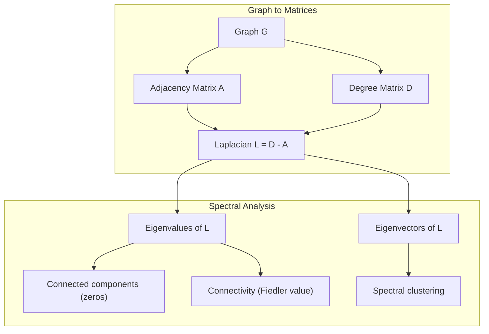
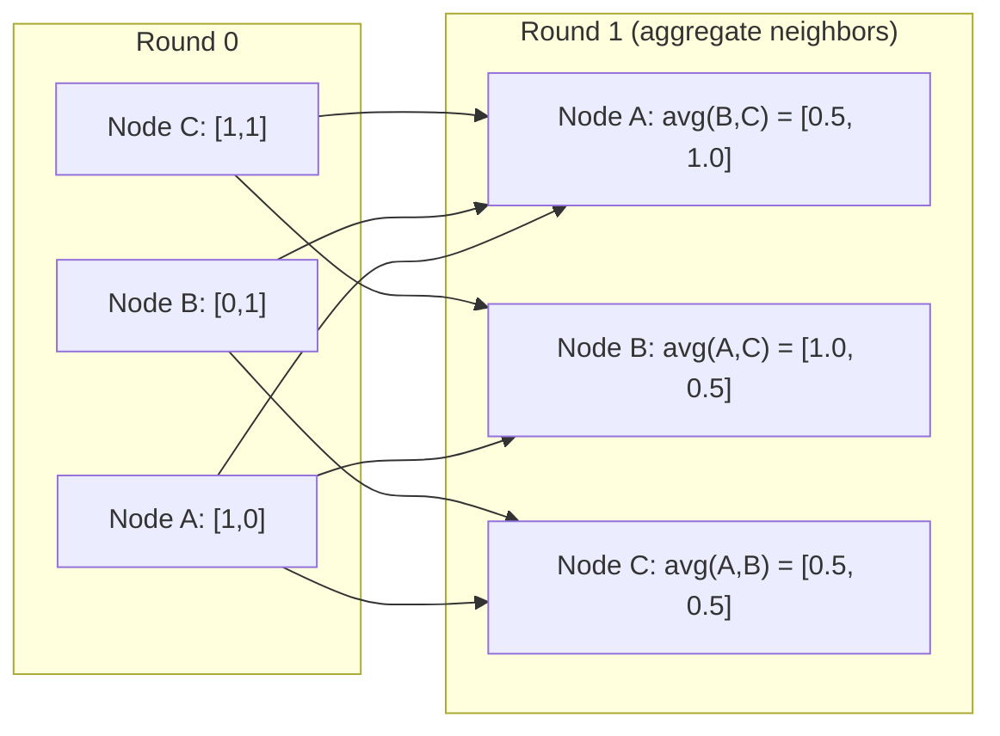

# نظرية الرسومات للتعلم الآلي

> الرسوم البيانية هي بنية البيانات للعلاقات. إذا كانت البيانات لديك اتصالات، فأنت بحاجة إلى نظرية الرسوم البيانية.

**Type:** Build
**Languages:** Python, TypeScript
**Prerequisites:** Phase 1, Lessons 01-03 (linear algebra, matrices)
**Time:** ~90 minutes

## أهداف التعلم

- بناء فئة الرسم البياني مع تمثيلات المصفوفات / القائمة المجاورة وتنفيذ عبورات BFS و DFS
- احسب الرسم البياني لابلاسي واستخدام قيمه الخاصة للكشف عن المكونات المتصلة والعقدة
- تنفيذ جولة واحدة من رسالة نمط GNN تمر كمراتب متراكم المجاورة المعتاد
- تطبيق التجميع الطيفي للفصل الرسمي باستخدام متجه Fiedler

## المشكلة

الشبكات الاجتماعية والجزيئات قواعد المعرفة وشبكات الاقتباسات وخرائط الطرق كلها هي الرسوم البيانية. تعامل المعلومات التقليدية مع البيانات كجدول مسطحة. كل سطر مستقل. كل صفة هي عمود. ولكن عندما تكون هيكل العلاقات مهمة، تفشل الجداول.

فكر في شبكة اجتماعية. تريد التنبؤ بال منتج الذي سيشتريه المستخدم. تاريخ شراءهم مهم. ولكن تاريخ شراء أصدقائهم مهم أكثر. الاتصالات تحمل الإشارة.

أو فكر في جزيء. تريد أن تتوقع ما إذا كان يربط بروتين. الذرات مهمة، ولكن ما يهم حقا هو كيفية ربط الذرات مع بعضها البعض. الهيكل هو البيانات.

شبكات العصبية الرسمية (GNNs) هي المنطقة الأكثر نمواً في التعلم العميق. وهي تعمل على اكتشاف المخدرات والتوصية الاجتماعية وكشف الاحتيال والنظرية الرسمية المعرفة. كل GNN تبني على نفس الأساس: نظرية الرسم البياني الأساسية.

تحتاج إلى أربعة أشياء:
1. طريقة لتمثيل الرسوم البيانية كالمصفوفات (لذلك يمكنك مضاعفةها)
2. خوارزميات عبورية لاستكشاف هيكل الرسم البياني
3. اللابلاسي -- المصفوفة الوحيدة الأكثر أهمية في نظرية الرسوم البياني الطيفية
4. نقل الرسائل -- العملية التي تجعل GNNs تعمل

## المفهوم

### الرسوم البيانية: العقد والحواف

الرسم البياني$G = (V, E)$يتكون من قمم (عقدات) $V$و الحواف$E$كل حافة تربط عقدين

**Directed vs undirected.**في الرسم البياني غير الموجّه، الحافة $(u, v)$الوسائل$u$يربط بـ$v$و$v$يربط بـ$u$في الرسم البياني الموجّه (المرسوم البياني) ، الحافة$(u, v)$الوسائل$u$تشير إلى$v$، ولكن ليس بالضرورة العكس

**Weighted vs unweighted.**في الرسم البياني غير الموزن، الحواف إما موجودة أو لا موجودة. في الرسم البياني الموزن، لكل حافة وزن عددي -- مسافة، تكلفة، قوة.

| Graph type | Example |
|-----------|---------|
| Undirected, unweighted | Facebook friendship network |
| Directed, unweighted | Twitter follow network |
| Undirected, weighted | Road map (distances) |
| Directed, weighted | Web page links (PageRank scores) |

### المصفوفة المجاورة

المصفوفة المجاورة$A$هو تمثيل الأساس.$n$العقد:

```math
A[i][j] = \begin{cases} 1 & \text{if there is an edge from node } i \text{ to node } j \\ 0 & \text{otherwise} \end{cases}
```

للخطوط غير المستهدفة$A$هو متماثل: $A[i][j] = A[j][i]$. للجرافات الموزعة ,$A[i][j]$= وزن الحافة$(i, j)$. . .

**Example -- a triangle:**

```
Nodes: 0, 1, 2
Edges: (0,1), (1,2), (0,2)

A = [[0, 1, 1],
     [1, 0, 1],
     [1, 1, 0]]
```

المصفوفة المجاورة هي المدخلات لكل GNN. عمليات المصفوفة على $A$تتوافق مع العمليات على الرسم البياني.

### درجة

درجة العقد هو عدد الحواف المتصلة بها. بالنسبة للجرافات الموجزة ، لديك درجة (الحواف الدخول) والدرجة الخارجة (الحواف الخروج).

المصفوفة الدرجة$D$هو متناح:

```math
\begin{aligned}
D[i][i] &= \text{degree of node } i \\
D[i][j] &= 0 \quad \text{for } i \ne j
\end{aligned}
```

على سبيل المثال مثلث:$D = \mathop{\mathrm{diag}}(2, 2, 2)$لأن كل عقدة تتصل مع عقدين آخرين

درجة تخبرك عن أهمية العقدة. درجة عالية = عقدة العقدة. توزيع درجة الشبكة يكشف عن بنيته. تتبع الشبكات الاجتماعية قوانين الطاقة (قليل من العقدة، العديد من عقدة الورق). الرسوم البيانية العشوائية لديها درجات موزعة بويسون.

### الـ BFS و الـ DFS

الخوارزميات الرئيسية لتحويل الرسوم البياني.

**Breadth-First Search (BFS):**استكشف جميع الجيران أولاً، ثم جيران الجيران.

```
BFS from node 0:
  Visit 0
  Queue: [1, 2]        (neighbors of 0)
  Visit 1
  Queue: [2, 3]        (add neighbors of 1)
  Visit 2
  Queue: [3]           (neighbors of 2 already visited)
  Visit 3
  Queue: []            (done)
```

يجد BFS أقصر المسارات في الرسوم البيانية غير الموزعة. المسافة من البداية إلى أي عقدة تساوي مستوى BFS الذي يتم اكتشاف العقدة الأولى. لهذا السبب يستخدم BFS لمسافات العد الهوب في الشبكات الاجتماعية.

**Depth-First Search (DFS):**إذهب بعمق قدر الإمكان قبل التراجع. تستخدم كومة (LIFO) أو التكرار.

```
DFS from node 0:
  Visit 0
  Stack: [1, 2]        (neighbors of 0)
  Visit 2               (pop from stack)
  Stack: [1, 3]         (add neighbors of 2)
  Visit 3               (pop from stack)
  Stack: [1]
  Visit 1               (pop from stack)
  Stack: []             (done)
```

DFS مفيد لل:
- العثور على المكونات المتصلة (تشغيل DFS من العقد غير المرصدة)
- كشف الدورة (الجوارب الخلفية في شجرة DFS)
- التصفية الترتيبية (تسلسل الانتهاء من DFS العكس)

| Algorithm | Data structure | Finds | Use case |
|-----------|---------------|-------|----------|
| BFS | Queue | Shortest paths | Social network distance, knowledge graph traversal |
| DFS | Stack | Components, cycles | Connectivity, topological sort |

### الرسم البياني لابلاسي

$L = D - A$أهم ماتريكس في نظرية الرسومات الطيفية

بالنسبة للثلث:

```math
D = \begin{bmatrix} 2 & 0 & 0 \\ 0 & 2 & 0 \\ 0 & 0 & 2 \end{bmatrix} \qquad A = \begin{bmatrix} 0 & 1 & 1 \\ 1 & 0 & 1 \\ 1 & 1 & 0 \end{bmatrix} \qquad L = \begin{bmatrix} 2 & -1 & -1 \\ -1 & 2 & -1 \\ -1 & -1 & 2 \end{bmatrix}
```

اللابلاسي لديه خصائص ملحوظة:

1. **$L$ is positive semi-definite.**جميع القيم الخاصة هي$\ge 0$. . .

2. **The number of zero eigenvalues equals the number of connected components.**الرسم البياني المتصل لديه قيمة خاصة واحدة صفر. الرسم البياني مع 3 مكونات منفصلة لديه ثلاثة قيم خاصة صفر.

3. **The smallest non-zero eigenvalue (Fiedler value) measures connectivity.**قيمة فيدر كبيرة تعني أن الرسم البياني متصلة بشكل جيد. قيمة فيدر صغيرة تعني أن الرسم البياني لديه نقطة ضعيفة -- عقدة زجاجة.

4. **The eigenvector of the Fiedler value (Fiedler vector) reveals the best split.**العقد مع القيم الإيجابية تذهب في مجموعة واحدة، العقد مع القيم السلبية تذهب في الأخرى. هذا هو التجميع الطيفي.



### الخصائص المتطرفة

وتكشف القيم الخاصة للمصفوفة المجاورة واللابلاسي عن الخصائص الهيكلية دون أي عبور.

**Spectral clustering**يعمل على هذا النحو:
1. احسب اللابلاسي $L$
2. إبحث عن$k$أصغر متجهات خاصة من $L$(تفوت الأول، وهو واحد فقط للخطوط المتصلة)
3. استخدم هذه المتجهات الخاصة كنسائق جديدة لكل عقد
4. أركض$k$-المتوسطات على تلك الإحداثيات

لماذا يعمل هذا؟$L$ترميز "أسرع" وظائف على الرسم البياني. العقدات التي ترتبط بشكل جيد تحصل على قيم محلية مشابهة. العقدات المنفصلة عن طريق عنق الزجاجة تحصل على قيم مختلفة. المنفصلات المنفصلة بشكل طبيعي مجموعات.

**Random walk connection.**يرتبط اللابلاسي المعادلة بالمشيات العشوائية على الرسم البياني. التوزيع الثابت للمشي العشوائي متناسب مع درجة العقدة. يعتمد وقت الاختلاط (كم سرعة التقارب في المشي) على الفجوة الطيفية.

### إرسال الرسالة

العملية الأساسية للشبكات العصبية الرسمية. كل عقد يجمع الرسائل من جيرانه، ويمجملها، ويحديث حالته الخاصة.

```math
h_v^{(k+1)} = \text{UPDATE}\left(h_v^{(k)}, \text{AGGREGATE}\left(\{h_u^{(k)} : u \in \text{neighbors}(v)\}\right)\right)
```

في أبسط شكل، جمع = متوسط، وتحديث = تحويل خطي + تفعيل:

```math
h_v^{(k+1)} = \sigma\left(W \cdot \text{mean}\left(\{h_u^{(k)} : u \in \text{neighbors}(v)\}\right)\right)
```

هذا مضاعفة المصفوفة في التنقل.$H$هو المصفوفة لجميع ميزات العقدة و $A$هي المصفوفة المجاورة:

```math
H^{(k+1)} = \sigma\left(A_{\text{norm}} H^{(k)} W\right)
```

أين$A_{\text{norm}}$هو المصفوفة المجاورة المعتادة (كل صف يصل إلى 1).

جولة واحدة من إرسال الرسالة تسمح لكل عقد "بإبصار" جيرانه المباشر. جولتين تسمح لها برؤية جير جير جير الجيران. $K$الجولات تعطى كل عقدة معلومات من$K$-حيّة الحيّ



### المفاهيم وتطبيقات ML

| Concept | ML Application |
|---------|---------------|
| Adjacency matrix | GNN input representation |
| Graph Laplacian | Spectral clustering, community detection |
| BFS/DFS | Knowledge graph traversal, path finding |
| Degree distribution | Node importance, feature engineering |
| Message passing | GNN layers (GCN, GAT, GraphSAGE) |
| Eigenvalues of L | Community detection, graph partitioning |
| Spectral clustering | Unsupervised node grouping |
| PageRank | Node importance, web search |

```figure
graph-degree-distribution
```

## بناءها

### الخطوة الأولى: صف الرسم البياني من الصفر

```python
class Graph:
    def __init__(self, n_nodes, directed=False):
        self.n = n_nodes
        self.directed = directed
        self.adj = {i: {} for i in range(n_nodes)}

    def add_edge(self, u, v, weight=1.0):
        self.adj[u][v] = weight
        if not self.directed:
            self.adj[v][u] = weight

    def neighbors(self, node):
        return list(self.adj[node].keys())

    def degree(self, node):
        return len(self.adj[node])

    def weighted_degree(self, node):
        return sum(self.adj[node].values())

    def adjacency_matrix(self):
        import numpy as np
        A = np.zeros((self.n, self.n))
        for u in range(self.n):
            for v, w in self.adj[u].items():
                A[u][v] = w
        return A

    def degree_matrix(self):
        import numpy as np
        D = np.zeros((self.n, self.n))
        for i in range(self.n):
            D[i][i] = self.weighted_degree(i)
        return D

    def laplacian(self):
        return self.degree_matrix() - self.adjacency_matrix()
```

قائمة الحيطة (`self.adj`تُستخدم تحويل المصفوفة المجاورة numpy لأن جميع العمليات الطيفية تحتاج إليها.

### الخطوة الثانية: BFS و DFS

```python
from collections import deque

def bfs(graph, start):
    visited = set()
    order = []
    distances = {}
    queue = deque([(start, 0)])
    visited.add(start)
    while queue:
        node, dist = queue.popleft()
        order.append(node)
        distances[node] = dist
        for neighbor in graph.neighbors(node):
            if neighbor not in visited:
                visited.add(neighbor)
                queue.append((neighbor, dist + 1))
    return order, distances


def dfs(graph, start):
    visited = set()
    order = []
    stack = [start]
    while stack:
        node = stack.pop()
        if node in visited:
            continue
        visited.add(node)
        order.append(node)
        for neighbor in reversed(graph.neighbors(node)):
            if neighbor not in visited:
                stack.append(neighbor)
    return order
```

يستخدم BFS ديك (صف مرتفع) لـ $O(1)$يستخدم DFS قائمة كمركز كلاهما يزور كل عقدة مرة بالضبط$O(V + E)$الوقت

### الخطوة الثالثة: المكونات المتصلة والقيم الخاصة لبلاتسي

```python
def connected_components(graph):
    visited = set()
    components = []
    for node in range(graph.n):
        if node not in visited:
            order, _ = bfs(graph, node)
            visited.update(order)
            components.append(order)
    return components


def laplacian_eigenvalues(graph):
    import numpy as np
    L = graph.laplacian()
    eigenvalues = np.linalg.eigvalsh(L)
    return eigenvalues
```

`eigvalsh`هو للمصفوفات التناظرية -- اللابلاسي هو متناظري دائما للخطوط غير الموجزة. يعيد القيم الخاصة في الترتيب الصاعد. احتساب الصفر للعثور على عدد المكونات المتصلة.

### الخطوة الرابعة: التجميع المتطويع

```python
def spectral_clustering(graph, k=2):
    import numpy as np
    L = graph.laplacian()
    eigenvalues, eigenvectors = np.linalg.eigh(L)
    features = eigenvectors[:, 1:k+1]

    labels = np.zeros(graph.n, dtype=int)
    for i in range(graph.n):
        if features[i, 0] >= 0:
            labels[i] = 0
        else:
            labels[i] = 1
    return labels
```

لأجل$k=2$، علامة متجه فيدر تقسم الرسم البياني إلى مجموعتين.$k>2$، كنت ستجري$k$-المتوسطات على أول $k$المتجهات الخاصة (باستثناء المتجهات الخاصة للجميع)

### الخطوة 5: إرسال الرسالة

```python
def message_passing(graph, features, weight_matrix):
    import numpy as np
    A = graph.adjacency_matrix()
    row_sums = A.sum(axis=1, keepdims=True)
    row_sums[row_sums == 0] = 1
    A_norm = A / row_sums
    aggregated = A_norm @ features
    output = aggregated @ weight_matrix
    return output
```

هذه جولة واحدة من إرسال رسالة GNN. هي الميزات الجديدة لكل عقدة المتوسط الموزن لميزات جيرانها، والتي تحولت بواسطة المصفوفة الوزن. قم بتجميع جولات متعددة لنشر المعلومات بشكل أكبر.

## استخدمها

مع networkx و numpy، نفس العمليات هي خط واحد:

```python
import networkx as nx
import numpy as np

G = nx.karate_club_graph()

A = nx.adjacency_matrix(G).toarray()
L = nx.laplacian_matrix(G).toarray()

eigenvalues = np.linalg.eigvalsh(L.astype(float))
print(f"Smallest eigenvalues: {eigenvalues[:5]}")
print(f"Connected components: {nx.number_connected_components(G)}")

communities = nx.community.greedy_modularity_communities(G)
print(f"Communities found: {len(communities)}")

pr = nx.pagerank(G)
top_nodes = sorted(pr.items(), key=lambda x: x[1], reverse=True)[:5]
print(f"Top 5 PageRank nodes: {top_nodes}")
```

networkx يُعامل الرسوم البيانية من أي حجم مع خلفيات C المثلى. استخدمها في الإنتاج. استخدم تنفيذك من الصفر لفهم ما تفعله.

### تحليل الطيف النمبي

```python
import numpy as np

A = np.array([
    [0, 1, 1, 0, 0],
    [1, 0, 1, 0, 0],
    [1, 1, 0, 1, 0],
    [0, 0, 1, 0, 1],
    [0, 0, 0, 1, 0]
])

D = np.diag(A.sum(axis=1))
L = D - A

eigenvalues, eigenvectors = np.linalg.eigh(L)
print(f"Eigenvalues: {np.round(eigenvalues, 4)}")
print(f"Fiedler value: {eigenvalues[1]:.4f}")
print(f"Fiedler vector: {np.round(eigenvectors[:, 1], 4)}")

fiedler = eigenvectors[:, 1]
group_a = np.where(fiedler >= 0)[0]
group_b = np.where(fiedler < 0)[0]
print(f"Cluster A: {group_a}")
print(f"Cluster B: {group_b}")
```

وكتور فيدر يقوم بالرفع الثقيل. إدخالات إيجابية في مجموعة واحدة، سلبية في الأخرى. لا حاجة إلى تحسين متكرر - مجرد واحد التكوين الخاص.

## أرسله

هذا الدرس ينتج عن:
- `outputs/skill-graph-analysis.md`-- مرجع مهارات تحليل البيانات المهيكلة على الرسم البياني

## العلاقات

| Concept | Where it shows up |
|---------|------------------|
| Adjacency matrix | GCN, GAT, GraphSAGE input |
| Laplacian | Spectral clustering, ChebNet filters |
| BFS | Knowledge graph traversal, shortest path queries |
| Message passing | Every GNN layer, neural message passing |
| Spectral gap | Graph connectivity, mixing time of random walks |
| Degree distribution | Power-law networks, node feature engineering |
| Connected components | Preprocessing, handling disconnected graphs |
| PageRank | Node importance ranking, attention initialization |

تستحق المواقع الجينية ذكرًا خاصًا. عملية تحويل الرسم البياني في GCN (Kipf & Welling ، 2017) تستخدم المصفوفة المجاورة مع إضافة حلقات ذاتية ، $\hat{A} = A + I$:

```math
H^{(l+1)} = \sigma\left(\hat{D}^{-1/2} \hat{A} \hat{D}^{-1/2} H^{(l)} W^{(l)}\right)
```

أين$\hat{A} = A + I$(الجاذبية بالإضافة إلى الحلقات الذاتية) و $\hat{D}$هو المصفوفة الدرجة من $\hat{A}$. الحلقات الذاتية تضمن كل عقدة تتضمن خصائصها الخاصة أثناء التجميع. هذا بالضبط الرسالة التي تمر مع التطبيع التناظر. $\hat{D}^{-1/2} \hat{A} \hat{D}^{-1/2}$هو المصفوفة المجاورة المعتادة. يظهر اللابلاكية لأن هذا التطبيع مرتبط$L_{\text{sym}} = I - D^{-1/2} A D^{-1/2}$فهم اللابلاكية يعني فهم سبب عمل المواد المضادة

## التمارين

1. **Implement PageRank from scratch.**تبدأ من درجات متساوية. في كل خطوة: درجة ((v) = (1-د) / n + d * جمع ((درجة ((u) / خارج_درجة ((u))) لجميع u التي تشير إلى v. استخدم d = 0.85. اجري حتى التقارب (تغيير < 1e-6). اختبار على الرسم البياني على شبكة صغيرة.

2. **Find communities using spectral clustering.**قم بإنشاء الرسم البياني مع مجموعة منفصلة بوضوح (على سبيل المثال ، اثنين من المجموعات المتصلة بحافة واحدة). قم بتشغيل التجميع الطيفي والتحقق من أنه يجد التقسيم الصحيح. ماذا يحدث عندما تضيف المزيد من حواف الحجم المتقاطعة؟

3. **Implement Dijkstra's algorithm**للمسارات الأقصر في الرسوم البيانية الموزعة. مقارنة النتائج مع BFS على نفس الرسوم البيانية ذات الوزن المتساوي.

4. **Build a 2-layer message passing network.**تطبيق الرسالة المرور مرتين مع مختلف المصفوفات الوزن. أظهر أنه بعد جولتين، كل عقدة لديها معلومات من حي 2 جولة.

5. **Analyze a real-world graph.**استخدم الرسم البياني لـ Karate Club (34 عقدة و 78 حافة). قم بتحساب توزيع درجة، وقيم خاصة لابلاكية، والتمزيق الطيفي. مقارنة نتيجة التجميع الطيفي بتقسيم الحقيقة الأرضية المعروفة.

### إشارات

**Exercise 1.**استخدم الصيغة من الممارسة. يجب أن يشارك العقدة التي لا تمتلك حواف خارجية نتيجتها بالتساوي مع جميع العقدات، أو أن يسقط إجمالي العقدة أقل من 1. تحقق من أن النتائج تصل إلى 1 بعد كل خطوة ومقارنة النتيجة مع `pagerank(graph)`. . .

**Exercise 2.**بناء اثنين من الطائفة مع `add_edge`، ربطهم بحافة واحدة ، وندعو`spectral_clustering(graph, k=2)`تحقق من أن كل كليك يحصل على علامة واحدة. عندما تضيف الحواف المتقاطعة، طبع القيمة نفسية الأصغر الثانية من `laplacian()`، والتي تنمو مع انضمام المجموعتين

**Exercise 3.**إبقوا في صف الأولويات مع`heapq`و دائماً توسيع العقدة بأقل مسافة معروفة. جعل كل وزن 1 والتحقق من أن كل مسافة Dijkstra يساوي طبقة BFS من تلك العقدة من `bfs(graph, start)`. . .

**Exercise 4.**استخدم المصفوفة الهوية`features`، بحيث كل عمود يرمز إلى عقدة واحدة ، وتطبيق `message_passing`مرتين. ثم الإدخالات غير الصفر في الصف للعقدة $v$أظهر أي عقدات وصلت$v$مقارنة هذه المجموعة مع العقدة على بعد 2 من عرض البحث الأول.

**Exercise 5.** `networkx.karate_club_graph()`يعطي قائمة الحافة والحقية الأرضية في صفة العقدة `club`نسخ الحواف إلى`Graph`و تحقق من أن لديها 34 عقدة و 78 حافة. مقارنة العلامات من`spectral_clustering`مع`club`القيم، والسماح بإستبدال اسم اللقبين.

## الشروط الرئيسية

| Term | What people say | What it actually means |
|------|----------------|----------------------|
| Graph | "Nodes and edges" | A mathematical structure $G=(V,E)$ encoding pairwise relationships |
| Adjacency matrix | "The connection table" | An $n \times n$ matrix where $A[i][j] = 1$ if nodes $i$ and $j$ are connected |
| Degree | "How connected a node is" | The number of edges touching a node |
| Laplacian | "D minus A" | $L = D - A$, the matrix whose eigenvalues reveal graph structure |
| Fiedler value | "The algebraic connectivity" | The smallest non-zero eigenvalue of $L$, measuring how well-connected the graph is |
| BFS | "Level-by-level search" | Traversal that visits all neighbors before going deeper, finds shortest paths |
| DFS | "Go deep first" | Traversal that follows one path to its end before backtracking |
| Message passing | "Nodes talk to neighbors" | Each node aggregates information from its neighbors, the core of GNNs |
| Spectral clustering | "Cluster by eigenvectors" | Partition a graph using eigenvectors of its Laplacian |
| Connected component | "A separate piece" | A maximal subgraph where every node can reach every other node |

## المزيد من القراءة

- **Kipf & Welling (2017)**-- "التصنيف شبه المشرف مع شبكات تحويل الرسومات". الورقة التي أطلقت GNNs الحديثة.
- **Spielman (2012)**-- "نظرية الرسومات الضوئية" ملاحظات محاضرة. مقدمة نهائية إلى لابلاسيين، الفجوات الضوئية، وتقسيم الرسومات.
- **Hamilton (2020)**-- "تعلم التمثيل الرسمي". كتاب يغطي GNN من الأساسيات إلى التطبيقات.
- **Bronstein et al. (2021)**-- "التعلم العميق الجغريفي: الشبكات والجماعات والرسوم البيانية والجيوديسيكا والمقاييس". ورقة الإطار الموحدة.
- **Veličković et al. (2018)**-- "شبكات الرقابة الرسمية". يمتد الرسالة التي تمر عبر آليات الاهتمام.
