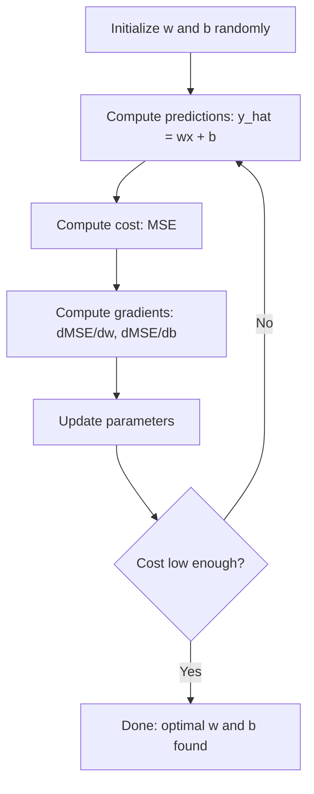

# الرجوع الخطى

> الرجعة الخطية ترسم أفضل خط مستقيم عبر بياناتك. إنها "عالم مرحبا" للتعلم الآلي.

**Type:** Build
**Languages:** Python, Julia, Rust
**Prerequisites:** Phase 1 (Linear Algebra, Calculus, Optimization), Phase 2 Lesson 1
**Time:** ~90 minutes

## أهداف التعلم

- استنتاج قواعد تحديث تراجع التراجع للمعدل للخطأ التربيعي المتوسط وتنفيذ التراجع الخطي من الصفر
- مقارنة انخفاض التراجعية والمعادلة الطبيعية من حيث تعقيد الحوسبة ومتى تستخدم كل
- بناء نموذج عكس خطي متعدد مع قياس الميزات وتفسير الوزن المتعلم
- شرح كيفية عودة الرصيف (تطبيق L2) منع المكاسب الزائدة عن طريق عقوبة الوزن الكبير

## المشكلة

لديك بيانات: حجم المنزل وأسعار بيعه. تريد التنبؤ بسعر المنزل الجديد بالنظر إلى حجمها. يمكنك أن تلقي نظرة عليه على مساحة التشتت، ولكن تحتاج إلى صيغة. تحتاج إلى خط يتناسب مع البيانات بشكل أفضل حتى تتمكن من توصيل أي حجم وتحصل على توقعات السعر.

التراجع الخطوي يعطيك هذا الخط. والأهم من ذلك، فإنه يقدم حلقة تدريب ML بأكملها: تحديد نموذج، تحديد وظيفة التكلفة، تحسين المعايير. كل خوارزمية ML تتبع نفس النمط. إتقانها هنا مع أبسط الحالة، وسوف تتعرف عليها في كل مكان.

هذا ليس فقط لمشاكل بسيطة. يتم استخدام الرجوع السري في أنظمة الإنتاج للتنبؤ بالطلب، وتحليل اختبار A / B، والنمذجة المالية، وكخط أساس لكل مهمة الرجوع.

## المفهوم

### النموذج

التراجع الخطى يفترض علاقة خطية بين المدخلات ($x$) والإنتاج ($y$):

```math
y = wx + b
```

- `w`(وزن/ميل): كم $y$تغيرات عندما$x$زيادة بنسبة 1
- `b`(التحيز/القطع): قيمة $y$متى$x = 0$

بالنسبة للمدخلات المتعددة (الميزات) ، يمتد هذا إلى:

```math
y = w_1 x_1 + w_2 x_2 + \cdots + w_n x_n + b
```

أو في شكل متجه:$y = w^T x + b$

الهدف: إيجاد قيم $w$و$b$التي تجعل المتوقع $y$أقرب ما يمكن للواقع$y$في جميع أمثلة التدريب.

### وظيفة التكلفة (خطأ المتوسط التربيعي)

كيف تقيس " أقرب ما يمكن "؟ تحتاج إلى رقم واحد يحتوي على مدى خطأ التنبؤات الخاصة بك. الخيار الأكثر شيوعا هو الخطأ المتوسط التربيعي (MSE):

```math
\text{MSE} = \frac{1}{n} \sum (y_{\text{predicted}} - y_{\text{actual}})^2
```

لماذا مربع؟ سببين. أولاً، فإنه يعاقب الأخطاء الكبيرة أكثر من الأخطاء الصغيرة (خطأ من 10 هو 100x أسوأ من خطأ من 1، وليس 10x). ثانياً، فإن وظيفة مربع متسقة ويمكن التمييز في كل مكان، مما يجعل التحسين سهلاً.

وظيفة التكلفة تخلق سطحاً.$w$والتحيز$b$يظهر سطح MSE على شكل وعاء (موازة متواصلة). الجزء السفلي من وعاء حيث يتم تقليل MSE. التدريب يعني العثور على هذا الجزء السفلي.

### التراجع المتدريج

التسلل المتدريج يجد قاع الصحن عن طريق اتخاذ خطوات أسفل التلال.



وتخبرك المرافق بشيءين: أي اتجاه تحرك كل ملامح، ومدى التحرك.

لـ MSE مع $\hat{y} = wx + b$:

```math
\begin{aligned}
\frac{\partial \text{MSE}}{\partial w} &= \frac{2}{n} \sum (\hat{y} - y) \, x \\
\frac{\partial \text{MSE}}{\partial b} &= \frac{2}{n} \sum (\hat{y} - y)
\end{aligned}
```

قاعدة التحديث:

```math
\begin{aligned}
w &= w - \text{learning\_rate} \cdot \frac{\partial \text{MSE}}{\partial w} \\
b &= b - \text{learning\_rate} \cdot \frac{\partial \text{MSE}}{\partial b}
\end{aligned}
```

معدل التعلم يحدد حجم الخطوة. كبير جداً: تتجاوز الحد الأدنى وتتباين. صغير جداً: يستغرق التدريب إلى الأبد. قيم البداية النموذجية: 0.01، 0.001، أو 0.0001.

### المعادلة الطبيعية (حل الشكل المغلق)

بالنسبة للعودة الخطية على وجه التحديد، هناك صيغة مباشرة توفر الوزن الأمثل دون أي تكرار:

```math
w = (X^T X)^{-1} X^T y
```

هذا يعكس المصفوفة لحل$w$في خطوة واحدة. يعمل بشكل مثالي لمجموعات بيانات صغيرة. لمجموعات بيانات كبيرة (ملايين الصفوف أو آلاف الميزات) ، يفضل تراجع التراجعية لأن عكس المصفوفة هو $O(n^3)$في عدد الميزات.

### عكس خطي متعدد

مع العديد من الميزات، يصبح النموذج:

```math
y = w_1 x_1 + w_2 x_2 + \cdots + w_n x_n + b
```

كل شيء يعمل بنفس الطريقة: MSE هو وظيفة التكلفة، تنزيل التراجع تحديث جميع الأوزان في وقت واحد. الفرق الوحيد هو أنك تصل إلى طائرة فائقة بدلا من خط.

إن كان أحد الميزات يتراوح من 0 إلى 1 وآخر يتراوح من 0 إلى 1,000,000، فسيكون انخفاض التراجع صعباً لأن سطح التكلفة يصبح أطول. قم بتعيين الميزات (استقل المتوسط، تقسيمها بالانحراف المعياري) قبل التدريب.

### عودة متعددة النسب

ماذا لو كانت العلاقة ليست خطية؟ يمكنك استخدام التراجع الخطي من خلال إنشاء ميزات متعددة النسب:

```math
y = w_1 x + w_2 x^2 + w_3 x^3 + b
```

هذا ما زال رجعة "خطية" لأن النموذج خطي في الوزن ($w_1, w_2, w_3$(). أنت تستخدم فقط ميزات غير خطية من$x$. . .

يمكن أن تتناسب تعدد الحدود العالية الدرجة مع منحنى أكثر تعقيداً ولكن هناك خطر من الإفراط. تعدد الحدود العليا الدرجة 10 سوف تمر عبر كل نقطة في مجموعة بيانات 10 نقاط ولكن تتوقع بشكل سيء على البيانات الجديدة.

### النتيجة R- مربع

الـ MSE يخبرك كم أنت مخطئ، لكن العدد يعتمد على حجم$y$. ر- مربع ($R^2$) يعطي تدبير مستقل عن المقياس:

```math
\begin{aligned}
R^2 &= 1 - \frac{\text{sum of squared residuals}}{\text{sum of squared deviations from mean}} \\
&= 1 - \frac{SS_{\text{res}}}{SS_{\text{tot}}}
\end{aligned}
```

- $R^2 = 1.0$: توقعات مثالية
- $R^2 = 0.0$: النموذج ليس أفضل من توقع المتوسط في كل مرة
- $R^2 < 0.0$: النموذج أسوأ من التنبؤ بالمتوسط

### المشاهدة المسبقة للترتيب (رجج ريج)

عندما يكون لديك العديد من الميزات، يمكن أن يضاف النموذج من خلال تعيين أوزان كبيرة.

```math
\text{Cost} = \text{MSE} + \lambda \sum w_i^2
```

المادة العقابية تثبط الوزن الكبير$\lambda$يسيطر على التنازل: أعلى $\lambda$يعني الوزن الأصغر والمزيد من التنظيم. هذا سيتم تغطيته بشكل متعمق في درس لاحقا.

```figure
linear-regression-fit
```

## بناءها

### الخطوة 1: توليد بيانات العينات

```python
import random
import math

random.seed(42)

TRUE_W = 3.0
TRUE_B = 7.0
N_SAMPLES = 100

X = [random.uniform(0, 10) for _ in range(N_SAMPLES)]
y = [TRUE_W * x + TRUE_B + random.gauss(0, 2.0) for x in X]

print(f"Generated {N_SAMPLES} samples")
print(f"True relationship: y = {TRUE_W}x + {TRUE_B} (+ noise)")
print(f"First 5 points: {[(round(X[i], 2), round(y[i], 2)) for i in range(5)]}")
```

### الخطوة الثانية: تراجع خطي من الصفر مع انخفاض التراجعية

```python
class LinearRegression:
    def __init__(self, learning_rate=0.01):
        self.w = 0.0
        self.b = 0.0
        self.lr = learning_rate
        self.cost_history = []

    def predict(self, X):
        return [self.w * x + self.b for x in X]

    def compute_cost(self, X, y):
        predictions = self.predict(X)
        n = len(y)
        cost = sum((pred - actual) ** 2 for pred, actual in zip(predictions, y)) / n
        return cost

    def compute_gradients(self, X, y):
        predictions = self.predict(X)
        n = len(y)
        dw = (2 / n) * sum((pred - actual) * x for pred, actual, x in zip(predictions, y, X))
        db = (2 / n) * sum(pred - actual for pred, actual in zip(predictions, y))
        return dw, db

    def fit(self, X, y, epochs=1000, print_every=200):
        for epoch in range(epochs):
            dw, db = self.compute_gradients(X, y)
            self.w -= self.lr * dw
            self.b -= self.lr * db
            cost = self.compute_cost(X, y)
            self.cost_history.append(cost)
            if epoch % print_every == 0:
                print(f"  Epoch {epoch:4d} | Cost: {cost:.4f} | w: {self.w:.4f} | b: {self.b:.4f}")
        return self

    def r_squared(self, X, y):
        predictions = self.predict(X)
        y_mean = sum(y) / len(y)
        ss_res = sum((actual - pred) ** 2 for actual, pred in zip(y, predictions))
        ss_tot = sum((actual - y_mean) ** 2 for actual in y)
        return 1 - (ss_res / ss_tot)


print("=== Training Linear Regression (Gradient Descent) ===")
model = LinearRegression(learning_rate=0.005)
model.fit(X, y, epochs=1000, print_every=200)
print(f"\nLearned: y = {model.w:.4f}x + {model.b:.4f}")
print(f"True:    y = {TRUE_W}x + {TRUE_B}")
print(f"R-squared: {model.r_squared(X, y):.4f}")
```

### الخطوة الثالثة: المعادلة الطبيعية (حل في شكل مغلق)

```python
class LinearRegressionNormal:
    def __init__(self):
        self.w = 0.0
        self.b = 0.0

    def fit(self, X, y):
        n = len(X)
        x_mean = sum(X) / n
        y_mean = sum(y) / n
        numerator = sum((X[i] - x_mean) * (y[i] - y_mean) for i in range(n))
        denominator = sum((X[i] - x_mean) ** 2 for i in range(n))
        self.w = numerator / denominator
        self.b = y_mean - self.w * x_mean
        return self

    def predict(self, X):
        return [self.w * x + self.b for x in X]

    def r_squared(self, X, y):
        predictions = self.predict(X)
        y_mean = sum(y) / len(y)
        ss_res = sum((actual - pred) ** 2 for actual, pred in zip(y, predictions))
        ss_tot = sum((actual - y_mean) ** 2 for actual in y)
        return 1 - (ss_res / ss_tot)


print("\n=== Normal Equation (Closed-Form) ===")
model_normal = LinearRegressionNormal()
model_normal.fit(X, y)
print(f"Learned: y = {model_normal.w:.4f}x + {model_normal.b:.4f}")
print(f"R-squared: {model_normal.r_squared(X, y):.4f}")
```

### الخطوة الرابعة: رجعة خطية متعددة

```python
class MultipleLinearRegression:
    def __init__(self, n_features, learning_rate=0.01):
        self.weights = [0.0] * n_features
        self.bias = 0.0
        self.lr = learning_rate
        self.cost_history = []

    def predict_single(self, x):
        return sum(w * xi for w, xi in zip(self.weights, x)) + self.bias

    def predict(self, X):
        return [self.predict_single(x) for x in X]

    def compute_cost(self, X, y):
        predictions = self.predict(X)
        n = len(y)
        return sum((pred - actual) ** 2 for pred, actual in zip(predictions, y)) / n

    def fit(self, X, y, epochs=1000, print_every=200):
        n = len(y)
        n_features = len(X[0])
        for epoch in range(epochs):
            predictions = self.predict(X)
            errors = [pred - actual for pred, actual in zip(predictions, y)]
            for j in range(n_features):
                grad = (2 / n) * sum(errors[i] * X[i][j] for i in range(n))
                self.weights[j] -= self.lr * grad
            grad_b = (2 / n) * sum(errors)
            self.bias -= self.lr * grad_b
            cost = self.compute_cost(X, y)
            self.cost_history.append(cost)
            if epoch % print_every == 0:
                print(f"  Epoch {epoch:4d} | Cost: {cost:.4f}")
        return self

    def r_squared(self, X, y):
        predictions = self.predict(X)
        y_mean = sum(y) / len(y)
        ss_res = sum((actual - pred) ** 2 for actual, pred in zip(y, predictions))
        ss_tot = sum((actual - y_mean) ** 2 for actual in y)
        return 1 - (ss_res / ss_tot)


random.seed(42)
N = 100
X_multi = []
y_multi = []
for _ in range(N):
    size = random.uniform(500, 3000)
    bedrooms = random.randint(1, 5)
    age = random.uniform(0, 50)
    price = 50 * size + 10000 * bedrooms - 1000 * age + 50000 + random.gauss(0, 20000)
    X_multi.append([size, bedrooms, age])
    y_multi.append(price)


def standardize(X):
    n_features = len(X[0])
    means = [sum(X[i][j] for i in range(len(X))) / len(X) for j in range(n_features)]
    stds = []
    for j in range(n_features):
        variance = sum((X[i][j] - means[j]) ** 2 for i in range(len(X))) / len(X)
        stds.append(variance ** 0.5)
    X_scaled = []
    for i in range(len(X)):
        row = [(X[i][j] - means[j]) / stds[j] if stds[j] > 0 else 0 for j in range(n_features)]
        X_scaled.append(row)
    return X_scaled, means, stds


y_mean_val = sum(y_multi) / len(y_multi)
y_std_val = (sum((yi - y_mean_val) ** 2 for yi in y_multi) / len(y_multi)) ** 0.5
y_scaled = [(yi - y_mean_val) / y_std_val for yi in y_multi]

X_scaled, x_means, x_stds = standardize(X_multi)

print("\n=== Multiple Linear Regression (3 features) ===")
print("Features: house size, bedrooms, age")
multi_model = MultipleLinearRegression(n_features=3, learning_rate=0.01)
multi_model.fit(X_scaled, y_scaled, epochs=1000, print_every=200)

print(f"\nWeights (standardized): {[round(w, 4) for w in multi_model.weights]}")
print(f"Bias (standardized): {multi_model.bias:.4f}")
print(f"R-squared: {multi_model.r_squared(X_scaled, y_scaled):.4f}")
```

### الخطوة 5: رجعة الكتلة

```python
class PolynomialRegression:
    def __init__(self, degree, learning_rate=0.01):
        self.degree = degree
        self.weights = [0.0] * degree
        self.bias = 0.0
        self.lr = learning_rate

    def make_features(self, X):
        return [[x ** (d + 1) for d in range(self.degree)] for x in X]

    def predict(self, X):
        features = self.make_features(X)
        return [sum(w * f for w, f in zip(self.weights, row)) + self.bias for row in features]

    def fit(self, X, y, epochs=1000, print_every=200):
        features = self.make_features(X)
        n = len(y)
        for epoch in range(epochs):
            predictions = [sum(w * f for w, f in zip(self.weights, row)) + self.bias for row in features]
            errors = [pred - actual for pred, actual in zip(predictions, y)]
            for j in range(self.degree):
                grad = (2 / n) * sum(errors[i] * features[i][j] for i in range(n))
                self.weights[j] -= self.lr * grad
            grad_b = (2 / n) * sum(errors)
            self.bias -= self.lr * grad_b
            if epoch % print_every == 0:
                cost = sum(e ** 2 for e in errors) / n
                print(f"  Epoch {epoch:4d} | Cost: {cost:.6f}")
        return self

    def r_squared(self, X, y):
        predictions = self.predict(X)
        y_mean = sum(y) / len(y)
        ss_res = sum((actual - pred) ** 2 for actual, pred in zip(y, predictions))
        ss_tot = sum((actual - y_mean) ** 2 for actual in y)
        return 1 - (ss_res / ss_tot)


random.seed(42)
X_poly = [x / 10.0 for x in range(0, 50)]
y_poly = [0.5 * x ** 2 - 2 * x + 3 + random.gauss(0, 1.0) for x in X_poly]

x_max = max(abs(x) for x in X_poly)
X_poly_norm = [x / x_max for x in X_poly]
y_poly_mean = sum(y_poly) / len(y_poly)
y_poly_std = (sum((yi - y_poly_mean) ** 2 for yi in y_poly) / len(y_poly)) ** 0.5
y_poly_norm = [(yi - y_poly_mean) / y_poly_std for yi in y_poly]

print("\n=== Polynomial Regression (degree 2 vs degree 5) ===")
print("True relationship: y = 0.5x^2 - 2x + 3")

print("\nDegree 2:")
poly2 = PolynomialRegression(degree=2, learning_rate=0.1)
poly2.fit(X_poly_norm, y_poly_norm, epochs=2000, print_every=500)
print(f"  R-squared: {poly2.r_squared(X_poly_norm, y_poly_norm):.4f}")

print("\nDegree 5:")
poly5 = PolynomialRegression(degree=5, learning_rate=0.1)
poly5.fit(X_poly_norm, y_poly_norm, epochs=2000, print_every=500)
print(f"  R-squared: {poly5.r_squared(X_poly_norm, y_poly_norm):.4f}")

print("\nDegree 2 fits the true curve well. Degree 5 fits training data slightly better")
print("but risks overfitting on new data.")
```

### الخطوة 6: تراجع التسلسل (تطبيق L2)

```python
class RidgeRegression:
    def __init__(self, n_features, learning_rate=0.01, alpha=1.0):
        self.weights = [0.0] * n_features
        self.bias = 0.0
        self.lr = learning_rate
        self.alpha = alpha

    def predict_single(self, x):
        return sum(w * xi for w, xi in zip(self.weights, x)) + self.bias

    def predict(self, X):
        return [self.predict_single(x) for x in X]

    def fit(self, X, y, epochs=1000, print_every=200):
        n = len(y)
        n_features = len(X[0])
        for epoch in range(epochs):
            predictions = self.predict(X)
            errors = [pred - actual for pred, actual in zip(predictions, y)]
            mse = sum(e ** 2 for e in errors) / n
            reg_term = self.alpha * sum(w ** 2 for w in self.weights)
            cost = mse + reg_term
            for j in range(n_features):
                grad = (2 / n) * sum(errors[i] * X[i][j] for i in range(n))
                grad += 2 * self.alpha * self.weights[j]
                self.weights[j] -= self.lr * grad
            grad_b = (2 / n) * sum(errors)
            self.bias -= self.lr * grad_b
            if epoch % print_every == 0:
                print(f"  Epoch {epoch:4d} | Cost: {cost:.4f} | L2 penalty: {reg_term:.4f}")
        return self


print("\n=== Ridge Regression (L2 Regularization) ===")
print("Same data as multiple regression, with alpha=0.1")
ridge = RidgeRegression(n_features=3, learning_rate=0.01, alpha=0.1)
ridge.fit(X_scaled, y_scaled, epochs=1000, print_every=200)
print(f"\nRidge weights: {[round(w, 4) for w in ridge.weights]}")
print(f"Plain weights: {[round(w, 4) for w in multi_model.weights]}")
print("Ridge weights are smaller (shrunk toward zero) due to the L2 penalty.")
```

## استخدمها

الآن نفس الشيء مع scikit-تعلم، وهو ما سوف تستخدم في الواقع في الإنتاج.

```python
from sklearn.linear_model import LinearRegression as SklearnLR
from sklearn.linear_model import Ridge
from sklearn.preprocessing import PolynomialFeatures, StandardScaler
from sklearn.model_selection import train_test_split
from sklearn.metrics import mean_squared_error, r2_score
import numpy as np

np.random.seed(42)
X_sk = np.random.uniform(0, 10, (100, 1))
y_sk = 3.0 * X_sk.squeeze() + 7.0 + np.random.normal(0, 2.0, 100)

X_train, X_test, y_train, y_test = train_test_split(X_sk, y_sk, test_size=0.2, random_state=42)

lr = SklearnLR()
lr.fit(X_train, y_train)
y_pred = lr.predict(X_test)

print("=== Scikit-learn Linear Regression ===")
print(f"Coefficient (w): {lr.coef_[0]:.4f}")
print(f"Intercept (b): {lr.intercept_:.4f}")
print(f"R-squared (test): {r2_score(y_test, y_pred):.4f}")
print(f"MSE (test): {mean_squared_error(y_test, y_pred):.4f}")

poly = PolynomialFeatures(degree=2, include_bias=False)
X_poly_sk = poly.fit_transform(X_train)
X_poly_test = poly.transform(X_test)

lr_poly = SklearnLR()
lr_poly.fit(X_poly_sk, y_train)
print(f"\nPolynomial degree 2 R-squared: {r2_score(y_test, lr_poly.predict(X_poly_test)):.4f}")

scaler = StandardScaler()
X_train_scaled = scaler.fit_transform(X_train)
X_test_scaled = scaler.transform(X_test)

ridge = Ridge(alpha=1.0)
ridge.fit(X_train_scaled, y_train)
print(f"Ridge R-squared: {r2_score(y_test, ridge.predict(X_test_scaled)):.4f}")
print(f"Ridge coefficient: {ridge.coef_[0]:.4f}")
```

تنفيذك من الصفر وتعلمك من الصفر يقدم نفس النتائج. الفرق: يتعامل مع حالات الحافة، والاستقرار الرقمي، وتحسين الأداء. استخدم المكتبة للإنتاج. استخدم إصدار من الصفر لفهم ما يحدث.

## أرسله

هذا الدرس ينتج عن:
- `outputs/skill-regression.md`- مهارة اختيار النهج المناسب للعودة بناء على المشكلة

## التمارين

1. قم بتنفيذ انخفاض تراجع المكونات، وانخفاض تراجع المكونات (SGD) ، وانخفاض تراجع المكونات الصغيرة. مقارنة سرعة التقارب على نفس مجموعة البيانات. أي من المكونات تتقارب أسرع؟ أي من المكونات لديه منحنى التكلفة السلسة؟
2. إنشاء بيانات من وظيفة مكعبة ($y = ax^3 + bx^2 + cx + d + \text{noise}$) تعدد الكلمات المتناسبة من الدرجة 1، 3 و 10. مقارنة التدريب $R^2$والاختبار$R^2$إلى أي درجة يصبح الإفراط واضحاً؟
3. تنفيذ تراجع لاسو (تطبيق L1: $\text{penalty} = \alpha \sum \lvert w_i \rvert$تدريب على بيانات السكن متعددة الميزات. مقارنة أي أوزان تذهب إلى الصفر مقابل الرصيف. لماذا L1 تنتج حلول نادرة بينما L2 لا؟

## الشروط الرئيسية

| Term | What people say | What it actually means |
|------|----------------|----------------------|
| Linear regression | "Draw a line through data" | Find weight $w$ and bias $b$ that minimize the sum of squared differences between $wx+b$ and actual $y$ values |
| Cost function | "How bad the model is" | A function that maps model parameters to a single number measuring prediction error, which optimization minimizes |
| Mean squared error | "Average of squared errors" | $\frac{1}{n} \sum (\text{predicted} - \text{actual})^2$, penalizing large errors disproportionately |
| Gradient descent | "Walk downhill" | Iteratively adjust parameters in the direction that reduces the cost function, using partial derivatives |
| Learning rate | "Step size" | A scalar that controls how much parameters change per gradient descent step |
| Normal equation | "Solve it directly" | The closed-form solution $w = (X^T X)^{-1} X^T y$ that gives optimal weights without iteration |
| R-squared | "How good the fit is" | The fraction of variance in $y$ explained by the model, ranging from negative infinity to 1.0 |
| Feature scaling | "Make features comparable" | Transforming features to similar ranges (e.g., zero mean, unit variance) so gradient descent converges faster |
| Regularization | "Penalize complexity" | Adding a term to the cost function that shrinks weights, preventing overfitting |
| Ridge regression | "L2 regularization" | Linear regression with a penalty of $\lambda \sum w_i^2$ added to MSE |
| Polynomial regression | "Fitting curves with linear math" | Linear regression on polynomial features ($x, x^2, x^3, \ldots$), still linear in the weights |
| Overfitting | "Memorizing training data" | Using a model so complex that it fits noise in training data and fails on new data |

## المزيد من القراءة

- [An Introduction to Statistical Learning (ISLR)](https://www.statlearning.com/)-- PDF مجاني، الفصول 3 و 6 تغطي التراجع الخطوي والتنظيم مع أمثلة R عملية
- [The Elements of Statistical Learning (ESL)](https://hastie.su.domains/ElemStatLearn/)-- PDF مجاني، المرافقة الأكثر رياضية ل ISLR مع معالجة أعمق للخضار واللاسسو
- [Stanford CS229 Lecture Notes on Linear Regression](https://cs229.stanford.edu/main_notes.pdf)-- ملاحظات أندرو نغ استنباط المعادلة الطبيعية و نزول التراجع من المبادئ الأولى
- [scikit-learn LinearRegression documentation](https://scikit-learn.org/stable/modules/linear_model.html)-- إشارة عملية لـ LinearRegression و Ridge و Lasso و ElasticNet مع أمثلة رمزية
