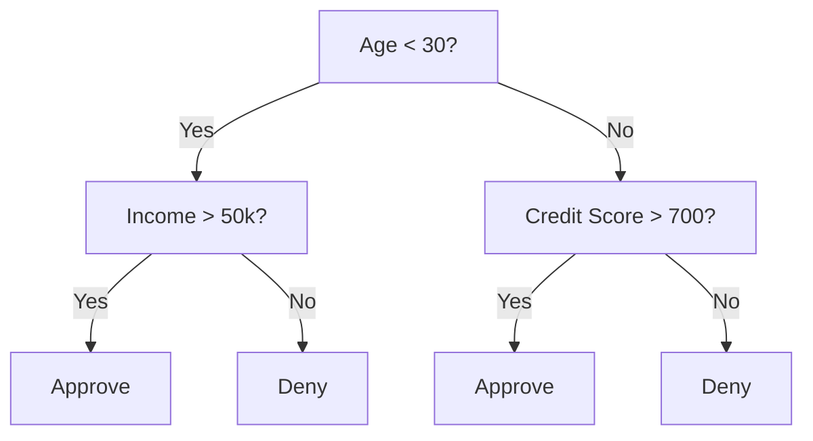
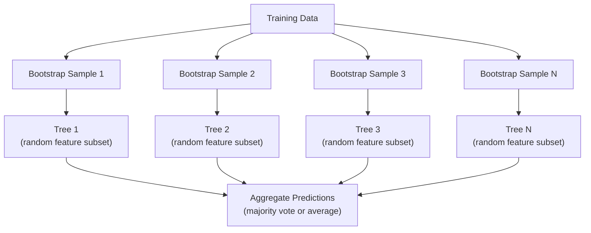

# الأشجار التي تتخذ قرارات والغابات العشوائية

> شجرة القرار مجرد مخطط تدفق ولكن غابة منها هي واحدة من أقوى الأدوات في ML

**Type:** Build
**Languages:** Python, TypeScript
**Prerequisites:** Phase 1 (Lessons 09 Information Theory, 06 Probability)
**Time:** ~90 minutes

## أهداف التعلم

- تنفيذ حسابات عدم نجس جيني والانتروبيا والاكتساب المعلومات للعثور على تقسيمات شجرة القرار المثلى
- بناء تصنيف شجرة القرار من الصفر مع التحكمات المسبقة للقطعة (عمق أقصى، عينات أقل)
- بناء غابة عشوائية باستخدام عينة التشغيل والتمييز المميز، وشرح لماذا يقلل من التباين
- مقارنة أهمية ميزة MDI مع أهمية المحوّل وتحديد متى يكون MDI متحيزاً

## المشكلة

لديك بيانات جدولية. الصفوف هي عينات، والعمود هي ميزات، وهناك عمود هدف تريد التنبؤ به. يمكنك رمي شبكة عصبية إليه. ولكن بالنسبة للبيانات الجدولية، النماذج القائمة على الأشجار القرارية، والغابات العشوائية، والشجيرات المرتفعة على التنحدرات، تتفوق باستمرار على التعلم العميق. تهيمن مسابقات كاغل على البيانات المهيكلة على XGBoost و LightGBM، وليس المحولات.

لماذا؟ تقوم الأشجار بمعالجة أنواع مزيجة من الميزات (الرقمية والفئوية) دون معالجة مسبقة. تتعامل مع العلاقات غير الخطية دون هندسة الميزات. فهي قابلة للتفسير: يمكنك النظر إلى الشجرة ورؤية بالضبط سبب قيامك بالتنبؤ. والغابات العشوائية، التي تتوسط العديد من الأشجار، مقاومة للغاية للتغلب على مجموعات بيانات ذات حجم معتدل.

هذه الدروس تبني شجرة القرار من الصفر باستخدام التقسيم التكراري، ثم تبني غابة عشوائية فوقها. ستقوم بتنفيذ الرياضيات وراء المعايير المقسمة (الأنقراطية الجيني، والإنتروبي، والكسب المعلومات) وتفهم لماذا يصبح مجموعة من المتعلمين الضعفاء قوية.

## المفهوم

### ما الذي تفعله شجرة القرار

شجرة القرار تقسم مساحة الميزات إلى مناطق مستطيلة عن طريق طرح سلسلة من الأسئلة نعم / لا.



كل عقدة داخلية تختبر ميزة ضد عتبة. كل عقدة ورقة تقوم بتنبؤ. لتصنيف نقطة بيانات جديدة، تبدأ من الجذر وتتبع الفروع حتى تصل إلى ورقة.

يتم بناء الشجرة من أعلى إلى أسفل عن طريق اختيار، في كل عقد، ميزة وعدول أفضل فصل البيانات. يتم تعريف "أفضل" بواسطة معيار تقسيم.

### معايير التقسيم: قياس النقدية

في كل عقدة، لدينا مجموعة من العينات. نريد تقسيمها بحيث تكون العقدة الطفولة الناتجة "طاهرة" قدر الإمكان، وهذا يعني أن كل طفل يحتوي على فئة واحدة في الغالب.

**Gini impurity**يُقيّم احتمال أن يتم تصنيف عينة مختارة عشوائياً بشكل خاطئ إذا تم وضعها على علامة وفقا لتوزيع الفئات في تلك العقدة.

```math
\text{Gini}(S) = 1 - \sum_k p_k^2 \quad \text{where } p_k \text{ is the proportion of class } k \text{ in set } S.
```

بالنسبة لعقدة نقية (كل فئة واحدة) ، Gini = 0. بالنسبة لقسيم ثنائي مع فئات 50/50، Gini = 0.5. أقل أفضل.

```
Example: 6 cats, 4 dogs

Gini = 1 - (0.6^2 + 0.4^2) = 1 - (0.36 + 0.16) = 0.48
```

**Entropy**يُقيّم محتوى المعلومات (الاضطراب) في العقدة.

```math
\text{Entropy}(S) = -\sum_k p_k \log_2(p_k)
```

بالنسبة لعقدة نقية، إنتروبيا = 0. بالنسبة لـ 50/50 تقسيم ثنائي، إنتروبيا = 1.0.

```
Example: 6 cats, 4 dogs

Entropy = -(0.6 * log2(0.6) + 0.4 * log2(0.4))
        = -(0.6 * -0.737 + 0.4 * -1.322)
        = 0.442 + 0.529
        = 0.971 bits
```

**Information gain**هو انخفاض النسب (الاندروبي أو جيني) بعد الانقسام.

```math
\begin{aligned}
& IG(S, \text{feature}, \text{threshold}) = \text{Impurity}(S) - \text{weighted\_avg}(\text{Impurity}(S_{\text{left}}), \text{Impurity}(S_{\text{right}})) \\[4pt]
& \text{where the weights are the proportions of samples in each child.}
\end{aligned}
```

الخوارزمية الفطرية في كل عقدة: جرب كل ميزة و كل عتبة ممكنة. اختر زوج (الميزة، العتبة) الذي يزيد من مكاسب المعلومات.

### كيف يعمل الانقسام

لـ مجموعة بيانات مع $n$الميزات و$m$عينات في العقدة الحالية:

1. لكل ميزة$j$($j = 1$إلى$n$):
   - قم بتصنيف العينات حسب الميزات$j$
   - جرب كل نقطة منتصف بين القيم المتتالية المختلفة كعرض
   - حساب مكاسب المعلومات لكل عتبة
2. اختر الميزة والعدول التي تحصل على أكبر قدر من المعلومات
3. تقسيم البيانات إلى اليسار (الميزة <= عتبة) واليمين (الميزة > عتبة)
4. التكرار على كل طفل

هذا النهج الطموح لا يضمن شجرة مثالية عالمياً. إيجاد شجرة مثالية هو أمر صعب غير معقول. ولكن التقسيم الطموح يعمل بشكل جيد في الممارسة العملية.

### ظروف التوقف

دون أية ظروف توقف، تنمو الشجرة حتى تكون كل ورقة نقية أو لا يمكن أن تفصل عيناتها، غالبًا ما تصل إلى عينة واحدة لكل ورقة. وهذا يتذكر بيانات التدريب بشكل مثالي ويجمل بشكل رهيب.

**Pre-pruning**يوقف الشجرة قبل أن تنمو بالكامل:
- أعمق أقصى: توقف الانقسام عندما تصل الشجرة إلى عمق محدد
- الحد الأدنى من العينات لكل ورقة: توقف إذا كان العقدة أقل من $k$عينات
- الحد الأدنى من اكتساب المعلومات: توقف إذا كانت أفضل تقسيم تحسن النقش أقل من عتبة
- الحد الأقصى لعدد العقدة: الحد من إجمالي عدد الأوراق

**Post-pruning**يُنمو الشجرة الكاملة ثم يُقَصّها
- تعقيد التكلفة (الذي يستخدمه المعلمون): يضيف عقوبة متناسبة مع عدد الأوراق.
- خفض الحصص الخطأ: إزالة شجرة فرعية إذا لم يزيد خطأ التحقق من التحقق

إنّ التقطيع المسبق أبسط وأسرع. غالباً ما ينتج التقطيع بعد ذلك أشجار أفضل لأنه لا يوقف التقطيع قبل فترة مبكرة قد يؤدي إلى تقطيعات مفيدة أخرى.

### شجرة القرار للعودة

بالنسبة للعودة، فإن التنبؤ بالورقة هو متوسط القيم المستهدفة في تلك الورقة. يتغير معايير الانقسام أيضًا:

**Variance reduction**يُستبدل اكتساب المعلومات:

```math
VR(S, \text{feature}, \text{threshold}) = \text{Var}(S) - \text{weighted\_avg}(\text{Var}(S_{\text{left}}), \text{Var}(S_{\text{right}}))
```

اختر الانقسام الذي يقلل من التباين أكثر. الشجرة تقسم مساحة المدخل إلى مناطق، وتتوقع ثابتة (المتوسط) في كل منطقة.

### الغابات العشوائية: قوة المجموعات

شجرة قرار واحدة هي اختلاف كبير. التغييرات الصغيرة في البيانات يمكن أن تنتج أشجار مختلفة تماما. الغابات العشوائية تحل هذا عن طريق متوسط العديد من الأشجار.



مصادر عشوائية تجعل الأشجار متنوعة:

**Bagging (bootstrap aggregating):**يتم تدريب كل شجرة على عينة منقطعة التشغيل ، عينة عشوائية مع استبدال من بيانات التدريب. يظهر حوالي 63٪ من العينات الأصلية في كل قطعة التشغيل (البقية هي عينة خارج الحقيبة التي يمكن استخدامها للتحقق من المصادقة).

**Feature randomization:**في كل تقسيم، يتم النظر في مجموعة فرعية عشوائية فقط من الميزات.$\sqrt{n_{\text{features}}}$. لالتراجع$n_{\text{features}}/3$هذا يمنع جميع الأشجار من الانقسام على نفس الميزة المهيمنة.

المفهوم الرئيسي: متوسط العديد من الأشجار غير المرتبطة يقلل من التباين دون زيادة التحيز. كل شجرة فردية قد تكون متوسطة. الجمع قوية.

### أهمية الميزات

الغابات العشوائية توفر بطبيعة الحال نقاط أهمية الميزات. الطريقة الأكثر شيوعا:

**Mean Decrease in Impurity (MDI):**لكل ميزة، قم بتجميع الحد الإجمالي من النقش عبر جميع الأشجار وجميع العقد حيث يتم استخدام هذه الميزة.

```math
\text{importance}(\text{feature}_j) = \sum_{\text{nodes where feature}_j \text{ is used}} \frac{n_{\text{samples at node}}}{n_{\text{total samples}}} \cdot \text{impurity\_decrease}
```

هذا سريع (حسب أثناء التدريب) ولكن متحيز نحو ميزات عالية الكاردينالية والصفات مع العديد من نقاط الانقسام المحتملة.

**Permutation importance**هو البديل: مزيج قيم ميزة واحدة وقياس مدى انخفاض دقة النموذج. أكثر موثوقية ولكن أبطأ.

### عندما تضرب الأشجار شبكات عصبية

الأشجار والغابات تهيمن على الشبكات العصبية على بيانات الجدول.

| Factor | Trees | Neural networks |
|--------|-------|----------------|
| Mixed types (numeric + categorical) | Native support | Need encoding |
| Small datasets (< 10k rows) | Work well | Overfit |
| Feature interactions | Found by splitting | Need architecture design |
| Interpretability | Full transparency | Black box |
| Training time | Minutes | Hours |
| Hyperparameter sensitivity | Low | High |

تنتصر الشبكات العصبية عندما يكون للبيانات هيكل مساحي أو متسلسل (الصور والنص والصوت). بالنسبة إلى الجداول المستوية للميزات ، فإن الأشجار هي الافتراض.

```figure
decision-tree-depth
```

## بناءها

### الخطوة الأولى: نقية جيني و الانتروبيا

بناء كلا المعايير المقسمتة من الصفر والتحقق من أنها توافق على أي من المقسمتين جيدة.

```python
import math

def gini_impurity(labels):
    n = len(labels)
    if n == 0:
        return 0.0
    counts = {}
    for label in labels:
        counts[label] = counts.get(label, 0) + 1
    return 1.0 - sum((c / n) ** 2 for c in counts.values())

def entropy(labels):
    n = len(labels)
    if n == 0:
        return 0.0
    counts = {}
    for label in labels:
        counts[label] = counts.get(label, 0) + 1
    return -sum(
        (c / n) * math.log2(c / n) for c in counts.values() if c > 0
    )
```

### الخطوة الثانية: إبحث عن أفضل تقسيم

جرب كل ميزة و كل عتبة، أعد تلك التي تملك أكبر قدر من المعلومات

```python
def information_gain(parent_labels, left_labels, right_labels, criterion="gini"):
    measure = gini_impurity if criterion == "gini" else entropy
    n = len(parent_labels)
    n_left = len(left_labels)
    n_right = len(right_labels)
    if n_left == 0 or n_right == 0:
        return 0.0
    parent_impurity = measure(parent_labels)
    child_impurity = (
        (n_left / n) * measure(left_labels) +
        (n_right / n) * measure(right_labels)
    )
    return parent_impurity - child_impurity
```

### الخطوة الثالثة: بناء صف DecisionTree

التقسيم المتكرر، التنبؤ، وتتبع أهمية الميزات. `_build`هو قلب الشجرة: يتوقف عندما تكون العقدة نقية أو تصل إلى حد ما قبل القص ، وإلا فإنه يأخذ أفضل الانقسام ويعود إلى كلا الأطفال.

```python
import random

class DecisionTree:
    def __init__(self, max_depth=None, min_samples_split=2,
                 min_samples_leaf=1, criterion="gini",
                 max_features=None):
        self.max_depth = max_depth
        self.min_samples_split = min_samples_split
        self.min_samples_leaf = min_samples_leaf
        self.criterion = criterion
        self.max_features = max_features
        self.tree = None
        self.feature_importances_ = None

    def fit(self, X, y):
        self.n_features = len(X[0])
        self.feature_importances_ = [0.0] * self.n_features
        self.n_samples = len(X)
        self.tree = self._build(X, y, depth=0)
        total = sum(self.feature_importances_)
        if total > 0:
            self.feature_importances_ = [
                fi / total for fi in self.feature_importances_
            ]

    def predict(self, X):
        return [self._predict_one(x, self.tree) for x in X]

    def _build(self, X, y, depth):
        if len(set(y)) == 1:
            return {"leaf": True, "value": y[0]}

        if self.max_depth is not None and depth >= self.max_depth:
            return self._make_leaf(y)

        if len(y) < self.min_samples_split:
            return self._make_leaf(y)

        best_feature, best_threshold, best_gain = self._best_split(X, y)

        if best_feature is None or best_gain <= 0:
            return self._make_leaf(y)

        left_X, left_y, right_X, right_y = self._split_data(
            X, y, best_feature, best_threshold
        )

        if len(left_y) < self.min_samples_leaf or len(right_y) < self.min_samples_leaf:
            return self._make_leaf(y)

        weight = len(y) / self.n_samples
        self.feature_importances_[best_feature] += weight * best_gain

        return {
            "leaf": False,
            "feature": best_feature,
            "threshold": best_threshold,
            "left": self._build(left_X, left_y, depth + 1),
            "right": self._build(right_X, right_y, depth + 1),
        }

    def _make_leaf(self, y):
        counts = {}
        for label in y:
            counts[label] = counts.get(label, 0) + 1
        return {"leaf": True, "value": max(counts, key=counts.get)}

    def _best_split(self, X, y):
        best_feature = None
        best_threshold = None
        best_gain = -1.0

        if self.max_features == "sqrt":
            k = max(1, int(math.sqrt(self.n_features)))
            feature_indices = random.sample(range(self.n_features), k)
        elif isinstance(self.max_features, int):
            if self.max_features < 1:
                raise ValueError("max_features must be at least 1 when given as an integer")
            k = min(self.max_features, self.n_features)
            feature_indices = random.sample(range(self.n_features), k)
        else:
            feature_indices = list(range(self.n_features))

        for feature_idx in feature_indices:
            values = sorted(set(X[i][feature_idx] for i in range(len(X))))
            if len(values) <= 1:
                continue

            for i in range(len(values) - 1):
                threshold = (values[i] + values[i + 1]) / 2.0
                left_y = [y[j] for j in range(len(X)) if X[j][feature_idx] <= threshold]
                right_y = [y[j] for j in range(len(X)) if X[j][feature_idx] > threshold]

                if len(left_y) < self.min_samples_leaf or len(right_y) < self.min_samples_leaf:
                    continue

                gain = information_gain(y, left_y, right_y, self.criterion)
                if gain > best_gain:
                    best_gain = gain
                    best_feature = feature_idx
                    best_threshold = threshold

        return best_feature, best_threshold, best_gain

    def _split_data(self, X, y, feature, threshold):
        left_X, left_y, right_X, right_y = [], [], [], []
        for i in range(len(X)):
            if X[i][feature] <= threshold:
                left_X.append(X[i])
                left_y.append(y[i])
            else:
                right_X.append(X[i])
                right_y.append(y[i])
        return left_X, left_y, right_X, right_y

    def _predict_one(self, x, node):
        if node["leaf"]:
            return node["value"]
        if x[node["feature"]] <= node["threshold"]:
            return self._predict_one(x, node["left"])
        return self._predict_one(x, node["right"])
```

### الخطوة الرابعة: بناء صف الغابات العشوائية

أخذ العينات من القفز، وتشغيل الميزات عشوائية، والصوت الأغلبي.

```python
class RandomForest:
    def __init__(self, n_trees=100, max_depth=None,
                 min_samples_split=2, max_features="sqrt",
                 criterion="gini"):
        self.n_trees = n_trees
        self.max_depth = max_depth
        self.min_samples_split = min_samples_split
        self.max_features = max_features
        self.criterion = criterion
        self.trees = []

    def fit(self, X, y):
        n = len(X)
        for _ in range(self.n_trees):
            indices = [random.randint(0, n - 1) for _ in range(n)]
            X_boot = [X[i] for i in indices]
            y_boot = [y[i] for i in indices]
            tree = DecisionTree(
                max_depth=self.max_depth,
                min_samples_split=self.min_samples_split,
                max_features=self.max_features,
                criterion=self.criterion,
            )
            tree.fit(X_boot, y_boot)
            self.trees.append(tree)

    def predict(self, X):
        all_preds = [tree.predict(X) for tree in self.trees]
        predictions = []
        for i in range(len(X)):
            votes = {}
            for preds in all_preds:
                v = preds[i]
                votes[v] = votes.get(v, 0) + 1
            predictions.append(max(votes, key=votes.get))
        return predictions
```

انظر`code/trees.py`لتنفيذ كامل مع جميع أساليب المساعدة. `code/trees.ts`هو منفذ TypeScript مع نفس الوظائف والإثباتات.`npx tsx code/trees.ts`. . .

## استخدمها

مع التعلم القصير، تدريب الغابة العشوائية هو ثلاثة خطوط:

```python
from sklearn.ensemble import RandomForestClassifier
from sklearn.datasets import load_iris
from sklearn.model_selection import train_test_split

X, y = load_iris(return_X_y=True)
X_train, X_test, y_train, y_test = train_test_split(X, y, random_state=42)

rf = RandomForestClassifier(n_estimators=100, random_state=42)
rf.fit(X_train, y_train)
print(f"Accuracy: {rf.score(X_test, y_test):.4f}")
print(f"Feature importances: {rf.feature_importances_}")
```

في الممارسة العملية، تكون الأشجار المرتفعة بالدرجات (XGBoost، LightGBM، CatBoost) غالبًا أقوى من الغابات العشوائية لأنها تُبني الأشجار بشكل متسلسل، مع تصحيح كل شجرة أخطاء الأخطاء السابقة. ولكن الغابات العشوائية أصعب إعدادها بشكل خاطئ ولا تتطلب تقريبًا أي ضبط للفيروسات.

## أرسله

هذا الدرس يُنتج`outputs/prompt-tree-interpreter.md`-- عرض مفيد يفسر تقسيم الأشجار القرارية لأصحاب المصلحة في الأعمال. إطعامها بتركيب شجرة مدربة (عمق، ميزات، عتبة تقسيم، دقة) وترجم النموذج إلى قواعد بسيطة اللغة، وتصفيات أهمية الميزات، والعلامات المبالغة أو التسريب، وتوصي بالخطوات التالية. استخدمها في أي وقت تحتاج إلى شرح نموذج قائم على الشجرة لشخص لا يقرأ الرمز.

## التمارين

1. قم بتدريب شجرة قرار واحدة على مجموعة بيانات ثنائية الأبعاد مع 3 فئات. قم بتتبع الانقسام يدوياً ورسوم حدود القرار المستطيل. قم بتقارن الحدود عند max_depth=2 مقابل max_depth=10.

2. تنفيذ تقسيم التخفيف من التباين لأشجار التراجع. توليد $y = \sin(x) + \text{noise}$و تتناسب مع شجرة التراجعات الخاصة بك. رسم التنبؤات الثابتة القطعة من شجرة ضد المنحنى الحقيقي.

3. بناء غابة عشوائية مع 1، 5، 10، 50 و 200 شجرة. قم بتدريب دقة التدريب واختبار دقة مقابل عدد الأشجار. لاحظ أن دقة اختبار مرتفعات ولكن لا تقل (الغابات مقاومة الإفراط في التكيف).

4. مقارنة قراءة جيني مقابل الانتروبيا كمعايير مقسمة على 5 مجموعات بيانات مختلفة. قياس الدقة وعمق الشجرة. في معظم الحالات، فإنها تنتج نتائج متطابقة تقريبا. شرح السبب.

5. قم بتنفيذ أهمية المحول. مقارنةها مع أهمية MDI على مجموعة بيانات حيث يتمثل أحد الميزات في ضجيج عشوائية ولكنها ذات صلابة عالية. MDI سوف تصنف ميزة الضجيج عالية. أهمية المحول لن تفعل.

## الشروط الرئيسية

| Term | What people say | What it actually means |
|------|----------------|----------------------|
| Decision tree | "A flowchart for predictions" | A model that partitions feature space into rectangular regions by learning a sequence of if/else splits |
| Gini impurity | "How mixed the node is" | Probability of misclassifying a random sample at a node. 0 = pure, 0.5 = maximum impurity for binary |
| Entropy | "The disorder in a node" | Information content at a node. 0 = pure, 1.0 = maximum uncertainty for binary. From information theory |
| Information gain | "How good a split is" | Reduction in impurity after a split. The greedy criterion for choosing splits |
| Pre-pruning | "Stop the tree early" | Stopping tree growth early by setting max depth, min samples, or min gain thresholds |
| Post-pruning | "Trim the tree after" | Growing the full tree, then removing subtrees that do not improve validation performance |
| Bagging | "Train on random subsets" | Bootstrap aggregating. Train each model on a different random sample with replacement |
| Random forest | "A bunch of trees" | Ensemble of decision trees, each trained on a bootstrap sample with random feature subsets at each split |
| Feature importance (MDI) | "Which features matter" | Total impurity decrease contributed by each feature, summed across all trees and nodes |
| Permutation importance | "Shuffle and check" | Accuracy drop when a feature's values are randomly shuffled. More reliable than MDI for noisy features |
| Variance reduction | "The regression version of info gain" | The regression tree analogue of information gain. Picks the split that reduces target variance the most |
| Bootstrap sample | "Random sample with repeats" | A random sample drawn with replacement from the original dataset. Same size, but with duplicates |

## المزيد من القراءة

- [Breiman: Random Forests (2001)](https://link.springer.com/article/10.1023/A:1010933404324)- الورق الغابات الأصلي عشوائي
- [Grinsztajn et al.: Why do tree-based models still outperform deep learning on tabular data? (2022)](https://arxiv.org/abs/2207.08815)- مقارنة صارمة بين الأشجار مقابل الشبكات العصبية في المهام الجدولية
- [scikit-learn Decision Trees documentation](https://scikit-learn.org/stable/modules/tree.html)- دليل عملي مع أدوات التصور
- [XGBoost: A Scalable Tree Boosting System (Chen & Guestrin, 2016)](https://arxiv.org/abs/1603.02754)- ورقة تعزيز التراجع التي تهيمن على كاغل
