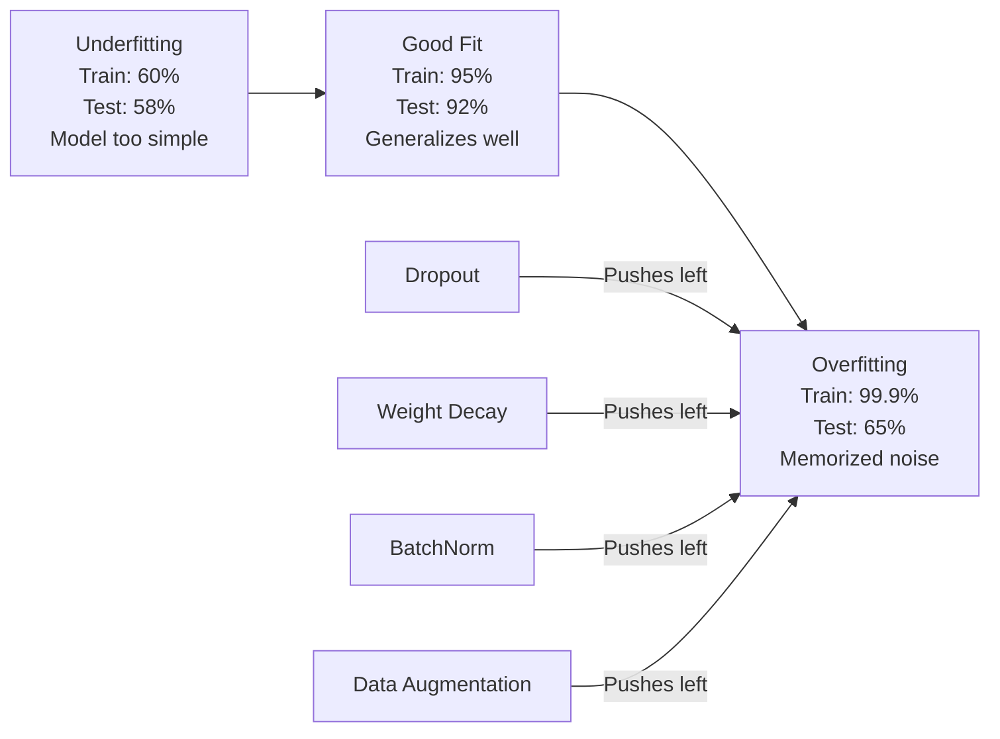
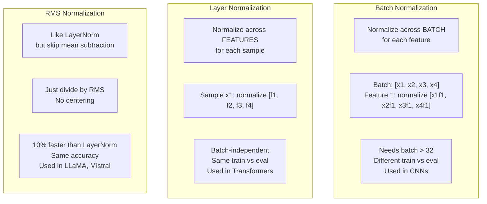
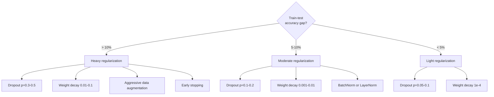

# التنظيم

> نموذجك يحصل على 99٪ من بيانات التدريب و 60٪ من بيانات الاختبار. هو حفظ بدلا من التعلم. التنظيم هو الضريبة التي تفرض عليها على التعقيد لإجبار التعميم.

**Type:** Build
**Languages:** Python, TypeScript
**Prerequisites:** Lesson 03.06 (Optimizers)
**Time:** ~75 minutes

## أهداف التعلم

- تنفيذ التوقف مع التوسع المعاكس ، وتحلل الوزن L2 ، وتطبيع اللحظة ، وتطبيع الطبقة ، و RMSNorm من الصفر
- قياس الفجوة الدقيقة في اختبار القطار وتشخيص الإصلاح المفرط باستخدام تجارب التنظيم
- شرح لماذا يستخدم المحولون LayerNorm بدلا من BatchNorm ولماذا يفضل الجامعات العليا الحديثة RMSNorm
- تطبيق مجموعة صحيحة من تقنيات التنظيم على أساس شدة الإصلاح المفرط

## المشكلة

شبكة عصبية ذات ملامح كافية يمكن أن تتذكر أي مجموعة بيانات. هذه ليست فرضية - Zhang et al. (2017) أثبت ذلك بتدريب الشبكات القياسية على ImageNet مع علامات عشوائية. وصلت الشبكات إلى خسارة تدريبية قريبة من الصفر على تفويضات اللقب عشوائية بالكامل. حفظوا مليون زوج من المدخلات والمخرجات عشوائية دون نمط للتعلم. فقدان التدريب كان مثاليا. دقة الاختبار كانت صفر.

هذه هي المشكلة المفرطة، وتزداد سوءاً مع تزايد نماذجها. GPT-3 لديها 175 مليار مبرمير. مجموعة التدريب لديها حوالي 500 مليار رمز. مع هذه العناصر العديدة، فإن النموذج لديه قدرة كافية لتذكر قطع كبيرة من بيانات التدريب حرفياً. دون تنظيمها، فإنه سيستمر في إعادة تشغيل أمثلة التدريب بدلاً من تعلم أنماط قابلة للتعميم.

الفجوة بين أداء التدريب وأداء الاختبار هي الفجوة المفرطة. كل تقنية في هذا الدروس تهاجم تلك الفجوة من زاوية مختلفة. التخلي عن التشغيل يفرض على الشبكة عدم الاعتماد على أي خلية عصبية واحدة إن تدهور الوزن يمنع أي وزن واحد من النمو الكبير تُسطح تطبيع المجموعة المشهد الخساري بحيث يجد المحسن أدنى الحد الأدنى الأكثر شحًا. يقوم تطبيع الطبقة بنفس الشيء ولكن يعمل حيث تفشل تطبيع اللحوم (لحوم صغيرة، تسلسلات طول متغير). يقوم RMSNorm بذلك بسرعة 10% عن طريق إسقاط متوسط الحساب. كل تقنية بسيطة معاً، هم الفرق بين نموذج يتذكر و الذي يعمّل.

## المفهوم

### الطيف المتناسب

كل نموذج يجلس في مكان ما على الطيف من عدم التكيف (بسيط جداً لالتقاط النمط) إلى التكيف الزائد (عقد جداً ليتمكن من التقاط الضوضاء).



### التخلي عن العمل

أسهل تقنية تنظيم مع أروع تفسير أثناء التدريب، قم بتعيين أداء كل عصبية عشوائيًا إلى الصفر مع احتمال$p$. . .

```math
\text{output} = \text{activation}(z) \cdot \text{mask} \quad \text{where }\text{mask}[i] \sim \text{Bernoulli}(1 - p)
```

مع$p = 0.5$نصف الخلايا العصبية يتم تحديدها على كل مرور إلى الأمام. يجب على الشبكة تعلم التمثيلات الزائدة لأنه لا يستطيع التنبؤ بالخلايا العصبية التي ستكون متاحة. هذا يمنع التكيف - الخلايا العصبية تتعلم الاعتماد على الخلايا العصبية الأخرى المحددة موجودة.

تفسير الجمع: شبكة مع $N$الخلايا العصبية والإقلاع يخلق$2^N$شبكات فرعية محتملة (كل مزيج من الخلايا العصبية تعمل أو غير تعمل).$2^N$شبكات فرعية في وقت واحد، كل على مجموعات صغيرة مختلفة. في وقت الاختبار، تستخدم جميع الخلايا العصبية (لا تخفيض) وتقليص النتائج بحلول $(1 - p)$لتتطابق القيمة المتوقعة خلال التدريب. هذا يعادل متوسط التنبؤات$2^N$شبكات فرعية -- مجموعة ضخمة من نموذج واحد.

في الممارسة العملية، يتم تطبيق التوسع خلال التدريب بدلاً من الاختبار (التوقف المُعكس):

```math
\begin{aligned}
\text{During training:} \quad & \text{output} = \text{activation}(z) \cdot \text{mask} / (1 - p) \\
\text{During testing:} \quad & \text{output} = \text{activation}(z) \quad \text{(no change needed)}
\end{aligned}
```

هذا أكثر نظافة لأن رمز الاختبار لا يحتاج إلى معرفة عن التخلي على الإطلاق.

معدلات الافتراض: p = 0.1 بالنسبة للمتحولات، p = 0.5 بالنسبة لشركات المعدات المعدنية، p = 0.2-0.3 بالنسبة لشركات التلفزيون.

### انخفاض الوزن (تعديل L2)

أضف الكبيرة المربعة لجميع الوزن إلى الخسارة:

```math
\text{total\_loss} = \text{task\_loss} + \frac{\lambda}{2} \sum_i w_i^2
```

تراجع مصطلح التنظيم هو $\lambda w$هذا يعني في كل خطوة، كل وزن يتم تقليصه نحو الصفر بنسبة متناسبة مع حجمها. يتم تعاقب الوزن الكبير أكثر. يتم دفع النموذج نحو حلول حيث لا يهيمن أي وزن واحد.

لماذا يساعد هذا على التعميم: تميل نماذج أكثر تكييفا إلى أن يكون لها أوزان كبيرة تضخم الضوضاء في بيانات التدريب. يحتفظ التدهور الوزن بالأوزان الصغيرة ، مما يحد من القدرة الفعالة للنموذج ويجبره على الاعتماد على ميزات قوية ويمكن التعميم بدلاً من الطرق الغريبة المتذكرة.

- نعم$\lambda$يحدد المعلم المضاد القوة القياسية

- 0.01 لـ AdamW على المحولات
- 1e-4 للـ SGD على قنوات CNN
- 0.1 للطرازات المبالغ فيها

كما تم مناقشة في الدروس 06: تدهور الوزن وتعديل L2 متساوية في SGD ولكن ليس في آدم. استخدم دائما AdamW (تدهور الوزن منفصل) عند التدريب مع آدم.

### التطبيع في الحزمة

عادي انتاج كل طبقة عبر المجموعة الصغيرة قبل أن تمررها إلى الطبقة التالية.

لـ (ميني) مجموعة من التفعيلات في بعض الطبقات:

```math
\begin{aligned}
\mu &= \frac{1}{B} \sum_i x_i && \text{(batch mean)} \\
\sigma^2 &= \frac{1}{B} \sum_i (x_i - \mu)^2 && \text{(batch variance)} \\
\hat{x} &= \frac{x_i - \mu}{\sqrt{\sigma^2 + \epsilon}} && \text{(normalize)} \\
y &= \gamma \hat{x} + \beta && \text{(scale and shift)}
\end{aligned}
```

غاما وبيتا هي معايير قابلة للتعلم التي تسمح للشبكة بإلغاء التطبيع إذا كان ذلك مثالياً. بدونها، كنت ستضطر إلى أن تكون خروج كل طبقة صفر المتوسط

**Training vs inference split:**أثناء التدريب$\mu$و$\sigma$تأتي من الحزمة الصغيرة الحالية. أثناء الاستنتاج، تستخدم المتوسطات الجارية المتراكمة خلال التدريب (متوسط متحرك تعريفي مع الزخم = 0.1, مما يعني 90% قديم + 10% جديد).

لماذا يعمل "باتش نورم" لا يزال مناقشة ادعى الورقة الأصلية أنها تقلل من "التحولات المتغيرة الداخلية" (توزيع مدخلات الطبقة تتغير مع تحديث الطبقات السابقة). سانتوركار وغيره (2018) أظهرت أن هذا التفسير خاطئ. السبب الحقيقي: "باتش نورم" يجعل المشهد الخسري أكثر سلاسة التراجعيات أكثر تنبؤا، ومستمرات ليبسكيتز أصغر، ويمكن للمحسن أن يتخذ خطوات أكبر بأمان. هذا هو السبب في أن BatchNorm يسمح لك باستخدام معدلات تعلم أعلى وتقارب أسرع.

لدى BatchNorm قيود أساسية: يعتمد على إحصاءات اللحوم. مع حجم اللحوم 1 ، فإن المتوسط والفرق لا معنى لهم. مع اللحوم الصغيرة (< 32) ، تكون الإحصاءات ضجة وأداء ضار. هذا مهم لمهام مثل الكشف عن الأشياء (حيث تحدد الذاكرة حجم اللحوم) ونمذجة اللغة (حيث تختلف طول التسلسل).

### الطبقة الطبيعية

عادةً، يجب أن تكون المعدلات المعدنية على جميع الميزات بدلاً من على جميع المجموعات.

```math
\begin{aligned}
\mu &= \frac{1}{D} \sum_j x_j && \text{(feature mean)} \\
\sigma^2 &= \frac{1}{D} \sum_j (x_j - \mu)^2 && \text{(feature variance)} \\
\hat{x} &= \frac{x_j - \mu}{\sqrt{\sigma^2 + \epsilon}} \\
y &= \gamma \hat{x} + \beta
\end{aligned}
```

$D$هو بعد الميزة. يتم تطبيع كل عينة بشكل مستقل - لا يعتمد على حجم الحزمة. لهذا السبب يستخدم المحولات LayerNorm بدلاً من BatchNorm. التسلسلات لها أطول متغيرة، و أحجام الحزمة تكون صغيرة في كثير من الأحيان (أو 1 خلال التوليد) ، والحساب هو نفسه بين التدريب والإستنتاج.

يتم تطبيق LayerNorm في المحولات بعد كل كتلة الانتباه الذاتي وكل كتلة إرسال إلى الأمام (Post-LN) ، أو قبلها (Pre-LN ، وهو أكثر استقرارًا للتدريب).

### RMSNorm

الطبقة غير المتوسط. اقترحها Zhang & Sennrich (2019).

```math
\begin{aligned}
\text{rms} &= \sqrt{\frac{1}{D} \sum_j x_j^2} \\
y &= \gamma \cdot \frac{x}{\text{rms}}
\end{aligned}
```

هذا هو الأمر. لا متوسط الحسابات، لا وجود لبرامج بيتا. الملاحظة: إعادة المركز (الخصم المتوسط) في LayerNorm يساهم قليلا جدا في أداء النموذج، ولكن تكلفة الحساب. إزالتها تعطى نفس الدقة مع حوالي 10% أقل التكلفة العامة.

LLaMA، LLaMA 2، LLaMA 3، Mistral، ومعظم LLM الحديثة تستخدم RMSNorm بدلا من LayerNorm. على نطاق مليارات المعلمات وتريليونات الرموز، أن 10% التوفير كبير.

### مقارنة التطبيع



### زيادة البيانات كنظام

ليس تعديل النموذج ولكن تعديل البيانات. تحويل مدخلات التدريب مع الحفاظ على العلامات:

- الصور: حصول عشوائي، التحول، الدوران، الاضطرابات اللونية، القطع
- النص: استبدال المختلفات، الترجمة الخلفية، الحذف العشوائي
- الصوت: التمدد الزمني، تغيير الصوت، إضافة الضوضاء

التأثير هو نفسه من التنظيم: يزيد من الحجم الفعلي لمجموعة التدريب ، مما يجعل من الصعب على النموذج حفظ أمثلة محددة. يمكن أن يتذكر نموذج يرى كل صورة مرة واحدة فقط في شكلها الأصلي. يمكن أن يتذكر نموذج يرى 50 نسخة مضاعفة من كل صورة أن يتعلم الهيكل غير المتغير.

### التوقف المبكر

أسهل طريقة للتنظيم: توقف التدريب عندما يبدأ فقدان التحقق من الصبر في زيادة. النموذج لم يصلح بعد في تلك النقطة. في الممارسة العملية، تتبع فقدان التحقق من الصبر في كل عصر، وترتب على أفضل النموذج، وتواصل التدريب من أجل نافذة "الصبر" (عادة 5-20 فترة). إذا لم يتحسن فقدان التحقق من الصبر في نافذة الصبر، فإنك تتوقف وتحمل أفضل النموذج المحفوظ.

### متى يجب تطبيق ماذا



```figure
l2-regularization
```

## بناءها

### الخطوة الأولى: التوقف (وضع القطار والإيفال)

```python
import random
import math


class Dropout:
    def __init__(self, p=0.5):
        self.p = p
        self.training = True
        self.mask = None

    def forward(self, x):
        if not self.training:
            return list(x)
        self.mask = []
        output = []
        for val in x:
            if random.random() < self.p:
                self.mask.append(0)
                output.append(0.0)
            else:
                self.mask.append(1)
                output.append(val / (1 - self.p))
        return output

    def backward(self, grad_output):
        grads = []
        for g, m in zip(grad_output, self.mask):
            if m == 0:
                grads.append(0.0)
            else:
                grads.append(g / (1 - self.p))
        return grads
```

### الخطوة الثانية: تدهور الوزن

```python
def l2_regularization(weights, lambda_reg):
    penalty = 0.0
    for w in weights:
        penalty += w * w
    return lambda_reg * 0.5 * penalty

def l2_gradient(weights, lambda_reg):
    return [lambda_reg * w for w in weights]
```

### الخطوة الثالثة: تطبيع المجموعة

```python
class BatchNorm:
    def __init__(self, num_features, momentum=0.1, eps=1e-5):
        self.gamma = [1.0] * num_features
        self.beta = [0.0] * num_features
        self.eps = eps
        self.momentum = momentum
        self.running_mean = [0.0] * num_features
        self.running_var = [1.0] * num_features
        self.training = True
        self.num_features = num_features

    def forward(self, batch):
        batch_size = len(batch)
        if self.training:
            mean = [0.0] * self.num_features
            for sample in batch:
                for j in range(self.num_features):
                    mean[j] += sample[j]
            mean = [m / batch_size for m in mean]

            var = [0.0] * self.num_features
            for sample in batch:
                for j in range(self.num_features):
                    var[j] += (sample[j] - mean[j]) ** 2
            var = [v / batch_size for v in var]

            for j in range(self.num_features):
                self.running_mean[j] = (1 - self.momentum) * self.running_mean[j] + self.momentum * mean[j]
                self.running_var[j] = (1 - self.momentum) * self.running_var[j] + self.momentum * var[j]
        else:
            mean = list(self.running_mean)
            var = list(self.running_var)

        self.x_hat = []
        output = []
        for sample in batch:
            normalized = []
            out_sample = []
            for j in range(self.num_features):
                x_h = (sample[j] - mean[j]) / math.sqrt(var[j] + self.eps)
                normalized.append(x_h)
                out_sample.append(self.gamma[j] * x_h + self.beta[j])
            self.x_hat.append(normalized)
            output.append(out_sample)
        return output
```

### الخطوة الرابعة: تطبيع الطبقة

```python
class LayerNorm:
    def __init__(self, num_features, eps=1e-5):
        self.gamma = [1.0] * num_features
        self.beta = [0.0] * num_features
        self.eps = eps
        self.num_features = num_features

    def forward(self, x):
        mean = sum(x) / len(x)
        var = sum((xi - mean) ** 2 for xi in x) / len(x)

        self.x_hat = []
        output = []
        for j in range(self.num_features):
            x_h = (x[j] - mean) / math.sqrt(var + self.eps)
            self.x_hat.append(x_h)
            output.append(self.gamma[j] * x_h + self.beta[j])
        return output
```

### الخطوة 5: RMSNorm

```python
class RMSNorm:
    def __init__(self, num_features, eps=1e-6):
        self.gamma = [1.0] * num_features
        self.eps = eps
        self.num_features = num_features

    def forward(self, x):
        rms = math.sqrt(sum(xi * xi for xi in x) / len(x) + self.eps)
        output = []
        for j in range(self.num_features):
            output.append(self.gamma[j] * x[j] / rms)
        return output
```

### الخطوة السادسة: التدريب مع و بدون التدريب

```python
def sigmoid(x):
    x = max(-500, min(500, x))
    return 1.0 / (1.0 + math.exp(-x))


def make_circle_data(n=200, seed=42):
    random.seed(seed)
    data = []
    for _ in range(n):
        x = random.uniform(-2, 2)
        y = random.uniform(-2, 2)
        label = 1.0 if x * x + y * y < 1.5 else 0.0
        data.append(([x, y], label))
    return data


class RegularizedNetwork:
    def __init__(self, hidden_size=16, lr=0.05, dropout_p=0.0, weight_decay=0.0):
        random.seed(0)
        self.hidden_size = hidden_size
        self.lr = lr
        self.dropout_p = dropout_p
        self.weight_decay = weight_decay
        self.dropout = Dropout(p=dropout_p) if dropout_p > 0 else None

        self.w1 = [[random.gauss(0, 0.5) for _ in range(2)] for _ in range(hidden_size)]
        self.b1 = [0.0] * hidden_size
        self.w2 = [random.gauss(0, 0.5) for _ in range(hidden_size)]
        self.b2 = 0.0

    def forward(self, x, training=True):
        self.x = x
        self.z1 = []
        self.h = []
        for i in range(self.hidden_size):
            z = self.w1[i][0] * x[0] + self.w1[i][1] * x[1] + self.b1[i]
            self.z1.append(z)
            self.h.append(max(0.0, z))

        if self.dropout and training:
            self.dropout.training = True
            self.h = self.dropout.forward(self.h)
        elif self.dropout:
            self.dropout.training = False
            self.h = self.dropout.forward(self.h)

        self.z2 = sum(self.w2[i] * self.h[i] for i in range(self.hidden_size)) + self.b2
        self.out = sigmoid(self.z2)
        return self.out

    def backward(self, target):
        eps = 1e-15
        p = max(eps, min(1 - eps, self.out))
        d_loss = -(target / p) + (1 - target) / (1 - p)
        d_sigmoid = self.out * (1 - self.out)
        d_out = d_loss * d_sigmoid

        for i in range(self.hidden_size):
            d_relu = 1.0 if self.z1[i] > 0 else 0.0
            d_h = d_out * self.w2[i] * d_relu
            self.w2[i] -= self.lr * (d_out * self.h[i] + self.weight_decay * self.w2[i])
            for j in range(2):
                self.w1[i][j] -= self.lr * (d_h * self.x[j] + self.weight_decay * self.w1[i][j])
            self.b1[i] -= self.lr * d_h
        self.b2 -= self.lr * d_out

    def evaluate(self, data):
        correct = 0
        total_loss = 0.0
        for x, y in data:
            pred = self.forward(x, training=False)
            eps = 1e-15
            p = max(eps, min(1 - eps, pred))
            total_loss += -(y * math.log(p) + (1 - y) * math.log(1 - p))
            if (pred >= 0.5) == (y >= 0.5):
                correct += 1
        return total_loss / len(data), correct / len(data) * 100

    def train_model(self, train_data, test_data, epochs=300):
        history = []
        for epoch in range(epochs):
            total_loss = 0.0
            correct = 0
            for x, y in train_data:
                pred = self.forward(x, training=True)
                self.backward(y)
                eps = 1e-15
                p = max(eps, min(1 - eps, pred))
                total_loss += -(y * math.log(p) + (1 - y) * math.log(1 - p))
                if (pred >= 0.5) == (y >= 0.5):
                    correct += 1
            train_loss = total_loss / len(train_data)
            train_acc = correct / len(train_data) * 100
            test_loss, test_acc = self.evaluate(test_data)
            history.append((train_loss, train_acc, test_loss, test_acc))
            if epoch % 75 == 0 or epoch == epochs - 1:
                gap = train_acc - test_acc
                print(f"    Epoch {epoch:3d}: train_acc={train_acc:.1f}%, test_acc={test_acc:.1f}%, gap={gap:.1f}%")
        return history
```

## استخدمها

توفر PyTorch كل التطبيع والتنظيم كمتطلبات:

```python
import torch
import torch.nn as nn

model = nn.Sequential(
    nn.Linear(784, 256),
    nn.BatchNorm1d(256),
    nn.ReLU(),
    nn.Dropout(0.3),
    nn.Linear(256, 128),
    nn.BatchNorm1d(128),
    nn.ReLU(),
    nn.Dropout(0.3),
    nn.Linear(128, 10),
)

model.train()
out_train = model(torch.randn(32, 784))

model.eval()
out_test = model(torch.randn(1, 784))
```

- نعم`model.train()`- لا ، لا`model.eval()`التبديل أمر حاسم. إنه يطفئ الإيقاف / التوقف ويقول لـ BatchNorm استخدام إحصاءات اللحوم مقابل إحصاءات التشغيل. نسيان `model.eval()`قبل الاستنتاج هو أحد أخطاء الأكثر شيوعا في التعلم العميق. تحرك دقة الاختبار الخاص بك تقلب عشوائيا لأن الإقلاع لا يزال نشطا و BatchNorm يستخدم إحصاءات المجموعات الصغيرة.

بالنسبة للمتحولات، النمط مختلف:

```python
class TransformerBlock(nn.Module):
    def __init__(self, d_model=512, nhead=8, dropout=0.1):
        super().__init__()
        self.attention = nn.MultiheadAttention(d_model, nhead, dropout=dropout)
        self.norm1 = nn.LayerNorm(d_model)
        self.ff = nn.Sequential(
            nn.Linear(d_model, d_model * 4),
            nn.GELU(),
            nn.Linear(d_model * 4, d_model),
            nn.Dropout(dropout),
        )
        self.norm2 = nn.LayerNorm(d_model)
        self.dropout = nn.Dropout(dropout)

    def forward(self, x):
        attended, _ = self.attention(x, x, x)
        x = self.norm1(x + self.dropout(attended))
        x = self.norm2(x + self.ff(x))
        return x
```

(ليير نورم) ، ليس (باتش نورم) ، إنقطاع (ب) = 0.1، وليس (ب) = 0.5. هذه هي التحويلات القابلة للتشغيل

## أرسله

هذا الدرس ينتج عن:
- `outputs/prompt-regularization-advisor.md`-- إشارة تُشخيص الإفراط في التكيف وتوصي بإستراتيجية التنظيم الصحيحة

## التمارين

1. تنفيذ التوقف الفضائي للبيانات الثنائية الأبعاد: بدلاً من إسقاط الخلايا العصبية الفردية، إسقاط قنوات الميزات بأكملها. محاكاة هذا عن طريق علاج مجموعات من الميزات المتتالية كقنوات وإسقاط مجموعات بأكملها. مقارنة الفجوة في اختبار القطار إلى التوقف القياسي على مجموعة بيانات الدائرة مع hidden_size=32.

2. قم بتنفيذ تسهيل اللوحة من الدروس 05 جنبا إلى جنب مع التخلي عن هذه الدروس. قم بتدريب مع أربع تكوينات: لا، التخلي فقط، تسهيل اللوحة فقط، كلاهما. قم بتقييم الفجوة النهائية في دقة اختبار القطار لكل منها. أي مزيج يعطي أدنى فجوة؟

3. إضافة طبقة BatchNorm بين الطبقة الخفية والتنشيط في شبكة مجموعة البيانات الدائرة الخاصة بك. تدريب مع ودون BatchNorm عند معدلات التعلم 0.01, 0.05 و 0.1. يجب أن يسمح BatchNorm بتدريب مستقر عند معدلات التعلم العالية حيث تختلف شبكة الفانيليا.

4. تنفيذ وقف مبكر: تتبع خسارة الاختبار في كل عصر، و حفظ أفضل الأوزان، و توقف إذا لم يتحسن خسارة الاختبار لمدة 20 عصر. تشغيل الشبكة المنظمة لمدة 1000 عصر. تقرير أي عصر كان أفضل دقة الاختبار وكيف عدد العصور من الحسابات التي حفظتها.

5. مقارنة LayerNorm بمقارنة RMSNorm على شبكة 4 طبقات (ليس فقط 2). قم بتشغيل كل من الوزن نفسه. قم بتدريب 200 دورة وقارن الدقة النهائية وسرعة التدريب (الوقت لكل دورة) ومحجمات التراجع في الطبقة الأولى. تحقق من أن RMSNorm أسرع بنفس الدقة.

## الشروط الرئيسية

| Term | What people say | What it actually means |
|------|----------------|----------------------|
| Overfitting | "Model memorized the data" | When a model's training performance significantly exceeds its test performance, indicating it learned noise rather than signal |
| Regularization | "Preventing overfitting" | Any technique that constrains model complexity to improve generalization: dropout, weight decay, normalization, augmentation |
| Dropout | "Random neuron deletion" | Zeroing random neurons during training with probability $p$, forcing redundant representations; equivalent to training an ensemble |
| Weight decay | "L2 penalty" | Shrinking all weights toward zero by subtracting $\lambda w$ at each step; penalizes complexity through weight magnitude |
| Batch normalization | "Normalize per batch" | Normalizing layer outputs across the batch dimension using batch statistics during training and running averages during inference |
| Layer normalization | "Normalize per sample" | Normalizing across features within each sample; batch-independent, used in transformers where batch size varies |
| RMSNorm | "LayerNorm without the mean" | Root mean square normalization; drops the mean subtraction from LayerNorm for 10% speedup with equal accuracy |
| Early stopping | "Stop before overfit" | Halting training when validation loss stops improving; the simplest regularizer, often used alongside others |
| Data augmentation | "More data from less" | Transforming training inputs (flip, crop, noise) to increase effective dataset size and force invariance learning |
| Generalization gap | "Train-test split" | The difference between training and test performance; regularization aims to minimize this gap |

## المزيد من القراءة

- سريڤاستافا وغيرها، "الإنقطاع: طريقة بسيطة لمنع شبكات الأعصاب من الإفراط" (2014) -- ورقة الإفراج الأصلية مع تفسير الجمعية والتجارب الواسعة
- أوفي و سيجادي، "طبيعية المجموعة: تسريع تدريب الشبكات العميقة عن طريق تقليل التحولات الداخلية المتغيرة" (2015) -- قدم BatchNorm و إجراءات التدريب الخاصة بها، واحدة من أكثر أوراق التعلم العميق المشار إليها
- تشانغ و سنريش، "تطبيع الطبقة المربعة المتوسطة الجذري" (2019) -- أظهرت أن RMSNorm يطابق دقة LayerNorm مع الحسابات المنخفضة؛ تم تبنيه من قبل LLaMA و Mistral
- تشانغ وغيره، "فهم التعلم العميق يتطلب إعادة التفكير في التعميم" (2017) -- ورقة تاريخية تظهر أن الشبكات العصبية يمكن أن تتذكر اللبكات العشوائية، تحدياً وجهات النظر التقليدية للتعميم
