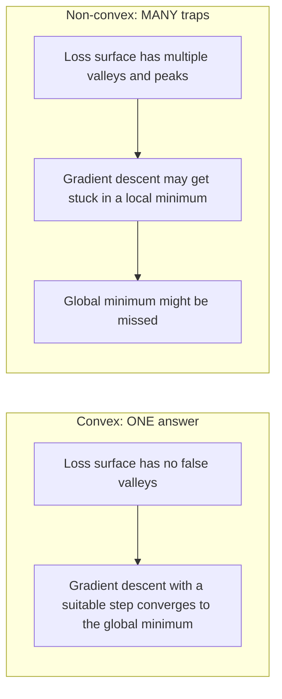
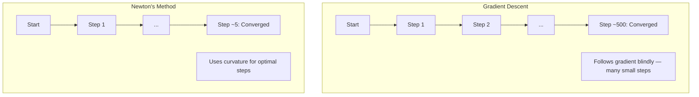
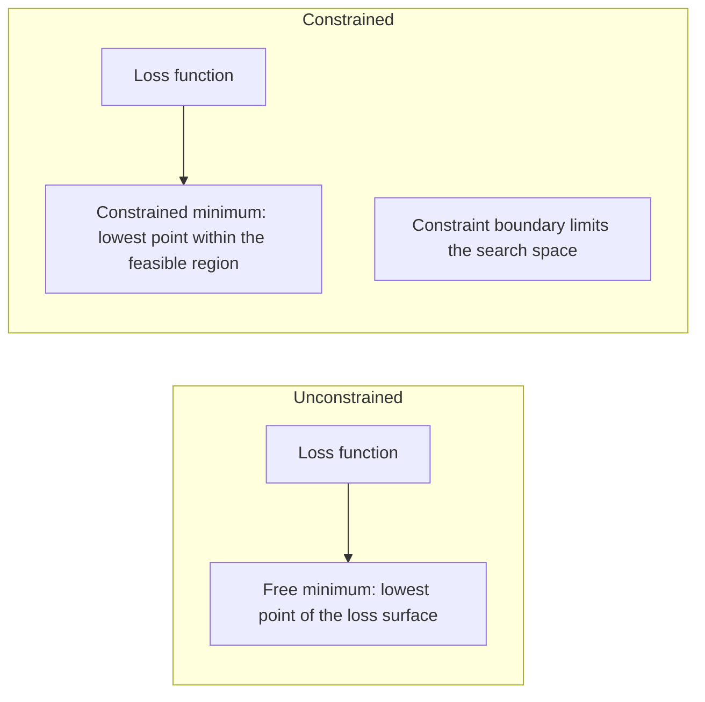
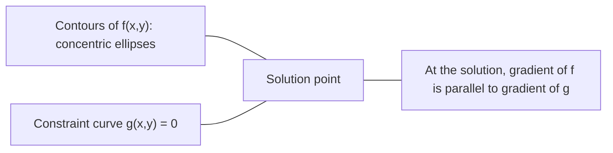

# Optimización convexa

> Los problemas convexos tienen un valle, las redes neuronales tienen millones, saber la diferencia importa.

**Type:** Build
**Languages:** Python, TypeScript
**Prerequisites:** Phase 1, Lessons 04 (Calculus for ML), 08 (Optimization)
**Time:** ~90 minutes

## Objetivos de aprendizaje

- Prueba si una función es convexa utilizando la definición, la segunda derivada y los criterios de Hessian
- Implemente el método de Newton y compare su convergencia cuadrática con el descenso de gradiente
- Resolver problemas de optimización restringidos utilizando multiplicadores de Lagrange e interpretar las condiciones de KKT
- Explica por qué los paisajes de pérdida de redes neuronales no son convexos pero SGD todavía encuentra buenas soluciones

## El problema

La lección 08 te enseñó la descenda de gradiente, el impulso y Adam. Esos optimizadores caminan por la ladera en cualquier superficie. Pero no tienen garantías. La descenda de gradiente en un paisaje no convexo puede aterrizar en un mínimo local malo, quedarse atascado en un punto de silla o oscilar para siempre. Lo usaste de todos modos porque las redes neuronales no son convexas y no hay alternativa.

Pero muchos problemas en el aprendizaje automático son convexos. Regresión lineal, regresión logística, SVMs, LASSO, regresión de cresta. Para estos, existe algo más fuerte: optimización con garantías matemáticas. Un problema convexo no tiene valles falsos: cada mínimo local es un mínimo global. Para una función convexa lisa que tenga un mínimo, converge a ella un descenso de gradiente con un tamaño de paso adecuado. No es necesario reiniciar. No hay horarios de aprendizaje. No hay oración.

Comprender la convexidad hace tres cosas. Primero, le dice cuándo su problema es fácil (convexa) versus duro (no convexa). Segundo, le da herramientas más rápidas como el método de Newton para problemas convexos. Tercero, explica conceptos que aparecen en todo ML: regularización como una restricción, dualidad en SVMs, y por qué el aprendizaje profundo funciona a pesar de violar cada propiedad agradable que le da la convexidad.

## El concepto

### conjuntos convexos

Un conjunto .$S$es convexa si para cualquier dos puntos en $S$, el segmento de línea entre ellos también se encuentra enteramente en $S$¿ Qué ?

| Convex sets | Not convex |
|---|---|
| **Rectangle**: any two points inside can be connected by a line segment that stays inside | **Star/crescent shape**: a line between two interior points can pass outside the set |
| **Triangle**: same property holds for all interior points | **Donut/annulus**: the hole means some line segments leave the set |
| The line segment between any two points stays within the set | The line segment between some pairs of points exits the set |

Prueba formal: para cualquier punto $x, y$En el$S$y cualquier otro .$t \in [0, 1]$, el punto $tx + (1-t)y$También está en $S$¿ Qué ?

Ejemplos de conjuntos convexos:
- Una línea, un avión, todo.$\mathbb{R}^n$
- Una bola (círculo, esfera, hiperesfera)
- Un medio espacio:$\lbrace x : a^T x \le b \rbrace$
- La intersección de cualquier número de conjuntos convexos

Ejemplos de conjuntos no convexos:
- Un donut (annulo)
- La unión de dos círculos desarticulados
- Cualquier conjunto con un "dent" o "agujero"

### Funciones convexas

Una función$f$es convexa si su dominio es un conjunto convexo y para cualquier dos puntos $x, y$en su dominio y en cualquier$t \in [0, 1]$¿Qué es esto ?

```math
f(tx + (1-t)y) \le t f(x) + (1-t) f(y)
```

Geométricamente: el segmento de línea entre cualquier dos puntos del gráfico se encuentra por encima o en el gráfico.

| Property | Convex function | Non-convex function |
|---|---|---|
| **Line segment test** | The line between any two points on the graph lies **above or on** the curve | The line between some points on the graph dips **below** the curve |
| **Shape** | Single bowl/valley curving upward | Multiple peaks and valleys with mixed curvature |
| **Local minima** | Every local minimum is the global minimum | Multiple local minima may exist at different heights |

Funciones convexas comunes:
- $f(x) = x^2$¿Qué es eso ?
- $f(x) = \lvert x \rvert$(valor absoluto)
- $f(x) = e^x$(exponencial)
- $f(x) = \max(0, x)$(ReLU, aunque pieza lineal)
- $f(x) = -\log(x)$por$x > 0$(registro negativo)
- Cualquier función lineal $f(x) = a^T x + b$(tanto convexa como cóncava)

### Pruebas de convexidad

Tres pruebas prácticas, desde las más fáciles hasta las más rigurosas.

**Test 1: Second derivative test (1D).**Si ...$f''(x) \ge 0$para todos .$x$, entonces$f$es convexa.

- $f(x) = x^2$¿ Qué es esto ?$f''(x) = 2 \ge 0$- Convexa.
- $f(x) = x^3$¿ Qué es esto ?$f''(x) = 6x$- Negativo para$x < 0$No es convexa.
- $f(x) = e^x$¿ Qué es esto ?$f''(x) = e^x > 0$- Convexa.

**Test 2: Hessian test (multivariate).**Si la matriz hessiana $H(x)$es semidefinido positivo para todos $x$, entonces$f$El Hessiano es la matriz de las derivadas parciales.

**Test 3: Definition test.**Compruebe la desigualdad.$f(tx + (1-t)y) \le t f(x) + (1-t) f(y)$Directamente. Útil para funciones donde las derivadas son difíciles de calcular.

### Por qué es importante la convexidad

El teorema central de la optimización convexa:

**For a convex function, every local minimum is a global minimum.**

Esto significa que el descenso de gradiente no puede quedar atrapado en un mínimo local malo. Cada mínimo que puede alcanzar tiene la misma pérdida. Para una función convexa lisa que tiene un mínimo, el descenso de gradiente con un tamaño de paso adecuado está garantizado para converger al valor óptimo.



Consecuencias:
- No hay necesidad de reiniciar al azar
- No se necesitan programas de aprendizaje sofisticados
- Las pruebas de convergencia son posibles (la tasa depende de las propiedades de la función)
- La solución es única (hasta regiones planas)

### Conveja vs no conveja en ML

| Problem | Convex? | Why |
|---------|---------|-----|
| Linear regression (MSE) | Yes | Loss is quadratic in weights |
| Logistic regression | Yes | Log-loss is convex in weights |
| SVM (hinge loss) | Yes | Maximum of linear functions |
| LASSO (L1 regression) | Yes | Sum of convex functions is convex |
| Ridge regression (L2) | Yes | Quadratic + quadratic = convex |
| Neural network (any loss) | No | Nonlinear activations create non-convex landscape |
| k-means clustering | No | Discrete assignment step |
| Matrix factorization | No | Product of unknowns |

Los modelos lineales con pérdidas convexas son convexas. En el momento en que se añaden capas ocultas con activaciones no lineales, se rompe la convexidad.

### La matriz hesiana

El Hesiano $H$de una función $f: \mathbb{R}^n \to \mathbb{R}$¿ Es el $n \times n$matriz de derivados parciales de segunda.

```math
H_{ij} = \frac{\partial^2 f}{\partial x_i \, \partial x_j}
```

Para$f(x, y) = x^2 + 3xy + y^2$¿Qué es esto ?

```math
\begin{gathered}
\begin{aligned}
\frac{\partial f}{\partial x} &= 2x + 3y & \frac{\partial^2 f}{\partial x^2} &= 2 & \frac{\partial^2 f}{\partial x \, \partial y} &= 3 \\
\frac{\partial f}{\partial y} &= 3x + 2y & \frac{\partial^2 f}{\partial y \, \partial x} &= 3 & \frac{\partial^2 f}{\partial y^2} &= 2
\end{aligned} \\[8pt]
H = \begin{bmatrix} 2 & 3 \\ 3 & 2 \end{bmatrix}
\end{gathered}
```

El Hessiano te dice acerca de la curvatura:
- Valores propios todos positivos: la función se curva hacia arriba en todas las direcciones (convexa en ese punto)
- Valores propios todos negativos: curvas hacia abajo en todas las direcciones (concavo, una máxima local)
- Signos mixtos: punto de silla (curvas hacia arriba en algunas direcciones, hacia abajo en otras)
- Valor propio cero: plano en esa dirección (degenerado)

Para la convexidad, el hessiano debe ser semidefinido positivo (todos los valores propios $\ge 0$) en todas partes, no sólo en un punto.

### El método de Newton

El descenso de gradiente utiliza información de primer orden (el gradiente). El método de Newton utiliza información de segundo orden (el Hessiano).

```math
\begin{aligned}
\text{Update rule:} \quad & x_{\text{new}} = x - H^{-1} \cdot \text{gradient} \\
\text{Compare to gradient descent:} \quad & x_{\text{new}} = x - \text{lr} \cdot \text{gradient}
\end{aligned}
```

El método de Newton reemplaza la tasa de aprendizaje escalar por el Hessiano inverso. Esto ajusta automáticamente el tamaño y la dirección del paso en función de la curvatura local.



Las ventajas:
- Convergencia cuadrática cerca del mínimo (cuadrados de errores en cada paso)
- No hay ritmo de aprendizaje para sintonizar
- Invariante de escala (funciona independientemente de cómo parametrice el problema)

Desventajas:
- Calculación de los costes de Hessian $O(n^2)$memoria y $O(n^3)$para invertir
- Para una red neuronal con 1 millón de pesos, eso es $10^{12}$las entradas y $10^{18}$operaciones
- No es práctico para el aprendizaje profundo

### Optimización limitada

Optimización sin restricciones: minimizar $f(x)$en todo .$x$¿ Qué ?
Optimización limitada: minimizar $f(x)$sujeto a restricciones.

Los problemas reales tienen limitaciones. Quiere reducir el costo pero su presupuesto es limitado. Quiere reducir al mínimo el error pero su complejidad del modelo es limitada.



### Multiplicadores de laranja

El método de los multiplicadores de Lagrange convierte un problema limitado en uno sin restricciones.

El problema es minimizar .$f(x)$sujeto a $g(x) = 0$¿ Qué ?

Solución: introducir una nueva variable (el multiplicador de Lagrange $\lambda$) y resolver el problema sin restricciones:

```math
L(x, \lambda) = f(x) + \lambda g(x)
```

En la solución, el gradiente de $L$es cero:

```math
\begin{aligned}
\frac{\partial L}{\partial x} &= \frac{\partial f}{\partial x} + \lambda \frac{\partial g}{\partial x} = 0 \\
\frac{\partial L}{\partial \lambda} &= g(x) = 0
\end{aligned}
```

Intuición geométrica: en el mínimo limitado, el gradiente de $f$debe ser paralela al gradiente de la restricción $g$Si no fueran paralelos, se podría mover a lo largo de la superficie de la restricción y reducir$f$más lejos.



Ejemplo: minimizar $f(x,y) = x^2 + y^2$sujeto a $x + y = 1$¿ Qué ?

```math
\begin{aligned}
L &= x^2 + y^2 + \lambda(x + y - 1) \\[4pt]
\frac{\partial L}{\partial x} &= 2x + \lambda = 0 \implies x = -\lambda/2 \\
\frac{\partial L}{\partial y} &= 2y + \lambda = 0 \implies y = -\lambda/2 \\
\frac{\partial L}{\partial \lambda} &= x + y - 1 = 0 \\[4pt]
&\text{From first two: } x = y \\
&\text{Substituting: } 2x = 1, \text{ so } x = y = 0.5, \ \lambda = -1
\end{aligned}
```

El punto más cercano de la línea .$x + y = 1$el origen es $(0.5, 0.5)$¿ Qué ?

### Condiciones de la TCC

Las condiciones de Karush-Kuhn-Tucker amplían los multiplicadores de Lagrange a las restricciones de desigualdad.

El problema es minimizar .$f(x)$sujeto a $g_i(x) \le 0$por$i = 1, \ldots, m$¿ Qué ?

Las condiciones de KKT (necesarias para la óptimalidad):

```math
\begin{aligned}
&\text{1. Stationarity:} && \frac{\partial f}{\partial x} + \sum_i \lambda_i \frac{\partial g_i}{\partial x} = 0 \\
&\text{2. Primal feasibility:} && g_i(x) \le 0 \quad \text{for all } i \\
&\text{3. Dual feasibility:} && \lambda_i \ge 0 \quad \text{for all } i \\
&\text{4. Complementary slackness:} && \lambda_i \, g_i(x) = 0 \quad \text{for all } i
\end{aligned}
```

La flexibilidad complementaria es la clave: o bien la restricción es activa ($g_i = 0$, la solución se encuentra en el límite) o el multiplicador es cero (la restricción no importa).$\lambda = 0$¿ Qué ?

Las condiciones de KKT son fundamentales para los SVM. Los vectores de apoyo son los puntos de datos en los que la restricción está activa ($\lambda > 0$Todos los demás puntos de datos tienen$\lambda = 0$y no afectan a la frontera de decisión.

### Regularización como optimización limitada

La regularización de L1 y L2 no son trucos arbitrarios, son problemas de optimización limitada disfrazados.

**L2 regularization (Ridge):**

```math
\begin{aligned}
&\text{minimize } \text{Loss}(w) \text{ subject to } \lVert w \rVert^2 \le t \\[4pt]
&\text{Equivalent unconstrained form:} \\
&\text{minimize } \text{Loss}(w) + \lambda \lVert w \rVert^2
\end{aligned}
```

La restricción$\lVert w \rVert^2 \le t$La solución es donde los contornos de pérdida tocan primero esta bola.

**L1 regularization (LASSO):**

```math
\begin{aligned}
&\text{minimize } \text{Loss}(w) \text{ subject to } \lVert w \rVert_1 \le t \\[4pt]
&\text{Equivalent unconstrained form:} \\
&\text{minimize } \text{Loss}(w) + \lambda \lVert w \rVert_1
\end{aligned}
```

La restricción$\lVert w \rVert_1 \le t$define un diamante (cuadrado giratorio en 2D).

| Property | L2 constraint (circle) | L1 constraint (diamond) |
|---|---|---|
| **Constraint shape** | Circle (sphere in higher dims) | Diamond (rotated square in 2D) |
| **Where loss contour touches** | Smooth boundary — any point on the circle | Corner — aligned with an axis |
| **Solution behavior** | Weights are small but nonzero | Some weights are exactly zero (sparse) |
| **Result** | Weight shrinkage | Feature selection |

Esto explica por qué L1 produce modelos escasos (selección de características) mientras que L2 solo reduce los pesos. El diamante tiene esquinas alineadas con ejes.

### La dualidad

Cada problema de optimización limitada (el primario) tiene un problema compañero (el dual). Para los problemas convexos, el primario y el dual tienen el mismo valor óptimo. Esta es una fuerte dualidad.

La función dual de Lagrangian:

```math
\begin{aligned}
&\text{Primal:} && \text{minimize } f(x) \text{ subject to } g(x) \le 0 \\
&\text{Lagrangian:} && L(x, \lambda) = f(x) + \lambda g(x) \\
&\text{Dual function:} && d(\lambda) = \min_x L(x, \lambda) \\
&\text{Dual problem:} && \text{maximize } d(\lambda) \text{ subject to } \lambda \ge 0
\end{aligned}
```

Por qué la dualidad es importante:
- El problema dual es a veces más fácil de resolver que el primordial
- Los SVM se resuelven en su forma dual, donde el problema depende de productos de puntos entre los puntos de datos (habilitando el truco del núcleo)
- El doble proporciona un límite inferior en el óptimo primario, útil para comprobar la calidad de la solución

Para los SVM específicamente:

```
Primal: find w, b that maximize the margin 2/||w|| subject to
        y_i(w^T x_i + b) >= 1 for all i

Dual:   maximize sum(alpha_i) - 0.5 * sum_ij(alpha_i * alpha_j * y_i * y_j * x_i^T x_j)
        subject to alpha_i >= 0 and sum(alpha_i * y_i) = 0

The dual only involves dot products x_i^T x_j.
Replace x_i^T x_j with K(x_i, x_j) to get the kernel trick.
```

### Por qué el aprendizaje profundo funciona a pesar de la no convexidad

Las funciones de pérdida de red neuronal son muy no convexas. Por todas las medidas clásicas, la optimización de ellas debería fallar. Sin embargo, el descenso de gradiente estocástico encuentra buenas soluciones confiablemente. Varios factores explican esto.

**Most local minima are good enough.**En los espacios de alta dimensión, los puntos críticos aleatorios (donde el gradiente es cero) son en su mayoría puntos de sella, no mínimos locales. Los pocos mínimos locales que existen tienden a tener valores de pérdida cercanos al mínimo global.

**Saddle points, not local minima, are the real obstacle.**En una función con $n$En el caso de los parámetros, un punto de silla tiene una mezcla de direcciones de curvatura positivas y negativas.$n$los valores propios son positivos (mínimo local) es aproximadamente $2^{-n}$Casi todos los puntos críticos son puntos de silla.

**Overparameterization smooths the landscape.**Las redes con más parámetros que los ejemplos de entrenamiento tienen superficies de pérdida más suaves y conectadas. Las redes más amplias tienen menos mínimos locales negativos. Esto es contrario a la intuición pero empíricamente consistente.

**Loss landscape structure:**

| Property | Low-dimensional space | High-dimensional space |
|---|---|---|
| **Landscape** | Many isolated peaks and valleys | Smoothly connected valleys |
| **Minima** | Many isolated local minima | Few bad local minima; most are near-optimal |
| **Navigation** | Hard to find global minimum | Many paths lead to good solutions |
| **Critical points** | Mix of local minima and saddle points | Overwhelmingly saddle points, not local minima |

**Stochastic noise acts as implicit regularization.**El SGD de mini lote añade ruido que evita que se establezca en mínimos nítidos. mínimos nítidos se sobreajustan; mínimos planos se generalizan. El ruido favorece la optimización hacia regiones planas del paisaje de pérdidas.

### Métodos de segundo orden en la práctica

El método de Newton puro es poco práctico para modelos grandes. Varias aproximaciones hacen que la información de segundo orden sea utilizable.

**L-BFGS (Limited-memory BFGS):**Aproxima el Hessiano inverso usando el último $m$Las diferencias de gradientes.$O(mn)$memoria en lugar de $O(n^2)$Funciona bien para problemas con hasta ~ 10.000 parámetros. Se utiliza en el ML clásico (regressión logística, CRF) pero no en el aprendizaje profundo.

**Natural gradient:**Utiliza la matriz de información de Fisher (Hessian esperado de la probabilidad de registro) en lugar del Hessian estándar. Esto explica la geometría de las distribuciones de probabilidad. K-FAC (Curvatura aproximada con factores de Cronécker) se aproxima a la matriz de Fisher como un producto de Cronécker, lo que la hace práctica para las redes neuronales.

**Hessian-free optimization:**Utiliza gradiente conjugado para resolver $Hx = g$sin formarse nunca.$H$. Sólo requiere productos de vectores hessianos, que se pueden calcular en $O(n)$tiempo mediante diferenciación automática.

**Diagonal approximations:**El segundo momento de Adam es una aproximación diagonal de la diagonal de Hessian. AdaHessian lo extiende utilizando elementos diagonales de Hessian reales a través del estimador de Hutchinson.

| Method | Memory | Per-step cost | When to use |
|--------|--------|--------------|-------------|
| Gradient descent | $O(n)$ | $O(n)$ | Baseline, large models |
| Newton's method | $O(n^2)$ | $O(n^3)$ | Small convex problems |
| L-BFGS | $O(mn)$ | $O(mn)$ | Medium convex problems |
| Adam | $O(n)$ | $O(n)$ | Deep learning default |
| K-FAC | $O(n)$ | $O(n)$ per layer | Research, large-batch training |

```figure
convex-vs-nonconvex
```

## Construye el mismo

### Paso 1: Verificación de convexidad

Construir una función que prueba la convexidad empíricamente mediante muestreo de puntos y comprobar la definición.

```python
import random
import math

def check_convexity(f, dim, bounds=(-5, 5), samples=1000):
    violations = 0
    for _ in range(samples):
        x = [random.uniform(*bounds) for _ in range(dim)]
        y = [random.uniform(*bounds) for _ in range(dim)]
        t = random.uniform(0, 1)
        mid = [t * xi + (1 - t) * yi for xi, yi in zip(x, y)]
        lhs = f(mid)
        rhs = t * f(x) + (1 - t) * f(y)
        if lhs > rhs + 1e-10:
            violations += 1
    return violations == 0, violations
```

### Paso 2: El método de Newton para 2D

Implemente el método de Newton usando un Hessiano explícito. Compara la velocidad de convergencia con el descenso de gradiente.

```python
def newtons_method(f, grad_f, hessian_f, x0, steps=50, tol=1e-12):
    x = list(x0)
    history = [x[:]]
    for _ in range(steps):
        g = grad_f(x)
        H = hessian_f(x)
        det = H[0][0] * H[1][1] - H[0][1] * H[1][0]
        if abs(det) < 1e-15:
            break
        H_inv = [
            [H[1][1] / det, -H[0][1] / det],
            [-H[1][0] / det, H[0][0] / det],
        ]
        dx = [
            H_inv[0][0] * g[0] + H_inv[0][1] * g[1],
            H_inv[1][0] * g[0] + H_inv[1][1] * g[1],
        ]
        x = [x[0] - dx[0], x[1] - dx[1]]
        history.append(x[:])
        if sum(gi ** 2 for gi in g) < tol:
            break
    return history
```

### Paso 3: Solvente del multiplicador de laranja

Resolver la optimización limitada utilizando el descenso de gradiente en el Lagrangiano.

```python
def lagrange_solve(f_grad, g_val, g_grad, x0, lr=0.01,
                   lr_lambda=0.01, steps=5000):
    x = list(x0)
    lam = 0.0
    history = []
    for _ in range(steps):
        fg = f_grad(x)
        gv = g_val(x)
        gg = g_grad(x)
        x = [
            xi - lr * (fgi + lam * ggi)
            for xi, fgi, ggi in zip(x, fg, gg)
        ]
        lam = lam + lr_lambda * gv
        history.append((x[:], lam, gv))
    return history
```

### Paso 4: Comparar el primer orden con el segundo orden

Ejecutar la descenda de gradiente y el método de Newton en la misma función cuadrática.

```python
def quadratic(x):
    return 5 * x[0] ** 2 + x[1] ** 2

def quadratic_grad(x):
    return [10 * x[0], 2 * x[1]]

def quadratic_hessian(x):
    return [[10, 0], [0, 2]]
```

El método de Newton convergerá en 1 paso (es exacto para la cuadrática).

## Usalo

El análisis de convexidad se aplica directamente a la hora de elegir modelos y solventes ML.

Para los problemas convexos (regressión logística, SVM, LASSO):
- Utilice solventes dedicados (liblinear, CVXPY, scipy.optimize.minimize con método='L-BFGS-B')
- Esperar una solución global única
- Los métodos de segundo orden son prácticos y rápidos

Para los problemas no convexos (redes neuronales):
- Utilice métodos de primer orden (SGD, Adam)
- Aceptar que la solución depende de la inicialización y la aleatoriedad
- Utilice los horarios de sobreparametrización, ruido y tasa de aprendizaje como regularización implícita
- No pierdas tiempo buscando el mínimo global.

```python
from scipy.optimize import minimize

result = minimize(
    fun=lambda w: sum((y - X @ w) ** 2) + 0.1 * sum(w ** 2),
    x0=np.zeros(d),
    method='L-BFGS-B',
    jac=lambda w: -2 * X.T @ (y - X @ w) + 0.2 * w,
)
```

Para los SVM, la fórmula dual permite usar el truco del núcleo:

```python
from sklearn.svm import SVC

svm = SVC(kernel='rbf', C=1.0)
svm.fit(X_train, y_train)
print(f"Support vectors: {svm.n_support_}")
```

## Los ejercicios

1. **Convexity gallery.**Prueba estas funciones para la convexidad utilizando el comprobador: $f(x) = x^4$¿ Qué ?$f(x) = \sin(x)$¿ Qué ?$f(x,y) = x^2 + y^2$¿ Qué ?$f(x,y) = xy$¿ Qué ?$f(x) = \max(x, 0)$Explica por qué cada resultado tiene sentido.

2. **Newton vs gradient descent race.**Ejecutar ambos métodos en $f(x,y) = 50x^2 + y^2$desde el punto de partida $(10, 10)$¿Cuántos pasos necesita cada uno para alcanzar la pérdida < 1e-10? ¿Qué sucede con el descenso de gradiente cuando el número de condición (ratio del valor propio hessiano más grande a menor) aumenta?

3. **Lagrange multiplier geometry.**Minimizar$f(x,y) = (x-3)^2 + (y-3)^2$sujeto a $x + 2y = 4$. Verificar la solución comprobando que el gradiente de $f$es paralelo al gradiente de $g$en la solución.

4. **Regularization constraint.**Implementar la optimización limitada L1: minimizar $(x-3)^2 + (y-2)^2$sujeto a $\lvert x \rvert + \lvert y \rvert \le 1$. Mostrar que la solución tiene una coordenada igual a cero (sparsidad de la restricción del diamante).

5. **Hessian eigenvalue analysis.**Compute el Hessian de la función Rosenbrock en (1,1) y en (-1,1). Compute los valores propios en ambos puntos. ¿Qué le dicen los valores propios sobre la curvatura en el mínimo versus lejos de él?

### Indicios

**Exercise 1.**Prevé cada resultado antes de correr .`check_convexity`En una dimensión, mira el signo de$f''(x)$En dos dimensiones, observe los valores propios del Hessian.$f(x,y) = xy$, el Hessian tiene valores propios 1 y -1, por lo que el comprobador debe informar que no es convexa.

**Exercise 2.**Llamé`optimize_gd`y `newtons_method`con el gradiente y el hessiano de $f$El método de Newton resuelve un cuadrático en un paso. para la descesión de gradientes, la tasa de aprendizaje debe ser menor que$2/100$por el $50x^2$término, por lo que el $y$La dirección se mueve lentamente. Repita con $100x^2$y contar los pasos de nuevo.

**Exercise 3.**Usar`lagrange_solve`con$g(x,y) = x + 2y - 4$En la respuesta, comprueba eso.$x + 2y = 4$Y eso .$\nabla f = (2(x-3), 2(y-3))$es un múltiplo de $\nabla g = (1, 2)$¿ Qué ?

**Exercise 4.**El mínimo sin restricciones (3, 2) está fuera del diamante, por lo que la respuesta está en su límite.$\lvert x \rvert + \lvert y \rvert \le 1$. Compruebe si el resultado satisface la limitación con igualdad y compare con `demo_regularization_geometry`¿ Qué ?

**Exercise 5.**Llamé`rosenbrock_hessian`en cada punto y pasar el resultado a `hessian_eigenvalues_2d`En (1, 1), ambos valores propios son positivos y su relación es muy grande, por lo que el valle es estrecho en una dirección y plano en la otra.

## Términos clave

| Term | What it means |
|------|---------------|
| Convex set | A set where the line segment between any two points in the set stays inside the set |
| Convex function | A function where the line between any two points on its graph lies above or on the graph. Equivalently, Hessian is positive semidefinite everywhere |
| Local minimum | A point lower than all nearby points. For convex functions, every local minimum is the global minimum |
| Global minimum | The lowest point of a function over its entire domain |
| Hessian matrix | The matrix of all second partial derivatives. Encodes curvature information |
| Positive semidefinite | A matrix whose eigenvalues are all non-negative. The multidimensional analogue of "second derivative >= 0" |
| Condition number | Ratio of largest to smallest eigenvalue of the Hessian. High condition number means elongated valleys and slow gradient descent |
| Newton's method | Second-order optimizer that uses the inverse Hessian to determine step direction and size. Quadratic convergence near the minimum |
| Lagrange multiplier | A variable introduced to convert a constrained optimization problem into an unconstrained one |
| KKT conditions | Necessary conditions for optimality with inequality constraints. Generalize Lagrange multipliers |
| Complementary slackness | At the solution, either a constraint is active or its multiplier is zero. Never both nonzero |
| Duality | Every constrained problem has a companion dual problem. For convex problems, both have the same optimal value |
| Strong duality | Primal and dual optimal values are equal. Holds for convex problems satisfying Slater's condition |
| L-BFGS | Approximate second-order method that stores the last $m$ gradient differences instead of the full Hessian |
| Saddle point | A point where the gradient is zero but it is a minimum in some directions and a maximum in others |
| Overparameterization | Using more parameters than training examples. Smooths the loss landscape and reduces bad local minima |

## Leer más

- [Boyd & Vandenberghe: Convex Optimization](https://web.stanford.edu/~boyd/cvxbook/)- el libro de texto estándar, disponible gratuitamente en línea
- [Bottou, Curtis, Nocedal: Optimization Methods for Large-Scale Machine Learning (2018)](https://arxiv.org/abs/1606.04838)- puentes de teoría de la optimización convexa y práctica de aprendizaje profundo
- [Choromanska et al.: The Loss Surfaces of Multilayer Networks (2015)](https://arxiv.org/abs/1412.0233)- por qué los paisajes de las redes neuronales no convexas no son tan malos como parecen
- [Nocedal & Wright: Numerical Optimization](https://link.springer.com/book/10.1007/978-0-387-40065-5)- referencia completa del método de Newton, L-BFGS, y optimización limitada
