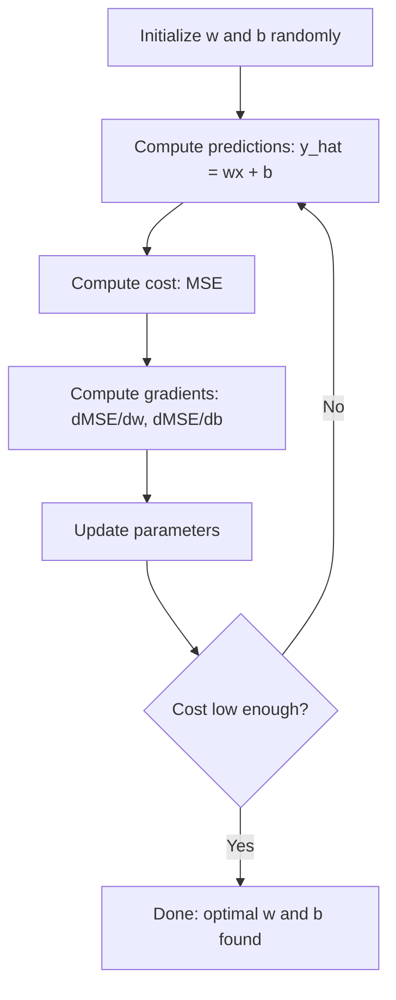

# Regresión lineal

> La regresión lineal traza la mejor línea recta a través de sus datos. Es el "hola mundo" del aprendizaje automático.

**Type:** Build
**Languages:** Python, Julia, Rust
**Prerequisites:** Phase 1 (Linear Algebra, Calculus, Optimization), Phase 2 Lesson 1
**Time:** ~90 minutes

## Objetivos de aprendizaje

- Derivar las reglas de actualización de la descenso de gradiente para el error medio cuadrado e implementar regresión lineal desde cero
- Comparar la descendencia de gradientes y la ecuación normal en términos de complejidad computacional y cuándo utilizar cada uno
- Construir un modelo de regresión lineal múltiple con estandarización de características e interpretar los pesos aprendidos
- Explica cómo la regresión de Ridge (regularización L2) evita el sobreajuste mediante la penalización de pesos grandes

## El problema

Tienes datos: tamaño de la casa y sus precios de venta. Quieres predecir el precio de una casa nueva dada su tamaño. Puedes mirar en un gráfico de dispersión, pero necesitas una fórmula. Necesitas una línea que mejor se adapte a los datos para poder conectar cualquier tamaño y obtener una predicción de precio.

La regresión lineal te da esa línea. Lo más importante, introduce todo el ciclo de entrenamiento de ML: definir un modelo, definir una función de costo, optimizar los parámetros. Cada algoritmo de ML sigue este mismo patrón. Dominarlo aquí con el caso más simple, y lo reconocerás en todas partes.

Esto no es sólo para problemas simples. La regresión lineal se utiliza en los sistemas de producción para la predicción de la demanda, análisis de pruebas A/B, modelado financiero y como base para cada tarea de regresión.

## El concepto

### El modelo

La regresión lineal asume una relación lineal entre las entradas ($x$) y la producción ($y$):

```math
y = wx + b
```

- `w`(peso/inclinación): cuánto $y$cambios cuando $x$Aumento de 1
- `b`(bias/intercepción): el valor de $y$¿ Cuándo ?$x = 0$

Para múltiples entradas (cargas), esto se extiende a:

```math
y = w_1 x_1 + w_2 x_2 + \cdots + w_n x_n + b
```

O en forma vectorial: $y = w^T x + b$

El objetivo: encontrar los valores de $w$y $b$que hacen lo previsto $y$lo más cerca posible de la actual $y$En todos los ejemplos de formación.

### La función de costo (error medio cuadrado)

¿Cómo medir "lo más cerca posible"? Necesitas un solo número que capture lo equivocado que son tus predicciones. La opción más común es el error medio cuadrado (MSE):

```math
\text{MSE} = \frac{1}{n} \sum (y_{\text{predicted}} - y_{\text{actual}})^2
```

¿Por qué cuadrado? Dos razones. Primero, penaliza errores grandes más que errores pequeños (un error de 10 es 100 veces peor que un error de 1, no 10x). Segundo, la función cuadrada es suave y diferenciable en todas partes, lo que hace que la optimización sea sencilla.

La función de costo crea una superficie.$w$y sesgo$b$La superficie del MSE se parece a un recipiente (una paraboloide convexa).

### Descenso gradual

La descenso gradual encuentra la parte inferior del tazón haciendo pasos hacia abajo.



Los gradientes te dicen dos cosas: en qué dirección mover cada parámetro, y cuánto mover.

Para la EMS con $\hat{y} = wx + b$¿Qué es esto ?

```math
\begin{aligned}
\frac{\partial \text{MSE}}{\partial w} &= \frac{2}{n} \sum (\hat{y} - y) \, x \\
\frac{\partial \text{MSE}}{\partial b} &= \frac{2}{n} \sum (\hat{y} - y)
\end{aligned}
```

La regla de actualización:

```math
\begin{aligned}
w &= w - \text{learning\_rate} \cdot \frac{\partial \text{MSE}}{\partial w} \\
b &= b - \text{learning\_rate} \cdot \frac{\partial \text{MSE}}{\partial b}
\end{aligned}
```

El ritmo de aprendizaje controla el tamaño del paso. Demasiado grande: se supera el mínimo y se diverge. Demasiado pequeño: el entrenamiento dura para siempre. Valores iniciales típicos: 0.01, 0.001, o 0.0001.

### La ecuación normal (solución en forma cerrada)

Para la regresión lineal específicamente, hay una fórmula directa que da los pesos óptimos sin ninguna iteración:

```math
w = (X^T X)^{-1} X^T y
```

Esto invierte una matriz para resolver$w$Para grandes conjuntos de datos (millones de filas o miles de características), se prefiere la descendencia de gradiente porque la inversión de matriz es$O(n^3)$en el número de características.

### Regresión lineal múltiple

Con múltiples características, el modelo se convierte en:

```math
y = w_1 x_1 + w_2 x_2 + \cdots + w_n x_n + b
```

Todo funciona de la misma manera: MSE es la función de costo, la descenda de gradiente actualiza todos los pesos simultáneamente.

Si una característica oscila entre 0 y 1 y otra oscila entre 0 y 1,000,000, el descenso de gradiente tendrá dificultades porque la superficie de costo se alarga.

### Regresión polinómica

¿Qué pasa si la relación no es lineal?

```math
y = w_1 x + w_2 x^2 + w_3 x^3 + b
```

Esto sigue siendo una regresión "lineal" porque el modelo es lineal en los pesos ($w_1, w_2, w_3$¿Qué es lo que se hace ?$x$¿ Qué ?

Los polinomios de grado superior pueden ajustarse a curvas más complejas pero corren el riesgo de sobreajuste. Un polinomio de grado 10 pasará a través de todos los puntos de un conjunto de datos de 10 puntos pero predice mal sobre los nuevos datos.

### Punto de la cuadrada

El MSE le dice lo equivocado que está, pero el número depende de la escala de$y$. R- cuadrado ($R^2$) proporciona una medida independiente de la escala:

```math
\begin{aligned}
R^2 &= 1 - \frac{\text{sum of squared residuals}}{\text{sum of squared deviations from mean}} \\
&= 1 - \frac{SS_{\text{res}}}{SS_{\text{tot}}}
\end{aligned}
```

- $R^2 = 1.0$: predicciones perfectas
- $R^2 = 0.0$: el modelo no es mejor que predecir la media cada vez
- $R^2 < 0.0$: el modelo es peor que predecir la media

### Previsión de regularización (regreso de la cuenca)

Cuando tienes muchas características, el modelo puede sobresalir asignando grandes pesos.

```math
\text{Cost} = \text{MSE} + \lambda \sum w_i^2
```

El término de penalidad desalienta los pesos grandes.$\lambda$control de la compensación: mayor $\lambda$Esto se abordará en profundidad en una lección posterior. por ahora, sabe que existe y por qué ayuda.

```figure
linear-regression-fit
```

## Construye el mismo

### Paso 1: Generar datos de muestras

```python
import random
import math

random.seed(42)

TRUE_W = 3.0
TRUE_B = 7.0
N_SAMPLES = 100

X = [random.uniform(0, 10) for _ in range(N_SAMPLES)]
y = [TRUE_W * x + TRUE_B + random.gauss(0, 2.0) for x in X]

print(f"Generated {N_SAMPLES} samples")
print(f"True relationship: y = {TRUE_W}x + {TRUE_B} (+ noise)")
print(f"First 5 points: {[(round(X[i], 2), round(y[i], 2)) for i in range(5)]}")
```

### Paso 2: Regresión lineal desde cero con descenso de gradiente

```python
class LinearRegression:
    def __init__(self, learning_rate=0.01):
        self.w = 0.0
        self.b = 0.0
        self.lr = learning_rate
        self.cost_history = []

    def predict(self, X):
        return [self.w * x + self.b for x in X]

    def compute_cost(self, X, y):
        predictions = self.predict(X)
        n = len(y)
        cost = sum((pred - actual) ** 2 for pred, actual in zip(predictions, y)) / n
        return cost

    def compute_gradients(self, X, y):
        predictions = self.predict(X)
        n = len(y)
        dw = (2 / n) * sum((pred - actual) * x for pred, actual, x in zip(predictions, y, X))
        db = (2 / n) * sum(pred - actual for pred, actual in zip(predictions, y))
        return dw, db

    def fit(self, X, y, epochs=1000, print_every=200):
        for epoch in range(epochs):
            dw, db = self.compute_gradients(X, y)
            self.w -= self.lr * dw
            self.b -= self.lr * db
            cost = self.compute_cost(X, y)
            self.cost_history.append(cost)
            if epoch % print_every == 0:
                print(f"  Epoch {epoch:4d} | Cost: {cost:.4f} | w: {self.w:.4f} | b: {self.b:.4f}")
        return self

    def r_squared(self, X, y):
        predictions = self.predict(X)
        y_mean = sum(y) / len(y)
        ss_res = sum((actual - pred) ** 2 for actual, pred in zip(y, predictions))
        ss_tot = sum((actual - y_mean) ** 2 for actual in y)
        return 1 - (ss_res / ss_tot)


print("=== Training Linear Regression (Gradient Descent) ===")
model = LinearRegression(learning_rate=0.005)
model.fit(X, y, epochs=1000, print_every=200)
print(f"\nLearned: y = {model.w:.4f}x + {model.b:.4f}")
print(f"True:    y = {TRUE_W}x + {TRUE_B}")
print(f"R-squared: {model.r_squared(X, y):.4f}")
```

### Paso 3: Equación normal (solución de forma cerrada)

```python
class LinearRegressionNormal:
    def __init__(self):
        self.w = 0.0
        self.b = 0.0

    def fit(self, X, y):
        n = len(X)
        x_mean = sum(X) / n
        y_mean = sum(y) / n
        numerator = sum((X[i] - x_mean) * (y[i] - y_mean) for i in range(n))
        denominator = sum((X[i] - x_mean) ** 2 for i in range(n))
        self.w = numerator / denominator
        self.b = y_mean - self.w * x_mean
        return self

    def predict(self, X):
        return [self.w * x + self.b for x in X]

    def r_squared(self, X, y):
        predictions = self.predict(X)
        y_mean = sum(y) / len(y)
        ss_res = sum((actual - pred) ** 2 for actual, pred in zip(y, predictions))
        ss_tot = sum((actual - y_mean) ** 2 for actual in y)
        return 1 - (ss_res / ss_tot)


print("\n=== Normal Equation (Closed-Form) ===")
model_normal = LinearRegressionNormal()
model_normal.fit(X, y)
print(f"Learned: y = {model_normal.w:.4f}x + {model_normal.b:.4f}")
print(f"R-squared: {model_normal.r_squared(X, y):.4f}")
```

### Paso 4: Regresión lineal múltiple

```python
class MultipleLinearRegression:
    def __init__(self, n_features, learning_rate=0.01):
        self.weights = [0.0] * n_features
        self.bias = 0.0
        self.lr = learning_rate
        self.cost_history = []

    def predict_single(self, x):
        return sum(w * xi for w, xi in zip(self.weights, x)) + self.bias

    def predict(self, X):
        return [self.predict_single(x) for x in X]

    def compute_cost(self, X, y):
        predictions = self.predict(X)
        n = len(y)
        return sum((pred - actual) ** 2 for pred, actual in zip(predictions, y)) / n

    def fit(self, X, y, epochs=1000, print_every=200):
        n = len(y)
        n_features = len(X[0])
        for epoch in range(epochs):
            predictions = self.predict(X)
            errors = [pred - actual for pred, actual in zip(predictions, y)]
            for j in range(n_features):
                grad = (2 / n) * sum(errors[i] * X[i][j] for i in range(n))
                self.weights[j] -= self.lr * grad
            grad_b = (2 / n) * sum(errors)
            self.bias -= self.lr * grad_b
            cost = self.compute_cost(X, y)
            self.cost_history.append(cost)
            if epoch % print_every == 0:
                print(f"  Epoch {epoch:4d} | Cost: {cost:.4f}")
        return self

    def r_squared(self, X, y):
        predictions = self.predict(X)
        y_mean = sum(y) / len(y)
        ss_res = sum((actual - pred) ** 2 for actual, pred in zip(y, predictions))
        ss_tot = sum((actual - y_mean) ** 2 for actual in y)
        return 1 - (ss_res / ss_tot)


random.seed(42)
N = 100
X_multi = []
y_multi = []
for _ in range(N):
    size = random.uniform(500, 3000)
    bedrooms = random.randint(1, 5)
    age = random.uniform(0, 50)
    price = 50 * size + 10000 * bedrooms - 1000 * age + 50000 + random.gauss(0, 20000)
    X_multi.append([size, bedrooms, age])
    y_multi.append(price)


def standardize(X):
    n_features = len(X[0])
    means = [sum(X[i][j] for i in range(len(X))) / len(X) for j in range(n_features)]
    stds = []
    for j in range(n_features):
        variance = sum((X[i][j] - means[j]) ** 2 for i in range(len(X))) / len(X)
        stds.append(variance ** 0.5)
    X_scaled = []
    for i in range(len(X)):
        row = [(X[i][j] - means[j]) / stds[j] if stds[j] > 0 else 0 for j in range(n_features)]
        X_scaled.append(row)
    return X_scaled, means, stds


y_mean_val = sum(y_multi) / len(y_multi)
y_std_val = (sum((yi - y_mean_val) ** 2 for yi in y_multi) / len(y_multi)) ** 0.5
y_scaled = [(yi - y_mean_val) / y_std_val for yi in y_multi]

X_scaled, x_means, x_stds = standardize(X_multi)

print("\n=== Multiple Linear Regression (3 features) ===")
print("Features: house size, bedrooms, age")
multi_model = MultipleLinearRegression(n_features=3, learning_rate=0.01)
multi_model.fit(X_scaled, y_scaled, epochs=1000, print_every=200)

print(f"\nWeights (standardized): {[round(w, 4) for w in multi_model.weights]}")
print(f"Bias (standardized): {multi_model.bias:.4f}")
print(f"R-squared: {multi_model.r_squared(X_scaled, y_scaled):.4f}")
```

### Paso 5: Regresión polinómica

```python
class PolynomialRegression:
    def __init__(self, degree, learning_rate=0.01):
        self.degree = degree
        self.weights = [0.0] * degree
        self.bias = 0.0
        self.lr = learning_rate

    def make_features(self, X):
        return [[x ** (d + 1) for d in range(self.degree)] for x in X]

    def predict(self, X):
        features = self.make_features(X)
        return [sum(w * f for w, f in zip(self.weights, row)) + self.bias for row in features]

    def fit(self, X, y, epochs=1000, print_every=200):
        features = self.make_features(X)
        n = len(y)
        for epoch in range(epochs):
            predictions = [sum(w * f for w, f in zip(self.weights, row)) + self.bias for row in features]
            errors = [pred - actual for pred, actual in zip(predictions, y)]
            for j in range(self.degree):
                grad = (2 / n) * sum(errors[i] * features[i][j] for i in range(n))
                self.weights[j] -= self.lr * grad
            grad_b = (2 / n) * sum(errors)
            self.bias -= self.lr * grad_b
            if epoch % print_every == 0:
                cost = sum(e ** 2 for e in errors) / n
                print(f"  Epoch {epoch:4d} | Cost: {cost:.6f}")
        return self

    def r_squared(self, X, y):
        predictions = self.predict(X)
        y_mean = sum(y) / len(y)
        ss_res = sum((actual - pred) ** 2 for actual, pred in zip(y, predictions))
        ss_tot = sum((actual - y_mean) ** 2 for actual in y)
        return 1 - (ss_res / ss_tot)


random.seed(42)
X_poly = [x / 10.0 for x in range(0, 50)]
y_poly = [0.5 * x ** 2 - 2 * x + 3 + random.gauss(0, 1.0) for x in X_poly]

x_max = max(abs(x) for x in X_poly)
X_poly_norm = [x / x_max for x in X_poly]
y_poly_mean = sum(y_poly) / len(y_poly)
y_poly_std = (sum((yi - y_poly_mean) ** 2 for yi in y_poly) / len(y_poly)) ** 0.5
y_poly_norm = [(yi - y_poly_mean) / y_poly_std for yi in y_poly]

print("\n=== Polynomial Regression (degree 2 vs degree 5) ===")
print("True relationship: y = 0.5x^2 - 2x + 3")

print("\nDegree 2:")
poly2 = PolynomialRegression(degree=2, learning_rate=0.1)
poly2.fit(X_poly_norm, y_poly_norm, epochs=2000, print_every=500)
print(f"  R-squared: {poly2.r_squared(X_poly_norm, y_poly_norm):.4f}")

print("\nDegree 5:")
poly5 = PolynomialRegression(degree=5, learning_rate=0.1)
poly5.fit(X_poly_norm, y_poly_norm, epochs=2000, print_every=500)
print(f"  R-squared: {poly5.r_squared(X_poly_norm, y_poly_norm):.4f}")

print("\nDegree 2 fits the true curve well. Degree 5 fits training data slightly better")
print("but risks overfitting on new data.")
```

### Paso 6: Regresión de la escala (regularización de L2)

```python
class RidgeRegression:
    def __init__(self, n_features, learning_rate=0.01, alpha=1.0):
        self.weights = [0.0] * n_features
        self.bias = 0.0
        self.lr = learning_rate
        self.alpha = alpha

    def predict_single(self, x):
        return sum(w * xi for w, xi in zip(self.weights, x)) + self.bias

    def predict(self, X):
        return [self.predict_single(x) for x in X]

    def fit(self, X, y, epochs=1000, print_every=200):
        n = len(y)
        n_features = len(X[0])
        for epoch in range(epochs):
            predictions = self.predict(X)
            errors = [pred - actual for pred, actual in zip(predictions, y)]
            mse = sum(e ** 2 for e in errors) / n
            reg_term = self.alpha * sum(w ** 2 for w in self.weights)
            cost = mse + reg_term
            for j in range(n_features):
                grad = (2 / n) * sum(errors[i] * X[i][j] for i in range(n))
                grad += 2 * self.alpha * self.weights[j]
                self.weights[j] -= self.lr * grad
            grad_b = (2 / n) * sum(errors)
            self.bias -= self.lr * grad_b
            if epoch % print_every == 0:
                print(f"  Epoch {epoch:4d} | Cost: {cost:.4f} | L2 penalty: {reg_term:.4f}")
        return self


print("\n=== Ridge Regression (L2 Regularization) ===")
print("Same data as multiple regression, with alpha=0.1")
ridge = RidgeRegression(n_features=3, learning_rate=0.01, alpha=0.1)
ridge.fit(X_scaled, y_scaled, epochs=1000, print_every=200)
print(f"\nRidge weights: {[round(w, 4) for w in ridge.weights]}")
print(f"Plain weights: {[round(w, 4) for w in multi_model.weights]}")
print("Ridge weights are smaller (shrunk toward zero) due to the L2 penalty.")
```

## Usalo

Ahora lo mismo con el aprendizaje de la escikit, que es lo que realmente utilizará en la producción.

```python
from sklearn.linear_model import LinearRegression as SklearnLR
from sklearn.linear_model import Ridge
from sklearn.preprocessing import PolynomialFeatures, StandardScaler
from sklearn.model_selection import train_test_split
from sklearn.metrics import mean_squared_error, r2_score
import numpy as np

np.random.seed(42)
X_sk = np.random.uniform(0, 10, (100, 1))
y_sk = 3.0 * X_sk.squeeze() + 7.0 + np.random.normal(0, 2.0, 100)

X_train, X_test, y_train, y_test = train_test_split(X_sk, y_sk, test_size=0.2, random_state=42)

lr = SklearnLR()
lr.fit(X_train, y_train)
y_pred = lr.predict(X_test)

print("=== Scikit-learn Linear Regression ===")
print(f"Coefficient (w): {lr.coef_[0]:.4f}")
print(f"Intercept (b): {lr.intercept_:.4f}")
print(f"R-squared (test): {r2_score(y_test, y_pred):.4f}")
print(f"MSE (test): {mean_squared_error(y_test, y_pred):.4f}")

poly = PolynomialFeatures(degree=2, include_bias=False)
X_poly_sk = poly.fit_transform(X_train)
X_poly_test = poly.transform(X_test)

lr_poly = SklearnLR()
lr_poly.fit(X_poly_sk, y_train)
print(f"\nPolynomial degree 2 R-squared: {r2_score(y_test, lr_poly.predict(X_poly_test)):.4f}")

scaler = StandardScaler()
X_train_scaled = scaler.fit_transform(X_train)
X_test_scaled = scaler.transform(X_test)

ridge = Ridge(alpha=1.0)
ridge.fit(X_train_scaled, y_train)
print(f"Ridge R-squared: {r2_score(y_test, ridge.predict(X_test_scaled)):.4f}")
print(f"Ridge coefficient: {ridge.coef_[0]:.4f}")
```

La aplicación desde cero y la aplicación de scikit-learn producen los mismos resultados. La diferencia: scikit-learn maneja casos de borde, estabilidad numérica y optimizaciones de rendimiento. Utilice la biblioteca para la producción. Utilice la versión desde cero para entender lo que está sucediendo.

## Envío

Esta lección produce:
- `outputs/skill-regression.md`- la habilidad para elegir el enfoque de regresión adecuado en función del problema

## Los ejercicios

1. Implemente el descenso de gradiente de lote, el descenso de gradiente estocástico (SGD) y el descenso de gradiente de mini lote. Comparar la velocidad de convergencia en el mismo conjunto de datos. ¿Cuál converge más rápido? ¿Cuál tiene la curva de costos más suave?
2. Generar datos a partir de una función cúbica ($y = ax^3 + bx^2 + cx + d + \text{noise}$Los estudios de formación de los estudiantes de la universidad de la Universidad de Madrid, en el que se encuentran los estudiantes de la universidad de la Universidad de Madrid, han sido realizados en el marco de la formación de los estudiantes de la universidad de la universidad de la universidad de Madrid.$R^2$y prueba$R^2$¿En qué grado se vuelve obvio el sobreajuste?
3. Implementar la regresión de Lasso (regularización L1: $\text{penalty} = \alpha \sum \lvert w_i \rvert$¿Por qué L1 produce soluciones escasas mientras que L2 no?

## Términos clave

| Term | What people say | What it actually means |
|------|----------------|----------------------|
| Linear regression | "Draw a line through data" | Find weight $w$ and bias $b$ that minimize the sum of squared differences between $wx+b$ and actual $y$ values |
| Cost function | "How bad the model is" | A function that maps model parameters to a single number measuring prediction error, which optimization minimizes |
| Mean squared error | "Average of squared errors" | $\frac{1}{n} \sum (\text{predicted} - \text{actual})^2$, penalizing large errors disproportionately |
| Gradient descent | "Walk downhill" | Iteratively adjust parameters in the direction that reduces the cost function, using partial derivatives |
| Learning rate | "Step size" | A scalar that controls how much parameters change per gradient descent step |
| Normal equation | "Solve it directly" | The closed-form solution $w = (X^T X)^{-1} X^T y$ that gives optimal weights without iteration |
| R-squared | "How good the fit is" | The fraction of variance in $y$ explained by the model, ranging from negative infinity to 1.0 |
| Feature scaling | "Make features comparable" | Transforming features to similar ranges (e.g., zero mean, unit variance) so gradient descent converges faster |
| Regularization | "Penalize complexity" | Adding a term to the cost function that shrinks weights, preventing overfitting |
| Ridge regression | "L2 regularization" | Linear regression with a penalty of $\lambda \sum w_i^2$ added to MSE |
| Polynomial regression | "Fitting curves with linear math" | Linear regression on polynomial features ($x, x^2, x^3, \ldots$), still linear in the weights |
| Overfitting | "Memorizing training data" | Using a model so complex that it fits noise in training data and fails on new data |

## Leer más

- [An Introduction to Statistical Learning (ISLR)](https://www.statlearning.com/)-- PDF gratuito, los capítulos 3 y 6 cubren la regresión lineal y la regularización con ejemplos prácticos de R
- [The Elements of Statistical Learning (ESL)](https://hastie.su.domains/ElemStatLearn/)-- PDF gratuito, el compañero más matemático de la ISLR con un tratamiento más profundo de la cresta y lasso
- [Stanford CS229 Lecture Notes on Linear Regression](https://cs229.stanford.edu/main_notes.pdf)-- Las notas de Andrew Ng derivando la ecuación normal y la descesión de gradiente de los primeros principios
- [scikit-learn LinearRegression documentation](https://scikit-learn.org/stable/modules/linear_model.html)-- referencia práctica para LinearRegression, Ridge, Lasso y ElasticNet con ejemplos de código
