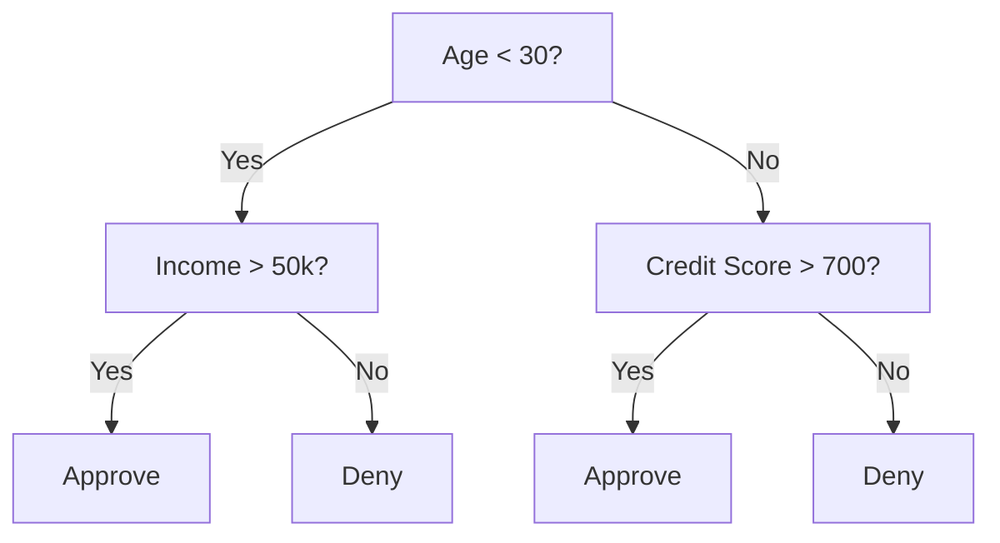
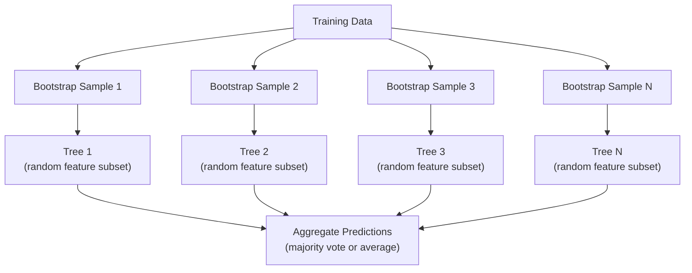

# Árboles de decisión y bosques aleatorios

> Un árbol de decisión es sólo un diagrama de flujo, pero un bosque de ellos es una de las herramientas más poderosas en ML.

**Type:** Build
**Languages:** Python, TypeScript
**Prerequisites:** Phase 1 (Lessons 09 Information Theory, 06 Probability)
**Time:** ~90 minutes

## Objetivos de aprendizaje

- Implementar cálculos de impureza, entropía y ganancia de información de Gini para encontrar las divisiones óptimas del árbol de decisión
- Construir desde cero un clasificador de árbol de decisión con controles pre-tono (profundidad máxima, muestras mínimas)
- Construir un bosque aleatorio utilizando muestreo de arranque y la aleatorización de características, y explicar por qué reduce la varianza
- Comparar la importancia de las características de MDI con la importancia de la permutación e identificar cuándo la MDI es sesgada

## El problema

Hay datos tablales. Las filas son muestras, las columnas son características, y hay una columna objetivo que quieres predecir. Puedes lanzar una red neuronal a ella. Pero para los datos tablales, los modelos basados en árboles (árboles de decisión, bosques aleatorios, árboles aumentados en gradiente) superan consistentemente el aprendizaje profundo. Las competiciones de Kaggle en datos estructurados son dominadas por XGBoost y LightGBM, no por transformadores.

Los árboles manejan tipos de características mixtas (númricas y categoricas) sin procesamiento previo. Manejan relaciones no lineales sin ingeniería de características. Son interpretables: se puede mirar al árbol y ver exactamente por qué se hizo una predicción.

Esta lección construye árboles de decisión desde cero utilizando la división recursiva, luego construye un bosque aleatorio en la parte superior. Implementará las matemáticas detrás de los criterios de división (impureza de Gini, entropía, ganancia de información) y entenderá por qué un conjunto de estudiantes débiles se convierte en uno fuerte.

## El concepto

### Lo que hace un árbol de decisión

Un árbol de decisión divide el espacio de características en regiones rectangulares haciendo una secuencia de preguntas de sí/no.



Cada nodo interno prueba una característica contra un umbral. Cada nodo de hoja hace una predicción. Para clasificar un nuevo punto de datos, comienza en la raíz y sigue las ramas hasta llegar a una hoja.

El árbol se construye de arriba hacia abajo eligiendo, en cada nodo, la característica y el umbral que mejor separan los datos.

### Criterios de división: medición de la impureza

En cada nodo, tenemos un conjunto de muestras. Queremos dividirlos para que los nodos infantiles resultantes sean lo más "puro" posible, lo que significa que cada niño contiene principalmente una clase.

**Gini impurity**mide la probabilidad de que una muestra seleccionada al azar se clasifique erróneamente si se etiquetara de acuerdo con la distribución de clases en ese nodo.

```math
\text{Gini}(S) = 1 - \sum_k p_k^2 \quad \text{where } p_k \text{ is the proportion of class } k \text{ in set } S.
```

Para un nodo puro (todos una clase), Gini = 0. Para una división binaria con clases 50/50, Gini = 0.5.

```
Example: 6 cats, 4 dogs

Gini = 1 - (0.6^2 + 0.4^2) = 1 - (0.36 + 0.16) = 0.48
```

**Entropy**mide el contenido de información (desorden) en un nodo.

```math
\text{Entropy}(S) = -\sum_k p_k \log_2(p_k)
```

Para un nodo puro, entropía = 0. Para una división binaria 50/50, entropía = 1.0.

```
Example: 6 cats, 4 dogs

Entropy = -(0.6 * log2(0.6) + 0.4 * log2(0.4))
        = -(0.6 * -0.737 + 0.4 * -1.322)
        = 0.442 + 0.529
        = 0.971 bits
```

**Information gain**es la reducción de la impureza (entropía o Gini) después de una división.

```math
\begin{aligned}
& IG(S, \text{feature}, \text{threshold}) = \text{Impurity}(S) - \text{weighted\_avg}(\text{Impurity}(S_{\text{left}}), \text{Impurity}(S_{\text{right}})) \\[4pt]
& \text{where the weights are the proportions of samples in each child.}
\end{aligned}
```

El codicioso algoritmo en cada nodo: prueba todas las características y todos los umbrales posibles. Elige el par (función, umbra) que maximiza la ganancia de información.

### Cómo funciona la división

Para un conjunto de datos con $n$características y $m$muestras en el nodo actual:

1. Para cada característica $j$(El artículo$j = 1$¿ Qué ?$n$):
   - Ordenar las muestras por características $j$
   - Prueba cada punto medio entre valores distintos consecutivos como umbral
   - Calcule la ganancia de información para cada umbral
2. Seleccione la característica y el umbral con el mayor aumento de información
3. Dividir los datos en izquierda (función <= umbral) y derecha (función > umbral)
4. Recurso en cada niño

Este enfoque codicioso no garantiza el árbol óptimo a nivel mundial. Encontrar el árbol óptimo es NP-difícil. Pero la división codiciosa funciona bien en la práctica.

### Condiciones de detención

Sin condiciones de detención, el árbol crece hasta que cada hoja es pura o sin fragmentación puede separar sus muestras, a menudo hasta una sola muestra por hoja.

**Pre-pruning**detiene el árbol antes de que crezca completamente:
- Profundidad máxima: dejar de dividirse cuando el árbol alcance una profundidad fija
- Muestras mínimas por hoja: detenerse si un nodo tiene menos de $k$muestras
- Obtención mínima de información: detenerse si la mejor división mejora la impureza en menos de un umbral
- Núdulos de hojas máximos: limite el número total de hojas

**Post-pruning**crece el árbol completo, luego lo recorta:
- La poda de costos y complejidad (utilizada por el método de aprendizaje de la hoja): se añade una penalidad proporcional al número de hojas.
- Reducción de la poda de errores: eliminar un subárbol si el error de validación no aumenta

La precisión es más sencilla y rápida, y la precisión a partir de la misma, a menudo produce mejores árboles porque no detiene prematuramente las divisiones que podrían conducir a otras divisiones útiles.

### Árboles de decisión para regresión

Para la regresión, la predicción de hoja es la media de los valores objetivo en esa hoja.

**Variance reduction**sustituye la información obtenida:

```math
VR(S, \text{feature}, \text{threshold}) = \text{Var}(S) - \text{weighted\_avg}(\text{Var}(S_{\text{left}}), \text{Var}(S_{\text{right}}))
```

Seleccione la división que reduce más la varianza. El árbol particiona el espacio de entrada en regiones y predice una constante (la media) en cada región.

### Bosques aleatorios: el poder de los conjuntos

Un árbol de decisión es de gran varianza. Los pequeños cambios en los datos pueden producir árboles completamente diferentes.



Dos fuentes de aleatoriedad hacen que los árboles sean diversos:

**Bagging (bootstrap aggregating):**Cada árbol se entrena en una muestra de arranque, una muestra aleatoria con reemplazo de los datos de entrenamiento. Aproximadamente el 63% de las muestras originales aparecen en cada arranque (el resto son muestras fuera de bolsa que se pueden usar para la validación).

**Feature randomization:**En cada división, solo se considera un subconjunto aleatorio de características.$\sqrt{n_{\text{features}}}$Para la regresión,$n_{\text{features}}/3$Esto evita que todos los árboles se dividan en la misma característica dominante.

La clave: el promedio de muchos árboles descorrelados reduce la varianza sin aumentar el sesgo.

### Importancia de las características

Los bosques aleatorios proporcionan naturalmente puntuaciones de importancia de las características.

**Mean Decrease in Impurity (MDI):**Para cada característica, suma la reducción total de impurezas en todos los árboles y todos los nodos donde se utiliza esa característica.

```math
\text{importance}(\text{feature}_j) = \sum_{\text{nodes where feature}_j \text{ is used}} \frac{n_{\text{samples at node}}}{n_{\text{total samples}}} \cdot \text{impurity\_decrease}
```

Esto es rápido (computado durante el entrenamiento) pero sesgado hacia características de alta cardinalidad y características con muchos puntos de división posibles.

**Permutation importance**La alternativa es mezclar los valores de una característica y medir cuánto disminuye la precisión del modelo.

### Cuando los árboles golpean las redes neuronales

Los árboles y los bosques dominan las redes neuronales en los datos tablales.

| Factor | Trees | Neural networks |
|--------|-------|----------------|
| Mixed types (numeric + categorical) | Native support | Need encoding |
| Small datasets (< 10k rows) | Work well | Overfit |
| Feature interactions | Found by splitting | Need architecture design |
| Interpretability | Full transparency | Black box |
| Training time | Minutes | Hours |
| Hyperparameter sensitivity | Low | High |

Las redes neuronales ganan cuando los datos tienen estructura espacial o secuencial (imágenes, texto, audio).

```figure
decision-tree-depth
```

## Construye el mismo

### Paso 1: Inpuridad y entropía de Gini

Construye ambos criterios de división desde cero y verifique que coinciden en cuáles divisiones son buenas.

```python
import math

def gini_impurity(labels):
    n = len(labels)
    if n == 0:
        return 0.0
    counts = {}
    for label in labels:
        counts[label] = counts.get(label, 0) + 1
    return 1.0 - sum((c / n) ** 2 for c in counts.values())

def entropy(labels):
    n = len(labels)
    if n == 0:
        return 0.0
    counts = {}
    for label in labels:
        counts[label] = counts.get(label, 0) + 1
    return -sum(
        (c / n) * math.log2(c / n) for c in counts.values() if c > 0
    )
```

### Paso 2: Encuentra la mejor división

Prueba todas las características y todos los umbrales.

```python
def information_gain(parent_labels, left_labels, right_labels, criterion="gini"):
    measure = gini_impurity if criterion == "gini" else entropy
    n = len(parent_labels)
    n_left = len(left_labels)
    n_right = len(right_labels)
    if n_left == 0 or n_right == 0:
        return 0.0
    parent_impurity = measure(parent_labels)
    child_impurity = (
        (n_left / n) * measure(left_labels) +
        (n_right / n) * measure(right_labels)
    )
    return parent_impurity - child_impurity
```

### Paso 3: Construye la clase DecisionTree

División recurrente, predicción y seguimiento de la importancia de las características. `_build`es el corazón del árbol: se detiene cuando un nodo es puro o alcanza un límite pre-tono, de lo contrario toma la mejor división y recurre en ambos niños.

```python
import random

class DecisionTree:
    def __init__(self, max_depth=None, min_samples_split=2,
                 min_samples_leaf=1, criterion="gini",
                 max_features=None):
        self.max_depth = max_depth
        self.min_samples_split = min_samples_split
        self.min_samples_leaf = min_samples_leaf
        self.criterion = criterion
        self.max_features = max_features
        self.tree = None
        self.feature_importances_ = None

    def fit(self, X, y):
        self.n_features = len(X[0])
        self.feature_importances_ = [0.0] * self.n_features
        self.n_samples = len(X)
        self.tree = self._build(X, y, depth=0)
        total = sum(self.feature_importances_)
        if total > 0:
            self.feature_importances_ = [
                fi / total for fi in self.feature_importances_
            ]

    def predict(self, X):
        return [self._predict_one(x, self.tree) for x in X]

    def _build(self, X, y, depth):
        if len(set(y)) == 1:
            return {"leaf": True, "value": y[0]}

        if self.max_depth is not None and depth >= self.max_depth:
            return self._make_leaf(y)

        if len(y) < self.min_samples_split:
            return self._make_leaf(y)

        best_feature, best_threshold, best_gain = self._best_split(X, y)

        if best_feature is None or best_gain <= 0:
            return self._make_leaf(y)

        left_X, left_y, right_X, right_y = self._split_data(
            X, y, best_feature, best_threshold
        )

        if len(left_y) < self.min_samples_leaf or len(right_y) < self.min_samples_leaf:
            return self._make_leaf(y)

        weight = len(y) / self.n_samples
        self.feature_importances_[best_feature] += weight * best_gain

        return {
            "leaf": False,
            "feature": best_feature,
            "threshold": best_threshold,
            "left": self._build(left_X, left_y, depth + 1),
            "right": self._build(right_X, right_y, depth + 1),
        }

    def _make_leaf(self, y):
        counts = {}
        for label in y:
            counts[label] = counts.get(label, 0) + 1
        return {"leaf": True, "value": max(counts, key=counts.get)}

    def _best_split(self, X, y):
        best_feature = None
        best_threshold = None
        best_gain = -1.0

        if self.max_features == "sqrt":
            k = max(1, int(math.sqrt(self.n_features)))
            feature_indices = random.sample(range(self.n_features), k)
        elif isinstance(self.max_features, int):
            if self.max_features < 1:
                raise ValueError("max_features must be at least 1 when given as an integer")
            k = min(self.max_features, self.n_features)
            feature_indices = random.sample(range(self.n_features), k)
        else:
            feature_indices = list(range(self.n_features))

        for feature_idx in feature_indices:
            values = sorted(set(X[i][feature_idx] for i in range(len(X))))
            if len(values) <= 1:
                continue

            for i in range(len(values) - 1):
                threshold = (values[i] + values[i + 1]) / 2.0
                left_y = [y[j] for j in range(len(X)) if X[j][feature_idx] <= threshold]
                right_y = [y[j] for j in range(len(X)) if X[j][feature_idx] > threshold]

                if len(left_y) < self.min_samples_leaf or len(right_y) < self.min_samples_leaf:
                    continue

                gain = information_gain(y, left_y, right_y, self.criterion)
                if gain > best_gain:
                    best_gain = gain
                    best_feature = feature_idx
                    best_threshold = threshold

        return best_feature, best_threshold, best_gain

    def _split_data(self, X, y, feature, threshold):
        left_X, left_y, right_X, right_y = [], [], [], []
        for i in range(len(X)):
            if X[i][feature] <= threshold:
                left_X.append(X[i])
                left_y.append(y[i])
            else:
                right_X.append(X[i])
                right_y.append(y[i])
        return left_X, left_y, right_X, right_y

    def _predict_one(self, x, node):
        if node["leaf"]:
            return node["value"]
        if x[node["feature"]] <= node["threshold"]:
            return self._predict_one(x, node["left"])
        return self._predict_one(x, node["right"])
```

### Paso 4: Construye la clase RandomForest

Muestreo de bootstrap, aleatorización de características y votación por mayoría.

```python
class RandomForest:
    def __init__(self, n_trees=100, max_depth=None,
                 min_samples_split=2, max_features="sqrt",
                 criterion="gini"):
        self.n_trees = n_trees
        self.max_depth = max_depth
        self.min_samples_split = min_samples_split
        self.max_features = max_features
        self.criterion = criterion
        self.trees = []

    def fit(self, X, y):
        n = len(X)
        for _ in range(self.n_trees):
            indices = [random.randint(0, n - 1) for _ in range(n)]
            X_boot = [X[i] for i in indices]
            y_boot = [y[i] for i in indices]
            tree = DecisionTree(
                max_depth=self.max_depth,
                min_samples_split=self.min_samples_split,
                max_features=self.max_features,
                criterion=self.criterion,
            )
            tree.fit(X_boot, y_boot)
            self.trees.append(tree)

    def predict(self, X):
        all_preds = [tree.predict(X) for tree in self.trees]
        predictions = []
        for i in range(len(X)):
            votes = {}
            for preds in all_preds:
                v = preds[i]
                votes[v] = votes.get(v, 0) + 1
            predictions.append(max(votes, key=votes.get))
        return predictions
```

¿ Qué ?`code/trees.py`para la implementación completa con todos los métodos auxiliares. `code/trees.ts`es un puerto de TypeScript con las mismas funciones y demos.`npx tsx code/trees.ts`¿ Qué ?

## Usalo

Con el aprendizaje de la escikit, entrenar un bosque aleatorio es tres líneas:

```python
from sklearn.ensemble import RandomForestClassifier
from sklearn.datasets import load_iris
from sklearn.model_selection import train_test_split

X, y = load_iris(return_X_y=True)
X_train, X_test, y_train, y_test = train_test_split(X, y, random_state=42)

rf = RandomForestClassifier(n_estimators=100, random_state=42)
rf.fit(X_train, y_train)
print(f"Accuracy: {rf.score(X_test, y_test):.4f}")
print(f"Feature importances: {rf.feature_importances_}")
```

En la práctica, los árboles aumentados en gradiente (XGBoost, LightGBM, CatBoost) a menudo son más fuertes que los bosques aleatorios porque construyen árboles secuencialmente, con cada árbol corrigiendo los errores de los anteriores.

## Envío

Esta lección produce`outputs/prompt-tree-interpreter.md`-- un prompt que interpreta las divisiones de árboles de decisión para las partes interesadas de la empresa. le da la estructura de un árbol entrenado (profundidad, características, umbrales de división, precisión) y traduce el modelo en reglas de lenguaje simple, clasifica la importancia de las características, sobrepone las banderas o filtración, y recomienda los próximos pasos.

## Los ejercicios

1. Traen un árbol de decisión en un conjunto de datos 2D con 3 clases. Trace manualmente las divisiones y dibuja los límites de decisión rectangulares. Compara los límites en max_depth=2 vs max_depth=10.

2. Implementar la división de reducción de varianza para árboles de regresión.$y = \sin(x) + \text{noise}$y se ajustan a su árbol de regresión.

3. Construir un bosque aleatorio con 1, 5, 10, 50 y 200 árboles. Plantear la precisión de entrenamiento y probar la precisión frente al número de árboles. Observe que la precisión de prueba es meseta pero no disminuye (los bosques resisten a la sobreposición).

4. Compare la impureza de Gini con la entropía como criterios divididos en 5 conjuntos de datos diferentes. Medir la precisión y la profundidad del árbol. En la mayoría de los casos, producen resultados casi idénticos. Explique por qué.

5. Implemente la importancia de la permutación. Compararla con la importancia de MDI en un conjunto de datos donde una característica es ruido aleatorio pero tiene alta cardinalidad.

## Términos clave

| Term | What people say | What it actually means |
|------|----------------|----------------------|
| Decision tree | "A flowchart for predictions" | A model that partitions feature space into rectangular regions by learning a sequence of if/else splits |
| Gini impurity | "How mixed the node is" | Probability of misclassifying a random sample at a node. 0 = pure, 0.5 = maximum impurity for binary |
| Entropy | "The disorder in a node" | Information content at a node. 0 = pure, 1.0 = maximum uncertainty for binary. From information theory |
| Information gain | "How good a split is" | Reduction in impurity after a split. The greedy criterion for choosing splits |
| Pre-pruning | "Stop the tree early" | Stopping tree growth early by setting max depth, min samples, or min gain thresholds |
| Post-pruning | "Trim the tree after" | Growing the full tree, then removing subtrees that do not improve validation performance |
| Bagging | "Train on random subsets" | Bootstrap aggregating. Train each model on a different random sample with replacement |
| Random forest | "A bunch of trees" | Ensemble of decision trees, each trained on a bootstrap sample with random feature subsets at each split |
| Feature importance (MDI) | "Which features matter" | Total impurity decrease contributed by each feature, summed across all trees and nodes |
| Permutation importance | "Shuffle and check" | Accuracy drop when a feature's values are randomly shuffled. More reliable than MDI for noisy features |
| Variance reduction | "The regression version of info gain" | The regression tree analogue of information gain. Picks the split that reduces target variance the most |
| Bootstrap sample | "Random sample with repeats" | A random sample drawn with replacement from the original dataset. Same size, but with duplicates |

## Leer más

- [Breiman: Random Forests (2001)](https://link.springer.com/article/10.1023/A:1010933404324)- el papel forestal original al azar
- [Grinsztajn et al.: Why do tree-based models still outperform deep learning on tabular data? (2022)](https://arxiv.org/abs/2207.08815)- una comparación rigurosa entre árboles y redes neuronales en tareas tablales
- [scikit-learn Decision Trees documentation](https://scikit-learn.org/stable/modules/tree.html)- Guía práctica con herramientas de visualización
- [XGBoost: A Scalable Tree Boosting System (Chen & Guestrin, 2016)](https://arxiv.org/abs/1603.02754)- el papel de aumento de gradiente que domina Kaggle
