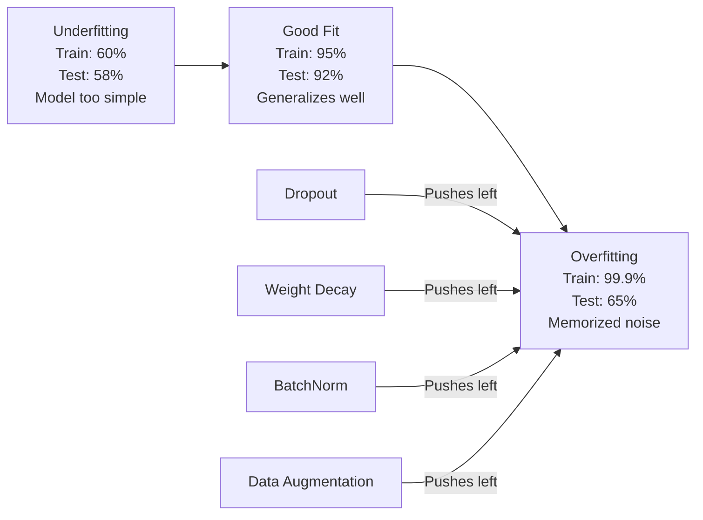
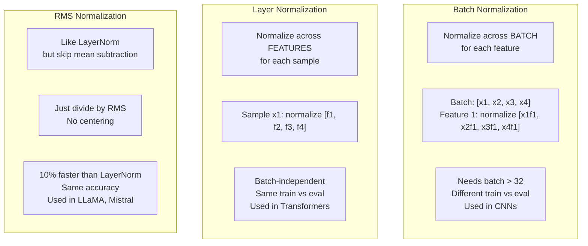
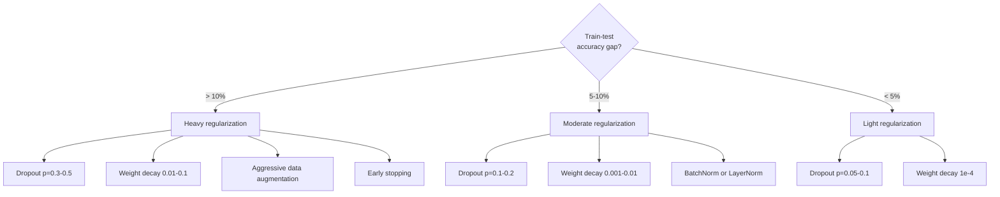

# Regularización

> Tu modelo obtiene el 99% de datos de entrenamiento y el 60% de datos de pruebas. Memorizó en lugar de aprender.

**Type:** Build
**Languages:** Python, TypeScript
**Prerequisites:** Lesson 03.06 (Optimizers)
**Time:** ~75 minutes

## Objetivos de aprendizaje

- Implementar el abandono con escala invertida, desintegración del peso L2, normalización de lote, normalización de capa y RMSNorm desde cero
- Medir la brecha de precisión en los ensayos de tren y diagnosticar el sobreajuste mediante experimentos de regularización
- Explica por qué los transformadores utilizan LayerNorm en lugar de BatchNorm y por qué los LLM modernos prefieren RMSNorm
- Aplicar la combinación correcta de técnicas de regularización basadas en la gravedad del sobreajuste

## El problema

Una red neuronal con suficientes parámetros puede memorizar cualquier conjunto de datos. Esto no es hipotético - Zhang et al. (2017) lo demostró entrenando redes estándar en ImageNet con etiquetas aleatorias. Las redes alcanzaron una pérdida de entrenamiento cercana a cero en asignaciones de etiquetas completamente aleatorias. Memorizaron un millón de pares de entradas y salidas aleatorias sin patrón para aprender. La pérdida de entrenamiento era perfecta. La precisión de la prueba fue cero.

Este es el problema de sobreajuste, y empeora a medida que los modelos se hacen más grandes. GPT-3 tiene 175 mil millones de parámetros. El conjunto de entrenamiento tiene alrededor de 500 mil millones de tokens. Con tantos parámetros, el modelo tiene suficiente capacidad para memorizar significativos trozos de los datos de entrenamiento verbalmente. Sin regularización, simplemente regurgitaría ejemplos de entrenamiento en lugar de aprender patrones generalizables.

La brecha entre el rendimiento de la formación y el rendimiento de los ensayos es la brecha de sobreajuste. Cada técnica de esta lección ataca esa brecha desde un ángulo diferente. El abandono obliga a la red a no depender de ninguna neurona. La pérdida de peso evita que un solo peso crezca demasiado. La normalización de lote suaviza el panorama de pérdidas para que el optimizador encuentre mínimos más planos y generalizables. La normalización de capas hace lo mismo, pero funciona cuando la normalización de lotes falla (partidos pequeños, secuencias de longitud variable). RMSNorm lo hace un 10% más rápido al bajar el cálculo medio. Cada técnica es simple. Juntos, son la diferencia entre un modelo que memoriza y uno que generaliza.

## El concepto

### El espectro de los excesos

Cada modelo se encuentra en algún lugar de un espectro desde el subajuste (demasiado simple para capturar el patrón) hasta el sobreajuste (tan complejo que capta el ruido).



### Desistir

La técnica de regularización más simple con la interpretación más elegante.$p$¿ Qué ?

```math
\text{output} = \text{activation}(z) \cdot \text{mask} \quad \text{where }\text{mask}[i] \sim \text{Bernoulli}(1 - p)
```

Con $p = 0.5$La red debe aprender representaciones redundantes porque no puede predecir qué neuronas estarán disponibles. Esto evita la co-adaptación - neuronas aprendiendo a confiar en otras neuronas específicas presentes.

La interpretación del conjunto: una red con $N$las neuronas y el abandono crea $2^N$Las redes de formación de los neuronas son de tipo de red de trabajo, y las redes de trabajo de los neuronas son de tipo de red de trabajo.$2^N$En el momento de la prueba, se utilizan todas las neuronas (sin interrupción) y se escalan las salidas por$(1 - p)$El resultado de la evaluación de los resultados de la formación es el resultado de la evaluación de los resultados de la formación.$2^N$las subredes -- un conjunto masivo de un solo modelo.

En la práctica, la escalación se aplica durante el entrenamiento en lugar de las pruebas (abandonado invertido):

```math
\begin{aligned}
\text{During training:} \quad & \text{output} = \text{activation}(z) \cdot \text{mask} / (1 - p) \\
\text{During testing:} \quad & \text{output} = \text{activation}(z) \quad \text{(no change needed)}
\end{aligned}
```

Esto es más limpio porque el código de prueba no necesita saber nada sobre el abandono.

Taxas de defecto: p = 0,1 para transformadores, p = 0,5 para MLPs, p = 0,2 a 0,3 para CNNs.

### Descenso de peso (regularización L2)

Añadir la magnitud cuadrada de todos los pesos a la pérdida:

```math
\text{total\_loss} = \text{task\_loss} + \frac{\lambda}{2} \sum_i w_i^2
```

El gradiente del término regularización es $\lambda w$Esto significa que en cada paso, cada peso se reduce hacia cero por una fracción proporcional a su magnitud. pesos grandes se penalizan más. El modelo se empuja hacia soluciones donde ningún peso único domina.

Por qué esto ayuda a la generalización: los modelos sobreajustados tienden a tener grandes pesos que amplifican el ruido en los datos de entrenamiento.

El $\lambda$El hiperparámetro controla la resistencia.

- 0,01 para AdamW en transformadores
- 1e-4 para SGD en las cadenas de televisión de CNN
- 0,1 para modelos muy adaptados

Como se discutió en la lección 06: la pérdida de peso y la regularización de L2 son equivalentes en SGD pero no en Adam.

### Normalización de lote

Normaliza la salida de cada capa a través del mini-batch antes de pasarla a la siguiente capa.

Para un mini lote de activaciones en alguna capa:

```math
\begin{aligned}
\mu &= \frac{1}{B} \sum_i x_i && \text{(batch mean)} \\
\sigma^2 &= \frac{1}{B} \sum_i (x_i - \mu)^2 && \text{(batch variance)} \\
\hat{x} &= \frac{x_i - \mu}{\sqrt{\sigma^2 + \epsilon}} && \text{(normalize)} \\
y &= \gamma \hat{x} + \beta && \text{(scale and shift)}
\end{aligned}
```

Gamma y beta son parámetros que permiten que la red deshaga la normalización si es óptima. sin ellos, se obligaría a cada capa de salida a ser de un valor cero-medio de variación unitaria, que podría no ser lo que la red quiere.

**Training vs inference split:**Durante la formación,$\mu$y $\sigma$En el caso de los equipos de entrenamiento, el resultado de la prueba de velocidad es el resultado de la prueba de velocidad de los equipos de entrenamiento.

Por qué funciona BatchNorm todavía se debate. El documento original afirmó que reduce el "cambio de covariado interno" (la distribución de las entradas de capas cambiando a medida que las capas anteriores se actualizan). Santurkar y otros. (2018) mostró que esta explicación es incorrecta. La verdadera razón: BatchNorm hace que el panorama de pérdidas sea más suave. Los gradientes son más predictivos, las constantes de Lipschitz son más pequeñas, y el optimizador puede tomar pasos más grandes de forma segura. Por eso BatchNorm te permite utilizar tasas de aprendizaje más altas y converger más rápido.

BatchNorm tiene una limitación fundamental: depende de las estadísticas de lote. Con el tamaño del lote 1, la media y la variación no tienen sentido. Con los lotes pequeños (< 32), las estadísticas son ruidosas y afectan el rendimiento. Esto importa para tareas como la detección de objetos (donde la memoria limita el tamaño del lote) y el modelado de lenguaje (donde varían las longitudes de secuencias).

### Normalización de las capas

Normaliza las características en lugar de las partidas.

```math
\begin{aligned}
\mu &= \frac{1}{D} \sum_j x_j && \text{(feature mean)} \\
\sigma^2 &= \frac{1}{D} \sum_j (x_j - \mu)^2 && \text{(feature variance)} \\
\hat{x} &= \frac{x_j - \mu}{\sqrt{\sigma^2 + \epsilon}} \\
y &= \gamma \hat{x} + \beta
\end{aligned}
```

$D$Es la dimensión de la característica. Cada muestra se normaliza de forma independiente - sin dependencia del tamaño del lote. Es por eso que los transformadores usan LayerNorm en lugar de BatchNorm. Las secuencias tienen longitudes variables, los tamaños del lote son a menudo pequeños (o 1 durante la generación), y el cálculo es idéntico entre el entrenamiento y la inferencia.

La capaNorm en transformadores se aplica después de cada bloque de autoatención y cada bloque de transmisión (Post-LN), o antes de ellos (Pre-LN, que es más estable para el entrenamiento).

### RMSNorm

LayerNorm sin la subtracción media. Propuso por Zhang & Sennrich (2019).

```math
\begin{aligned}
\text{rms} &= \sqrt{\frac{1}{D} \sum_j x_j^2} \\
y &= \gamma \cdot \frac{x}{\text{rms}}
\end{aligned}
```

No hay cálculo medio, no hay parámetro beta. La observación: la recentricación (sustracción media) en LayerNorm contribuye muy poco al rendimiento del modelo, pero cuesta el cálculo.

Los LLM modernos usan RMSNorm en lugar de LayerNorm. A la escala de miles de millones de parámetros y billones de tokens, ese ahorro del 10% es significativo.

### Comparación de normalización



### Aumento de datos como regularización

No es una modificación de modelo sino una modificación de datos.

- Imágenes: cosecha aleatoria, giro, rotación, nerviosismo de color, corte
- Texto: sustitución de sinónimos, traducción posterior, eliminación aleatoria
- Audio: extensión de tiempo, cambio de tono, adición de ruido

El efecto es idéntico a la regularización: aumenta el tamaño efectivo del conjunto de entrenamiento, lo que dificulta que el modelo recuerde ejemplos específicos. Un modelo que sólo ve cada imagen una vez en su forma original puede memorizarla. Un modelo que ve 50 versiones aumentadas de cada imagen se ve obligado a aprender la estructura invariante.

### Pararse temprano

El regulador más simple: detener el entrenamiento cuando la pérdida de validación comienza a aumentar. El modelo aún no ha sobreajustado en ese punto. En la práctica, rastreas la pérdida de validación en cada época, guardas el mejor modelo y continúas entrenando para una ventana de "paciencia" (normalmente 5-20 épocas). Si la pérdida de validación no mejora dentro de la ventana de paciencia, te detienes y cargas el mejor modelo guardado.

### Cuándo aplicar qué



```figure
l2-regularization
```

## Construye el mismo

### Paso 1: Descanso (Modo de trenes y de Eval)

```python
import random
import math


class Dropout:
    def __init__(self, p=0.5):
        self.p = p
        self.training = True
        self.mask = None

    def forward(self, x):
        if not self.training:
            return list(x)
        self.mask = []
        output = []
        for val in x:
            if random.random() < self.p:
                self.mask.append(0)
                output.append(0.0)
            else:
                self.mask.append(1)
                output.append(val / (1 - self.p))
        return output

    def backward(self, grad_output):
        grads = []
        for g, m in zip(grad_output, self.mask):
            if m == 0:
                grads.append(0.0)
            else:
                grads.append(g / (1 - self.p))
        return grads
```

### Paso 2: Descenso de peso L2

```python
def l2_regularization(weights, lambda_reg):
    penalty = 0.0
    for w in weights:
        penalty += w * w
    return lambda_reg * 0.5 * penalty

def l2_gradient(weights, lambda_reg):
    return [lambda_reg * w for w in weights]
```

### Paso 3: Normalización del lote

```python
class BatchNorm:
    def __init__(self, num_features, momentum=0.1, eps=1e-5):
        self.gamma = [1.0] * num_features
        self.beta = [0.0] * num_features
        self.eps = eps
        self.momentum = momentum
        self.running_mean = [0.0] * num_features
        self.running_var = [1.0] * num_features
        self.training = True
        self.num_features = num_features

    def forward(self, batch):
        batch_size = len(batch)
        if self.training:
            mean = [0.0] * self.num_features
            for sample in batch:
                for j in range(self.num_features):
                    mean[j] += sample[j]
            mean = [m / batch_size for m in mean]

            var = [0.0] * self.num_features
            for sample in batch:
                for j in range(self.num_features):
                    var[j] += (sample[j] - mean[j]) ** 2
            var = [v / batch_size for v in var]

            for j in range(self.num_features):
                self.running_mean[j] = (1 - self.momentum) * self.running_mean[j] + self.momentum * mean[j]
                self.running_var[j] = (1 - self.momentum) * self.running_var[j] + self.momentum * var[j]
        else:
            mean = list(self.running_mean)
            var = list(self.running_var)

        self.x_hat = []
        output = []
        for sample in batch:
            normalized = []
            out_sample = []
            for j in range(self.num_features):
                x_h = (sample[j] - mean[j]) / math.sqrt(var[j] + self.eps)
                normalized.append(x_h)
                out_sample.append(self.gamma[j] * x_h + self.beta[j])
            self.x_hat.append(normalized)
            output.append(out_sample)
        return output
```

### Paso 4: Normalización de las capas

```python
class LayerNorm:
    def __init__(self, num_features, eps=1e-5):
        self.gamma = [1.0] * num_features
        self.beta = [0.0] * num_features
        self.eps = eps
        self.num_features = num_features

    def forward(self, x):
        mean = sum(x) / len(x)
        var = sum((xi - mean) ** 2 for xi in x) / len(x)

        self.x_hat = []
        output = []
        for j in range(self.num_features):
            x_h = (x[j] - mean) / math.sqrt(var + self.eps)
            self.x_hat.append(x_h)
            output.append(self.gamma[j] * x_h + self.beta[j])
        return output
```

### Paso 5: Norma de RMS

```python
class RMSNorm:
    def __init__(self, num_features, eps=1e-6):
        self.gamma = [1.0] * num_features
        self.eps = eps
        self.num_features = num_features

    def forward(self, x):
        rms = math.sqrt(sum(xi * xi for xi in x) / len(x) + self.eps)
        output = []
        for j in range(self.num_features):
            output.append(self.gamma[j] * x[j] / rms)
        return output
```

### Paso 6: Entrenamiento con y sin regularización

```python
def sigmoid(x):
    x = max(-500, min(500, x))
    return 1.0 / (1.0 + math.exp(-x))


def make_circle_data(n=200, seed=42):
    random.seed(seed)
    data = []
    for _ in range(n):
        x = random.uniform(-2, 2)
        y = random.uniform(-2, 2)
        label = 1.0 if x * x + y * y < 1.5 else 0.0
        data.append(([x, y], label))
    return data


class RegularizedNetwork:
    def __init__(self, hidden_size=16, lr=0.05, dropout_p=0.0, weight_decay=0.0):
        random.seed(0)
        self.hidden_size = hidden_size
        self.lr = lr
        self.dropout_p = dropout_p
        self.weight_decay = weight_decay
        self.dropout = Dropout(p=dropout_p) if dropout_p > 0 else None

        self.w1 = [[random.gauss(0, 0.5) for _ in range(2)] for _ in range(hidden_size)]
        self.b1 = [0.0] * hidden_size
        self.w2 = [random.gauss(0, 0.5) for _ in range(hidden_size)]
        self.b2 = 0.0

    def forward(self, x, training=True):
        self.x = x
        self.z1 = []
        self.h = []
        for i in range(self.hidden_size):
            z = self.w1[i][0] * x[0] + self.w1[i][1] * x[1] + self.b1[i]
            self.z1.append(z)
            self.h.append(max(0.0, z))

        if self.dropout and training:
            self.dropout.training = True
            self.h = self.dropout.forward(self.h)
        elif self.dropout:
            self.dropout.training = False
            self.h = self.dropout.forward(self.h)

        self.z2 = sum(self.w2[i] * self.h[i] for i in range(self.hidden_size)) + self.b2
        self.out = sigmoid(self.z2)
        return self.out

    def backward(self, target):
        eps = 1e-15
        p = max(eps, min(1 - eps, self.out))
        d_loss = -(target / p) + (1 - target) / (1 - p)
        d_sigmoid = self.out * (1 - self.out)
        d_out = d_loss * d_sigmoid

        for i in range(self.hidden_size):
            d_relu = 1.0 if self.z1[i] > 0 else 0.0
            d_h = d_out * self.w2[i] * d_relu
            self.w2[i] -= self.lr * (d_out * self.h[i] + self.weight_decay * self.w2[i])
            for j in range(2):
                self.w1[i][j] -= self.lr * (d_h * self.x[j] + self.weight_decay * self.w1[i][j])
            self.b1[i] -= self.lr * d_h
        self.b2 -= self.lr * d_out

    def evaluate(self, data):
        correct = 0
        total_loss = 0.0
        for x, y in data:
            pred = self.forward(x, training=False)
            eps = 1e-15
            p = max(eps, min(1 - eps, pred))
            total_loss += -(y * math.log(p) + (1 - y) * math.log(1 - p))
            if (pred >= 0.5) == (y >= 0.5):
                correct += 1
        return total_loss / len(data), correct / len(data) * 100

    def train_model(self, train_data, test_data, epochs=300):
        history = []
        for epoch in range(epochs):
            total_loss = 0.0
            correct = 0
            for x, y in train_data:
                pred = self.forward(x, training=True)
                self.backward(y)
                eps = 1e-15
                p = max(eps, min(1 - eps, pred))
                total_loss += -(y * math.log(p) + (1 - y) * math.log(1 - p))
                if (pred >= 0.5) == (y >= 0.5):
                    correct += 1
            train_loss = total_loss / len(train_data)
            train_acc = correct / len(train_data) * 100
            test_loss, test_acc = self.evaluate(test_data)
            history.append((train_loss, train_acc, test_loss, test_acc))
            if epoch % 75 == 0 or epoch == epochs - 1:
                gap = train_acc - test_acc
                print(f"    Epoch {epoch:3d}: train_acc={train_acc:.1f}%, test_acc={test_acc:.1f}%, gap={gap:.1f}%")
        return history
```

## Usalo

PyTorch proporciona toda la normalización y regularización como módulos:

```python
import torch
import torch.nn as nn

model = nn.Sequential(
    nn.Linear(784, 256),
    nn.BatchNorm1d(256),
    nn.ReLU(),
    nn.Dropout(0.3),
    nn.Linear(256, 128),
    nn.BatchNorm1d(128),
    nn.ReLU(),
    nn.Dropout(0.3),
    nn.Linear(128, 10),
)

model.train()
out_train = model(torch.randn(32, 784))

model.eval()
out_test = model(torch.randn(1, 784))
```

El `model.train()`- ¿ Qué ?`model.eval()`El interruptor de acceso es crítico.`model.eval()`La precisión de las pruebas fluctúa aleatoriamente porque el abandono sigue activo y BatchNorm está utilizando estadísticas mini-batch.

Para los transformadores, el patrón es diferente:

```python
class TransformerBlock(nn.Module):
    def __init__(self, d_model=512, nhead=8, dropout=0.1):
        super().__init__()
        self.attention = nn.MultiheadAttention(d_model, nhead, dropout=dropout)
        self.norm1 = nn.LayerNorm(d_model)
        self.ff = nn.Sequential(
            nn.Linear(d_model, d_model * 4),
            nn.GELU(),
            nn.Linear(d_model * 4, d_model),
            nn.Dropout(dropout),
        )
        self.norm2 = nn.LayerNorm(d_model)
        self.dropout = nn.Dropout(dropout)

    def forward(self, x):
        attended, _ = self.attention(x, x, x)
        x = self.norm1(x + self.dropout(attended))
        x = self.norm2(x + self.ff(x))
        return x
```

LayerNorm, no BatchNorm. Descarga p=0.1, no p=0.5. Estos son los cambios de configuración.

## Envío

Esta lección produce:
- `outputs/prompt-regularization-advisor.md`-- un mensaje que diagnostica el exceso de ajuste y recomienda la estrategia correcta de regularización

## Los ejercicios

1. Implemente el abandono espacial para los datos 2D: en lugar de dejar caer neuronas individuales, deje caer canales de características enteros. Simula esto tratando grupos de características consecutivas como canales y dejando caer grupos enteros. Compara la brecha de prueba de tren con el abandono estándar en el conjunto de datos del círculo con hidden_size=32.

2. Implemente el suavización de etiquetas de la lección 05 combinado con el abandono de esta lección. Entrenar con cuatro configuraciones: ninguno, solo abandono, solo suavización de etiquetas, ambos. Medir la brecha de precisión final de la prueba de tren para cada uno. ¿Qué combinación da la brecha más pequeña?

3. Añadir una capa BatchNorm entre la capa oculta y la activación en la red de conjunto de datos de círculos. Entrenar con y sin BatchNorm a tasas de aprendizaje de 0,01, 0,05, y 0.1. BatchNorm debe permitir un entrenamiento estable a tasas de aprendizaje más altas donde la red de vainilla diverge.

4. Implemente la parada temprana: siga la pérdida de prueba en cada época, guarde los mejores pesos y detenga si la pérdida de prueba no ha mejorado durante 20 épocas. ejecuta la red regularizada durante 1000 épocas. Informar qué época tuvo la mejor precisión de prueba y cuántas épocas de cálculo ahorró.

5. Comparar LayerNorm vs RMSNorm en una red de 4 capas (no sólo 2). Iniciar ambos con el mismo peso. Entrenar durante 200 épocas y comparar la precisión final, la velocidad de entrenamiento (tiempo por época), y magnitudes de gradiente en la primera capa. Verificar que RMSNorm es más rápido con la misma precisión.

## Términos clave

| Term | What people say | What it actually means |
|------|----------------|----------------------|
| Overfitting | "Model memorized the data" | When a model's training performance significantly exceeds its test performance, indicating it learned noise rather than signal |
| Regularization | "Preventing overfitting" | Any technique that constrains model complexity to improve generalization: dropout, weight decay, normalization, augmentation |
| Dropout | "Random neuron deletion" | Zeroing random neurons during training with probability $p$, forcing redundant representations; equivalent to training an ensemble |
| Weight decay | "L2 penalty" | Shrinking all weights toward zero by subtracting $\lambda w$ at each step; penalizes complexity through weight magnitude |
| Batch normalization | "Normalize per batch" | Normalizing layer outputs across the batch dimension using batch statistics during training and running averages during inference |
| Layer normalization | "Normalize per sample" | Normalizing across features within each sample; batch-independent, used in transformers where batch size varies |
| RMSNorm | "LayerNorm without the mean" | Root mean square normalization; drops the mean subtraction from LayerNorm for 10% speedup with equal accuracy |
| Early stopping | "Stop before overfit" | Halting training when validation loss stops improving; the simplest regularizer, often used alongside others |
| Data augmentation | "More data from less" | Transforming training inputs (flip, crop, noise) to increase effective dataset size and force invariance learning |
| Generalization gap | "Train-test split" | The difference between training and test performance; regularization aims to minimize this gap |

## Leer más

- Srivastava et al., "Dropout: Una forma simple de prevenir que las redes neuronales se sobreajusten" (2014) -- el documento original de abandono con la interpretación del conjunto y los extensos experimentos
- Ioffe & Szegedy, "Batch Normalization: Accelerating Deep Network Training by Reducing Internal Covariate Shift" (2015) -- presentó BatchNorm y su procedimiento de capacitación, uno de los documentos de aprendizaje profundo más citados
- Zhang & Sennrich, "Root Mean Square Layer Normalization" (2019) -- mostró que RMSNorm coincide con la precisión de LayerNorm con un cálculo reducido; adoptado por LLaMA y Mistral
- Zhang et al., "Entender el aprendizaje profundo requiere repensar la generalización" (2017) -- el documento histórico que muestra que las redes neuronales pueden memorizar etiquetas aleatorias, desafiando las visiones tradicionales de la generalización
