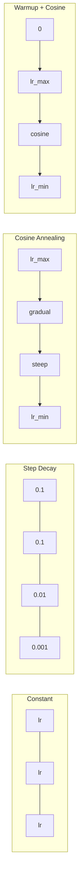
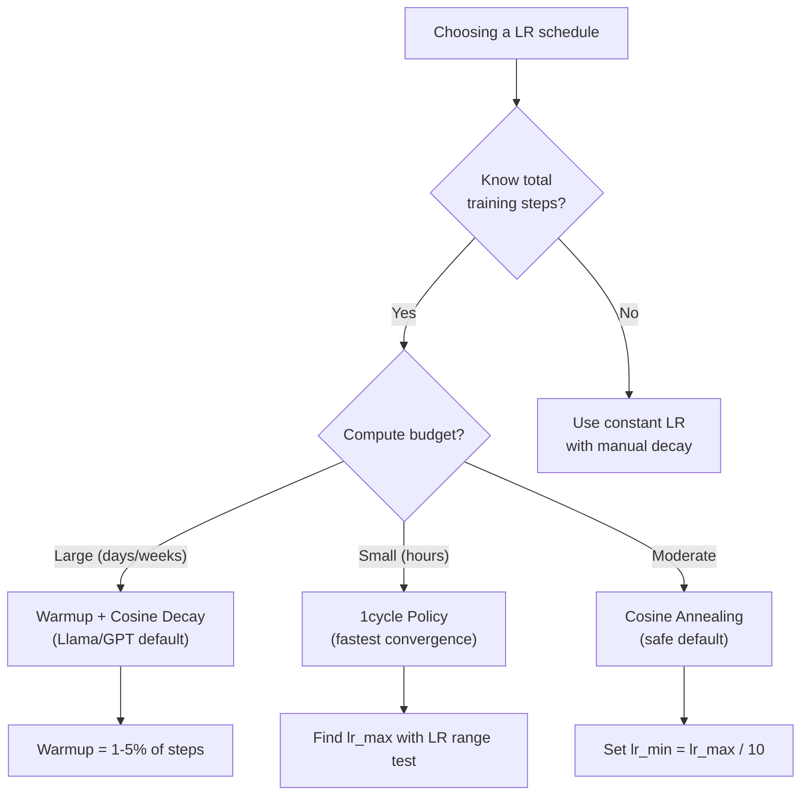
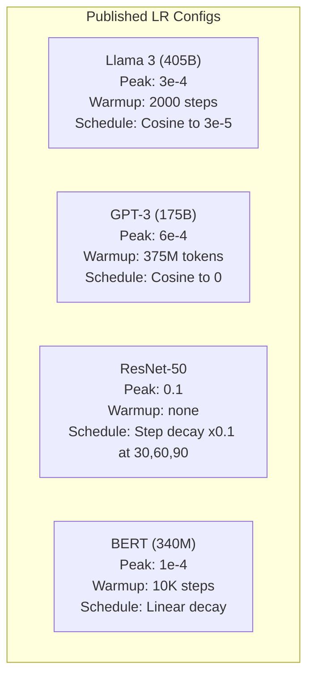

# Horarios de aprendizaje y calentamiento

> La velocidad de aprendizaje es el único hiperparámetro más importante. No la arquitectura, no el tamaño del conjunto de datos, no la función de activación, la velocidad de aprendizaje. Si no sintonizas nada más, sintoniza esto.

**Type:** Build
**Languages:** Python, TypeScript
**Prerequisites:** Lesson 03.06 (Optimizers), Lesson 03.08 (Weight Initialization)
**Time:** ~90 minutes

## Objetivos de aprendizaje

- Implementar desde cero los horarios constantes, de degradación gradual, de anulación cosina, de calentamiento + cosina y de tasa de aprendizaje en un ciclo
- Demostrar los tres modos de fracaso de la selección de la tasa de aprendizaje: divergencia (demasiado alta), estancamiento (demasiado bajo) y oscilación (sin decadencia)
- Explica por qué es necesario que los optimistas basados en Adán se calienten y cómo estabiliza la formación temprana
- Comparar la velocidad de convergencia en los cinco horarios de la misma tarea y seleccionar el adecuado para un presupuesto de formación determinado

## El problema

Establezca la tasa de aprendizaje en 0.1. El entrenamiento se desvía -- la pérdida salta a infinito en 3 pasos. Establezca a 0.0001. El entrenamiento se arrastra -- después de 100 épocas, el modelo apenas se ha movido de al azar. Establezca a 0.01. El entrenamiento funciona durante 50 épocas, entonces la pérdida oscila alrededor de un mínimo que nunca puede alcanzar porque los pasos son demasiado grandes.

La tasa óptima de aprendizaje no es constante. cambia durante el entrenamiento. Al principio, se quiere grandes pasos para cubrir el terreno rápidamente. Al final del entrenamiento, se quiere pequeños pasos para establecerse en un mínimo nítido. La diferencia entre un modelo 90% preciso y un modelo 95% preciso es a menudo sólo el horario.

Cada modelo principal publicado en los últimos tres años utiliza un calendario de tasa de aprendizaje. Llama 3 utilizó el pico lr=3e-4 con 2000 pasos de calentamiento y desintegración cosina a 3e-5. GPT-3 utilizó lr=6e-4 con calentamiento de más de 375 millones de tokens. Estas no son opciones arbitrarias. Son el resultado de extensos barridos de hiperparámetros que cuestan millones de dólares.

Cuando se ajusta un modelo pre-entrenado, el horario correcto es diferente al entrenamiento desde cero. Cuando se aumenta el tamaño del lote, el período de calentamiento debe cambiar. Cuando el entrenamiento se interrumpe en el paso 10.000, se necesita saber si es un problema de horario o algo más.

## El concepto

### Rate de aprendizaje constante

El método más simple es elegir un número, usarlo para cada paso.

```math
\text{lr}(t) = \text{lr}_0
```

Es muy poco óptimo. Es demasiado alto para el final del entrenamiento (oscillación alrededor del mínimo) o demasiado bajo para el comienzo (computación desperdiciada en pequeños pasos). Funciona bien para modelos pequeños y depuración. Una opción terrible para cualquier cosa que entrenar durante más de una hora.

### Paso de descomposición

El enfoque de la vieja escuela de la era de ResNet: reducir la tasa de aprendizaje en un factor (generalmente 10 veces) en épocas fijas.

```math
\text{lr}(t) = \text{lr}_0 \cdot \gamma^{\lfloor \text{epoch} / \text{step\_size} \rfloor}
```

¿ Dónde ?$\gamma = 0.1$y step_size = 30 significa: lr cae 10 veces cada 30 épocas. ResNet-50 usó esto -- lr = 0,1, cae 10 veces en épocas 30, 60 y 90.

El problema: los puntos de desintegración óptimos dependen del conjunto de datos y la arquitectura. Moverse a un problema diferente y usted necesita volver a ajustar cuando bajar. Las transiciones son abruptas - la pérdida puede aumentar cuando la tasa cambia repentinamente.

### Coseña de la piel

Desintegración suave desde la tasa máxima de aprendizaje hasta el mínimo, siguiendo una curva cosina:

```math
\text{lr}(t) = \text{lr}_{\min} + 0.5 \cdot (\text{lr}_{\max} - \text{lr}_{\min}) \cdot \left(1 + \cos\left(\frac{\pi t}{T}\right)\right)
```

¿ Dónde ?$t$es el paso actual y $T$es el número total de pasos.

En el$t=0$, el término cosino es 1, así que $\text{lr} = \text{lr} _{\max}$- En el$t=T$, el término cosino es -1, así que $\text{lr} = \text{lr} _{\min}$La descomposición es suave al principio, se acelera en el medio, y vuelve suave cerca del final.

Este es el estándar para la mayoría de las carreras de entrenamiento modernas.$\text{lr} _{\max}$y $\text{lr} _{\min}$La forma cosínica coincide con la observación empírica de que la mayoría del aprendizaje ocurre en medio del entrenamiento, se quieren tamaños razonables de pasos durante ese período crítico.

### ¿Por qué empezar desde pequeño?

Adam y otros optimizadores adaptativos mantienen estimaciones corrientes de la media y variación de gradientes. En el paso 0, estas estimaciones se inicializan a cero. Las primeras actualizaciones de gradientes se basan en estadísticas de basura. Si su tasa de aprendizaje es grande durante este período, el modelo toma pasos enormes y mal dirigidos.

Calentamiento corrige esto. Comience con una pequeña tasa de aprendizaje (a menudo lr_max / calentamiento_pasos o incluso cero) y linealmente ramp hasta $\text{lr}_{\max}$sobre el primero $N$Cuando alcances la tasa de aprendizaje completa, las estadísticas de Adam se han estabilizado.

```math
\text{lr}(t) = \text{lr}_{\max} \cdot \frac{t}{\text{warmup\_steps}} \quad \text{for } t < \text{warmup\_steps}
```

El calentamiento típico: 1-5% del total de las etapas de entrenamiento. Llama 3 entrenó para ~ 1,8 billones de tokens y se calentó para 2000 etapas. GPT-3 calentó más de 375 millones de tokens.

### Calentamiento lineal + desintegración cosina

El estándar moderno, se incrementa linealmente y luego se descompone con cosino.

```
if t < warmup_steps:
    lr(t) = lr_max * (t / warmup_steps)
else:
    progress = (t - warmup_steps) / (total_steps - warmup_steps)
    lr(t) = lr_min + 0.5 * (lr_max - lr_min) * (1 + cos(pi * progress))
```

Esto es lo que usan Llama, GPT, PaLM y la mayoría de los transformadores modernos. El calentamiento evita la inestabilidad temprana.

### Política de ciclo

Descubrimiento de Leslie Smith (2018): aumentar la tasa de aprendizaje de un valor bajo a un valor alto en la primera mitad del entrenamiento, luego reducirla de nuevo en la segunda mitad. Contrario a la intuición - ¿por qué aumentar la tasa de aprendizaje a mitad de camino?

La teoría: una alta tasa de aprendizaje actúa como regularización agregando ruido a la trayectoria de optimización. El modelo explora más del paisaje de pérdida durante la fase de aumento, encontrando mejores cuencas. La fase de bajada luego se refina dentro de la mejor cuenca encontrada.

```
Phase 1 (0 to T/2):    lr ramps from lr_max/25 to lr_max
Phase 2 (T/2 to T):    lr ramps from lr_max to lr_max/10000
```

El 1cycle suele ser más rápido que el cosino para un presupuesto de cálculo fijo.

### Las formas de la agenda



### Diagrama de flujo de decisiones



### Números reales de modelos publicados



```figure
lr-schedule
```

## Construye el mismo

### Paso 1: Programación de las funciones

Cada función toma el paso actual y devuelve la tasa de aprendizaje en ese paso.

```python
import math


def constant_schedule(step, lr=0.01, **kwargs):
    return lr


def step_decay_schedule(step, lr=0.1, step_size=100, gamma=0.1, **kwargs):
    return lr * (gamma ** (step // step_size))


def cosine_schedule(step, lr=0.01, total_steps=1000, lr_min=1e-5, **kwargs):
    if step >= total_steps:
        return lr_min
    return lr_min + 0.5 * (lr - lr_min) * (1 + math.cos(math.pi * step / total_steps))


def warmup_cosine_schedule(step, lr=0.01, total_steps=1000, warmup_steps=100, lr_min=1e-5, **kwargs):
    if total_steps <= warmup_steps:
        return lr * (step / max(warmup_steps, 1))
    if step < warmup_steps:
        return lr * step / warmup_steps
    progress = (step - warmup_steps) / (total_steps - warmup_steps)
    return lr_min + 0.5 * (lr - lr_min) * (1 + math.cos(math.pi * progress))


def one_cycle_schedule(step, lr=0.01, total_steps=1000, **kwargs):
    mid = max(total_steps // 2, 1)
    if step < mid:
        return (lr / 25) + (lr - lr / 25) * step / mid
    else:
        progress = (step - mid) / max(total_steps - mid, 1)
        return lr * (1 - progress) + (lr / 10000) * progress
```

### Paso 2: Visualiza todos los horarios

Imprima una gráfica basada en texto que muestre cómo evoluciona cada programa durante la formación.

```python
def visualize_schedule(name, schedule_fn, total_steps=500, **kwargs):
    steps = list(range(0, total_steps, total_steps // 20))
    if total_steps - 1 not in steps:
        steps.append(total_steps - 1)

    lrs = [schedule_fn(s, total_steps=total_steps, **kwargs) for s in steps]
    max_lr = max(lrs) if max(lrs) > 0 else 1.0

    print(f"\n{name}:")
    for s, lr_val in zip(steps, lrs):
        bar_len = int(lr_val / max_lr * 40)
        bar = "#" * bar_len
        print(f"  Step {s:4d}: lr={lr_val:.6f} {bar}")
```

### Paso 3: Red de capacitación

Una simple red de dos capas en el conjunto de datos del círculo, igual que las lecciones anteriores, pero ahora cambiamos el horario.

```python
import random


def sigmoid(x):
    x = max(-500, min(500, x))
    return 1.0 / (1.0 + math.exp(-x))


def relu(x):
    return max(0.0, x)


def relu_deriv(x):
    return 1.0 if x > 0 else 0.0


def make_circle_data(n=200, seed=42):
    random.seed(seed)
    data = []
    for _ in range(n):
        x = random.uniform(-2, 2)
        y = random.uniform(-2, 2)
        label = 1.0 if x * x + y * y < 1.5 else 0.0
        data.append(([x, y], label))
    return data


def train_with_schedule(schedule_fn, schedule_name, data, epochs=300, base_lr=0.05, **kwargs):
    random.seed(0)
    hidden_size = 8
    total_steps = epochs * len(data)

    std = math.sqrt(2.0 / 2)
    w1 = [[random.gauss(0, std) for _ in range(2)] for _ in range(hidden_size)]
    b1 = [0.0] * hidden_size
    w2 = [random.gauss(0, std) for _ in range(hidden_size)]
    b2 = 0.0

    step = 0
    epoch_losses = []

    for epoch in range(epochs):
        total_loss = 0
        correct = 0

        for x, target in data:
            lr = schedule_fn(step, lr=base_lr, total_steps=total_steps, **kwargs)

            z1 = []
            h = []
            for i in range(hidden_size):
                z = w1[i][0] * x[0] + w1[i][1] * x[1] + b1[i]
                z1.append(z)
                h.append(relu(z))

            z2 = sum(w2[i] * h[i] for i in range(hidden_size)) + b2
            out = sigmoid(z2)

            error = out - target
            d_out = error * out * (1 - out)

            for i in range(hidden_size):
                d_h = d_out * w2[i] * relu_deriv(z1[i])
                w2[i] -= lr * d_out * h[i]
                for j in range(2):
                    w1[i][j] -= lr * d_h * x[j]
                b1[i] -= lr * d_h
            b2 -= lr * d_out

            total_loss += (out - target) ** 2
            if (out >= 0.5) == (target >= 0.5):
                correct += 1
            step += 1

        avg_loss = total_loss / len(data)
        accuracy = correct / len(data) * 100
        epoch_losses.append(avg_loss)

    return epoch_losses
```

### Paso 4: Compare todos los horarios

Entrenar la misma red con cada programa y comparar el comportamiento final de pérdida y convergencia.

```python
def compare_schedules(data):
    configs = [
        ("Constant", constant_schedule, {}),
        ("Step Decay", step_decay_schedule, {"step_size": 15000, "gamma": 0.1}),
        ("Cosine", cosine_schedule, {"lr_min": 1e-5}),
        ("Warmup+Cosine", warmup_cosine_schedule, {"warmup_steps": 3000, "lr_min": 1e-5}),
        ("1cycle", one_cycle_schedule, {}),
    ]

    print(f"\n{'Schedule':<20} {'Start Loss':>12} {'Mid Loss':>12} {'End Loss':>12} {'Best Loss':>12}")
    print("-" * 70)

    for name, schedule_fn, extra_kwargs in configs:
        losses = train_with_schedule(schedule_fn, name, data, epochs=300, base_lr=0.05, **extra_kwargs)
        mid_idx = len(losses) // 2
        best = min(losses)
        print(f"{name:<20} {losses[0]:>12.6f} {losses[mid_idx]:>12.6f} {losses[-1]:>12.6f} {best:>12.6f}")
```

### Paso 5: LR demasiado alto vs demasiado bajo

Demostrar los tres modos de falla: demasiado alto (divergencia), demasiado bajo (deslizamiento) y justo derecho.

```python
def lr_sensitivity(data):
    learning_rates = [1.0, 0.1, 0.01, 0.001, 0.0001]

    print("\nLR Sensitivity (constant schedule, 100 epochs):")
    print(f"  {'LR':>10} {'Start Loss':>12} {'End Loss':>12} {'Status':>15}")
    print("  " + "-" * 52)

    for lr in learning_rates:
        losses = train_with_schedule(constant_schedule, f"lr={lr}", data, epochs=100, base_lr=lr)
        start = losses[0]
        end = losses[-1]

        if end > start or math.isnan(end) or end > 1.0:
            status = "DIVERGED"
        elif end > start * 0.9:
            status = "BARELY MOVED"
        elif end < 0.15:
            status = "CONVERGED"
        else:
            status = "LEARNING"

        end_str = f"{end:.6f}" if not math.isnan(end) else "NaN"
        print(f"  {lr:>10.4f} {start:>12.6f} {end_str:>12} {status:>15}")
```

## Usalo

PyTorch ofrece programadores en `torch.optim.lr_scheduler`¿Qué es esto ?

```python
import torch
import torch.optim as optim
from torch.optim.lr_scheduler import CosineAnnealingLR, OneCycleLR, StepLR

model = nn.Sequential(nn.Linear(10, 64), nn.ReLU(), nn.Linear(64, 1))
optimizer = optim.Adam(model.parameters(), lr=3e-4)

scheduler = CosineAnnealingLR(optimizer, T_max=1000, eta_min=1e-5)

for step in range(1000):
    loss = train_step(model, optimizer)
    scheduler.step()
```

Para calentar + cosin, utilice un calendario lambda o el `get_cosine_schedule_with_warmup`de HuggingFace:

```python
from transformers import get_cosine_schedule_with_warmup

scheduler = get_cosine_schedule_with_warmup(
    optimizer,
    num_warmup_steps=2000,
    num_training_steps=100000,
)
```

La función HuggingFace es la que la mayoría de los scripts de ajuste fino de Llama y GPT utilizan. Cuando tenga dudas, use calentamiento + cosino con calentamiento = 3-5% de los pasos totales. Funciona para casi todo.

## Envío

Esta lección produce:
- `outputs/prompt-lr-schedule-advisor.md`-- una solicitud que recomienda el horario de tasa de aprendizaje adecuado y los hiperparámetros para su configuración de entrenamiento

## Los ejercicios

1. Implementar la decadencia exponencial: $\text{lr}(t) = \text{lr}_0 \cdot \gamma^t$donde$\gamma = 0.999$Comparar con el anulación cosina en el conjunto de datos del círculo.

2. Implemente la prueba de rango de velocidad de aprendizaje (Leslie Smith): entrenar por unos cientos de pasos mientras aumenta exponencialmente el LR de 1e-7 a 1.

3. Entrenamiento con calentamiento + cosino pero varía la duración del calentamiento: 0%, 1%, 5%, 10%, 20% de los pasos totales.

4. Implementar el anelamiento cosino con reinicio caliente (RGD): restablecer la tasa de aprendizaje a $\text{lr}_{\max}$cada uno$T$Comparar con el cosino estándar en una carrera de entrenamiento más larga.

5. Construir un "cirujano de horario" que monitoree la pérdida de entrenamiento y cambia automáticamente de calentamiento a cosino cuando la pérdida se estabiliza, y reduce la ir si la pérdida se eleva demasiado.

## Términos clave

| Term | What people say | What it actually means |
|------|----------------|----------------------|
| Learning rate | "How fast the model learns" | The scalar that multiplies the gradient to determine the parameter update size |
| Schedule | "Change the LR over time" | A function that maps training step to learning rate, designed to optimize convergence |
| Warmup | "Start with a small LR" | Linearly ramping the LR from near-zero to the target value over the first $N$ steps to stabilize optimizer statistics |
| Cosine annealing | "Smooth LR decay" | Decreasing the LR following a cosine curve from $\text{lr} _{\max}$ to $\text{lr} _{\min}$ over training |
| Step decay | "Drop LR at milestones" | Multiplying the LR by a factor (usually 0.1) at fixed epoch intervals |
| 1cycle policy | "Up then down" | Leslie Smith's method of ramping LR up then down in a single cycle for faster convergence |
| LR range test | "Find the best learning rate" | Training briefly while increasing LR to find the value where loss starts diverging |
| Cosine with warm restarts | "Reset and repeat" | Periodically resetting the LR to $\text{lr} _{\max}$ and decaying again (SGDR) |
| Eta min | "The floor for the LR" | The minimum learning rate that the schedule decays to |
| Peak learning rate | "The maximum LR" | The highest LR reached during training, typically after warmup |

## Leer más

- Loshchilov & Hutter, "SGDR: Descenso de gradiente estocástico con reinicios cálidos" (2017) -- introdujo el anelamiento cosino y los reinicios cálidos
- Smith, "Super-Convergencia: Formación muy rápida de redes neuronales utilizando grandes tasas de aprendizaje" (2018) -- el documento de política de 1 ciclo
- Touvron et al., "Llama 2: Open Foundation and Fine-Tuned Chat Models" (2023) -- documenta el horario de calentamiento + cosino utilizado a escala
- Goyal et al., "GD de miniparcelación precisa y grande: Entrenamiento ImageNet en 1 hora" (2017) -- regla de escalación lineal y calentamiento para el entrenamiento de grandes lotes
