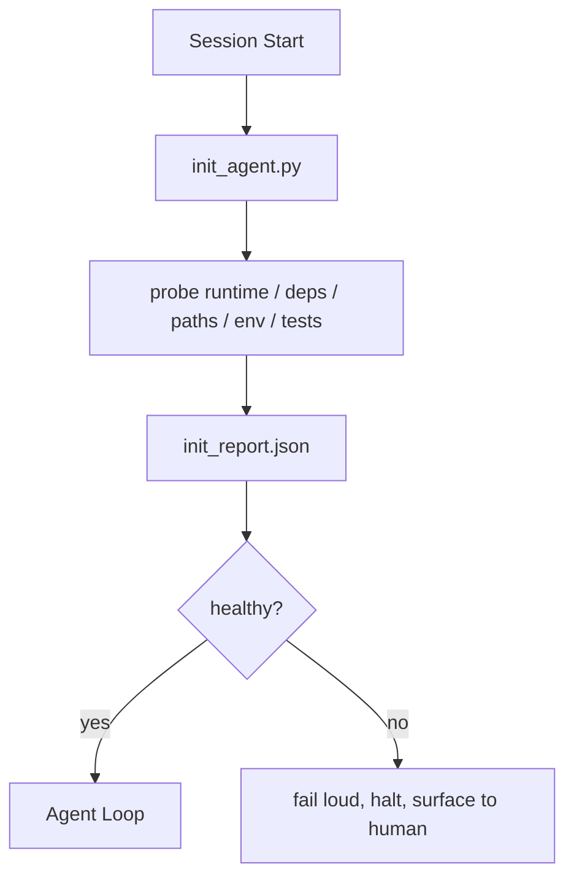

# Scripts de inicialización para agentes

> Cada sesión que comienza en frío paga un impuesto el agente lee los mismos archivos, vuelve a probar las mismas sondas y redescubre los mismos caminos un script init paga el impuesto una vez y escribe las respuestas en estado

**Type:** Build
**Languages:** Python (stdlib), TypeScript
**Prerequisites:** Phase 14 · 32 (Minimal Workbench), Phase 14 · 34 (Repo Memory)
**Time:** ~45 minutes

## Objetivos de aprendizaje

- Identificar el trabajo que un agente nunca debería tener que hacer por sesión.
- Construye un script de iniciación determinista que sondee el tiempo de ejecución, las dependencias y la salud de los repos.
- Persiste en el resultado de la sonda para que el agente lo lea en lugar de volver a hacer los cheques.
- Fallar fuerte, rápido, y con un lugar para mirar cuando la inicialización falla.

## El problema

Abre una sesión. El agente adivina la versión de Python. Adivina el comando de prueba. Enumera la raíz de repo cinco veces para encontrar el punto de entrada. Trata de importar un paquete que no está instalado. Pregunta al usuario dónde vive el archivo de configuración. Para el momento en que realiza una edición real, diez mil tokens han ido al trabajo de configuración que debería haber sido un solo script.

La solución es un script de inicialización que se ejecuta antes de que el agente haga cualquier otra cosa y escribe un`init_report.json`El agente lee en la puesta en marcha.

## El concepto



### Lo que el script init sondea

| Probe | Why it matters |
|-------|----------------|
| Runtime versions | Wrong Python or Node version means silent wrong-version bugs |
| Dependency availability | A missing package later costs ten times the cost of catching it now |
| Test command | The agent must know how to verify; if the command is missing the workbench is broken |
| Repo paths | Hard-coded paths drift; resolve them once and pin |
| Environment variables | Missing `OPENAI_API_KEY` is a failure surface, not a runtime mystery |
| State + board freshness | Stale state from a crashed session is a footgun |
| Last-known-good commit | Anchor for the handoff diff at the end of the session |

### Fallar fuerte, fallar rápido, fallar en un solo lugar

Una falla de la sonda significa detenerse y salir a la superficie del humano. No "el agente lo descubrirá".

### Idempotente

La segunda vuelta debe ser una no-op excepto para una nueva marca de tiempo. Idempotency es lo que le permite cablear el guión en CI, ganchos, o un pre-task slash comando.

### Las reglas de inicio

Las reglas (fase 14 · 33) describen lo que debe ser cierto para actuar. Init es el guión que establece que esas reglas pueden ser verificadas. Reglas sin init se vuelven "cuidado".

```figure
wb-init-probes
```

## Construye el mismo

`code/main.py`ejecutar `init_agent.py`¿Qué es esto ?

- Cinco sondas: versión Python, dependencias listadas a través de `importlib.util.find_spec`, la resoluciónbilidad de los comandos de prueba, el entorno requerido, la actualidad del archivo del estado.
- Cada sonda regresa .`(name, status, detail)`¿ Qué ?
- El guión dice:`init_report.json`con la sonda completa puesta y sale sin cero si alguna sonda de severidad de bloque falla.

- ¿Qué quieres decir ?

```
python3 code/main.py
npx tsx code/main.ts
```

El guión imprime la tabla de sondas, escribe.`init_report.json`, y sale de cero en el camino feliz o no cero con una lista de sondas fallidas.

## Modelos de producción en la naturaleza

Tres patrones separan un script de iniciación útil de una ceremonia.

**Last-known-good commit anchoring.**Prueba el compromiso actual contra un `LKG`Si la diferencia excede un presupuesto (ficheros por defecto 50), se niega a comenzar y requiere que un humano ratifique la nueva línea de base. Esto es lo que la Revisión de Código de IA de Cloudflare utiliza para abarcar a los agentes de revisión: cada sesión de revisión se ancla contra el mismo último bien conocido y nunca se deriva los compuestos entre las sesiones.

**Lock files with TTL.**Escriba un`prereqs.lock`Después de que la primera sonda pase con éxito. Las ejecuciones posteriores confían en la cerradura durante N horas (24h por defecto) y omiten las costosas sondas. El script init lee la cerradura primero; si está fresco y el hash del manifiesto de dependencia coincide, corta el circuito. Este es el mismo patrón que utiliza Docker para las cachées de capas: sonda idempotent + contenido hash = omite.

**No network, no LLM, no surprises in the hot path.**Las sondas init son una tubería determinista. Una sonda que llama a un LLM para clasificar un fallo o que golpea a un servicio externo para verificar una licencia no es una sonda; es un flujo de trabajo. Si una sonda dura más de tres segundos en una carrera seca, trate eso como un olor de banco de trabajo y o lo muevan de init o almacenen en caché su resultado.

## Usalo

En producción:

- **Claude Code hooks.** `pre-task`Hook llama al script de init y se niega a lanzar el agente si falla.
- **GitHub Actions.**¿ Qué es esto ?`setup-agent`El trabajo ejecuta el script init; el trabajo del agente depende de él.
- **Docker entrypoint.**El contenedor de agente ejecuta el script init antes de ejecutar el tiempo de ejecución del agente; registra la superficie en caso de fallo.

El script init es portátil porque no hace llamadas a un marco específico. Bash, Make o un archivo de tareas pueden envolverlo todo.

## Envío

`outputs/skill-init-script.md`Entrevistará el proyecto, clasificará su trabajo de instalación en sondas y emitirá un informe específico del proyecto `init_agent.py`Además de un flujo de trabajo de CI que lo ejecuta antes de cualquier paso del agente.

## Los ejercicios

1. Añadir una sonda que diferencia el compromiso actual con el último conocido-bueno compromiso y se niega a iniciar si se cambian más de 50 archivos.
2. Envía el guión para escribir un `prereqs.lock`el registro y rechazar el inicio si la cerradura es mayor de siete días.
3. Añadir un`--fix`bandera que instala automáticamente las dependencias de desarrollo faltantes pero nunca modifica las dependencias de tiempo de ejecución sin aprobación.
4. Mover las sondas de las funciones codificadas en un registro YAML.
5. Una sonda que dure más de tres segundos es un olor de escritorio.

## Términos clave

| Term | What people say | What it actually means |
|------|----------------|------------------------|
| Probe | "A check" | A deterministic function returning `(name, status, detail)` |
| Init report | "Setup output" | JSON written next to state with the probe results |
| Idempotent | "Safe to re-run" | Two runs in a row produce identical reports modulo timestamp |
| Fail loud | "Don't swallow" | Halt and surface to the human; no silent fallback |
| Setup tax | "Bootstrap cost" | The tokens the agent spends per session rediscovering the obvious |

## Leer más

- [Anthropic, Effective harnesses for long-running agents](https://www.anthropic.com/engineering/effective-harnesses-for-long-running-agents)
- [GitHub Actions, composite actions for setup](https://docs.github.com/en/actions/sharing-automations/creating-actions/creating-a-composite-action)
- [microservices.io, GenAI dev platform: guardrails](https://microservices.io/post/architecture/2026/03/09/genai-development-platform-part-1-development-guardrails.html) Precompromiso + control de CI como inicial
- [Augment Code, How to Build Your AGENTS.md (2026)](https://www.augmentcode.com/guides/how-to-build-agents-md) expectativas iniciales
- [Codex Blog, Codex CLI Context Compaction](https://codex.danielvaughan.com/2026/03/31/codex-cli-context-compaction-architecture/) inicio de sesión como compacción consciente init
- Fase 14 · 33  la regla establecida en este guión permite
- Fase 14 · 34  el archivo de estado de este script semillas
- Fase 14 · 38  la puerta de verificación el script init alimenta
- Fase 14 · 40  la entrega que consume el último bien conocido del informe init
