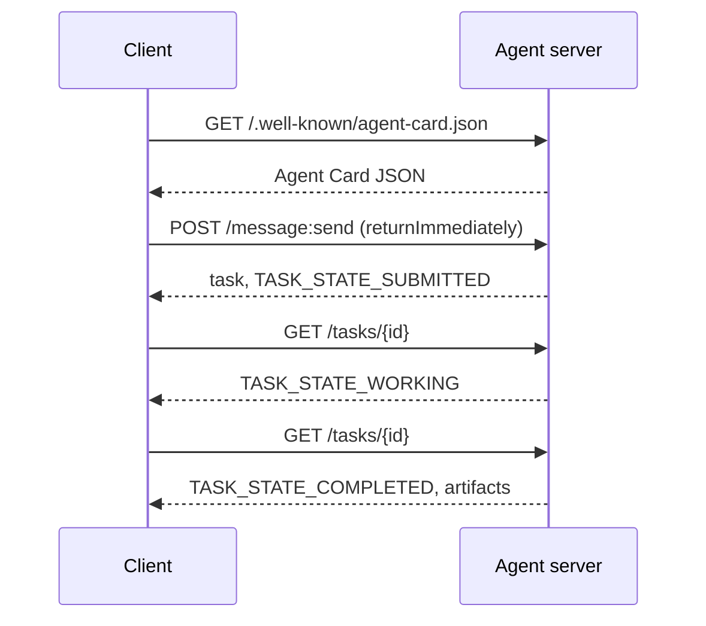

# A2A  El Protocolo entre agentes

> Google anunció A2A en abril de 2025; para abril de 2026 la especificación está en https://a2a-protocol.org/latest/specification/y más de 150 organizaciones lo respaldan. A2A es el complemento horizontal del MCP (lección 13): donde el MCP es vertical (agente  herramientas), A2A es peer-to-peer (agente  agente). Define las tarjetas de agentes (descubrimiento), tareas con artefactos (texto, datos estructurados, video), ciclos de vida opacos de tareas y auth. Los sistemas de producción emparejan cada vez más el MCP con el A2A. Google Cloud lanzó soporte A2A en Vertex AI Agent Builder durante 2025-2026.

**Type:** Learn + Build
**Languages:** Python (stdlib, `http.server`, `json`), TypeScript
**Prerequisites:** Phase 16 · 04 (Primitive Model)
**Time:** ~75 minutes

## El problema

El agente debe llamar a otro agente en otro sistema. ¿Cómo? Puedes exponer un punto final HTTP, definir un esquema JSON a medida, y esperar que el otro lado lo hable. Cada par de agentes se convierte en una integración personalizada.

A2A es el protocolo universal para esa llamada. Descubrimiento estándar, modelo de tarea estándar, transporte estándar, artefactos estándar.

## Concepto

### Los cuatro elementos

**Agent Card.**Un documento JSON en `/.well-known/agent-card.json`Describir al agente: nombre, habilidades, `supportedInterfaces`(URL de punto final, unión de protocolo, versión de protocolo), tipos de medios de entrada y salida predeterminados y requisitos de autor (`securitySchemes`Además`securityRequirements`El descubrimiento se hace leyendo la tarjeta.

```http
GET /.well-known/agent-card.json HTTP/1.1
Host: agent.example.com
```

```json
{
  "name": "code-review-agent",
  "description": "Reviews Python and TypeScript code.",
  "version": "1.0.0",
  "supportedInterfaces": [
    {
      "url": "https://agent.example.com",
      "protocolBinding": "HTTP+JSON",
      "protocolVersion": "1.0"
    }
  ],
  "capabilities": {"streaming": false, "pushNotifications": false},
  "securitySchemes": {
    "bearer": {"httpAuthSecurityScheme": {"scheme": "Bearer"}}
  },
  "securityRequirements": [{"schemes": {"bearer": {"list": []}}}],
  "defaultInputModes": ["text/plain", "application/json"],
  "defaultOutputModes": ["application/json"],
  "skills": [
    {
      "id": "review-python",
      "name": "Review Python",
      "description": "Reviews Python code.",
      "tags": ["code-review", "python"]
    },
    {
      "id": "review-typescript",
      "name": "Review TypeScript",
      "description": "Reviews TypeScript code.",
      "tags": ["code-review", "typescript"]
    }
  ]
}
```

**Task.**Una unidad de trabajo, un objeto sincronizado, con un ciclo de vida:`TASK_STATE_SUBMITTED`¿ Qué es esto ?`TASK_STATE_WORKING`¿ Qué es esto ?`TASK_STATE_COMPLETED`- ¿ Qué ?`TASK_STATE_FAILED`- ¿ Qué ?`TASK_STATE_CANCELED`Un cliente envía un mensaje, el servidor crea la tarea, y el cliente vota o suscribe para las actualizaciones.

**Artifact.**El tipo de resultado producido por una tarea. Texto, JSON estructurado, imagen, video, audio.`text`¿ Qué ?`raw`¿ Qué ?`url`, o`data`y puede nombrar su `mediaType`, así que las diferentes modalidades son de primera clase.

**Opaque lifecycle.**A2A no prescribe *cómo* el agente remoto resuelve la tarea.El cliente ve las transiciones de estado y los artefactos; la implementación es libre de usar cualquier marco.

### La división MCP/A2A

- **MCP**(Lección 13): agente  herramienta. El agente lee/escribe a través de JSON-RPC a un servidor de herramientas.
- **A2A**El protocolo de pares, ambos lados son agentes con su propio razonamiento.

Los sistemas de producción multi-agentes utilizan ambos. Un A2A peer llama a herramientas MCP de su lado. La división mantiene las dos preocupaciones limpias.

### Flujo de descubrimiento



Estas son las rutas de enlace HTTP+JSON, y cada solicitud lleva `A2A-Version: 1.0`Por defecto .`SendMessage`bloquea hasta que la tarea alcanza un estado terminal o interrumpido, por lo que un cliente de encuesta establece `configuration.returnImmediately`para recuperar la tarea de inmediato.

O con transmisión: `POST /message:stream`devuelve los eventos enviados por el servidor (a `task`Primero, luego.`statusUpdate`y `artifactUpdate`eventos), y `/tasks/{id}:subscribe`Se reune a una tarea en ejecución. La corriente se cierra cuando la tarea alcanza un estado terminal; no hay `final`bandera.

### Autor

A2A admite tres patrones comunes:

- **Bearer token**: OAuth2 o opaco (`httpAuthSecurityScheme`o `oauth2SecurityScheme`¿Qué es lo que se hace?
- **mTLS**: TLS mutuo; las organizaciones se muestran la identidad entre sí (`mtlsSecurityScheme`¿Qué es lo que se hace?
- **API key**: una clave en un encabezado, parámetro de consulta o cookie (`apiKeySecurityScheme`¿Qué es lo que se hace?

El autor se declara en la tarjeta de agente:`securitySchemes`Nombrar cada régimen y `securityRequirements`El cliente debe descubrir y cumplir.

### 150+ organizaciones para abril de 2026

La adopción de la empresa impulsó la escala A2A. El título: A2A se convirtió en la forma en que los sistemas de agentes empresariales cruzaron las fronteras de confianza. Google Cloud envió soporte A2A para Vertex AI Agent Builder; Microsoft Agent Framework lo soporta; la mayoría de los principales marcos (LangGraph, CrewAI, AutoGen) envían adaptadores A2A.

### Donde gana A2A

- **Cross-organization calls.**Agente de la compañía A llama a agente de la compañía B. Sin A2A, cada par es un contrato a medida.
- **Heterogeneous frameworks.**El agente LangGraph llama al agente CrewAI llama al agente Python personalizado.
- **Typed artifacts.**Resultado de vídeo, JSON estructurado, audio  todos de primera clase.
- **Long-running tasks.**El ciclo de vida opaco + las encuestas hacen que las tareas de horas sean sencillas.

### Donde A2A lucha

- **Latency-sensitive micro-calls.**El ciclo de vida de A2A es asincronizado.
- **Tight-coupled in-process agents.**Si ambos agentes se ejecutan en el mismo proceso Python, A2A HTTP ida y vuelta es exagerado.
- **Small teams.**Las tarifas generales de las especificaciones son reales; los agentes internos pueden no necesitar la formalidad.

### A2A vs ACP, ANP, NLIP

Varias especificaciones relacionadas surgieron en 2024-2026:

- **ACP**(IBM/Linux Foundation)  predecesor de A2A, alcance más estrecho.
- **ANP**(Protocolo de red de agentes)  Peer-discovery-heavy, descentralizado-first.
- **NLIP**(Protocolo de Interacción de Lenguaje Natural de ECMA, estandarizado diciembre 2025)  Tipo de contenido en lenguaje natural.

A2A es el protocolo de pares más adoptado a partir de abril de 2026. Ver arXiv:2505.02279 (Liu et al., "Una encuesta de protocolos de interoperabilidad de agentes") para la comparación.

```figure
sw-agent-card-discovery
```

## Construye el mismo

`code/main.py`Implementa un servidor y cliente A2A mínimo utilizando `http.server`y JSON, en la unión HTTP + JSON 1.0. El servidor:

- expone `/.well-known/agent-card.json`¿ Qué ?
- acepta`POST /message:send`¿ Qué ?
- gestiona el estado de tarea,
- devuelve los artefactos en `GET /tasks/{id}`¿ Qué ?

El cliente:

- Trae la tarjeta de agente,
- Envía un mensaje con `returnImmediately`¿ Qué ?
- encuestas hasta su finalización,
- Leía el artefacto.

- ¿Qué quieres decir ?

```
python3 code/main.py
npx tsx code/main.ts
```

El script inicia el servidor en un hilo de fondo, luego ejecuta el cliente contra él.

## Usalo

`outputs/skill-a2a-integrator.md`Diseña una integración A2A: contenido de la tarjeta de agente, esquemas de tareas, elección de autor, transmisión versus encuestas.

## Envío

Lista de control:

- **Pin the spec version.**A2A sigue evolucionando; cada uno `supportedInterfaces`La entrada declara su `protocolVersion`, y los clientes envían`A2A-Version: 1.0`¿ Qué ?
- **Idempotent task creation.**Las presentaciones duplicadas (retemplazos de red) deben producir una tarea.`messageId`¿ Qué ?
- **Artifact schemas.**Declarar qué formas devuelve el agente; los consumidores deben validar.
- **Rate limits + auth.**A2A es público; aplica seguridad web estándar.
- **Dead-letter for failed tasks.**Inspeccionar los patrones a lo largo del tiempo para detectar tipos de fallas recurrentes.

## Los ejercicios

1. - ¿ Qué ?`code/main.py`Confirme que el cliente descubre el servidor y recibe el artefacto correcto.
2. Añadir una segunda habilidad al servidor (por ejemplo, "resumir"). Actualizar la tarjeta de agente. Escribir un cliente que selecciona la habilidad en función del tipo de tarea. Una solicitud 1.0 no tiene campo de habilidad, por lo que el servidor rutas en las partes del mensaje.
3. Implementación `POST /message:stream`: respuesta con eventos enviados por servidor (a `task`Primero, luego.`statusUpdate`¿Qué necesita hacer el cliente de manera diferente?
4. Leer la especificación A2A (https://a2a-protocol.org/latest/specification/Se trata de un proyecto de investigación que se desarrolla en el ámbito de la seguridad social.
5. Compare A2A (descubrimiento de tarjetas de agente) con MCP (lista de capacidades del lado del servidor a través de `listTools`¿Cuál es la diferencia entre los agentes que se describen a sí mismos y los que prueban sus capacidades?

## Términos clave

| Term | What people say | What it actually means |
|------|----------------|------------------------|
| A2A | "Agent-to-agent" | Peer protocol for agents to call other agents across systems. Google 2025. |
| Agent Card | "The agent's business card" | JSON at `/.well-known/agent-card.json` describing skills, `supportedInterfaces`, auth. |
| Task | "The unit of work" | Async stateful object with a lifecycle; artifacts produced on completion. |
| Artifact | "The result" | Typed output: text, structured JSON, image, video, audio. First-class media. |
| Opaque lifecycle | "How it's solved is the agent's business" | Client sees state transitions; server is free to choose framework/tools. |
| Discovery | "Finding the agent" | `GET /.well-known/agent-card.json` returns the card. |
| MCP vs A2A | "Tools vs peers" | MCP: vertical agent ↔ tool. A2A: horizontal agent ↔ agent. |
| ACP / ANP / NLIP | "Sibling protocols" | Adjacent specs; A2A is the most-adopted 2026. |

## Leer más

- [A2A specification](https://a2a-protocol.org/latest/specification/) la especificación canónica
- [A2A v1.0.1 release](https://github.com/a2aproject/A2A/tree/v1.0.1): el etiquetado `docs/specification.md`y `specification/a2a.proto`Esta lección sigue
- [Google Developers Blog — A2A announcement](https://developers.googleblog.com/en/a2a-a-new-era-of-agent-interoperability/) Abril 2025 puesta en marcha
- [A2A GitHub repo](https://github.com/a2aproject/A2A) Implementaciones de referencia y KDD
- [Liu et al. — A Survey of Agent Interoperability Protocols](https://arxiv.org/html/2505.02279v1) Comparación entre MCP, ACP, A2A y ANP
