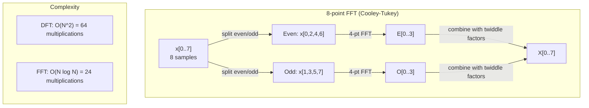
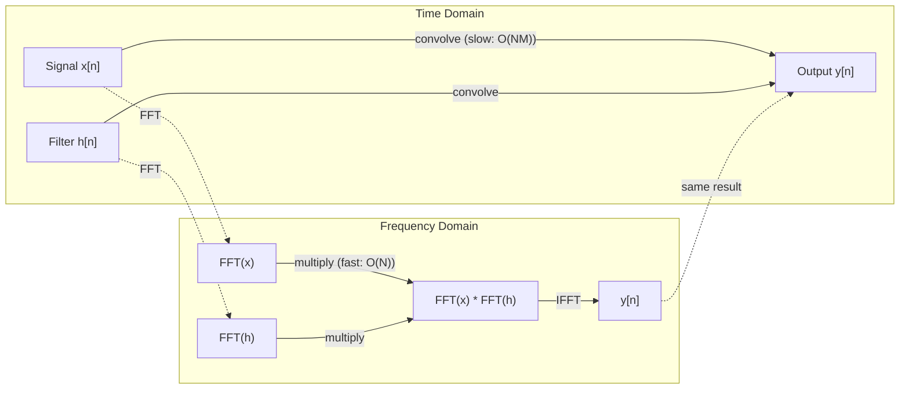

# La transformation de Fourier

> Chaque signal est une somme d'ondes sinusoïdes.

**Type:** Build
**Languages:** Python, TypeScript
**Prerequisites:** Phase 1, Lessons 01-04, 19 (complex numbers)
**Time:** ~90 minutes

## Objectifs d'apprentissage

- Mettre en œuvre la DFT à partir de zéro et la vérifier contre les $O(N \log N)$Cooley-Tukey FFT
- Interpréter les coefficients de fréquence: extraire l'amplitude, la phase et le spectre de puissance d'un signal
- Appliquer le théorème de la convolutions pour effectuer la convolutions par la multiplication FFT
- Connectez la décomposition de fréquence Fourier aux couches de codage positionnel et de convolutions de CNN transformateurs

## Le problème

Une enregistrement audio est une séquence de mesures de pression au fil du temps. Un prix d'action est une séquence de valeurs sur plusieurs jours. Une image est une grille d'intensités de pixels sur l'espace. Toutes ces données sont dans le domaine du temps (ou domaine de l'espace). Vous voyez des valeurs en changement sur un certain indice.

Mais de nombreux modèles sont invisibles dans le domaine temporel. Ce signal audio est-il un ton pur ou un accord? Le prix de l'action a-t-il un cycle hebdomadaire? Cette image a-t-elle une texture répétée? Ces questions concernent le contenu de la fréquence, et le domaine temporel le cache.

La transformation de Fourier convertit les données du domaine temporel au domaine de fréquence. Elle prend un signal et le décompose en ondes sinusales de différentes fréquences. Chaque onde sinusale a une amplitude (la force de son amplitude) et une phase (où elle démarre).

Cela importe pour ML parce que la pensée du domaine de fréquence apparaît partout. Les réseaux neuronaux convolutifs effectuent une convolutions, qui est la multiplication dans le domaine de fréquence. Les encodements positionnels des transformateurs utilisent la décomposition de fréquence pour représenter la position. Les modèles audio (reconnaissance de la parole, génération de musique) fonctionnent sur des spectrogrammes - représentations de fréquence du son. Les modèles de séries temporelles recherchent des modèles périodiques. Comprendre la transformation de Fourier vous donne le vocabulaire pour travailler avec tout cela.

## Le concept

### La définition de la DFT

- Je vous en prie .$N$échantillons $x[0], x[1], \ldots, x[N-1]$, la Transformation Fourier discrète produit $N$coefficients de fréquence $X[0], X[1], \ldots, X[N-1]$- Le numéro de la liste:

```math
X[k] = \sum_{n=0}^{N-1} x[n] \, e^{-2\pi i k n/N} \qquad \text{for } k = 0, 1, \ldots, N-1
```

Chacun d' eux .$X[k]$C'est un nombre complexe.$\lvert X[k] \rvert$est proportionnelle à l'amplitude de fréquence $k$Sans normalisation, un vrai sinus d'amplitude.$A$qui tombe exactement sur Bin $k$donne$\lvert X[k] \rvert = AN/2$, alors divisez par $N/2$Pour lire l'amplitude.$\angle X[k]$vous indique le décalage de phase de cette fréquence.

Le point de vue clé: $e^{-2\pi i k n/N}$est un phasor rotatif à fréquence $k$. Le DFT calcule la corrélation entre le signal et chacun des $N$Si le signal contient de l'énergie à la fréquence$k$Si ce n'est pas le cas, il est proche de zéro.

### Ce que chaque coefficient signifie

**$X[0]$: the DC component.**C'est la somme de tous les échantillons, proportionnelle à la moyenne.

```math
X[0] = \sum_{n=0}^{N-1} x[n] \, e^0 = \text{sum of all samples}
```

**$X[k]$ for $1 \le k \le N/2$: positive frequencies.** $X[k]$représente la fréquence $k$cycles par$N$échantillons. plus élevé $k$signifie une fréquence plus élevée (oscillation plus rapide).

**$X[N/2]$: the Nyquist frequency.**La fréquence la plus élevée que vous puissiez représenter $N$Au-dessus de cela, vous obtenez un pseudonyme -- des fréquences élevées masquant des fréquences basses.

**$X[k]$ for $N/2 < k < N$: negative frequencies.**Pour les signaux de valeur réelle,$X[N-k] = \overline{X[k]}$Les fréquences négatives sont des images miroir des fréquences positives.$N/2 + 1$les coefficients.

### DFT inversé

Le DFT inverse reconstruit le signal d'origine à partir de ses coefficients de fréquence:

```math
x[n] = \frac{1}{N} \sum_{k=0}^{N-1} X[k] \, e^{2\pi i k n/N} \qquad \text{for } n = 0, 1, \ldots, N-1
```

Les seules différences avec le DFT à terme: le signe dans l'exponent est positif (pas négatif), et il y a un $1/N$facteur de normalisation.

Le DFT inverse est une reconstruction parfaite. Aucune information n'est perdue. Vous pouvez passer du domaine temporel au domaine de fréquence et retourner sans aucune erreur. Le DFT est un changement de base - il réexprime les mêmes informations dans un système de coordonnées différent.

### Le FFT: le rendre rapide

Le DFT tel que défini ci-dessus est $O(N^2)$: pour chacun d'eux $N$Les coefficients de sortie, vous les résumerez $N$Les échantillons d'entrée.$N$= 1 million, c'est-à-dire $10^{12}$les opérations.

La transformation rapide de Fourier (FFT) compute le même résultat en $O(N \log N)$Pour ...$N$= 1 million, c'est environ 20 millions d'opérations au lieu d'un trillion.

L'algorithme Cooley-Tukey (le FFT le plus courant) fonctionne par division et conquête:

1. Divisez le signal en échantillons indexés par et par.
2. Calculer le DFT de chaque moitié de manière récursive.
3. Combinez les deux DFT de taille moyenne en utilisant des "facteurs jumeaux". $e^{-2\pi i k/N}$- Je suis désolé .

```math
\begin{aligned}
X[k] &= E[k] + e^{-2\pi i k/N} \, O[k] && \text{for } k = 0, \ldots, N/2 - 1 \\
X[k + N/2] &= E[k] - e^{-2\pi i k/N} \, O[k] && \text{for } k = 0, \ldots, N/2 - 1 \\[6pt]
\text{where } E &= \text{DFT of even-indexed samples} \\
O &= \text{DFT of odd-indexed samples}
\end{aligned}
```

La symétrie signifie que chaque niveau de récursion fait$O(N)$Le travail, et il y a $\log_2(N)$Les niveaux.$O(N \log N)$- Je suis désolé .



Le radix-2 FFT construit ici est le plus rapide lorsque la longueur du signal est une puissance de 2. Chaque fois qu'un sous-problème a une longueur irrégulière, il tombe à nouveau à la plaine `dft`, les signaux sont donc souvent réglés à zéro à la puissance suivante de 2 pour la vitesse.`numpy.fft`Ils sont plus rapides sur les longueurs avec de petits facteurs primaires.

### Analyse spectrale

Le **power spectrum**est $\lvert X[k] \rvert^2$-- la magnitude carrée de chaque coefficient de fréquence. Il montre combien d'énergie est à chaque fréquence.

Le **phase spectrum**est $\angle X[k]$Pour la plupart des tâches d'analyse, vous vous souciez du spectre de puissance et ignorez la phase.

```math
\begin{aligned}
\text{Power at frequency } k: \quad P[k] &= |X[k]|^2 = \mathop{\mathrm{Re}}(X[k])^2 + \mathop{\mathrm{Im}}(X[k])^2 \\
\text{Phase at frequency } k: \quad \phi[k] &= \mathop{\mathrm{atan2}}(\mathop{\mathrm{Im}}(X[k]), \mathop{\mathrm{Re}}(X[k]))
\end{aligned}
```

### Résolution de fréquence

La résolution de fréquence du DFT dépend du nombre d' échantillons $N$et le taux d'échantillonnage $f_s$- Je suis désolé .

```math
\begin{aligned}
\text{Frequency of bin } k: \quad & f_k = k \cdot f_s / N \\
\text{Frequency resolution:} \quad & \Delta f = f_s / N \\
\text{Maximum frequency:} \quad & f_{\max} = f_s / 2 \quad \text{(Nyquist)}
\end{aligned}
```

Pour résoudre deux fréquences proches, il faut plus d'échantillons.

### Le théorème de la convolutions

C'est l'un des résultats les plus importants dans le traitement des signaux et directement pertinent pour les CNN.

**Convolution in the time domain equals pointwise multiplication in the frequency domain.**

```math
\begin{aligned}
& x * h = \text{IFFT}(\text{FFT}(x) \cdot \text{FFT}(h)) \\[4pt]
& \text{where } * \text{ is convolution and } \cdot \text{ is element-wise multiplication}
\end{aligned}
```

Pourquoi cela importe ?

- Convolutions directes de deux signaux de longueur $N$et $M$Il prend$O(NM)$les opérations.
- La convulsion basée sur le FFT prend $O(N \log N)$: transformer les deux, multiplier, transformer de retour.
- Pour les grands noyaux, la convolutions FFT sont considérablement plus rapides.
- C'est exactement ce qui se passe dans les couches convolutives avec de grands champs réceptifs.

Note: le DFT compute la convolutions circulaires (le signal se retourne). Pour la convolutions linéaires (pas de contour), la longueur des deux signaux est réduite à zéro.$N + M - 1$avant l'informatique.



### Les fenêtres

Le DFT suppose que le signal est périodique - il traite le $N$Si le signal ne commence pas et ne se termine pas à la même valeur, cela crée une discontinuité à la limite, qui apparaît comme un contenu à haute fréquence faux.

Le débit de la fenêtre réduit la fuite en réduisant le signal à zéro à chaque extrémité avant de calculer le DFT.

Les fenêtres communes:

| Window | Shape | Main lobe width | Side lobe level | Use case |
|--------|-------|----------------|-----------------|----------|
| Rectangular | Flat (no window) | Narrowest | Highest (-13 dB) | When signal is exactly periodic in N samples |
| Hann | Raised cosine | Moderate | Low (-31 dB) | General purpose spectral analysis |
| Hamming | Modified cosine | Moderate | Lower (-42 dB) | Audio processing, speech analysis |
| Blackman | Triple cosine | Wide | Very low (-58 dB) | When side lobe suppression is critical |

```math
\begin{aligned}
\text{Hann window:} \quad & w[n] = 0.5 \left(1 - \cos\frac{2\pi n}{N-1}\right) \\
\text{Hamming window:} \quad & w[n] = 0.54 - 0.46 \cos\frac{2\pi n}{N-1}
\end{aligned}
```

Appliquer la fenêtre en la multipliant par élément avec le signal avant le DFT: `X = DFT(x * w)`- Je suis désolé .

### Propriétés de DFT

| Property | Time Domain | Frequency Domain |
|----------|-------------|-----------------|
| Linearity | $ax + by$ | $aX + bY$ |
| Time shift | $x[n - k]$ | $X[f] e^{-2\pi i f k/N}$ |
| Frequency shift | $x[n] e^{2\pi i f_0 n/N}$ | $X[f - f_0]$ |
| Convolution | $x * h$ | $X \cdot H$ (pointwise) |
| Multiplication | $x \cdot h$ (pointwise) | $X * H$ (circular convolution, scaled by $1/N$) |
| Parseval's theorem | $\sum \lvert x[n] \rvert^2$ | $\frac{1}{N} \sum \lvert X[k] \rvert^2$ |
| Conjugate symmetry (real input) | $x[n]$ real | $X[k] = \overline{X[N-k]}$ |

Le théorème de Parseval dit que l'énergie totale est la même dans les deux domaines.

### Connexion à des encodements positionnels

Le Transformer original utilise des codes positionnels sinusoïdes:

```math
\begin{aligned}
PE(pos, 2i) &= \sin\left(pos / 10000^{2i/d_{\text{model}}}\right) \\
PE(pos, 2i+1) &= \cos\left(pos / 10000^{2i/d_{\text{model}}}\right)
\end{aligned}
```

Chaque paire de dimensions $(2i, 2i+1)$Les fréquences sont géométriquement séparées de haute (dimension 0,1) à basse (dimension finale). Cela donne à chaque position un motif unique dans toutes les bandes de fréquences - similaire à la façon dont les coefficients de Fourier identifient un signal de manière unique.

Les propriétés clés que cela fournit:

- **Uniqueness:**Aucune position n'a le même code.
- **Bounded values:**Le péché et le cos sont toujours là.$[-1, 1]$- Je suis désolé .
- **Relative position:**Le codage de la position $p+k$peut être exprimée comme une fonction linéaire du codage à position $p$Le modèle peut apprendre à prendre des positions relatives.

### Connexion à la CNN

Une couche de convolutions applique un filtre (nucle) appris à l'entrée en le faisant glisser à travers le signal ou l'image.

Selon le théorème de la convolutions, cela équivaut à:
1. FFT l'entrée
2. FFT le noyau
3. Multipliez dans le domaine de fréquence
4. Si le résultat est

Les implémentations standard de CNN utilisent la convulsion directe (plus rapide pour les petits noyaux 3x3). Mais pour les grands noyaux ou la convulsion globale, les approches basées sur FFT sont nettement plus rapides. Certaines architectures (comme FNet) remplacent entièrement l'attention par FFT, atteignant une précision concurrentielle avec $O(N \log N)$Au lieu de $O(N^2)$La complexité.

### Les spectrogrammes et la transformation Fourier à court terme

Un FFT unique vous donne le contenu de fréquence de l'ensemble du signal, mais ne vous dit rien sur quand ces fréquences se produisent.

La transformation Fourier à court temps (STFT) résout cette question en calculant des FFT sur des fenêtres de signal qui se chevauchent. Le résultat est un spectrogramme: une représentation 2D avec le temps sur un axe et la fréquence sur l'autre. L'intensité à chaque point montre l'énergie à cette fréquence à ce moment-là.

```
STFT procedure:
1. Choose a window size (e.g., 1024 samples)
2. Choose a hop size (e.g., 256 samples -- 75% overlap)
3. For each window position:
   a. Extract the windowed segment
   b. Apply a Hann/Hamming window
   c. Compute FFT
   d. Store the magnitude spectrum as one column of the spectrogram
```

Les spectrogrammes sont la représentation standard des entrées pour les modèles audio ML. Les modèles de reconnaissance de la parole (Whisper, DeepSpeech) fonctionnent sur des spectrogrammes mel - des spectrogrammes avec des fréquences mappées à l'échelle mel, ce qui correspond mieux à la perception du son humain.

### Le nom de l'alias

Si un signal contient des fréquences supérieures $f_s/2$(fréquence Nyquist), prélèvement à la vitesse $f_s$Un signal de 90 Hz échantillonné à 100 Hz ressemble à un signal de 10 Hz. Il n'y a aucun moyen de les distinguer des échantillons seuls.

```
Example:
  True signal: 90 Hz sine wave
  Sampling rate: 100 Hz
  Apparent frequency: 100 - 90 = 10 Hz

  The samples from the 90 Hz signal at 100 Hz sampling rate
  are identical to the samples from a 10 Hz signal.
  No amount of math can recover the original 90 Hz.
```

C'est pourquoi les convertisseurs analogiques vers numériques incluent des filtres anti-aliasing qui éliminent les fréquences supérieures à Nyquist avant le prélèvement d'échantillons.

### Le rembourrage à zéro n'augmente pas la résolution

Un malentendu commun: le remplissage à zéro d'un signal avant FFT améliore la résolution de la fréquence. Ce n'est pas le cas. Le remplissage à zéro interpole entre les poubelles de fréquences existantes, ce qui vous donne un spectre plus lisse. Mais il ne peut pas révéler les détails de fréquence qui n'étaient pas présents dans les échantillons originaux.

La résolution de la fréquence réelle dépend uniquement du temps d' observation $T = N / f_s$- Pour résoudre deux fréquences séparées par$\Delta f$Tu as besoin du moins .$T = 1 / \Delta f$Aucune quantité de rembourrage à zéro ne modifie cette limite fondamentale.

```figure
fourier-synthesis
```

## Faites-le

### Étape 1: DFT à partir de zéro

Le $O(N^2)$Le DFT dérive directement de la définition.

```python
import math

class Complex:
    ...

def dft(x):
    N = len(x)
    result = []
    for k in range(N):
        total = Complex(0, 0)
        for n in range(N):
            angle = -2 * math.pi * k * n / N
            w = Complex(math.cos(angle), math.sin(angle))
            xn = x[n] if isinstance(x[n], Complex) else Complex(x[n])
            total = total + xn * w
        result.append(total)
    return result
```

### Étape 2: DFT inversé

La même structure, l'exponent positif, divisé par $N$- Je suis désolé .

```python
def idft(X):
    N = len(X)
    result = []
    for n in range(N):
        total = Complex(0, 0)
        for k in range(N):
            angle = 2 * math.pi * k * n / N
            w = Complex(math.cos(angle), math.sin(angle))
            total = total + X[k] * w
        result.append(Complex(total.real / N, total.imag / N))
    return result
```

### Étape 3: FFT (Cooley-Tukey)

La FFT récursive nécessite une puissance de longueur de 2.

```python
def fft(x):
    N = len(x)
    if N <= 1:
        return [x[0] if isinstance(x[0], Complex) else Complex(x[0])]
    if N % 2 != 0:
        return dft(x)

    even = fft([x[i] for i in range(0, N, 2)])
    odd = fft([x[i] for i in range(1, N, 2)])

    result = [Complex(0)] * N
    for k in range(N // 2):
        angle = -2 * math.pi * k / N
        twiddle = Complex(math.cos(angle), math.sin(angle))
        t = twiddle * odd[k]
        result[k] = even[k] + t
        result[k + N // 2] = even[k] - t
    return result
```

### Étape 4: Aide à l'analyse spectrale

```python
def power_spectrum(X):
    return [xk.real ** 2 + xk.imag ** 2 for xk in X]

def convolve_fft(x, h):
    N = len(x) + len(h) - 1
    padded_N = 1
    while padded_N < N:
        padded_N *= 2

    x_padded = x + [0.0] * (padded_N - len(x))
    h_padded = h + [0.0] * (padded_N - len(h))

    X = fft(x_padded)
    H = fft(h_padded)

    Y = [xk * hk for xk, hk in zip(X, H)]

    y = idft(Y)
    return [y[n].real for n in range(N)]
```

## Utilisez-le

Pour le vrai travail, utilisez le FFT de numpy qui est pris en charge par des bibliothèques C hautement optimisées.

```python
import numpy as np

signal = np.sin(2 * np.pi * 5 * np.arange(256) / 256)
spectrum = np.fft.fft(signal)
freqs = np.fft.fftfreq(256, d=1/256)

power = np.abs(spectrum) ** 2

positive_freqs = freqs[:len(freqs)//2]
positive_power = power[:len(power)//2]
```

Pour l'analyse des fenêtres et des spectraux plus avancés:

```python
from scipy.signal import windows, stft

window = windows.hann(256)
windowed = signal * window
spectrum = np.fft.fft(windowed)
```

Pour la convolutions:

```python
from scipy.signal import fftconvolve

result = fftconvolve(signal, kernel, mode='full')
```

Pour les spectrogrammes:

```python
from scipy.signal import stft

frequencies, times, Zxx = stft(signal, fs=sample_rate, nperseg=256)
spectrogram = np.abs(Zxx) ** 2
```

La matrice du spectrogramme a une forme (n_frequences, n_time_frames). Chaque colonne est le spectre de puissance à une fenêtre temporelle.

## La faire partir

On court .`code/fourier.py`pour générer `outputs/prompt-spectral-analyzer.md`La version TypeScript,`code/fourier.ts`, écrit le même dossier.

## Exercices

1. **Pure tone identification.**Créer un signal avec une seule onde sinus à une fréquence inconnue (entre 1 et 50 Hz), échantillonné à 128 Hz pendant 1 seconde. Utilisez votre DFT pour identifier la fréquence. Vérifiez les correspondances de la réponse. Ajoutez maintenant le bruit gaussien avec déviation standard 0.5 et répète. Comment le bruit affecte-t-il le spectre?

2. **FFT vs DFT verification.**Générer un signal aléatoire de longueur 64.$O(N^2){}$) et FFT. Vérifiez que tous les coefficients correspondent à 1e-10. Le temps fonctionne sur les signaux de longueur 256, 512, 1024, et 2048.

3. **Convolution theorem proof by example.**Créer le signal x = [1, 2, 3, 4, 0, 0, 0, 0] et filtrer h = [1, 1, 1, 0, 0, 0, 0, 0]. Computez leur convolutions circulaires directement (boucle nichée). Computez-le ensuite via FFT (transformation, multiplication, transformation inverse). Vérifiez la correspondance des résultats.

4. **Windowing effects.**Créer un signal qui est la somme de deux ondes sinusoïdes à 10 Hz et 12 Hz (très proche). échantillonner à 128 Hz pendant 1 seconde. Compute le spectre de puissance sans fenêtre, fenêtre Hann et fenêtre Hamming. Quelle fenêtre rend le plus facile de distinguer les deux sommets? Pourquoi?

5. **Positional encoding analysis.**Générer les codage positionnaires sinusoïdes pour d_modèle = 128 et max_pos = 512. Pour chaque paire de positions $(p_1, p_2)$, calculer le produit des points de leurs codages.$\lvert p_1 - p_2 \rvert$Qu'arrive-t-il au produit des points à mesure que la distance augmente ?

### Des indices

**Exercise 1.**Avec 128 échantillons sur 1 seconde, bin $k$est $k$Hz, donc pour une fréquence entière l'indice de la plus grande valeur dans les poubelles 1 à 63 est la fréquence. Choisissez un nombre entier de hertz. Une fréquence entre deux poubelles se propage dans ses voisins, et le pic donne seulement la poubelle la plus proche. Utilisez `generate_signal`et `magnitude_spectrum`Après avoir ajouté du bruit, vérifiez que le pic est toujours au même coffre pendant que les autres coffres montent.

**Exercise 2.**Utilisez une puissance de deux longues, parce que `fft`- Il divise le signal en deux.`max(abs(a - b))`Le ratio de temps devrait augmenter à peu près en fonction de la valeur de l'indice de coefficient.$N / \log_2 N$- Je suis désolé .

**Exercise 3.**Pour la convolutions circulaires, calculer $y[n] = \sum_k h[k] x[(n-k) \bmod 8]$à la main pour $n$= 0, 1 et 2, et comparer les trois premières valeurs de `convolve_direct`et `convolve_fft`La convolutions linéaires ont une longueur de 4 + 3 - 1 = 6, alors vérifiez d'abord si la longueur 8 est déjà assez longue.

**Exercise 4.**Utilisation `hann_window`- Je suis là .`hamming_window`- Je suis là .`apply_window`, et `power_spectrum`, et compter les pics séparés entre 9 et 13 Hz. Les 10 Hz et 12 Hz complètent des cycles entiers en 1 seconde, de sorte qu'aucune fenêtre ne peut avoir l'air la meilleure. Répétez avec 10,5 Hz et 12,5 Hz pour voir la fuite que les fenêtres réduisent.

**Exercise 5.**Compute chaque codage avec `positional_encoding(pos, 128)`. Comparer le produit des points pour les positions (0, 10) avec le produit des points pour (100, 110): les deux valeurs doivent correspondre à environ 1e-10.$\lvert p_1 - p_2 \rvert$pour une seule fixation $p_1$- Je suis désolé .

## Les termes clés

| Term | What it means |
|------|---------------|
| DFT (Discrete Fourier Transform) | Converts $N$ time-domain samples into $N$ frequency-domain coefficients. Each coefficient is the correlation with a complex sinusoid at that frequency |
| FFT (Fast Fourier Transform) | An $O(N \log N)$ algorithm to compute the DFT. The Cooley-Tukey algorithm splits even/odd indices recursively |
| Inverse DFT | Reconstructs the time-domain signal from frequency coefficients. Same formula as DFT with flipped exponent sign and $1/N$ scaling |
| Frequency bin | Each index $k$ in the DFT output represents frequency $k f_s/N$ Hz. The "bin" is the discrete frequency slot |
| DC component | $X[0]$, the zero-frequency coefficient. Proportional to the signal mean |
| Nyquist frequency | $f_s/2$, the maximum frequency representable at sampling rate $f_s$. Frequencies above this alias |
| Power spectrum | $\lvert X[k] \rvert^2$, the squared magnitude of each frequency coefficient. Shows energy distribution across frequencies |
| Phase spectrum | $\angle X[k]$, the phase offset of each frequency component. Often ignored in analysis |
| Spectral leakage | Spurious frequency content caused by treating a non-periodic signal as periodic. Reduced by windowing |
| Window function | A tapering function (Hann, Hamming, Blackman) applied before DFT to reduce spectral leakage |
| Twiddle factor | The complex exponential $e^{-2\pi i k/N}$ used to combine sub-DFTs in the FFT butterfly computation |
| Convolution theorem | Convolution in time domain equals pointwise multiplication in frequency domain. Fundamental to signal processing and CNNs |
| Circular convolution | Convolution where the signal wraps around. This is what the DFT naturally computes |
| Linear convolution | Standard convolution without wraparound. Achieved by zero-padding before DFT |
| Parseval's theorem | Total energy is preserved through the Fourier transform. $\sum \lvert x[n] \rvert^2 = \frac{1}{N} \sum \lvert X[k] \rvert^2$ |
| Aliasing | When frequencies above Nyquist appear as lower frequencies due to insufficient sampling rate |

## Pour en savoir plus

- [Cooley & Tukey: An Algorithm for the Machine Calculation of Complex Fourier Series (1965)](https://www.ams.org/journals/mcom/1965-19-090/S0025-5718-1965-0178586-1/)- le papier FFT original qui a changé l'informatique
- [3Blue1Brown: But what is the Fourier Transform?](https://www.youtube.com/watch?v=spUNpyF58BY)- la meilleure introduction visuelle aux transformations de Fourier
- [Lee-Thorp et al.: FNet: Mixing Tokens with Fourier Transforms (2021)](https://arxiv.org/abs/2105.03824)- remplace l'auto-attention par la FFT dans les transformateurs
- [Smith: The Scientist and Engineer's Guide to Digital Signal Processing](http://www.dspguide.com/)- livre en ligne gratuit couvrant en profondeur les FFT, les fenêtres et l'analyse spectrale
- [Vaswani et al.: Attention Is All You Need (2017)](https://arxiv.org/abs/1706.03762)- les encodements positionnels sinusoïdes dérivés de la décomposition de fréquence Fourier
- [Radford et al.: Whisper (2022)](https://arxiv.org/abs/2212.04356)- reconnaissance vocale à l'aide de mélespectogrammes comme représentation d'entrée
