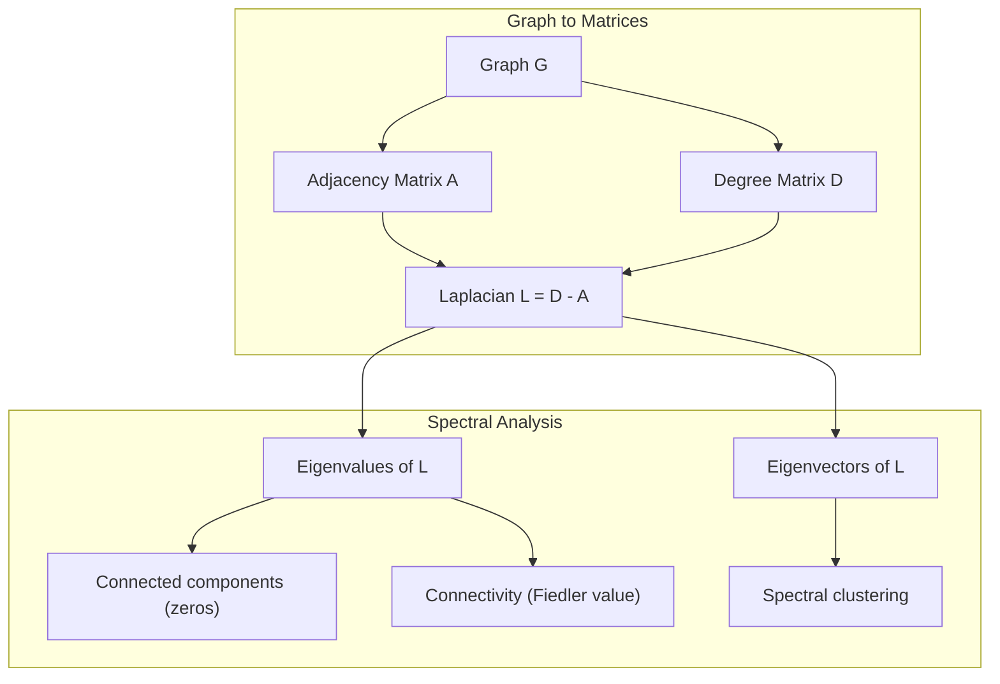
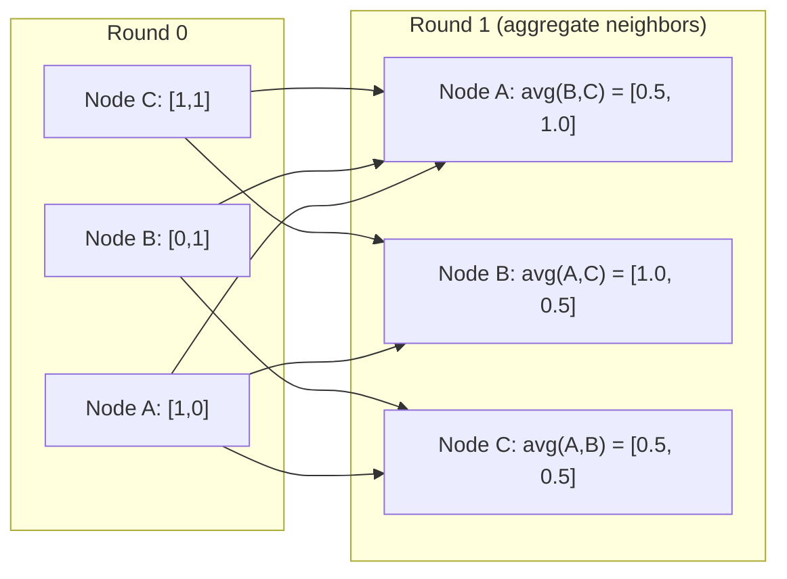

# Théorie des graphiques pour l'apprentissage automatique

> Les graphiques sont la structure des données des relations. Si vos données ont des connexions, vous avez besoin de la théorie des graphiques.

**Type:** Build
**Languages:** Python, TypeScript
**Prerequisites:** Phase 1, Lessons 01-03 (linear algebra, matrices)
**Time:** ~90 minutes

## Objectifs d'apprentissage

- Construire une classe de graphes avec des représentations de matrice/liste adjacentes et mettre en œuvre des traverses BFS et DFS
- Compute le graphe Laplacien et utilise ses valeurs propres pour détecter les composants connectés et les nœuds de cluster
- Implémenter une ronde de message de style GNN passant comme une matrice d'adjacence normalisée
- Appliquer le regroupement spectrale pour partager un graphique en utilisant le vecteur Fiedler

## Le problème

Les réseaux sociaux, les molécules, les bases de connaissances, les réseaux de citations, les cartes routières, tout cela sont des graphiques. La méthode ML traditionnelle traite les données comme des tables plates. Chaque ligne est indépendante. Chaque fonctionnalité est une colonne. Mais quand la structure des connexions compte, les tables échouent.

Considérez un réseau social. Vous voulez prédire quel produit un utilisateur achètera. Son historique d'achat compte. Mais l'historique d'achat de ses amis compte plus. Les connexions portent un signal.

Ou pensez à une molécule. Vous voulez prédire si elle se lie à une protéine. Les atomes sont importants, mais ce qui compte vraiment, c'est comment les atomes sont liés les uns aux autres. La structure est les données.

Les réseaux neuraux graphiques (GNN) sont le domaine de l'apprentissage profond qui connaît la croissance la plus rapide. Ils alimentent la découverte de médicaments, la recommandation sociale, la détection de fraude et le raisonnement graphique des connaissances.

Il vous faut quatre choses:
1. Une façon de représenter les graphiques comme des matrices (pour les multiplier)
2. Algorithmes de traverses pour explorer la structure du graphique
3. Le Laplacien -- la matrice la plus importante dans la théorie des graphiques spectraux
4. Passage de messages - l'opération qui fait fonctionner les GNN

## Le concept

### Graphiques: nœuds et bords

Un graphique $G = (V, E)$est constitué de sommets (nœuds) $V$et les bords $E$Chaque bord relie deux nœuds.

**Directed vs undirected.**Dans un graphique non dirigé, bord $(u, v)$les moyens $u$se connecte à $v$Et ...$v$se connecte à $u$Dans un graphique dirigé (digraphe), bord $(u, v)$les moyens $u$fait référence à $v$, mais pas nécessairement l'inverse.

**Weighted vs unweighted.**Dans un graphique non pondéré, les bords existent ou non. Dans un graphique pondéré, chaque bord a un poids numérique - une distance, un coût, une force.

| Graph type | Example |
|-----------|---------|
| Undirected, unweighted | Facebook friendship network |
| Directed, unweighted | Twitter follow network |
| Undirected, weighted | Road map (distances) |
| Directed, weighted | Web page links (PageRank scores) |

### La matrice d'adjacence

La matrice d' adjacence $A$est la représentation du noyau.$n$les nœuds:

```math
A[i][j] = \begin{cases} 1 & \text{if there is an edge from node } i \text{ to node } j \\ 0 & \text{otherwise} \end{cases}
```

Pour les graphiques non dirigés, $A$est symétrique: $A[i][j] = A[j][i]$Pour les graphiques pondérés,$A[i][j]$= poids du bord $(i, j)$- Je suis désolé .

**Example -- a triangle:**

```
Nodes: 0, 1, 2
Edges: (0,1), (1,2), (0,2)

A = [[0, 1, 1],
     [1, 0, 1],
     [1, 1, 0]]
```

La matrice d'adjacence est l'entrée de chaque GNN.$A$correspondent aux opérations sur le graphique.

### Diplôme

Le degré d'un nœud est le nombre de bords qui y sont connectés. Pour les graphiques dirigés, vous avez des degrés in-grade (bords entrant) et out-grade (bords sortant).

La matrice de degrés $D$est diagonale:

```math
\begin{aligned}
D[i][i] &= \text{degree of node } i \\
D[i][j] &= 0 \quad \text{for } i \ne j
\end{aligned}
```

Pour l' exemple du triangle: $D = \mathop{\mathrm{diag}}(2, 2, 2)$Parce que chaque nœud se connecte à deux autres.

Le degré vous indique l'importance des nœuds. Le degré élevé = nœud de hub. La distribution des degrés d'un réseau révèle sa structure. Les réseaux sociaux suivent les lois de puissance (peu de nœuds, beaucoup de nœuds de feuilles). Les graphiques aléatoires ont des degrés distribués par Poisson.

### BFS et DFS

Les deux algorithmes de traversage de graphes fondamentaux.

**Breadth-First Search (BFS):**Explorez tous les voisins d'abord, puis les voisins des voisins.

```
BFS from node 0:
  Visit 0
  Queue: [1, 2]        (neighbors of 0)
  Visit 1
  Queue: [2, 3]        (add neighbors of 1)
  Visit 2
  Queue: [3]           (neighbors of 2 already visited)
  Visit 3
  Queue: []            (done)
```

Le BFS trouve les chemins les plus courts dans les graphiques non pondérés. La distance entre le début et un nœud équivaut au niveau du BFS auquel ce nœud est découvert pour la première fois. C'est pourquoi le BFS est utilisé pour les distances de compte hop dans les réseaux sociaux.

**Depth-First Search (DFS):**Faites le plus profond possible avant de revenir en arrière.

```
DFS from node 0:
  Visit 0
  Stack: [1, 2]        (neighbors of 0)
  Visit 2               (pop from stack)
  Stack: [1, 3]         (add neighbors of 2)
  Visit 3               (pop from stack)
  Stack: [1]
  Visit 1               (pop from stack)
  Stack: []             (done)
```

Le DFS est utile pour:
- Trouver les composants connectés (exécuter DFS à partir de nœuds non visités)
- Détection du cycle (marges arrières dans l'arbre DFS)
- Sortement topologique (ordre de finition inverse du DFS)

| Algorithm | Data structure | Finds | Use case |
|-----------|---------------|-------|----------|
| BFS | Queue | Shortest paths | Social network distance, knowledge graph traversal |
| DFS | Stack | Components, cycles | Connectivity, topological sort |

### Le graphe laplacien

$L = D - A$La matrice la plus importante de la théorie des graphiques spectraux.

Pour le triangle:

```math
D = \begin{bmatrix} 2 & 0 & 0 \\ 0 & 2 & 0 \\ 0 & 0 & 2 \end{bmatrix} \qquad A = \begin{bmatrix} 0 & 1 & 1 \\ 1 & 0 & 1 \\ 1 & 1 & 0 \end{bmatrix} \qquad L = \begin{bmatrix} 2 & -1 & -1 \\ -1 & 2 & -1 \\ -1 & -1 & 2 \end{bmatrix}
```

Le Laplacien possède des propriétés remarquables:

1. **$L$ is positive semi-definite.**Toutes les valeurs propres sont $\ge 0$- Je suis désolé .

2. **The number of zero eigenvalues equals the number of connected components.**Un graphique connecté a exactement une valeur propre zéro. Un graphique avec 3 composants déconnectés a trois valeurs propres zéro.

3. **The smallest non-zero eigenvalue (Fiedler value) measures connectivity.**Une grande valeur Fiedler signifie que le graphique est bien connecté. une petite valeur Fiedler signifie que le graphique a un point faible - un goulet d'étranglement.

4. **The eigenvector of the Fiedler value (Fiedler vector) reveals the best split.**Les nœuds avec des valeurs positives vont dans un groupe, les nœuds avec des valeurs négatives vont dans l'autre.



### Propriétés spectrales

Les valeurs propres de la matrice adjacente et du Laplacien révèlent des propriétés structurelles sans aucune traversée.

**Spectral clustering**fonctionne comme ceci:
1. Compute le Laplacien $L$
2. Trouvez le $k$Les plus petits vecteurs propres de $L$(s'il vous plaît sauter la première, qui est tout-on pour les graphiques connectés)
3. Utilisez ces propres vecteurs comme nouvelles coordonnées pour chaque nœud
4. On court .$k$- les moyens sur ces coordonnées

Pourquoi cela fonctionne-t-il ?$L$Les nœuds qui sont bien connectés obtiennent des valeurs propres vectorielles similaires. Les nœuds séparés par un goulet d'étranglement obtiennent des valeurs différentes. Les propres vecteurs séparent naturellement des grappes.

**Random walk connection.**Le Laplacien normalisé se rapporte à des promenades aléatoires sur le graphique. La répartition stationnaire d'une marche aléatoire est proportionnelle au degré de nœud. Le temps de mélange (la rapidité avec laquelle la marche converge) dépend de l'écart spectrique.

### Le message est passé

Le fonctionnement principal des réseaux neuraux graphiques. Chaque nœud collecte des messages de ses voisins, les agrégera et met à jour son propre état.

```math
h_v^{(k+1)} = \text{UPDATE}\left(h_v^{(k)}, \text{AGGREGATE}\left(\{h_u^{(k)} : u \in \text{neighbors}(v)\}\right)\right)
```

Dans la forme la plus simple, AGGREGATE = moyenne et UPDATE = transformation linéaire + activation:

```math
h_v^{(k+1)} = \sigma\left(W \cdot \text{mean}\left(\{h_u^{(k)} : u \in \text{neighbors}(v)\}\right)\right)
```

C'est une multiplication de matrice déguisée.$H$est la matrice de toutes les caractéristiques du nœud et $A$est la matrice d'adjacence:

```math
H^{(k+1)} = \sigma\left(A_{\text{norm}} H^{(k)} W\right)
```

où $A_{\text{norm}}$est la matrice d'adjacentité normalisée (chaque ligne est une somme de 1).

Une ronde de message permettant à chaque nœud de "voir" ses voisins immédiats.$K$Les ronds donnent à chaque nœud des informations de son $K$- dans le quartier du hop.



### Concepts et applications de l'équipement

| Concept | ML Application |
|---------|---------------|
| Adjacency matrix | GNN input representation |
| Graph Laplacian | Spectral clustering, community detection |
| BFS/DFS | Knowledge graph traversal, path finding |
| Degree distribution | Node importance, feature engineering |
| Message passing | GNN layers (GCN, GAT, GraphSAGE) |
| Eigenvalues of L | Community detection, graph partitioning |
| Spectral clustering | Unsupervised node grouping |
| PageRank | Node importance, web search |

```figure
graph-degree-distribution
```

## Faites-le

### Étape 1: Classement de graphique à partir de zéro

```python
class Graph:
    def __init__(self, n_nodes, directed=False):
        self.n = n_nodes
        self.directed = directed
        self.adj = {i: {} for i in range(n_nodes)}

    def add_edge(self, u, v, weight=1.0):
        self.adj[u][v] = weight
        if not self.directed:
            self.adj[v][u] = weight

    def neighbors(self, node):
        return list(self.adj[node].keys())

    def degree(self, node):
        return len(self.adj[node])

    def weighted_degree(self, node):
        return sum(self.adj[node].values())

    def adjacency_matrix(self):
        import numpy as np
        A = np.zeros((self.n, self.n))
        for u in range(self.n):
            for v, w in self.adj[u].items():
                A[u][v] = w
        return A

    def degree_matrix(self):
        import numpy as np
        D = np.zeros((self.n, self.n))
        for i in range(self.n):
            D[i][i] = self.weighted_degree(i)
        return D

    def laplacian(self):
        return self.degree_matrix() - self.adjacency_matrix()
```

La liste des adjacents (`self.adj`La conversion de matrice d'adjacence utilise numpy parce que toutes les opérations spectrales en ont besoin.

### Étape 2: BFS et DFS

```python
from collections import deque

def bfs(graph, start):
    visited = set()
    order = []
    distances = {}
    queue = deque([(start, 0)])
    visited.add(start)
    while queue:
        node, dist = queue.popleft()
        order.append(node)
        distances[node] = dist
        for neighbor in graph.neighbors(node):
            if neighbor not in visited:
                visited.add(neighbor)
                queue.append((neighbor, dist + 1))
    return order, distances


def dfs(graph, start):
    visited = set()
    order = []
    stack = [start]
    while stack:
        node = stack.pop()
        if node in visited:
            continue
        visited.add(node)
        order.append(node)
        for neighbor in reversed(graph.neighbors(node)):
            if neighbor not in visited:
                stack.append(neighbor)
    return order
```

BFS utilise une déque (couche à double fin) pour $O(1)$DFS utilise une liste comme une pile.$O(V + E)$Le temps.

### Étape 3: Les composants connectés et les valeurs propres laplaciennes

```python
def connected_components(graph):
    visited = set()
    components = []
    for node in range(graph.n):
        if node not in visited:
            order, _ = bfs(graph, node)
            visited.update(order)
            components.append(order)
    return components


def laplacian_eigenvalues(graph):
    import numpy as np
    L = graph.laplacian()
    eigenvalues = np.linalg.eigvalsh(L)
    return eigenvalues
```

`eigvalsh`est pour les matrices symétriques -- le Laplacien est toujours symétrique pour les graphiques non dirigés. Il renvoie les valeurs propres dans l'ordre ascendant.

### Étape 4: Clusterage spectrique

```python
def spectral_clustering(graph, k=2):
    import numpy as np
    L = graph.laplacian()
    eigenvalues, eigenvectors = np.linalg.eigh(L)
    features = eigenvectors[:, 1:k+1]

    labels = np.zeros(graph.n, dtype=int)
    for i in range(graph.n):
        if features[i, 0] >= 0:
            labels[i] = 0
        else:
            labels[i] = 1
    return labels
```

Pour $k=2$, le signe du vecteur Fiedler divise le graphique en deux graphes.$k>2$Tu courrais .$k$- signifie sur la première $k$vecteurs propres (à l'exclusion du vecteur propre trivial de tous les un).

### Étape 5: Transmission du message

```python
def message_passing(graph, features, weight_matrix):
    import numpy as np
    A = graph.adjacency_matrix()
    row_sums = A.sum(axis=1, keepdims=True)
    row_sums[row_sums == 0] = 1
    A_norm = A / row_sums
    aggregated = A_norm @ features
    output = aggregated @ weight_matrix
    return output
```

Il s'agit d'une série de messages GNN. Les nouvelles caractéristiques de chaque nœud sont la moyenne pondérée des caractéristiques de ses voisins, transformée par la matrice de poids.

## Utilisez-le

Avec networkx et numpy, les mêmes opérations sont unliners:

```python
import networkx as nx
import numpy as np

G = nx.karate_club_graph()

A = nx.adjacency_matrix(G).toarray()
L = nx.laplacian_matrix(G).toarray()

eigenvalues = np.linalg.eigvalsh(L.astype(float))
print(f"Smallest eigenvalues: {eigenvalues[:5]}")
print(f"Connected components: {nx.number_connected_components(G)}")

communities = nx.community.greedy_modularity_communities(G)
print(f"Communities found: {len(communities)}")

pr = nx.pagerank(G)
top_nodes = sorted(pr.items(), key=lambda x: x[1], reverse=True)[:5]
print(f"Top 5 PageRank nodes: {top_nodes}")
```

networkx traite des graphiques de toutes tailles avec des backends C optimisés. Utilisez-le dans la production. Utilisez votre mise en œuvre à partir de zéro pour comprendre ce qu'il fait.

### analyse spectrale de la nudité

```python
import numpy as np

A = np.array([
    [0, 1, 1, 0, 0],
    [1, 0, 1, 0, 0],
    [1, 1, 0, 1, 0],
    [0, 0, 1, 0, 1],
    [0, 0, 0, 1, 0]
])

D = np.diag(A.sum(axis=1))
L = D - A

eigenvalues, eigenvectors = np.linalg.eigh(L)
print(f"Eigenvalues: {np.round(eigenvalues, 4)}")
print(f"Fiedler value: {eigenvalues[1]:.4f}")
print(f"Fiedler vector: {np.round(eigenvectors[:, 1], 4)}")

fiedler = eigenvectors[:, 1]
group_a = np.where(fiedler >= 0)[0]
group_b = np.where(fiedler < 0)[0]
print(f"Cluster A: {group_a}")
print(f"Cluster B: {group_b}")
```

Le vecteur Fiedler fait le gros du travail. Les entrées positives dans un groupe, négatives dans l'autre. Aucune optimisation itérative n'est nécessaire - juste une propre composition.

## La faire partir

Cette leçon donne:
- `outputs/skill-graph-analysis.md`-- une référence de compétence pour l'analyse des données structurées par graphique

## Les liens

| Concept | Where it shows up |
|---------|------------------|
| Adjacency matrix | GCN, GAT, GraphSAGE input |
| Laplacian | Spectral clustering, ChebNet filters |
| BFS | Knowledge graph traversal, shortest path queries |
| Message passing | Every GNN layer, neural message passing |
| Spectral gap | Graph connectivity, mixing time of random walks |
| Degree distribution | Power-law networks, node feature engineering |
| Connected components | Preprocessing, handling disconnected graphs |
| PageRank | Node importance ranking, attention initialization |

Les GNN méritent une mention spéciale. L'opération de convolutions de graphes dans GCN (Kipf & Welling, 2017) utilise la matrice d'adjacence avec des boucles auto-ajoutées, $\hat{A} = A + I$- Le numéro de la liste:

```math
H^{(l+1)} = \sigma\left(\hat{D}^{-1/2} \hat{A} \hat{D}^{-1/2} H^{(l)} W^{(l)}\right)
```

où $\hat{A} = A + I$(adjacence plus auto-loops) et $\hat{D}$est la matrice de degrés de $\hat{A}$Les auto-loops assurent que chaque nœud inclut ses propres caractéristiques lors de l'agrégation.$\hat{D}^{-1/2} \hat{A} \hat{D}^{-1/2}$La Laplacienne apparaît parce que cette normalisation est liée à$L_{\text{sym}} = I - D^{-1/2} A D^{-1/2}$Comprendre le Laplacien signifie comprendre pourquoi les GCN fonctionnent.

## Exercices

1. **Implement PageRank from scratch.**Commencez par des scores uniformes. À chaque étape: score(v) = (1-d) /n + d * somme(score(u) /out_degree(u)) pour tous les u pointant vers v. Utilisez d=0,85.

2. **Find communities using spectral clustering.**Créer un graphique avec deux grappes clairement séparées (par exemple, deux cliques reliés par un seul bord). Exécuter le regroupement spectrale et vérifier qu'il trouve la bonne fraction. Que se passe-t-il lorsque vous ajoutez plus de bordes croisées?

3. **Implement Dijkstra's algorithm**Pour les traces les plus courtes dans les graphiques pondérés, comparez les résultats avec BFS sur le même graphique avec des poids uniformes.

4. **Build a 2-layer message passing network.**Appliquez un message qui passe deux fois avec des matrices de poids différentes. Montrez qu'après 2 tours, chaque nœud a des informations de son voisinage de 2 tours.

5. **Analyze a real-world graph.**Utilisez le graphique du Karate Club (34 nœuds, 78 bords). Comptez la répartition des degrés, les valeurs propres de Laplace et le regroupement spectrique. Comparer le résultat du regroupement spectrique avec la fraction de vérité de la terre connue.

### Des indices

**Exercise 1.**Utilisez la formule de l'exercice. Un nœud sans bordes sortantes doit partager son score de manière égale avec tous les nœuds, ou le total tombe en dessous de 1. Vérifiez que les scores s'ajoutent à 1 après chaque étape et comparez votre résultat avec `pagerank(graph)`- Je suis désolé .

**Exercise 2.**Construisez deux cliques avec `add_edge`, les connecter avec un bord, et appeler `spectral_clustering(graph, k=2)`Vérifiez que chaque clique obtient une étiquette. Lorsque vous ajoutez des bordures croisées, imprimez la deuxième plus petite valeur propre de `laplacian()`, qui grandit à mesure que les deux groupes se rejoignent.

**Exercise 3.**Gardez une file d'attente prioritaire avec `heapq`et toujours étendre le nœud avec la plus petite distance connue.`bfs(graph, start)`- Je suis désolé .

**Exercise 4.**Utilisez la matrice d' identité comme `features`, de sorte que chaque colonne marque un nœud, et appliquer `message_passing`Ensuite, les entrées non zéro dans la rangée pour le nœud $v$montrer quels nœuds ont atteint $v$Comparer cet ensemble avec les nœuds à distance 2 d'une première recherche de largeur.

**Exercise 5.** `networkx.karate_club_graph()`donne la liste de bord et la vérité de base dans l' attribut noeud `club`- Copiez les bords dans un`Graph`et vérifier qu'il a 34 nœuds et 78 bords.`spectral_clustering`avec le `club`Les deux étiquettes doivent être échangées.

## Les termes clés

| Term | What people say | What it actually means |
|------|----------------|----------------------|
| Graph | "Nodes and edges" | A mathematical structure $G=(V,E)$ encoding pairwise relationships |
| Adjacency matrix | "The connection table" | An $n \times n$ matrix where $A[i][j] = 1$ if nodes $i$ and $j$ are connected |
| Degree | "How connected a node is" | The number of edges touching a node |
| Laplacian | "D minus A" | $L = D - A$, the matrix whose eigenvalues reveal graph structure |
| Fiedler value | "The algebraic connectivity" | The smallest non-zero eigenvalue of $L$, measuring how well-connected the graph is |
| BFS | "Level-by-level search" | Traversal that visits all neighbors before going deeper, finds shortest paths |
| DFS | "Go deep first" | Traversal that follows one path to its end before backtracking |
| Message passing | "Nodes talk to neighbors" | Each node aggregates information from its neighbors, the core of GNNs |
| Spectral clustering | "Cluster by eigenvectors" | Partition a graph using eigenvectors of its Laplacian |
| Connected component | "A separate piece" | A maximal subgraph where every node can reach every other node |

## Pour en savoir plus

- **Kipf & Welling (2017)**-- "Classification semi-surveillée avec des réseaux convolutifs graphiques". Le document qui a lancé les GNN modernes.
- **Spielman (2012)**-- notes de conférence sur la théorie des graphes spectraux. L'introduction définitive aux Laplaciens, aux lacunes spectrales et à la partition des graphes.
- **Hamilton (2020)**-- "L'apprentissage de la représentation graphique". Livre couvrant les GNN des fondamentaux aux applications.
- **Bronstein et al. (2021)**-- "L'apprentissage géométrique en profondeur: réseaux, groupes, graphiques, géodésiques et gauges". Le document de cadre unificateur.
- **Veličković et al. (2018)**-- "Graph Attention Networks". Élargit le message passé avec des mécanismes d'attention.
