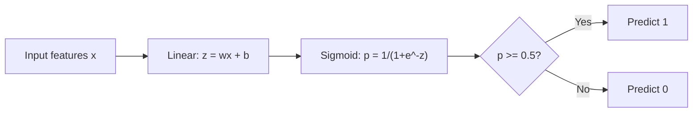
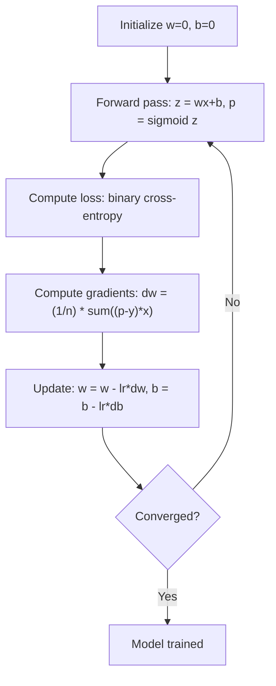

# Régré­sion logistique

> La régression logistique plie une ligne droite dans une courbe S pour répondre aux questions oui ou non avec probabilité.

**Type:** Build
**Languages:** Python, Julia, Rust
**Prerequisites:** Phase 2 Lesson 1-2 (What Is ML, Linear Regression)
**Time:** ~90 minutes

## Objectifs d'apprentissage

- Implémenter la régression logistique à partir de zéro en utilisant la fonction sigmoïde et la perte binaire d'entropie croisée
- Compute et interprète la précision, le rappel, le score F1 et la matrice de confusion pour la classification binaire
- Expliquer pourquoi les échanges de devises ne sont pas classés et pourquoi l'entropie binaire transversale produit une surface de coûts convexe
- Construire un modèle de régression de softmax pour la classification multi-classes et évaluer les compromis de réglage des seuils

## Le problème

Vous voulez prédire si une tumeur est maligne ou bénigne compte tenu de sa taille. Vous essayez une régression linéaire. Elle donne des chiffres comme 0,3 ou 1,7 ou -0,5. Qu'est-ce que cela signifie?

La régression logistique résoud cela.$wx + b$Il est donc possible de calculer la probabilité de la valeur de la valeur de la valeur de la valeur de la valeur de la valeur de la valeur de la valeur de la valeur de la valeur de la valeur de la valeur de la valeur de la valeur de la valeur de la valeur de la valeur de la valeur de la valeur de la valeur de la valeur de la valeur de la valeur de la valeur de la valeur de la valeur de la valeur de la valeur de la valeur de la valeur de la valeur de la valeur de la valeur de la valeur de la valeur de la valeur de la valeur de la valeur de la valeur de la valeur de la valeur de la valeur de la valeur de la valeur de la valeur de la valeur de la valeur de la valeur de la valeur de la valeur de la valeur de la valeur de la valeur de la valeur de la valeur de la valeur de la valeur de la valeur de la valeur de la valeur de la valeur de la valeur de la valeur de la valeur de la valeur de la valeur de la valeur de la valeur de la valeur de la valeur de la valeur de la valeur de la valeur de la valeur de la valeur de la valeur de la valeur de la valeur de la valeur de la valeur de la valeur de la valeur de la valeur de la valeur de la valeur de la valeur de cette valeur de cette valeur.

Il s'agit de l'un des algorithmes les plus utilisés en pratique. Malgré son nom, la régression logistique est un algorithme de classification, pas un algorithme de régression.

## Le concept

### Pourquoi la régression linéaire ne peut être classée

Imaginez prédire le passage/échec (1/0) en fonction des heures d'étude.

```
hours:  1   2   3   4   5   6   7   8   9   10
actual: 0   0   0   0   1   1   1   1   1   1
```

Une correspondance linéaire pourrait produire des prédictions comme -0,2 à l'heure 1 et 1,3 à l'heure 10. Ces valeurs ne sont pas des probabilités. Elles vont en dessous de 0 et au-dessus de 1.

La classification a besoin d'une fonction qui:
- Les valeurs de sortie entre 0 et 1 (probabilités)
- Créer une transition rapide (une limite de décision)
- Ne pas être déformé par des écarts loin de la limite

### La fonction sigmoïde

La fonction sigmoïde fait exactement ceci:

```math
\sigma(z) = \frac{1}{1 + e^{-z}}
```

Propriétés:
- Quand ?$z$est large et positif, $\sigma(z)$approches 1
- Quand ?$z$est grande et négative,$\sigma(z)$approches 0
- Quand ?$z = 0$- Je suis là .$\sigma(z) = 0.5$
- La sortie est toujours entre 0 et 1
- La fonction est lisse et différenciable partout

La dérivé a une forme pratique: $\sigma'(z) = \sigma(z) (1 - \sigma(z))$Cela rend le calcul des gradients efficace.

### Régrésion logistique = modèle linéaire + sigmoïde

Le modèle compute $z = wx + b$(même que la régression linéaire), puis sigmoïde:



La sortie $p$est interprété comme $P(y=1 \mid x)$, la probabilité que l'entrée appartient à la classe 1. La limite de décision est où $wx + b = 0$, ce qui rend la sortie sigmoïde exactement 0,5.

### Perte de l'entropie croisée binaire

Vous ne pouvez pas utiliser MSE pour la régression logistique. MSE avec un sigmoïde crée une surface de coûts non convexe avec de nombreux minima locaux.

```math
\text{Loss} = -\frac{1}{n} \sum \left( y \log(p) + (1-y) \log(1-p) \right)
```

Pourquoi ça marche:
- Quand ?$y=1$et $p$est proche de 1: $\log(1) = 0$, donc la perte est proche de 0 (correct, faible coût)
- Quand ?$y=1$et $p$est proche de 0: $\log(0)$approche l'infini négatif, donc la perte est énorme (erreur, coût élevé)
- Quand ?$y=0$et $p$est proche de 0: $\log(1) = 0$, donc la perte est proche de 0 (correct, faible coût)
- Quand ?$y=0$et $p$est proche de 1: $\log(0)$approche l'infini négatif, donc la perte est énorme (erreur, coût élevé)

Cette fonction de perte est convexe pour la régression logistique, de sorte que chaque minimum local est un minimum global et la descente de gradient ne peut pas rester coincée dans une mauvaise. Sur les données parfaitement séparables, la perte continue de diminuer à mesure que les poids augmentent, de sorte qu'il n'existe pas de minimum fini; la régulation L2 corrige cela et rend le minimum unique.

### Une baisse progressive de la régression logistique

Les gradients de l'entropie croisée binaire avec le sigmoïde sont de forme propre:

```math
\begin{aligned}
\frac{\partial L}{\partial w} &= \frac{1}{n} \sum (p - y) \, x \\
\frac{\partial L}{\partial b} &= \frac{1}{n} \sum (p - y)
\end{aligned}
```

Ces gradients sont identiques aux gradients de régression linéaires.$p = \sigma(wx + b)$Au lieu de $p = wx + b$Le sigmoïde introduit la non-linéarité, mais la règle de mise à jour des gradients reste la même.



### La limite de décision

Pour une entrée 2D (deux caractéristiques), la limite de décision est la ligne où:

```math
w_1 x_1 + w_2 x_2 + b = 0
```

Les points d'un côté sont classés comme 1, les points de l'autre côté comme 0. La régression logistique produit toujours une limite de décision linéaire.

### Classification multi-classe avec Softmax

La régression logistique binaire traite de deux classes.$k$classes, utilisez la fonction softmax:

```math
\text{softmax}(z_i) = \frac{e^{z_i}}{\sum_j e^{z_j}}
```

Chaque classe a son propre vecteur de poids.$z_i$pour chaque classe, softmax convertit les scores en probabilités qui s'ajoutent à 1.

La fonction de perte devient une entropie croisée catégorique:

```math
\text{Loss} = -\frac{1}{n} \sum \sum_k y_k \log(p_k)
```

où $y_k$est 1 pour la classe vraie et 0 pour toutes les autres (encoding à chaud unique).

### Les mesures d'évaluation

Pour un ensemble de données avec 95% négatif et 5% positif, un modèle qui prédit toujours négatif obtient une précision de 95% mais est inutile.

**Confusion Matrix**- Le numéro de la liste:

| | Predicted Positive | Predicted Negative |
|---|---|---|
| Actually Positive | True Positive (TP) | False Negative (FN) |
| Actually Negative | False Positive (FP) | True Negative (TN) |

**Precision**: De tous les positifs prévus, combien sont effectivement positifs ?
```math
\text{Precision} = \frac{TP}{TP + FP}
```

**Recall**(Sensibilité): De tous les positifs réels, combien avons-nous attrapé ?
```math
\text{Recall} = \frac{TP}{TP + FN}
```

**F1 Score**: moyen harmonieux de précision et de rappel.
```math
F_1 = 2 \cdot \frac{\text{Precision} \cdot \text{Recall}}{\text{Precision} + \text{Recall}}
```

Quand donner la priorité:
- **Precision**: lorsque les faux positifs sont coûteux (filtre de spam, vous ne voulez pas bloquer les courriels légitimes)
- **Recall**: lorsque les faux négatifs sont coûteux (le dépistage du cancer, vous ne voulez pas manquer une tumeur)
- **F1**: lorsque vous avez besoin d'une seule métrique équilibrée

```figure
logistic-sigmoid
```

## Faites-le

### Étape 1: Fonction Sigmoid et génération de données

```python
import random
import math

def sigmoid(z):
    z = max(-500, min(500, z))
    return 1.0 / (1.0 + math.exp(-z))


random.seed(42)
N = 200
X = []
y = []

for _ in range(N // 2):
    X.append([random.gauss(2, 1), random.gauss(2, 1)])
    y.append(0)

for _ in range(N // 2):
    X.append([random.gauss(5, 1), random.gauss(5, 1)])
    y.append(1)

combined = list(zip(X, y))
random.shuffle(combined)
X, y = zip(*combined)
X = list(X)
y = list(y)

print(f"Generated {N} samples (2 classes, 2 features)")
print(f"Class 0 center: (2, 2), Class 1 center: (5, 5)")
print(f"First 5 samples:")
for i in range(5):
    print(f"  Features: [{X[i][0]:.2f}, {X[i][1]:.2f}], Label: {y[i]}")
```

### Étape 2: Régrésion logistique à partir de zéro

```python
class LogisticRegression:
    def __init__(self, n_features, learning_rate=0.01):
        self.weights = [0.0] * n_features
        self.bias = 0.0
        self.lr = learning_rate
        self.loss_history = []

    def predict_proba(self, x):
        z = sum(w * xi for w, xi in zip(self.weights, x)) + self.bias
        return sigmoid(z)

    def predict(self, x, threshold=0.5):
        return 1 if self.predict_proba(x) >= threshold else 0

    def compute_loss(self, X, y):
        n = len(y)
        total = 0.0
        for i in range(n):
            p = self.predict_proba(X[i])
            p = max(1e-15, min(1 - 1e-15, p))
            total += y[i] * math.log(p) + (1 - y[i]) * math.log(1 - p)
        return -total / n

    def fit(self, X, y, epochs=1000, print_every=200):
        n = len(y)
        n_features = len(X[0])
        for epoch in range(epochs):
            dw = [0.0] * n_features
            db = 0.0
            for i in range(n):
                p = self.predict_proba(X[i])
                error = p - y[i]
                for j in range(n_features):
                    dw[j] += error * X[i][j]
                db += error
            for j in range(n_features):
                self.weights[j] -= self.lr * (dw[j] / n)
            self.bias -= self.lr * (db / n)
            loss = self.compute_loss(X, y)
            self.loss_history.append(loss)
            if epoch % print_every == 0:
                print(f"  Epoch {epoch:4d} | Loss: {loss:.4f} | w: [{self.weights[0]:.3f}, {self.weights[1]:.3f}] | b: {self.bias:.3f}")
        return self

    def accuracy(self, X, y):
        correct = sum(1 for i in range(len(y)) if self.predict(X[i]) == y[i])
        return correct / len(y)


split = int(0.8 * N)
X_train, X_test = X[:split], X[split:]
y_train, y_test = y[:split], y[split:]

print("\n=== Training Logistic Regression ===")
model = LogisticRegression(n_features=2, learning_rate=0.1)
model.fit(X_train, y_train, epochs=1000, print_every=200)

print(f"\nTrain accuracy: {model.accuracy(X_train, y_train):.4f}")
print(f"Test accuracy:  {model.accuracy(X_test, y_test):.4f}")
print(f"Weights: [{model.weights[0]:.4f}, {model.weights[1]:.4f}]")
print(f"Bias: {model.bias:.4f}")
```

### Étape 3: Matrice de confusion et métriques à partir de zéro

```python
class ClassificationMetrics:
    def __init__(self, y_true, y_pred):
        self.tp = sum(1 for t, p in zip(y_true, y_pred) if t == 1 and p == 1)
        self.tn = sum(1 for t, p in zip(y_true, y_pred) if t == 0 and p == 0)
        self.fp = sum(1 for t, p in zip(y_true, y_pred) if t == 0 and p == 1)
        self.fn = sum(1 for t, p in zip(y_true, y_pred) if t == 1 and p == 0)

    def accuracy(self):
        total = self.tp + self.tn + self.fp + self.fn
        return (self.tp + self.tn) / total if total > 0 else 0

    def precision(self):
        denom = self.tp + self.fp
        return self.tp / denom if denom > 0 else 0

    def recall(self):
        denom = self.tp + self.fn
        return self.tp / denom if denom > 0 else 0

    def f1(self):
        p = self.precision()
        r = self.recall()
        return 2 * p * r / (p + r) if (p + r) > 0 else 0

    def print_confusion_matrix(self):
        print(f"\n  Confusion Matrix:")
        print(f"                  Predicted")
        print(f"                  Pos   Neg")
        print(f"  Actual Pos     {self.tp:4d}  {self.fn:4d}")
        print(f"  Actual Neg     {self.fp:4d}  {self.tn:4d}")

    def print_report(self):
        self.print_confusion_matrix()
        print(f"\n  Accuracy:  {self.accuracy():.4f}")
        print(f"  Precision: {self.precision():.4f}")
        print(f"  Recall:    {self.recall():.4f}")
        print(f"  F1 Score:  {self.f1():.4f}")


y_pred_test = [model.predict(x) for x in X_test]
print("\n=== Classification Report (Test Set) ===")
metrics = ClassificationMetrics(y_test, y_pred_test)
metrics.print_report()
```

### Étape 4: Analyse des limites de décision

```python
print("\n=== Decision Boundary ===")
w1, w2 = model.weights
b = model.bias
print(f"Decision boundary: {w1:.4f}*x1 + {w2:.4f}*x2 + {b:.4f} = 0")
if abs(w2) > 1e-10:
    print(f"Solved for x2:     x2 = {-w1/w2:.4f}*x1 + {-b/w2:.4f}")

print("\nSample predictions near the boundary:")
test_points = [
    [3.0, 3.0],
    [3.5, 3.5],
    [4.0, 4.0],
    [2.5, 2.5],
    [5.0, 5.0],
]
for point in test_points:
    prob = model.predict_proba(point)
    pred = model.predict(point)
    print(f"  [{point[0]}, {point[1]}] -> prob={prob:.4f}, class={pred}")
```

### Étape 5: Multi-classe avec softmax

```python
class SoftmaxRegression:
    def __init__(self, n_features, n_classes, learning_rate=0.01):
        self.n_features = n_features
        self.n_classes = n_classes
        self.lr = learning_rate
        self.weights = [[0.0] * n_features for _ in range(n_classes)]
        self.biases = [0.0] * n_classes

    def softmax(self, scores):
        max_score = max(scores)
        exp_scores = [math.exp(s - max_score) for s in scores]
        total = sum(exp_scores)
        return [e / total for e in exp_scores]

    def predict_proba(self, x):
        scores = [
            sum(self.weights[k][j] * x[j] for j in range(self.n_features)) + self.biases[k]
            for k in range(self.n_classes)
        ]
        return self.softmax(scores)

    def predict(self, x):
        probs = self.predict_proba(x)
        return probs.index(max(probs))

    def fit(self, X, y, epochs=1000, print_every=200):
        n = len(y)
        for epoch in range(epochs):
            grad_w = [[0.0] * self.n_features for _ in range(self.n_classes)]
            grad_b = [0.0] * self.n_classes
            total_loss = 0.0
            for i in range(n):
                probs = self.predict_proba(X[i])
                for k in range(self.n_classes):
                    target = 1.0 if y[i] == k else 0.0
                    error = probs[k] - target
                    for j in range(self.n_features):
                        grad_w[k][j] += error * X[i][j]
                    grad_b[k] += error
                true_prob = max(probs[y[i]], 1e-15)
                total_loss -= math.log(true_prob)
            for k in range(self.n_classes):
                for j in range(self.n_features):
                    self.weights[k][j] -= self.lr * (grad_w[k][j] / n)
                self.biases[k] -= self.lr * (grad_b[k] / n)
            if epoch % print_every == 0:
                print(f"  Epoch {epoch:4d} | Loss: {total_loss / n:.4f}")
        return self

    def accuracy(self, X, y):
        correct = sum(1 for i in range(len(y)) if self.predict(X[i]) == y[i])
        return correct / len(y)


random.seed(42)
X_3class = []
y_3class = []

centers = [(1, 1), (5, 1), (3, 5)]
for label, (cx, cy) in enumerate(centers):
    for _ in range(50):
        X_3class.append([random.gauss(cx, 0.8), random.gauss(cy, 0.8)])
        y_3class.append(label)

combined = list(zip(X_3class, y_3class))
random.shuffle(combined)
X_3class, y_3class = zip(*combined)
X_3class = list(X_3class)
y_3class = list(y_3class)

split_3 = int(0.8 * len(X_3class))
X_train_3 = X_3class[:split_3]
y_train_3 = y_3class[:split_3]
X_test_3 = X_3class[split_3:]
y_test_3 = y_3class[split_3:]

print("\n=== Multi-class Softmax Regression (3 classes) ===")
softmax_model = SoftmaxRegression(n_features=2, n_classes=3, learning_rate=0.1)
softmax_model.fit(X_train_3, y_train_3, epochs=1000, print_every=200)
print(f"\nTrain accuracy: {softmax_model.accuracy(X_train_3, y_train_3):.4f}")
print(f"Test accuracy:  {softmax_model.accuracy(X_test_3, y_test_3):.4f}")

print("\nSample predictions:")
for i in range(5):
    probs = softmax_model.predict_proba(X_test_3[i])
    pred = softmax_model.predict(X_test_3[i])
    print(f"  True: {y_test_3[i]}, Predicted: {pred}, Probs: [{', '.join(f'{p:.3f}' for p in probs)}]")
```

### Étape 6: réglage du seuil

```python
print("\n=== Threshold Tuning ===")
print("Default threshold: 0.5. Adjusting the threshold trades precision for recall.\n")

thresholds = [0.3, 0.4, 0.5, 0.6, 0.7]
print(f"{'Threshold':>10} {'Accuracy':>10} {'Precision':>10} {'Recall':>10} {'F1':>10}")
print("-" * 52)

for t in thresholds:
    y_pred_t = [1 if model.predict_proba(x) >= t else 0 for x in X_test]
    m = ClassificationMetrics(y_test, y_pred_t)
    print(f"{t:>10.1f} {m.accuracy():>10.4f} {m.precision():>10.4f} {m.recall():>10.4f} {m.f1():>10.4f}")
```

## Utilisez-le

C'est la même chose avec le scikit-learn.

```python
from sklearn.linear_model import LogisticRegression as SklearnLR
from sklearn.metrics import accuracy_score, precision_score, recall_score, f1_score
from sklearn.metrics import confusion_matrix, classification_report
from sklearn.model_selection import train_test_split
from sklearn.preprocessing import StandardScaler
import numpy as np

np.random.seed(42)
X_0 = np.random.randn(100, 2) + [2, 2]
X_1 = np.random.randn(100, 2) + [5, 5]
X_sk = np.vstack([X_0, X_1])
y_sk = np.array([0] * 100 + [1] * 100)

X_tr, X_te, y_tr, y_te = train_test_split(X_sk, y_sk, test_size=0.2, random_state=42)

scaler = StandardScaler()
X_tr_sc = scaler.fit_transform(X_tr)
X_te_sc = scaler.transform(X_te)

lr = SklearnLR()
lr.fit(X_tr_sc, y_tr)
y_pred = lr.predict(X_te_sc)

print("=== Scikit-learn Logistic Regression ===")
print(f"Accuracy:  {accuracy_score(y_te, y_pred):.4f}")
print(f"Precision: {precision_score(y_te, y_pred):.4f}")
print(f"Recall:    {recall_score(y_te, y_pred):.4f}")
print(f"F1:        {f1_score(y_te, y_pred):.4f}")
print(f"\nConfusion Matrix:\n{confusion_matrix(y_te, y_pred)}")
print(f"\nClassification Report:\n{classification_report(y_te, y_pred)}")
```

La mise en œuvre de votre système à partir de zéro produit les mêmes limites et mesures de décision. Scikit-learn ajoute des options de résolution (liblinear, lbfgs, saga), une régularisation automatique, des stratégies multiclasses (un contre un reste, multinomiale) et des optimisations de stabilité numérique.

## La faire partir

Cette leçon donne:
- `code/logistic_regression.py`- régression logistique à partir de zéro avec des mesures
- `code/main.rs`- le même code dans Rust, seulement STDlib.`rustc --edition 2021 code/main.rs && ./main`- Je suis désolé .

## Exercices

1. Générer un ensemble de données qui n'est pas séparable linéairement (par exemple, deux cercles concentriques).$x_1^2, x_2^2, x_1 x_2$Il faut montrer que la précision s'améliore.
2. Implémenter une matrice de confusion multi-classe pour le modèle softmax de 3 classes. Compute la précision par classe et rappelle. Quelle classe est la plus difficile à classer?
3. Construisez une courbe ROC à partir de zéro. Pour 100 valeurs de seuil de 0 à 1, calculez le taux positif vrai et le taux faux positif. Calculez l'AUC (zone sous la courbe) en utilisant la règle trapézoïdale.

## Les termes clés

| Term | What people say | What it actually means |
|------|----------------|----------------------|
| Logistic regression | "Regression for classification" | A linear model followed by a sigmoid function that outputs class probabilities |
| Sigmoid function | "The S-curve" | The function $1/(1+e^{-z})$ that maps any real number to the range (0, 1) |
| Binary cross-entropy | "Log loss" | The loss function $-[y \log(p) + (1-y) \log(1-p)]$ that penalizes confident wrong predictions severely |
| Decision boundary | "The dividing line" | The surface where the model's output probability equals 0.5, separating predicted classes |
| Softmax | "Multi-class sigmoid" | A function that converts a vector of scores into probabilities that sum to 1 |
| Precision | "How many selected are relevant" | $TP / (TP + FP)$, the fraction of positive predictions that are actually positive |
| Recall | "How many relevant are selected" | $TP / (TP + FN)$, the fraction of actual positives that the model correctly identifies |
| F1 score | "Balanced accuracy" | The harmonic mean of precision and recall: $2PR / (P+R)$ |
| Confusion matrix | "The error breakdown" | A table showing TP, TN, FP, FN counts for each class pair |
| Threshold | "The cutoff" | The probability value above which the model predicts class 1 (default 0.5, tunable) |
| One-hot encoding | "Binary columns for categories" | Representing class $k$ as a vector of zeros with a 1 at position $k$ |
| Categorical cross-entropy | "Multi-class log loss" | The extension of binary cross-entropy to $k$ classes using one-hot encoded labels |
