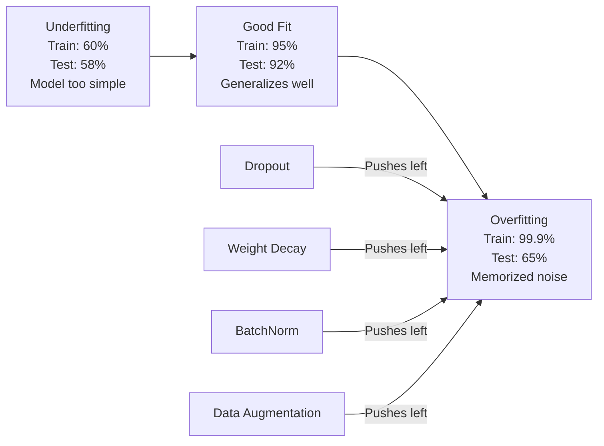
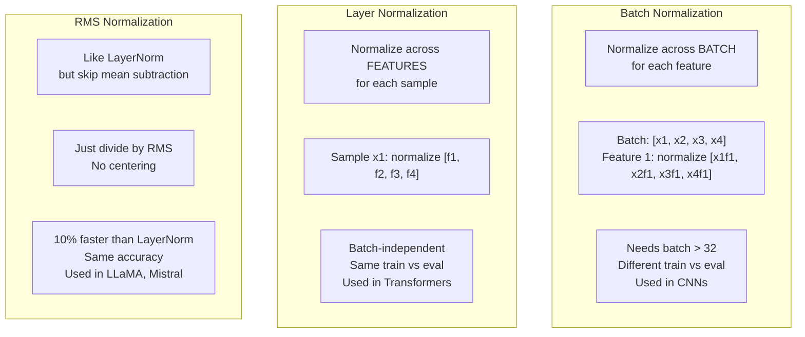
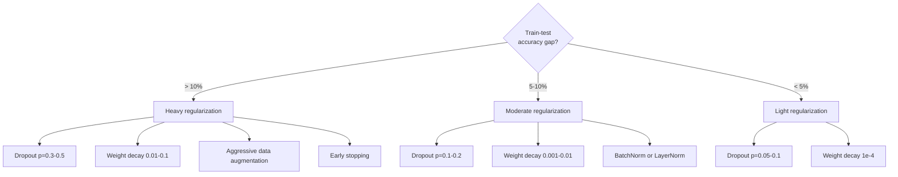

# Régularisation

> Votre modèle reçoit 99% sur les données de formation et 60% sur les données de test. Il mémore au lieu d'apprendre.

**Type:** Build
**Languages:** Python, TypeScript
**Prerequisites:** Lesson 03.06 (Optimizers)
**Time:** ~75 minutes

## Objectifs d'apprentissage

- Implémenter le décrochage avec une mise à l'échelle inverse, une diminution du poids L2, une normalisation de lot, une normalisation de couche et une normalisation RMSNorm à partir de zéro
- Mesurer l'écart de précision des essais en train et diagnostiquer le surmatch à l'aide d'expériences de régularisation
- Expliquez pourquoi les transformateurs utilisent LayerNorm au lieu de BatchNorm et pourquoi les LLM modernes préfèrent RMSNorm
- Appliquer la bonne combinaison de techniques de régularisation en fonction de la gravité du surmatch

## Le problème

Un réseau neural avec suffisamment de paramètres peut mémoriser n'importe quel ensemble de données. Ce n'est pas une hypothèse - Zhang et coll. (2017) l'a prouvé en entraînant des réseaux standard sur ImageNet avec des étiquettes aléatoires. Les réseaux ont atteint une perte de formation proche de zéro sur des assignations d'étiquettes complètement aléatoires. Ils ont mémorisé un million de paires de saisie-sortie aléatoires sans modèle à apprendre. La perte de formation était parfaite.

C'est le problème du sur-adaptation, et il s'aggrave à mesure que les modèles deviennent plus grands. GPT-3 a 175 milliards de paramètres. Le jeu de formation a environ 500 milliards de jetons. Avec autant de paramètres, le modèle a suffisamment de capacité pour mémoriser des morceaux importants des données de formation verbalement. Sans régularisation, il regurgiterait simplement des exemples de formation au lieu d'apprendre des modèles généralisables.

L'écart entre les performances de formation et les performances d'essai est le décalage de suradéquation. Chaque technique de cette leçon attaque cette lacune sous un angle différent. Le décrochage force le réseau à ne pas compter sur un seul neurone. La perte de poids empêche tout poids de devenir trop gros. La normalisation des lots allume le paysage des pertes afin que l'optimisateur trouve des minima plus plats et plus généralisables. La normalisation de couche fait la même chose, mais fonctionne lorsque la normalisation de lot échoue (petits lots, séquences de longueur variable). RMSNorm le fait 10% plus rapidement en laissant tomber le calcul moyen. Chaque technique est simple. Ensemble, ils sont la différence entre un modèle qui mémore et un modèle qui généralise.

## Le concept

### Le spectre de l'excès

Chaque modèle se trouve quelque part sur un spectre, de l'inadaptation (trop simple pour capturer le motif) à la suradaptation (aussi complexe qu'il capture le bruit).



### Démission

La technique de régulation la plus simple avec l'interprétation la plus élégante.$p$- Je suis désolé .

```math
\text{output} = \text{activation}(z) \cdot \text{mask} \quad \text{where }\text{mask}[i] \sim \text{Bernoulli}(1 - p)
```

Avec $p = 0.5$Le réseau doit apprendre des représentations redondantes parce qu'il ne peut pas prédire quels neurones seront disponibles. Cela empêche la co-adaptation - les neurones apprennent à compter sur d'autres neurones spécifiques étant présents.

L'interprétation de l'ensemble: un réseau avec $N$Les neurones et le décrochage créent$2^N$Les réseaux de formation sont des réseaux de formation de formation de formation.$2^N$Les sous-réseaux sont simultanément utilisés sur différents mini-parts.$(1 - p)$La moyenne des prévisions de formation est de$2^N$sous-réseaux -- un ensemble massif d'un seul modèle.

En pratique, l'évolutivité est appliquée au cours de la formation au lieu des essais (dérapagement inversé):

```math
\begin{aligned}
\text{During training:} \quad & \text{output} = \text{activation}(z) \cdot \text{mask} / (1 - p) \\
\text{During testing:} \quad & \text{output} = \text{activation}(z) \quad \text{(no change needed)}
\end{aligned}
```

C'est plus propre parce que le code de test n'a pas besoin de savoir du tout sur le décrochage.

Taux de défaillance: p = 0,1 pour les transformateurs, p = 0,5 pour les MLP, p = 0,2 à 0,3 pour les CNN.

### Déclinaison du poids (régularisation de l' L2)

Ajoutez la magnitude carrée de tous les poids à la perte:

```math
\text{total\_loss} = \text{task\_loss} + \frac{\lambda}{2} \sum_i w_i^2
```

Le gradient du terme de régularisation est $\lambda w$Cela signifie que à chaque étape, chaque poids est réduit vers zéro par une fraction proportionnelle à son magnitude.

Pourquoi cela aide à la généralisation: les modèles sur-adaptés ont tendance à avoir de grands poids qui amplifient le bruit dans les données de formation.

Le $\lambda$L'hyperparamètre contrôle la résistance.

- 0,01 pour AdamW sur les transformateurs
- 1e-4 pour SGD sur les chaînes de télévision
- 0,1 pour les modèles très surchargés

Comme nous l'avons expliqué dans la leçon 06: la perte de poids et la régulation de L2 sont équivalentes en SGD mais pas en Adam.

### Normalité des lots

Normalizer la sortie de chaque couche sur le mini-batch avant de le passer à la couche suivante.

Pour un mini-batch d'activations à une couche:

```math
\begin{aligned}
\mu &= \frac{1}{B} \sum_i x_i && \text{(batch mean)} \\
\sigma^2 &= \frac{1}{B} \sum_i (x_i - \mu)^2 && \text{(batch variance)} \\
\hat{x} &= \frac{x_i - \mu}{\sqrt{\sigma^2 + \epsilon}} && \text{(normalize)} \\
y &= \gamma \hat{x} + \beta && \text{(scale and shift)}
\end{aligned}
```

Gamma et bêta sont des paramètres apprenables qui permettent au réseau de désamorcer la normalisation si c'est optimal. Sans eux, vous forceriez chaque couche de sortie à être une variante unitaire zéro moyenne, ce qui pourrait ne pas être ce que le réseau veut.

**Training vs inference split:**Pendant la formation, $\mu$et $\sigma$Les résultats obtenus sont basés sur le mini-batch actuel.

Pourquoi BatchNorm fonctionne est toujours débattu. Le document original prétendait qu'il réduisait le "changement de covariate interne" (la distribution des entrées de couches changeant à mesure que les couches antérieures se mettent à jour). Santurkar et al. (2018) a montré que cette explication est erronée. La raison réelle: BatchNorm rend le paysage des pertes plus lisse. Les gradients sont plus prédictifs, les constantes de Lipschitz sont plus petites, et l'optimisateur peut prendre de plus grands pas en toute sécurité. C'est pourquoi BatchNorm vous permet d'utiliser des taux d'apprentissage plus élevés et de converger plus rapidement.

BatchNorm a une limitation fondamentale: il dépend des statistiques de lot. Avec la taille du lot 1, la moyenne et la variance sont sans signification. Avec les petits lots (< 32), les statistiques sont bruyantes et ont des performances blessées. Cela est important pour des tâches telles que la détection d'objets (où la mémoire limite la taille du lot) et la modélisation du langage (où les longueurs de séquences varient).

### Normalité des couches

Normalement, les caractéristiques doivent être normalisées au lieu de toutes les caractéristiques du lot.

```math
\begin{aligned}
\mu &= \frac{1}{D} \sum_j x_j && \text{(feature mean)} \\
\sigma^2 &= \frac{1}{D} \sum_j (x_j - \mu)^2 && \text{(feature variance)} \\
\hat{x} &= \frac{x_j - \mu}{\sqrt{\sigma^2 + \epsilon}} \\
y &= \gamma \hat{x} + \beta
\end{aligned}
```

$D$Chaque échantillon est normalisé indépendamment - sans dépendance de la taille du lot. C'est pourquoi les transformateurs utilisent LayerNorm au lieu de BatchNorm. Les séquences ont des longueurs variables, les tailles de lot sont souvent petites (ou 1 pendant la génération), et le calcul est identique entre l'entraînement et l'inférence.

LayerNorm dans les transformateurs est appliqué après chaque bloc d'auto-attention et chaque bloc de transfert (Post-LN) ou avant eux (Pre-LN, plus stable pour l'entraînement).

### RMSNorm

LayerNorm sans soustraction moyenne. Proposée par Zhang & Sennrich (2019).

```math
\begin{aligned}
\text{rms} &= \sqrt{\frac{1}{D} \sum_j x_j^2} \\
y &= \gamma \cdot \frac{x}{\text{rms}}
\end{aligned}
```

C'est tout. Pas de calcul moyen, pas de paramètre bêta. L'observation: le recentrage (soustraction moyenne) dans LayerNorm contribue très peu aux performances du modèle, mais coûte calcul.

LLaMA, LLaMA 2, LLaMA 3, Mistral et la plupart des LLM modernes utilisent RMSNorm au lieu de LayerNorm.

### Comparaison de normalisation



### Augmentation des données en tant que réglementation

Pas une modification de modèle mais une modification de données.

- Images: coupure aléatoire, retour, rotation, frisson de couleur, coupure
- Text: remplacement synonyme, traduction récurrente, suppression aléatoire
- Audio: décalage de temps, changement de ton, addition de bruit

L'effet est identique à la régularisation: il augmente la taille effective de l'ensemble de formation, ce qui rend plus difficile pour le modèle de mémoriser des exemples spécifiques. Un modèle qui ne voit chaque image qu'une fois dans sa forme originale peut la mémoriser. Un modèle qui voit 50 versions augmentées de chaque image est obligé d'apprendre la structure invariante.

### Arrêt précoce

Le régulateur le plus simple: arrêtez de vous entraîner lorsque la perte de validation commence à augmenter. Le modèle n'est pas encore surpassé à ce stade. En pratique, vous suivez la perte de validation à chaque époque, sauvegardez le meilleur modèle et continuez à vous entraîner pour une fenêtre de "patience" (généralement 5 à 20 époques). Si la perte de validation ne s'améliore pas dans la fenêtre de patience, vous arrêtez et chargez le modèle le mieux enregistré.

### Quand appliquer quoi



```figure
l2-regularization
```

## Faites-le

### Étape 1: Démission (Mode train et Eval)

```python
import random
import math


class Dropout:
    def __init__(self, p=0.5):
        self.p = p
        self.training = True
        self.mask = None

    def forward(self, x):
        if not self.training:
            return list(x)
        self.mask = []
        output = []
        for val in x:
            if random.random() < self.p:
                self.mask.append(0)
                output.append(0.0)
            else:
                self.mask.append(1)
                output.append(val / (1 - self.p))
        return output

    def backward(self, grad_output):
        grads = []
        for g, m in zip(grad_output, self.mask):
            if m == 0:
                grads.append(0.0)
            else:
                grads.append(g / (1 - self.p))
        return grads
```

### Étape 2: L2 Décomposition du poids

```python
def l2_regularization(weights, lambda_reg):
    penalty = 0.0
    for w in weights:
        penalty += w * w
    return lambda_reg * 0.5 * penalty

def l2_gradient(weights, lambda_reg):
    return [lambda_reg * w for w in weights]
```

### Étape 3: Normalization du lot

```python
class BatchNorm:
    def __init__(self, num_features, momentum=0.1, eps=1e-5):
        self.gamma = [1.0] * num_features
        self.beta = [0.0] * num_features
        self.eps = eps
        self.momentum = momentum
        self.running_mean = [0.0] * num_features
        self.running_var = [1.0] * num_features
        self.training = True
        self.num_features = num_features

    def forward(self, batch):
        batch_size = len(batch)
        if self.training:
            mean = [0.0] * self.num_features
            for sample in batch:
                for j in range(self.num_features):
                    mean[j] += sample[j]
            mean = [m / batch_size for m in mean]

            var = [0.0] * self.num_features
            for sample in batch:
                for j in range(self.num_features):
                    var[j] += (sample[j] - mean[j]) ** 2
            var = [v / batch_size for v in var]

            for j in range(self.num_features):
                self.running_mean[j] = (1 - self.momentum) * self.running_mean[j] + self.momentum * mean[j]
                self.running_var[j] = (1 - self.momentum) * self.running_var[j] + self.momentum * var[j]
        else:
            mean = list(self.running_mean)
            var = list(self.running_var)

        self.x_hat = []
        output = []
        for sample in batch:
            normalized = []
            out_sample = []
            for j in range(self.num_features):
                x_h = (sample[j] - mean[j]) / math.sqrt(var[j] + self.eps)
                normalized.append(x_h)
                out_sample.append(self.gamma[j] * x_h + self.beta[j])
            self.x_hat.append(normalized)
            output.append(out_sample)
        return output
```

### Étape 4: Normalization de la couche

```python
class LayerNorm:
    def __init__(self, num_features, eps=1e-5):
        self.gamma = [1.0] * num_features
        self.beta = [0.0] * num_features
        self.eps = eps
        self.num_features = num_features

    def forward(self, x):
        mean = sum(x) / len(x)
        var = sum((xi - mean) ** 2 for xi in x) / len(x)

        self.x_hat = []
        output = []
        for j in range(self.num_features):
            x_h = (x[j] - mean) / math.sqrt(var + self.eps)
            self.x_hat.append(x_h)
            output.append(self.gamma[j] * x_h + self.beta[j])
        return output
```

### Étape 5: RMSNorm

```python
class RMSNorm:
    def __init__(self, num_features, eps=1e-6):
        self.gamma = [1.0] * num_features
        self.eps = eps
        self.num_features = num_features

    def forward(self, x):
        rms = math.sqrt(sum(xi * xi for xi in x) / len(x) + self.eps)
        output = []
        for j in range(self.num_features):
            output.append(self.gamma[j] * x[j] / rms)
        return output
```

### Étape 6: Formation avec et sans régularisation

```python
def sigmoid(x):
    x = max(-500, min(500, x))
    return 1.0 / (1.0 + math.exp(-x))


def make_circle_data(n=200, seed=42):
    random.seed(seed)
    data = []
    for _ in range(n):
        x = random.uniform(-2, 2)
        y = random.uniform(-2, 2)
        label = 1.0 if x * x + y * y < 1.5 else 0.0
        data.append(([x, y], label))
    return data


class RegularizedNetwork:
    def __init__(self, hidden_size=16, lr=0.05, dropout_p=0.0, weight_decay=0.0):
        random.seed(0)
        self.hidden_size = hidden_size
        self.lr = lr
        self.dropout_p = dropout_p
        self.weight_decay = weight_decay
        self.dropout = Dropout(p=dropout_p) if dropout_p > 0 else None

        self.w1 = [[random.gauss(0, 0.5) for _ in range(2)] for _ in range(hidden_size)]
        self.b1 = [0.0] * hidden_size
        self.w2 = [random.gauss(0, 0.5) for _ in range(hidden_size)]
        self.b2 = 0.0

    def forward(self, x, training=True):
        self.x = x
        self.z1 = []
        self.h = []
        for i in range(self.hidden_size):
            z = self.w1[i][0] * x[0] + self.w1[i][1] * x[1] + self.b1[i]
            self.z1.append(z)
            self.h.append(max(0.0, z))

        if self.dropout and training:
            self.dropout.training = True
            self.h = self.dropout.forward(self.h)
        elif self.dropout:
            self.dropout.training = False
            self.h = self.dropout.forward(self.h)

        self.z2 = sum(self.w2[i] * self.h[i] for i in range(self.hidden_size)) + self.b2
        self.out = sigmoid(self.z2)
        return self.out

    def backward(self, target):
        eps = 1e-15
        p = max(eps, min(1 - eps, self.out))
        d_loss = -(target / p) + (1 - target) / (1 - p)
        d_sigmoid = self.out * (1 - self.out)
        d_out = d_loss * d_sigmoid

        for i in range(self.hidden_size):
            d_relu = 1.0 if self.z1[i] > 0 else 0.0
            d_h = d_out * self.w2[i] * d_relu
            self.w2[i] -= self.lr * (d_out * self.h[i] + self.weight_decay * self.w2[i])
            for j in range(2):
                self.w1[i][j] -= self.lr * (d_h * self.x[j] + self.weight_decay * self.w1[i][j])
            self.b1[i] -= self.lr * d_h
        self.b2 -= self.lr * d_out

    def evaluate(self, data):
        correct = 0
        total_loss = 0.0
        for x, y in data:
            pred = self.forward(x, training=False)
            eps = 1e-15
            p = max(eps, min(1 - eps, pred))
            total_loss += -(y * math.log(p) + (1 - y) * math.log(1 - p))
            if (pred >= 0.5) == (y >= 0.5):
                correct += 1
        return total_loss / len(data), correct / len(data) * 100

    def train_model(self, train_data, test_data, epochs=300):
        history = []
        for epoch in range(epochs):
            total_loss = 0.0
            correct = 0
            for x, y in train_data:
                pred = self.forward(x, training=True)
                self.backward(y)
                eps = 1e-15
                p = max(eps, min(1 - eps, pred))
                total_loss += -(y * math.log(p) + (1 - y) * math.log(1 - p))
                if (pred >= 0.5) == (y >= 0.5):
                    correct += 1
            train_loss = total_loss / len(train_data)
            train_acc = correct / len(train_data) * 100
            test_loss, test_acc = self.evaluate(test_data)
            history.append((train_loss, train_acc, test_loss, test_acc))
            if epoch % 75 == 0 or epoch == epochs - 1:
                gap = train_acc - test_acc
                print(f"    Epoch {epoch:3d}: train_acc={train_acc:.1f}%, test_acc={test_acc:.1f}%, gap={gap:.1f}%")
        return history
```

## Utilisez-le

PyTorch fournit toutes les normalisations et régularisations sous forme de modules:

```python
import torch
import torch.nn as nn

model = nn.Sequential(
    nn.Linear(784, 256),
    nn.BatchNorm1d(256),
    nn.ReLU(),
    nn.Dropout(0.3),
    nn.Linear(256, 128),
    nn.BatchNorm1d(128),
    nn.ReLU(),
    nn.Dropout(0.3),
    nn.Linear(128, 10),
)

model.train()
out_train = model(torch.randn(32, 784))

model.eval()
out_test = model(torch.randn(1, 784))
```

Le `model.train()`- Je suis là .`model.eval()`Le commutateur est essentiel. Il commute le dérapagement et dit à BatchNorm d'utiliser les statistiques de lot par rapport aux statistiques de fonctionnement.`model.eval()`La précision de vos tests fluctuera au hasard parce que le dérapagement est toujours actif et que BatchNorm utilise des statistiques mini-parts.

Pour les transformateurs, le modèle est différent:

```python
class TransformerBlock(nn.Module):
    def __init__(self, d_model=512, nhead=8, dropout=0.1):
        super().__init__()
        self.attention = nn.MultiheadAttention(d_model, nhead, dropout=dropout)
        self.norm1 = nn.LayerNorm(d_model)
        self.ff = nn.Sequential(
            nn.Linear(d_model, d_model * 4),
            nn.GELU(),
            nn.Linear(d_model * 4, d_model),
            nn.Dropout(dropout),
        )
        self.norm2 = nn.LayerNorm(d_model)
        self.dropout = nn.Dropout(dropout)

    def forward(self, x):
        attended, _ = self.attention(x, x, x)
        x = self.norm1(x + self.dropout(attended))
        x = self.norm2(x + self.ff(x))
        return x
```

LayerNorm, pas BatchNorm. Découpe p = 0,1, pas p = 0,5.

## La faire partir

Cette leçon donne:
- `outputs/prompt-regularization-advisor.md`-- une demande qui diagnostique le surcoût et recommande la bonne stratégie de régularisation

## Exercices

1. Implémenter la décomposition spatiale pour les données 2D: au lieu de laisser tomber des neurones individuels, décomposez des canaux entiers de fonctionnalités. Simuler ceci en traitant des groupes de fonctionnalités consécutives comme des canaux et en laissant tomber des groupes entiers. Comparer l'écart de test en train à la décomposition standard sur le jeu de données de cercle avec hidden_size=32.

2. Mettre en œuvre le lissage des étiquettes de la leçon 05 combiné à l'abandon de cette leçon. Train avec quatre configurations: ni, abandon seulement, étiquette lissage seulement, les deux. Mesurer l'écart de précision final de train-test pour chacun. Quelle combinaison donne le plus petit écart?

3. Ajoutez une couche BatchNorm entre la couche cachée et l'activation dans votre réseau de jeu de données.

4. Mettre en œuvre l'arrêt précoce: suivre la perte de test à chaque époque, économiser les meilleurs poids et arrêter si la perte de test n'a pas amélioré pendant 20 époques. Exécuter le réseau régularisé pendant 1000 époques. Rapporter quelle époque a eu la meilleure précision de test et combien d'époques de calcul vous avez économisé.

5. Comparer LayerNorm vs RMSNorm sur un réseau de 4 couches (pas seulement 2). Initializer les deux avec les mêmes poids. entraînez pendant 200 époques et comparer la précision finale, la vitesse d'entraînement (temps par époque) et les magnitudes de gradient à la première couche. Vérifiez que RMSNorm est plus rapide avec la même précision.

## Les termes clés

| Term | What people say | What it actually means |
|------|----------------|----------------------|
| Overfitting | "Model memorized the data" | When a model's training performance significantly exceeds its test performance, indicating it learned noise rather than signal |
| Regularization | "Preventing overfitting" | Any technique that constrains model complexity to improve generalization: dropout, weight decay, normalization, augmentation |
| Dropout | "Random neuron deletion" | Zeroing random neurons during training with probability $p$, forcing redundant representations; equivalent to training an ensemble |
| Weight decay | "L2 penalty" | Shrinking all weights toward zero by subtracting $\lambda w$ at each step; penalizes complexity through weight magnitude |
| Batch normalization | "Normalize per batch" | Normalizing layer outputs across the batch dimension using batch statistics during training and running averages during inference |
| Layer normalization | "Normalize per sample" | Normalizing across features within each sample; batch-independent, used in transformers where batch size varies |
| RMSNorm | "LayerNorm without the mean" | Root mean square normalization; drops the mean subtraction from LayerNorm for 10% speedup with equal accuracy |
| Early stopping | "Stop before overfit" | Halting training when validation loss stops improving; the simplest regularizer, often used alongside others |
| Data augmentation | "More data from less" | Transforming training inputs (flip, crop, noise) to increase effective dataset size and force invariance learning |
| Generalization gap | "Train-test split" | The difference between training and test performance; regularization aims to minimize this gap |

## Pour en savoir plus

- Srivastava et coll., "Dropout: Un moyen simple d'empêcher les réseaux neuronaux de trop se dépasser" (2014) -- le papier original de dépôt avec l'interprétation ensemble et des expériences étendues
- Ioffe & Szegedy, " Batch Normalization: Accélérer la formation en réseau profond en réduisant le changement de couverture interne " (2015) -- introduit BatchNorm et sa procédure de formation, l'un des documents d'apprentissage profond les plus cités
- Zhang & Sennrich, "Rot Mean Square Layer Normalization" (2019) -- a montré que RMSNorm correspond à la précision de LayerNorm avec un calcul réduit; adopté par LLaMA et Mistral
- Zhang et coll., "Comprendre l'apprentissage profond nécessite une rééducation générale" (2017) -- le document historique montrant que les réseaux neuraux peuvent mémoriser des étiquettes aléatoires, défiant les vues traditionnelles de la généralisation
