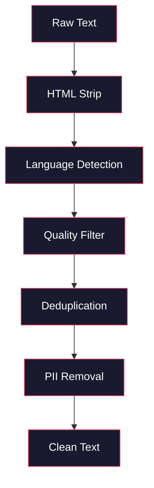
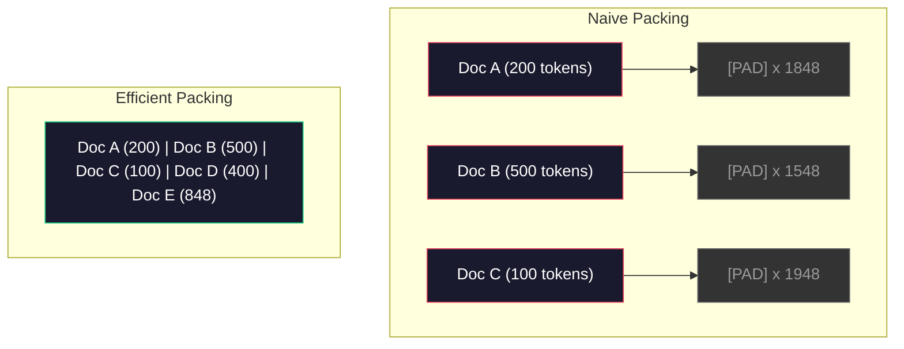

# Pipelines de données pour la formation préalable

> Le modèle est un miroir, il reflète les données que vous lui donnez, il le donne à la poubelle, il reflète la poubelle avec une fluidité parfaite.

**Type:** Build
**Languages:** Python, Rust
**Prerequisites:** Phase 10, Lessons 01-02 (Tokenizers, Building a Tokenizer)
**Time:** ~90 minutes

## Objectifs d'apprentissage

- Construisez un pipeline de données en streaming qui symbolise, coupe, mélange et batte des téraoctets de texte sans le charger dans la mémoire
- Implementer des filtres de qualité des données (déduplication, détection de langage, filtrage du contenu) utilisés dans des pipelines de pré-formation réelles
- Créer des séquences d'entraînement de longueur fixe avec des masques d'attention appropriés et une manipulation des limites des documents
- Le débit de pipeline de profil pour s'assurer que le chargement de données suit la vitesse d'entraînement de la GPU

## Le problème

Vous avez un tokenizer, maintenant vous avez besoin de données.

Pas un ensemble de données, pas un fichier CSV. Des téraoctets de texte - nettoyés, déduplicés, filtrés pour la qualité, jetonés en séquences de longueur fixe, et servis en lots aléatoires assez rapidement que votre cluster de 8 GPU n'attend jamais le prochain lot.

La plupart des gens pensent que la formation d'un LLM concerne l'architecture du modèle. Ce n'est pas le cas. Llama 3 a utilisé 15,6 billions de jetons. GPT-3 a utilisé 300 milliards. DeepSeek-V2 a utilisé 8,1 billions. L'architecture dans les trois est à peu près la même: blocs de transformateur empilés avec des couches d'attention et de rétroaction. La différence de qualité de sortie provient largement des données.

Le papier de Chinchilla de DeepMind a fait cela précisément. Pour un budget informatique donné, il existe un ratio optimal des paramètres du modèle aux jetons de formation. Chinchilla a montré que la plupart des modèles en 2022 étaient considérablement sous-trainés -- ils avaient trop de paramètres pour la quantité de données qu'ils voyaient. Un modèle de paramètre 70B formé sur 1,4 billions de jetons (Chinchilla-optimal) a dépassé un modèle 280B formé sur 300 milliards de jetons (Gopher).

Votre pipeline de données détermine si votre modèle apprend le langage ou apprend le bruit.

## Le concept

### D'où viennent les données

Chaque grand modèle de langage est formé sur un mélange de sources. La composition exacte est un secret gardé de près pour la plupart des laboratoires, mais nous savons assez pour comprendre les catégories.

| Source | Size | Quality | Used By |
|--------|------|---------|---------|
| Common Crawl | ~250 TB raw | Low (needs heavy filtering) | GPT-3, Llama, most open models |
| Wikipedia | ~20 GB | High | Every major LLM |
| GitHub code | ~1 TB+ | Medium (lots of duplicates, dead code) | StarCoder, CodeLlama, DeepSeek-Coder |
| Books (BookCorpus, Pile) | ~100 GB | High | GPT-2, GPT-3, early models |
| Academic papers (arXiv, S2ORC) | ~100 GB | High for STEM | Llama, Galactica |
| StackOverflow, Reddit | ~100 GB | Medium | Llama, Falcon |
| Curated web (C4, RefinedWeb) | ~5 TB | Medium-High (pre-filtered) | T5, Falcon |

Llama 3 a révélé son mix de données: environ 50% de données Web, 25% de code, 13% de livres et de documents académiques, 8% de données mathématiques et 4% de données Web multilingues.

Le rapport importe autant que la taille totale. Trop de données Web et le modèle devient un perroquet Reddit. Trop peu de code et il ne peut pas programmer. Trop peu de mathématiques et il échoue à raisonner.

### Nettoyage des données

Les données web sont sales.

- Étiquettes HTML et JavaScript
- Titres de chaudières, pieds, menus de navigation
- Pages dupliquées (exactes et quasi-duplicées)
- Spam généré par machine
- Les informations personnelles (PII)
- Textes de mauvaise qualité (listes de mots clés, spam de référencement)
- Contenu non texte codé en texte

Le nettoyage n'est pas facultatif. C'est la différence entre un modèle qui génère des paragraphes cohérents et un modèle qui produit des balises HTML mélangées à des listes de produits.



Chaque étape élimine une catégorie de bruit:

**HTML stripping:**Retirez tous les balises. Gardez seulement le contenu visible du texte.`trafilatura`ou `readability`extraire le contenu de l'article tout en éliminant la navigation, les annonces et la plaque de chauffage.

**Language detection:**Utilisez le modèle d'identification de langue de fastText (lid.176.bin) pour classer chaque document. Filtrez à vos langues cibles. Un document classé comme anglais avec moins de 0,8 confiance n'est probablement pas un anglais pur.

**Quality filtering:**C'est là que cela devient intéressant. RefinedWeb (le jeu de données derrière Falcon) utilise un filtre basé sur la perplexité: entraîne un petit modèle de langage sur Wikipedia, puis marque chaque document.

**Deduplication:**Le simple pas de nettoyage le plus impactant. Common Crawl contient un nombre énorme de pages dupliquées - des déductions légales, des avis de cookie, des conditions d'utilisation.

**PII removal:**Nom, adresse e-mail, numéro de téléphone, numéro de sécurité sociale, détection basée sur Regex pour les données personnelles structurées, modèles NER pour les noms dans le contexte.

### Déduplication avec MinHash

La déduplication exacte est facile: hash chaque document, supprimer les duplicates. Mais les duplicates proches sont le vrai problème. Deux copies du même article d'actualité avec des annonces légèrement différentes autour de lui sont des duplicates proches. Le contenu est 95% identique, mais ils diffèrent par octet.

Le MinHash + Hashing sensible à la localisation (LSH) résoudra cela efficacement.


L' idée:

1. **Shingling:**Convertir chaque document en un ensemble de n-grammes (par exemple, 5 grammes de mots ou de caractères). "le renard brun rapide" avec une tige de 3 mots devient {"le renard brun rapide", "le renard brun rapide"}.

2. **MinHash:**Pour chaque ensemble de bardeaux de document, calculer les valeurs de hash k. Chaque valeur de hash est le minimum de hash sur tous les bardeaux de fonction hash différente. Cela crée une " signature " de taille fixe qui approximate la similitude de Jaccard entre les deux documents.

3. **LSH:**Les documents de groupe en seins basés sur des bandes de signature MinHash. Les documents dans le même seins sont des candidats presque duplicés. Cela évite de comparer chaque paire - vous ne comparez que les candidats.

4. **Verify:**Pour chaque paire candidate, calculer la similitude exacte de Jaccard.

L'équipe de Llama a rapporté avoir supprimé environ 38% de leurs données Web par déduplication. Ce n'est pas un petit nombre. Plus d'un tiers du Common Crawl est du contenu dupliqué ou presque dupliqué.

### L'emballage de séquences

Votre modèle s'attend à des séquences d'entrée de longueur fixe. Vos documents sont de longueur variable. Certains sont de 50 jetons. Certains sont de 50 000 jetons.

Approche naïve: remplissez chaque document à la longueur maximale de la séquence. Cela gaspille d'énormes calculs sur les jetons de remplissage qui ne contribuent à rien à l'apprentissage.

Une meilleure approche: emballer plusieurs documents dans une seule séquence, séparés par des jetons de fin de séquence. Une séquence de jetons 2048 peut contenir trois documents courts concatenés avec des jetons [EOS] entre eux.



Le masque d'attention doit être correctement réglé. Les jetons du document A ne doivent pas être associés aux jetons du document B dans la même séquence de paquets.

Les documents longs sont tronqués ou divisés en morceaux aux limites de la séquence. Le point de séparation compte: la séparation au milieu de la phrase oblige le modèle à voir des pensées incomplètes.

### La loi de l'échelle de Chinchilla

Pour un budget calculé fixe $C$(mesurée en PLOP), la taille optimale du modèle $N$et taille du jeu de données $D$suivent:

```math
\begin{aligned}
N_{\text{opt}} &\sim C^{0.5} \\
D_{\text{opt}} &\sim C^{0.5}
\end{aligned}
```

En pratique, cela signifie que vous devez étaler la taille du modèle et la taille du jeu de données à peu près de la même manière.

| Model | Parameters | Training Tokens | Chinchilla-Optimal? |
|-------|-----------|----------------|-------------------|
| GPT-3 | 175B | 300B | No (undertrained 3-4x) |
| Chinchilla | 70B | 1.4T | Yes (by design) |
| Llama 2 | 70B | 2T | Overtrained (intentionally) |
| Llama 3 | 70B | 15T | Heavily overtrained |

Llama 3 viole délibérément la loi de Chinchilla. Meta a constaté que la surentraînement sur plus de données - bien au-delà du rapport calcul-optimal - produit de meilleurs modèles pour l'inférence. Le coût de formation supplémentaire est payé une fois, mais le modèle plus petit est moins cher à servir à jamais. Cela est parfois appelé l'approche d'échelle "inférence-optimal", et il est devenu la norme de l'industrie depuis 2024.

```figure
l5-data-pipeline
```

## Faites-le

### Étape 1: Nettoyer le texte

Nous allons utiliser un texte de domaine public (Projet Gutenberg) comme notre petit corpus.

```python
import re

def clean_text(text):
    text = re.sub(r"<[^>]+>", "", text)
    text = re.sub(r"http\S+", "", text)
    text = re.sub(r"[^\x20-\x7E\n]", "", text)
    text = re.sub(r"\n{3,}", "\n\n", text)
    text = re.sub(r" {2,}", " ", text)
    return text.strip()

def quality_filter(text, min_words=50, max_ratio_caps=0.3, max_ratio_special=0.1):
    words = text.split()
    if len(words) < min_words:
        return False
    caps_ratio = sum(1 for w in words if w.isupper()) / len(words)
    if caps_ratio > max_ratio_caps:
        return False
    special_chars = sum(1 for c in text if not c.isalnum() and not c.isspace())
    if special_chars / max(len(text), 1) > max_ratio_special:
        return False
    return True
```

Le filtre de qualité capture le spam SEO (ALL CAPS), le bruit généré par machine (ratio de caractères spéciaux élevé) et les pages de contenu (trop courtes). Ces trois contrôles seuls éliminent une quantité surprenante de déchets des crawls Web.

### Étape 2: Déduplication de MinHash

Mettre en œuvre MinHash à partir de zéro. Aucune bibliothèque externe n'est nécessaire... juste`hashlib`- Je suis désolé .

```python
import hashlib
from collections import defaultdict

def get_shingles(text, k=5):
    words = text.lower().split()
    if len(words) < k:
        return set()
    return {" ".join(words[i:i+k]) for i in range(len(words) - k + 1)}

def minhash_signature(shingles, num_hashes=128):
    signature = []
    for i in range(num_hashes):
        min_hash = float("inf")
        for shingle in shingles:
            h = int(hashlib.sha256(f"{i}:{shingle}".encode()).hexdigest(), 16)
            min_hash = min(min_hash, h)
        signature.append(min_hash)
    return signature

def lsh_buckets(signature, bands=16):
    rows_per_band = len(signature) // bands
    buckets = []
    for b in range(bands):
        start = b * rows_per_band
        band_data = tuple(signature[start:start + rows_per_band])
        bucket_hash = hashlib.md5(str(band_data).encode()).hexdigest()
        buckets.append((b, bucket_hash))
    return buckets

def deduplicate(documents, threshold=0.8, num_hashes=128, bands=16):
    signatures = []
    shingle_sets = []
    for doc in documents:
        shingles = get_shingles(doc)
        shingle_sets.append(shingles)
        signatures.append(minhash_signature(shingles, num_hashes))

    bucket_map = defaultdict(list)
    for doc_idx, sig in enumerate(signatures):
        for band_id, bucket_hash in lsh_buckets(sig, bands):
            bucket_map[(band_id, bucket_hash)].append(doc_idx)

    duplicate_pairs = set()
    for bucket_docs in bucket_map.values():
        if len(bucket_docs) < 2:
            continue
        for i in range(len(bucket_docs)):
            for j in range(i + 1, len(bucket_docs)):
                duplicate_pairs.add((bucket_docs[i], bucket_docs[j]))

    removed = set()
    for i, j in duplicate_pairs:
        if i in removed or j in removed:
            continue
        s1, s2 = shingle_sets[i], shingle_sets[j]
        if not s1 or not s2:
            continue
        jaccard = len(s1 & s2) / len(s1 | s2)
        if jaccard >= threshold:
            removed.add(j)

    return [doc for idx, doc in enumerate(documents) if idx not in removed], len(removed)
```

Le `num_hashes=128`et `bands=16`Les paramètres contrôlent le compromis de rappel de précision. Plus de haches donnent des estimations de similitude plus précises. Plus de bandes augmentent le rappel (capture plus de duplicates) au coût de plus de faux positifs. Ces valeurs fonctionnent bien pour le texte Web typique.

### Étape 3: Symboliser et emballer les séquences

Prenez le texte propre et déduplicé, le symbolisez et le faites en séquences de longueur fixe pour l'entraînement.

```python
def tokenize_corpus(documents, tokenizer):
    all_tokens = []
    for doc in documents:
        tokens = tokenizer.encode(doc)
        all_tokens.extend(tokens)
        all_tokens.append(tokenizer.eos_id)
    return all_tokens

def pack_sequences(token_ids, seq_length, pad_id=0):
    sequences = []
    attention_masks = []
    for i in range(0, len(token_ids), seq_length):
        seq = token_ids[i:i + seq_length]
        mask = [1] * len(seq)
        if len(seq) < seq_length:
            pad_count = seq_length - len(seq)
            seq = seq + [pad_id] * pad_count
            mask = mask + [0] * pad_count
        sequences.append(seq)
        attention_masks.append(mask)
    return sequences, attention_masks
```

### Étape 4: DataLoader pour la formation

Il faut produire des lots de séquences randomisées.

```python
import random

class PreTrainingDataLoader:
    def __init__(self, sequences, attention_masks, batch_size, shuffle=True):
        self.sequences = sequences
        self.attention_masks = attention_masks
        self.batch_size = batch_size
        self.shuffle = shuffle

    def __len__(self):
        return (len(self.sequences) + self.batch_size - 1) // self.batch_size

    def __iter__(self):
        indices = list(range(len(self.sequences)))
        if self.shuffle:
            random.shuffle(indices)
        for start in range(0, len(indices), self.batch_size):
            batch_idx = indices[start:start + self.batch_size]
            batch_seqs = [self.sequences[i] for i in batch_idx]
            batch_masks = [self.attention_masks[i] for i in batch_idx]
            yield batch_seqs, batch_masks
```

### Étape 5: Statistiques des ensembles de données

Comptez les nombres qui comptent: total de jetons, jetons uniques, ratio de compression, distribution de longueur du document.

```python
from collections import Counter

def compute_statistics(documents, token_ids, sequences, tokenizer_vocab_size):
    total_chars = sum(len(d) for d in documents)
    total_tokens = len(token_ids)
    unique_tokens = len(set(token_ids))
    compression_ratio = total_chars / total_tokens

    doc_lengths = [len(d.split()) for d in documents]
    avg_doc_length = sum(doc_lengths) / max(len(doc_lengths), 1)
    max_doc_length = max(doc_lengths) if doc_lengths else 0
    min_doc_length = min(doc_lengths) if doc_lengths else 0

    token_counts = Counter(token_ids)
    top_tokens = token_counts.most_common(10)

    non_pad_tokens = sum(sum(1 for t in seq if t != 0) for seq in sequences)
    total_positions = sum(len(seq) for seq in sequences)
    utilization = non_pad_tokens / max(total_positions, 1)

    stats = {
        "total_documents": len(documents),
        "total_characters": total_chars,
        "total_tokens": total_tokens,
        "unique_tokens": unique_tokens,
        "vocab_utilization": unique_tokens / tokenizer_vocab_size,
        "compression_ratio": compression_ratio,
        "avg_doc_length_words": avg_doc_length,
        "max_doc_length_words": max_doc_length,
        "min_doc_length_words": min_doc_length,
        "num_sequences": len(sequences),
        "sequence_utilization": utilization,
        "top_10_tokens": top_tokens,
    }
    return stats
```

Le ratio de compression indique à quel point le tokenizer est efficace sur ce corpus. Le texte anglais est généralement comprimé à environ 3-4 caractères par token. Si vous voyez 1,5 caractères par token, votre tokenizer se divise trop agressivement. Si vous voyez 8+, il a appris des fusions très spécifiques à un domaine.

L'utilisation de la séquence vous indique combien de vos séquences emballées sont de données réelles par rapport au rembourrage.

## Utilisez-le

### Comparer avec les ensembles de données HuggingFace

Chargez le même corpus dans la bibliothèque de données HuggingFace et comparez la vitesse du pipeline.

```python
from datasets import load_dataset
from transformers import AutoTokenizer

ds = load_dataset("wikitext", "wikitext-2-raw-v1", split="train")
tokenizer = AutoTokenizer.from_pretrained("meta-llama/Meta-Llama-3-8B")

import time

start = time.time()
tokenized = ds.map(
    lambda x: tokenizer(x["text"], truncation=True, max_length=2048),
    batched=True,
    num_proc=4,
)
hf_time = time.time() - start
total_tokens = sum(len(t) for t in tokenized["input_ids"])
print(f"HuggingFace: {total_tokens:,} tokens in {hf_time:.2f}s ({total_tokens/hf_time:,.0f} tokens/sec)")
```

Le pipeline HuggingFace utilise des jetons Rust sous le capot et un traitement parallèle sur 4 cœurs. Votre pipeline Python pur sera 10 à 50 fois plus lent. Cette lacune est la raison pour laquelle les équipes de production utilisent des jetons compilés. L'algorithme est le même. Le langage de mise en œuvre est la différence.

## La faire partir

Cette leçon fournit une information pour valider et déboguer la qualité des données dans les pipelines de formation LLM. Voir `outputs/prompt-data-quality-checker.md`- Je suis désolé .

## Exercices

1. **Easy:**Ajoutez la détection de langage au pipeline de nettoyage en utilisant une simple heuristique (analyse de l'ensemble de caractères).
2. **Medium:**Implémenter la déduplication exacte en utilisant des hash SHA-256 aux côtés de la déduplication proche de MinHash. Comparer le nombre de duplicates capturés par chaque méthode sur un corpus gratté par le Web.
3. **Hard:**Construisez un filtre de qualité basé sur la perplexité. Prenez un petit modèle de langage bigram sur le texte de Wikipédia, marquez chaque document par la perplexité et retirez le 20% inférieur.

## Les termes clés

| Term | What people say | What it actually means |
|------|----------------|----------------------|
| Common Crawl | "The internet" | A non-profit that crawls the web monthly -- ~250TB raw, the starting point for most LLM training data |
| MinHash | "Some hashing trick" | A technique to estimate Jaccard similarity between sets using fixed-size signatures -- enables near-duplicate detection at scale |
| LSH | "Locality-Sensitive Hashing" | A method to group similar items into the same bucket -- reduces pairwise comparisons from $O(n^2)$ to near-linear |
| Sequence packing | "Concatenating documents" | Fitting multiple documents into fixed-length sequences with proper attention masks -- eliminates padding waste |
| Chinchilla scaling | "Train on more data" | For a fixed compute budget, optimal performance requires scaling model size and training tokens roughly equally |
| Fertility | "Tokens per word" | Average number of tokens per word -- 1.3 for English in GPT-4, higher for non-Latin scripts |
| Data mixing | "Choosing training data" | The ratio of code vs text vs math vs multilingual data -- no formula, requires experimentation |
| Perplexity filter | "Quality scoring" | Use a small language model to score documents -- high perplexity means the text is unlike clean reference data |
| Deduplication | "Removing copies" | Eliminating exact and near-duplicate documents -- typically removes 30-40% of raw web data |
| Attention mask | "Which tokens to look at" | A binary mask that prevents attention across document boundaries in packed sequences |

## Pour en savoir plus

- [Hoffmann et al., 2022 -- Training Compute-Optimal Large Language Models (Chinchilla)](https://arxiv.org/abs/2203.15556)-- le document qui a changé notre façon de penser sur l'échelle des données
- [Penedo et al., 2023 -- The RefinedWeb Dataset for Falcon LLM](https://arxiv.org/abs/2306.01116)-- comment filtrer le crawling commun à haute qualité
- [Touvron et al., 2023 -- Llama 2: Open Foundation and Fine-Tuned Chat Models](https://arxiv.org/abs/2307.09288)-- détails du pipeline de données pour Llama 2
- [Lee et al., 2022 -- Deduplicating Training Data Makes Language Models Better](https://arxiv.org/abs/2107.06499)-- pourquoi la déduplication importe plus que vous ne le pensez
- [Broder, 1997 -- On the Resemblance and Containment of Documents](https://ieeexplore.ieee.org/document/666900)-- le papier original de MinHash
- [Meta, 2024 -- Llama 3 Technical Report](https://arxiv.org/abs/2407.21783)-- 15,6T tokens, rapports de mélange de données, filtrage du pipeline
