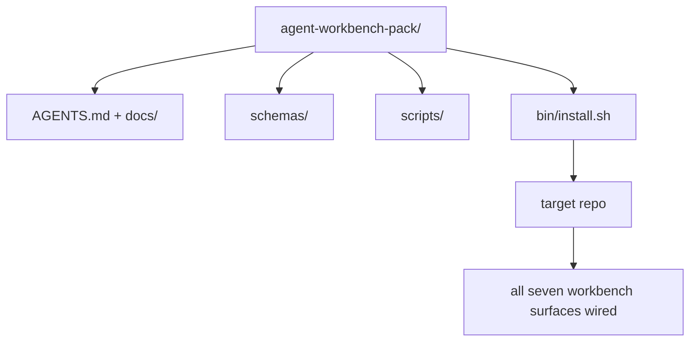

# Capstone: expédier un pack de travail d'agent réutilisable

> La mini-track se termine par un paquet que vous laissez dans n'importe quel repo.`cp -r`Le capstone est l'artefact sur lequel ce programme est basé.

**Type:** Build
**Languages:** Python (stdlib), TypeScript
**Prerequisites:** Phases 14 · 31 to 14 · 41
**Time:** ~75 minutes

## Objectifs d'apprentissage

- Emballez les sept surfaces de bureau dans un répertoire.
- Pin les schémas, scripts et modèles afin qu'un nouveau repo ait une base connue.
- Ajoutez un script d'installation unique qui dépose le pack idempotemment.
- Décidez ce qui reste dans le sac et ce qui reste dehors, en défendant la coupe pour chacun.
- Démontre un changement de référentiel assisté par un agent avec des preuves qu'un examinateur peut reproduire.

## Le problème

Un tableau de travail qui vit dans un Google Doc, un historique de chat et trois scripts à moitié mémorisés est un tableau de travail qui est reconstruit tous les trimestres. Le remède est un pack de versions: un répo ou un répertoire avec les surfaces, les schémas, les scripts et un installateur d'une seule commande.

Vous terminerez cette leçon avec `outputs/agent-workbench-pack/`livré sur disque et un `bin/install.sh`qui le met dans n'importe quel repo cible.

## Le concept



### L'état de l'emballage

```
outputs/agent-workbench-pack/
├── AGENTS.md
├── docs/
│   ├── agent-rules.md
│   ├── reliability-policy.md
│   ├── handoff-protocol.md
│   └── reviewer-rubric.md
├── schemas/
│   ├── agent_state.schema.json
│   ├── task_board.schema.json
│   └── scope_contract.schema.json
├── scripts/
│   ├── init_agent.py
│   ├── run_with_feedback.py
│   ├── verify_agent.py
│   └── generate_handoff.py
├── bin/
│   └── install.sh
└── README.md
```

### Ce qui reste, ce qui reste

Dans:

- Des schémas de surface, c'est le contrat.
- Les quatre scénarios ci-dessus, c'est le temps de course.
- Les quatre documents, ce sont les règles et la rubrique.

À l' extérieur:

- Les tâches sont sur le tableau de référencement cible, pas dans le paquet.
- Le fournisseur appelle le SDK.
- Le groupe vit à côté de l'équipe, pas à l'intérieur.

### L'installateur

Un court`bin/install.sh`(ou `bin/install.py`):

1. Refuse d' installer sur un emballage existant sans `--force`- Je suis désolé .
2. Il copie le paquet dans le référentiel cible.
3. - Le câble s' est allumé`.github/workflows/`Il existe.
4. Imprime les étapes suivantes: remplissez le tableau, définissez les commandes d'acceptation, exécutez le script init.

### Rédaction de versions

Le paquet est équipé d' un`VERSION`Les modifications de schéma et de script nécessitant des migrations font des modifications majeures.`agent_state.json`enregistrement de la version du pack à laquelle il a été initialisé.

```figure
wb-pack-install
```

## Faites-le

`code/main.py`assemble l' emballage en `outputs/agent-workbench-pack/`à côté de la leçon, avec les schémas et scénarios des leçons précédentes dans cette mini-track et les documents que vous avez déjà écrits.

- Je vais le faire.

```
python3 code/main.py
npx tsx code/main.ts
```

Le script copie et pinne les surfaces, écrit le README, imprime l'arbre de pack et sort de zéro.

## Modèles de production dans la nature

Un paquet n'est précieux que s'il survit à des fourches, à des mises à jour et à une situation hostile en amont.

**`VERSION` is the contract, not the marketing.**Les gros bosses nécessitent une migration d'état. Les petits bosses nécessitent une vérification récurrente. Les bosses de patch sont uniquement documentaires.`.workbench-version`dans le repo cible à chaque installation; `lint_pack.py`refuse d'expédition si la serrure de la cible ne correspond pas à celle du colis `VERSION`C' est comme ça .`npm`- Je suis là .`Cargo`, et `pyproject.toml`Survivre à 10 ans de churn, rien sur les agents ne change les règles.

**Single source for cross-tool distribution.**Nx vaisseaux un `nx ai-setup`qui détermine`AGENTS.md`- Je suis là .`CLAUDE.md`- Je suis là .`.cursor/rules/`- Je suis là .`.github/copilot-instructions.md`Le pack doit faire la même chose; l'installateur émet les liens symboliques (`ln -s AGENTS.md CLAUDE.md`Il est donc impossible de faire une seule source de vérité pour chaque agent de codage.

**`uninstall.sh` that refuses on non-trivial state.**La désinstallation du pack ne doit pas supprimer les données de l'utilisateur `agent_state.json`- Je suis là .`task_board.json`ou `outputs/`Le désinstalleur supprime les schémas, scripts, documents, et `AGENTS.md`(avec `--keep-agents-md`L'État appartient à l'utilisateur; le paquet ne le possède pas.

**Skill-as-publishable. SkillKit-style distribution.**Les paquets sont des compétences de SkillKit: `skillkit install agent-workbench-pack`Le pack repo est la source de vérité; SkillKit est le canal de distribution. Le verrouillage du fournisseur s'effondre; les sept surfaces restent les mêmes.

## Utilisez-le

Trois places où les paquets vont:

- **As a directory you drop into a repo.** `cp -r outputs/agent-workbench-pack /path/to/repo`- Je suis désolé .
- **As a public template repo.**Forge et personnalisation, avec `VERSION`- Je contrôle la dérive.
- **As a SkillKit skill.**Cable dans votre produit agent pour qu'une seule commande le dépose.

Le paquet est la recette, chaque installation est une portion.

## La faire partir

`outputs/skill-workbench-pack.md`génère un ensemble de projets: règles affinées en fonction de l'historique de l'équipe, globes de portée correspondant au repo, dimensions de rubrique étendues avec une entrée spécifique au domaine.

## Exercices

1. Décidez quel cinquième document doit être promu au sein du groupe canonique.
2. Réécrire l'installateur en Python avec un `--dry-run`Comparez l'ergonomie avec la bash.
3. Ajouter un `bin/uninstall.sh`Il est important de savoir si les dossiers de l'État ont des antécédents non triviaux.
4. Ajouter un `lint_pack.py`qui échoue lorsque le colis dérive de `VERSION`- Envoyez-le à l'IC pour le repos du groupe.
5. L'auteur du manuel de migration d'un bureau roulé à la main à ce paquet.

## Pratique de carrière: prouver un changement de référentiel

La démo d'emballage prouve que l'assembleur exécute et produit des fichiers. Il ne prouve pas que votre agent peut accomplir une nouvelle tâche, que les contrôles générés prouvent cette tâche, ou qu'un système déployé fonctionne. Gardez ces revendications séparées.

Choisissez une petite tâche réelle dans un référentiel que vous possédez ou que vous avez l'autorisation de modifier. Utilisez un agent de codage auquel vous avez déjà accès. Une correction de bug, une fonctionnalité limitée ou une amélioration opérationnelle suffisent; l'installation de plusieurs agents ne fait pas partie de l'exercice.

Prévoir une séance de travail séparée au-delà du laboratoire d'emballage.`learning-artifacts/`conserver le modèle enregistré et l'emballer comme matériel de référence.

### 1. Encadrez la tâche et choisissez l'autonomie

Utilisez le cadre de tâches de la leçon 43 et le plan de preuve de la leçon 44. Enregistrer la révision initiale, l'objectif observable, les non-objectifs, les chemins autorisés et les preuves d'acceptation. Identifiez l'utilisateur ou l'opérateur réel qui a besoin du comportement.

Choisissez un mode de travail: étapes guidées, mise en œuvre avec un point de contrôle ou une conduite autonome limitée. Expliquez pourquoi l'incertitude, les conséquences et la réversibilité le justifient.

Définissez un budget de temps de paroi et un jeton ou une limite de coûts si l'agent en expose un. Enregistrez honnêtement les mesures non disponibles. Définissez une condition d'arrêt pour une défaillance répétée, de nouveaux permis, l'épuisement du budget ou une décision de contrat non résolue; nommez qui peut la résoudre.

### 2. Préparez le plus petit environnement utile

Retrouvez les instructions de mise en œuvre, d'appel, de test et locales pertinentes. Enregistrez pourquoi chaque source appartient au contexte et quelles preuves actuelles pourraient remplacer une note obsolète. Ne chargez pas l'ensemble du référentiel par défaut.

Faites un choix explicite pour chaque extension pertinente: une compétence fournit une procédure répétable; un outil MCP fournit un accès; un crochet exécute un contrôle déterministe; un plugin emballe les capacités. Gardez une extension seulement lorsque la tâche en a besoin, avec le moins d'autorisations qui la permettent de fonctionner.

Enregistrer le contexte ou le coût de maintenance d'une addition proposée que vous rejetez. Revoir une mémoire ou une instruction obsolète, puis retirer ou la remplacer dans votre configuration appartenant à l'apprenant lorsque les preuves soutiennent cette décision. Refaire le contrôle affecté pour confirmer que la suppression n'a pas perdu une contrainte nécessaire.

### 3. Capture de la ligne de base et mise en œuvre

Avant de modifier, effectuez la vérification existante la plus proche et montrez l'état actuel du comportement demandé. Conservez la commande, la révision, le résultat et l'emplacement des preuves. Une fonctionnalité qui n'existe pas encore a toujours une ligne de base: enregistrer la réponse observée ou l'opération non prise en charge.

Laissez l'agent mettre en œuvre l'intérieur du contrat. Gardez un journal d'intervention avec la raison de chaque correction, changement de permis ou révision du plan. La délégation est facultative; si nécessaire, appliquez le contrat de propriété et d'intégration de la leçon 45 avant d'ajouter un autre travailleur.

### 4. Défiez les preuves

Choisissez une preuve qui observe la surface modifiée. Pour une interface utilisateur, reconstruisez et inspectez le parcours servi à des largeurs pertinentes. Pour une API, inspectez la demande et la réponse sérialisée. Pour un CLI, exécutez la commande intégrée et vérifiez son code de sortie et sa sortie. Sélectionnez les contrôles dont vous avez besoin et expliquez leurs limites.

Écrivez un résultat attendu du contrat de tâche indépendamment de la mise en œuvre de l'agent. Dans une copie jetable, entrez un résultat incorrect spécifique, comme accepter une valeur invalide ou laisser tomber un champ de réponse requis.

Si elle reste verte, renforcez l'affirmation ou l'observation avant de la faire confiance. Retournez la bonne mise en œuvre et redémarrez avec succès. Gardez les deux reçus. Une erreur de syntaxe ou une configuration de test cassée ne compte pas comme détection de la régression.

Examiner la différence finale, y compris les tests modifiés, par rapport à l'objectif initial et aux chemins autorisés. Demandez à un analyste ou à une session séparée de contester la preuve la plus faible sans modifier la mise en œuvre. Vous possédez toujours le jugement final; l'accord d'un autre agent n'est pas une preuve d'exécution.

### 5. Opération et récupération des répétitions

Exécutez l'artefact modifié dans un environnement local jetable ou de mise en scène.`local`- Je suis là .`staging`ou `live`Une répétition locale appuie une revendication locale; un déploiement de production n'est pas nécessaire pour cet exercice.

Choisissez un signal d'échec lié à la tâche, un seuil, une fenêtre d'observation et un propriétaire. Expliquez la réponse lorsque ce seuil est franchi.

Reprenez le retour à un artefact connu et vérifiez que le comportement précédent est restauré. Prenez en compte les données persistantes lorsque cela est applicable; le remplacement d'un binaire seul ne peut pas inverser un changement de données. Enregistrez toute étape de récupération que vous n'avez pas pu vérifier.

### 6. Améliorez la prochaine course et remettez-la

Comparer le résultat avec le résultat de base, y compris le temps écoulé, les données d'utilisation disponibles et les interventions humaines.

Promuer une correction observée dans un test, une limite d'autorisation plus petite, une automatisation ou un exemple plus clair en utilisant la leçon 46. Retournez le contrôle affecté. Retirez les mutations temporaires et laissez la branche finale, les fichiers modifiés, ouvrez les risques et la prochaine action explicite pour la prochaine session.

### Rubrique de révision manuelle

Demandez à l'examinateur d'inspecter les dossiers de preuve et de reproduire au moins le contrôle d'acceptation le plus faible.`demonstrated`- Je suis là .`needs revision`ou `unverified`Les champs remplis et les scripts d'emballage ne remplacent pas ces observations.

| Dimension | Evidence the reviewer should challenge |
|---|---|
| Task and autonomy | Starting behavior, bounded goal, justified permissions, budget, and a usable stop rule |
| Context and environment | Relevant sources, justified tool access, and a rechecked retirement decision |
| Verification | Actual before/after behavior and a deliberate incorrect result that the same check rejects |
| Review and operation | Inspected diff, independent challenge, labeled runtime observation, and rehearsed recovery |
| Iteration and handoff | One verified improvement, honest limits, clean final state, and a reproducible next action |

Déterminer `needs revision`Les résultats obtenus avant de prétendre que la tâche est terminée.`unverified`Le portefeuille démontre votre jugement technique sur une tâche limitée; il ne s'agit pas d'une garantie d'embauche ou de déploiement.

## Artéfacts expédiés

Gardez l' emballage réutilisable et votre copie complète de [career-agent-evidence.md](https://github.com/rohitg00/ai-engineering-from-scratch/blob/main/phases/14-agent-engineering/42-agent-workbench-capstone/outputs/career-agent-evidence.md). Le modèle relie le cadre de tâche, le plan d'exécution, les reçus de temps d'exécution, l'examen, la répétition de récupération et la présentation dans une étude de cas révisable.

## Les termes clés

| Term | What people say | What it actually means |
|------|----------------|------------------------|
| Workbench pack | "The starter kit" | A versioned directory carrying all seven surfaces |
| Installer | "Setup script" | `bin/install.sh` that lays the pack down idempotently |
| Pack version | "VERSION" | Major bumps for schema/script changes, patch for doc-only |
| Drop-in pack | "cp -r and go" | Pack works without per-repo customization on day one |
| Forkable template | "GitHub template" | Public repo that GitHub's "Use this template" can clone from |

## Pour en savoir plus

- Les phases 14 · 31 à 14 · 41  chaque surface que cette boîte regroupe
- [SkillKit](https://github.com/rohitg00/skillkit) installer cette compétence sur 32 agents d'IA
- [Nx Blog, Teach Your AI Agent How to Work in a Monorepo](https://nx.dev/blog/nx-ai-agent-skills) Générateur à source unique sur six outils
- [agents.md — the open spec](https://agents.md/) ce que doit mettre en œuvre le routeur de votre paquet
- [HKUDS/OpenHarness](https://github.com/HKUDS/OpenHarness) mise en œuvre de référence d'un équivalent de conditionnement
- [Augment Code, A good AGENTS.md is a model upgrade](https://www.augmentcode.com/blog/how-to-write-good-agents-dot-md-files) les documents de package
- [Anthropic, Effective harnesses for long-running agents](https://www.anthropic.com/engineering/effective-harnesses-for-long-running-agents)
- [Anthropic, Harness design for long-running application development](https://www.anthropic.com/engineering/harness-design-long-running-apps)
- Phase 14 · 30  Développement d'un agent axé sur l'évaluation qui consomme la passerelle de vérification du paquet
- La phase 14 · 41  le rapport avant/après ce pack s'améliore sur
