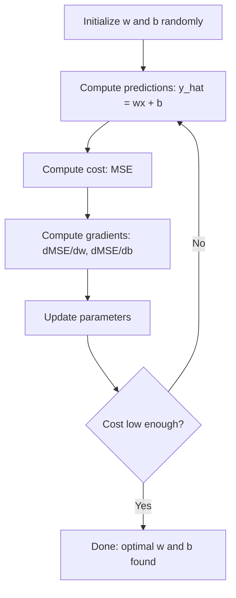

# रैखिक प्रतिगमन

> रैखिक प्रतिगमन आपके डेटा के माध्यम से सबसे अच्छी सीधी रेखा खींचता है। यह मशीन लर्निंग की "हैलो दुनिया" है।

**Type:** Build
**Languages:** Python, Julia, Rust
**Prerequisites:** Phase 1 (Linear Algebra, Calculus, Optimization), Phase 2 Lesson 1
**Time:** ~90 minutes

## सीखने के लक्ष्य

- औसत वर्ग त्रुटि के लिए ग्रेडिएंट गिरावट अद्यतन नियम निकालें और खरोंच से रैखिक प्रतिगमन को लागू करें
- गणना जटिलता के मामले में ग्रेडिएंट गिरावट और सामान्य समीकरण की तुलना करें और प्रत्येक का उपयोग कब करें
- सुविधा मानकीकरण के साथ एक बहु रैखिक प्रतिगमन मॉडल का निर्माण करें और सीखे गए वजन की व्याख्या करें
- बताएं कि बड़े वजन को दंडित करके रidge रेग्रिशन (L2 नियमितता) कैसे ओवरफाइटिंग को रोकता है

## समस्या

आपके पास डेटा हैः घर के आकार और उनकी बिक्री कीमतें। आप अपने आकार को देखते हुए नए घर की कीमत का अनुमान लगाना चाहते हैं। आप इसे एक स्कैटर ग्राफ पर देख सकते हैं, लेकिन आपको एक सूत्र की आवश्यकता है। आपको एक रेखा की आवश्यकता है जो डेटा के सबसे अच्छी तरह से फिट बैठती है ताकि आप किसी भी आकार को प्लग कर सकें और मूल्य भविष्यवाणी प्राप्त कर सकें।

रैखिक प्रतिगमन आपको यह रेखा देता है। इससे भी महत्वपूर्ण बात यह है कि यह पूरे एमएल प्रशिक्षण लूप को पेश करता हैः एक मॉडल को परिभाषित करें, लागत फ़ंक्शन को परिभाषित करें, मापदंडों को अनुकूलित करें। प्रत्येक एमएल एल्गोरिदम इस एक ही पैटर्न का पालन करता है। इसे सबसे सरल मामले के साथ यहां मास्टर करें, और आप इसे हर जगह पहचानेंगे।

यह केवल सरल समस्याओं के लिए नहीं है। उत्पादन प्रणालियों में मांग पूर्वानुमान, ए / बी परीक्षण विश्लेषण, वित्तीय मॉडलिंग के लिए रैखिक प्रतिगमन का उपयोग किया जाता है, और प्रत्येक प्रतिगमन कार्य के लिए एक आधार के रूप में।

## अवधारणा

### आदर्श

रैखिक प्रतिगमन में इनपुट के बीच रैखिक संबंध ($x$) और आउटपुट ($y$):

```math
y = wx + b
```

- `w`(वेट/झल): कितना $y$परिवर्तन जब $x$1 की वृद्धि
- `b`(अवशिष्ट/अवरोध):  का मूल्य$y$कब$x = 0$

कई इनपुट (विशेषताओं) के लिए, यह निम्नलिखित तक फैला हैः

```math
y = w_1 x_1 + w_2 x_2 + \cdots + w_n x_n + b
```

या वेक्टर रूप मेंः $y = w^T x + b$

लक्ष्य: $w$और $b$जो भविष्यवाणी करते हैं $y$वास्तविकता के यथासंभव करीब $y$सभी प्रशिक्षण उदाहरणों में।

### लागत फ़ंक्शन (मीडियन स्क्वायर त्रुटि)

आप "जितना संभव हो उतना करीब" कैसे मापते हैं? आपको एक एकल संख्या की आवश्यकता है जो आपकी भविष्यवाणियों को गलत तरीके से कैप्चर करती है। सबसे आम विकल्प औसत वर्ग त्रुटि (MSE) हैः

```math
\text{MSE} = \frac{1}{n} \sum (y_{\text{predicted}} - y_{\text{actual}})^2
```

दो कारणों से। पहला, यह छोटी त्रुटियों की तुलना में बड़ी त्रुटियों को अधिक दंडित करता है (10 की त्रुटि 1 की त्रुटि से 100 गुना बदतर है, 10 की तुलना में) दूसरा, वर्ग फ़ंक्शन हर जगह चिकनी और भिन्न है, जो अनुकूलन को सीधा बनाता है।

लागत फ़ंक्शन एक सतह बनाता है।$w$और पूर्वाग्रह $b$एक कटोरा (एक घुमावदार पैराबोलाइड) की तरह दिखता है। कटोरा के नीचे जहां एमएसई को कम किया जाता है। प्रशिक्षण का मतलब है कि नीचे की खोज।

### क्रमिक गिरावट

गिरती हुई तलछट नीचे की ओर कदम उठाकर कटोरे का तल ढूँढती है।



ग्रेडिएंट आपको दो चीजें बताते हैंः प्रत्येक पैरामीटर को किस दिशा में स्थानांतरित करना है, और कितना स्थानांतरित करना है।

 के साथ एमएसई के लिए$\hat{y} = wx + b$:

```math
\begin{aligned}
\frac{\partial \text{MSE}}{\partial w} &= \frac{2}{n} \sum (\hat{y} - y) \, x \\
\frac{\partial \text{MSE}}{\partial b} &= \frac{2}{n} \sum (\hat{y} - y)
\end{aligned}
```

अद्यतन नियमः

```math
\begin{aligned}
w &= w - \text{learning\_rate} \cdot \frac{\partial \text{MSE}}{\partial w} \\
b &= b - \text{learning\_rate} \cdot \frac{\partial \text{MSE}}{\partial b}
\end{aligned}
```

सीखने की दर चरण के आकार को नियंत्रित करती है। बहुत बड़ाः आप न्यूनतम से अधिक हो जाते हैं और विचलित होते हैं। बहुत छोटाः प्रशिक्षण हमेशा के लिए लेता है। सामान्य प्रारंभिक मानः 0.01, 0.001, या 0.0001.

### सामान्य समीकरण (बंद रूप समाधान)

रैखिक प्रतिगमन के लिए विशेष रूप से, एक सीधा सूत्र है जो बिना किसी पुनरावृत्ति के इष्टतम वजन देता हैः

```math
w = (X^T X)^{-1} X^T y
```

यह हल करने के लिए एक मैट्रिक्स को उलटा करता है $w$यह छोटे डेटासेट के लिए एकदम सही काम करता है। बड़े डेटासेट (मिलियन पंक्तियों या हजारों सुविधाओं) के लिए, ग्रेडिएंट गिरावट को प्राथमिकता दी जाती है क्योंकि मैट्रिक्स विपरित है।$O(n^3)$विशेषताओं की संख्या में।

### बहु-रेखीय प्रतिगमन

कई विशेषताओं के साथ, मॉडल बन जाता हैः

```math
y = w_1 x_1 + w_2 x_2 + \cdots + w_n x_n + b
```

सब कुछ एक ही काम करता हैः एमएसई लागत फ़ंक्शन है, ग्रेडिएंट गिरावट एक साथ सभी भारों को अपडेट करती है। एकमात्र अंतर यह है कि आप एक रेखा के बजाय एक हाइपरप्लेन फिट कर रहे हैं।

यदि एक विशेषता 0 से 1 तक और दूसरी 0 से 1,000,000 तक है, तो ग्रेडिएंट गिरावट संघर्ष करेगी क्योंकि लागत सतह लंबा हो जाती है। प्रशिक्षण से पहले विशेषताएं (मध्यम घटाएं, मानक विचलन द्वारा विभाजित करें) को मानकीकृत करें।

### बहुपद प्रतिगमन

यदि संबंध रैखिक नहीं है तो क्या होगा? आप अभी भी बहुपद विशेषताओं को बनाकर रैखिक प्रतिगमन का उपयोग कर सकते हैंः

```math
y = w_1 x + w_2 x^2 + w_3 x^3 + b
```

यह अभी भी "रैखिक" प्रतिगमन है क्योंकि मॉडल भार में रैखिक है ($w_1, w_2, w_3$) आप सिर्फ उपयोग कर रहे हैं गैर रैखिक सुविधाओं के $x$. .

उच्च डिग्री बहुपद अधिक जटिल वक्रों को फिट कर सकते हैं लेकिन ओवरफitting का जोखिम है। एक डिग्री-10 बहुपद 10 बिंदु डेटासेट में हर बिंदु से गुजरता है लेकिन नए डेटा पर खराब भविष्यवाणी करता है।

### आर-क्वायर स्कोर

एमएसई आपको बताता है कि आप कितना गलत हैं, लेकिन संख्या के पैमाने पर निर्भर करती है $y$. आर-क्वाड ($R^2$) एक पैमाने से स्वतंत्र उपाय देता हैः

```math
\begin{aligned}
R^2 &= 1 - \frac{\text{sum of squared residuals}}{\text{sum of squared deviations from mean}} \\
&= 1 - \frac{SS_{\text{res}}}{SS_{\text{tot}}}
\end{aligned}
```

- $R^2 = 1.0$: सही भविष्यवाणियाँ
- $R^2 = 0.0$: मॉडल हर बार औसत की भविष्यवाणी से बेहतर नहीं है
- $R^2 < 0.0$: मॉडल औसत की भविष्यवाणी से भी बदतर है

### नियमन पूर्वावलोकन (रिज रिग्रेशन)

जब आपके पास कई विशेषताएं होती हैं, तो मॉडल बड़े वजन आवंटित करके ओवरफिट कर सकता है। रidge रेग्रिशन (L2 नियमितकरण) एक दंड जोड़ता हैः

```math
\text{Cost} = \text{MSE} + \lambda \sum w_i^2
```

दंड शब्द बड़े वजन को रोकने के लिए है।$\lambda$व्यापारिक अंतर को नियंत्रित करता हैः उच्च $\lambda$यह एक बाद के पाठ में गहराई से कवर किया जाएगा। अभी के लिए, यह पता है कि यह मौजूद है और यह मदद क्यों करता है।

```figure
linear-regression-fit
```

## इसे बनाओ

### चरण 1: नमूना डेटा उत्पन्न करें

```python
import random
import math

random.seed(42)

TRUE_W = 3.0
TRUE_B = 7.0
N_SAMPLES = 100

X = [random.uniform(0, 10) for _ in range(N_SAMPLES)]
y = [TRUE_W * x + TRUE_B + random.gauss(0, 2.0) for x in X]

print(f"Generated {N_SAMPLES} samples")
print(f"True relationship: y = {TRUE_W}x + {TRUE_B} (+ noise)")
print(f"First 5 points: {[(round(X[i], 2), round(y[i], 2)) for i in range(5)]}")
```

### चरण 2: ग्रेडिएंट अवतरण के साथ खरोंच से रैखिक प्रतिगमन

```python
class LinearRegression:
    def __init__(self, learning_rate=0.01):
        self.w = 0.0
        self.b = 0.0
        self.lr = learning_rate
        self.cost_history = []

    def predict(self, X):
        return [self.w * x + self.b for x in X]

    def compute_cost(self, X, y):
        predictions = self.predict(X)
        n = len(y)
        cost = sum((pred - actual) ** 2 for pred, actual in zip(predictions, y)) / n
        return cost

    def compute_gradients(self, X, y):
        predictions = self.predict(X)
        n = len(y)
        dw = (2 / n) * sum((pred - actual) * x for pred, actual, x in zip(predictions, y, X))
        db = (2 / n) * sum(pred - actual for pred, actual in zip(predictions, y))
        return dw, db

    def fit(self, X, y, epochs=1000, print_every=200):
        for epoch in range(epochs):
            dw, db = self.compute_gradients(X, y)
            self.w -= self.lr * dw
            self.b -= self.lr * db
            cost = self.compute_cost(X, y)
            self.cost_history.append(cost)
            if epoch % print_every == 0:
                print(f"  Epoch {epoch:4d} | Cost: {cost:.4f} | w: {self.w:.4f} | b: {self.b:.4f}")
        return self

    def r_squared(self, X, y):
        predictions = self.predict(X)
        y_mean = sum(y) / len(y)
        ss_res = sum((actual - pred) ** 2 for actual, pred in zip(y, predictions))
        ss_tot = sum((actual - y_mean) ** 2 for actual in y)
        return 1 - (ss_res / ss_tot)


print("=== Training Linear Regression (Gradient Descent) ===")
model = LinearRegression(learning_rate=0.005)
model.fit(X, y, epochs=1000, print_every=200)
print(f"\nLearned: y = {model.w:.4f}x + {model.b:.4f}")
print(f"True:    y = {TRUE_W}x + {TRUE_B}")
print(f"R-squared: {model.r_squared(X, y):.4f}")
```

### चरण 3: सामान्य समीकरण (बंद रूप समाधान)

```python
class LinearRegressionNormal:
    def __init__(self):
        self.w = 0.0
        self.b = 0.0

    def fit(self, X, y):
        n = len(X)
        x_mean = sum(X) / n
        y_mean = sum(y) / n
        numerator = sum((X[i] - x_mean) * (y[i] - y_mean) for i in range(n))
        denominator = sum((X[i] - x_mean) ** 2 for i in range(n))
        self.w = numerator / denominator
        self.b = y_mean - self.w * x_mean
        return self

    def predict(self, X):
        return [self.w * x + self.b for x in X]

    def r_squared(self, X, y):
        predictions = self.predict(X)
        y_mean = sum(y) / len(y)
        ss_res = sum((actual - pred) ** 2 for actual, pred in zip(y, predictions))
        ss_tot = sum((actual - y_mean) ** 2 for actual in y)
        return 1 - (ss_res / ss_tot)


print("\n=== Normal Equation (Closed-Form) ===")
model_normal = LinearRegressionNormal()
model_normal.fit(X, y)
print(f"Learned: y = {model_normal.w:.4f}x + {model_normal.b:.4f}")
print(f"R-squared: {model_normal.r_squared(X, y):.4f}")
```

### चरण 4: बहु रैखिक प्रतिगमन

```python
class MultipleLinearRegression:
    def __init__(self, n_features, learning_rate=0.01):
        self.weights = [0.0] * n_features
        self.bias = 0.0
        self.lr = learning_rate
        self.cost_history = []

    def predict_single(self, x):
        return sum(w * xi for w, xi in zip(self.weights, x)) + self.bias

    def predict(self, X):
        return [self.predict_single(x) for x in X]

    def compute_cost(self, X, y):
        predictions = self.predict(X)
        n = len(y)
        return sum((pred - actual) ** 2 for pred, actual in zip(predictions, y)) / n

    def fit(self, X, y, epochs=1000, print_every=200):
        n = len(y)
        n_features = len(X[0])
        for epoch in range(epochs):
            predictions = self.predict(X)
            errors = [pred - actual for pred, actual in zip(predictions, y)]
            for j in range(n_features):
                grad = (2 / n) * sum(errors[i] * X[i][j] for i in range(n))
                self.weights[j] -= self.lr * grad
            grad_b = (2 / n) * sum(errors)
            self.bias -= self.lr * grad_b
            cost = self.compute_cost(X, y)
            self.cost_history.append(cost)
            if epoch % print_every == 0:
                print(f"  Epoch {epoch:4d} | Cost: {cost:.4f}")
        return self

    def r_squared(self, X, y):
        predictions = self.predict(X)
        y_mean = sum(y) / len(y)
        ss_res = sum((actual - pred) ** 2 for actual, pred in zip(y, predictions))
        ss_tot = sum((actual - y_mean) ** 2 for actual in y)
        return 1 - (ss_res / ss_tot)


random.seed(42)
N = 100
X_multi = []
y_multi = []
for _ in range(N):
    size = random.uniform(500, 3000)
    bedrooms = random.randint(1, 5)
    age = random.uniform(0, 50)
    price = 50 * size + 10000 * bedrooms - 1000 * age + 50000 + random.gauss(0, 20000)
    X_multi.append([size, bedrooms, age])
    y_multi.append(price)


def standardize(X):
    n_features = len(X[0])
    means = [sum(X[i][j] for i in range(len(X))) / len(X) for j in range(n_features)]
    stds = []
    for j in range(n_features):
        variance = sum((X[i][j] - means[j]) ** 2 for i in range(len(X))) / len(X)
        stds.append(variance ** 0.5)
    X_scaled = []
    for i in range(len(X)):
        row = [(X[i][j] - means[j]) / stds[j] if stds[j] > 0 else 0 for j in range(n_features)]
        X_scaled.append(row)
    return X_scaled, means, stds


y_mean_val = sum(y_multi) / len(y_multi)
y_std_val = (sum((yi - y_mean_val) ** 2 for yi in y_multi) / len(y_multi)) ** 0.5
y_scaled = [(yi - y_mean_val) / y_std_val for yi in y_multi]

X_scaled, x_means, x_stds = standardize(X_multi)

print("\n=== Multiple Linear Regression (3 features) ===")
print("Features: house size, bedrooms, age")
multi_model = MultipleLinearRegression(n_features=3, learning_rate=0.01)
multi_model.fit(X_scaled, y_scaled, epochs=1000, print_every=200)

print(f"\nWeights (standardized): {[round(w, 4) for w in multi_model.weights]}")
print(f"Bias (standardized): {multi_model.bias:.4f}")
print(f"R-squared: {multi_model.r_squared(X_scaled, y_scaled):.4f}")
```

### चरण 5: बहुपद प्रतिगमन

```python
class PolynomialRegression:
    def __init__(self, degree, learning_rate=0.01):
        self.degree = degree
        self.weights = [0.0] * degree
        self.bias = 0.0
        self.lr = learning_rate

    def make_features(self, X):
        return [[x ** (d + 1) for d in range(self.degree)] for x in X]

    def predict(self, X):
        features = self.make_features(X)
        return [sum(w * f for w, f in zip(self.weights, row)) + self.bias for row in features]

    def fit(self, X, y, epochs=1000, print_every=200):
        features = self.make_features(X)
        n = len(y)
        for epoch in range(epochs):
            predictions = [sum(w * f for w, f in zip(self.weights, row)) + self.bias for row in features]
            errors = [pred - actual for pred, actual in zip(predictions, y)]
            for j in range(self.degree):
                grad = (2 / n) * sum(errors[i] * features[i][j] for i in range(n))
                self.weights[j] -= self.lr * grad
            grad_b = (2 / n) * sum(errors)
            self.bias -= self.lr * grad_b
            if epoch % print_every == 0:
                cost = sum(e ** 2 for e in errors) / n
                print(f"  Epoch {epoch:4d} | Cost: {cost:.6f}")
        return self

    def r_squared(self, X, y):
        predictions = self.predict(X)
        y_mean = sum(y) / len(y)
        ss_res = sum((actual - pred) ** 2 for actual, pred in zip(y, predictions))
        ss_tot = sum((actual - y_mean) ** 2 for actual in y)
        return 1 - (ss_res / ss_tot)


random.seed(42)
X_poly = [x / 10.0 for x in range(0, 50)]
y_poly = [0.5 * x ** 2 - 2 * x + 3 + random.gauss(0, 1.0) for x in X_poly]

x_max = max(abs(x) for x in X_poly)
X_poly_norm = [x / x_max for x in X_poly]
y_poly_mean = sum(y_poly) / len(y_poly)
y_poly_std = (sum((yi - y_poly_mean) ** 2 for yi in y_poly) / len(y_poly)) ** 0.5
y_poly_norm = [(yi - y_poly_mean) / y_poly_std for yi in y_poly]

print("\n=== Polynomial Regression (degree 2 vs degree 5) ===")
print("True relationship: y = 0.5x^2 - 2x + 3")

print("\nDegree 2:")
poly2 = PolynomialRegression(degree=2, learning_rate=0.1)
poly2.fit(X_poly_norm, y_poly_norm, epochs=2000, print_every=500)
print(f"  R-squared: {poly2.r_squared(X_poly_norm, y_poly_norm):.4f}")

print("\nDegree 5:")
poly5 = PolynomialRegression(degree=5, learning_rate=0.1)
poly5.fit(X_poly_norm, y_poly_norm, epochs=2000, print_every=500)
print(f"  R-squared: {poly5.r_squared(X_poly_norm, y_poly_norm):.4f}")

print("\nDegree 2 fits the true curve well. Degree 5 fits training data slightly better")
print("but risks overfitting on new data.")
```

### चरण 6: रिंग रेग्रिशन (L2 नियमितता)

```python
class RidgeRegression:
    def __init__(self, n_features, learning_rate=0.01, alpha=1.0):
        self.weights = [0.0] * n_features
        self.bias = 0.0
        self.lr = learning_rate
        self.alpha = alpha

    def predict_single(self, x):
        return sum(w * xi for w, xi in zip(self.weights, x)) + self.bias

    def predict(self, X):
        return [self.predict_single(x) for x in X]

    def fit(self, X, y, epochs=1000, print_every=200):
        n = len(y)
        n_features = len(X[0])
        for epoch in range(epochs):
            predictions = self.predict(X)
            errors = [pred - actual for pred, actual in zip(predictions, y)]
            mse = sum(e ** 2 for e in errors) / n
            reg_term = self.alpha * sum(w ** 2 for w in self.weights)
            cost = mse + reg_term
            for j in range(n_features):
                grad = (2 / n) * sum(errors[i] * X[i][j] for i in range(n))
                grad += 2 * self.alpha * self.weights[j]
                self.weights[j] -= self.lr * grad
            grad_b = (2 / n) * sum(errors)
            self.bias -= self.lr * grad_b
            if epoch % print_every == 0:
                print(f"  Epoch {epoch:4d} | Cost: {cost:.4f} | L2 penalty: {reg_term:.4f}")
        return self


print("\n=== Ridge Regression (L2 Regularization) ===")
print("Same data as multiple regression, with alpha=0.1")
ridge = RidgeRegression(n_features=3, learning_rate=0.01, alpha=0.1)
ridge.fit(X_scaled, y_scaled, epochs=1000, print_every=200)
print(f"\nRidge weights: {[round(w, 4) for w in ridge.weights]}")
print(f"Plain weights: {[round(w, 4) for w in multi_model.weights]}")
print("Ridge weights are smaller (shrunk toward zero) due to the L2 penalty.")
```

## इसका प्रयोग करें

अब वही बात है स्किकट-लर्न के साथ, जो आप वास्तव में उत्पादन में उपयोग करेंगे।

```python
from sklearn.linear_model import LinearRegression as SklearnLR
from sklearn.linear_model import Ridge
from sklearn.preprocessing import PolynomialFeatures, StandardScaler
from sklearn.model_selection import train_test_split
from sklearn.metrics import mean_squared_error, r2_score
import numpy as np

np.random.seed(42)
X_sk = np.random.uniform(0, 10, (100, 1))
y_sk = 3.0 * X_sk.squeeze() + 7.0 + np.random.normal(0, 2.0, 100)

X_train, X_test, y_train, y_test = train_test_split(X_sk, y_sk, test_size=0.2, random_state=42)

lr = SklearnLR()
lr.fit(X_train, y_train)
y_pred = lr.predict(X_test)

print("=== Scikit-learn Linear Regression ===")
print(f"Coefficient (w): {lr.coef_[0]:.4f}")
print(f"Intercept (b): {lr.intercept_:.4f}")
print(f"R-squared (test): {r2_score(y_test, y_pred):.4f}")
print(f"MSE (test): {mean_squared_error(y_test, y_pred):.4f}")

poly = PolynomialFeatures(degree=2, include_bias=False)
X_poly_sk = poly.fit_transform(X_train)
X_poly_test = poly.transform(X_test)

lr_poly = SklearnLR()
lr_poly.fit(X_poly_sk, y_train)
print(f"\nPolynomial degree 2 R-squared: {r2_score(y_test, lr_poly.predict(X_poly_test)):.4f}")

scaler = StandardScaler()
X_train_scaled = scaler.fit_transform(X_train)
X_test_scaled = scaler.transform(X_test)

ridge = Ridge(alpha=1.0)
ridge.fit(X_train_scaled, y_train)
print(f"Ridge R-squared: {r2_score(y_test, ridge.predict(X_test_scaled)):.4f}")
print(f"Ridge coefficient: {ridge.coef_[0]:.4f}")
```

स्कीट-लर्न के साथ-साथ स्कीट-लर्न के साथ-साथ स्कीट-लर्न के साथ-साथ स्कीट-लर्न के साथ-साथ स्कीट-लर्न के साथ-साथ स्कीट-लर्न के साथ-साथ स्कीट-लर्न के साथ-साथ स्कीट-लर्न के साथ-साथ स्कीट-लर्न के साथ-साथ स्कीट-लर्न के साथ-साथ स्कीट-लर्न के साथ-साथ स्कीट-लर्न के साथ-साथ स्कीट-लर्न के साथ-साथ स्कीट-लर्न के साथ-साथ स्कीट-लर्न के साथ-साथ स्कीट-लर्न के साथ-साथ स्कीट-लर्न के साथ-साथ स्कीट-लर्न के साथ-साथ स्कीट-लर्न के साथ-साथ स्कीट-लर्न के साथ-साथ स्कीट-लर्न के साथ-साथ-साथ-साथ-साथ-साथ-साथ-साथ-साथ-साथ-साथ-साथ-साथ-साथ-साथ-साथ-साथ-साथ-साथ-साथ-साथ-साथ-साथ-साथ-साथ-साथ-साथ-साथ-साथ-साथ-साथ-साथ-साथ-साथ-साथ-साथ-साथ-साथ-साथ-साथ-साथ-साथ-साथ-साथ-साथ-साथ-साथ-साथ-साथ-साथ-साथ-साथ-साथ-साथ-साथ-साथ-साथ-साथ-साथ-साथ-साथ-साथ-साथ-साथ-साथ-साथ-साथ-साथ-साथ-साथ-साथ-साथ-साथ-साथ-साथ-साथ-साथ-साथ-साथ-साथ-साथ-साथ-साथ-साथ-साथ-साथ-साथ--साथ-साथ-साथ--साथ-साथ-साथ--साथ---साथ--साथ--साथ------साथ--साथ----------साथ----------------------------------------------------------------------------------

## इसे भेजें

इस पाठ से उत्पन्न होता हैः
- `outputs/skill-regression.md`- समस्या के आधार पर सही प्रतिगमन दृष्टिकोण चुनने के लिए कौशल

## व्यायाम

1. बैच ग्रेडिएंट गिरावट, स्टोकास्टिक ग्रेडिएंट गिरावट (SGD) और मिनी बैच ग्रेडिएंट गिरावट को लागू करें। एक ही डेटासेट पर अभिसरण गति की तुलना करें। कौन सा सबसे तेजी से अभिसरण करता है?
2. एक घन फ़ंक्शन से डेटा उत्पन्न करें ($y = ax^3 + bx^2 + cx + d + \text{noise}$) डिग्री 1, 3 और 10 के बहुपदों के अनुकूल। प्रशिक्षण की तुलना करें $R^2$और परीक्षण$R^2$. . . . . . . . . . . . . . . . . . . . . . . . . . . . . . . . . . . . . . . . . . . . . . . . . . . . . . . . . . . . . . . . . . . . . . . . . . . . . . . . . . . . . . . . . . . . . . . . . . . . . . . . . . . . . . . . . . . . . . . . . . . . . . . . . . . . . . . . . . . . . . . . . . . . . . . . . . . . . . . . . . . . . . . . . . . . . . . . . . . . . . . . . . . . . . . . . . . . . . . . . . . . . . . . . . . . . . . . . . . . . . . . . . . . . . . . . . . . . . . . . . . . . . . . . . . . . . . . . . . . . . . . . . . . . . . . . . . . . . . . . . . . . . . . . . . . . . . . . . . . . . . . . . . . . . . . . . . . . . . . . . . . . . . . . . . . . . . . . . . . . . . . . . . . . . . . . . . . . . . . . . . . . . . . . . . . . . . . . . . . . . . . . . . . . . . . . . . . . . . . . . . . . . . . . . . . . . . . . . . . . . . . . . . . . . . . . . . . . . . . . . . . . . . . . . . . . . . . . . . . . . . . . . . . . . . . . . . . . . . . . . . . . . . . . . . . . . . . . . . . . . . . . . . . . .
3. लासो रेग्रिशन (L1 नियमितकरण) को लागू करें: $\text{penalty} = \alpha \sum \lvert w_i \rvert$) बहु-विशेषताओं वाले आवास डेटा पर प्रशिक्षण करें। तुलना करें कि कौन से वजन शून्य बनाम रिज पर जाते हैं। L1 दुर्लभ समाधान क्यों पैदा करता है जबकि L2 नहीं करता है?

## प्रमुख शर्तें

| Term | What people say | What it actually means |
|------|----------------|----------------------|
| Linear regression | "Draw a line through data" | Find weight $w$ and bias $b$ that minimize the sum of squared differences between $wx+b$ and actual $y$ values |
| Cost function | "How bad the model is" | A function that maps model parameters to a single number measuring prediction error, which optimization minimizes |
| Mean squared error | "Average of squared errors" | $\frac{1}{n} \sum (\text{predicted} - \text{actual})^2$, penalizing large errors disproportionately |
| Gradient descent | "Walk downhill" | Iteratively adjust parameters in the direction that reduces the cost function, using partial derivatives |
| Learning rate | "Step size" | A scalar that controls how much parameters change per gradient descent step |
| Normal equation | "Solve it directly" | The closed-form solution $w = (X^T X)^{-1} X^T y$ that gives optimal weights without iteration |
| R-squared | "How good the fit is" | The fraction of variance in $y$ explained by the model, ranging from negative infinity to 1.0 |
| Feature scaling | "Make features comparable" | Transforming features to similar ranges (e.g., zero mean, unit variance) so gradient descent converges faster |
| Regularization | "Penalize complexity" | Adding a term to the cost function that shrinks weights, preventing overfitting |
| Ridge regression | "L2 regularization" | Linear regression with a penalty of $\lambda \sum w_i^2$ added to MSE |
| Polynomial regression | "Fitting curves with linear math" | Linear regression on polynomial features ($x, x^2, x^3, \ldots$), still linear in the weights |
| Overfitting | "Memorizing training data" | Using a model so complex that it fits noise in training data and fails on new data |

## आगे पढ़ना

- [An Introduction to Statistical Learning (ISLR)](https://www.statlearning.com/)-- निःशुल्क पीडीएफ, अध्याय 3 और 6 व्यावहारिक आर उदाहरणों के साथ रैखिक प्रतिगमन और नियमितता को कवर करते हैं
- [The Elements of Statistical Learning (ESL)](https://hastie.su.domains/ElemStatLearn/)-- मुक्त पीडीएफ, आईएसएलआर के अधिक गणितीय साथी गहरे उपचार के साथ रिंग और लसो
- [Stanford CS229 Lecture Notes on Linear Regression](https://cs229.stanford.edu/main_notes.pdf)-- एंड्रयू एनजी के नोट्स सामान्य समीकरण और ग्रेडिएंट अवतरण के लिए पहले सिद्धांतों से प्राप्त
- [scikit-learn LinearRegression documentation](https://scikit-learn.org/stable/modules/linear_model.html)-- कोड उदाहरणों के साथ रैखिक रिग्रेशन, रिज, लासो और एलास्टिकनेट के लिए व्यावहारिक संदर्भ
