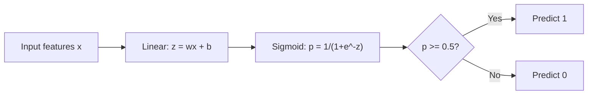
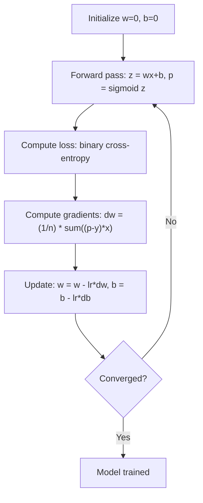

# रसदगत गिरावट

> लॉजिस्टिक रेग्रिशन एक सीधी रेखा को S-क्रव में झुकाता है ताकि संभावनाओं के साथ हाँ या नहीं प्रश्नों का उत्तर दिया जा सके।

**Type:** Build
**Languages:** Python, Julia, Rust
**Prerequisites:** Phase 2 Lesson 1-2 (What Is ML, Linear Regression)
**Time:** ~90 minutes

## सीखने के लक्ष्य

- सिग्मोइड फ़ंक्शन और बाइनरी क्रॉस-एंट्रोपी हानि का उपयोग करके खरोंच से लॉजिस्टिक प्रतिगमन को लागू करें
- सटीकता, याद, F1 स्कोर और द्विआधारी वर्गीकरण के लिए भ्रम मैट्रिक्स की गणना और व्याख्या
- समझाएं कि एमएसई वर्गीकरण में क्यों विफल रहता है और क्यों द्विआधारी क्रॉस-एंट्रोपी एक कंवेक्स लागत सतह पैदा करती है
- बहु-वर्ग वर्गीकरण के लिए एक softmax प्रतिगमन मॉडल का निर्माण करें और सीमा समायोजन समझौता का मूल्यांकन करें

## समस्या

आप यह अनुमान लगाना चाहते हैं कि क्या एक ट्यूमर उसके आकार को देखते हुए दुर्भावनापूर्ण या सौम्य है। आप रैखिक प्रतिगमन का प्रयास करते हैं। यह 0.3 या 1.7 या -0.5 जैसे संख्याओं का उत्पादन करता है। इसका क्या मतलब है? क्या 1.7 "बहुत दुर्भावनापूर्ण" है? क्या -0.5 "बहुत सौम्य" है? रैखिक प्रतिगमन असीमित संख्याओं का उत्पादन करता है। वर्गीकरण के लिए 0 से 1 के बीच सीमित संभावनाओं की आवश्यकता होती है, और एक स्पष्ट निर्णयः हाँ या नहीं।

लॉजिस्टिक रेग्रिशन इस समस्या का समाधान करता है।$wx + b$) और इसे सिग्मोइड फ़ंक्शन के माध्यम से पारित करता है, जो किसी भी संख्या को दायरे में कुचल देता है (0, 1). आउटपुट एक संभावना है। आप एक सीमा निर्धारित करते हैं (आमतौर पर 0.5) और एक निर्णय लेते हैं।

यह अभ्यास में सबसे व्यापक रूप से उपयोग किए जाने वाले एल्गोरिदम में से एक है। इसके नाम के बावजूद, लॉजिस्टिक रेग्रिशन एक वर्गीकरण एल्गोरिदम है, रेग्रिशन एल्गोरिदम नहीं। इसका नाम लॉजिस्टिक (सिग्मोइड) फ़ंक्शन से आता है जिसका यह उपयोग करता है।

## अवधारणा

### क्यों रैखिक प्रतिगमन वर्गीकरण में विफल रहता है

अध्ययन के घंटों के आधार पर पास/फेल (1/0) की भविष्यवाणी की कल्पना करें। रैखिक प्रतिगमन डेटा के माध्यम से एक रेखा फिट बैठता हैः

```
hours:  1   2   3   4   5   6   7   8   9   10
actual: 0   0   0   0   1   1   1   1   1   1
```

एक रैखिक फिट 1 घंटे में -0.2 और 10 घंटे में 1.3 जैसी भविष्यवाणियां उत्पन्न कर सकता है। ये मान संभावनाएं नहीं हैं। वे 0 से नीचे और 1 से ऊपर जाते हैं। इससे भी बदतर, एक एकल आउटलियर (किसी ने 50 घंटे का अध्ययन किया) पूरी रेखा को खींच लेगा, सभी के लिए भविष्यवाणियों को बदल देगा।

वर्गीकरण के लिए एक कार्य की आवश्यकता होती है जोः
- 0 से 1 के बीच के आउटपुट मान (संभाव्यता)
- एक तेज संक्रमण (एक निर्णय सीमा) बनाता है
- सीमा से दूर विकृति से विकृत नहीं है

### सिग्मोइड फ़ंक्शन

सिग्मोइड फ़ंक्शन ठीक यही करता हैः

```math
\sigma(z) = \frac{1}{1 + e^{-z}}
```

गुण:
- कब$z$बड़ा और सकारात्मक है,$\sigma(z)$दृष्टिकोण 1
- कब$z$बड़ा और नकारात्मक है,$\sigma(z)$दृष्टिकोण 0
- कब$z = 0$,$\sigma(z) = 0.5$
- आउटपुट हमेशा 0 से 1 के बीच होता है
- समारोह चिकनी है और हर जगह अंतर

व्युत्पन्न का एक सुविधाजनक रूप हैः $\sigma'(z) = \sigma(z) (1 - \sigma(z))$. यह ग्रेडिएंट गणना कुशल बनाता है.

### लॉजिस्टिक रिग्रेशन = रैखिक मॉडल + सिग्मोइड

मॉडल गणना करता है $z = wx + b$(सीधी विघटन के समान), फिर सिग्मोइड लागू होता हैः



आउटपुट $p$इसको व्याख्या की जाती है $P(y=1 \mid x)$, संभावना है कि इनपुट वर्ग 1 से संबंधित है। निर्णय सीमा है जहां $wx + b = 0$, जो सिग्मोइड आउटपुट ठीक 0.5 बनाता है।

### द्विआधारी क्रॉस-एंट्रोपी हानि

आप लॉजिस्टिक रेग्रेशन के लिए एमएसई का उपयोग नहीं कर सकते। सिग्मोइड के साथ एमएसई कई स्थानीय न्यूनतम के साथ एक गैर-घुंढ लागत सतह बनाता है। इसके बजाय, द्विआधारी क्रॉस-एंट्रोपी (लॉग हानि) का उपयोग करेंः

```math
\text{Loss} = -\frac{1}{n} \sum \left( y \log(p) + (1-y) \log(1-p) \right)
```

यह काम क्यों करता हैः
- कब$y=1$और $p$1 के करीब है।$\log(1) = 0$, तो हानि 0 के निकट है (सही, कम लागत)
- कब$y=1$और $p$0 के निकट हैः $\log(0)$नकारात्मक अनंत के करीब आता है, इसलिए हानि बहुत बड़ी है (गलत, उच्च लागत)
- कब$y=0$और $p$0 के निकट हैः $\log(1) = 0$, तो हानि 0 के निकट है (सही, कम लागत)
- कब$y=0$और $p$1 के करीब है।$\log(0)$नकारात्मक अनंत के करीब आता है, इसलिए हानि बहुत बड़ी है (गलत, उच्च लागत)

लॉजिस्टिक रेग्रेशन के लिए यह हानि फ़ंक्शन घुमावदार है, इसलिए प्रत्येक स्थानीय न्यूनतम एक वैश्विक न्यूनतम है और ग्रेडिएंट अवतरण एक खराब में फंस नहीं सकता है। पूरी तरह से अलग किए जाने वाले डेटा पर हानि वजन बढ़ने के साथ घटती रहती है, इसलिए कोई परिमित न्यूनतम मौजूद नहीं है; L2 नियमितता इसे तय करती है और न्यूनतम को अद्वितीय बनाती है।

### लॉजिस्टिक रिग्रेशन के लिए क्रमिक गिरावट

सिग्मोइड के साथ द्विआधारी क्रॉस-एंट्रोपी के लिए ग्रेडिएंट्स का एक साफ रूप होता हैः

```math
\begin{aligned}
\frac{\partial L}{\partial w} &= \frac{1}{n} \sum (p - y) \, x \\
\frac{\partial L}{\partial b} &= \frac{1}{n} \sum (p - y)
\end{aligned}
```

ये रैखिक regression gradients के समान दिखते हैं। अंतर यह है कि$p = \sigma(wx + b)$इसके बजाय $p = wx + b$. सिग्मोइड गैर-रैखिकता को पेश करता है, लेकिन ग्रेडिएंट अपडेट नियम समान रहता है।



### निर्णय सीमा

2D इनपुट (दो विशेषताएं) के लिए निर्णय सीमा वह रेखा है जहांः

```math
w_1 x_1 + w_2 x_2 + b = 0
```

एक तरफ के बिंदुओं को 1 के रूप में वर्गीकृत किया जाता है, दूसरी तरफ 0 के रूप में। लॉजिस्टिक प्रतिगमन हमेशा एक रैखिक निर्णय सीमा उत्पन्न करता है। यदि आपको एक घुमावदार सीमा की आवश्यकता है, तो आप या तो बहुपद सुविधाओं को जोड़ते हैं या एक गैर-रेखीय मॉडल का उपयोग करते हैं।

### सॉफ्टमैक्स के साथ मल्टी-क्लास वर्गीकरण

द्विआधारी तार्किक regression दो वर्गों को संभालता है।$k$वर्गों, softmax फ़ंक्शन का उपयोग करेंः

```math
\text{softmax}(z_i) = \frac{e^{z_i}}{\sum_j e^{z_j}}
```

प्रत्येक वर्ग का अपना वजन वेक्टर होता है। मॉडल एक स्कोर की गणना करता है।$z_i$प्रत्येक वर्ग के लिए, तो softmax संभावनाओं के लिए स्कोर परिवर्तित करता है कि 1 के योग है. भविष्यवाणी वर्ग सबसे अधिक संभावना के साथ है.

हानि फ़ंक्शन श्रेणीगत क्रॉस-एंट्रोपी बन जाती हैः

```math
\text{Loss} = -\frac{1}{n} \sum \sum_k y_k \log(p_k)
```

कहाँ$y_k$सही वर्ग के लिए 1 और अन्य सभी के लिए 0 है (एक-गर्म एन्कोडिंग) ।

### मूल्यांकन मेट्रिक्स

केवल सटीकता ही पर्याप्त नहीं है. 95% नकारात्मक और 5% सकारात्मक डेटासेट के लिए, एक मॉडल जो हमेशा नकारात्मक भविष्यवाणी करता है, 95% सटीकता प्राप्त करता है लेकिन बेकार है।

**Confusion Matrix**:

| | Predicted Positive | Predicted Negative |
|---|---|---|
| Actually Positive | True Positive (TP) | False Negative (FN) |
| Actually Negative | False Positive (FP) | True Negative (TN) |

**Precision**: सभी भविष्यवाणी की गई सकारात्मकताओं में से कितने वास्तव में सकारात्मक हैं?
```math
\text{Precision} = \frac{TP}{TP + FP}
```

**Recall**(संवेदनशीलता): सभी वास्तविक सकारात्मकताओं में से, हम कितने को पकड़े?
```math
\text{Recall} = \frac{TP}{TP + FN}
```

**F1 Score**: सटीकता और याद करने का सामंजस्यपूर्ण औसत। दोनों मीट्रिकों को संतुलित करता है।
```math
F_1 = 2 \cdot \frac{\text{Precision} \cdot \text{Recall}}{\text{Precision} + \text{Recall}}
```

प्राथमिकताएं कब निर्धारित करेंः
- **Precision**: जब झूठी सकारात्मक लागतें महंगी होती हैं (स्पैम फ़िल्टर, आप वैध ईमेल को ब्लॉक नहीं करना चाहते हैं)
- **Recall**: जब झूठी नकारात्मक रिपोर्टें महंगी होती हैं (कैंसर स्क्रीनिंग, आप ट्यूमर को याद नहीं करना चाहते)
- **F1**: जब आपको एक एकल संतुलित मीट्रिक की आवश्यकता होती है

```figure
logistic-sigmoid
```

## इसे बनाओ

### चरण 1: सिग्मोइड फ़ंक्शन और डेटा जनरेशन

```python
import random
import math

def sigmoid(z):
    z = max(-500, min(500, z))
    return 1.0 / (1.0 + math.exp(-z))


random.seed(42)
N = 200
X = []
y = []

for _ in range(N // 2):
    X.append([random.gauss(2, 1), random.gauss(2, 1)])
    y.append(0)

for _ in range(N // 2):
    X.append([random.gauss(5, 1), random.gauss(5, 1)])
    y.append(1)

combined = list(zip(X, y))
random.shuffle(combined)
X, y = zip(*combined)
X = list(X)
y = list(y)

print(f"Generated {N} samples (2 classes, 2 features)")
print(f"Class 0 center: (2, 2), Class 1 center: (5, 5)")
print(f"First 5 samples:")
for i in range(5):
    print(f"  Features: [{X[i][0]:.2f}, {X[i][1]:.2f}], Label: {y[i]}")
```

### चरण 2: स्क्रैच से लॉजिस्टिक रिग्रेशन

```python
class LogisticRegression:
    def __init__(self, n_features, learning_rate=0.01):
        self.weights = [0.0] * n_features
        self.bias = 0.0
        self.lr = learning_rate
        self.loss_history = []

    def predict_proba(self, x):
        z = sum(w * xi for w, xi in zip(self.weights, x)) + self.bias
        return sigmoid(z)

    def predict(self, x, threshold=0.5):
        return 1 if self.predict_proba(x) >= threshold else 0

    def compute_loss(self, X, y):
        n = len(y)
        total = 0.0
        for i in range(n):
            p = self.predict_proba(X[i])
            p = max(1e-15, min(1 - 1e-15, p))
            total += y[i] * math.log(p) + (1 - y[i]) * math.log(1 - p)
        return -total / n

    def fit(self, X, y, epochs=1000, print_every=200):
        n = len(y)
        n_features = len(X[0])
        for epoch in range(epochs):
            dw = [0.0] * n_features
            db = 0.0
            for i in range(n):
                p = self.predict_proba(X[i])
                error = p - y[i]
                for j in range(n_features):
                    dw[j] += error * X[i][j]
                db += error
            for j in range(n_features):
                self.weights[j] -= self.lr * (dw[j] / n)
            self.bias -= self.lr * (db / n)
            loss = self.compute_loss(X, y)
            self.loss_history.append(loss)
            if epoch % print_every == 0:
                print(f"  Epoch {epoch:4d} | Loss: {loss:.4f} | w: [{self.weights[0]:.3f}, {self.weights[1]:.3f}] | b: {self.bias:.3f}")
        return self

    def accuracy(self, X, y):
        correct = sum(1 for i in range(len(y)) if self.predict(X[i]) == y[i])
        return correct / len(y)


split = int(0.8 * N)
X_train, X_test = X[:split], X[split:]
y_train, y_test = y[:split], y[split:]

print("\n=== Training Logistic Regression ===")
model = LogisticRegression(n_features=2, learning_rate=0.1)
model.fit(X_train, y_train, epochs=1000, print_every=200)

print(f"\nTrain accuracy: {model.accuracy(X_train, y_train):.4f}")
print(f"Test accuracy:  {model.accuracy(X_test, y_test):.4f}")
print(f"Weights: [{model.weights[0]:.4f}, {model.weights[1]:.4f}]")
print(f"Bias: {model.bias:.4f}")
```

### चरण 3: खरोंच से भ्रमित मैट्रिक्स और मीट्रिक

```python
class ClassificationMetrics:
    def __init__(self, y_true, y_pred):
        self.tp = sum(1 for t, p in zip(y_true, y_pred) if t == 1 and p == 1)
        self.tn = sum(1 for t, p in zip(y_true, y_pred) if t == 0 and p == 0)
        self.fp = sum(1 for t, p in zip(y_true, y_pred) if t == 0 and p == 1)
        self.fn = sum(1 for t, p in zip(y_true, y_pred) if t == 1 and p == 0)

    def accuracy(self):
        total = self.tp + self.tn + self.fp + self.fn
        return (self.tp + self.tn) / total if total > 0 else 0

    def precision(self):
        denom = self.tp + self.fp
        return self.tp / denom if denom > 0 else 0

    def recall(self):
        denom = self.tp + self.fn
        return self.tp / denom if denom > 0 else 0

    def f1(self):
        p = self.precision()
        r = self.recall()
        return 2 * p * r / (p + r) if (p + r) > 0 else 0

    def print_confusion_matrix(self):
        print(f"\n  Confusion Matrix:")
        print(f"                  Predicted")
        print(f"                  Pos   Neg")
        print(f"  Actual Pos     {self.tp:4d}  {self.fn:4d}")
        print(f"  Actual Neg     {self.fp:4d}  {self.tn:4d}")

    def print_report(self):
        self.print_confusion_matrix()
        print(f"\n  Accuracy:  {self.accuracy():.4f}")
        print(f"  Precision: {self.precision():.4f}")
        print(f"  Recall:    {self.recall():.4f}")
        print(f"  F1 Score:  {self.f1():.4f}")


y_pred_test = [model.predict(x) for x in X_test]
print("\n=== Classification Report (Test Set) ===")
metrics = ClassificationMetrics(y_test, y_pred_test)
metrics.print_report()
```

### चरण 4: निर्णय सीमा विश्लेषण

```python
print("\n=== Decision Boundary ===")
w1, w2 = model.weights
b = model.bias
print(f"Decision boundary: {w1:.4f}*x1 + {w2:.4f}*x2 + {b:.4f} = 0")
if abs(w2) > 1e-10:
    print(f"Solved for x2:     x2 = {-w1/w2:.4f}*x1 + {-b/w2:.4f}")

print("\nSample predictions near the boundary:")
test_points = [
    [3.0, 3.0],
    [3.5, 3.5],
    [4.0, 4.0],
    [2.5, 2.5],
    [5.0, 5.0],
]
for point in test_points:
    prob = model.predict_proba(point)
    pred = model.predict(point)
    print(f"  [{point[0]}, {point[1]}] -> prob={prob:.4f}, class={pred}")
```

### चरण 5: सॉफ्टमैक्स के साथ मल्टी-क्लास

```python
class SoftmaxRegression:
    def __init__(self, n_features, n_classes, learning_rate=0.01):
        self.n_features = n_features
        self.n_classes = n_classes
        self.lr = learning_rate
        self.weights = [[0.0] * n_features for _ in range(n_classes)]
        self.biases = [0.0] * n_classes

    def softmax(self, scores):
        max_score = max(scores)
        exp_scores = [math.exp(s - max_score) for s in scores]
        total = sum(exp_scores)
        return [e / total for e in exp_scores]

    def predict_proba(self, x):
        scores = [
            sum(self.weights[k][j] * x[j] for j in range(self.n_features)) + self.biases[k]
            for k in range(self.n_classes)
        ]
        return self.softmax(scores)

    def predict(self, x):
        probs = self.predict_proba(x)
        return probs.index(max(probs))

    def fit(self, X, y, epochs=1000, print_every=200):
        n = len(y)
        for epoch in range(epochs):
            grad_w = [[0.0] * self.n_features for _ in range(self.n_classes)]
            grad_b = [0.0] * self.n_classes
            total_loss = 0.0
            for i in range(n):
                probs = self.predict_proba(X[i])
                for k in range(self.n_classes):
                    target = 1.0 if y[i] == k else 0.0
                    error = probs[k] - target
                    for j in range(self.n_features):
                        grad_w[k][j] += error * X[i][j]
                    grad_b[k] += error
                true_prob = max(probs[y[i]], 1e-15)
                total_loss -= math.log(true_prob)
            for k in range(self.n_classes):
                for j in range(self.n_features):
                    self.weights[k][j] -= self.lr * (grad_w[k][j] / n)
                self.biases[k] -= self.lr * (grad_b[k] / n)
            if epoch % print_every == 0:
                print(f"  Epoch {epoch:4d} | Loss: {total_loss / n:.4f}")
        return self

    def accuracy(self, X, y):
        correct = sum(1 for i in range(len(y)) if self.predict(X[i]) == y[i])
        return correct / len(y)


random.seed(42)
X_3class = []
y_3class = []

centers = [(1, 1), (5, 1), (3, 5)]
for label, (cx, cy) in enumerate(centers):
    for _ in range(50):
        X_3class.append([random.gauss(cx, 0.8), random.gauss(cy, 0.8)])
        y_3class.append(label)

combined = list(zip(X_3class, y_3class))
random.shuffle(combined)
X_3class, y_3class = zip(*combined)
X_3class = list(X_3class)
y_3class = list(y_3class)

split_3 = int(0.8 * len(X_3class))
X_train_3 = X_3class[:split_3]
y_train_3 = y_3class[:split_3]
X_test_3 = X_3class[split_3:]
y_test_3 = y_3class[split_3:]

print("\n=== Multi-class Softmax Regression (3 classes) ===")
softmax_model = SoftmaxRegression(n_features=2, n_classes=3, learning_rate=0.1)
softmax_model.fit(X_train_3, y_train_3, epochs=1000, print_every=200)
print(f"\nTrain accuracy: {softmax_model.accuracy(X_train_3, y_train_3):.4f}")
print(f"Test accuracy:  {softmax_model.accuracy(X_test_3, y_test_3):.4f}")

print("\nSample predictions:")
for i in range(5):
    probs = softmax_model.predict_proba(X_test_3[i])
    pred = softmax_model.predict(X_test_3[i])
    print(f"  True: {y_test_3[i]}, Predicted: {pred}, Probs: [{', '.join(f'{p:.3f}' for p in probs)}]")
```

### चरण 6: सीमा समायोजन

```python
print("\n=== Threshold Tuning ===")
print("Default threshold: 0.5. Adjusting the threshold trades precision for recall.\n")

thresholds = [0.3, 0.4, 0.5, 0.6, 0.7]
print(f"{'Threshold':>10} {'Accuracy':>10} {'Precision':>10} {'Recall':>10} {'F1':>10}")
print("-" * 52)

for t in thresholds:
    y_pred_t = [1 if model.predict_proba(x) >= t else 0 for x in X_test]
    m = ClassificationMetrics(y_test, y_pred_t)
    print(f"{t:>10.1f} {m.accuracy():>10.4f} {m.precision():>10.4f} {m.recall():>10.4f} {m.f1():>10.4f}")
```

## इसका प्रयोग करें

अब वही बात है स्किट-लर्न के साथ।

```python
from sklearn.linear_model import LogisticRegression as SklearnLR
from sklearn.metrics import accuracy_score, precision_score, recall_score, f1_score
from sklearn.metrics import confusion_matrix, classification_report
from sklearn.model_selection import train_test_split
from sklearn.preprocessing import StandardScaler
import numpy as np

np.random.seed(42)
X_0 = np.random.randn(100, 2) + [2, 2]
X_1 = np.random.randn(100, 2) + [5, 5]
X_sk = np.vstack([X_0, X_1])
y_sk = np.array([0] * 100 + [1] * 100)

X_tr, X_te, y_tr, y_te = train_test_split(X_sk, y_sk, test_size=0.2, random_state=42)

scaler = StandardScaler()
X_tr_sc = scaler.fit_transform(X_tr)
X_te_sc = scaler.transform(X_te)

lr = SklearnLR()
lr.fit(X_tr_sc, y_tr)
y_pred = lr.predict(X_te_sc)

print("=== Scikit-learn Logistic Regression ===")
print(f"Accuracy:  {accuracy_score(y_te, y_pred):.4f}")
print(f"Precision: {precision_score(y_te, y_pred):.4f}")
print(f"Recall:    {recall_score(y_te, y_pred):.4f}")
print(f"F1:        {f1_score(y_te, y_pred):.4f}")
print(f"\nConfusion Matrix:\n{confusion_matrix(y_te, y_pred)}")
print(f"\nClassification Report:\n{classification_report(y_te, y_pred)}")
```

स्किट-लर्न में सॉल्वर विकल्प (लिबलाइनर, एलबीएफजीएस, सागा), स्वचालित नियमितकरण, बहु-वर्ग रणनीतियाँ (एक बनाम बाकी, बहु-मौजूद) और संख्यात्मक स्थिरता अनुकूलन शामिल हैं।

## इसे भेजें

इस पाठ से उत्पन्न होता हैः
- `code/logistic_regression.py`- मेट्रिक्स के साथ शून्य से लॉजिस्टिक प्रतिगमन
- `code/main.rs`- एक ही कोड में Rust, केवल stdlib.`rustc --edition 2021 code/main.rs && ./main`. .

## व्यायाम

1. एक डेटासेट उत्पन्न करें जो रैखिक रूप से अलग नहीं है (जैसे, दो केंद्रित वृत्त) । लॉजिस्टिक प्रतिगमन को प्रशिक्षित करें और इसकी विफलता का अवलोकन करें। फिर बहुपद विशेषताएं जोड़ें ($x_1^2, x_2^2, x_1 x_2$) और फिर से प्रशिक्षित करें। दिखाएं कि सटीकता में सुधार होता है।
2. 3-वर्ग सॉफ्टमैक्स मॉडल के लिए मल्टी-क्लास भ्रम मैट्रिक्स लागू करें। प्रति-वर्ग सटीकता और यादगार गणना करें। किस वर्ग को वर्गीकृत करना सबसे कठिन है?
3. आरओसी वक्र को खरोंच से बनाएं। 0 से 1 तक 100 सीमा मानों के लिए, सच्ची सकारात्मक दर और झूठी सकारात्मक दर की गणना करें। ट्रैपेज़ोइडल नियम का उपयोग करके एयूसी (वक्र के नीचे क्षेत्र) की गणना करें।

## प्रमुख शर्तें

| Term | What people say | What it actually means |
|------|----------------|----------------------|
| Logistic regression | "Regression for classification" | A linear model followed by a sigmoid function that outputs class probabilities |
| Sigmoid function | "The S-curve" | The function $1/(1+e^{-z})$ that maps any real number to the range (0, 1) |
| Binary cross-entropy | "Log loss" | The loss function $-[y \log(p) + (1-y) \log(1-p)]$ that penalizes confident wrong predictions severely |
| Decision boundary | "The dividing line" | The surface where the model's output probability equals 0.5, separating predicted classes |
| Softmax | "Multi-class sigmoid" | A function that converts a vector of scores into probabilities that sum to 1 |
| Precision | "How many selected are relevant" | $TP / (TP + FP)$, the fraction of positive predictions that are actually positive |
| Recall | "How many relevant are selected" | $TP / (TP + FN)$, the fraction of actual positives that the model correctly identifies |
| F1 score | "Balanced accuracy" | The harmonic mean of precision and recall: $2PR / (P+R)$ |
| Confusion matrix | "The error breakdown" | A table showing TP, TN, FP, FN counts for each class pair |
| Threshold | "The cutoff" | The probability value above which the model predicts class 1 (default 0.5, tunable) |
| One-hot encoding | "Binary columns for categories" | Representing class $k$ as a vector of zeros with a 1 at position $k$ |
| Categorical cross-entropy | "Multi-class log loss" | The extension of binary cross-entropy to $k$ classes using one-hot encoded labels |
