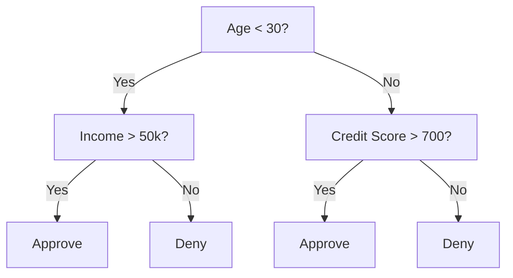
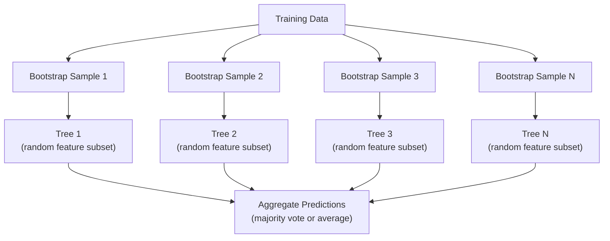

# निर्णय वृक्ष और आकस्मिक वन

> निर्णय वृक्ष केवल एक प्रवाह चार्ट है, लेकिन उनमें से एक वन एमएल में सबसे शक्तिशाली उपकरणों में से एक है।

**Type:** Build
**Languages:** Python, TypeScript
**Prerequisites:** Phase 1 (Lessons 09 Information Theory, 06 Probability)
**Time:** ~90 minutes

## सीखने के लक्ष्य

- निर्णय वृक्ष के इष्टतम विभाजन को खोजने के लिए जीनी अशुद्धता, एंट्रोपी और सूचना प्राप्ति गणनाएं लागू करें
- पूर्व-संहार नियंत्रणों (अधिकतम गहराई, न्यूनतम नमूने) के साथ निर्णय वृक्ष वर्गीकरण को खरोंच से बनाएं
- बूटस्ट्रैप नमूनाकरण और सुविधाओं के यादृच्छिककरण का उपयोग करके एक यादृच्छिक वन का निर्माण करें, और समझाएं कि यह भिन्नता को क्यों कम करता है
- एमडीआई विशेषता महत्व की तुलना परमुटेशन महत्व के साथ करें और पहचानें कि एमडीआई पक्षपातपूर्ण कब है

## समस्या

आपके पास तालिकागत डेटा है। पंक्तियां नमूने हैं, कॉलम विशेषताएं हैं, और एक लक्ष्य स्तंभ है जिसे आप भविष्यवाणी करना चाहते हैं। आप उस पर एक तंत्रिका नेटवर्क फेंक सकते हैं। लेकिन तालिकागत डेटा के लिए, पेड़-आधारित मॉडल (निर्णय पेड़, यादृच्छिक जंगल, ग्रेडिएंट बूस्ट पेड़) लगातार गहरे सीखने से बेहतर प्रदर्शन करते हैं। संरचित डेटा पर कैगल प्रतियोगिताओं पर XGBoost और LightGBM का प्रभुत्व है, ट्रांसफार्मर नहीं।

क्यों? पेड़ पूर्व प्रसंस्करण के बिना मिश्रित विशेषता प्रकार (संख्यात्मक और श्रेणीगत) संभालते हैं। वे सुविधा इंजीनियरिंग के बिना गैर-रैखिक संबंधों को संभालते हैं। वे व्याख्या योग्य हैंः आप पेड़ को देख सकते हैं और सटीक रूप से देख सकते हैं कि भविष्यवाणी क्यों की गई थी। और यादृच्छिक वन, जो कई पेड़ों का औसत है, मध्यम आकार के डेटा सेट पर ओवरफिट करने के लिए अत्यधिक प्रतिरोधी हैं।

इस पाठ में रिकर्सिव स्प्लिटिंग का उपयोग करके निर्णय के पेड़ को खरोंच से बनाया जाता है, फिर ऊपर पर एक यादृच्छिक जंगल बनाया जाता है। आप विभाजन मानदंडों (गिनी अशुद्धता, एंट्रोपी, सूचना लाभ) के पीछे गणित लागू करेंगे और समझेंगे कि कमजोर शिक्षार्थियों का एक समूह एक मजबूत क्यों बन जाता है।

## अवधारणा

### निर्णय वृक्ष क्या करता है

निर्णय वृक्ष एक अनुक्रम के हां/नहीं प्रश्न पूछकर विशेषता स्थान को आयताकार क्षेत्रों में विभाजित करता है।



प्रत्येक आंतरिक नोड एक विशेषता का एक सीमा के खिलाफ परीक्षण करता है। प्रत्येक पत्ती नोड एक भविष्यवाणी करता है। एक नए डेटा बिंदु को वर्गीकृत करने के लिए, आप जड़ से शुरू करते हैं और शाखाओं का पालन करते हैं जब तक आप एक पत्ती तक नहीं पहुंचते।

प्रत्येक नोड पर, वह विशेषता और सीमा चुनकर पेड़ ऊपर से नीचे बनाया जाता है जो डेटा को सबसे अच्छा अलग करता है। "सर्वश्रेष्ठ" को एक विभाजन मानदंड द्वारा परिभाषित किया जाता है।

### विभाजन मानदंडः अशुद्धता का माप

प्रत्येक नोड पर, हमारे पास नमूने का एक सेट है. हम उन्हें विभाजित करना चाहते हैं ताकि परिणामस्वरूप बच्चे नोड जितना संभव हो उतना "शुद्ध" हो, जिसका अर्थ है कि प्रत्येक बच्चे में ज्यादातर एक वर्ग होता है।

**Gini impurity**यह इस बात की संभावना को मापता है कि यदि उस नोड पर वर्ग वितरण के अनुसार लेबल किया गया तो यादृच्छिक रूप से चुने गए नमूने को गलत वर्गीकृत किया जाएगा।

```math
\text{Gini}(S) = 1 - \sum_k p_k^2 \quad \text{where } p_k \text{ is the proportion of class } k \text{ in set } S.
```

एक शुद्ध नोड (सभी एक वर्ग) के लिए, Gini = 0. 50/50 वर्गों के साथ द्विआधारी विभाजन के लिए, Gini = 0.5. निचला बेहतर है।

```
Example: 6 cats, 4 dogs

Gini = 1 - (0.6^2 + 0.4^2) = 1 - (0.36 + 0.16) = 0.48
```

**Entropy**एक नोड में सूचना सामग्री (अराजकता) को मापता है। चरण 1 पाठ 09 में शामिल है।

```math
\text{Entropy}(S) = -\sum_k p_k \log_2(p_k)
```

एक शुद्ध नोड के लिए, एंट्रोपी = 0. 50/50 द्विआधारी विभाजन के लिए, एंट्रोपी = 1.0. निचला बेहतर है।

```
Example: 6 cats, 4 dogs

Entropy = -(0.6 * log2(0.6) + 0.4 * log2(0.4))
        = -(0.6 * -0.737 + 0.4 * -1.322)
        = 0.442 + 0.529
        = 0.971 bits
```

**Information gain**विभाजन के बाद अशुद्धता (एंट्रोपी या जिनी) में कमी है।

```math
\begin{aligned}
& IG(S, \text{feature}, \text{threshold}) = \text{Impurity}(S) - \text{weighted\_avg}(\text{Impurity}(S_{\text{left}}), \text{Impurity}(S_{\text{right}})) \\[4pt]
& \text{where the weights are the proportions of samples in each child.}
\end{aligned}
```

प्रत्येक नोड पर लालची एल्गोरिथ्मः हर सुविधा और हर संभव सीमा का परीक्षण करें। (विशेषता, सीमा) जो जानकारी की अधिकतम प्राप्ति का चयन करें।

### विभाजन कैसे काम करता है

 के साथ डेटासेट के लिए$n$विशेषताएं और $m$वर्तमान नोड पर नमूनेः

1. प्रत्येक विशेषता के लिए $j$($j = 1$$n$):
   - विशेषता के अनुसार नमूनों को क्रमबद्ध करें $j$
   - एक सीमा के रूप में लगातार अलग मूल्यों के बीच प्रत्येक मध्य बिंदु की कोशिश करें
   - प्रत्येक सीमा के लिए सूचना प्राप्ति की गणना करें
2. उच्चतम सूचना प्राप्त करने वाली विशेषता और सीमा का चयन करें
3. डेटा को बाएं (विशेषता <= सीमा) और दाएं (विशेषता > सीमा) में विभाजित करें
4. प्रत्येक बच्चे पर पुनरावृत्ति

इस लोभी दृष्टिकोण से वैश्विक रूप से इष्टतम पेड़ की गारंटी नहीं मिलती है। इष्टतम पेड़ को ढूंढना NP- कठिन है। लेकिन लोभी विभाजन व्यवहार में अच्छी तरह से काम करता है।

### रोकने की शर्तें

बिना रुके हुए परिस्थितियों के, पेड़ तब तक बढ़ता है जब तक कि हर पत्ती शुद्ध नहीं हो जाती या कोई विभाजन नहीं हो जाता है, अपने नमूने को अलग कर सकता है, अक्सर प्रति पत्ती एक नमूना तक। यह प्रशिक्षण डेटा को पूरी तरह से याद करता है और भयानक रूप से सामान्य करता है।

**Pre-pruning**वृक्ष को पूरी तरह से बढ़ने से पहले रोकता हैः
- अधिकतम गहराईः वृक्ष की एक निर्धारित गहराई तक पहुंचने पर विभाजन बंद हो जाता है
- प्रति पत्ती न्यूनतम नमूनेः यदि नोड में  से कम है तो रोकें$k$नमूने
- न्यूनतम सूचना प्राप्तिः यदि सर्वोत्तम विभाजन एक सीमा से कम अशुद्धता में सुधार करता है तो रोकें
- अधिकतम पत्ते के नोड्सः पत्ते की कुल संख्या को सीमित करें

**Post-pruning**और वह (आख़िर) पूरे पेड़ को उगाएगा और फिर उसे (फौरन) काट डालेगा
- लागत-कम्प्लेक्सता का काटना (स्किट-लर्न द्वारा प्रयोग किया जाता है): पत्तियों की संख्या के समानुपातिक दंड जोड़ता है। छोटे पेड़ प्राप्त करने के लिए दंड बढ़ाएं
- त्रुटि का कम करने का उपायः यदि सत्यापन त्रुटि बढ़ी नहीं है तो एक उपवृक्ष को हटा दें

पहले काटना आसान और तेज़ होता है। काटना के बाद अक्सर बेहतर पेड़ पैदा होते हैं क्योंकि इससे पहले काटना नहीं रुकता है जिससे आगे काटना उपयोगी हो सकता है।

### विघटन के लिए निर्णय के पेड़

पुनरावृत्ति के लिए, पाना भविष्यवाणी उस पाना में लक्ष्य मानों का औसत है। विभाजन मानदंड भी बदलता हैः

**Variance reduction**सूचना प्राप्ति की जगह लेती हैः

```math
VR(S, \text{feature}, \text{threshold}) = \text{Var}(S) - \text{weighted\_avg}(\text{Var}(S_{\text{left}}), \text{Var}(S_{\text{right}}))
```

उस विभाजन को चुनें जो सबसे ज्यादा भिन्नता को कम करता है। पेड़ इनपुट स्पेस को क्षेत्रों में विभाजित करता है, और प्रत्येक क्षेत्र में एक स्थिर (औसत) की भविष्यवाणी करता है।

### यादृच्छिक वनः समूहों की शक्ति

एक ही निर्णय वृक्ष में उच्च भिन्नता होती है। डेटा में छोटे बदलाव पूरी तरह से अलग-अलग पेड़ पैदा कर सकते हैं। यादृच्छिक वन कई पेड़ों को औसत करके इसे ठीक करते हैं।



दो प्रकार की यादृच्छिकता वृक्षों को विविध बनाती हैः

**Bagging (bootstrap aggregating):**प्रत्येक पेड़ को एक बूटस्ट्रैप नमूने पर प्रशिक्षित किया जाता है, प्रशिक्षण डेटा से प्रतिस्थापन के साथ एक यादृच्छिक नमूना। प्रत्येक बूटस्ट्रैप में मूल नमूनों के लगभग 63% दिखाई देते हैं (बचे हुए बैग के बाहर नमूने हैं जिनका उपयोग सत्यापन के लिए किया जा सकता है) ।

**Feature randomization:**प्रत्येक विभाजन पर, केवल सुविधाओं के एक यादृच्छिक उपसमूह पर विचार किया जाता है। वर्गीकरण के लिए, डिफ़ॉल्ट $\sqrt{n_{\text{features}}}$. प्रतिगमन के लिए,$n_{\text{features}}/3$इससे सभी पेड़ एक ही प्रमुख विशेषता पर विभाजित होने से बचते हैं।

मुख्य अंतर्दृष्टिः कई विकोरेटेड पेड़ों का औसत बढ़ते पक्षपात के बिना भिन्नता को कम करता है। प्रत्येक व्यक्तिगत पेड़ मध्यम हो सकता है। समूह मजबूत है।

### विशेषता महत्व

यादृच्छिक वन स्वाभाविक रूप से विशेषता महत्व स्कोर प्रदान करते हैं। सबसे आम विधिः

**Mean Decrease in Impurity (MDI):**प्रत्येक विशेषता के लिए, सभी पेड़ों और उन सभी नोड्स में अशुद्धता में कुल कमी का योग करें जहां उस विशेषता का उपयोग किया जाता है। विशेषताएं जो पहले के विभाजन में अधिक अशुद्धता में कमी पैदा करती हैं, वे अधिक महत्वपूर्ण हैं।

```math
\text{importance}(\text{feature}_j) = \sum_{\text{nodes where feature}_j \text{ is used}} \frac{n_{\text{samples at node}}}{n_{\text{total samples}}} \cdot \text{impurity\_decrease}
```

यह तेज (प्रशिक्षण के दौरान गणना) है, लेकिन कई संभावित विभाजन बिंदुओं के साथ उच्च कार्डिनलता सुविधाओं और सुविधाओं की ओर पूर्वाग्रह है।

**Permutation importance**विकल्पः एक विशेषता के मानों को मिलाएं और मापें कि मॉडल की सटीकता कितनी कम होती है। अधिक विश्वसनीय लेकिन धीमा।

### जब पेड़ों ने तंत्रिका नेटवर्क को हराया

पेड़ और वन तालिकागत डेटा पर तंत्रिका नेटवर्क पर हावी हैं। कई कारण हैंः

| Factor | Trees | Neural networks |
|--------|-------|----------------|
| Mixed types (numeric + categorical) | Native support | Need encoding |
| Small datasets (< 10k rows) | Work well | Overfit |
| Feature interactions | Found by splitting | Need architecture design |
| Interpretability | Full transparency | Black box |
| Training time | Minutes | Hours |
| Hyperparameter sensitivity | Low | High |

न्यूरल नेटवर्क तब जीतते हैं जब डेटा में स्थानिक या अनुक्रमिक संरचना (छवि, पाठ, ऑडियो) होती है। सुविधाओं की सपाट तालिकाओं के लिए, पेड़ों डिफ़ॉल्ट रूप से होते हैं।

```figure
decision-tree-depth
```

## इसे बनाओ

### चरण 1: जिनी अशुद्धता और एंट्रॉपी

दोनों विभाजन मानदंडों को खरोंच से बनाएं और वे किस विभाजन पर सहमत हैं, इसकी पुष्टि करें।

```python
import math

def gini_impurity(labels):
    n = len(labels)
    if n == 0:
        return 0.0
    counts = {}
    for label in labels:
        counts[label] = counts.get(label, 0) + 1
    return 1.0 - sum((c / n) ** 2 for c in counts.values())

def entropy(labels):
    n = len(labels)
    if n == 0:
        return 0.0
    counts = {}
    for label in labels:
        counts[label] = counts.get(label, 0) + 1
    return -sum(
        (c / n) * math.log2(c / n) for c in counts.values() if c > 0
    )
```

### चरण 2: सबसे अच्छा विभाजन खोजें

हर सुविधा और हर सीमा का परीक्षण करें। सबसे अधिक जानकारी प्राप्त करने वाले को लौटाएं।

```python
def information_gain(parent_labels, left_labels, right_labels, criterion="gini"):
    measure = gini_impurity if criterion == "gini" else entropy
    n = len(parent_labels)
    n_left = len(left_labels)
    n_right = len(right_labels)
    if n_left == 0 or n_right == 0:
        return 0.0
    parent_impurity = measure(parent_labels)
    child_impurity = (
        (n_left / n) * measure(left_labels) +
        (n_right / n) * measure(right_labels)
    )
    return parent_impurity - child_impurity
```

### चरण 3: निर्णय वृक्ष वर्ग का निर्माण करें

पुनरावर्ती विभाजन, भविष्यवाणी, और विशेषता महत्व ट्रैकिंग। `_build`यह वृक्ष का हृदय है: यह बंद हो जाता है जब एक नोड शुद्ध हो जाता है या एक पूर्व-संहार सीमा पर पहुंच जाता है, अन्यथा यह सबसे अच्छा विभाजन लेता है और दोनों बच्चों में फिर से होता है।

```python
import random

class DecisionTree:
    def __init__(self, max_depth=None, min_samples_split=2,
                 min_samples_leaf=1, criterion="gini",
                 max_features=None):
        self.max_depth = max_depth
        self.min_samples_split = min_samples_split
        self.min_samples_leaf = min_samples_leaf
        self.criterion = criterion
        self.max_features = max_features
        self.tree = None
        self.feature_importances_ = None

    def fit(self, X, y):
        self.n_features = len(X[0])
        self.feature_importances_ = [0.0] * self.n_features
        self.n_samples = len(X)
        self.tree = self._build(X, y, depth=0)
        total = sum(self.feature_importances_)
        if total > 0:
            self.feature_importances_ = [
                fi / total for fi in self.feature_importances_
            ]

    def predict(self, X):
        return [self._predict_one(x, self.tree) for x in X]

    def _build(self, X, y, depth):
        if len(set(y)) == 1:
            return {"leaf": True, "value": y[0]}

        if self.max_depth is not None and depth >= self.max_depth:
            return self._make_leaf(y)

        if len(y) < self.min_samples_split:
            return self._make_leaf(y)

        best_feature, best_threshold, best_gain = self._best_split(X, y)

        if best_feature is None or best_gain <= 0:
            return self._make_leaf(y)

        left_X, left_y, right_X, right_y = self._split_data(
            X, y, best_feature, best_threshold
        )

        if len(left_y) < self.min_samples_leaf or len(right_y) < self.min_samples_leaf:
            return self._make_leaf(y)

        weight = len(y) / self.n_samples
        self.feature_importances_[best_feature] += weight * best_gain

        return {
            "leaf": False,
            "feature": best_feature,
            "threshold": best_threshold,
            "left": self._build(left_X, left_y, depth + 1),
            "right": self._build(right_X, right_y, depth + 1),
        }

    def _make_leaf(self, y):
        counts = {}
        for label in y:
            counts[label] = counts.get(label, 0) + 1
        return {"leaf": True, "value": max(counts, key=counts.get)}

    def _best_split(self, X, y):
        best_feature = None
        best_threshold = None
        best_gain = -1.0

        if self.max_features == "sqrt":
            k = max(1, int(math.sqrt(self.n_features)))
            feature_indices = random.sample(range(self.n_features), k)
        elif isinstance(self.max_features, int):
            if self.max_features < 1:
                raise ValueError("max_features must be at least 1 when given as an integer")
            k = min(self.max_features, self.n_features)
            feature_indices = random.sample(range(self.n_features), k)
        else:
            feature_indices = list(range(self.n_features))

        for feature_idx in feature_indices:
            values = sorted(set(X[i][feature_idx] for i in range(len(X))))
            if len(values) <= 1:
                continue

            for i in range(len(values) - 1):
                threshold = (values[i] + values[i + 1]) / 2.0
                left_y = [y[j] for j in range(len(X)) if X[j][feature_idx] <= threshold]
                right_y = [y[j] for j in range(len(X)) if X[j][feature_idx] > threshold]

                if len(left_y) < self.min_samples_leaf or len(right_y) < self.min_samples_leaf:
                    continue

                gain = information_gain(y, left_y, right_y, self.criterion)
                if gain > best_gain:
                    best_gain = gain
                    best_feature = feature_idx
                    best_threshold = threshold

        return best_feature, best_threshold, best_gain

    def _split_data(self, X, y, feature, threshold):
        left_X, left_y, right_X, right_y = [], [], [], []
        for i in range(len(X)):
            if X[i][feature] <= threshold:
                left_X.append(X[i])
                left_y.append(y[i])
            else:
                right_X.append(X[i])
                right_y.append(y[i])
        return left_X, left_y, right_X, right_y

    def _predict_one(self, x, node):
        if node["leaf"]:
            return node["value"]
        if x[node["feature"]] <= node["threshold"]:
            return self._predict_one(x, node["left"])
        return self._predict_one(x, node["right"])
```

### चरण 4: रैंडम फॉरेस्ट कक्षा का निर्माण करें

बूटस्ट्रैप नमूना, सुविधाओं के यादृच्छिककरण, और बहुमत मतदान।

```python
class RandomForest:
    def __init__(self, n_trees=100, max_depth=None,
                 min_samples_split=2, max_features="sqrt",
                 criterion="gini"):
        self.n_trees = n_trees
        self.max_depth = max_depth
        self.min_samples_split = min_samples_split
        self.max_features = max_features
        self.criterion = criterion
        self.trees = []

    def fit(self, X, y):
        n = len(X)
        for _ in range(self.n_trees):
            indices = [random.randint(0, n - 1) for _ in range(n)]
            X_boot = [X[i] for i in indices]
            y_boot = [y[i] for i in indices]
            tree = DecisionTree(
                max_depth=self.max_depth,
                min_samples_split=self.min_samples_split,
                max_features=self.max_features,
                criterion=self.criterion,
            )
            tree.fit(X_boot, y_boot)
            self.trees.append(tree)

    def predict(self, X):
        all_preds = [tree.predict(X) for tree in self.trees]
        predictions = []
        for i in range(len(X)):
            votes = {}
            for preds in all_preds:
                v = preds[i]
                votes[v] = votes.get(v, 0) + 1
            predictions.append(max(votes, key=votes.get))
        return predictions
```

देखो`code/trees.py`सभी सहायक तरीकों के साथ पूर्ण कार्यान्वयन के लिए। `code/trees.ts`एक प्रकार के स्क्रिप्ट पोर्ट के साथ एक ही कार्यों और डेमो है. इसे चलाओ`npx tsx code/trees.ts`. .

## इसका प्रयोग करें

स्किट-लर्न के साथ, एक यादृच्छिक जंगल को प्रशिक्षित करने में तीन पंक्तियां होती हैंः

```python
from sklearn.ensemble import RandomForestClassifier
from sklearn.datasets import load_iris
from sklearn.model_selection import train_test_split

X, y = load_iris(return_X_y=True)
X_train, X_test, y_train, y_test = train_test_split(X, y, random_state=42)

rf = RandomForestClassifier(n_estimators=100, random_state=42)
rf.fit(X_train, y_train)
print(f"Accuracy: {rf.score(X_test, y_test):.4f}")
print(f"Feature importances: {rf.feature_importances_}")
```

अभ्यास में, ग्रेडिएंट बूस्ट पेड़ (XGBoost, LightGBM, CatBoost) अक्सर यादृच्छिक वनों की तुलना में मजबूत होते हैं क्योंकि वे पेड़ क्रमशः बनाते हैं, प्रत्येक पेड़ पिछले की त्रुटियों को सुधारता है। लेकिन यादृच्छिक वनों को गलत कॉन्फ़िगर करना मुश्किल होता है और लगभग कोई हाइपरपैरामीटर ट्यूनिंग की आवश्यकता नहीं होती है।

## इसे भेजें

यह सबक हमें फल देता है`outputs/prompt-tree-interpreter.md`- एक प्रॉम्प्ट जो व्यवसाय हितधारकों के लिए निर्णय वृक्ष विभाजन की व्याख्या करता है। इसे एक प्रशिक्षित पेड़ की संरचना (गंभीरता, विशेषताएं, विभाजित सीमाएं, सटीकता) खिलाता है और यह मॉडल को सादे-भाषा के नियमों में अनुवाद करता है, विशेषता महत्व को रैंक करता है, ध्वज ओवरफitting या लीक, और अगले चरणों की सिफारिश करता है। इसका उपयोग किसी ऐसे व्यक्ति को जब भी आपको पेड़ आधारित मॉडल की व्याख्या करने की आवश्यकता हो, जो कोड नहीं पढ़ता है।

## व्यायाम

1. 3 वर्गों के साथ 2D डेटासेट पर एक एकल निर्णय वृक्ष को प्रशिक्षित करें। विभाजन को मैन्युअल रूप से ट्रैक करें और आयताकार निर्णय सीमाएं खींचें। अधिकतम_गहनता=2 बनाम अधिकतम_गहनता=10 पर सीमाओं की तुलना करें।

2. रिग्रेशन पेड़ों के लिए भिन्नता घटाने विभाजन लागू करें।$y = \sin(x) + \text{noise}$200 अंक के लिए और अपने regression पेड़ फिट. पेड़ के टुकड़े-सापेक्ष निरंतर भविष्यवाणियों को सही वक्र के खिलाफ रेखांकित.

3. 1, 5, 10, 50 और 200 पेड़ों के साथ एक यादृच्छिक जंगल का निर्माण करें। प्लॉट प्रशिक्षण सटीकता और परीक्षण सटीकता बनाम पेड़ों की संख्या का परीक्षण करें। ध्यान दें कि परीक्षण सटीकता पठारों पर है लेकिन कम नहीं होती है (प्लॉट से अधिक फिट होने का सामना करने वाले जंगलों) ।

4. 5 अलग-अलग डेटा सेट पर विभाजित मानदंडों के रूप में Gini अशुद्धता बनाम एंट्रॉपी की तुलना करें। सटीकता और पेड़ की गहराई मापें। ज्यादातर मामलों में, वे लगभग समान परिणाम देते हैं। क्यों समझाएं।

5. परमुटेशन महत्व लागू करें. डेटासेट पर एमडीआई महत्व की तुलना करें जहां एक विशेषता यादृच्छिक शोर है लेकिन उच्च कार्डिनलता है। एमडीआई शोर सुविधा को उच्च रैंक करेगा। परमुटेशन महत्व नहीं करेगा।

## प्रमुख शर्तें

| Term | What people say | What it actually means |
|------|----------------|----------------------|
| Decision tree | "A flowchart for predictions" | A model that partitions feature space into rectangular regions by learning a sequence of if/else splits |
| Gini impurity | "How mixed the node is" | Probability of misclassifying a random sample at a node. 0 = pure, 0.5 = maximum impurity for binary |
| Entropy | "The disorder in a node" | Information content at a node. 0 = pure, 1.0 = maximum uncertainty for binary. From information theory |
| Information gain | "How good a split is" | Reduction in impurity after a split. The greedy criterion for choosing splits |
| Pre-pruning | "Stop the tree early" | Stopping tree growth early by setting max depth, min samples, or min gain thresholds |
| Post-pruning | "Trim the tree after" | Growing the full tree, then removing subtrees that do not improve validation performance |
| Bagging | "Train on random subsets" | Bootstrap aggregating. Train each model on a different random sample with replacement |
| Random forest | "A bunch of trees" | Ensemble of decision trees, each trained on a bootstrap sample with random feature subsets at each split |
| Feature importance (MDI) | "Which features matter" | Total impurity decrease contributed by each feature, summed across all trees and nodes |
| Permutation importance | "Shuffle and check" | Accuracy drop when a feature's values are randomly shuffled. More reliable than MDI for noisy features |
| Variance reduction | "The regression version of info gain" | The regression tree analogue of information gain. Picks the split that reduces target variance the most |
| Bootstrap sample | "Random sample with repeats" | A random sample drawn with replacement from the original dataset. Same size, but with duplicates |

## आगे पढ़ना

- [Breiman: Random Forests (2001)](https://link.springer.com/article/10.1023/A:1010933404324)- मूल यादृच्छिक वन कागज
- [Grinsztajn et al.: Why do tree-based models still outperform deep learning on tabular data? (2022)](https://arxiv.org/abs/2207.08815)- तालिकागत कार्यों पर पेड़ों और तंत्रिका नेटवर्क की कठोर तुलना
- [scikit-learn Decision Trees documentation](https://scikit-learn.org/stable/modules/tree.html)- दृश्य के साधनों के साथ व्यावहारिक मार्गदर्शिका
- [XGBoost: A Scalable Tree Boosting System (Chen & Guestrin, 2016)](https://arxiv.org/abs/1603.02754)- ग्रेडिएंट बूस्टिंग पेपर जो कागेल पर हावी है
