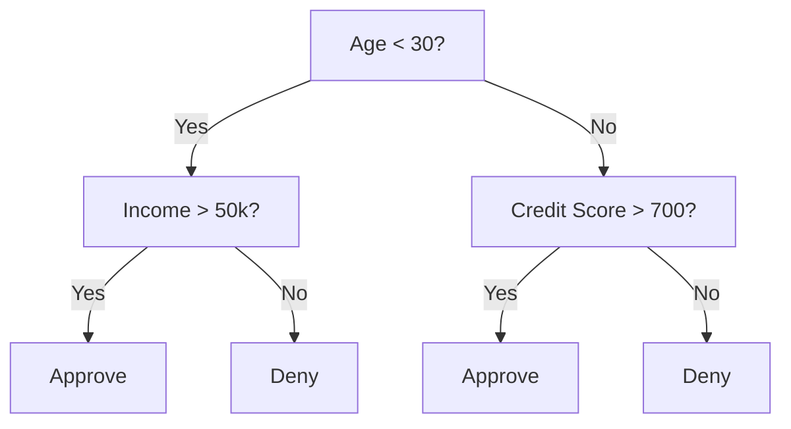
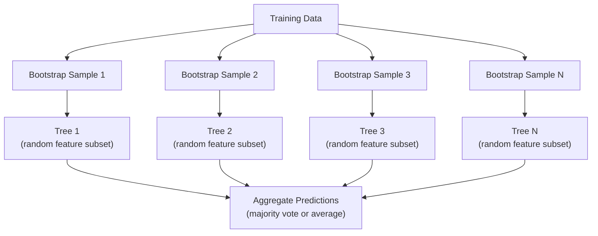

# Árvores de decisão e florestas aleatórias

> Uma árvore de decisão é apenas um fluxo, mas uma floresta delas é uma das ferramentas mais poderosas do ML.

**Type:** Build
**Languages:** Python, TypeScript
**Prerequisites:** Phase 1 (Lessons 09 Information Theory, 06 Probability)
**Time:** ~90 minutes

## Objetivos de aprendizagem

- Implementar cálculos de impureza de Gini, entropia e ganho de informações para encontrar as divisões ótimas da árvore de decisão
- Construir um classificador de árvore de decisão a partir do zero com controles pré-titular (profundeza máxima, amostras mínimas)
- Construir uma floresta aleatória usando amostragem de bootstrap e randomization de recursos, e explicar por que reduz a variância
- Comparar a importância da característica MDI com a importância da permutação e identificar quando a MDI é tendenciosa

## O problema

Você tem dados tabulares. As linhas são amostras, as colunas são características, e há uma coluna-alvo que você quer prever. Você pode jogar uma rede neural para ela. Mas para dados tabulares, os modelos baseados em árvores (árvores de decisão, florestas aleatórias, árvores aumentadas de gradiente) superam consistentemente a aprendizagem profunda. As competições de Kaggle em dados estruturados são dominadas pelo XGBoost e LightGBM, não por transformadores.

Por que? As árvores lidam com tipos de características mistos (números e categorias) sem pré-processamento. Eles lidam com relações não lineares sem engenharia de características. Eles são interpretáveis: você pode olhar para a árvore e ver exatamente por que uma previsão foi feita. E florestas aleatórias, que médiamente muitas árvores, são altamente resistentes a sobreajustes em conjuntos de dados de tamanho moderado.

Esta lição constrói árvores de decisão a partir do zero usando divisão recursiva, depois constrói uma floresta aleatória no topo. Você implementará a matemática por trás dos critérios de divisão (impuridade de Gini, entropia, ganho de informações) e entenderá por que um conjunto de aprendizes fracos se torna um forte.

## O conceito

### O que faz uma árvore de decisão

Uma árvore de decisão divide o espaço de características em regiões retangulares, fazendo uma sequência de perguntas sim/não.



Cada nó interno testa uma característica contra um limiar. Cada nó de folha faz uma previsão. Para classificar um novo ponto de dados, você começa na raiz e segue os ramos até chegar a uma folha.

A árvore é construída de cima para baixo escolhendo, em cada nó, a característica e o limiar que melhor separam os dados.

### Critérios de separação: medição da impureza

Em cada nó, temos um conjunto de amostras. Queremos dividir-los para que os nódulos infantis resultantes sejam o mais "puro" possível, o que significa que cada criança contém principalmente uma classe.

**Gini impurity**Messa a probabilidade de uma amostra escolhida aleatoriamente ser classificada erroneamente se for rotulada de acordo com a distribuição de classes nesse nó.

```math
\text{Gini}(S) = 1 - \sum_k p_k^2 \quad \text{where } p_k \text{ is the proportion of class } k \text{ in set } S.
```

Para um nó puro (todos uma classe), Gini = 0. Para uma divisão binária com classes 50/50, Gini = 0.5.

```
Example: 6 cats, 4 dogs

Gini = 1 - (0.6^2 + 0.4^2) = 1 - (0.36 + 0.16) = 0.48
```

**Entropy**Método de avaliação de dados e de dados de um nó.

```math
\text{Entropy}(S) = -\sum_k p_k \log_2(p_k)
```

Para um nó puro, entropia = 0. Para uma divisão binária 50/50, entropia = 1.0.

```
Example: 6 cats, 4 dogs

Entropy = -(0.6 * log2(0.6) + 0.4 * log2(0.4))
        = -(0.6 * -0.737 + 0.4 * -1.322)
        = 0.442 + 0.529
        = 0.971 bits
```

**Information gain**é a redução da impureza (entropia ou Gini) após a separação.

```math
\begin{aligned}
& IG(S, \text{feature}, \text{threshold}) = \text{Impurity}(S) - \text{weighted\_avg}(\text{Impurity}(S_{\text{left}}), \text{Impurity}(S_{\text{right}})) \\[4pt]
& \text{where the weights are the proportions of samples in each child.}
\end{aligned}
```

O algoritmo ganancioso em cada nó: tente todas as características e todos os limites possíveis. Escolha o par (função, limite) que maximiza o ganho de informações.

### Como funciona a separação

Para um conjunto de dados com $n$características e $m$amostras no nó corrente:

1. Para cada característica $j$($j = 1$- Não .$n$):
   - Ordenar as amostras por características $j$
   - Tente cada ponto médio entre valores distintos consecutivos como um limiar
   - Calcular o ganho de informação para cada limiar
2. Selecionar a característica e o limiar com o maior ganho de informações
3. Dividir os dados em esquerda (ponto <= função) e direita (ponto > função)
4. Recurso em cada criança

Esta abordagem gananciosa não garante a árvore globalmente ideal. Encontrar a árvore ideal é NP-difícil. Mas a divisão gananciosa funciona bem na prática.

### Condições de parada

Sem condições de parada, a árvore cresce até que cada folha seja pura ou sem fragmentação possa separar suas amostras, muitas vezes até uma única amostra por folha.

**Pre-pruning**para a árvore antes de crescer completamente:
- Profundeza máxima: parar de se dividir quando a árvore atingir uma profundidade definida
- Práticas mínimas por folha: parar se um nó tiver menos de $k$amostras
- Ganhamento mínimo de informações: parar se a melhor divisão melhorar a impureza em menos de um limiar
- Núcleos de folhas máximos: limite o número total de folhas

**Post-pruning**cresce a árvore cheia, depois a corta de volta:
- A redução de custos e complexidade (usada pela scikit-learn): adiciona uma penalidade proporcional ao número de folhas.
- Reduzir a poda de erros: remover uma subárvore se o erro de validação não aumentar

A pré-titulação é mais simples e mais rápida. A pós-titulação geralmente produz melhores árvores porque não impede prematuramente as divisões que podem levar a novas divisões úteis.

### Árvores de decisão para regressão

Para regressão, a previsão de folha é a média dos valores-alvo nessa folha.

**Variance reduction**Substitui o ganho de informações:

```math
VR(S, \text{feature}, \text{threshold}) = \text{Var}(S) - \text{weighted\_avg}(\text{Var}(S_{\text{left}}), \text{Var}(S_{\text{right}}))
```

Escolha a divisão que reduz a variância mais. A árvore divide o espaço de entrada em regiões e prevê uma constante (a média) em cada região.

### Florestas aleatórias: o poder dos conjuntos

Uma única árvore de decisão é de alta variação. Pequenas mudanças nos dados podem produzir árvores completamente diferentes.



Duas fontes de aleatoriedade tornam as árvores diversas:

**Bagging (bootstrap aggregating):**Cada árvore é treinada em uma amostra de bootstrap, uma amostra aleatória com substituição dos dados de treinamento. Cerca de 63% das amostras originais aparecem em cada bootstrap (o resto são amostras fora do saco que podem ser usadas para validação).

**Feature randomization:**Em cada divisão, apenas um subconjunto aleatório de características é considerado.$\sqrt{n_{\text{features}}}$Para regressão,$n_{\text{features}}/3$Isto impede que todas as árvores se dividam no mesmo aspecto dominante.

A principal ideia: a média de muitas árvores descorreladas reduz a variância sem aumentar o viés. Cada árvore individual pode ser mediocre.

### Importância das características

As florestas aleatórias fornecem naturalmente pontuações de importância das características.

**Mean Decrease in Impurity (MDI):**Para cada característica, soma a redução total de impureza em todas as árvores e todos os nós onde essa característica é usada.

```math
\text{importance}(\text{feature}_j) = \sum_{\text{nodes where feature}_j \text{ is used}} \frac{n_{\text{samples at node}}}{n_{\text{total samples}}} \cdot \text{impurity\_decrease}
```

Isto é rápido (computado durante o treinamento), mas tendencioso em direção a características e características de alta cardinalidade com muitos pontos de divisão possíveis.

**Permutation importance**A alternativa é misturar os valores de uma característica e medir o quanto a precisão do modelo diminui. Mais confiável, mas mais lento.

### Quando as árvores batem em redes neurais

As árvores e as florestas dominam as redes neurais em dados tabulares.

| Factor | Trees | Neural networks |
|--------|-------|----------------|
| Mixed types (numeric + categorical) | Native support | Need encoding |
| Small datasets (< 10k rows) | Work well | Overfit |
| Feature interactions | Found by splitting | Need architecture design |
| Interpretability | Full transparency | Black box |
| Training time | Minutes | Hours |
| Hyperparameter sensitivity | Low | High |

As redes neurais ganham quando os dados têm estrutura espacial ou seqüencial (imagens, texto, áudio).

```figure
decision-tree-depth
```

## Construí-lo

### Passo 1: impureza e entropia de Gini

Construir ambos os critérios de divisão a partir do zero e verificar que eles concordam sobre quais divisões são boas.

```python
import math

def gini_impurity(labels):
    n = len(labels)
    if n == 0:
        return 0.0
    counts = {}
    for label in labels:
        counts[label] = counts.get(label, 0) + 1
    return 1.0 - sum((c / n) ** 2 for c in counts.values())

def entropy(labels):
    n = len(labels)
    if n == 0:
        return 0.0
    counts = {}
    for label in labels:
        counts[label] = counts.get(label, 0) + 1
    return -sum(
        (c / n) * math.log2(c / n) for c in counts.values() if c > 0
    )
```

### Passo 2: Encontre a melhor divisão

Tente cada característica e cada limiar, devolva o que tem o maior ganho de informações.

```python
def information_gain(parent_labels, left_labels, right_labels, criterion="gini"):
    measure = gini_impurity if criterion == "gini" else entropy
    n = len(parent_labels)
    n_left = len(left_labels)
    n_right = len(right_labels)
    if n_left == 0 or n_right == 0:
        return 0.0
    parent_impurity = measure(parent_labels)
    child_impurity = (
        (n_left / n) * measure(left_labels) +
        (n_right / n) * measure(right_labels)
    )
    return parent_impurity - child_impurity
```

### Passo 3: Construir a classe DecisionTree

Divisão recorrente, previsão e rastreamento de importância de características. `_build`é o coração da árvore: ela para quando um nó é puro ou atinge um limite pré-tado, caso contrário, ela toma a melhor divisão e recorre em ambos os filhos.

```python
import random

class DecisionTree:
    def __init__(self, max_depth=None, min_samples_split=2,
                 min_samples_leaf=1, criterion="gini",
                 max_features=None):
        self.max_depth = max_depth
        self.min_samples_split = min_samples_split
        self.min_samples_leaf = min_samples_leaf
        self.criterion = criterion
        self.max_features = max_features
        self.tree = None
        self.feature_importances_ = None

    def fit(self, X, y):
        self.n_features = len(X[0])
        self.feature_importances_ = [0.0] * self.n_features
        self.n_samples = len(X)
        self.tree = self._build(X, y, depth=0)
        total = sum(self.feature_importances_)
        if total > 0:
            self.feature_importances_ = [
                fi / total for fi in self.feature_importances_
            ]

    def predict(self, X):
        return [self._predict_one(x, self.tree) for x in X]

    def _build(self, X, y, depth):
        if len(set(y)) == 1:
            return {"leaf": True, "value": y[0]}

        if self.max_depth is not None and depth >= self.max_depth:
            return self._make_leaf(y)

        if len(y) < self.min_samples_split:
            return self._make_leaf(y)

        best_feature, best_threshold, best_gain = self._best_split(X, y)

        if best_feature is None or best_gain <= 0:
            return self._make_leaf(y)

        left_X, left_y, right_X, right_y = self._split_data(
            X, y, best_feature, best_threshold
        )

        if len(left_y) < self.min_samples_leaf or len(right_y) < self.min_samples_leaf:
            return self._make_leaf(y)

        weight = len(y) / self.n_samples
        self.feature_importances_[best_feature] += weight * best_gain

        return {
            "leaf": False,
            "feature": best_feature,
            "threshold": best_threshold,
            "left": self._build(left_X, left_y, depth + 1),
            "right": self._build(right_X, right_y, depth + 1),
        }

    def _make_leaf(self, y):
        counts = {}
        for label in y:
            counts[label] = counts.get(label, 0) + 1
        return {"leaf": True, "value": max(counts, key=counts.get)}

    def _best_split(self, X, y):
        best_feature = None
        best_threshold = None
        best_gain = -1.0

        if self.max_features == "sqrt":
            k = max(1, int(math.sqrt(self.n_features)))
            feature_indices = random.sample(range(self.n_features), k)
        elif isinstance(self.max_features, int):
            if self.max_features < 1:
                raise ValueError("max_features must be at least 1 when given as an integer")
            k = min(self.max_features, self.n_features)
            feature_indices = random.sample(range(self.n_features), k)
        else:
            feature_indices = list(range(self.n_features))

        for feature_idx in feature_indices:
            values = sorted(set(X[i][feature_idx] for i in range(len(X))))
            if len(values) <= 1:
                continue

            for i in range(len(values) - 1):
                threshold = (values[i] + values[i + 1]) / 2.0
                left_y = [y[j] for j in range(len(X)) if X[j][feature_idx] <= threshold]
                right_y = [y[j] for j in range(len(X)) if X[j][feature_idx] > threshold]

                if len(left_y) < self.min_samples_leaf or len(right_y) < self.min_samples_leaf:
                    continue

                gain = information_gain(y, left_y, right_y, self.criterion)
                if gain > best_gain:
                    best_gain = gain
                    best_feature = feature_idx
                    best_threshold = threshold

        return best_feature, best_threshold, best_gain

    def _split_data(self, X, y, feature, threshold):
        left_X, left_y, right_X, right_y = [], [], [], []
        for i in range(len(X)):
            if X[i][feature] <= threshold:
                left_X.append(X[i])
                left_y.append(y[i])
            else:
                right_X.append(X[i])
                right_y.append(y[i])
        return left_X, left_y, right_X, right_y

    def _predict_one(self, x, node):
        if node["leaf"]:
            return node["value"]
        if x[node["feature"]] <= node["threshold"]:
            return self._predict_one(x, node["left"])
        return self._predict_one(x, node["right"])
```

### Passo 4: Construir a classe RandomForest

Probelamento de bootstrap, aleatorização de recursos e votação da maioria.

```python
class RandomForest:
    def __init__(self, n_trees=100, max_depth=None,
                 min_samples_split=2, max_features="sqrt",
                 criterion="gini"):
        self.n_trees = n_trees
        self.max_depth = max_depth
        self.min_samples_split = min_samples_split
        self.max_features = max_features
        self.criterion = criterion
        self.trees = []

    def fit(self, X, y):
        n = len(X)
        for _ in range(self.n_trees):
            indices = [random.randint(0, n - 1) for _ in range(n)]
            X_boot = [X[i] for i in indices]
            y_boot = [y[i] for i in indices]
            tree = DecisionTree(
                max_depth=self.max_depth,
                min_samples_split=self.min_samples_split,
                max_features=self.max_features,
                criterion=self.criterion,
            )
            tree.fit(X_boot, y_boot)
            self.trees.append(tree)

    def predict(self, X):
        all_preds = [tree.predict(X) for tree in self.trees]
        predictions = []
        for i in range(len(X)):
            votes = {}
            for preds in all_preds:
                v = preds[i]
                votes[v] = votes.get(v, 0) + 1
            predictions.append(max(votes, key=votes.get))
        return predictions
```

Veja .`code/trees.py`Para a implementação completa com todos os métodos auxiliares. `code/trees.ts`é uma porta TypeScript com as mesmas funções e demos.`npx tsx code/trees.ts`- Não .

## Usá-lo

Com a aprendizagem de escobilha, treinar uma floresta aleatória é três linhas:

```python
from sklearn.ensemble import RandomForestClassifier
from sklearn.datasets import load_iris
from sklearn.model_selection import train_test_split

X, y = load_iris(return_X_y=True)
X_train, X_test, y_train, y_test = train_test_split(X, y, random_state=42)

rf = RandomForestClassifier(n_estimators=100, random_state=42)
rf.fit(X_train, y_train)
print(f"Accuracy: {rf.score(X_test, y_test):.4f}")
print(f"Feature importances: {rf.feature_importances_}")
```

Na prática, as árvores aumentadas de gradiente (XGBoost, LightGBM, CatBoost) são muitas vezes mais fortes do que as florestas aleatórias porque construem árvores sequencialmente, com cada árvore corrigindo os erros das anteriores.

## Envia-o

Esta lição produz`outputs/prompt-tree-interpreter.md`-- um prompt que interpreta as divisões de árvores de decisão para as partes interessadas do negócio. Alimenta-o com a estrutura de uma árvore treinada (profundeza, características, limiares divididos, precisão) e traduz o modelo em regras de linguagem simples, classifica a importância das características, sobrepõe bandeiras ou vazamento e recomenda os próximos passos.

## Exercícios

1. Treinar uma árvore de decisão única em um conjunto de dados 2D com 3 classes. Traçar manualmente as divisões e desenhar os limites de decisão retangular. Compare os limites em max_depth=2 vs max_depth=10.

2. Implementar divisão de redução de variância para árvores de regressão.$y = \sin(x) + \text{noise}$Para 200 pontos e se encaixar na árvore de regressão.

3. Construir uma floresta aleatória com 1, 5, 10, 50 e 200 árvores. Planejar a precisão de treinamento e testar a precisão versus o número de árvores. Observe que a precisão de teste planícies, mas não diminui (forestas resistem ao excesso de montagem).

4. Compare a impureza de Gini vs entropia como critérios divididos em 5 conjuntos de dados diferentes. Messa a precisão e a profundidade da árvore. Na maioria dos casos, eles produzem resultados quase idênticos. Explique por quê.

5. Implementar a importância da permutação. Compare-a com a importância do MDI em um conjunto de dados onde uma característica é ruído aleatório, mas tem alta cardinalidade.

## Termos-chave

| Term | What people say | What it actually means |
|------|----------------|----------------------|
| Decision tree | "A flowchart for predictions" | A model that partitions feature space into rectangular regions by learning a sequence of if/else splits |
| Gini impurity | "How mixed the node is" | Probability of misclassifying a random sample at a node. 0 = pure, 0.5 = maximum impurity for binary |
| Entropy | "The disorder in a node" | Information content at a node. 0 = pure, 1.0 = maximum uncertainty for binary. From information theory |
| Information gain | "How good a split is" | Reduction in impurity after a split. The greedy criterion for choosing splits |
| Pre-pruning | "Stop the tree early" | Stopping tree growth early by setting max depth, min samples, or min gain thresholds |
| Post-pruning | "Trim the tree after" | Growing the full tree, then removing subtrees that do not improve validation performance |
| Bagging | "Train on random subsets" | Bootstrap aggregating. Train each model on a different random sample with replacement |
| Random forest | "A bunch of trees" | Ensemble of decision trees, each trained on a bootstrap sample with random feature subsets at each split |
| Feature importance (MDI) | "Which features matter" | Total impurity decrease contributed by each feature, summed across all trees and nodes |
| Permutation importance | "Shuffle and check" | Accuracy drop when a feature's values are randomly shuffled. More reliable than MDI for noisy features |
| Variance reduction | "The regression version of info gain" | The regression tree analogue of information gain. Picks the split that reduces target variance the most |
| Bootstrap sample | "Random sample with repeats" | A random sample drawn with replacement from the original dataset. Same size, but with duplicates |

## Mais leitura

- [Breiman: Random Forests (2001)](https://link.springer.com/article/10.1023/A:1010933404324)- O papel original da floresta aleatória
- [Grinsztajn et al.: Why do tree-based models still outperform deep learning on tabular data? (2022)](https://arxiv.org/abs/2207.08815)- uma comparação rigorosa entre árvores e redes neurais em tarefas tabuleiras
- [scikit-learn Decision Trees documentation](https://scikit-learn.org/stable/modules/tree.html)- guia prático com ferramentas de visualização
- [XGBoost: A Scalable Tree Boosting System (Chen & Guestrin, 2016)](https://arxiv.org/abs/1603.02754)- o papel de aumento de gradiente que domina o Kaggle
