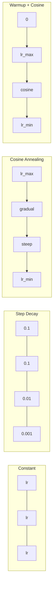
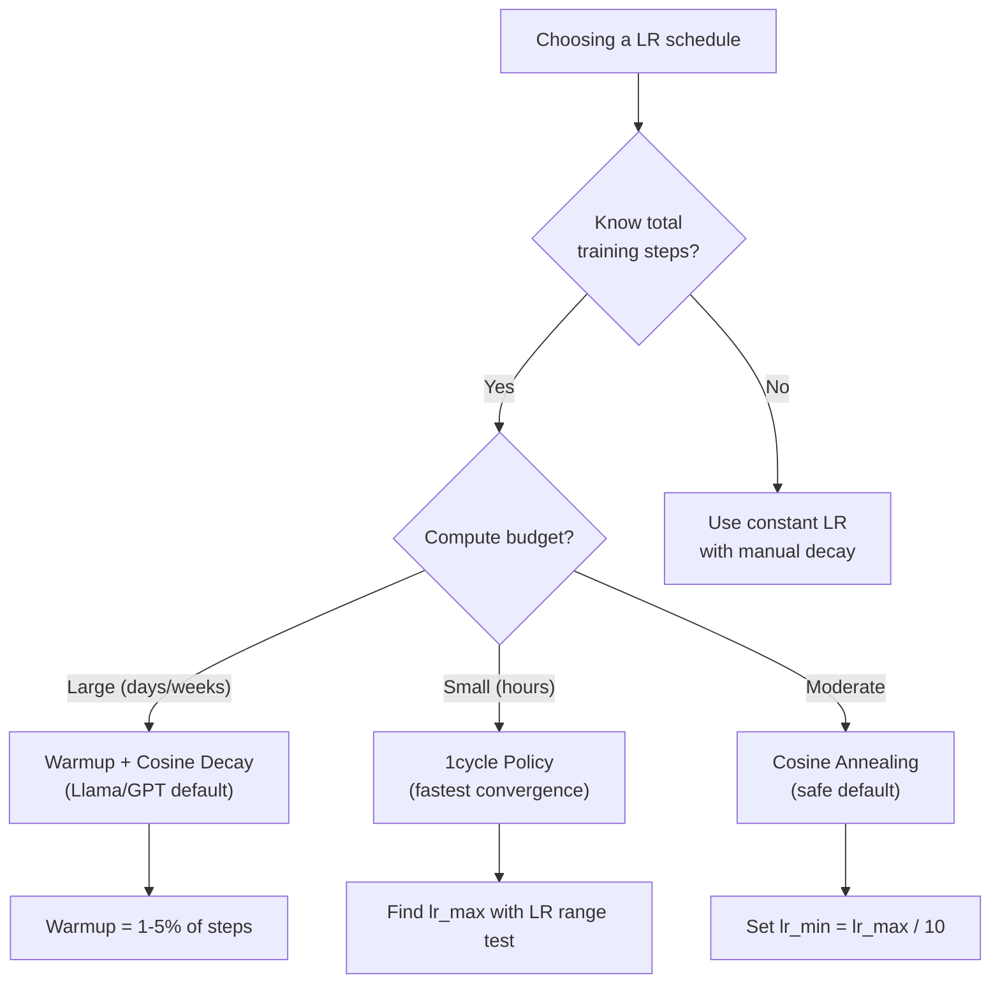
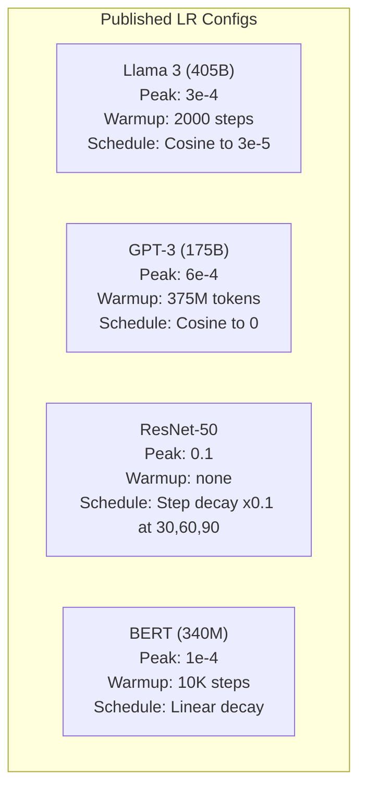

# Horários de aprendizagem e aquecimento

> A taxa de aprendizagem é o único hiperparâmetro mais importante. Não a arquitetura, não o tamanho do conjunto de dados, não a função de ativação, a taxa de aprendizagem.

**Type:** Build
**Languages:** Python, TypeScript
**Prerequisites:** Lesson 03.06 (Optimizers), Lesson 03.08 (Weight Initialization)
**Time:** ~90 minutes

## Objetivos de aprendizagem

- Implementar a partir do zero os horários constantes, de degradação gradual, de anelação cosina, de aquecimento + cosina e de taxa de aprendizagem de 1 ciclo
- Demonstrar os três modos de falha da selecção da taxa de aprendizagem: divergência (demasiada), atraso (demasiada baixa) e oscilação (sem decadência)
- Explique por que o aquecimento é necessário para os optimistas baseados em Adão e como estabiliza o treinamento precoce
- Comparar a velocidade de convergência entre os cinco horários da mesma tarefa e selecionar a adequada para um determinado orçamento de formação

## O problema

Defina a taxa de aprendizagem em 0.1. O treinamento diverge - a perda salta para o infinito em 3 passos. Defina-o em 0.0001. O treinamento rasteja - após 100 épocas, o modelo mal se moveu do aleatório. Defina-o em 0.01. O treinamento funciona por 50 épocas, então a perda oscila em torno de um mínimo que nunca pode alcançar porque os passos são grandes demais.

A taxa de aprendizagem ideal não é constante. Ele muda durante o treinamento. No início, você quer grandes passos para cobrir o terreno rapidamente. No final do treinamento, você quer pequenos passos para se estabelecer em um mínimo nítido. A diferença entre um modelo 90% preciso e um modelo 95% preciso é muitas vezes apenas o cronograma.

Todos os principais modelos publicados nos últimos três anos usam um cronograma de taxa de aprendizagem. Llama 3 usou pico lr = 3e-4 com 2000 passos de aquecimento e decadência cosínica para 3e-5. GPT-3 usou lr = 6e-4 com aquecimento de mais de 375 milhões de tokens.

Quando você aprende um modelo pré-treinado, o horário certo é diferente do treinamento a partir do zero. Quando aumenta o tamanho do lote, o período de aquecimento precisa mudar. Quando o treinamento se rompe no passo 10.000, você precisa saber se é um problema de horário ou algo mais.

## O conceito

### Taxa de aprendizagem constante

A abordagem mais simples é escolher um número, usar-o para cada passo.

```math
\text{lr}(t) = \text{lr}_0
```

Raramente óptimo. É muito alto para o final do treinamento (oscillação em torno do mínimo) ou muito baixo para o início (computação desperdiçada em passos pequenos). Funciona bem para pequenos modelos e depuração. Uma escolha terrível para qualquer coisa que treina por mais de uma hora.

### Passo de decadência

A abordagem da velha escola da era ResNet: reduzir a taxa de aprendizagem em um fator (geralmente 10x) em épocas fixas.

```math
\text{lr}(t) = \text{lr}_0 \cdot \gamma^{\lfloor \text{epoch} / \text{step\_size} \rfloor}
```

Onde ?$\gamma = 0.1$e step_size = 30 significa: lr cai 10x a cada 30 épocas. ResNet-50 usou isto -- lr = 0,1, cai 10x a épocas 30, 60 e 90.

O problema: os pontos de decomposição ótimos dependem do conjunto de dados e da arquitetura. Passe para um problema diferente e você precisa reajustar quando cair. As transições são abruptas - a perda pode aumentar quando a taxa muda repentinamente.

### Cossina de Annealing

Desintegração suave da taxa máxima de aprendizagem para o mínimo, seguindo uma curva cosínica:

```math
\text{lr}(t) = \text{lr}_{\min} + 0.5 \cdot (\text{lr}_{\max} - \text{lr}_{\min}) \cdot \left(1 + \cos\left(\frac{\pi t}{T}\right)\right)
```

Onde ?$t$é o passo atual e $T$é o número total de passos.

- Não .$t=0$, o termo cosínio é 1, então $\text{lr} = \text{lr} _{\max}$- Em .$t=T$, o termo cosínio é -1, então $\text{lr} = \text{lr} _{\min}$A decadência é suave no início, acelera no meio, e torna-se suave novamente perto do fim.

Esta é a padrão para a maioria das corridas de treinamento modernas.$\text{lr} _{\max}$E ...$\text{lr} _{\min}$A forma cosínica corresponde à observação empírica de que a maior parte da aprendizagem acontece no meio do treinamento - queremos tamanhos razoáveis de passos durante esse período crítico.

### O aquecimento: Por que começar pequeno

Adam e outros optimizadores adaptativos mantêm estimativas em execução da média de gradiente e variação. No passo 0, essas estimativas são iniciadas para zero. As primeiras atualizações de gradiente são baseadas em estatísticas de lixo. Se a sua taxa de aprendizagem é grande durante esse período, o modelo toma passos enormes e mal direcionados.

O Warmup corrige isto. Comece com uma pequena taxa de aprendizagem (muitas vezes lr_max / warmup_steps ou até zero) e linearmente eleve para $\text{lr}_{\max}$- Não .$N$Quando você alcançar a taxa de aprendizagem completa, as estatísticas de Adam se estabilizaram.

```math
\text{lr}(t) = \text{lr}_{\max} \cdot \frac{t}{\text{warmup\_steps}} \quad \text{for } t < \text{warmup\_steps}
```

O aquecimento típico: 1-5% do total de etapas de treinamento. Llama 3 treinado para ~ 1,8 trilhão de tokens e aquecido para 2000 etapas. GPT-3 aquecido para mais de 375 milhões de tokens.

### O aquecimento linear + declínio do cosino

A padrão moderna, eleva-se linearmente, depois decompõe com o cosino:

```
if t < warmup_steps:
    lr(t) = lr_max * (t / warmup_steps)
else:
    progress = (t - warmup_steps) / (total_steps - warmup_steps)
    lr(t) = lr_min + 0.5 * (lr_max - lr_min) * (1 + cos(pi * progress))
```

É o que Llama, GPT, PaLM e a maioria dos transformadores modernos usam. O aquecimento evita a instabilidade precoce.

### Política de 1 ciclo

Descoberta de Leslie Smith (2018): aumentar a taxa de aprendizagem de um valor baixo para um valor alto no primeiro semestre do treinamento, e depois reduzir novamente no segundo semestre.

A teoria: uma alta taxa de aprendizagem atua como regularização adicionando ruído à trajetória de otimização. O modelo explora mais do cenário de perda durante a fase de ramp-up, encontrando melhores bacias.

```
Phase 1 (0 to T/2):    lr ramps from lr_max/25 to lr_max
Phase 2 (T/2 to T):    lr ramps from lr_max to lr_max/10000
```

O 1cycle é frequentemente mais rápido do que o cosino de anelação para um orçamento fixo de computação.

### Formas de programação



### Diagrama de fluxo de decisão



### Números reais de modelos publicados



```figure
lr-schedule
```

## Construí-lo

### Passo 1: Agendamento de funções

Cada função toma o passo atual e retorna a taxa de aprendizagem nesse passo.

```python
import math


def constant_schedule(step, lr=0.01, **kwargs):
    return lr


def step_decay_schedule(step, lr=0.1, step_size=100, gamma=0.1, **kwargs):
    return lr * (gamma ** (step // step_size))


def cosine_schedule(step, lr=0.01, total_steps=1000, lr_min=1e-5, **kwargs):
    if step >= total_steps:
        return lr_min
    return lr_min + 0.5 * (lr - lr_min) * (1 + math.cos(math.pi * step / total_steps))


def warmup_cosine_schedule(step, lr=0.01, total_steps=1000, warmup_steps=100, lr_min=1e-5, **kwargs):
    if total_steps <= warmup_steps:
        return lr * (step / max(warmup_steps, 1))
    if step < warmup_steps:
        return lr * step / warmup_steps
    progress = (step - warmup_steps) / (total_steps - warmup_steps)
    return lr_min + 0.5 * (lr - lr_min) * (1 + math.cos(math.pi * progress))


def one_cycle_schedule(step, lr=0.01, total_steps=1000, **kwargs):
    mid = max(total_steps // 2, 1)
    if step < mid:
        return (lr / 25) + (lr - lr / 25) * step / mid
    else:
        progress = (step - mid) / max(total_steps - mid, 1)
        return lr * (1 - progress) + (lr / 10000) * progress
```

### Passo 2: Visualize todos os horários

Imprima um gráfico baseado em texto que mostre como cada programa evolui ao longo da formação.

```python
def visualize_schedule(name, schedule_fn, total_steps=500, **kwargs):
    steps = list(range(0, total_steps, total_steps // 20))
    if total_steps - 1 not in steps:
        steps.append(total_steps - 1)

    lrs = [schedule_fn(s, total_steps=total_steps, **kwargs) for s in steps]
    max_lr = max(lrs) if max(lrs) > 0 else 1.0

    print(f"\n{name}:")
    for s, lr_val in zip(steps, lrs):
        bar_len = int(lr_val / max_lr * 40)
        bar = "#" * bar_len
        print(f"  Step {s:4d}: lr={lr_val:.6f} {bar}")
```

### Passo 3: Rede de formação

Uma rede simples de duas camadas no conjunto de dados do círculo, igual às lições anteriores, mas agora variamos o horário.

```python
import random


def sigmoid(x):
    x = max(-500, min(500, x))
    return 1.0 / (1.0 + math.exp(-x))


def relu(x):
    return max(0.0, x)


def relu_deriv(x):
    return 1.0 if x > 0 else 0.0


def make_circle_data(n=200, seed=42):
    random.seed(seed)
    data = []
    for _ in range(n):
        x = random.uniform(-2, 2)
        y = random.uniform(-2, 2)
        label = 1.0 if x * x + y * y < 1.5 else 0.0
        data.append(([x, y], label))
    return data


def train_with_schedule(schedule_fn, schedule_name, data, epochs=300, base_lr=0.05, **kwargs):
    random.seed(0)
    hidden_size = 8
    total_steps = epochs * len(data)

    std = math.sqrt(2.0 / 2)
    w1 = [[random.gauss(0, std) for _ in range(2)] for _ in range(hidden_size)]
    b1 = [0.0] * hidden_size
    w2 = [random.gauss(0, std) for _ in range(hidden_size)]
    b2 = 0.0

    step = 0
    epoch_losses = []

    for epoch in range(epochs):
        total_loss = 0
        correct = 0

        for x, target in data:
            lr = schedule_fn(step, lr=base_lr, total_steps=total_steps, **kwargs)

            z1 = []
            h = []
            for i in range(hidden_size):
                z = w1[i][0] * x[0] + w1[i][1] * x[1] + b1[i]
                z1.append(z)
                h.append(relu(z))

            z2 = sum(w2[i] * h[i] for i in range(hidden_size)) + b2
            out = sigmoid(z2)

            error = out - target
            d_out = error * out * (1 - out)

            for i in range(hidden_size):
                d_h = d_out * w2[i] * relu_deriv(z1[i])
                w2[i] -= lr * d_out * h[i]
                for j in range(2):
                    w1[i][j] -= lr * d_h * x[j]
                b1[i] -= lr * d_h
            b2 -= lr * d_out

            total_loss += (out - target) ** 2
            if (out >= 0.5) == (target >= 0.5):
                correct += 1
            step += 1

        avg_loss = total_loss / len(data)
        accuracy = correct / len(data) * 100
        epoch_losses.append(avg_loss)

    return epoch_losses
```

### Passo 4: Compare todos os horários

Treinar a mesma rede com cada cronograma e comparar o comportamento final de perda e convergência.

```python
def compare_schedules(data):
    configs = [
        ("Constant", constant_schedule, {}),
        ("Step Decay", step_decay_schedule, {"step_size": 15000, "gamma": 0.1}),
        ("Cosine", cosine_schedule, {"lr_min": 1e-5}),
        ("Warmup+Cosine", warmup_cosine_schedule, {"warmup_steps": 3000, "lr_min": 1e-5}),
        ("1cycle", one_cycle_schedule, {}),
    ]

    print(f"\n{'Schedule':<20} {'Start Loss':>12} {'Mid Loss':>12} {'End Loss':>12} {'Best Loss':>12}")
    print("-" * 70)

    for name, schedule_fn, extra_kwargs in configs:
        losses = train_with_schedule(schedule_fn, name, data, epochs=300, base_lr=0.05, **extra_kwargs)
        mid_idx = len(losses) // 2
        best = min(losses)
        print(f"{name:<20} {losses[0]:>12.6f} {losses[mid_idx]:>12.6f} {losses[-1]:>12.6f} {best:>12.6f}")
```

### Passo 5: LR muito alto versus muito baixo

Demonstre os três modos de falha: muito alto (divergência), muito baixo (deslocamento) e direito.

```python
def lr_sensitivity(data):
    learning_rates = [1.0, 0.1, 0.01, 0.001, 0.0001]

    print("\nLR Sensitivity (constant schedule, 100 epochs):")
    print(f"  {'LR':>10} {'Start Loss':>12} {'End Loss':>12} {'Status':>15}")
    print("  " + "-" * 52)

    for lr in learning_rates:
        losses = train_with_schedule(constant_schedule, f"lr={lr}", data, epochs=100, base_lr=lr)
        start = losses[0]
        end = losses[-1]

        if end > start or math.isnan(end) or end > 1.0:
            status = "DIVERGED"
        elif end > start * 0.9:
            status = "BARELY MOVED"
        elif end < 0.15:
            status = "CONVERGED"
        else:
            status = "LEARNING"

        end_str = f"{end:.6f}" if not math.isnan(end) else "NaN"
        print(f"  {lr:>10.4f} {start:>12.6f} {end_str:>12} {status:>15}")
```

## Usá-lo

A PyTorch fornece agendadores em `torch.optim.lr_scheduler`- Não .

```python
import torch
import torch.optim as optim
from torch.optim.lr_scheduler import CosineAnnealingLR, OneCycleLR, StepLR

model = nn.Sequential(nn.Linear(10, 64), nn.ReLU(), nn.Linear(64, 1))
optimizer = optim.Adam(model.parameters(), lr=3e-4)

scheduler = CosineAnnealingLR(optimizer, T_max=1000, eta_min=1e-5)

for step in range(1000):
    loss = train_step(model, optimizer)
    scheduler.step()
```

Para aquecimento + cosin, use um agendador lambda ou o `get_cosine_schedule_with_warmup`de HuggingFace:

```python
from transformers import get_cosine_schedule_with_warmup

scheduler = get_cosine_schedule_with_warmup(
    optimizer,
    num_warmup_steps=2000,
    num_training_steps=100000,
)
```

A função HuggingFace é o que a maioria dos scripts de ajuste fino Llama e GPT usa. Quando em dúvida, use aquecimento + cosino com aquecimento = 3-5% do total de passos. Funciona para quase tudo.

## Envia-o

Esta lição produz:
- `outputs/prompt-lr-schedule-advisor.md`-- um aviso que recomenda o horário de aprendizagem e os hiperparâmetros adequados para a sua formação

## Exercícios

1. Implementar decadência exponencial: $\text{lr}(t) = \text{lr}_0 \cdot \gamma^t$onde$\gamma = 0.999$Comparar com o cosino de anelação no conjunto de dados do círculo.

2. Implementar o teste de faixa de taxa de aprendizagem (Leslie Smith): treinar por algumas centenas de passos aumentando exponencialmente a LR de 1e-7 para 1.

3. Treinar com aquecimento + cosino, mas variar o comprimento do aquecimento: 0%, 1%, 5%, 10%, 20% dos passos totais.

4. Implementar o anelamento cosino com reinicialização quente (SGDR): restabelecer a taxa de aprendizagem para $\text{lr}_{\max}$- Todos .$T$Comparar com o cosino padrão numa corrida de treinamento mais longa.

5. Construir um "chirurgião de horário" que monitore a perda de treinamento e muda automaticamente do aquecimento para cosino quando a perda se estabiliza, e reduz a irritação se a perda se prolongar por muito tempo.

## Termos-chave

| Term | What people say | What it actually means |
|------|----------------|----------------------|
| Learning rate | "How fast the model learns" | The scalar that multiplies the gradient to determine the parameter update size |
| Schedule | "Change the LR over time" | A function that maps training step to learning rate, designed to optimize convergence |
| Warmup | "Start with a small LR" | Linearly ramping the LR from near-zero to the target value over the first $N$ steps to stabilize optimizer statistics |
| Cosine annealing | "Smooth LR decay" | Decreasing the LR following a cosine curve from $\text{lr} _{\max}$ to $\text{lr} _{\min}$ over training |
| Step decay | "Drop LR at milestones" | Multiplying the LR by a factor (usually 0.1) at fixed epoch intervals |
| 1cycle policy | "Up then down" | Leslie Smith's method of ramping LR up then down in a single cycle for faster convergence |
| LR range test | "Find the best learning rate" | Training briefly while increasing LR to find the value where loss starts diverging |
| Cosine with warm restarts | "Reset and repeat" | Periodically resetting the LR to $\text{lr} _{\max}$ and decaying again (SGDR) |
| Eta min | "The floor for the LR" | The minimum learning rate that the schedule decays to |
| Peak learning rate | "The maximum LR" | The highest LR reached during training, typically after warmup |

## Mais leitura

- Loshchilov & Hutter, "SGDR: Descenso Gradiente Stocástico com Restarto Quente" (2017) -- introduziu o cozinho de anel e o reinicio quente
- Smith, "Super-Convergência: Treinamento muito rápido de redes neurais usando grandes taxas de aprendizagem" (2018) -- o documento de política de 1 ciclo
- Touvron et al., "Llama 2: Open Foundation and Fine-Tuned Chat Models" (2023) -- documenta o calendário de aquecimento + cosino usado em escala
- Goyal et al., "Exato, Minibatch SGD: Training ImageNet em 1 hora" (2017) -- regra de escalação linear e aquecimento para treinamento de grandes lotes
