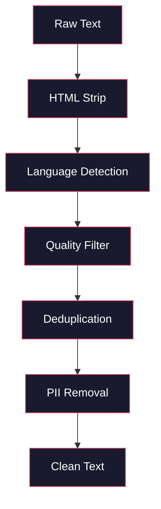
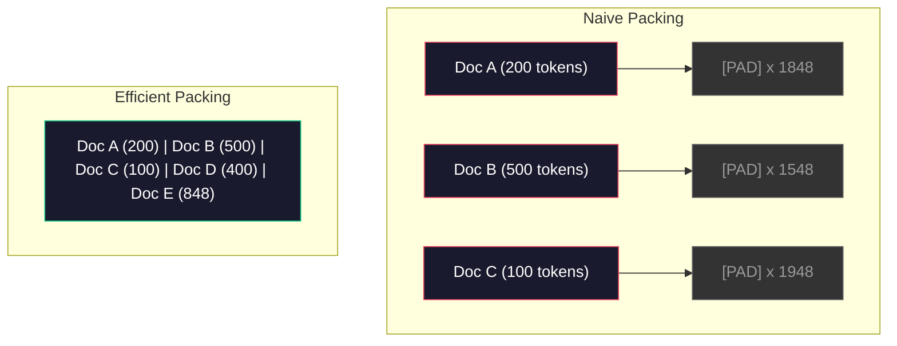

# Pipelines de dados para a formação prévia

> O modelo é um espelho, reflete os dados que lhe fornecer, alimenta-o de lixo, reflete lixo com fluência perfeita.

**Type:** Build
**Languages:** Python, Rust
**Prerequisites:** Phase 10, Lessons 01-02 (Tokenizers, Building a Tokenizer)
**Time:** ~90 minutes

## Objetivos de aprendizagem

- Construir um pipeline de dados de streaming que tokenize, pedaços, misturas e lotes de terabytes de texto sem carregar tudo na memória
- Implementar filtros de qualidade de dados (desduplicação, detecção de linguagem, filtragem de conteúdo) utilizados em canais reais de pré-formação
- Criar sequências de treinamento de comprimento fixo com máscaras de atenção adequadas e manuseio de limites de documentos
- Perfil de tráfego de tubo para garantir o carregador de dados mantém-se com a velocidade de treinamento da GPU

## O problema

Tens um tokenizer, agora precisas de dados.

Não é um conjunto de dados, não é um arquivo CSV. Terabytes de texto - limpos, deduplicados, filtrados para qualidade, tokenizados em sequências de comprimento fixo e servidos em lotes aleatórios suficientemente rápidos para que o seu cluster de 8 GPU nunca espere pelo próximo lote.

A maioria das pessoas pensa que a formação de um LLM é sobre a arquitetura do modelo. Não é. Llama 3 usou 15,6 trilhões de tokens. GPT-3 usou 300 bilhões. DeepSeek-V2 usou 8,1 trilhões. A arquitetura em todos os três é aproximadamente a mesma: blocos de transformador empilhados com camadas de atenção e feedforward. A diferença na qualidade de saída vem em grande parte dos dados.

O artigo do Chinchilla da DeepMind fez isso precisamente. Para um determinado orçamento de computação, existe uma relação ótima entre os parâmetros do modelo e os tokens de formação. Chinchilla mostrou que a maioria dos modelos em 2022 estavam dramaticamente subtraídos - tinham muitos parâmetros para a quantidade de dados que viavam. Um modelo de parâmetro 70B treinado em 1,4 trilhão de tokens (Chinchilla-óptimo) superou um modelo 280B treinado em 300 bilhões de tokens (Gopher).

A sua linha de dados determina se o seu modelo aprende a língua ou o ruído.

## O conceito

### De onde vêm os dados

Cada grande modelo de linguagem é treinado com base em uma mistura de fontes. A composição exata é um segredo bem guardado para a maioria dos laboratórios, mas sabemos o suficiente para entender as categorias.

| Source | Size | Quality | Used By |
|--------|------|---------|---------|
| Common Crawl | ~250 TB raw | Low (needs heavy filtering) | GPT-3, Llama, most open models |
| Wikipedia | ~20 GB | High | Every major LLM |
| GitHub code | ~1 TB+ | Medium (lots of duplicates, dead code) | StarCoder, CodeLlama, DeepSeek-Coder |
| Books (BookCorpus, Pile) | ~100 GB | High | GPT-2, GPT-3, early models |
| Academic papers (arXiv, S2ORC) | ~100 GB | High for STEM | Llama, Galactica |
| StackOverflow, Reddit | ~100 GB | Medium | Llama, Falcon |
| Curated web (C4, RefinedWeb) | ~5 TB | Medium-High (pre-filtered) | T5, Falcon |

Llama 3 divulgou sua mistura de dados: cerca de 50% de dados da web, 25% de código, 13% de livros e artigos acadêmicos, 8% de dados matemáticos e 4% de dados da web multilíngue.

A relação importa tanto quanto o tamanho total. Demasiados dados da web e o modelo torna-se um papagaio Reddit. Demasiado pouco código e não pode programar. Demasiado pouco matemática e falha no raciocínio.

### Limpeza de dados

Os dados da web são sujos.

- Tags HTML e JavaScript
- Cabeças, calçados, menus de navegação
- Páginas duplicadas (exactas e quase duplicadas)
- Spam gerado por máquina
- Informações de identificação pessoal (PII)
- Texto de baixa qualidade (listas de palavras-chave, spam de SEO)
- Conteúdo não-textual codificado como texto

Limpagem não é opcional. É a diferença entre um modelo que gera parágrafos coerentes e um que sai tags HTML misturados com listas de produtos.



Cada passo elimina uma categoria de ruído:

**HTML stripping:**Remover todas as marcas. Mantenha apenas o conteúdo visível do texto.`trafilatura`ou `readability`extrair o conteúdo do artigo enquanto descartamos navegação, anúncios e placa de caldeira.

**Language detection:**Use o modelo de identificação de idioma do fastText (lid.176.bin) para classificar cada documento. Filtre para os idiomas alvo. Um documento classificado como inglês com menos de 0,8 confiança provavelmente não é inglês limpo.

**Quality filtering:**É aqui que fica interessante. RefinedWeb (o conjunto de dados por trás do Falcon) usa um filtro baseado em perplexidade: treinar um pequeno modelo de linguagem na Wikipedia, em seguida, marcar cada documento. Alta perplexidade significa que o documento é diferente da Wikipedia - provavelmente spam, listas de palavras-chave ou conteúdo gerado por máquina. Documentos com perplexidade acima de um limiar são removidos.

**Deduplication:**O único passo de limpeza mais impactante. O Common Crawl contém um enorme número de páginas duplicadas - disclaims legais, avisos de cookie, termos de serviço. O treinamento em duplicados desperdiça o cálculo e pode fazer com que o modelo memorize e regurgite passagens específicas literalmente.

**PII removal:**Nomes, endereços de e-mail, números de telefone, números de segurança social. Detecção baseada em Regex para PII estruturada, modelos NER para nomes no contexto.

### Deduplicação com MinHash

A deduplicação exata é fácil: hash cada documento, remover duplicados. Mas duplicados quase são o verdadeiro problema. Duas cópias do mesmo artigo de notícias com anúncios ligeiramente diferentes ao seu redor são duplicados quase. O conteúdo é 95% idêntico, mas eles diferem em byte-for-byte.

O MinHash + Hashing sensível à localidade (LSH) resolve isso de forma eficiente.


A ideia:

1. **Shingling:**Converter cada documento em um conjunto de n-gramas (por exemplo, 5 gramas de palavras ou caracteres). "a rapidez rufo marrom" com 3 palavras de barbatana torna-se {"a rapidez rufo marrom", "a rapidez rufo marrom"}.

2. **MinHash:**Para cada conjunto de barandas de documento, calcule k valores de hash. Cada valor de hash é o hash mínimo em todos os barandas sob uma função de hash diferente. Isso cria uma "assinatura" de tamanho fixo que se aproxima da semelhança de Jaccard entre dois documentos.

3. **LSH:**Grupar documentos em baldes com base em bandas de sua assinatura MinHash. Documentos no mesmo balde são candidatos quase duplicados. Isso evita comparar cada par - você apenas compara candidatos.

4. **Verify:**Para cada par candidato, calcule a semelhança exata de Jaccard. Retire uma cópia se a semelhança exceder um limiar (normalmente 0,8).

A equipe de Llama relatou ter removido aproximadamente 38% de seus dados da web através da deduplicação.

### Embalagem de sequência

O seu modelo espera sequências de entrada de comprimento fixo. Os seus documentos são de comprimento variável. Alguns são de 50 tokens.

Abordagem ingênua: encher cada documento com o comprimento máximo da sequência. Isto desperdiça enormes cálculos em tokens de enchimento que não contribuem para a aprendizagem.

Melhor abordagem: empacotar vários documentos em uma única sequência, separados por tokens de fim de sequência. Uma sequência de 2048 tokens pode conter três documentos curtos concatenados com tokens [EOS] entre eles.



A máscara de atenção deve ser definida corretamente. Tokens do documento A não devem atender a tokens do documento B dentro da mesma sequência de embalagem. Isso requer uma máscara de atenção de diagonal de bloco.

Documentos longos são truncados ou divididos em pedaços nos limites da sequência. O ponto de divisão importa: dividir no meio da frase obriga o modelo a ver pensamentos incompletos.

### A Lei de Escala de Chinchilla

Para um orçamento fixo de computação $C$(medido em FLOPs), o tamanho óptimo do modelo $N$e tamanho do conjunto de dados $D$Seguem:

```math
\begin{aligned}
N_{\text{opt}} &\sim C^{0.5} \\
D_{\text{opt}} &\sim C^{0.5}
\end{aligned}
```

Na prática, isso significa que você deve escalar o tamanho do modelo e o tamanho do conjunto de dados aproximadamente igualmente. Um modelo com 10x mais parâmetros precisa de aproximadamente 10x mais tokens de treinamento para alcançar a mesma perda.

| Model | Parameters | Training Tokens | Chinchilla-Optimal? |
|-------|-----------|----------------|-------------------|
| GPT-3 | 175B | 300B | No (undertrained 3-4x) |
| Chinchilla | 70B | 1.4T | Yes (by design) |
| Llama 2 | 70B | 2T | Overtrained (intentionally) |
| Llama 3 | 70B | 15T | Heavily overtrained |

Llama 3 viola deliberadamente a lei Chinchilla. Meta descobriu que o treinamento excessivo em mais dados - muito além da relação computação-ótima - produz melhores modelos para inferência. O custo extra de treinamento é pago uma vez, mas o modelo menor é mais barato para servir para sempre. Isso às vezes é chamado de abordagem de escalação "inferência-ótima", e tornou-se o padrão da indústria desde 2024.

```figure
l5-data-pipeline
```

## Construí-lo

### Passo 1: Limpeza do texto

Desprimir HTML, normalizar o espaço branco, remover conteúdo não-textual. Usaremos um texto de domínio público (Projeto Gutenberg) como nosso pequeno corpus.

```python
import re

def clean_text(text):
    text = re.sub(r"<[^>]+>", "", text)
    text = re.sub(r"http\S+", "", text)
    text = re.sub(r"[^\x20-\x7E\n]", "", text)
    text = re.sub(r"\n{3,}", "\n\n", text)
    text = re.sub(r" {2,}", " ", text)
    return text.strip()

def quality_filter(text, min_words=50, max_ratio_caps=0.3, max_ratio_special=0.1):
    words = text.split()
    if len(words) < min_words:
        return False
    caps_ratio = sum(1 for w in words if w.isupper()) / len(words)
    if caps_ratio > max_ratio_caps:
        return False
    special_chars = sum(1 for c in text if not c.isalnum() and not c.isspace())
    if special_chars / max(len(text), 1) > max_ratio_special:
        return False
    return True
```

O filtro de qualidade capta spam de SEO (Todos os CAPS), ruído gerado por máquina (alta proporção de caracteres especiais) e páginas de estúdio (muito curtas).

### Passo 2: Desduplicação de MinHash

Implementar o MinHash do zero. Não é necessária biblioteca externa.`hashlib`- Não .

```python
import hashlib
from collections import defaultdict

def get_shingles(text, k=5):
    words = text.lower().split()
    if len(words) < k:
        return set()
    return {" ".join(words[i:i+k]) for i in range(len(words) - k + 1)}

def minhash_signature(shingles, num_hashes=128):
    signature = []
    for i in range(num_hashes):
        min_hash = float("inf")
        for shingle in shingles:
            h = int(hashlib.sha256(f"{i}:{shingle}".encode()).hexdigest(), 16)
            min_hash = min(min_hash, h)
        signature.append(min_hash)
    return signature

def lsh_buckets(signature, bands=16):
    rows_per_band = len(signature) // bands
    buckets = []
    for b in range(bands):
        start = b * rows_per_band
        band_data = tuple(signature[start:start + rows_per_band])
        bucket_hash = hashlib.md5(str(band_data).encode()).hexdigest()
        buckets.append((b, bucket_hash))
    return buckets

def deduplicate(documents, threshold=0.8, num_hashes=128, bands=16):
    signatures = []
    shingle_sets = []
    for doc in documents:
        shingles = get_shingles(doc)
        shingle_sets.append(shingles)
        signatures.append(minhash_signature(shingles, num_hashes))

    bucket_map = defaultdict(list)
    for doc_idx, sig in enumerate(signatures):
        for band_id, bucket_hash in lsh_buckets(sig, bands):
            bucket_map[(band_id, bucket_hash)].append(doc_idx)

    duplicate_pairs = set()
    for bucket_docs in bucket_map.values():
        if len(bucket_docs) < 2:
            continue
        for i in range(len(bucket_docs)):
            for j in range(i + 1, len(bucket_docs)):
                duplicate_pairs.add((bucket_docs[i], bucket_docs[j]))

    removed = set()
    for i, j in duplicate_pairs:
        if i in removed or j in removed:
            continue
        s1, s2 = shingle_sets[i], shingle_sets[j]
        if not s1 or not s2:
            continue
        jaccard = len(s1 & s2) / len(s1 | s2)
        if jaccard >= threshold:
            removed.add(j)

    return [doc for idx, doc in enumerate(documents) if idx not in removed], len(removed)
```

O `num_hashes=128`E ...`bands=16`Os parâmetros controlam a compensação de recall de precisão. Mais hashes dão estimativas de semelhança mais precisas. Mais bandas aumentam a recall (capturam mais duplicados) ao custo de mais falsos positivos. Estes valores funcionam bem para texto web típico.

### Passo 3: Tokenize e empacotar sequências

Pegue o texto limpo, deduplicado, tokenize-o e enrole em sequências de duração fixa para treinamento.

```python
def tokenize_corpus(documents, tokenizer):
    all_tokens = []
    for doc in documents:
        tokens = tokenizer.encode(doc)
        all_tokens.extend(tokens)
        all_tokens.append(tokenizer.eos_id)
    return all_tokens

def pack_sequences(token_ids, seq_length, pad_id=0):
    sequences = []
    attention_masks = []
    for i in range(0, len(token_ids), seq_length):
        seq = token_ids[i:i + seq_length]
        mask = [1] * len(seq)
        if len(seq) < seq_length:
            pad_count = seq_length - len(seq)
            seq = seq + [pad_id] * pad_count
            mask = mask + [0] * pad_count
        sequences.append(seq)
        attention_masks.append(mask)
    return sequences, attention_masks
```

### Passo 4: DataLoader para formação

E dá lotes aleatórios de sequências embaladas.

```python
import random

class PreTrainingDataLoader:
    def __init__(self, sequences, attention_masks, batch_size, shuffle=True):
        self.sequences = sequences
        self.attention_masks = attention_masks
        self.batch_size = batch_size
        self.shuffle = shuffle

    def __len__(self):
        return (len(self.sequences) + self.batch_size - 1) // self.batch_size

    def __iter__(self):
        indices = list(range(len(self.sequences)))
        if self.shuffle:
            random.shuffle(indices)
        for start in range(0, len(indices), self.batch_size):
            batch_idx = indices[start:start + self.batch_size]
            batch_seqs = [self.sequences[i] for i in batch_idx]
            batch_masks = [self.attention_masks[i] for i in batch_idx]
            yield batch_seqs, batch_masks
```

### Passo 5: Estatísticas de conjuntos de dados

Calcule os números que importam: total de tokens, tokens únicos, relação de compressão, distribuição de comprimento do documento.

```python
from collections import Counter

def compute_statistics(documents, token_ids, sequences, tokenizer_vocab_size):
    total_chars = sum(len(d) for d in documents)
    total_tokens = len(token_ids)
    unique_tokens = len(set(token_ids))
    compression_ratio = total_chars / total_tokens

    doc_lengths = [len(d.split()) for d in documents]
    avg_doc_length = sum(doc_lengths) / max(len(doc_lengths), 1)
    max_doc_length = max(doc_lengths) if doc_lengths else 0
    min_doc_length = min(doc_lengths) if doc_lengths else 0

    token_counts = Counter(token_ids)
    top_tokens = token_counts.most_common(10)

    non_pad_tokens = sum(sum(1 for t in seq if t != 0) for seq in sequences)
    total_positions = sum(len(seq) for seq in sequences)
    utilization = non_pad_tokens / max(total_positions, 1)

    stats = {
        "total_documents": len(documents),
        "total_characters": total_chars,
        "total_tokens": total_tokens,
        "unique_tokens": unique_tokens,
        "vocab_utilization": unique_tokens / tokenizer_vocab_size,
        "compression_ratio": compression_ratio,
        "avg_doc_length_words": avg_doc_length,
        "max_doc_length_words": max_doc_length,
        "min_doc_length_words": min_doc_length,
        "num_sequences": len(sequences),
        "sequence_utilization": utilization,
        "top_10_tokens": top_tokens,
    }
    return stats
```

A relação de compressão diz-lhe quão eficiente é o tokenizer neste corpus. O texto inglês normalmente comprime para cerca de 3-4 caracteres por token. Se você vê 1,5 caracteres por token, seu tokenizer está se dividindo muito agressivamente. Se você vê 8+, ele aprendeu fusões muito específicas de domínio.

A utilização de sequências diz-lhe quanto das suas sequências embaladas são dados reais versus padding. abaixo de 90% significa que a sua embalagem é ineficiente - você está desperdiçando computação em tokens de padding.

## Usá-lo

### Comparar com os conjuntos de dados HuggingFace

Carregue o mesmo corpus através da biblioteca de conjuntos de dados do HuggingFace e compare a velocidade do pipeline.

```python
from datasets import load_dataset
from transformers import AutoTokenizer

ds = load_dataset("wikitext", "wikitext-2-raw-v1", split="train")
tokenizer = AutoTokenizer.from_pretrained("meta-llama/Meta-Llama-3-8B")

import time

start = time.time()
tokenized = ds.map(
    lambda x: tokenizer(x["text"], truncation=True, max_length=2048),
    batched=True,
    num_proc=4,
)
hf_time = time.time() - start
total_tokens = sum(len(t) for t in tokenized["input_ids"])
print(f"HuggingFace: {total_tokens:,} tokens in {hf_time:.2f}s ({total_tokens/hf_time:,.0f} tokens/sec)")
```

O pipeline HuggingFace usa tokenizers de Rust sob o capô e processamento paralelo em 4 núcleos. Seu pipeline Python puro será 10-50 vezes mais lento. Essa lacuna é por que as equipes de produção usam tokenizers compilados. O algoritmo é o mesmo. A linguagem de implementação é a diferença.

## Envia-o

Esta lição produz um prompt para validar e depurar a qualidade dos dados em canais de formação LLM.`outputs/prompt-data-quality-checker.md`- Não .

## Exercícios

1. **Easy:**Adicionar detecção de linguagem ao pipeline de limpeza usando uma simples heurística (análise de conjuntos de caracteres).
2. **Medium:**Implementar a deduplicação exata usando hashes SHA-256 ao lado da deduplicação próxima de MinHash. Compare o número de duplicados capturados por cada método em um corpus raspado na web.
3. **Hard:**Construa um filtro de qualidade baseado em perplexidade. Treine um pequeno modelo de linguagem de bigram no texto da Wikipédia, ponta cada documento por perplexidade e remova o 20% inferior.

## Termos-chave

| Term | What people say | What it actually means |
|------|----------------|----------------------|
| Common Crawl | "The internet" | A non-profit that crawls the web monthly -- ~250TB raw, the starting point for most LLM training data |
| MinHash | "Some hashing trick" | A technique to estimate Jaccard similarity between sets using fixed-size signatures -- enables near-duplicate detection at scale |
| LSH | "Locality-Sensitive Hashing" | A method to group similar items into the same bucket -- reduces pairwise comparisons from $O(n^2)$ to near-linear |
| Sequence packing | "Concatenating documents" | Fitting multiple documents into fixed-length sequences with proper attention masks -- eliminates padding waste |
| Chinchilla scaling | "Train on more data" | For a fixed compute budget, optimal performance requires scaling model size and training tokens roughly equally |
| Fertility | "Tokens per word" | Average number of tokens per word -- 1.3 for English in GPT-4, higher for non-Latin scripts |
| Data mixing | "Choosing training data" | The ratio of code vs text vs math vs multilingual data -- no formula, requires experimentation |
| Perplexity filter | "Quality scoring" | Use a small language model to score documents -- high perplexity means the text is unlike clean reference data |
| Deduplication | "Removing copies" | Eliminating exact and near-duplicate documents -- typically removes 30-40% of raw web data |
| Attention mask | "Which tokens to look at" | A binary mask that prevents attention across document boundaries in packed sequences |

## Mais leitura

- [Hoffmann et al., 2022 -- Training Compute-Optimal Large Language Models (Chinchilla)](https://arxiv.org/abs/2203.15556)- o artigo que mudou a nossa forma de pensar sobre a escala de dados
- [Penedo et al., 2023 -- The RefinedWeb Dataset for Falcon LLM](https://arxiv.org/abs/2306.01116)-- como filtrar o Common Crawl para alta qualidade
- [Touvron et al., 2023 -- Llama 2: Open Foundation and Fine-Tuned Chat Models](https://arxiv.org/abs/2307.09288)-- Detalhes do pipeline de dados para Llama 2
- [Lee et al., 2022 -- Deduplicating Training Data Makes Language Models Better](https://arxiv.org/abs/2107.06499)- porque a deduplicação é mais importante do que pensas
- [Broder, 1997 -- On the Resemblance and Containment of Documents](https://ieeexplore.ieee.org/document/666900)- O papel original da MinHash
- [Meta, 2024 -- Llama 3 Technical Report](https://arxiv.org/abs/2407.21783)-- Tokens 15,6T, índices de mistura de dados, filtragem de canalização
