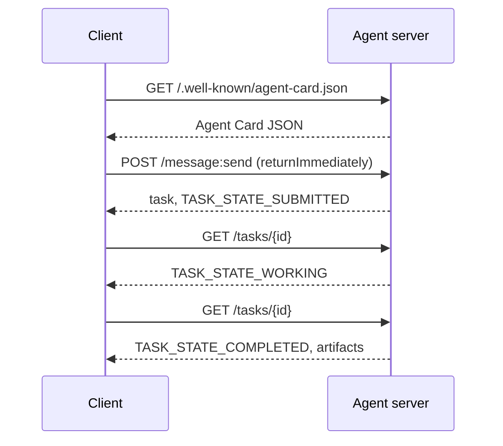

# A2A  O Protocolo Agente a Agente

> O Google anunciou A2A em abril de 2025; em abril de 2026 a especificação está em https://a2a-protocol.org/latest/specification/e 150 organizações apoiam-na. A2A é o complemento horizontal do MCP (Lessão 13): onde o MCP é vertical (agente  ferramentas), A2A é peer-to-peer (agente  agente). Ele define os Cartões de Agente (descoberta), tarefas com artefatos (texto, dados estruturados, vídeo), ciclos de vida de tarefas opacos e auth. Os sistemas de produção combinam cada vez mais o MCP com o A2A. O Google Cloud lançou o suporte A2A no Vertex AI Agent Builder durante 2025-2026.

**Type:** Learn + Build
**Languages:** Python (stdlib, `http.server`, `json`), TypeScript
**Prerequisites:** Phase 16 · 04 (Primitive Model)
**Time:** ~75 minutes

## Problemas

O seu agente precisa chamar outro agente em outro sistema. Como? Você pode expor um endpoint HTTP, definir um esquema JSON personalizado, e esperar que o outro lado fale. Cada par de agentes se torna uma integração personalizada.

A2A é o protocolo universal para essa chamada. Descoberta padrão, modelo de tarefa padrão, transporte padrão, artefatos padrão.

## Conceptos

### Os quatro elementos

**Agent Card.**Um documento JSON em `/.well-known/agent-card.json`Descrição do agente: nome, competências,`supportedInterfaces`(URL do ponto final, ligação de protocolo, versão do protocolo), tipos de mídia de entrada e saída padrão e requisitos de auth (`securitySchemes`- E mais .`securityRequirements`A descoberta acontece lendo o cartão.

```http
GET /.well-known/agent-card.json HTTP/1.1
Host: agent.example.com
```

```json
{
  "name": "code-review-agent",
  "description": "Reviews Python and TypeScript code.",
  "version": "1.0.0",
  "supportedInterfaces": [
    {
      "url": "https://agent.example.com",
      "protocolBinding": "HTTP+JSON",
      "protocolVersion": "1.0"
    }
  ],
  "capabilities": {"streaming": false, "pushNotifications": false},
  "securitySchemes": {
    "bearer": {"httpAuthSecurityScheme": {"scheme": "Bearer"}}
  },
  "securityRequirements": [{"schemes": {"bearer": {"list": []}}}],
  "defaultInputModes": ["text/plain", "application/json"],
  "defaultOutputModes": ["application/json"],
  "skills": [
    {
      "id": "review-python",
      "name": "Review Python",
      "description": "Reviews Python code.",
      "tags": ["code-review", "python"]
    },
    {
      "id": "review-typescript",
      "name": "Review TypeScript",
      "description": "Reviews TypeScript code.",
      "tags": ["code-review", "typescript"]
    }
  ]
}
```

**Task.**Uma unidade de trabalho, um objeto sincronizado, com um ciclo de vida:`TASK_STATE_SUBMITTED`→ `TASK_STATE_WORKING`→ `TASK_STATE_COMPLETED`- Não .`TASK_STATE_FAILED`- Não .`TASK_STATE_CANCELED`Um cliente envia uma mensagem, o servidor cria a tarefa e o cliente vota ou subscreve para atualizações.

**Artifact.**O tipo de resultado produzido por uma tarefa. Texto, JSON estruturado, imagem, vídeo, áudio.`text`- Não .`raw`- Não .`url`, ou `data`e pode nomear o seu `mediaType`, por isso diferentes modalidades são de primeira classe.

**Opaque lifecycle.**A A2A não prescreve *como* o agente remoto resolve a tarefa. O cliente vê transições de estado e artefatos; a implementação é livre de usar qualquer framework.

### A divisão MCP/A2A

- **MCP**(Lessão 13): agente  ferramenta. O agente lê/escreve através de JSON-RPC para um servidor de ferramentas.
- **A2A**O protocolo de pares, ambos os lados são agentes com o seu próprio raciocínio.

Os sistemas de produção multi-agentes usam ambos. Um par A2A chama ferramentas MCP de seu lado. A divisão mantém as duas preocupações limpas.

### Fluxo de descoberta



Estas são as rotas de ligação HTTP+JSON, e cada solicitação carrega `A2A-Version: 1.0`Por padrão .`SendMessage`bloqueia até que a tarefa atinja um estado terminal ou interrompido, de modo que um cliente de pesquisa define `configuration.returnImmediately`Para recuperar a tarefa de uma vez.

Ou com streaming: `POST /message:stream`Retorna Eventos enviados pelo servidor (a `task`Primeiro, depois.`statusUpdate`E ...`artifactUpdate`eventos), e `/tasks/{id}:subscribe`O fluxo de transmissão se fecha quando a tarefa atinge um estado terminal; não há `final`- Não.

### Autor

A A2A suporta três padrões comuns:

- **Bearer token**: OAuth2 ou opaco (`httpAuthSecurityScheme`ou `oauth2SecurityScheme`)).
- **mTLS**A Comissão Europeia (UE)`mtlsSecurityScheme`)).
- **API key**: uma chave num cabeçalho, parâmetro de consulta ou cookie (`apiKeySecurityScheme`)).

A autenticidade é declarada no cartão de agente: `securitySchemes`nomear cada regime e `securityRequirements`Diz quais os clientes devem satisfazer.

### 150+ organizações até abril de 2026

A adoção da empresa impulsionou a escala A2A. O título: A2A tornou-se a forma como os sistemas de agentes empresariais cruzaram as fronteiras de confiança. O Google Cloud enviou o suporte Vertex AI Agent Builder A2A; o Microsoft Agent Framework o suporta; a maioria das principais frameworks (LangGraph, CrewAI, AutoGen) enviam adaptadores A2A.

### Onde A2A ganha

- **Cross-organization calls.**Agente da empresa A chama agente da empresa B. Sem A2A, cada par é um contrato feito sob medida.
- **Heterogeneous frameworks.**O agente LangGraph chama o agente CrewAI chama o agente Python personalizado.
- **Typed artifacts.**Resultado de vídeo, JSON estruturado, áudio  todos de primeira classe.
- **Long-running tasks.**O ciclo de vida opaco + pesquisas tornam as tarefas de horas simples.

### Onde A2A luta

- **Latency-sensitive micro-calls.**O ciclo de vida do A2A é assíncrono. Sub-milissegundos agente-a-agente não se encaixa; usar RPC direto.
- **Tight-coupled in-process agents.**Se ambos os agentes executarem no mesmo processo Python, a viagem de ida e volta HTTP do A2A é exagerada.
- **Small teams.**Os custos gerais das especificações são reais; os agentes internos só podem não precisar da formalidade.

### A2A vs ACP, ANP, NLIP

Várias especificações relacionadas surgiram em 2024-2026:

- **ACP**(IBM/Linux Foundation)  antecessor do A2A, escopo mais estreito.
- **ANP**(Protocolo de Rede de Agentes)  Peer-discovery-heavy, descentralizado-first.
- **NLIP**(Protocolo de Interação da Língua Natural da Ecma, padronizado em dezembro de 2025)  tipo de conteúdo em língua natural.

A2A é o protocolo de pares mais adotado em abril de 2026. Veja arXiv:2505.02279 (Liu et al., "Um levantamento de protocolos de interoperabilidade de agentes") para comparação.

```figure
sw-agent-card-discovery
```

## Construí-lo

`code/main.py`implementa um servidor e cliente A2A-minimal usando `http.server`e JSON, na ligação HTTP + JSON 1.0.

- expõe`/.well-known/agent-card.json`- Não .
- Aceita .`POST /message:send`- Não .
- gerencia o estado da tarefa,
- Retorna artefatos em `GET /tasks/{id}`- Não .

O cliente:

- - Vai buscar o cartão de agente.
- Envia uma mensagem com `returnImmediately`- Não .
- sondagens até à conclusão,
- - Ele lê o artefato.

- Correr .

```
python3 code/main.py
npx tsx code/main.ts
```

O script inicia o servidor em um fio de fundo, e depois corre o cliente contra ele.

## Usá-lo

`outputs/skill-a2a-integrator.md`Desenha uma integração A2A: conteúdo do Cartão de Agente, esquemas de tarefas, escolha de autor, streaming versus sondagens.

## Envia-o

Lista de verificação:

- **Pin the spec version.**A2A ainda está a evoluir; cada `supportedInterfaces`A entrada declara o seu `protocolVersion`, e os clientes enviam`A2A-Version: 1.0`- Não .
- **Idempotent task creation.**As submissões duplicadas (retemps de rede) devem produzir uma tarefa.`messageId`- Não .
- **Artifact schemas.**Declare quais são as formas que o agente retorna; os consumidores devem validar.
- **Rate limits + auth.**A2A é de uso público; aplica segurança web padrão.
- **Dead-letter for failed tasks.**Inspeccionar os padrões ao longo do tempo para detectar tipos de falhas recorrentes.

## Exercícios

1. Corra .`code/main.py`Confirme que o cliente descobre o servidor e recebe o artefato correto.
2. Adicionar uma segunda habilidade ao servidor (por exemplo, "resumir"). Atualizar o Cartão de Agente. Escrever um cliente que escolhe a habilidade com base no tipo de tarefa. Uma solicitação 1.0 não tem campo de habilidade, então o servidor percorre as partes de mensagem.
3. Implementação `POST /message:stream`: resposta com Eventos enviados pelo servidor (a `task`Primeiro, depois.`statusUpdate`O cliente precisa fazer o que de diferente?
4. Leia a especificação A2A (https://a2a-protocol.org/latest/specification/O artigo 1.o, n.o 1, do Regulamento (CE) n.o 1069/2009 estabelece as regras aplicáveis às empresas que não utilizam a tecnologia.
5. Compare A2A (Agent Card discovery) com MCP (Listing of Server-side capabilities via `listTools`O que é a compensação entre agentes que se descrevem e testes de capacidade?

## Termos-chave

| Term | What people say | What it actually means |
|------|----------------|------------------------|
| A2A | "Agent-to-agent" | Peer protocol for agents to call other agents across systems. Google 2025. |
| Agent Card | "The agent's business card" | JSON at `/.well-known/agent-card.json` describing skills, `supportedInterfaces`, auth. |
| Task | "The unit of work" | Async stateful object with a lifecycle; artifacts produced on completion. |
| Artifact | "The result" | Typed output: text, structured JSON, image, video, audio. First-class media. |
| Opaque lifecycle | "How it's solved is the agent's business" | Client sees state transitions; server is free to choose framework/tools. |
| Discovery | "Finding the agent" | `GET /.well-known/agent-card.json` returns the card. |
| MCP vs A2A | "Tools vs peers" | MCP: vertical agent ↔ tool. A2A: horizontal agent ↔ agent. |
| ACP / ANP / NLIP | "Sibling protocols" | Adjacent specs; A2A is the most-adopted 2026. |

## Mais leitura

- [A2A specification](https://a2a-protocol.org/latest/specification/) a especificação canónica
- [A2A v1.0.1 release](https://github.com/a2aproject/A2A/tree/v1.0.1): os marcados `docs/specification.md`E ...`specification/a2a.proto`Esta lição segue
- [Google Developers Blog — A2A announcement](https://developers.googleblog.com/en/a2a-a-new-era-of-agent-interoperability/) Abril de 2025
- [A2A GitHub repo](https://github.com/a2aproject/A2A) Implementações de referência e KDS
- [Liu et al. — A Survey of Agent Interoperability Protocols](https://arxiv.org/html/2505.02279v1) Comparar MCP, ACP, A2A, ANP
