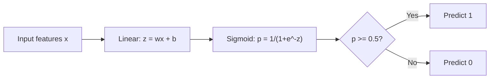
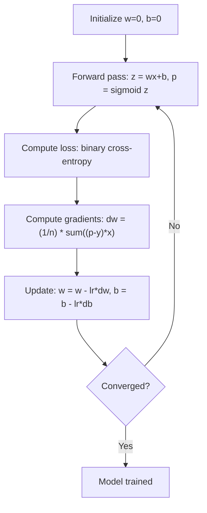

# Logistik Geri Dönüş

> Lojiistik gerileme, olasılıklarla evet veya hayır sorularına cevap vermek için düz çizgiyi S eğriye eğer.

**Type:** Build
**Languages:** Python, Julia, Rust
**Prerequisites:** Phase 2 Lesson 1-2 (What Is ML, Linear Regression)
**Time:** ~90 minutes

## Öğrenme Hedefleri

- Sigmoid işlevi ve ikili çapraz entropi kaybı kullanarak sıfırdan lojistik geri dönüşü uygulayın
- Bilgisayar ve yorumlama doğruluğu, hatırlama, F1 puanı ve ikili sınıflandırma için karışıklık matrisi
- MSE'nin sınıflandırılmayı neden başarısız ettiğini ve ikili çapraz entropi'nin neden konveks bir maliyet yüzeyini ürettiğini açıklayın.
- Çoklu sınıflandırma için softmax gerileme modeli oluşturun ve eşiğin ayarlama anlaşmaları değerlendirin

## Sorun

Bir tümörün büyüklüğü bakıldığında kötü huylu veya iyi huylu olup olmadığını tahmin etmek istersiniz. Düzsel geri dönüş denersiniz. 0.3 veya 1.7 veya -0.5 gibi sayılarda sonuçlar verir. Bunlar ne anlama gelir? 1.7 "çok kötü huylu" mu? -0.5 "çok iyi huylu" mu? Düzsel geri dönüş sınırsız sayılarda sonuçlar verir. Sınıflandırmaya 0 ile 1 arasında sınırlı olasılıklar ve net bir karar gerekir: evet veya hayır.

Logistik gerileme bunu çözür.$wx + b$Bu sayede, bir olasılık çıkışını oluşturur.

Bu uygulamalarda en yaygın kullanılan algoritmalardan biridir. Adına rağmen, lojistik gerileme bir sınıflandırma algoritması, gerileme algoritması değil. Adı kullanıldığı lojistik (sigmoid) işleviyle gelir.

## Anlaşım

### Neden Düzsel Geri Dönüştürme Klasikasyonda Başarısız

Çalışma saatlerine dayanarak geçiş/başarısızlık tahminini hayal edin.

```
hours:  1   2   3   4   5   6   7   8   9   10
actual: 0   0   0   0   1   1   1   1   1   1
```

Bir doğrusal uyumlama saat 1'de -0.2 ve saat 10'da 1.3 gibi tahminler üretebilir. Bu değerler olasılıklar değildir. 0'dan aşağı ve 1'den yukarı giderler. Daha da kötüsü, tek bir dışa çıkış (50 saat incelediği biri) tüm çizgiyi sürükler ve herkes için tahminleri değiştirir.

Sınıflandırma, aşağıdaki fonksiyona ihtiyaç duyar:
- 0 ile 1 arasındaki çıkış değerleri (muhtemelenlikler)
- Keskin bir geçiş yaratır (bir karar sınırı)
- Sınırdan uzak bir sıradanlık tarafından çarpıtılmamıştır

### Sigmoid Fonksiyonu

Sigmoid fonksiyonu tam olarak bunu yapar:

```math
\sigma(z) = \frac{1}{1 + e^{-z}}
```

Özellikleri:
- Ne zaman ?$z$büyük ve olumlu.$\sigma(z)$yaklaşımlar 1
- Ne zaman ?$z$büyük ve negatif.$\sigma(z)$yaklaşım 0
- Ne zaman ?$z = 0$- Evet .$\sigma(z) = 0.5$
- Çıktı her zaman 0 ile 1 arasında
- İşlev her yerde düzgün ve farklılık gösterir

Devirenin uygun bir şekli vardır: $\sigma'(z) = \sigma(z) (1 - \sigma(z))$Bu gradient hesaplamalarını verimli hale getirir.

### Logistik Geri Dönüş = Düzsel Model + Sigmoid

Modeldeki hesaplamalar $z = wx + b$(sadece doğrusal gerileme gibi), sonra sigmoid uygulanır:



Çıktı $p$Bu ifade $P(y=1 \mid x)$, girişlerin 1. sınıfına ait olma olasılığı.$wx + b = 0$, Sigmoid çıkışı tam olarak 0.5 yapar.

### Biner çapraz entropik kaybı

MSE'yi lojistik gerileme için kullanamazsınız. Sigmoid ile MSE, birçok yerel minimum ile konveks olmayan bir maliyet yüzeyini oluşturur.

```math
\text{Loss} = -\frac{1}{n} \sum \left( y \log(p) + (1-y) \log(1-p) \right)
```

Neden işe yarıyor:
- Ne zaman ?$y=1$ve $p$1'e yakın.$\log(1) = 0$, yani kaybı 0 yakın (doğru, düşük maliyet)
- Ne zaman ?$y=1$ve $p$0'ya yakın: $\log(0)$Negatif sonsuzluk yaklaşır, bu yüzden kayıp büyüktür ( yanlışı, yüksek maliyet)
- Ne zaman ?$y=0$ve $p$0'ya yakın: $\log(1) = 0$, yani kaybı 0 yakın (doğru, düşük maliyet)
- Ne zaman ?$y=0$ve $p$1'e yakın.$\log(0)$Negatif sonsuzluk yaklaşır, bu yüzden kayıp büyüktür ( yanlışı, yüksek maliyet)

Bu kayıp işlevi lojistik gerileme için eğri, bu nedenle her yerel minimum küresel bir minimum ve gradient düşüşü kötü birinde sıkışamaz. mükemmel ayrılabilir verilerde kayıp ağırlıkların büyüdükçe düşmeye devam eder, bu nedenle sınırlı minimum yoktur; L2 düzenlenmesi bunu düzeltir ve minimumı eşsiz yapar.

### Logistik Geri Dönüşüm için Aralıklı Düşüş

Sigmoid ile ikili çapraz entropi için gradientler temiz bir formda bulunur:

```math
\begin{aligned}
\frac{\partial L}{\partial w} &= \frac{1}{n} \sum (p - y) \, x \\
\frac{\partial L}{\partial b} &= \frac{1}{n} \sum (p - y)
\end{aligned}
```

Bu çizgisi gerileme gradiyenti ile aynı görünüyor.$p = \sigma(wx + b)$yerine$p = wx + b$Sigmoid, doğrusal olmayanlığı tanıtır, ama gradient güncelleme kuralı aynı kalır.



### Karar Sınırı

2D giriş için (iki özellik), karar sınırı, aşağıdaki çizgidir:

```math
w_1 x_1 + w_2 x_2 + b = 0
```

Bir tarafta noktalar 1 olarak sınıflandırılır, diğer tarafta 0 olarak sınıflandırılır. Logistik geri dönüş her zaman doğrusal bir karar sınırı üretir. Eğer eğri bir sınırı istiyorsanız, ya polinom özellikleri eklersiniz ya da doğrusal olmayan bir model kullanırsınız.

### Softmax ile çok sınıf sınıflandırma

İkili lojistik gerileme iki sınıfı ele alır.$k$sınıflar, softmax fonksiyonunu kullanın:

```math
\text{softmax}(z_i) = \frac{e^{z_i}}{\sum_j e^{z_j}}
```

Her sınıfın kendi ağırlık vektörü vardır.$z_i$Her sınıf için, softmax puanları 1'e denk olan olasılıklara dönüştürür.

Kayıp işlevi kategorik çapraz entropiye dönüşür:

```math
\text{Loss} = -\frac{1}{n} \sum \sum_k y_k \log(p_k)
```

nerede$y_k$gerçek sınıf için 1 ve diğer tüm sınıflar için 0 (bir sıcaktan kodlama).

### Değerlendirme Metrikleri

Sadece doğruluk yeterli değildir. %95 negatif ve %5 pozitif olan bir veri kümesi için, her zaman negatif tahmin eden bir model %95 doğruluk elde eder ancak işe yaramaz.

**Confusion Matrix**- ...

| | Predicted Positive | Predicted Negative |
|---|---|---|
| Actually Positive | True Positive (TP) | False Negative (FN) |
| Actually Negative | False Positive (FP) | True Negative (TN) |

**Precision**Tüm öngörülen olumlu sonuçlardan kaçı aslında olumlu?
```math
\text{Precision} = \frac{TP}{TP + FP}
```

**Recall**(Sensitivite): Tüm olumlu sonuçlardan kaç tane yakaladık?
```math
\text{Recall} = \frac{TP}{TP + FN}
```

**F1 Score**: Harmonik kesim kesimleri, doğru ve geri çağırma.
```math
F_1 = 2 \cdot \frac{\text{Precision} \cdot \text{Recall}}{\text{Precision} + \text{Recall}}
```

Öncelikleri ne zaman belirleyin:
- **Precision**: yanlış pozitiflerin maliyetli olduğu zaman (spam filtre, meşru e-postaları engellemek istemezsiniz)
- **Recall**: yanlış negatiflerin maliyetli olduğu (kanser taraması, tümörü kaçırmak istemezsiniz)
- **F1**: tek dengeli bir metrik gerekirse

```figure
logistic-sigmoid
```

## Yapın

### Adım 1: Sigmoid fonksiyonu ve veri üretimi

```python
import random
import math

def sigmoid(z):
    z = max(-500, min(500, z))
    return 1.0 / (1.0 + math.exp(-z))


random.seed(42)
N = 200
X = []
y = []

for _ in range(N // 2):
    X.append([random.gauss(2, 1), random.gauss(2, 1)])
    y.append(0)

for _ in range(N // 2):
    X.append([random.gauss(5, 1), random.gauss(5, 1)])
    y.append(1)

combined = list(zip(X, y))
random.shuffle(combined)
X, y = zip(*combined)
X = list(X)
y = list(y)

print(f"Generated {N} samples (2 classes, 2 features)")
print(f"Class 0 center: (2, 2), Class 1 center: (5, 5)")
print(f"First 5 samples:")
for i in range(5):
    print(f"  Features: [{X[i][0]:.2f}, {X[i][1]:.2f}], Label: {y[i]}")
```

### Adım 2: Lojiistik geri dönüş sıfırdan

```python
class LogisticRegression:
    def __init__(self, n_features, learning_rate=0.01):
        self.weights = [0.0] * n_features
        self.bias = 0.0
        self.lr = learning_rate
        self.loss_history = []

    def predict_proba(self, x):
        z = sum(w * xi for w, xi in zip(self.weights, x)) + self.bias
        return sigmoid(z)

    def predict(self, x, threshold=0.5):
        return 1 if self.predict_proba(x) >= threshold else 0

    def compute_loss(self, X, y):
        n = len(y)
        total = 0.0
        for i in range(n):
            p = self.predict_proba(X[i])
            p = max(1e-15, min(1 - 1e-15, p))
            total += y[i] * math.log(p) + (1 - y[i]) * math.log(1 - p)
        return -total / n

    def fit(self, X, y, epochs=1000, print_every=200):
        n = len(y)
        n_features = len(X[0])
        for epoch in range(epochs):
            dw = [0.0] * n_features
            db = 0.0
            for i in range(n):
                p = self.predict_proba(X[i])
                error = p - y[i]
                for j in range(n_features):
                    dw[j] += error * X[i][j]
                db += error
            for j in range(n_features):
                self.weights[j] -= self.lr * (dw[j] / n)
            self.bias -= self.lr * (db / n)
            loss = self.compute_loss(X, y)
            self.loss_history.append(loss)
            if epoch % print_every == 0:
                print(f"  Epoch {epoch:4d} | Loss: {loss:.4f} | w: [{self.weights[0]:.3f}, {self.weights[1]:.3f}] | b: {self.bias:.3f}")
        return self

    def accuracy(self, X, y):
        correct = sum(1 for i in range(len(y)) if self.predict(X[i]) == y[i])
        return correct / len(y)


split = int(0.8 * N)
X_train, X_test = X[:split], X[split:]
y_train, y_test = y[:split], y[split:]

print("\n=== Training Logistic Regression ===")
model = LogisticRegression(n_features=2, learning_rate=0.1)
model.fit(X_train, y_train, epochs=1000, print_every=200)

print(f"\nTrain accuracy: {model.accuracy(X_train, y_train):.4f}")
print(f"Test accuracy:  {model.accuracy(X_test, y_test):.4f}")
print(f"Weights: [{model.weights[0]:.4f}, {model.weights[1]:.4f}]")
print(f"Bias: {model.bias:.4f}")
```

### Adım 3: Kafanın matrisi ve ölçümleri sıfırdan

```python
class ClassificationMetrics:
    def __init__(self, y_true, y_pred):
        self.tp = sum(1 for t, p in zip(y_true, y_pred) if t == 1 and p == 1)
        self.tn = sum(1 for t, p in zip(y_true, y_pred) if t == 0 and p == 0)
        self.fp = sum(1 for t, p in zip(y_true, y_pred) if t == 0 and p == 1)
        self.fn = sum(1 for t, p in zip(y_true, y_pred) if t == 1 and p == 0)

    def accuracy(self):
        total = self.tp + self.tn + self.fp + self.fn
        return (self.tp + self.tn) / total if total > 0 else 0

    def precision(self):
        denom = self.tp + self.fp
        return self.tp / denom if denom > 0 else 0

    def recall(self):
        denom = self.tp + self.fn
        return self.tp / denom if denom > 0 else 0

    def f1(self):
        p = self.precision()
        r = self.recall()
        return 2 * p * r / (p + r) if (p + r) > 0 else 0

    def print_confusion_matrix(self):
        print(f"\n  Confusion Matrix:")
        print(f"                  Predicted")
        print(f"                  Pos   Neg")
        print(f"  Actual Pos     {self.tp:4d}  {self.fn:4d}")
        print(f"  Actual Neg     {self.fp:4d}  {self.tn:4d}")

    def print_report(self):
        self.print_confusion_matrix()
        print(f"\n  Accuracy:  {self.accuracy():.4f}")
        print(f"  Precision: {self.precision():.4f}")
        print(f"  Recall:    {self.recall():.4f}")
        print(f"  F1 Score:  {self.f1():.4f}")


y_pred_test = [model.predict(x) for x in X_test]
print("\n=== Classification Report (Test Set) ===")
metrics = ClassificationMetrics(y_test, y_pred_test)
metrics.print_report()
```

### 4. Adım: Karar sınırları analizi

```python
print("\n=== Decision Boundary ===")
w1, w2 = model.weights
b = model.bias
print(f"Decision boundary: {w1:.4f}*x1 + {w2:.4f}*x2 + {b:.4f} = 0")
if abs(w2) > 1e-10:
    print(f"Solved for x2:     x2 = {-w1/w2:.4f}*x1 + {-b/w2:.4f}")

print("\nSample predictions near the boundary:")
test_points = [
    [3.0, 3.0],
    [3.5, 3.5],
    [4.0, 4.0],
    [2.5, 2.5],
    [5.0, 5.0],
]
for point in test_points:
    prob = model.predict_proba(point)
    pred = model.predict(point)
    print(f"  [{point[0]}, {point[1]}] -> prob={prob:.4f}, class={pred}")
```

### Adım 5: Softmax ile çok sınıflı

```python
class SoftmaxRegression:
    def __init__(self, n_features, n_classes, learning_rate=0.01):
        self.n_features = n_features
        self.n_classes = n_classes
        self.lr = learning_rate
        self.weights = [[0.0] * n_features for _ in range(n_classes)]
        self.biases = [0.0] * n_classes

    def softmax(self, scores):
        max_score = max(scores)
        exp_scores = [math.exp(s - max_score) for s in scores]
        total = sum(exp_scores)
        return [e / total for e in exp_scores]

    def predict_proba(self, x):
        scores = [
            sum(self.weights[k][j] * x[j] for j in range(self.n_features)) + self.biases[k]
            for k in range(self.n_classes)
        ]
        return self.softmax(scores)

    def predict(self, x):
        probs = self.predict_proba(x)
        return probs.index(max(probs))

    def fit(self, X, y, epochs=1000, print_every=200):
        n = len(y)
        for epoch in range(epochs):
            grad_w = [[0.0] * self.n_features for _ in range(self.n_classes)]
            grad_b = [0.0] * self.n_classes
            total_loss = 0.0
            for i in range(n):
                probs = self.predict_proba(X[i])
                for k in range(self.n_classes):
                    target = 1.0 if y[i] == k else 0.0
                    error = probs[k] - target
                    for j in range(self.n_features):
                        grad_w[k][j] += error * X[i][j]
                    grad_b[k] += error
                true_prob = max(probs[y[i]], 1e-15)
                total_loss -= math.log(true_prob)
            for k in range(self.n_classes):
                for j in range(self.n_features):
                    self.weights[k][j] -= self.lr * (grad_w[k][j] / n)
                self.biases[k] -= self.lr * (grad_b[k] / n)
            if epoch % print_every == 0:
                print(f"  Epoch {epoch:4d} | Loss: {total_loss / n:.4f}")
        return self

    def accuracy(self, X, y):
        correct = sum(1 for i in range(len(y)) if self.predict(X[i]) == y[i])
        return correct / len(y)


random.seed(42)
X_3class = []
y_3class = []

centers = [(1, 1), (5, 1), (3, 5)]
for label, (cx, cy) in enumerate(centers):
    for _ in range(50):
        X_3class.append([random.gauss(cx, 0.8), random.gauss(cy, 0.8)])
        y_3class.append(label)

combined = list(zip(X_3class, y_3class))
random.shuffle(combined)
X_3class, y_3class = zip(*combined)
X_3class = list(X_3class)
y_3class = list(y_3class)

split_3 = int(0.8 * len(X_3class))
X_train_3 = X_3class[:split_3]
y_train_3 = y_3class[:split_3]
X_test_3 = X_3class[split_3:]
y_test_3 = y_3class[split_3:]

print("\n=== Multi-class Softmax Regression (3 classes) ===")
softmax_model = SoftmaxRegression(n_features=2, n_classes=3, learning_rate=0.1)
softmax_model.fit(X_train_3, y_train_3, epochs=1000, print_every=200)
print(f"\nTrain accuracy: {softmax_model.accuracy(X_train_3, y_train_3):.4f}")
print(f"Test accuracy:  {softmax_model.accuracy(X_test_3, y_test_3):.4f}")

print("\nSample predictions:")
for i in range(5):
    probs = softmax_model.predict_proba(X_test_3[i])
    pred = softmax_model.predict(X_test_3[i])
    print(f"  True: {y_test_3[i]}, Predicted: {pred}, Probs: [{', '.join(f'{p:.3f}' for p in probs)}]")
```

### Adım 6: Eğitme eşiği ayarlama

```python
print("\n=== Threshold Tuning ===")
print("Default threshold: 0.5. Adjusting the threshold trades precision for recall.\n")

thresholds = [0.3, 0.4, 0.5, 0.6, 0.7]
print(f"{'Threshold':>10} {'Accuracy':>10} {'Precision':>10} {'Recall':>10} {'F1':>10}")
print("-" * 52)

for t in thresholds:
    y_pred_t = [1 if model.predict_proba(x) >= t else 0 for x in X_test]
    m = ClassificationMetrics(y_test, y_pred_t)
    print(f"{t:>10.1f} {m.accuracy():>10.4f} {m.precision():>10.4f} {m.recall():>10.4f} {m.f1():>10.4f}")
```

## Kullan

Şimdi de tıpkı tıpkı tıpkı tıpkı tıpkı tıpkı tıpkı tıpkı tıpkı tıpkı tıpkı tıpkı tıpkı tıpkı tıpkı tıpkı tıpkı tıpkı tıp gibi.

```python
from sklearn.linear_model import LogisticRegression as SklearnLR
from sklearn.metrics import accuracy_score, precision_score, recall_score, f1_score
from sklearn.metrics import confusion_matrix, classification_report
from sklearn.model_selection import train_test_split
from sklearn.preprocessing import StandardScaler
import numpy as np

np.random.seed(42)
X_0 = np.random.randn(100, 2) + [2, 2]
X_1 = np.random.randn(100, 2) + [5, 5]
X_sk = np.vstack([X_0, X_1])
y_sk = np.array([0] * 100 + [1] * 100)

X_tr, X_te, y_tr, y_te = train_test_split(X_sk, y_sk, test_size=0.2, random_state=42)

scaler = StandardScaler()
X_tr_sc = scaler.fit_transform(X_tr)
X_te_sc = scaler.transform(X_te)

lr = SklearnLR()
lr.fit(X_tr_sc, y_tr)
y_pred = lr.predict(X_te_sc)

print("=== Scikit-learn Logistic Regression ===")
print(f"Accuracy:  {accuracy_score(y_te, y_pred):.4f}")
print(f"Precision: {precision_score(y_te, y_pred):.4f}")
print(f"Recall:    {recall_score(y_te, y_pred):.4f}")
print(f"F1:        {f1_score(y_te, y_pred):.4f}")
print(f"\nConfusion Matrix:\n{confusion_matrix(y_te, y_pred)}")
print(f"\nClassification Report:\n{classification_report(y_te, y_pred)}")
```

Scikit-learn çözücü seçeneklerini (liblinear, lbfgs, saga), otomatik düzenlendirme, çok sınıflı stratejiler (bir vs. geri kalan, çok sayısal) ve sayısal istikrar optimizasyonlarını ekler.

## Gönder

Bu ders şunları ortaya çıkarır:
- `code/logistic_regression.py`- metriklerle sıfırdan lojistik geri dönüş
- `code/main.rs`- Rust'deki aynı kod, sadece STDlib.`rustc --edition 2021 code/main.rs && ./main`- Evet .

## Egzersizler

1. Düzsel olarak ayırılamaz bir veri kümesi oluşturun (örneğin iki konsentrik döngü).$x_1^2, x_2^2, x_1 x_2$Düzgünlüğün iyileştiğini göster.
2. 3 sınıf softmax modeli için bir çok sınıf karışıklık matrisi uygulayın.
3. 0'dan 1'e kadar 100 eşiğin değerleri için gerçek pozitif oranı ve yanlış pozitif oranı hesaplayın.

## Anahtar Terimler

| Term | What people say | What it actually means |
|------|----------------|----------------------|
| Logistic regression | "Regression for classification" | A linear model followed by a sigmoid function that outputs class probabilities |
| Sigmoid function | "The S-curve" | The function $1/(1+e^{-z})$ that maps any real number to the range (0, 1) |
| Binary cross-entropy | "Log loss" | The loss function $-[y \log(p) + (1-y) \log(1-p)]$ that penalizes confident wrong predictions severely |
| Decision boundary | "The dividing line" | The surface where the model's output probability equals 0.5, separating predicted classes |
| Softmax | "Multi-class sigmoid" | A function that converts a vector of scores into probabilities that sum to 1 |
| Precision | "How many selected are relevant" | $TP / (TP + FP)$, the fraction of positive predictions that are actually positive |
| Recall | "How many relevant are selected" | $TP / (TP + FN)$, the fraction of actual positives that the model correctly identifies |
| F1 score | "Balanced accuracy" | The harmonic mean of precision and recall: $2PR / (P+R)$ |
| Confusion matrix | "The error breakdown" | A table showing TP, TN, FP, FN counts for each class pair |
| Threshold | "The cutoff" | The probability value above which the model predicts class 1 (default 0.5, tunable) |
| One-hot encoding | "Binary columns for categories" | Representing class $k$ as a vector of zeros with a 1 at position $k$ |
| Categorical cross-entropy | "Multi-class log loss" | The extension of binary cross-entropy to $k$ classes using one-hot encoded labels |
