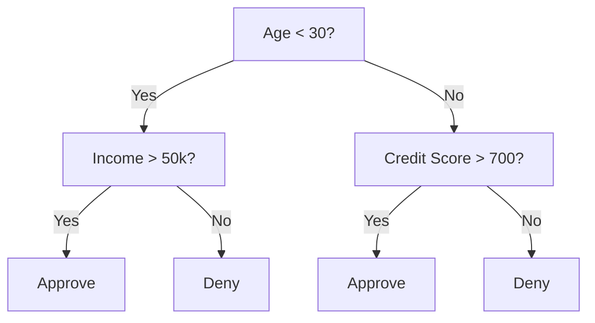
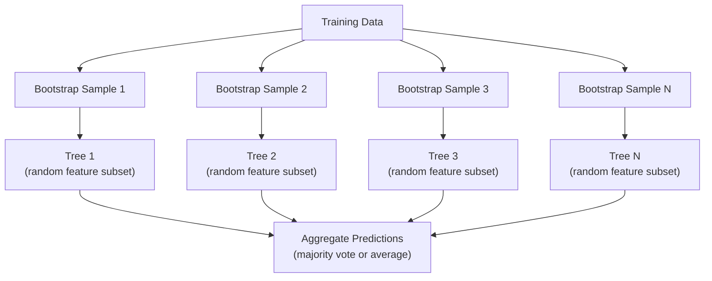

# Karar ağaçları ve rastgele ormanlar

> Bir karar ağacı sadece bir akış haritasıdır. Ama bir orman, ML'de en güçlü araçlardan biridir.

**Type:** Build
**Languages:** Python, TypeScript
**Prerequisites:** Phase 1 (Lessons 09 Information Theory, 06 Probability)
**Time:** ~90 minutes

## Öğrenme Hedefleri

- Optimal karar ağacı bölünmeleri bulmak için Gini kirliliği, entropi ve bilgi kazanç hesaplamalarını uygulayın
- Ön kesim kontrolleriyle bir karar ağacı sınıflandırıcısı oluşturmak (maksimum derinlik, minimum örnekler)
- Bootstrap örneği ve özellik rastlantısını kullanarak rastgele bir orman inşa edin ve neden varyansiyi azaltdığını açıklayın
- MDI özelliklerinin önemini permutasyon önemine karşılaştırın ve MDI'nin tarafsız olduğunu belirleyin

## Sorun

Tablo verileri var. Satırlar örnekler, sütunlar özellikler ve tahmin etmek istediğiniz bir hedef sütun vardır. Ona bir sinir ağı atabilirsiniz. Ancak tablo verileri için, ağaç tabanlı modeller (hüküm ağaçları, rastgele ormanlar, gradient artmış ağaçlar) sürekli derin öğrenmeyi üstlenir. Yapılandırılmış veriler üzerinde Kaggle yarışları XGBoost ve LightGBM tarafından egemenlik kazanılır, transformatörler değil.

Neden? Ağaçlar önceden işleme yapmadan karıştırılmış özellik türlerini (sayısal ve kategorik) işliyor. Özellik mühendisliği olmadan çizgisiz ilişkileri işliyor. Anlatabilir: ağaca bakabilir ve tahminlerin tam olarak neden yapıldığını görebilirsiniz.

Bu ders, geri dönüşlü bölünme kullanarak karar ağaçlarını sıfırdan inşa eder, sonra üstte rastgele bir orman inşa eder. Bölünme kriterlerinin arkasındaki matematiği uygulayacaksınız (Gini kirlilik, entropi, bilgi kazancı) ve zayıf öğrencilerin bir grubunun neden güçlü bir grup haline geldiğini anlayacaksınız.

## Anlaşım

### Karar ağacının ne işi var ?

Bir karar ağacı, evet/hayır soruları bir dizi sorarak özellik alanını dikdörtgen bölgelere ayırır.



Her iç düğüm bir özelliği bir eşiğe karşı test eder. Her bir yaprak düğüm bir tahmin yapar. Yeni bir veri noktasını sınıflandırmak için, köküden başlayıp bir yaprak olana kadar dalları takip edersiniz.

Ağaç, her düğümde verileri en iyi şekilde ayıran özellik ve eşiği seçerek üst-üstün inşa edilir. "En iyi" bölünme kriterine göre tanımlanır.

### Ayrılma kriterleri: kirlilik ölçümü

Her düğümde bir dizi örnek var. Onları bölmek istiyoruz, böylece elde edilen çocuk düğümleri mümkün olduğunca "temiz" olur, yani her çocuk çoğunlukla bir sınıf içerir.

**Gini impurity**Bu, rastgele seçilen bir örneğin, bu düğümdeki sınıf dağılımına göre etiketlenmesi durumunda yanlış sınıflandırılma olasılığını ölçer.

```math
\text{Gini}(S) = 1 - \sum_k p_k^2 \quad \text{where } p_k \text{ is the proportion of class } k \text{ in set } S.
```

Saf bir düğüm için (her biri bir sınıf), Gini = 0. 50/50 sınıflı bir ikili bölünme için Gini = 0.5.

```
Example: 6 cats, 4 dogs

Gini = 1 - (0.6^2 + 0.4^2) = 1 - (0.36 + 0.16) = 0.48
```

**Entropy**Bir düğümdeki bilgi içeriğini (bozukluğu) ölçer.

```math
\text{Entropy}(S) = -\sum_k p_k \log_2(p_k)
```

saf bir düğüm için entropy = 0. 50/50 çift bölünme için entropy = 1.0.

```
Example: 6 cats, 4 dogs

Entropy = -(0.6 * log2(0.6) + 0.4 * log2(0.4))
        = -(0.6 * -0.737 + 0.4 * -1.322)
        = 0.442 + 0.529
        = 0.971 bits
```

**Information gain**bölünmeden sonra kirlilik (entropy veya Gini) azalmasıdır.

```math
\begin{aligned}
& IG(S, \text{feature}, \text{threshold}) = \text{Impurity}(S) - \text{weighted\_avg}(\text{Impurity}(S_{\text{left}}), \text{Impurity}(S_{\text{right}})) \\[4pt]
& \text{where the weights are the proportions of samples in each child.}
\end{aligned}
```

Her düğümde açgözlü algoritma: her özelliği ve olası her eşiği deneyin. Bilgi kazanımını en üst düzeye çıkaran (söz, eşiği) çiftini seçin.

### Bölünme nasıl çalışır

 ile bir veri kümesi için$n$Özellikleri ve $m$Akım düğümünde örnekler:

1. Her özellik için $j$($j = 1$- ...$n$):
   - Örnekleri özelliklere göre sıralayın $j$
   - Ardından farklı değerler arasındaki her orta noktayı bir eşiği olarak deneyin
   - Her eşiğin bilgi kazanımını hesaplayın
2. En yüksek bilgi kazancı olan özellik ve eşiği seçin
3. Verileri sola (sırh <= değer) ve sağa (sırh > değer) bölün
4. Her çocuğa tekrar

Bu açgözlülükle yaklaşım küresel olarak en iyi ağacı garanti etmez. En iyi ağacı bulmak NP-kısıtlı. Ama açgözlülükle bölmek pratikte iyi çalışır.

### Durdurma koşulları

Ağaç, durma koşulları olmadan her yaprak saf olana kadar veya parçalanmadan örneklerini ayırana kadar büyür, genellikle bir yaprak başına tek bir örnekten aşağı. Bu eğitim verilerini mükemmel bir şekilde ezberler ve korkunç bir şekilde genelleştirir.

**Pre-pruning**ağaç tamamen büyümeden önce durdurur:
- Maksimum derinlik: ağaç belirlenmiş bir derinliğe ulaştığında bölünmeyi durdurur
- Yarpaq başına en az örnek: bir düğümün ' dan daha azı varsa dur.$k$örnekler
- En az bilgi kazanımı: en iyi bölünme pisliği bir eşiğinden daha az iyileştirirse durur
- Maksimum yaprak düğümleri: toplam yaprak sayısını sınırlayın

**Post-pruning**Sonra da onu biçer.
- Masraflı karmaşıklıklı kesim (sikit-learn kullanılır): yaprak sayısına orantılı bir ceza eklenir.
- Kötü hata kesimi: Eğer doğrulama hatası artmazsa alt ağacı kaldırın

Ön kesim daha basit ve daha hızlıdır. Kesimden sonra genellikle daha iyi ağaçlar üretilir, çünkü daha faydalı daha fazla kesime yol açabilecek kesimleri erken durdurmaz.

### Geri dönüş için karar ağaçları

Regresiyon için, yaprak tahminleri bu yapraktaki hedef değerlerin ortalamasıdır.

**Variance reduction**bilgi kazanımı yerine:

```math
VR(S, \text{feature}, \text{threshold}) = \text{Var}(S) - \text{weighted\_avg}(\text{Var}(S_{\text{left}}), \text{Var}(S_{\text{right}}))
```

Ağaç giriş alanını bölgeye ayırır ve her bölgede sabit (ortalama) tahmin eder.

### Rastgele ormanlar: Ansembllerin gücü

Tek bir karar ağacı yüksek bir değişikliğe sahiptir. Verilerdeki küçük değişiklikler tamamen farklı ağaçlar üretebilir.



İki rastlantı kaynağı ağaçları çeşitlendirir:

**Bagging (bootstrap aggregating):**Her ağaç, eğitim verilerinden değiştirilen rastgele bir örnek olan bir başlangıç örneği üzerinde eğitilir.

**Feature randomization:**Her bölünmede, yalnızca rastgele bir özellik alt kümesi dikkate alınır.$\sqrt{n_{\text{features}}}$Geri dönüş için.$n_{\text{features}}/3$Bu, tüm ağaçların aynı baskın özellik üzerinde bölünmesini engeller.

Anahtar bir anlayış: ortalama bir çok koraylı ağaç, önyargıyı arttırmadan farklılığı azaltır.

### Özellik önemi

Rastgele ormanlar doğal olarak özellik önem puanları sağlar.

**Mean Decrease in Impurity (MDI):**Her bir özellik için, tüm ağaçlar ve bu özellik kullanıldığı tüm düğümlerdeki kirliliklerin toplam azalmasını toplamlayın.

```math
\text{importance}(\text{feature}_j) = \sum_{\text{nodes where feature}_j \text{ is used}} \frac{n_{\text{samples at node}}}{n_{\text{total samples}}} \cdot \text{impurity\_decrease}
```

Bu hızlı (öğrenme sırasında hesaplanır), ancak yüksek kardinalite özelliklerine ve birçok olası bölünme noktasına yönelen özelliklere yönlendirilir.

**Permutation importance**Bu seçenek, bir özelliğin değerlerini karıştırıp modelin doğruluğunun ne kadar düştüğünü ölçmek.

### Ağaçlar sinir ağlarını vurduğunda

Ağaçlar ve ormanlar, tablo verileri üzerinde sinir ağlarında egemenlik göstermektedir.

| Factor | Trees | Neural networks |
|--------|-------|----------------|
| Mixed types (numeric + categorical) | Native support | Need encoding |
| Small datasets (< 10k rows) | Work well | Overfit |
| Feature interactions | Found by splitting | Need architecture design |
| Interpretability | Full transparency | Black box |
| Training time | Minutes | Hours |
| Hyperparameter sensitivity | Low | High |

Nöral ağlar verilerin uzaylı veya sıralı yapısı (resimler, metin, ses) olduğunda kazanır.

```figure
decision-tree-depth
```

## Yapın

### Adım 1: Gini kirliliği ve entropi

Her iki bölünme kriterini sıfırdan oluşturun ve hangi bölünmeler iyi olduğuna dair anlaştıklarını kontrol edin.

```python
import math

def gini_impurity(labels):
    n = len(labels)
    if n == 0:
        return 0.0
    counts = {}
    for label in labels:
        counts[label] = counts.get(label, 0) + 1
    return 1.0 - sum((c / n) ** 2 for c in counts.values())

def entropy(labels):
    n = len(labels)
    if n == 0:
        return 0.0
    counts = {}
    for label in labels:
        counts[label] = counts.get(label, 0) + 1
    return -sum(
        (c / n) * math.log2(c / n) for c in counts.values() if c > 0
    )
```

### Adım 2: En iyi bölümü bul

Her özellik ve her eşiği deneyin.

```python
def information_gain(parent_labels, left_labels, right_labels, criterion="gini"):
    measure = gini_impurity if criterion == "gini" else entropy
    n = len(parent_labels)
    n_left = len(left_labels)
    n_right = len(right_labels)
    if n_left == 0 or n_right == 0:
        return 0.0
    parent_impurity = measure(parent_labels)
    child_impurity = (
        (n_left / n) * measure(left_labels) +
        (n_right / n) * measure(right_labels)
    )
    return parent_impurity - child_impurity
```

### Adım 3: DecisionTree sınıfını oluşturun

Tekrarlı bölünme, tahmin ve özellik önemini takip etmek. `_build`Ağacın kalbi: bir düğüm saf olduğunda veya kesim öncesi bir sınırın bulunduğu zaman durur, aksi takdirde en iyi bölünmeyi alır ve her iki çocuğa da geri döner.

```python
import random

class DecisionTree:
    def __init__(self, max_depth=None, min_samples_split=2,
                 min_samples_leaf=1, criterion="gini",
                 max_features=None):
        self.max_depth = max_depth
        self.min_samples_split = min_samples_split
        self.min_samples_leaf = min_samples_leaf
        self.criterion = criterion
        self.max_features = max_features
        self.tree = None
        self.feature_importances_ = None

    def fit(self, X, y):
        self.n_features = len(X[0])
        self.feature_importances_ = [0.0] * self.n_features
        self.n_samples = len(X)
        self.tree = self._build(X, y, depth=0)
        total = sum(self.feature_importances_)
        if total > 0:
            self.feature_importances_ = [
                fi / total for fi in self.feature_importances_
            ]

    def predict(self, X):
        return [self._predict_one(x, self.tree) for x in X]

    def _build(self, X, y, depth):
        if len(set(y)) == 1:
            return {"leaf": True, "value": y[0]}

        if self.max_depth is not None and depth >= self.max_depth:
            return self._make_leaf(y)

        if len(y) < self.min_samples_split:
            return self._make_leaf(y)

        best_feature, best_threshold, best_gain = self._best_split(X, y)

        if best_feature is None or best_gain <= 0:
            return self._make_leaf(y)

        left_X, left_y, right_X, right_y = self._split_data(
            X, y, best_feature, best_threshold
        )

        if len(left_y) < self.min_samples_leaf or len(right_y) < self.min_samples_leaf:
            return self._make_leaf(y)

        weight = len(y) / self.n_samples
        self.feature_importances_[best_feature] += weight * best_gain

        return {
            "leaf": False,
            "feature": best_feature,
            "threshold": best_threshold,
            "left": self._build(left_X, left_y, depth + 1),
            "right": self._build(right_X, right_y, depth + 1),
        }

    def _make_leaf(self, y):
        counts = {}
        for label in y:
            counts[label] = counts.get(label, 0) + 1
        return {"leaf": True, "value": max(counts, key=counts.get)}

    def _best_split(self, X, y):
        best_feature = None
        best_threshold = None
        best_gain = -1.0

        if self.max_features == "sqrt":
            k = max(1, int(math.sqrt(self.n_features)))
            feature_indices = random.sample(range(self.n_features), k)
        elif isinstance(self.max_features, int):
            if self.max_features < 1:
                raise ValueError("max_features must be at least 1 when given as an integer")
            k = min(self.max_features, self.n_features)
            feature_indices = random.sample(range(self.n_features), k)
        else:
            feature_indices = list(range(self.n_features))

        for feature_idx in feature_indices:
            values = sorted(set(X[i][feature_idx] for i in range(len(X))))
            if len(values) <= 1:
                continue

            for i in range(len(values) - 1):
                threshold = (values[i] + values[i + 1]) / 2.0
                left_y = [y[j] for j in range(len(X)) if X[j][feature_idx] <= threshold]
                right_y = [y[j] for j in range(len(X)) if X[j][feature_idx] > threshold]

                if len(left_y) < self.min_samples_leaf or len(right_y) < self.min_samples_leaf:
                    continue

                gain = information_gain(y, left_y, right_y, self.criterion)
                if gain > best_gain:
                    best_gain = gain
                    best_feature = feature_idx
                    best_threshold = threshold

        return best_feature, best_threshold, best_gain

    def _split_data(self, X, y, feature, threshold):
        left_X, left_y, right_X, right_y = [], [], [], []
        for i in range(len(X)):
            if X[i][feature] <= threshold:
                left_X.append(X[i])
                left_y.append(y[i])
            else:
                right_X.append(X[i])
                right_y.append(y[i])
        return left_X, left_y, right_X, right_y

    def _predict_one(self, x, node):
        if node["leaf"]:
            return node["value"]
        if x[node["feature"]] <= node["threshold"]:
            return self._predict_one(x, node["left"])
        return self._predict_one(x, node["right"])
```

### Dördüncü adım: RandomForest sınıfını oluşturun

Bootstrap örneklemesi, özellikler rastlantısı ve çoğunluk oylaması.

```python
class RandomForest:
    def __init__(self, n_trees=100, max_depth=None,
                 min_samples_split=2, max_features="sqrt",
                 criterion="gini"):
        self.n_trees = n_trees
        self.max_depth = max_depth
        self.min_samples_split = min_samples_split
        self.max_features = max_features
        self.criterion = criterion
        self.trees = []

    def fit(self, X, y):
        n = len(X)
        for _ in range(self.n_trees):
            indices = [random.randint(0, n - 1) for _ in range(n)]
            X_boot = [X[i] for i in indices]
            y_boot = [y[i] for i in indices]
            tree = DecisionTree(
                max_depth=self.max_depth,
                min_samples_split=self.min_samples_split,
                max_features=self.max_features,
                criterion=self.criterion,
            )
            tree.fit(X_boot, y_boot)
            self.trees.append(tree)

    def predict(self, X):
        all_preds = [tree.predict(X) for tree in self.trees]
        predictions = []
        for i in range(len(X)):
            votes = {}
            for preds in all_preds:
                v = preds[i]
                votes[v] = votes.get(v, 0) + 1
            predictions.append(max(votes, key=votes.get))
        return predictions
```

Bakın .`code/trees.py`Tüm yardımcı yöntemlerle birlikte tam olarak uygulanması için. `code/trees.ts`Aynı fonksiyon ve demo ile TypeScript portu.`npx tsx code/trees.ts`- Evet .

## Kullan

Sikit-learn ile rastgele bir ormanı eğitmek üç çizgidir:

```python
from sklearn.ensemble import RandomForestClassifier
from sklearn.datasets import load_iris
from sklearn.model_selection import train_test_split

X, y = load_iris(return_X_y=True)
X_train, X_test, y_train, y_test = train_test_split(X, y, random_state=42)

rf = RandomForestClassifier(n_estimators=100, random_state=42)
rf.fit(X_train, y_train)
print(f"Accuracy: {rf.score(X_test, y_test):.4f}")
print(f"Feature importances: {rf.feature_importances_}")
```

Pratikte, gradient artıran ağaçlar (XGBoost, LightGBM, CatBoost) genellikle rastgele ormanlardan daha güçlüdür çünkü ağaçları sıradan olarak inşa ederler ve her ağaç önceki hataları düzeltir.

## Gönder

Bu ders bize çok yararlı .`outputs/prompt-tree-interpreter.md`-- bir istek, karar ağacı bölünmelerini işletme paydaşları için yorumlar. Ona eğitimli bir ağaç yapısını (daha derinlik, özellikler, bölünme eşiği, doğruluk) besler ve modelini basit dil kurallarına çevirir, özelliklerin önemini sıralar, bayrakların aşırı doldurulmasını veya sızmasını önerir ve sonraki adımları önerir.

## Egzersizler

1. 3 sınıflı 2 boyutlu bir veri kümesinde tek bir karar ağacını çalıştırın. Bölümleri elca izleyin ve dikdörtgen karar sınırlarını çizin. Sınırları max_depth=2 vs max_depth=10'da karşılaştırın.

2. Regresyon ağaçları için varyansa azaltma bölünmesini uygulayın.$y = \sin(x) + \text{noise}$200 puan için ve gerileme ağacına uyumlu olarak ağacın parça-daimi tahminlerini gerçek eğri ile çizin.

3. 1, 5, 10, 50 ve 200 ağaçla rastgele bir orman inşa edin. Plan eğitimi doğruluğu ve test doğruluğu vs. ağaç sayısına karşı.

4. Gini kirlilik ile entropiyi 5 farklı veri kümesi üzerinde ayrılmış kriter olarak karşılaştırın.

5. Permutasyon önemi uygulayın. Bir özelliğin rastgele gürültü olduğu ancak yüksek bir kardinallüğe sahip olduğu bir veri kümesindeki MDI önemi ile karşılaştırın. MDI gürültü özelliğini yüksek derecede sıralayacaktır. Permutasyon önemi olmayacaktır.

## Anahtar Terimler

| Term | What people say | What it actually means |
|------|----------------|----------------------|
| Decision tree | "A flowchart for predictions" | A model that partitions feature space into rectangular regions by learning a sequence of if/else splits |
| Gini impurity | "How mixed the node is" | Probability of misclassifying a random sample at a node. 0 = pure, 0.5 = maximum impurity for binary |
| Entropy | "The disorder in a node" | Information content at a node. 0 = pure, 1.0 = maximum uncertainty for binary. From information theory |
| Information gain | "How good a split is" | Reduction in impurity after a split. The greedy criterion for choosing splits |
| Pre-pruning | "Stop the tree early" | Stopping tree growth early by setting max depth, min samples, or min gain thresholds |
| Post-pruning | "Trim the tree after" | Growing the full tree, then removing subtrees that do not improve validation performance |
| Bagging | "Train on random subsets" | Bootstrap aggregating. Train each model on a different random sample with replacement |
| Random forest | "A bunch of trees" | Ensemble of decision trees, each trained on a bootstrap sample with random feature subsets at each split |
| Feature importance (MDI) | "Which features matter" | Total impurity decrease contributed by each feature, summed across all trees and nodes |
| Permutation importance | "Shuffle and check" | Accuracy drop when a feature's values are randomly shuffled. More reliable than MDI for noisy features |
| Variance reduction | "The regression version of info gain" | The regression tree analogue of information gain. Picks the split that reduces target variance the most |
| Bootstrap sample | "Random sample with repeats" | A random sample drawn with replacement from the original dataset. Same size, but with duplicates |

## Daha Fazla Okumak

- [Breiman: Random Forests (2001)](https://link.springer.com/article/10.1023/A:1010933404324)- orijinal rastgele orman kağıdı
- [Grinsztajn et al.: Why do tree-based models still outperform deep learning on tabular data? (2022)](https://arxiv.org/abs/2207.08815)- tablolar görevleri için ağaçların sinir ağları ile karşılaştırılması.
- [scikit-learn Decision Trees documentation](https://scikit-learn.org/stable/modules/tree.html)- Görüşümsel araçlarla pratik rehberlik
- [XGBoost: A Scalable Tree Boosting System (Chen & Guestrin, 2016)](https://arxiv.org/abs/1603.02754)- Kaggle'i ele alan gradient artıran kağıt
