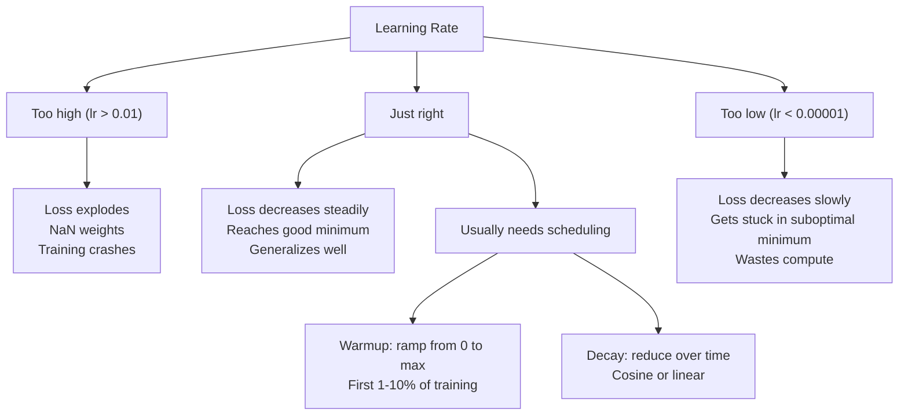
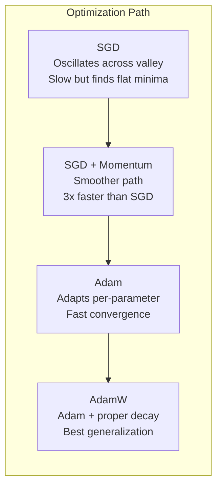
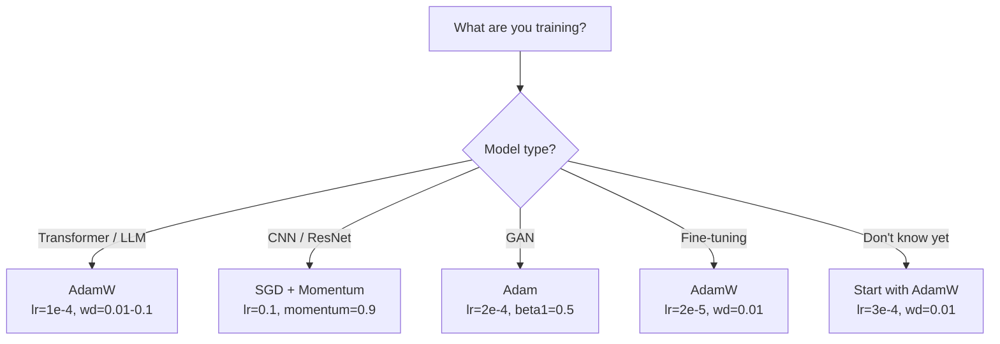

# Optimizeciler

> İndirme derecesi hangi yönde hareket edeceğinizi söyler. Ne kadar uzakta ne kadar hızlı olduğunu söylemez. SGD bir pusula. Adam trafik verileri ile GPS.

**Type:** Build
**Languages:** Python, TypeScript
**Prerequisites:** Lesson 03.05 (Loss Functions)
**Time:** ~75 minutes

## Öğrenme Hedefleri

- Python'da SGD, SGD ve AdamW optimizerlerini sıfırdan uygulayın
- Adam'ın tarafsızlık düzeltmesi, erken eğitim aşamalarında sıfır başlangıçlı moment tahminlerini nasıl telafi ettiğini açıklayın.
- AdamW'nin aynı görevde L2 düzenlenmesi ile Adam'dan daha iyi genelleşmeyi neden ürettiğini gösterin.
- Transformatörler, CNN'ler, GAN'lar ve ince ayarlar için uygun optimizer ve varsayılan hiperparametre seçin

## Sorun

Eğer bu değerleri hesapladığınızda, 4.721'in ağırlığının kaybı azaltmak için 0.003'e düşmesi gerektiğini biliyorsunuz. Ama 0.003 hangi birimlerde? Ne kadar ölçeklendirilmiş? Ve 1. adımda 1.000'de olduğu kadar aynı miktarı hareket ettirmek mi gerekiyor?

Vanilla gradient düşüşü her adımda her parametre aynı öğrenme hızını uyguluyor: $w = w - \text{lr} \cdot \text{gradient}$Bu, nöral ağların eğitimiyle ilgili pratikte acı verici olan üç sorunu ortaya çıkarır.

Öncelikle, titreşim. Kayıp manzarası nadiren bir kavanoz şeklinde oluşur. Daha çok uzun ve dar bir vadide. Merdiven, vadinin üzerinden (tırtlak yönde) değil, onun boyunca (kuyu yönde) işaretler. Devamlı düşüş, dar boyut boyunca ileri-geri atlayıp yararlı boyut boyunca küçük ilerlemeler yaparken. Bunu gördünüz: kayıp platolardan daha hızlı düşer, modelin birleştiği için değil, dalgalanması nedeniyle.

İkinci olarak, tüm parametreler için bir öğrenme hızı yanlışdır. Bazı ağırlıkların büyük güncellemelere ihtiyacı vardır (önce, uygunsuz aşamadalar). Diğerlerinin küçük güncellemelere ihtiyacı vardır (optimal değerlerine yakınlar).

Üçüncü olarak, otlak noktaları. Yüksek boyutlarda, kayıp manzarası, gradientin sıfıra yakın geniş düz bölgelere sahiptir. Vanilla SGD, gradientin hızıyla bu bölgeleri tarar, bu da aslında sıfır. Modeldeki görünüş sıkışmış.

Adam üçünü de çözer. Parametre başına iki çalışkan ortalama tutar - ortalama gradient (momentum, ossilasyonu ele alır) ve ortalama kare gradient (adaptif hız, farklı ölçekleri ele alır). İlk birkaç adım için tarafsızlık düzeltmesi ile birlikte, size standart hiperparametre ile ilgili sorunların %80'inde çalışan tek bir optimizer verir. Bu ders, onu sıfırdan inşa eder böylece diğer %20'de ne zaman ve neden başarısız olduğunu tam olarak anlarsınız.

## Anlaşım

### Stochastic Gradient Descent (SGD)

En basit optimizör. Mini seri üzerinde gradient hesaplayın ve ters yöne adım atın.

```math
w = w - \text{lr} \cdot \text{gradient}
```

"Stochastik" demek, tüm veri kümesi yerine, gradiyenti tahmin etmek için rastgele bir alt kümesi (mini-batch) verileri kullanmak demektir. Bu gürültü aslında yararlıdır - keskin yerel minimumlardan kaçmaya yardımcı olur. Ama gürültü aynı zamanda titreşimlere neden olur.

Öğrenme hızı tek bir düğmedir. Çok yüksek: kayıplar farklıdır. Çok düşük: eğitim sonsuza dek sürer. Optimal değer mimarlığa, verilere, parti boyutuna ve eğitimin mevcut aşamasına bağlıdır. Modern ağlarda vanilya SGD için tipik değerler 0.01 ile 0.1 arasında değişir.

### Gelişme

Top-tükük-tük analogiyi çok fazla kullanır ama doğru. Sadece gradiyenti geçmek yerine, past gradients toplanan bir hız koruruz.

```math
\begin{aligned}
m_t &= \beta \, m_{t-1} + \text{gradient} \\
w &= w - \text{lr} \cdot m_t
\end{aligned}
```

Beta (genellikle 0.9) ne kadar geçmiş tutmak için kontrol eder.$\beta = 0.9$, momentum yaklaşık olarak son 10 gradientin ortalamasıdır ($1 / (1 - 0.9) = 10$)

Bu neden dalgalanmayı düzeltir: aynı yönde gösteren gradientler birikir. Kötü yönde ters giden gradientler iptal edilir. O dar vadide, "çetesi" bileşen her adımını işaret eder ve dümdüz edilir. "Yüzde" bileşen tutarlı kalır ve güçlenir. Sonuç yararlı yönde düzgün bir hızlandırma olur.

Gerçek rakamlar: Yalnızca kötü koşullarda kayıplar alanında SGD 10.000 adım alabilir.$\beta = 0.9$Bu nedenle, bu süreçte, bu süreçte, bu süreçte, bu süreçte, bu süreçte, bu süreçte, bu süreçte, bu süreçte, bu süreçte, bu süreçte, bu süreçte, bu süreçte, bu süreçte, bu süreçte, bu süreçte, bu süreçte, bu süreçte, bu süreçte, bu süreçte, bu süreçte, bu süreçte, bu süreçte, bu süreçte, bu süreçte, bu süreçte, bu süreçte, bu süreçte, bu süreçte, bu süreçte, bu süreçte, bu süreçte, bu süreçte, bu süreçte, bu süreçte, bu süreçte, bu süreçte, bu süreçte, bu süreçte, bu süreçte, bu süreçte, bu süreçte, bu süreçte, bu süreçte, bu süreçte, bu süreçte, bu süreçte, bu süreçte, bu süreçte, bu süreçte, bu süreçte, bu süreçte, bu süreçte, bu süreçte, bu süreçte, bu süreçte, bu, bu, bu, bu, bu, bu, bu, bu, bu, bu, bu, bu, bu, bu, bu, bu, bu, bu, bu, için, bu, bu, bu, bu, bu, bu, bu, bu, bu, bu, bu, bu, bu, bu, bu, bu, bu, bu, bu, bu, bu, bu, bu, bu, bu, bu, bu, bu, bu, bu, bu, bu, bu, bu, bu, bu, bu, bu, bu, bu, bu, bu, bu, bu, bu, bu, bu, bu, bu, bu, bu, bu, bu, bu, bu, bu, bu, bu, bu, bu, bu, bu, bu, bu, bu, bu, bu, bu, bu, bu, bu, bu, bu, bu, bu, bu, bu, bu, bu, bu, bu, bu, bu, bu, bu, bu, bu, bu, bu, bu, bu, bu, bu, bu, bu, bu, bu, bu, bu, bu, bu, bu, bu, bu, bu, bu, bu, bu, bu, bu, bu, bu, bu, bu, bu, bu, bu, bu, bu, bu, bu, bu, bu, bu

### RMSProp

Hinton tarafından Coursera dersi (resmi olarak hiç yayınlanmamış) önerilen, gerçekte işe yarayan ilk parametreki adaptatif öğrenme oranı yöntemi.

```math
\begin{aligned}
s_t &= \beta \, s_{t-1} + (1 - \beta) \cdot \text{gradient}^2 \\
w &= w - \text{lr} \cdot \frac{\text{gradient}}{\sqrt{s_t} + \epsilon}
\end{aligned}
```

$s_t$Bu, bir dizi farklılık gösterir: bir dizi farklılık gösterirken, bir dizi farklılık gösterirken, bir dizi farklılık gösterirken, bir dizi farklılık gösterirken, bir dizi farklılık gösterirken, bir dizi farklılık gösterirken, bir dizi farklılık gösterirken, bir dizi farklılık gösterirken, bir dizi farklılık gösterirken, bir dizi farklılık gösterirken, bir dizi farklılık gösterirken, bir dizi farklılık gösterirken, bir dizi farklılık gösterirken, bir dizi farklılık gösterirken, bir dizi farklılık gösterirken, bir dizi farklılık gösterirken, bir dizi farklılık gösterirken, bir dizi farklılık gösterirken, bir dizi farklılık gösterirken, bir dizi farklılık gösterirken, bir dizi farklılık gösterirken, bir dizi farklılık gösterirken, bir dizi farklılık gösterirken, bir dizi farklılık gösterirken, bir dizi farklılık gösterirken, bir dizi farklılık gösterirken, bir dizi farklılık gösterirken, bir dizi farklılık gösterirken, bir dizi farklılık gösterirken, bir dizi farklılık gösterirken, bir dizi farklılık gösterirken, bir dizi farklılık gösterirken, bir diğer bir diğer bir diğer diğer diğer diğer diğer diğerine benzerliği gösterir.

Bu, "her parametre için bir öğrenme hızı" sorunu çözüyor. Büyük güncellemeler alıyor olan bir ağırlık muhtemelen hedefine yakın -- yavaşlatıyor. Küçük güncellemeler alan bir ağırlık az eğitimli olabilir -- hızlandırıyor.

Epsilon (genellikle 1e-8) bir parametrenin güncelleştirilmediği zaman sıfırla bölünmeyi engeller.

### Adam: Momentum + RMSProp

Adam her parametre için iki eksponensial hareketli ortalama tutar.

```math
\begin{aligned}
m_t &= \beta_1 m_{t-1} + (1 - \beta_1) \cdot \text{gradient} && \text{(first moment: mean)} \\
v_t &= \beta_2 v_{t-1} + (1 - \beta_2) \cdot \text{gradient}^2 && \text{(second moment: variance)}
\end{aligned}
```

**Bias correction**Bu, çoğu açıklamanın atlattığı ana detay.$m_1 = (1 - \beta_1) \cdot \text{gradient}$- Evet .$\beta_1 = 0.9$- Bu da...$0.1 \cdot \text{gradient}$- 10 kat daha küçük. Hareketli ortalama henüz ısıtılmamış.

```math
\begin{aligned}
\hat{m} &= \frac{m_t}{1 - \beta_1^t} \\
\hat{v} &= \frac{v_t}{1 - \beta_2^t}
\end{aligned}
```

1 . Adımda $\beta_1 = 0.9$- Evet .$\hat{m} = m_1 / (1 - 0.9) = m_1 / 0.1 =$Gerçek derecede.$(1 - 0.9^{100})$Bu nedenle, bir kısım olarak, bir kısım olarak, bir kısım olarak, bir kısım olarak, bir kısım olarak, bir kısım olarak, bir kısım olarak, bir kısım olarak, bir kısım olarak, bir kısım olarak, bir kısım olarak, bir kısım olarak, bir kısım olarak, bir kısım olarak, bir kısım olarak, bir kısım olarak, bir kısım olarak, bir kısım olarak, bir kısım olarak, bir kısım olarak, bir kısım olarak, bir kısım olarak, bir kısım olarak, bir kısım olarak, bir kısım olarak, bir kısım olarak, bir kısım olarak, bir kısım olarak, bir kısım olarak, bir kısım olarak, bir kısım olarak, bir kısım olarak, bir kısım olarak, bir kısım olarak, bir kısım olarak, bir kısım olarak, bir kısım olarak, bir kısım olarak, bir kısım olarak, bir kısmını, bir kısmını, bir kısmını, bir diğerine, bir diğerine, bir diğerine, bir diğerine, bir diğerine, bir diğerine, bir diğerine, bir diğerine, bir diğerine, diğerine, diğerine, diğerine, diğerine, diğerine, diğerine, diğerine, diğerine, diğerine, diğerine, diğerine, diğerine, diğerine, diğerine, diğerine, diğerine, diğerine, diğerine, diğerine, diğerine, diğerine, diğerine, diğerine, diğerine, diğerine, diğerine, diğerine, diğerine, diğerine, diğerine, diğerine, diğerine, diğerine, diğerine, diğerine, diğerine, diğerine, diğerine, diğerine, diğerine, diğerine, diğerine, de, diğerine, de, diğerine, diğerine, de, diğerine, diğerine, de, diğerine, de, de, diğerine, de, diğerine, diğerine, de, diğerine, diğerine, diğerine, diğerine, de, de, diğerine, de, diğer diğerine, de, de, diğerine, de, de, diğerine, de, de, diğer, diğer diğerine, diğer diğerine, de, de, de, de, diğer diğer diğer diğer diğer diğerine, de, de, de, de, de, de, de, de, de, diğer diğer diğer diğer diğer, de,

Güncelleme:

```math
w = w - \text{lr} \cdot \frac{\hat{m}}{\sqrt{\hat{v}} + \epsilon}
```

Öntanımlı olarak: $\text{lr} = 0.001$- Evet .$\beta_1 = 0.9$- Evet .$\beta_2 = 0.999$- Evet .$\epsilon = 10^{-8}$Bu öntanımlı sorunların %80'inde işe yarıyor.$\beta_2$Neredeyse hiç değişmez .$\beta_1$veya $\epsilon$- Evet .

### Ağırlık kaybı doğru şekilde yapıldı

L2 düzenlenmesi eklenir $\lambda w^2$Vanilya SGD'de bu, ağırlık kaybına eşittir (çıkartmak $\lambda w$Adam'da bu eşdeğerlik kırılır.

Loshchilov & Hutter'ın anlayışı: L2'yi kaybına eklediğinizde ve sonra Adam gradiyenti işlediğinde, adaptatif öğrenme hızı düzenleme terimini de ölçeyor. Büyük gradiyent varyasyonu olan parametreler daha az düzenlenir. Küçük varyasyonu olan parametreler daha fazla düzenlenir. Bu istediğiniz şey değil - gradiyent istatistiklerine bakılmaksızın birer düzenlenme istiyorsunuz.

AdamW, bu durumu, Adam güncelleştirmesinden sonra ağırlık kaybını doğrudan ağırlıklara uygulayarak düzeltir:

```math
w = w - \text{lr} \cdot \frac{\hat{m}}{\sqrt{\hat{v}} + \epsilon} - \text{lr} \cdot \lambda w
```

Ağırlık kaybı terimi ($\text{lr} \cdot \lambda w$Bu, bir değişkenlik oranı olarak belirlenir.

Bu küçük bir detay gibi görünüyor. Hayır. AdamW neredeyse her görevde Adam + L2 düzenlenmesinden daha iyi çözümlere yaklaşıyor. PyTorch'de dönüştürücülerin, difüzyon modellerinin ve çoğu modern mimarinin eğitimi için varsayılan optimizördür. BERT, GPT, LLaMA, Stable Diffusion - hepsi AdamW ile eğitilmiştir.

### Öğrenme Hızı: En Önemli Hiperparametr



Eğer bir hiperparametre ayarladığınızda öğrenme hızını ayarlayın. Öğrenme hızında 10 katlık bir değişiklik, herhangi bir mimari kararınızdan daha önemlidir.

- SGD: lr = 0.01 ila 0.1
- Adam/AdamW: lr = 1e-4 ile 3e-4
- Düzgün ayarlama öncesi eğitilmiş modeller: lr = 1e-5 ile 5e-5 arasında
- Öğrenme hızının yükselmesi: ilk adımların % 1-10'unda çizgilik rampa

### Optimizer karşılaştırma



### Her Optimizer Kazanırken



```figure
optimizer-trajectory
```

## Yapın

### Adım 1: Vanil SGD

```python
class SGD:
    def __init__(self, lr=0.01):
        self.lr = lr

    def step(self, params, grads):
        for i in range(len(params)):
            params[i] -= self.lr * grads[i]
```

### Adım 2: SGD'nin Momentum ile

```python
class SGDMomentum:
    def __init__(self, lr=0.01, beta=0.9):
        self.lr = lr
        self.beta = beta
        self.velocities = None

    def step(self, params, grads):
        if self.velocities is None:
            self.velocities = [0.0] * len(params)
        for i in range(len(params)):
            self.velocities[i] = self.beta * self.velocities[i] + grads[i]
            params[i] -= self.lr * self.velocities[i]
```

### Üçüncü adım: Adam

```python
import math

class Adam:
    def __init__(self, lr=0.001, beta1=0.9, beta2=0.999, epsilon=1e-8):
        self.lr = lr
        self.beta1 = beta1
        self.beta2 = beta2
        self.epsilon = epsilon
        self.m = None
        self.v = None
        self.t = 0

    def step(self, params, grads):
        if self.m is None:
            self.m = [0.0] * len(params)
            self.v = [0.0] * len(params)

        self.t += 1

        for i in range(len(params)):
            self.m[i] = self.beta1 * self.m[i] + (1 - self.beta1) * grads[i]
            self.v[i] = self.beta2 * self.v[i] + (1 - self.beta2) * grads[i] ** 2

            m_hat = self.m[i] / (1 - self.beta1 ** self.t)
            v_hat = self.v[i] / (1 - self.beta2 ** self.t)

            params[i] -= self.lr * m_hat / (math.sqrt(v_hat) + self.epsilon)
```

### 4. Adım: AdamW

```python
class AdamW:
    def __init__(self, lr=0.001, beta1=0.9, beta2=0.999, epsilon=1e-8, weight_decay=0.01):
        self.lr = lr
        self.beta1 = beta1
        self.beta2 = beta2
        self.epsilon = epsilon
        self.weight_decay = weight_decay
        self.m = None
        self.v = None
        self.t = 0

    def step(self, params, grads):
        if self.m is None:
            self.m = [0.0] * len(params)
            self.v = [0.0] * len(params)

        self.t += 1

        for i in range(len(params)):
            self.m[i] = self.beta1 * self.m[i] + (1 - self.beta1) * grads[i]
            self.v[i] = self.beta2 * self.v[i] + (1 - self.beta2) * grads[i] ** 2

            m_hat = self.m[i] / (1 - self.beta1 ** self.t)
            v_hat = self.v[i] / (1 - self.beta2 ** self.t)

            params[i] -= self.lr * m_hat / (math.sqrt(v_hat) + self.epsilon)
            params[i] -= self.lr * self.weight_decay * params[i]
```

### Adım 5: Eğitim karşılaştırması

Dört optimizörle 05. dersden beri döngü verileri üzerinde aynı iki katmanlı ağı çalıştırın.

```python
import random

def sigmoid(x):
    x = max(-500, min(500, x))
    return 1.0 / (1.0 + math.exp(-x))

def make_circle_data(n=200, seed=42):
    random.seed(seed)
    data = []
    for _ in range(n):
        x = random.uniform(-2, 2)
        y = random.uniform(-2, 2)
        label = 1.0 if x * x + y * y < 1.5 else 0.0
        data.append(([x, y], label))
    return data


class OptimizerTestNetwork:
    def __init__(self, optimizer, hidden_size=8):
        random.seed(0)
        self.hidden_size = hidden_size
        self.optimizer = optimizer

        self.w1 = [[random.gauss(0, 0.5) for _ in range(2)] for _ in range(hidden_size)]
        self.b1 = [0.0] * hidden_size
        self.w2 = [random.gauss(0, 0.5) for _ in range(hidden_size)]
        self.b2 = 0.0

    def get_params(self):
        params = []
        for row in self.w1:
            params.extend(row)
        params.extend(self.b1)
        params.extend(self.w2)
        params.append(self.b2)
        return params

    def set_params(self, params):
        idx = 0
        for i in range(self.hidden_size):
            for j in range(2):
                self.w1[i][j] = params[idx]
                idx += 1
        for i in range(self.hidden_size):
            self.b1[i] = params[idx]
            idx += 1
        for i in range(self.hidden_size):
            self.w2[i] = params[idx]
            idx += 1
        self.b2 = params[idx]

    def forward(self, x):
        self.x = x
        self.z1 = []
        self.h = []
        for i in range(self.hidden_size):
            z = self.w1[i][0] * x[0] + self.w1[i][1] * x[1] + self.b1[i]
            self.z1.append(z)
            self.h.append(max(0.0, z))

        self.z2 = sum(self.w2[i] * self.h[i] for i in range(self.hidden_size)) + self.b2
        self.out = sigmoid(self.z2)
        return self.out

    def compute_grads(self, target):
        eps = 1e-15
        p = max(eps, min(1 - eps, self.out))
        d_loss = -(target / p) + (1 - target) / (1 - p)
        d_sigmoid = self.out * (1 - self.out)
        d_out = d_loss * d_sigmoid

        grads = [0.0] * (self.hidden_size * 2 + self.hidden_size + self.hidden_size + 1)
        idx = 0
        for i in range(self.hidden_size):
            d_relu = 1.0 if self.z1[i] > 0 else 0.0
            d_h = d_out * self.w2[i] * d_relu
            grads[idx] = d_h * self.x[0]
            grads[idx + 1] = d_h * self.x[1]
            idx += 2

        for i in range(self.hidden_size):
            d_relu = 1.0 if self.z1[i] > 0 else 0.0
            grads[idx] = d_out * self.w2[i] * d_relu
            idx += 1

        for i in range(self.hidden_size):
            grads[idx] = d_out * self.h[i]
            idx += 1

        grads[idx] = d_out
        return grads

    def train(self, data, epochs=300):
        losses = []
        for epoch in range(epochs):
            total_loss = 0.0
            correct = 0
            for x, y in data:
                pred = self.forward(x)
                grads = self.compute_grads(y)
                params = self.get_params()
                self.optimizer.step(params, grads)
                self.set_params(params)

                eps = 1e-15
                p = max(eps, min(1 - eps, pred))
                total_loss += -(y * math.log(p) + (1 - y) * math.log(1 - p))
                if (pred >= 0.5) == (y >= 0.5):
                    correct += 1
            avg_loss = total_loss / len(data)
            accuracy = correct / len(data) * 100
            losses.append((avg_loss, accuracy))
            if epoch % 75 == 0 or epoch == epochs - 1:
                print(f"    Epoch {epoch:3d}: loss={avg_loss:.4f}, accuracy={accuracy:.1f}%")
        return losses
```

## Kullan

PyTorch optimizörleri parametre gruplarını, gradient kesimini ve öğrenme hızının programlamasını işliyor:

```python
import torch
import torch.optim as optim

model = torch.nn.Sequential(
    torch.nn.Linear(784, 256),
    torch.nn.ReLU(),
    torch.nn.Linear(256, 10),
)

optimizer = optim.AdamW(model.parameters(), lr=3e-4, weight_decay=0.01)

scheduler = optim.lr_scheduler.CosineAnnealingLR(optimizer, T_max=100)

for epoch in range(100):
    optimizer.zero_grad()
    output = model(torch.randn(32, 784))
    loss = torch.nn.functional.cross_entropy(output, torch.randint(0, 10, (32,)))
    loss.backward()
    torch.nn.utils.clip_grad_norm_(model.parameters(), max_norm=1.0)
    optimizer.step()
    scheduler.step()
```

Bu düzen her zaman: zero_grad, forward, loss, backward, (clip), step, (schedule) şeklinde kalır. Bu sırayı ezberleyin.

CNN'ler için, birçok uygulayıcı hala SGD + momentum (lr=0.1, momentum=0.9, weight_decay=1e-4) ve bir adım veya cosine programı tercih eder. SGD genellikle daha iyi genelleştirilen düz minimumlar bulur. Transformatörler ve LLM için, ısıtma + cosine çöküşü ile AdamW evrensel varsayımdır. Ölçülmüş bir neden olmadan bir fikir birliği ile mücadele etmeyin.

## Gönder

Bu ders şunları ortaya çıkarır:
- `outputs/prompt-optimizer-selector.md`-- herhangi bir mimarlık için doğru optimizer ve öğrenme oranı seçmek için bir karar uyarısı

## Egzersizler

1. Nesterov momentumu uygulamak, burada "görüş açısı" pozisyonunda eğilimi hesaplarsınız ($w - \text{lr} \cdot \beta v$Dört veri kümesindeki standart momentum ile yakınlığı karşılaştırın.

2. Öğrenme hızı ısınma programını uygulayın: eğitim adımlarının ilk 10%'inde 0'dan maksimum_lr'e kadar çizgi ramp, sonra kozin çöküşü 0. Adam + ısınma ile ısınmadan ısınma ile ısınma.

3. Adam eğitiminde her parametreden etkili öğrenme oranını takip edin.$\text{lr} \cdot \hat{m} / (\sqrt{\hat{v}} + \epsilon)$10.50 ve 200 adımdan sonra etkin oranların dağılımını çizin.

4. Yüksek öğrenme oranı (lr=0.01 için Adam) kullanarak ve kesmeden eğitilmek. Ne kadar koşunun ayrıldığı (kayıp NaN'e gider) sayın.

5. Adam vs. AdamW'yi büyük ağırlıklar olan bir ağda karşılaştırın. Tüm ağırlıkları rastgele değerlere [-5, 5] (normalden çok daha büyük) initialize edin. 200 dönem boyunca weight_decay=0.1 ile çalışın.

## Anahtar Terimler

| Term | What people say | What it actually means |
|------|----------------|----------------------|
| Learning rate | "Step size" | The scalar multiplier on the gradient update; the single most impactful hyperparameter in training |
| SGD | "Basic gradient descent" | Stochastic gradient descent: update weights by subtracting $\text{lr} \cdot \text{gradient}$, computed on a mini-batch |
| Momentum | "Rolling ball analogy" | Exponential moving average of past gradients; dampens oscillation and accelerates consistent directions |
| RMSProp | "Adaptive learning rate" | Divides each parameter's gradient by the running RMS of its recent gradients; equalizes learning rates |
| Adam | "The default optimizer" | Combines momentum (first moment) and RMSProp (second moment) with bias correction for the initial steps |
| AdamW | "Adam done right" | Adam with decoupled weight decay; applies regularization directly to weights rather than through the gradient |
| Bias correction | "Warmup for running averages" | Dividing by $(1 - \beta^t)$ to compensate for the zero-initialization of Adam's moment estimates |
| Weight decay | "Shrink the weights" | Subtracting a fraction of the weight value at each step; a regularizer that penalizes large weights |
| Learning rate schedule | "Changing lr over time" | A function that adjusts the learning rate during training; warmup + cosine decay is the modern default |
| Gradient clipping | "Capping the gradient norm" | Scaling down the gradient vector when its norm exceeds a threshold; prevents exploding gradient updates |

## Daha Fazla Okumak

- Kingma & Ba, "Adam: Stochastic Optimization için Bir Yöntem" (2014) - konverjense analizi ve önyargı düzeltme çıkarımı ile orijinal Adam kağıdı
- Loshchilov & Hutter, "Kısıtlı Ağırlık Kayıp Düzenlemesi" (2017) -- L2 düzenlemesinin ve kilo kaybının Adam'da eşdeğer olmadığını kanıtladı ve AdamW'yi önerdi
- Smith, "Trening Neural Networks için Siklik Öğrenme Sınıfları" (2017) -- sabit bir öğrenme oranını ayarlamanın gereksinimini ortadan kaldıran LR aralığı testi ve siklik programları tanıttı
- Ruder, "Gradient Descent Optimization Algorithms'in Özetleri" (2016) - tüm optimizer çeşitlerinin en iyi tek anketini, net karşılaştırmalar ve sezgisellikler ile
