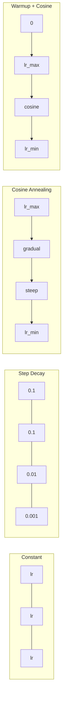
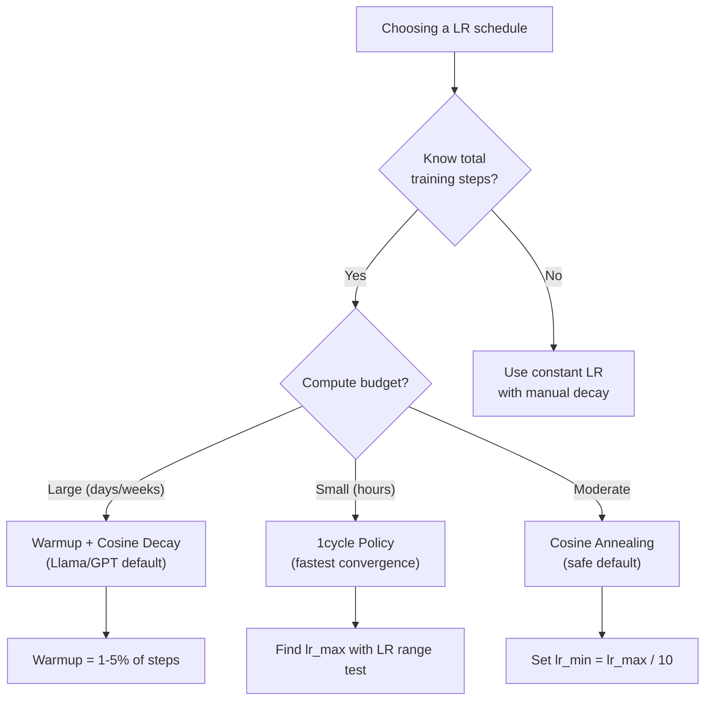
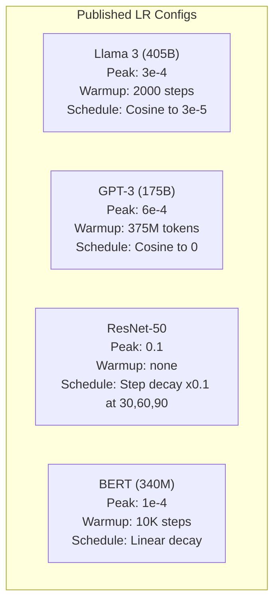

# Öğrenme Zamanı Programları ve ısınma

> Öğrenme hızı en önemli hiperparametre. Arsitür değil. Veriler kümesi boyutu değil. Aktiflik fonksiyonu değil. Öğrenme hızı.

**Type:** Build
**Languages:** Python, TypeScript
**Prerequisites:** Lesson 03.06 (Optimizers), Lesson 03.08 (Weight Initialization)
**Time:** ~90 minutes

## Öğrenme Hedefleri

- Sürekli, adım adım çöküş, cosine annealing, warmup + cosine ve 1 döngü öğrenme hızı programlarını sıfırdan uygulamak
- Öğrenme oranının seçimi için üç başarısızlık modunu gösterin: ayrım (çok yüksek), durgunluk (çok düşük) ve dalgalanma (kayıp yok)
- Adam'a dayalı optimizasyoncular için neden ısıtma gerekli olduğunu ve erken eğitimin nasıl istikrarlı olduğunu açıklayın
- Aynı görevdeki beş programın da birbiriyle yakınlaşma hızını karşılaştırın ve belirli bir eğitim bütçesi için uygun olanı seçin

## Sorun

Eğitim oranını 0.1'e ayarlayın. Eğitim ayrılır - kayıp 3 adımla sonsuzluğa atlar. 0.0001'e ayarlayın. Eğitim sürüklenir - 100 dönemden sonra model neredeyse rastgeleden geçmedi. 0.01'e ayarlayın. Eğitim 50 dönem boyunca çalışır, sonra kayıp asla ulaşamayacağı bir minimum etrafında dalga geçirir çünkü adımlar çok büyüktür.

Optimal öğrenme hızı sabit değildir. Eğitim sırasında değişir. Başta, büyük adımların toprağı hızlı bir şekilde kaplamasını istersin. Eğitimin sonuna kadar, küçük adımların keskin bir minimumda yerleşmesini istersin. 90% doğru bir model ile 95% doğru bir model arasındaki fark genellikle sadece programdır.

Son üç yılda yayınlanan her büyük model öğrenme oranı çizelgesini kullanır. Llama 3 2000 ısınma adımları ile zirve lr = 3e-4 ve 3e-5'e kadar cosine çöküşünü kullanır. GPT-3 375 milyon tokenden fazla ısınma ile lr = 6e-4 kullanır. Bunlar keyfi olmayan seçimler değildir.

Bu nedenle, programları anlamalısınız çünkü öntanımlı programlar sorununuz için işe yaramayacaktır. Önceden eğitilmiş bir modeli inceleme yaptığınızda, doğru program sıfırdan eğitimden farklıdır.

## Anlaşım

### Sürekli Öğrenme Hızı

En basit yaklaşım, bir sayı seçip her adımda kullan.

```math
\text{lr}(t) = \text{lr}_0
```

Bu, eğitim sonuna kadar çok yüksek (minimum civarında kayganlık) veya başlangıç için çok düşük (küçük adımlarda boşa harcanmış hesaplama).

### Adım Çürümesi

ResNet döneminden gelen eski okul yaklaşımı.

```math
\text{lr}(t) = \text{lr}_0 \cdot \gamma^{\lfloor \text{epoch} / \text{step\_size} \rfloor}
```

Nerede ?$\gamma = 0.1$ve step_size = 30 demek: lr her 30 dönemde 10 kat düşer. ResNet-50 bunu kullanıyor -- lr = 0.1, 30, 60 ve 90 dönemlerde 10 kat düşer.

Sorun: optimal çöküş noktaları veri kümesine ve mimarlığa bağlıdır. Farklı bir soruna geçin ve düşme zamanı yeniden ayarlamanız gerekir. Değişiklikler ani bir şekilde gerçekleşir.

### Cosine Annealing

En yüksek öğrenme hızından en azına doğru, cosine eğri boyunca düzgün bir çöküş:

```math
\text{lr}(t) = \text{lr}_{\min} + 0.5 \cdot (\text{lr}_{\max} - \text{lr}_{\min}) \cdot \left(1 + \cos\left(\frac{\pi t}{T}\right)\right)
```

Nerede ?$t$Bu adım şu anda devam ediyor ve $T$Adım sayısı.

- Evet .$t=0$, cosine terimi 1'dir, yani $\text{lr} = \text{lr} _{\max}$- Ne ?$t=T$, cosine terimi -1, yani $\text{lr} = \text{lr} _{\min}$Çürüme başlangıçta hafif, ortalarda hızlanır ve sonun yakınlarında tekrar hafif hale gelir.

Bu, çoğu modern eğitim için varsayılan bir seçenek.$\text{lr} _{\max}$ve $\text{lr} _{\min}$Kosinus şekli, çoğu öğrenmenin eğitimin ortasında olduğu empiriyel gözlemle uyuşur. Bu kritik dönemde makul adım boyutlarını istiyorsunuz.

### İhmal: Neden Küçük Başlayın

Adam ve diğer uyarlayıcı optimizörler gradient ortalama ve varyansın çalışkan tahminlerini sürdürürler. 0 adımda bu tahminler sıfıra initialize edilir. İlk birkaç gradient güncelleştirmesi çöp istatistiklerine dayanır. Eğer bu dönemde öğrenme hızınız büyükse, model büyük, kötü yönlendirilmiş adımlar atar.

Warmup bunu düzeltir. Küçük bir öğrenme hızıyla başlayın (genellikle lr_max / warmup_steps veya hatta sıfır) ve doğrusal olarak $\text{lr}_{\max}$İlk kez .$N$Tam öğrenme hızına ulaştığınızda, Adam'ın istatistikleri istikrarlı hale geldi.

```math
\text{lr}(t) = \text{lr}_{\max} \cdot \frac{t}{\text{warmup\_steps}} \quad \text{for } t < \text{warmup\_steps}
```

Tipik ısınma: toplam eğitim adımlarının %1-5. Llama 3 yaklaşık 1.8 trilyon token için eğitim aldı ve 2000 adım için ısındı. GPT-3 375 milyon tokenden fazla ısındı.

### Düzsel ısınma + Kosin bozulması

Modern standart, çizgi olarak yüksel, sonra da kosinus ile çürü.

```
if t < warmup_steps:
    lr(t) = lr_max * (t / warmup_steps)
else:
    progress = (t - warmup_steps) / (total_steps - warmup_steps)
    lr(t) = lr_min + 0.5 * (lr_max - lr_min) * (1 + cos(pi * progress))
```

Bu, Llama, GPT, PaLM ve çoğu modern transformatörün kullandığı bir yöntemdir.

### 1 döngü politikası

Leslie Smith'in keşfi (2018): eğitimin ilk yarısında öğrenme oranını düşük değerden yüksek değerlere yükseltmek, sonra ikinci yarıda geriye düşürmek.

Teorisi: yüksek öğrenme oranı, optimize trajektörüne gürültü ekleyerek düzenlendirme olarak hareket eder. Model, ramp-up aşamasında kayıp manzarasının daha fazlasını keşfeder ve daha iyi havuzlar bulur.

```
Phase 1 (0 to T/2):    lr ramps from lr_max/25 to lr_max
Phase 2 (T/2 to T):    lr ramps from lr_max to lr_max/10000
```

1cycle genellikle sabit bir hesaplama bütçesi için cosine annealing'den daha hızlı trenler.

### Program şekilleri



### Karar Akış Çizelgesi



### Yayınlanmış Modellerden Gerçek Sayılar



```figure
lr-schedule
```

## Yapın

### Adım 1: İşleri programla

Her fonksiyon mevcut adımları alır ve bu adımlarda öğrenme hızını iade eder.

```python
import math


def constant_schedule(step, lr=0.01, **kwargs):
    return lr


def step_decay_schedule(step, lr=0.1, step_size=100, gamma=0.1, **kwargs):
    return lr * (gamma ** (step // step_size))


def cosine_schedule(step, lr=0.01, total_steps=1000, lr_min=1e-5, **kwargs):
    if step >= total_steps:
        return lr_min
    return lr_min + 0.5 * (lr - lr_min) * (1 + math.cos(math.pi * step / total_steps))


def warmup_cosine_schedule(step, lr=0.01, total_steps=1000, warmup_steps=100, lr_min=1e-5, **kwargs):
    if total_steps <= warmup_steps:
        return lr * (step / max(warmup_steps, 1))
    if step < warmup_steps:
        return lr * step / warmup_steps
    progress = (step - warmup_steps) / (total_steps - warmup_steps)
    return lr_min + 0.5 * (lr - lr_min) * (1 + math.cos(math.pi * progress))


def one_cycle_schedule(step, lr=0.01, total_steps=1000, **kwargs):
    mid = max(total_steps // 2, 1)
    if step < mid:
        return (lr / 25) + (lr - lr / 25) * step / mid
    else:
        progress = (step - mid) / max(total_steps - mid, 1)
        return lr * (1 - progress) + (lr / 10000) * progress
```

### İkinci Adım: Tüm programları gözünüzde görün

Her programın eğitim boyunca nasıl geliştiğini gösteren bir metin tabanlı tablo yazdırın.

```python
def visualize_schedule(name, schedule_fn, total_steps=500, **kwargs):
    steps = list(range(0, total_steps, total_steps // 20))
    if total_steps - 1 not in steps:
        steps.append(total_steps - 1)

    lrs = [schedule_fn(s, total_steps=total_steps, **kwargs) for s in steps]
    max_lr = max(lrs) if max(lrs) > 0 else 1.0

    print(f"\n{name}:")
    for s, lr_val in zip(steps, lrs):
        bar_len = int(lr_val / max_lr * 40)
        bar = "#" * bar_len
        print(f"  Step {s:4d}: lr={lr_val:.6f} {bar}")
```

### Üçüncü Adım: Eğitim ağı

Bir çevrede iki katlı ağ, önceki derslerdeki gibi, ama şimdi programı değiştiriyoruz.

```python
import random


def sigmoid(x):
    x = max(-500, min(500, x))
    return 1.0 / (1.0 + math.exp(-x))


def relu(x):
    return max(0.0, x)


def relu_deriv(x):
    return 1.0 if x > 0 else 0.0


def make_circle_data(n=200, seed=42):
    random.seed(seed)
    data = []
    for _ in range(n):
        x = random.uniform(-2, 2)
        y = random.uniform(-2, 2)
        label = 1.0 if x * x + y * y < 1.5 else 0.0
        data.append(([x, y], label))
    return data


def train_with_schedule(schedule_fn, schedule_name, data, epochs=300, base_lr=0.05, **kwargs):
    random.seed(0)
    hidden_size = 8
    total_steps = epochs * len(data)

    std = math.sqrt(2.0 / 2)
    w1 = [[random.gauss(0, std) for _ in range(2)] for _ in range(hidden_size)]
    b1 = [0.0] * hidden_size
    w2 = [random.gauss(0, std) for _ in range(hidden_size)]
    b2 = 0.0

    step = 0
    epoch_losses = []

    for epoch in range(epochs):
        total_loss = 0
        correct = 0

        for x, target in data:
            lr = schedule_fn(step, lr=base_lr, total_steps=total_steps, **kwargs)

            z1 = []
            h = []
            for i in range(hidden_size):
                z = w1[i][0] * x[0] + w1[i][1] * x[1] + b1[i]
                z1.append(z)
                h.append(relu(z))

            z2 = sum(w2[i] * h[i] for i in range(hidden_size)) + b2
            out = sigmoid(z2)

            error = out - target
            d_out = error * out * (1 - out)

            for i in range(hidden_size):
                d_h = d_out * w2[i] * relu_deriv(z1[i])
                w2[i] -= lr * d_out * h[i]
                for j in range(2):
                    w1[i][j] -= lr * d_h * x[j]
                b1[i] -= lr * d_h
            b2 -= lr * d_out

            total_loss += (out - target) ** 2
            if (out >= 0.5) == (target >= 0.5):
                correct += 1
            step += 1

        avg_loss = total_loss / len(data)
        accuracy = correct / len(data) * 100
        epoch_losses.append(avg_loss)

    return epoch_losses
```

### Dördüncü Adım: Tüm programları karşılaştırın

Her programla aynı ağı çalıştırın ve son kaybı ve dönüş davranışlarını karşılaştırın.

```python
def compare_schedules(data):
    configs = [
        ("Constant", constant_schedule, {}),
        ("Step Decay", step_decay_schedule, {"step_size": 15000, "gamma": 0.1}),
        ("Cosine", cosine_schedule, {"lr_min": 1e-5}),
        ("Warmup+Cosine", warmup_cosine_schedule, {"warmup_steps": 3000, "lr_min": 1e-5}),
        ("1cycle", one_cycle_schedule, {}),
    ]

    print(f"\n{'Schedule':<20} {'Start Loss':>12} {'Mid Loss':>12} {'End Loss':>12} {'Best Loss':>12}")
    print("-" * 70)

    for name, schedule_fn, extra_kwargs in configs:
        losses = train_with_schedule(schedule_fn, name, data, epochs=300, base_lr=0.05, **extra_kwargs)
        mid_idx = len(losses) // 2
        best = min(losses)
        print(f"{name:<20} {losses[0]:>12.6f} {losses[mid_idx]:>12.6f} {losses[-1]:>12.6f} {best:>12.6f}")
```

### Adım 5: LR Çok Yüksek vs Çok Düşük

Üç başarısızlık modunu gösterin: çok yüksek (ayrılık), çok düşük (crawling) ve doğru.

```python
def lr_sensitivity(data):
    learning_rates = [1.0, 0.1, 0.01, 0.001, 0.0001]

    print("\nLR Sensitivity (constant schedule, 100 epochs):")
    print(f"  {'LR':>10} {'Start Loss':>12} {'End Loss':>12} {'Status':>15}")
    print("  " + "-" * 52)

    for lr in learning_rates:
        losses = train_with_schedule(constant_schedule, f"lr={lr}", data, epochs=100, base_lr=lr)
        start = losses[0]
        end = losses[-1]

        if end > start or math.isnan(end) or end > 1.0:
            status = "DIVERGED"
        elif end > start * 0.9:
            status = "BARELY MOVED"
        elif end < 0.15:
            status = "CONVERGED"
        else:
            status = "LEARNING"

        end_str = f"{end:.6f}" if not math.isnan(end) else "NaN"
        print(f"  {lr:>10.4f} {start:>12.6f} {end_str:>12} {status:>15}")
```

## Kullan

PyTorch , `torch.optim.lr_scheduler`- ...

```python
import torch
import torch.optim as optim
from torch.optim.lr_scheduler import CosineAnnealingLR, OneCycleLR, StepLR

model = nn.Sequential(nn.Linear(10, 64), nn.ReLU(), nn.Linear(64, 1))
optimizer = optim.Adam(model.parameters(), lr=3e-4)

scheduler = CosineAnnealingLR(optimizer, T_max=1000, eta_min=1e-5)

for step in range(1000):
    loss = train_step(model, optimizer)
    scheduler.step()
```

                                        `get_cosine_schedule_with_warmup`HuggingFace'dan:

```python
from transformers import get_cosine_schedule_with_warmup

scheduler = get_cosine_schedule_with_warmup(
    optimizer,
    num_warmup_steps=2000,
    num_training_steps=100000,
)
```

HuggingFace fonksiyonu, çoğu Llama ve GPT ince ayarlama senaryolarında kullanılan bir fonksiyondur.

## Gönder

Bu ders şunları ortaya çıkarır:
- `outputs/prompt-lr-schedule-advisor.md`- eğitim ayarınız için doğru öğrenme oranı programını ve hiperparametri öneren bir istek.

## Egzersizler

1. Eksponansiyel çöküş uygula: $\text{lr}(t) = \text{lr}_0 \cdot \gamma^t$nerede$\gamma = 0.999$- Çember veri kümesindeki cosine annealing ile karşılaştırın.

2. Öğrenme hız aralığı testi uygulayın (Leslie Smith): LR'yi 1e-7'den 1'e artırken birkaç yüz adım için eğit.

3.                                                                                                                                                                                                                                                               

4.                                                                                                                                                                                                                                                                                                                                                                                                                                                                                                                              $\text{lr}_{\max}$Her zaman$T$Daha uzun bir antrenman sırasında standart kosine karşılaştırın.

5. Eğitim kaybını izleyen ve kaybı istikrarlı olduğunda otomatik olarak ısıtmadan cosine geçen ve kaybı çok uzun sürerse lr azaltan bir "şerur programı" oluşturun.

## Anahtar Terimler

| Term | What people say | What it actually means |
|------|----------------|----------------------|
| Learning rate | "How fast the model learns" | The scalar that multiplies the gradient to determine the parameter update size |
| Schedule | "Change the LR over time" | A function that maps training step to learning rate, designed to optimize convergence |
| Warmup | "Start with a small LR" | Linearly ramping the LR from near-zero to the target value over the first $N$ steps to stabilize optimizer statistics |
| Cosine annealing | "Smooth LR decay" | Decreasing the LR following a cosine curve from $\text{lr} _{\max}$ to $\text{lr} _{\min}$ over training |
| Step decay | "Drop LR at milestones" | Multiplying the LR by a factor (usually 0.1) at fixed epoch intervals |
| 1cycle policy | "Up then down" | Leslie Smith's method of ramping LR up then down in a single cycle for faster convergence |
| LR range test | "Find the best learning rate" | Training briefly while increasing LR to find the value where loss starts diverging |
| Cosine with warm restarts | "Reset and repeat" | Periodically resetting the LR to $\text{lr} _{\max}$ and decaying again (SGDR) |
| Eta min | "The floor for the LR" | The minimum learning rate that the schedule decays to |
| Peak learning rate | "The maximum LR" | The highest LR reached during training, typically after warmup |

## Daha Fazla Okumak

- Loshchilov & Hutter, "SGDR: Stochastic Gradient Descent with Warm Restarts" (2017) -- cosine annealing ve sıcak restarts tanıtıldı
- Smith, "Süper-Könüşüm: Büyük Öğrenme Sınıflarını Kullanarak Nöral Ağların Çok Hızlı Eğitimi" (2018) -- 1 döngü politika kağıdı
- Touvron et al., "Llama 2: Open Foundation and Fine-Tuned Chat Models" (2023) -- ölçekte kullanılan ısınma + cosine programını belgelendirir
- Goyal et al., "Düzgün, Büyük Minibatch SGD: 1 Saatte Eğitim ImageNet" (2017) -- lineer ölçekleme kuralları ve büyük batch eğitim için ısınma
