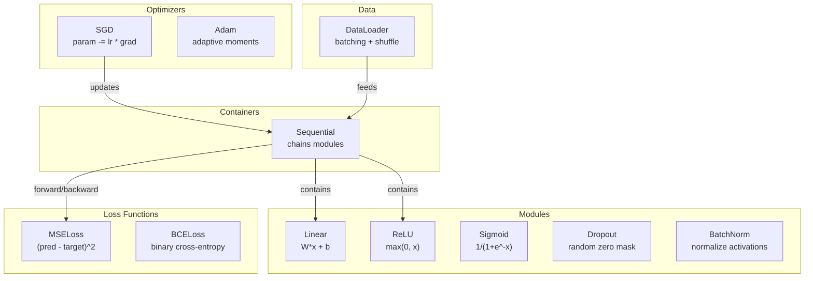
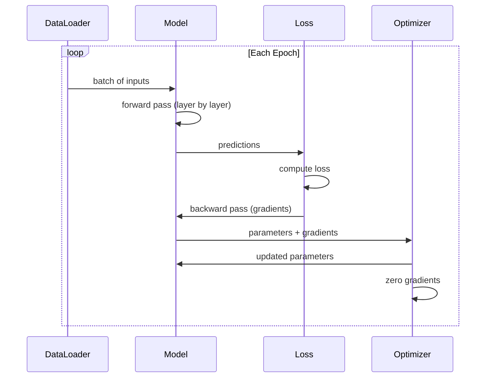
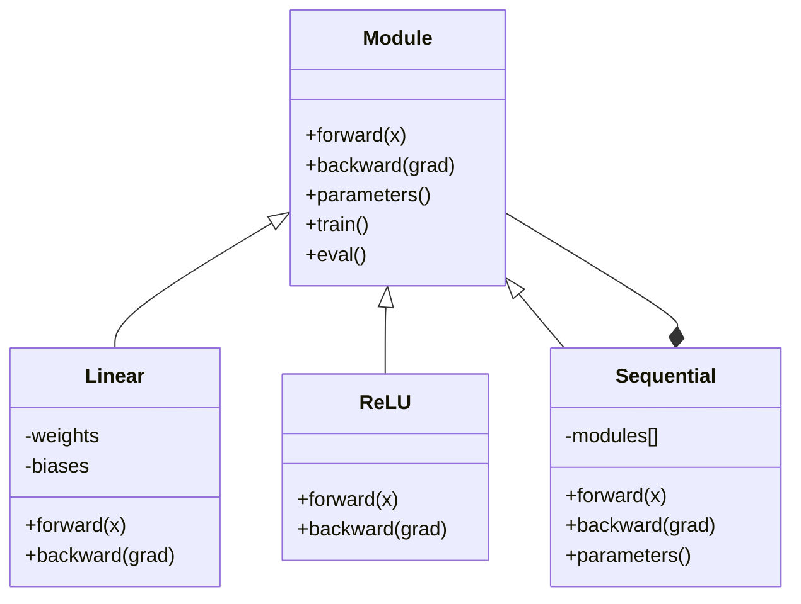

# Kendi Mini Çerçeve Yap

> Nöronları, katmanları, ağları, arka destekleri, aktivasyonları, kayb fonksiyonlarını, optimizerleri, düzenleme, başlangıç ve LR programlarını oluşturdun. Hepsi ayrı parçalar olarak. Şimdi onları bir çerçeveye bağla. PyTorch değil. TensorFlow değil.

**Type:** Build
**Languages:** Python, TypeScript
**Prerequisites:** All of Phase 03 (Lessons 01-09)
**Time:** ~120 minutes

## Öğrenme Hedefleri

- Modül, Linear, ReLU, Sigmoid, Dropout, BatchNorm, Sequential, kayb fonksiyonları, optimizerler ve DataLoader ile tam bir derin öğrenme çerçevesini (~ 500 satır) oluşturun
- Modül soyutlamasını (yukarı, geri, parametreler) ve neden tren/eval modunun değiştirilmesi gerekliliğini açıklayın.
- Tüm bileşenleri, dört katmanlı bir ağı döngü sınıflandırması üzerine eğiten bir çalışma eğitim döngüsüne bağlayın
- Çerçevenin her bileşenini PyTorch eşdeğeri (nn.Module, nn.Sequential, optim.Adam, DataLoader) ile çiz.

## Sorun

- 10 tane dersiniz var.`Value`Bir ağı eğitmek için beş farklı dersden kopya yapıştırıp elle birleştirirsin.

PyTorch size bu konuda bir çözüm sunuyor.`nn.Module`- Evet .`nn.Sequential`- Evet .`optim.Adam`- Evet .`DataLoader`TensorFlow size birleştirir.`keras.Layer`- Evet .`keras.Sequential`- Evet .`keras.optimizers.Adam`Bunlar sihir değil, her seferinde tesisatları yeniden icat etmeden ağları tanımlamanın, eğitmenin ve değerlendirmenin mümkün olduğunu sağlayan örgütleşim kalıpları.

Python'un 500 satırında aynı şeyi yapacaksınız. Numpy yok. Dış bağımlılık yok. Herhangi bir feedforward ağı tanımlayabilen, SGD veya Adam ile eğitilebilen, verileri toplayabilen, çıkış ve parti normallaşımı uygulayabilen, herhangi bir etkinleştirmeyi kullanabilen ve öğrenme hızını planlayabilen bir çerçeve.

İşini bitirdiğinde, yazma sırasında ne olduğunu tam olarak anlayacaksın.`model = nn.Sequential(...)`Nedenini anlayacaksınız.`model.train()`ve `model.eval()`Neden olduğunu anlayacaksın.`optimizer.zero_grad()`Her şeyi anlayacaksın, çünkü sen hepsini inşa ettin.

## Anlaşım

### Modül Abstraksiyonu

PyTorch ' un her tabakası , `nn.Module`Modülün üç sorumluluğu vardır:

1. **forward()**-- verilen girişlerin çıkışını hesaplayın
2. **parameters()**- ... bütün eğitimli ağırlıkları geri getir .
3. **backward()**-- hesaplama gradientleri (PyTorch'de otograd tarafından işlenir, bizimki açıkça)

Bir Linear katman bir Modül. Bir ReLU etkinleştirme bir Modül. Bir düşüş katmanı bir Modül. Bir parti normallaştırma katmanı bir Modül. Hepsi aynı arayüzüne sahiptir.

### İletişimli konteyner

`nn.Sequential`Modüller. Önceki geçiş: Modül 1, sonra Modül 2, sonra Modül 3. Geri geçiş: zinciri tersine çevirin. konteyner kendisi bir Modül - ileriye (((), parametrelerine ((() ve geriye ((() sahiptir. Bu karmaşık örnektir: Modüller dizisi kendisi bir Modüldür.

### Eğitim ve Değerlendirme Modu

İptal, eğitim sırasında rastgele nöronları sıfırlıyor, ancak değerlendirme sırasında her şeyi geçer.`train()`ve `eval()`Bu davranışları değiştirmek için kullanılan yöntemler.`training`Bayrak.

### Optimizer

Optimizer, parametreleri gradientlerini kullanarak güncelleyecektir.`param -= lr * grad`Adam: momentum ve varyansa tahminlerini korur, sonra güncelleştirir. Optimizer ağ mimarisini bilmiyor - sadece parametre ve gradientlerinin düz bir listesini görür.

### DataLoader

Batchleme iki nedenden dolayı önemlidir. Birincisi, büyük sorunlar için tüm veri kümesini hafıza içine yerleştiremezsiniz. İkincisi, mini-batch gradient düşüşü yerel minimumlardan kaçmaya yardımcı olan gürültü sağlar. DataLoader verileri partilere ayırır ve seçeneğiyle dönemler arasında karıştırır.

### Çerçeve mimarisi



### Eğitim Çubuğu



### Modül Hierarşi



```figure
gradient-clipping
```

## Yapın

### Adım 1: Modül Üssü Sınıfı

Her katmanın uyguladığı soyut bir arayüz.

```python
class Module:
    def __init__(self):
        self.training = True

    def forward(self, x):
        raise NotImplementedError

    def backward(self, grad):
        raise NotImplementedError

    def parameters(self):
        return []

    def train(self):
        self.training = True

    def eval(self):
        self.training = False
```

### Adım 2: Düzsel katman

Temel yapı taşı. Ağırlıkları ve tarafsızlıkları depolar, Wx + b'yi ileriye ve ağırlık / giriş gradiyentilerini geriye hesaplar.

```python
import math
import random


class Linear(Module):
    def __init__(self, fan_in, fan_out):
        super().__init__()
        std = math.sqrt(2.0 / fan_in)
        self.weights = [[random.gauss(0, std) for _ in range(fan_in)] for _ in range(fan_out)]
        self.biases = [0.0] * fan_out
        self.weight_grads = [[0.0] * fan_in for _ in range(fan_out)]
        self.bias_grads = [0.0] * fan_out
        self.fan_in = fan_in
        self.fan_out = fan_out
        self.input = None

    def forward(self, x):
        self.input = x
        output = []
        for i in range(self.fan_out):
            val = self.biases[i]
            for j in range(self.fan_in):
                val += self.weights[i][j] * x[j]
            output.append(val)
        return output

    def backward(self, grad):
        input_grad = [0.0] * self.fan_in
        for i in range(self.fan_out):
            self.bias_grads[i] += grad[i]
            for j in range(self.fan_in):
                self.weight_grads[i][j] += grad[i] * self.input[j]
                input_grad[j] += grad[i] * self.weights[i][j]
        return input_grad

    def parameters(self):
        params = []
        for i in range(self.fan_out):
            for j in range(self.fan_in):
                params.append((self.weights, i, j, self.weight_grads))
            params.append((self.biases, i, None, self.bias_grads))
        return params
```

### Adım 3: Aktifleştirme Modülleri

ReLU, Sigmoid ve Tanh modüller olarak, her biri geriye geçiş için gerekenleri saklar.

```python
class ReLU(Module):
    def __init__(self):
        super().__init__()
        self.mask = None

    def forward(self, x):
        self.mask = [1.0 if v > 0 else 0.0 for v in x]
        return [max(0.0, v) for v in x]

    def backward(self, grad):
        return [g * m for g, m in zip(grad, self.mask)]


class Sigmoid(Module):
    def __init__(self):
        super().__init__()
        self.output = None

    def forward(self, x):
        self.output = []
        for v in x:
            v = max(-500, min(500, v))
            self.output.append(1.0 / (1.0 + math.exp(-v)))
        return self.output

    def backward(self, grad):
        return [g * o * (1 - o) for g, o in zip(grad, self.output)]


class Tanh(Module):
    def __init__(self):
        super().__init__()
        self.output = None

    def forward(self, x):
        self.output = [math.tanh(v) for v in x]
        return self.output

    def backward(self, grad):
        return [g * (1 - o * o) for g, o in zip(grad, self.output)]
```

### Adım 4: İptal Modülü

Elemleri eğitim sırasında rastgele sıfırlıyor. kalan elementleri 1/(1-p) ile ölçeyor, böylece beklenen değerler aynı kalıyor.

```python
class Dropout(Module):
    def __init__(self, p=0.5):
        super().__init__()
        self.p = p
        self.mask = None

    def forward(self, x):
        if not self.training:
            return x
        self.mask = [0.0 if random.random() < self.p else 1.0 / (1 - self.p) for _ in x]
        return [v * m for v, m in zip(x, self.mask)]

    def backward(self, grad):
        if self.mask is None:
            return grad
        return [g * m for g, m in zip(grad, self.mask)]
```

### Adım 5: BatchNorm Modülü

Batçadaki özellikler için aktivasyonları sıfır ortalama ve birim varyansına normalleştirir.

```python
class BatchNorm(Module):
    def __init__(self, size, momentum=0.1, eps=1e-5):
        super().__init__()
        self.size = size
        self.gamma = [1.0] * size
        self.beta = [0.0] * size
        self.gamma_grads = [0.0] * size
        self.beta_grads = [0.0] * size
        self.running_mean = [0.0] * size
        self.running_var = [1.0] * size
        self.momentum = momentum
        self.eps = eps
        self.x_norm = None
        self.std_inv = None
        self.batch_input = None

    def forward_batch(self, batch):
        batch_size = len(batch)
        output_batch = []

        if self.training:
            mean = [0.0] * self.size
            for sample in batch:
                for j in range(self.size):
                    mean[j] += sample[j]
            mean = [m / batch_size for m in mean]

            var = [0.0] * self.size
            for sample in batch:
                for j in range(self.size):
                    var[j] += (sample[j] - mean[j]) ** 2
            var = [v / batch_size for v in var]

            self.std_inv = [1.0 / math.sqrt(v + self.eps) for v in var]

            self.x_norm = []
            self.batch_input = batch
            for sample in batch:
                normed = [(sample[j] - mean[j]) * self.std_inv[j] for j in range(self.size)]
                self.x_norm.append(normed)
                output = [self.gamma[j] * normed[j] + self.beta[j] for j in range(self.size)]
                output_batch.append(output)

            for j in range(self.size):
                self.running_mean[j] = (1 - self.momentum) * self.running_mean[j] + self.momentum * mean[j]
                self.running_var[j] = (1 - self.momentum) * self.running_var[j] + self.momentum * var[j]
        else:
            std_inv = [1.0 / math.sqrt(v + self.eps) for v in self.running_var]
            for sample in batch:
                normed = [(sample[j] - self.running_mean[j]) * std_inv[j] for j in range(self.size)]
                output = [self.gamma[j] * normed[j] + self.beta[j] for j in range(self.size)]
                output_batch.append(output)

        return output_batch

    def forward(self, x):
        result = self.forward_batch([x])
        return result[0]

    def backward(self, grad):
        if self.x_norm is None:
            return grad
        for j in range(self.size):
            self.gamma_grads[j] += self.x_norm[0][j] * grad[j]
            self.beta_grads[j] += grad[j]
        return [grad[j] * self.gamma[j] * self.std_inv[j] for j in range(self.size)]

    def parameters(self):
        params = []
        for j in range(self.size):
            params.append((self.gamma, j, None, self.gamma_grads))
            params.append((self.beta, j, None, self.beta_grads))
        return params
```

### Adım 6: Sıradan konteyner

Zincir modülleri. Önüne sola sağa gidiyor, geriye doğru sola gidiyor.

```python
class Sequential(Module):
    def __init__(self, *modules):
        super().__init__()
        self.modules = list(modules)

    def forward(self, x):
        for module in self.modules:
            x = module.forward(x)
        return x

    def backward(self, grad):
        for module in reversed(self.modules):
            grad = module.backward(grad)
        return grad

    def parameters(self):
        params = []
        for module in self.modules:
            params.extend(module.parameters())
        return params

    def train(self):
        self.training = True
        for module in self.modules:
            module.train()

    def eval(self):
        self.training = False
        for module in self.modules:
            module.eval()
```

### Adım 7: İşlevlerini kaybetmek

MSE ve Binary Cross-Entropy. Her biri kayıp değerini iade eder ve gradiyenti iade eden bir geriye doğru (() sağlar.

```python
class MSELoss:
    def __call__(self, predicted, target):
        self.predicted = predicted
        self.target = target
        n = len(predicted)
        self.loss = sum((p - t) ** 2 for p, t in zip(predicted, target)) / n
        return self.loss

    def backward(self):
        n = len(self.predicted)
        return [2 * (p - t) / n for p, t in zip(self.predicted, self.target)]


class BCELoss:
    def __call__(self, predicted, target):
        self.predicted = predicted
        self.target = target
        eps = 1e-7
        n = len(predicted)
        self.loss = 0
        for p, t in zip(predicted, target):
            p = max(eps, min(1 - eps, p))
            self.loss += -(t * math.log(p) + (1 - t) * math.log(1 - p))
        self.loss /= n
        return self.loss

    def backward(self):
        eps = 1e-7
        n = len(self.predicted)
        grads = []
        for p, t in zip(self.predicted, self.target):
            p = max(eps, min(1 - eps, p))
            grads.append((-t / p + (1 - t) / (1 - p)) / n)
        return grads
```

### Adım 8: SGD ve Adam Optimizerleri

Her ikisi de bir parametre listesini alır ve gradientleri kullanarak ağırlıkları güncelleir.

```python
class SGD:
    def __init__(self, parameters, lr=0.01):
        self.params = parameters
        self.lr = lr

    def step(self):
        for container, i, j, grad_container in self.params:
            if j is not None:
                container[i][j] -= self.lr * grad_container[i][j]
            else:
                container[i] -= self.lr * grad_container[i]

    def zero_grad(self):
        for container, i, j, grad_container in self.params:
            if j is not None:
                grad_container[i][j] = 0.0
            else:
                grad_container[i] = 0.0


class Adam:
    def __init__(self, parameters, lr=0.001, beta1=0.9, beta2=0.999, eps=1e-8):
        self.params = parameters
        self.lr = lr
        self.beta1 = beta1
        self.beta2 = beta2
        self.eps = eps
        self.t = 0
        self.m = [0.0] * len(parameters)
        self.v = [0.0] * len(parameters)

    def step(self):
        self.t += 1
        for idx, (container, i, j, grad_container) in enumerate(self.params):
            if j is not None:
                g = grad_container[i][j]
            else:
                g = grad_container[i]

            self.m[idx] = self.beta1 * self.m[idx] + (1 - self.beta1) * g
            self.v[idx] = self.beta2 * self.v[idx] + (1 - self.beta2) * g * g

            m_hat = self.m[idx] / (1 - self.beta1 ** self.t)
            v_hat = self.v[idx] / (1 - self.beta2 ** self.t)

            update = self.lr * m_hat / (math.sqrt(v_hat) + self.eps)

            if j is not None:
                container[i][j] -= update
            else:
                container[i] -= update

    def zero_grad(self):
        for container, i, j, grad_container in self.params:
            if j is not None:
                grad_container[i][j] = 0.0
            else:
                grad_container[i] = 0.0
```

### Adım 9: DataLoader

Verileri seriye ayırır, her dönemleri seçeneğiyle karıştırır.

```python
class DataLoader:
    def __init__(self, data, batch_size=32, shuffle=True):
        self.data = data
        self.batch_size = batch_size
        self.shuffle = shuffle

    def __iter__(self):
        indices = list(range(len(self.data)))
        if self.shuffle:
            random.shuffle(indices)
        for start in range(0, len(indices), self.batch_size):
            batch_indices = indices[start:start + self.batch_size]
            batch = [self.data[i] for i in batch_indices]
            inputs = [item[0] for item in batch]
            targets = [item[1] for item in batch]
            yield inputs, targets

    def __len__(self):
        return (len(self.data) + self.batch_size - 1) // self.batch_size
```

### Adım 10: Dört katmanlı bir ağı döngü sınıflandırması üzerine eğit

Bir model tanımla, bir kayıp seç, bir optimizer seç, eğitim döngüsünü çalıştır.

```python
def make_circle_data(n=500, seed=42):
    random.seed(seed)
    data = []
    for _ in range(n):
        x = random.uniform(-2, 2)
        y = random.uniform(-2, 2)
        label = 1.0 if x * x + y * y < 1.5 else 0.0
        data.append(([x, y], [label]))
    return data


def train():
    random.seed(42)

    model = Sequential(
        Linear(2, 16),
        ReLU(),
        Linear(16, 16),
        ReLU(),
        Linear(16, 8),
        ReLU(),
        Linear(8, 1),
        Sigmoid(),
    )

    criterion = BCELoss()
    optimizer = Adam(model.parameters(), lr=0.01)

    data = make_circle_data(500)
    split = int(len(data) * 0.8)
    train_data = data[:split]
    test_data = data[split:]

    loader = DataLoader(train_data, batch_size=16, shuffle=True)

    model.train()

    for epoch in range(100):
        total_loss = 0
        total_correct = 0
        total_samples = 0

        for batch_inputs, batch_targets in loader:
            batch_loss = 0
            for x, t in zip(batch_inputs, batch_targets):
                pred = model.forward(x)
                loss = criterion(pred, t)
                batch_loss += loss

                optimizer.zero_grad()
                grad = criterion.backward()
                model.backward(grad)
                optimizer.step()

                predicted_class = 1.0 if pred[0] >= 0.5 else 0.0
                if predicted_class == t[0]:
                    total_correct += 1
                total_samples += 1

            total_loss += batch_loss

        avg_loss = total_loss / total_samples
        accuracy = total_correct / total_samples * 100

        if epoch % 10 == 0 or epoch == 99:
            print(f"Epoch {epoch:3d} | Loss: {avg_loss:.6f} | Train Accuracy: {accuracy:.1f}%")

    model.eval()
    correct = 0
    for x, t in test_data:
        pred = model.forward(x)
        predicted_class = 1.0 if pred[0] >= 0.5 else 0.0
        if predicted_class == t[0]:
            correct += 1
    test_accuracy = correct / len(test_data) * 100
    print(f"\nTest Accuracy: {test_accuracy:.1f}% ({correct}/{len(test_data)})")

    return model, test_accuracy
```

## Kullan

İşte şimdi inşa ettiğiniz PyTorch eşdeğeri:

```python
import torch
import torch.nn as nn
from torch.utils.data import DataLoader, TensorDataset

model = nn.Sequential(
    nn.Linear(2, 16),
    nn.ReLU(),
    nn.Linear(16, 16),
    nn.ReLU(),
    nn.Linear(16, 8),
    nn.ReLU(),
    nn.Linear(8, 1),
    nn.Sigmoid(),
)

criterion = nn.BCELoss()
optimizer = torch.optim.Adam(model.parameters(), lr=0.01)

for epoch in range(100):
    model.train()
    for inputs, targets in dataloader:
        optimizer.zero_grad()
        predictions = model(inputs)
        loss = criterion(predictions, targets)
        loss.backward()
        optimizer.step()

    model.eval()
    with torch.no_grad():
        test_predictions = model(test_inputs)
```

Yapı aynı.`Sequential`- Evet .`Linear`- Evet .`ReLU`- Evet .`Sigmoid`- Evet .`BCELoss`- Evet .`Adam`- Evet .`zero_grad`- Evet .`backward`- Evet .`step`- Evet .`train`- Evet .`eval`Her konsept bir-bir haritası yapar. Farklılık şu ki PyTorch otomatik olarak otogradı (her modülde geriye doğru uygulamanın gerekliliği yoktur) ele alır, GPU'da çalışır ve yıllardır optimize edilmiştir.

PyTorch kodunu gördüğünüzde her satırda ne olduğunu tam olarak biliyorsunuz.

## Gönder

Bu ders şunları ortaya çıkarır:
- `outputs/prompt-framework-architect.md`-- çerçeve soyutlamalarını kullanarak sinir ağ mimarlıklarını tasarlama için bir ipucu

## Egzersizler

1. Bir ekle`SoftmaxCrossEntropyLoss`Sınıflar arasında sınıflandırma için sınıf. Yumuşak tahminleri artırın, çapraz entropi kaybını hesaplayın ve kombinasyon geriye geçiş yapın.

2. Optimizer'de öğrenme hızının programlanmasını uygulayın: bir  ekleyin`set_lr()`9. Ders'ten sonra, sistem ve telin, cosine çizelgesinde kullanılır.

3. Bir ekle`save()`ve `load()`Sequential'e yöntemi tüm ağırlıkları bir JSON dosyasına seriye eder ve geri yükler.

4. Adam optimizerinde kilo kaybı (L2 düzenlenmesi) uygulayın.`weight_decay`Her adımda ağırlıkları sıfıra doğru küçültür.

5. Örnek başına yapılan eğitim döngüsünü uygun mini-batch gradient birikimi ile değiştirin: bir partideki tüm örnekler boyunca gradient birikimi yapın, sonra parti boyutuna bölün ve bir optimizer adımını atın. Bu, yakınlaşma hızı değiştirir mi ölçün.

## Anahtar Terimler

| Term | What people say | What it actually means |
|------|----------------|----------------------|
| Module | "A layer" | The base abstraction in a framework -- anything with forward(), backward(), and parameters() |
| Sequential | "Stack layers in order" | A container that chains modules, applying them in sequence for forward and reverse for backward |
| Forward pass | "Run the network" | Computing the output by passing input through each module in order |
| Backward pass | "Compute gradients" | Propagating the loss gradient through each module in reverse to compute parameter gradients |
| Parameters | "The trainable weights" | All values in the network that the optimizer can update -- weights and biases |
| Optimizer | "The thing that updates weights" | An algorithm that uses gradients to update parameters, implementing SGD, Adam, or other rules |
| DataLoader | "The thing that feeds data" | An iterator that splits a dataset into batches, optionally shuffling between epochs |
| Training mode | "model.train()" | A flag that enables stochastic behavior like dropout and batch normalization with batch stats |
| Evaluation mode | "model.eval()" | A flag that disables dropout and uses running statistics for batch normalization |
| Zero grad | "Clear the gradients" | Resetting all parameter gradients to zero before computing the next batch's gradients |

## Daha Fazla Okumak

- Paszke et al., "PyTorch: Bir İmperatif Stylo, Yüksek Performanslı Derin Öğrenme Kütüphanesi" (2019) -- PyTorch'in tasarım kararlarını açıklayan makale
- Chollet, "Python ile Derin Öğrenme, İkinci Sürüm" (2021) -- 3. bölüm aynı modül/katman soyutlaması ile Keras içsellerini kapsar
- Johnson, "Tiny-DNN" (https://github.com/tiny-dnn/tiny-dnn) -- sadece başlıklı bir C++ derin öğrenme çerçevesini çerçeve içsellerini anlamak için
