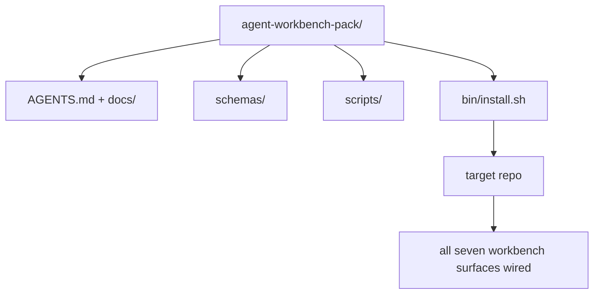

# Kapstone: Bir Yeniden Kullanılabilir Ajan Çalışma Masa Paketi Gönder

> Mini-track, her repo'ya bırakılan bir paketle sona erer.`cp -r`Bu ders programının eseri bu taş.

**Type:** Build
**Languages:** Python (stdlib), TypeScript
**Prerequisites:** Phases 14 · 31 to 14 · 41
**Time:** ~75 minutes

## Öğrenme Hedefleri

- Yedi çalışma masası yüzeyini tek bir drop-in dizinine paketleyin.
- Şemaları, senaryoları ve şablonları sıkıştırın böylece yeni bir repo bilinen bir temel çizgiye sahip olur.
- Paketi idempotently yere koyacak tek bir yükleme senaryounu ekleyin.
- Her biri için kesikliği savunarak, pakete ne kalır ne de ne kalmaz karar verin.
- Bir değerlendirmeci tarafından yeniden üretilebilecek kanıtlarla bir ajan yardımıyla depolama değişikliğini göster.

## Sorun

Google Doküman'da, sohbet geçmişinde ve üç yarı hatırlanan senaryoda yaşayan bir çalışma deski, her çeyrekte yeniden inşa edilen bir çalışma deski. Tedavi bir versiyon paketidir: yüzeyler, şemalar, senaryolar ve tek komut yükleyici olan bir repo veya dizin.

Bu dersi bitireceksin .`outputs/agent-workbench-pack/`Diskte ve bir `bin/install.sh`Bu da onu hedef repo'ya düşürür.

## Anlaşım



### Paket düzenlemesi

```
outputs/agent-workbench-pack/
├── AGENTS.md
├── docs/
│   ├── agent-rules.md
│   ├── reliability-policy.md
│   ├── handoff-protocol.md
│   └── reviewer-rubric.md
├── schemas/
│   ├── agent_state.schema.json
│   ├── task_board.schema.json
│   └── scope_contract.schema.json
├── scripts/
│   ├── init_agent.py
│   ├── run_with_feedback.py
│   ├── verify_agent.py
│   └── generate_handoff.py
├── bin/
│   └── install.sh
└── README.md
```

### Ne kalır, ne kalır.

İçinde:

- Üst planları, sözleşme.
- Yukarıdaki dört senaryo, bu da çalışmanın zamanı.
- Dört belge, kural ve kural.

Dışarıda:

- Projeye özel görevler, görevler hedef repo tahtasına ait, paketlere değil.
- Satıcı SDK çağrıları.
- Toplu takımın içinde değil, mevcut grubun yanında yaşıyor.

### Kurulucu

Kısa bir ...`bin/install.sh`(veya `bin/install.py`):

1. Var olan bir paket üzerinde yüklemeyi reddeder.`--force`- Evet .
2. Paketi hedef repo'ya kopyalar.
3. İK ile bağlantı kurulur`.github/workflows/`var.
4. Sonraki adımları yazdırır: tabloyu doldurun, kabul komutlarını ayarlayın, init metnini çalıştırın.

### Versiyonlama

Paket bir `VERSION`-Skype'de değişiklikler ve senaryo değişiklikleri, göç gerektirir.`agent_state.json`hangi paket versiyonuna karşı başlatılmış olduğunu kaydeder.

```figure
wb-pack-install
```

## Yapın

`code/main.py`paketleri bir araya getirir.`outputs/agent-workbench-pack/`Dersin yanında, bu mini-track'deki önceki derslerin planları ve senaryoları ve zaten yazdığın belgeleri yerleştirilmiş.

Çek şunu:

```
python3 code/main.py
npx tsx code/main.ts
```

Senaryo yüzeyleri kopyalar ve penler, README yazır, paket ağacını yazdırır ve sıfırdan çıkıyor.

## Doğada üretim biçimleri

Bir paket sadece çatal, güncelleştirme ve akıntıdan uzak kalırsa değerlidir.

**`VERSION` is the contract, not the marketing.**Büyük çatlaklar bir devlet göçü gerektirir. Küçük çatlaklar bir kontrol tekrar çalıştırmak gerekir. Çizgi çatlaklar sadece belge. Kurulucu yazar`.workbench-version`Her yükleme için hedef repo 'ya; `lint_pack.py`Eğer hedefinin kilitli anahtarı paketle aynı fikirde değilse göndermeyi reddeder `VERSION`- İşte böyle .`npm`- Evet .`Cargo`ve`pyproject.toml`10 yıl süren bir savaşta hayatta kalmak için. Ajanlar hakkında hiçbir şey kuralları değiştirmez.

**Single source for cross-tool distribution.**Nx gemileri bir .`nx ai-setup`Bu da bir şey.`AGENTS.md`- Evet .`CLAUDE.md`- Evet .`.cursor/rules/`- Evet .`.github/copilot-instructions.md`Bu paket aynı şeyi yapmalıdır; kurulucu simge bağlantıları yayar (`ln -s AGENTS.md CLAUDE.md`Bu yüzden her kodlama ajanına tek bir gerçek kaynağı yayılır.

**`uninstall.sh` that refuses on non-trivial state.**Paketi kaldırmak kullanıcıların adreslerini silmemelidir `agent_state.json`- Evet .`task_board.json`veya`outputs/`- İndirme cihazı, şemaları, senaryoları, belgeleri ve `AGENTS.md`(Bütün bu`--keep-agents-md`Bu durumun bir diğer nedeni de, devlet dosyalarının herhangi bir değişikliğe sahip olmasıdır.

**Skill-as-publishable. SkillKit-style distribution.**Paketler SkillKit yeteneği olarak gemiye gönderilir: `skillkit install agent-workbench-pack`Bu, 32 AI ajanı bir tek kaynaktan oluşturur. Paket repo gerçeğin kaynağıdır; SkillKit dağıtım kanalıdır. Satıcı kilitleme çöker; yedi yüzey aynı kalır.

## Kullan

Paket gemileri üç yere:

- **As a directory you drop into a repo.** `cp -r outputs/agent-workbench-pack /path/to/repo`- Evet .
- **As a public template repo.**Kork ve özelleştir,  ile`VERSION`Akıntı kontrolü.
- **As a SkillKit skill.**Ajanın ürünüyle bağlantılı, böylece tek bir komut onu belirler.

Her paket bir resept, her kurulum bir porsiyon.

## Gönder

`outputs/skill-workbench-pack.md`proje ayarlı bir paket oluşturur: takım tarihine göre kurallar, repo ile eşleşen kapsam küpleri, bir alan özel giriş ile genişletilmiş rubrik boyutları.

## Egzersizler

1. Hangi beşinci dokümenin kanonik grupta terfi edilmeye layık olduğuna karar verin.
2. Kurulucuyu Python olarak yeniden yaz `--dry-run`Ergonomiyi bash ile karşılaştır.
3. Bir ekle`bin/uninstall.sh`Bu, paketi güvenli bir şekilde çıkarır ve devlet dosyalarının önemsiz geçmişi varsa reddeder.
4. Bir ekle`lint_pack.py`Paketin çıkışında başarısız olur.`VERSION`- Topluğun kendi repo için bilgi kaynağına gönder.
5. Bu paketle birlikte elden yuvarlanan bir masaüstüden hareket eden bir yolcu defteri yazarı.

## Kariyer Uygulamaları: Bir Depolama Değişimi Göster

Paketleme demo'su, montaj cihazının dosyaları çalıştıracağını ve ürettiğini kanıtlar. Bu, ajanınızın yeni bir görevi tamamlayabileceğini, oluşturulan kontrollerin bu görevi kanıtlayacağını veya dağıtılan bir sistemin çalıştığını kanıtlamaz.

Sahip olduğunuz veya değiştirme izniniz olan bir depodaki küçük gerçek bir görevi seçin.

Paketleme laboratuvarının dışında ayrı bir çalışma oturumunun bütçesi. Aşağıdaki bağlantılı kanıt şablonunu kendi işinizle kopyalanın.`learning-artifacts/`Kayıtlı şablonun referans malzemesi olarak saklanması ve paketlenmesi.

### 1. Görev çerçevesini oluştur ve özerk seç

Ders 43'ten görev çerçevesini ve ders 44'ten kanıt planını kullanın. Başlangıç incelemesini, gözlemlenebilir hedefi, hedef olmayanları, izin verilen yolları ve kabul kanıtı kaydetin. Davranışa ihtiyacı olan gerçek kullanıcıyı veya operatörü tanımlayın.

İşlem modunu seçin: rehberlik adımları, kontrol noktası uygulanması veya sınırlı bir otonom çalıştırma.

Bir ajanın bir tane ortaya çıkarması durumunda bir divar zaman bütçesi ve bir token veya maliyet limiti belirleyin.

### 2. En küçük yararlı ortamı hazırlayın

Uygun uygulamayı, çağrıda bulunmayı, test etmeyi ve yerel talimatları geri alın. Her kaynağın neden bağlamda yer aldığını ve hangi mevcut kanıtların eski bir notu geçersiz kılacağını kaydet. Öntanımlı olarak tüm deposu yüklemeyin.

Her ilgili uzantı için bir açık seçim yapın: bir beceri tekrarlanabilir bir prosedür sağlar; bir MCP aracı erişim sağlar; bir kanca belirleyici bir kontrol yürütür; bir eklenti paketi yetenekleri. Bir uzantıyı yalnızca göreve ihtiyaç duyduğunda, çalışmasına izin veren en az izinle tutun.

İtiraf ettiğiniz bir eklemin bağlamını veya bakım maliyetini kaydedin. Eski bir belleği veya talimatı yeniden kontrol edin, sonra bu kararı destekleyen kanıtlar olduğunda öğrencilerin sahip olduğu kurulumunuzda geri çekiniz veya değiştirin.

### 3. Temel çizgiyi yakalayıp uygulayın

Düzenleme yapmadan önce, en yakın mevcut kontrolü çalıştırın ve istenen davranışın mevcut durumunu gösterin. Komut, gözden geçirme, sonuç ve kanıt konumunu koruyun. Henüz bulunmayan bir özelliğin hala bir temel hatı vardır: gözlemlenen yanıt veya desteklenmeyen işlem kaydedilir.

Bu nedenle, bir işçiyi görevlendirmeyi kabul ederek, görevli bir görevliyi görevlendirmeyi kabul ederek, görevli bir görevliyi görevli bir görevli olarak görevlendirmeyi kabul eder.

### 4. Kanıtlara meydan okuyun

Değişen yüzeyi gözlemleyen bir kanıt seçin. Bir UI için, hizmet edilen yolculuğu ilgili genişlikler üzerinde yeniden inşa edin ve inceleyin. Bir API için, istek ve serileşmiş yanıtı inceleyin. CLI için, oluşturulmuş komutu çalıştırın ve çıkış kodunu ve çıkışını kontrol edin. Görevinizin ihtiyaç duyduğu kontrolleri seçin ve sınırlarını açıklayın.

Görev sözleşmesinden beklenen bir sonuç yazın, ajanın uygulamasından bağımsız olarak. Bir defter kopyasında geçersiz bir değer kabul etmek veya gerekli bir cevap alanını düşürmek gibi belirli bir yanlış sonuç girin. Aynı kabul kontrolünü yapın: bu nedenle başarısız olmalıdır.

Eğer yeşil kalırsa, güvenmeden önce itirafı veya gözlemini güçlendirin. Doğru uygulamayı geri yükleyin ve başarılı bir şekilde tekrar çalıştırın. Her iki risit de tutun. Bir sözcük hatası veya bozuk test ayarı geri dönüşü tespit etmek olarak sayılmaz.

Değişmiş testler dahil son farkı orijinal hedefe ve izin verilen yollara karşı değerlendirin. En zayıf kanıtı düzenlemeden mücadele etmesi için bir eşya veya ayrı bir değerlendirme oturumunu isteyin.

### 5. Tekrar çalıştırma ve kurtarma

Değiştirilmiş eserleri bir kullanımlık yerel veya sahnedeci ortamda çalıştırın.`local`- Evet .`staging`veya`live`Yerel bir prova yerel bir iddiayı destekler; bu egzersiz için üretim dağıtımına gerek yoktur.

Görev ile ilgili bir başarısızlık sinyali, bir eşiği, bir gözlem penceresi ve bir sahibi seçin. Bu eşiği geçtikten sonra tepkiyi açıklayın. Deneme sırasında sinyalü güvenli bir şekilde tetikleyin ve gözlemlenen günlük, metrik veya tepkiyi tutun.

Bilinen iyi bir eser için tekrar tekrar çalışın ve önceki davranışın restore edildiğini kontrol edin. Uygulanabilir olduğunda kalıcı verileri göz önünde bulundurun; tek başına ikili bir değişikliğin veri değişikliğini tersine çevirmeyebileceği anlamına gelmez. Doğrulama işlemlerini kaydetemediğiniz herhangi bir adım kaydetin.

### 6. Bir sonraki koşuyu iyileştir ve teslim et

Sonuçları, geçmiş zaman, mevcut kullanım verileri ve insan müdahaleleri dahil olmak üzere başlangıç çizgisiyle karşılaştırın.

Bir test, küçük bir izin sınırı, otomasyon veya daha net bir örnek kullanılarak 46. dersi kullanarak bir gözlemlenmiş düzeltmeyi teşvik edin. Etkili kontrolü tekrarlayın. Geçici mutasyonları kaldırın ve son dalı, değiştirilen dosyaları, riskleri açın ve bir sonraki eylem sonraki oturum için açıkça bırakın.

### Elsel inceleme rubrikası

Değerlendirici kanıt dosyalarını incelesin ve en zayıf kabul kontrolünü tekrarlasın.`demonstrated`- Evet .`needs revision`veya`unverified`Bu gözlemlerin yerine doldurulmuş alanlar ve geçiş yapılmış ambalaj yazıları geçmez.

| Dimension | Evidence the reviewer should challenge |
|---|---|
| Task and autonomy | Starting behavior, bounded goal, justified permissions, budget, and a usable stop rule |
| Context and environment | Relevant sources, justified tool access, and a rechecked retirement decision |
| Verification | Actual before/after behavior and a deliberate incorrect result that the same check rejects |
| Review and operation | Inspected diff, independent challenge, labeled runtime observation, and rehearsed recovery |
| Iteration and handoff | One verified improvement, honest limits, clean final state, and a reproducible next action |

Kararını ver .`needs revision`Görev tamamlandığını iddia etmeden önce bulguları.`unverified`Portföy sınırlı bir görev hakkında mühendislik yargınızı gösterir; bir işe alma veya dağıtım garantisi değildir.

## Nakliye edilen Sanatlı

Yeniden kullanılabilir paketinizi ve tamamlanmış kopyalarınızı saklayın.[career-agent-evidence.md](https://github.com/rohitg00/ai-engineering-from-scratch/blob/main/phases/14-agent-engineering/42-agent-workbench-capstone/outputs/career-agent-evidence.md)Şablon görev çerçevesini, yürütme planını, çalışma zamanının risitlerini, incelemeyi, kurtarma provalarını ve teslimatını tek bir inceleme edilebilir vaka çalışmasına bağlar.

## Anahtar Terimler

| Term | What people say | What it actually means |
|------|----------------|------------------------|
| Workbench pack | "The starter kit" | A versioned directory carrying all seven surfaces |
| Installer | "Setup script" | `bin/install.sh` that lays the pack down idempotently |
| Pack version | "VERSION" | Major bumps for schema/script changes, patch for doc-only |
| Drop-in pack | "cp -r and go" | Pack works without per-repo customization on day one |
| Forkable template | "GitHub template" | Public repo that GitHub's "Use this template" can clone from |

## Daha Fazla Okumak

- 14 · 31 ila 14 · 41  Bu paket her yüzeyi toplar
- [SkillKit](https://github.com/rohitg00/skillkit) 32 AI ajanına bu beceriyi yükle
- [Nx Blog, Teach Your AI Agent How to Work in a Monorepo](https://nx.dev/blog/nx-ai-agent-skills) 6 alet üzerinde tek kaynaklı jeneratör
- [agents.md — the open spec](https://agents.md/) paketinizin yönlendirici neyi uygulamalı
- [HKUDS/OpenHarness](https://github.com/HKUDS/OpenHarness) Paket eşdeğerinin referans uygulanması
- [Augment Code, A good AGENTS.md is a model upgrade](https://www.augmentcode.com/blog/how-to-write-good-agents-dot-md-files) paket belgeler kaliteli çubuğu
- [Anthropic, Effective harnesses for long-running agents](https://www.anthropic.com/engineering/effective-harnesses-for-long-running-agents)
- [Anthropic, Harness design for long-running application development](https://www.anthropic.com/engineering/harness-design-long-running-apps)
- Ekipmanın doğrulama kapısını tüketen değerlendirme yöntemiyle çalışan ajan geliştirme aşaması 14 · 30 
- EY 14 · 41  bu paket ön/sonu referans değerini
