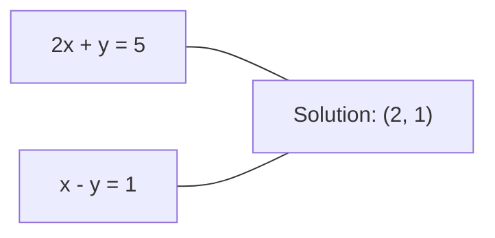
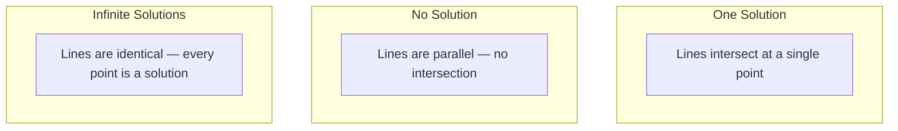

# Hệ thống tuyến tính

> Giải quyết$Ax = b$là vấn đề lâu đời nhất trong toán học vẫn đang điều hành mạng lưới thần kinh của bạn.

**Type:** Build
**Languages:** Python, TypeScript
**Prerequisites:** Phase 1, Lessons 01 (Linear Algebra Intuition), 02 (Vectors & Matrices), 03 (Matrix Transformations)
**Time:** ~120 minutes

## Mục tiêu học tập

- Giải quyết $Ax = b$sử dụng loại bỏ Gaussian với xoay một phần và thay thế ngược
- Các matrices nhân tố với LU, QR, và cholesky phân hủy và giải thích khi nào mỗi thích hợp
- Thuộc dẫn các phương trình bình thường cho các hình vuông tối thiểu và kết nối chúng với sự lùi đường thẳng và sườn
- Chẩn đoán các hệ thống không điều kiện tốt bằng cách sử dụng số điều kiện và áp dụng quy định để ổn định chúng

## Vấn đề

Mỗi lần bạn đào tạo một sự hồi quy tuyến tính, bạn giải quyết một hệ thống tuyến tính. mỗi khi bạn tính toán một phù hợp ít nhất vuông, bạn giải quyết một hệ thống tuyến tính. mỗi khi một lớp mạng thần kinh tính toán.`y = Wx + b`, đó là đánh giá một mặt của một hệ thống tuyến tính. khi bạn thêm quy định, bạn sửa đổi hệ thống. khi bạn sử dụng các quá trình Gaussian, bạn tính toán một matrix. khi bạn đảo ngược một matrix tính biến đối với khoảng cách Mahalanobis, bạn giải quyết một hệ thống tuyến tính.

Phương trình $Ax = b$xuất hiện khắp nơi.$A$là một trật tự của các hệ số được biết. $b$là một vector của các kết quả được biết. $x$là vector của những điều không biết mà bạn muốn tìm.$A$là dữ liệu của bạn,$b$là vector mục tiêu của bạn, và $x$là vector trọng lượng. toàn bộ mô hình giảm xuống: tìm $x$như thế này$Ax$là gần nhất với $b$- Có thể.

Bài học này xây dựng mọi phương pháp chính để giải quyết phương trình đó từ đầu. Bạn sẽ hiểu tại sao một số phương pháp nhanh và một số khác ổn định, tại sao một số chỉ hoạt động cho các hệ thống vuông và một số khác xử lý các hệ thống quá xác định, và tại sao số điều kiện của dải tử liệu của bạn quyết định liệu câu trả lời của bạn có nghĩa gì không.

## Khái niệm

### Ax = b có nghĩa là gì về mặt hình học

Một hệ thống các phương trình tuyến tính có một cách giải thích hình học. Mỗi phương trình xác định một siêu phẳng. Giải pháp là điểm (hoặc tập hợp các điểm) nơi tất cả các siêu phẳng giao nhau.

```
2x + y = 5          Two lines in 2D.
x - y  = 1          They intersect at x=2, y=1.
```



Ba điều có thể xảy ra:



Trong dạng matrix, "một giải pháp" có nghĩa là $A$là đảo ngược. "Không giải pháp" có nghĩa là hệ thống không phù hợp. "Solution vô hạn" có nghĩa là$A$có không gian không. Hầu hết các vấn đề ML thuộc loại "không có giải pháp chính xác" bởi vì bạn có nhiều phương trình (điểm dữ liệu) hơn các không rõ (chỉ số). Đó là nơi các hình vuông ít nhất đến.

### Hình cột vs hình hàng

Có hai cách đọc $Ax = b$- Tôi không biết.

**Row picture.**Mỗi hàng của $A$mỗi phương trình là một siêu phẳng. giải pháp là nơi chúng giao nhau.

**Column picture.**Mỗi cột của $A$Câu hỏi trở thành: kết hợp tuyến tính nào của các cột của $A$sản xuất $b$- Không .

```
A = | 2  1 |    b = | 5 |
    | 1 -1 |        | 1 |

Row picture: solve 2x + y = 5 and x - y = 1 simultaneously.

Column picture: find x1, x2 such that:
  x1 * [2, 1] + x2 * [1, -1] = [5, 1]
  2 * [2, 1] + 1 * [1, -1] = [4+1, 2-1] = [5, 1]   check.
```

Hình ảnh cột là cơ bản hơn.$b$nằm trong không gian cột của $A$, hệ thống có một giải pháp.$b$nếu không, bạn sẽ tìm thấy điểm gần nhất trong không gian cột. điểm gần nhất là giải pháp các hình vuông nhỏ nhất.

### Phục tiêu Gaussian

Giao dịch loại bỏ Gaussian$Ax = b$vào một hệ thống tam giác trên $Ux = c$là phương pháp trực tiếp nhất.

Khóa toán:

```
1. For each column k (the pivot column):
   a. Find the largest entry in column k at or below row k (partial pivoting).
   b. Swap that row with row k.
   c. For each row i below k:
      - Compute multiplier m = A[i][k] / A[k][k]
      - Subtract m times row k from row i.
2. Back substitute: solve from the last equation upward.
```

Ví dụ:

```
Original:
| 2  1  1 | 8 |       R2 = R2 - (2)R1     | 2  1   1 |  8 |
| 4  3  3 |20 |  -->  R3 = R3 - (1)R1 --> | 0  1   1 |  4 |
| 2  3  1 |12 |                            | 0  2   0 |  4 |

                       R3 = R3 - (2)R2     | 2  1   1 |  8 |
                                       --> | 0  1   1 |  4 |
                                           | 0  0  -2 | -4 |

Back substitute:
  -2 * x3 = -4    -->  x3 = 2
  x2 + 2  = 4     -->  x2 = 2
  2*x1 + 2 + 2 = 8 --> x1 = 2
```

Chi phí loại bỏ Gaussian $O(n^3)$Các hoạt động.$1000 \times 1000$Hệ thống, đó là khoảng một tỷ hoạt động điểm nổi. nhanh, nhưng bạn có thể làm tốt hơn nếu bạn cần giải quyết nhiều hệ thống với cùng một$A$- Tôi không biết.

### Phong trào một phần: tại sao nó quan trọng

Nếu không xoay, việc loại bỏ Gaussian có thể thất bại hoặc tạo ra rác. Nếu một yếu tố xoay là không, bạn chia bằng không. Nếu nó nhỏ, bạn tăng cường sai lầm xoay.

```
Bad pivot:                       With partial pivoting:
| 0.001  1 | 1.001 |            Swap rows first:
| 1      1 | 2     |            | 1      1 | 2     |
                                 | 0.001  1 | 1.001 |
m = 1/0.001 = 1000              m = 0.001/1 = 0.001
R2 = R2 - 1000*R1               R2 = R2 - 0.001*R1
| 0.001  1     | 1.001   |      | 1      1     | 2     |
| 0     -999   | -999.0  |      | 0      0.999 | 0.999 |

x2 = 1.000 (correct)            x2 = 1.000 (correct)
x1 = (1.001 - 1)/0.001          x1 = (2 - 1)/1 = 1.000 (correct)
   = 0.001/0.001 = 1.000        Stable because the multiplier is small.
```

Trong toán học điểm nổi với độ chính xác hạn chế, phiên bản không xoay có thể mất các chữ số đáng kể.

### LU phân hủy

LU yếu tố phân hủy $A$vào một hình hình ba góc thấp hơn $L$và một hình trục phía trên $U$$A = LU$- $L$Matrix lưu trữ các nhân từ việc loại bỏ Gaussian.$U$Matrix là kết quả của việc loại bỏ.

```
A = L @ U

| 2  1  1 |   | 1  0  0 |   | 2  1   1 |
| 4  3  3 | = | 2  1  0 | @ | 0  1   1 |
| 2  3  1 |   | 1  2  1 |   | 0  0  -2 |
```

Tại sao phải tính toán thay vì chỉ loại bỏ?$L$và $U$, giải quyết$Ax = b$cho bất kỳ mới $b$Chỉ có chi phí $O(n^2)$- Có thể là:

```math
\begin{aligned}
Ax &= b \\
LUx &= b \\
&\text{Let } y = Ux\text{:} \\
Ly &= b \quad \text{(forward substitution, } O(n^2)\text{)} \\
Ux &= y \quad \text{(back substitution, } O(n^2)\text{)}
\end{aligned}
```

- $O(n^3)$chi phí được trả một lần trong quá trình tính toán.$O(n^2)$Nếu bạn cần giải quyết 1000 hệ thống bằng cùng một$A$Nhưng khác nhau.$b$LU tiết kiệm một nhân tố 1000/3 trong tổng công việc.

Với xoay một phần, bạn có được $PA = LU$nơi $P$là một matrix permutation ghi lại các thay đổi hàng.

### Sự phân hủy QR

Các yếu tố phân hủy QR $A$thành một matrix thẳng thắn $Q$và một hình trục phía trên $R$$A = QR$- Tôi không biết.

Một matrix trực giác có tính chất $Q^T Q = I$Cột của nó là vector orthonormal.$Q$bảo tồn chiều dài và góc độ.

```
A = Q @ R

Q has orthonormal columns: Q^T Q = I
R is upper triangular

To solve Ax = b:
  QRx = b
  Rx = Q^T b    (just multiply by Q^T, no inversion needed)
  Back substitute to get x.
```

QR số lượng ổn định hơn LU để giải quyết các vấn đề bình số ít nhất.$Q$Cột cho cột:

```
Given columns a1, a2, ... of A:

q1 = a1 / ||a1||

q2 = a2 - (a2 . q1) * q1        (subtract projection onto q1)
q2 = q2 / ||q2||                (normalize)

q3 = a3 - (a3 . q1) * q1 - (a3 . q2) * q2
q3 = q3 / ||q3||

R[i][j] = qi . aj    for i <= j
```

Mỗi bước sẽ loại bỏ thành phần cùng với tất cả các bước trước $q$các vector, chỉ để lại hướng thẳng đứng mới.

### Sự phân hủy của Cholesky

Khi nào $A$là đối xứng ($A = A^T$) và xác định tích cực (tất cả các giá trị riêng tích cực), bạn có thể tính toán nó như $A = L L^T$nơi $L$là hình ba dưới. Đây là phân hủy của Cholesky.

```
A = L @ L^T

| 4  2 |   | 2  0 |   | 2  1 |
| 2  5 | = | 1  2 | @ | 0  2 |

L[i][i] = sqrt(A[i][i] - sum(L[i][k]^2 for k < i))
L[i][j] = (A[i][j] - sum(L[i][k]*L[j][k] for k < j)) / L[j][j]    for i > j
```

Cholesky nhanh gấp đôi LU và đòi hỏi một nửa lưu trữ. Nó chỉ hoạt động cho các matrix tích cực đối xứng, nhưng chúng luôn xuất hiện:

- Các matrix có tính tính tương đối là phân định dương tính đối xứng (định định dương tính với quy định).
- Các môtrix hạt nhân trong các quy trình Gaussian là đối xứng tích cực xác định.
- Hessian của một hàm ngọc tối thiểu là đối xứng tích cực xác định.
- $A^T A$luôn là đối xứng tích cực bán xác định.

Trong các quy trình Gaussian, bạn tính toán các khối lõi$K$Cholesky, sau đó giải quyết.$K \alpha = y$Cholesky cũng cho bạn số lượng xác định log cho xác suất biên:$\log \det(K) = 2 \sum \log(\mathop{\mathrm{diag}}(L))$- Tôi không biết.

### Các hình vuông tối thiểu: khi Ax = b không có giải pháp chính xác

Nếu$A$là $m \times n$với $m > n$(các phương trình hơn là những phương trình chưa biết), hệ thống đã được xác định quá mức. Không có giải pháp chính xác. Thay vào đó, bạn giảm thiểu sai lầm vuông:

```
minimize ||Ax - b||^2

This is the sum of squared residuals:
  sum((A[i,:] @ x - b[i])^2 for i in range(m))
```

Máy giảm thiểu đáp ứng các phương trình bình thường:

```math
A^T A x = A^T b
```

Xuất phát: mở rộng $\lVert Ax - b \rVert^2 = (Ax - b)^T (Ax - b) = x^T A^T A x - 2 x^T A^T b + b^T b$Hãy lấy gradient đối với $x$, đặt nó lên 0: $2 A^T A x - 2 A^T b = 0$- Tôi không biết.

```
Original system (overdetermined, 4 equations, 2 unknowns):
| 1  1 |         | 3 |
| 1  2 | x     = | 5 |       No exact x satisfies all 4 equations.
| 1  3 |         | 6 |
| 1  4 |         | 8 |

Normal equations:
A^T A = | 4  10 |    A^T b = | 22 |
        | 10 30 |            | 63 |

Solve: x = [1.5, 1.7]

This is linear regression. x[0] is the intercept, x[1] is the slope.
```

### Các phương trình bình thường = sự lùi lại tuyến tính

Kết nối chính xác. Trong trục hồi tuyến tính, các dữ liệu của bạn$X$có một dòng cho mỗi mẫu và một cột cho mỗi tính năng.$y$có một mục cho mỗi mẫu.$w$đáp ứng:

```math
\begin{aligned}
X^T X w &= X^T y \\
w &= (X^T X)^{-1} X^T y
\end{aligned}
```

Đây là giải pháp dạng đóng cho sự lùi ngược tuyến tính.`sklearn.linear_model.LinearRegression.fit()`tính toán này (hoặc tương đương qua QR hoặc SVD).

Thêm một thuật ngữ quy định $\lambda I$đến các matrix và bạn có được sự lùi lại của cột:

```math
\begin{aligned}
(X^T X + \lambda I) w &= X^T y \\
w &= (X^T X + \lambda I)^{-1} X^T y
\end{aligned}
```

Việc điều chỉnh làm cho các hình tử hình được điều kiện tốt hơn (làm cho nó dễ dàng đảo ngược chính xác hơn) và ngăn chặn quá phù hợp bằng cách thu hẹp trọng lượng về phía không.$X^T X + \lambda I$luôn là đối xứng tích cực xác định khi $\lambda > 0$, để bạn có thể sử dụng Cholesky để giải quyết nó.

### Phép đảo ngược (Moore-Penrose)

Phép đảo ngược$A^+$tổng hợp sự đảo ngược của matrix thành các matrix không bình phương và đơn vị.$A$- Có thể là:

```math
\begin{aligned}
x &= A^+ b \\[4pt]
\text{where } A^+ &= V \Sigma^+ U^T \quad \text{(computed via SVD)}
\end{aligned}
```

$\Sigma^+$được hình thành bằng cách lấy tương đối của mỗi giá trị đơn vị không bằng 0 và chuyển đổi kết quả.$A = U \Sigma V^T$, sau đó $A^+ = V \Sigma^+ U^T$- Tôi không biết.

```
A = U Sigma V^T        (SVD)

Sigma = | 5  0 |       Sigma+ = | 1/5  0  0 |
        | 0  2 |                | 0  1/2  0 |
        | 0  0 |

A+ = V Sigma+ U^T
```

Phép đảo ngược cho giải pháp tối thiểu-định luật số lượng vuông thấp nhất. Nếu hệ thống có:
- Một giải pháp:$A^+ b$- Đưa ra.
- Không có giải pháp: $A^+ b$cho giải pháp các khối lượng nhỏ nhất.
- Giải pháp vô hạn:$A^+ b$cho người có ít nhất $\lVert x \rVert$- Tôi không biết.

NumPy `np.linalg.lstsq`và `np.linalg.pinv`Cả hai đều sử dụng SVD bên trong.

### Số điều kiện

Số điều kiện đo lường độ nhạy cảm của giải pháp đối với những thay đổi nhỏ trong đầu vào.$A$, số điều kiện là:

```math
\kappa(A) = \lVert A \rVert \cdot \lVert A^{-1} \rVert = \frac{\sigma_{\max}}{\sigma_{\min}}
```

nơi $\sigma_{\max}$và $\sigma_{\min}$là các giá trị đơn lẻ lớn nhất và nhỏ nhất.

```
Well-conditioned (kappa ~ 1):        Ill-conditioned (kappa ~ 10^15):
Small change in b -->                Small change in b -->
small change in x                    huge change in x

| 2  0 |   kappa = 2/1 = 2          | 1   1          |   kappa ~ 10^15
| 0  1 |   safe to solve            | 1   1+10^(-15) |   solution is garbage
```

Quy tắc của ngón tay:
- $\kappa < 100$: an toàn, giải pháp chính xác.
- $\kappa \approx 10^k$: bạn thua khoảng $k$số chính xác từ toán học điểm nổi của bạn.
- $\kappa \approx 10^{16}$(đối với float64): giải pháp là vô nghĩa.

Trong ML, điều kiện không tốt xảy ra khi các tính năng gần như liên kết.$\lambda I$) cải thiện số điều kiện từ $\sigma_{\max} / \sigma_{\min}$đến$(\sigma_{\max} + \lambda) / (\sigma_{\min} + \lambda)$- Tôi không biết.

### Phương pháp lặp lại: gradient kết hợp

Đối với các hệ thống hiếm rất lớn (người không biết hàng triệu), các phương pháp trực tiếp như LU hoặc Cholesky quá đắt tiền.

Tỷ lệ kết hợp (CG) giải quyết $Ax = b$Khi nào $A$là đối xứng tích cực xác định. Nó tìm thấy giải pháp chính xác trong tối đa$n$lặp (trong toán học chính xác), nhưng thường hội tụ nhanh hơn nhiều nếu các giá trị riêng của $A$được tập hợp.

```
Algorithm sketch:
  x0 = initial guess (often zero)
  r0 = b - A x0           (residual)
  p0 = r0                 (search direction)

  For k = 0, 1, 2, ...:
    alpha = (rk . rk) / (pk . A pk)
    x_{k+1} = xk + alpha * pk
    r_{k+1} = rk - alpha * A pk
    beta = (r_{k+1} . r_{k+1}) / (rk . rk)
    p_{k+1} = r_{k+1} + beta * pk
    if ||r_{k+1}|| < tolerance: stop
```

CG được sử dụng trong:
- Tối ưu hóa quy mô lớn (Phương pháp Newton-CG)
- Giải quyết các sự phân biệt PDE
- Các phương pháp hạt nhân khi các ma trận hạt nhân quá lớn để tính
- Việc điều kiện trước cho các máy giải pháp lặp lại khác

Tỷ lệ hội tụ phụ thuộc vào số điều kiện. Hệ thống có điều kiện tốt hơn hội tụ nhanh hơn, đó là một lý do khác vì sao việc điều chỉnh giúp.

### Hình ảnh đầy đủ: phương pháp nào khi

| Method | Requirements | Cost | Use case |
|--------|-------------|------|----------|
| Gaussian elimination | Square, nonsingular $A$ | $O(n^3)$ | One-off solve of a square system |
| LU decomposition | Square, nonsingular $A$ | $O(n^3)$ factor + $O(n^2)$ solve | Multiple solves with the same $A$ |
| QR decomposition | Any $A$ ($m \ge n$) | $O(mn^2)$ | Least squares, numerically stable |
| Cholesky | Symmetric positive definite $A$ | $O(n^3/3)$ | Covariance matrices, Gaussian processes, ridge regression |
| Normal equations | Overdetermined ($m > n$) | $O(mn^2 + n^3)$ | Linear regression (small $n$) |
| SVD / pseudoinverse | Any $A$ | $O(mn^2)$ | Rank-deficient systems, minimum-norm solutions |
| Conjugate gradient | Symmetric positive definite, sparse $A$ | $O(n \cdot k \cdot \text{nnz})$ | Large sparse systems, $k$ = iterations |

### Kết nối với ML

Mỗi phương pháp trong bài học này xuất hiện trong sản xuất ML:

**Linear regression.**Giải pháp hình thức đóng giải quyết các phương trình bình thường $X^T X w = X^T y$Điều này được thực hiện qua Cholesky (nếu$n$là nhỏ) hoặc QR (nếu ổn định số là quan trọng) hoặc SVD (nếu các matrix có thể thiếu thứ hạng).

**Ridge regression.**Thêm thêm $\lambda I$đến$X^T X$Hệ thống quy định$(X^T X + \lambda I) w = X^T y$luôn có thể giải quyết qua Cholesky bởi vì$X^T X + \lambda I$là tích cực đối xứng xác định cho $\lambda > 0$- Tôi không biết.

**Gaussian processes.**Tỷ lệ trung bình dự đoán đòi hỏi phải giải quyết $K \alpha = y$nơi $K$là các khối lượng hạt nhân.$K$là phương pháp tiếp cận tiêu chuẩn.$\log \det(K) = 2 \sum \log(\mathop{\mathrm{diag}}(L))$- Tôi không biết.

**Neural network initialization.**Việc khởi tạo trực giác sử dụng phân hủy QR để tạo ra các matrix trọng lượng có cột là hoặc bình thường. Điều này ngăn chặn sự sụp đổ tín hiệu trong các mạng sâu.

**Preconditioning.**Các máy tối ưu hóa quy mô lớn sử dụng Cholesky không hoàn chỉnh hoặc LU không hoàn chỉnh như là điều kiện tiên quyết cho các máy giải gradient kết hợp.

**Feature engineering.**Số điều kiện của $X^T X$cho bạn biết nếu các tính năng của bạn là tròn.$\kappa$là lớn, giảm tính năng hoặc thêm quy định.

```figure
linear-system-conditioning
```

## Hãy xây dựng nó

### Bước 1: Phục tiêu Gaussian với xoay một phần

```python
import numpy as np

def gaussian_elimination(A, b):
    n = len(b)
    Ab = np.hstack([A.astype(float), b.reshape(-1, 1).astype(float)])

    for k in range(n):
        max_row = k + np.argmax(np.abs(Ab[k:, k]))
        Ab[[k, max_row]] = Ab[[max_row, k]]

        if abs(Ab[k, k]) < 1e-12:
            raise ValueError(f"Matrix is singular or nearly singular at pivot {k}")

        for i in range(k + 1, n):
            m = Ab[i, k] / Ab[k, k]
            Ab[i, k:] -= m * Ab[k, k:]

    x = np.zeros(n)
    for i in range(n - 1, -1, -1):
        x[i] = (Ab[i, -1] - Ab[i, i+1:n] @ x[i+1:n]) / Ab[i, i]

    return x
```

### Bước 2: LU phân hủy

```python
def lu_decompose(A):
    n = A.shape[0]
    L = np.eye(n)
    U = A.astype(float).copy()
    P = np.eye(n)

    for k in range(n):
        max_row = k + np.argmax(np.abs(U[k:, k]))
        if max_row != k:
            U[[k, max_row]] = U[[max_row, k]]
            P[[k, max_row]] = P[[max_row, k]]
            if k > 0:
                L[[k, max_row], :k] = L[[max_row, k], :k]

        for i in range(k + 1, n):
            L[i, k] = U[i, k] / U[k, k]
            U[i, k:] -= L[i, k] * U[k, k:]

    return P, L, U

def lu_solve(P, L, U, b):
    n = len(b)
    Pb = P @ b.astype(float)

    y = np.zeros(n)
    for i in range(n):
        y[i] = Pb[i] - L[i, :i] @ y[:i]

    x = np.zeros(n)
    for i in range(n - 1, -1, -1):
        x[i] = (y[i] - U[i, i+1:] @ x[i+1:]) / U[i, i]

    return x
```

### Bước 3: Sự phân hủy của Cholesky

```python
def cholesky(A):
    n = A.shape[0]
    L = np.zeros_like(A, dtype=float)

    for i in range(n):
        for j in range(i + 1):
            s = A[i, j] - L[i, :j] @ L[j, :j]
            if i == j:
                if s <= 0:
                    raise ValueError("Matrix is not positive definite")
                L[i, j] = np.sqrt(s)
            else:
                L[i, j] = s / L[j, j]

    return L
```

### Bước 4: Các hình vuông tối thiểu thông qua các phương trình bình thường

```python
def least_squares_normal(A, b):
    AtA = A.T @ A
    Atb = A.T @ b
    return gaussian_elimination(AtA, Atb)

def ridge_regression(A, b, lam):
    n = A.shape[1]
    AtA = A.T @ A + lam * np.eye(n)
    Atb = A.T @ b
    L = cholesky(AtA)
    y = np.zeros(n)
    for i in range(n):
        y[i] = (Atb[i] - L[i, :i] @ y[:i]) / L[i, i]
    x = np.zeros(n)
    for i in range(n - 1, -1, -1):
        x[i] = (y[i] - L.T[i, i+1:] @ x[i+1:]) / L.T[i, i]
    return x
```

### Bước 5: Số điều kiện

```python
def condition_number(A):
    U, S, Vt = np.linalg.svd(A)
    return S[0] / S[-1]
```

## Sử dụng nó

Đặt các mảnh cùng nhau để lập lại đường thẳng và lập lại sườn trên dữ liệu thực:

```python
np.random.seed(42)
X_raw = np.random.randn(100, 3)
w_true = np.array([2.0, -1.0, 0.5])
y = X_raw @ w_true + np.random.randn(100) * 0.1

X = np.column_stack([np.ones(100), X_raw])

w_ols = least_squares_normal(X, y)
print(f"OLS weights (ours):    {w_ols}")

w_np = np.linalg.lstsq(X, y, rcond=None)[0]
print(f"OLS weights (numpy):   {w_np}")
print(f"Max difference: {np.max(np.abs(w_ols - w_np)):.2e}")

w_ridge = ridge_regression(X, y, lam=1.0)
print(f"Ridge weights (ours):  {w_ridge}")

from sklearn.linear_model import Ridge
ridge_sk = Ridge(alpha=1.0, fit_intercept=False)
ridge_sk.fit(X, y)
print(f"Ridge weights (sklearn): {ridge_sk.coef_}")
```

## Chuyển nó

Bài học này mang lại:
- `code/linear_systems.py`chứa các thực hiện từ đầu của loại bỏ Gaussian, phân hủy LU, phân hủy Cholesky, các hình vuông tối thiểu và sự lùi sườn
- `code/linear_systems.ts`Nó so sánh với các giải pháp tham chiếu nhỏ từ đầu, bởi vì TypeScript không có NumPy.
- Một minh chứng làm việc cho thấy các phương trình bình thường và Klern's LinearRegression tạo ra các trọng lượng tương tự

## Các bài tập

1. Giải quyết hệ thống `[[1,2,3],[4,5,6],[7,8,10]] x = [6, 15, 27]`sử dụng loại bỏ Gaussian của bạn, giải pháp LU của bạn, và `np.linalg.solve`Hãy kiểm tra cả ba câu trả lời đều giống nhau trong độ dung nạp điểm nổi.

2. Tạo một số liệu ngẫu nhiên 50x5 X và mục tiêu y = X @ w_true + tiếng ồn. Giải quyết cho w bằng cách sử dụng các phương trình bình thường, QR (via `np.linalg.qr`), SVD (via `np.linalg.svd`), và `np.linalg.lstsq`So sánh cả bốn giải pháp.$X^T X$và giải thích nó ảnh hưởng đến phương pháp nào mà bạn tin tưởng.

3. Tạo một số liệu gần như đơn vị bằng cách làm cho hai cột gần giống nhau (ví dụ, cột 2 = cột 1 + 1e-10 * tiếng ồn).$Ax = b$với và không có quy định (đã thêm $0.01 I$). So sánh các dung dịch và chất còn lại.

4. Thực hiện thuật toán gradient kết hợp cho một số liệu số 100x100 ngẫu nhiên đối xứng tích cực xác định. Đếm bao nhiêu lần lặp lại cần để hội tụ với dung lượng 1e-8. So sánh với tối đa lý thuyết của $n$lặp lại.

5. Thời gian của bạn cho cholesky giải quyết vs LU giải quyết vs `np.linalg.solve`trên các số liệu xác định tích cực đối xứng với kích thước 10, 50, 200, 500.

### Những gợi ý

**Exercise 1.**Gọi`gaussian_elimination(A, b)`, sau đó `lu_decompose(A)`tiếp theo là `lu_solve(P, L, U, b)`, sau đó `np.linalg.solve(A, b)`Hãy kiểm tra từng câu trả lời với `np.allclose(A @ x, b)`và so sánh ba câu trả lời với `np.allclose`- Tôi không biết.

**Exercise 2.**Sử dụng `least_squares_normal`cho các phương trình bình thường và ba hàm NumPy cho các phương pháp khác.`w_true`- So sánh`condition_number(X.T @ X)`với `condition_number(X)`: thứ nhất là hình vuông của thứ hai, vì vậy các phương trình bình thường mất độ chính xác nhất.

**Exercise 3.**Hãy mong đợi một số điều kiện ở trên $10^{9}$- Giải quyết với `np.linalg.solve`và với `ridge_regression(A, b, 0.01)`, sau đó so sánh`np.linalg.norm(x)`Cả hai chất còn lại có thể nhỏ, nhưng dung dịch không có quy định thường có các mục rất lớn.

**Exercise 4.**Làm một matrix xác định tích cực đối xứng với `B @ B.T + n * np.eye(n)`, để mỗi giá trị bản chất là tích cực. Thêm một đếm vào vòng lặp trong bản sao của bạn của `conjugate_gradient`, sau đó kiểm tra rằng chuẩn dư cuối cùng là dưới 1e-8 và rằng con số là tối đa 100.

**Exercise 5.**Sử dụng cùng một `B @ B.T + n * np.eye(n)`các matrices cho cả ba giải pháp và thời gian mỗi giải quyết với `time.perf_counter`Cholesky cần khoảng một nửa số toán của LU, vì vậy tỷ lệ rõ ràng nhất ở các kích thước lớn hơn.

## Các điều khoản chính

| Term | What people say | What it actually means |
|------|----------------|----------------------|
| Linear system | "Solve for x" | A set of linear equations $Ax = b$. Finding $x$ means finding the input that produces output $b$ under transformation $A$. |
| Gaussian elimination | "Row reduce" | Systematically zero out entries below the diagonal using row operations, producing an upper triangular system solvable by back substitution. $O(n^3)$. |
| Partial pivoting | "Swap rows for stability" | Before eliminating in column $k$, swap the row with the largest absolute value in that column to the pivot position. Prevents division by small numbers. |
| LU decomposition | "Factor into triangles" | Write $A = LU$ where $L$ is lower triangular (stores multipliers) and $U$ is upper triangular (the eliminated matrix). Amortizes the $O(n^3)$ cost over multiple solves. |
| QR decomposition | "Orthogonal factorization" | Write $A = QR$ where $Q$ has orthonormal columns and $R$ is upper triangular. More stable than LU for least squares. |
| Cholesky decomposition | "Square root of a matrix" | For symmetric positive definite $A$, write $A = LL^T$. Half the cost of LU. Used for covariance matrices, kernel matrices, and ridge regression. |
| Least squares | "Best fit when exact is impossible" | Minimize the sum of squared residuals $\lVert Ax - b \rVert^2$ when the system is overdetermined (more equations than unknowns). |
| Normal equations | "The calculus shortcut" | $A^T A x = A^T b$. Setting the gradient of $\lVert Ax - b \rVert^2$ to zero. This IS the closed-form solution to linear regression. |
| Pseudoinverse | "Inversion for non-square matrices" | $A^+ = V \Sigma^+ U^T$ via SVD. Gives the minimum-norm least-squares solution for any matrix, square or rectangular, singular or not. |
| Condition number | "How trustworthy is this answer" | $\kappa = \sigma_{\max} / \sigma_{\min}$. Measures sensitivity to input perturbations. Lose about $\log_{10}(\kappa)$ digits of precision. |
| Ridge regression | "Regularized least squares" | Solve $(X^T X + \lambda I) w = X^T y$. Adding $\lambda I$ improves conditioning and shrinks weights toward zero. Prevents overfitting. |
| Conjugate gradient | "Iterative Ax=b for big matrices" | An iterative solver for symmetric positive definite systems. Converges in at most $n$ steps. Practical for large sparse systems where factorization is too expensive. |
| Overdetermined system | "More data than parameters" | $m > n$ in an $m\text{-by-}n$ system. No exact solution exists. Least squares finds the best approximation. This is every regression problem. |
| Back substitution | "Solve from the bottom up" | Given an upper triangular system, solve the last equation first, then substitute backward. $O(n^2)$. |
| Forward substitution | "Solve from the top down" | Given a lower triangular system, solve the first equation first, then substitute forward. $O(n^2)$. Used in the L step of LU solves. |

## Đọc thêm

- [MIT 18.06: Linear Algebra](https://ocw.mit.edu/courses/18-06-linear-algebra-spring-2010/)(Gilbert Strang) - khóa học cuối cùng về hệ thống tuyến tính và các hệ số tử liệu
- [Numerical Linear Algebra](https://people.maths.ox.ac.uk/trefethen/text.html)(Trefethen & Bau) - tham chiếu tiêu chuẩn để hiểu sự ổn định số, điều kiện hóa, và tại sao các thuật toán thất bại
- [Matrix Computations](https://www.press.jhu.edu/books/title/10678/matrix-computations)(Golub & Van Loan) -- tham khảo khoa học cho mỗi thuật toán tử liệu
- [3Blue1Brown: Inverse Matrices](https://www.3blue1brown.com/lessons/inverse-matrices)-- trực giác thị giác để giải quyết những gì $Ax = b$nghĩa là hình học
