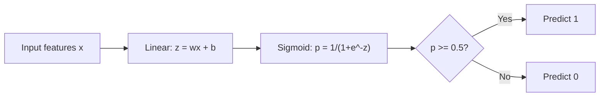
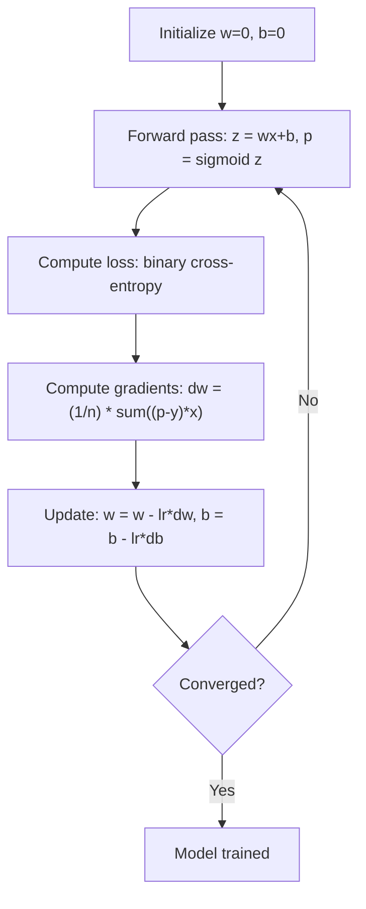

# Sự lùi hậu cần

> Sự lùi lại hậu cần cong một đường thẳng vào một đường cong S để trả lời câu hỏi có hay không với xác suất.

**Type:** Build
**Languages:** Python, Julia, Rust
**Prerequisites:** Phase 2 Lesson 1-2 (What Is ML, Linear Regression)
**Time:** ~90 minutes

## Mục tiêu học tập

- Thực hiện sự lùi lại hậu cần từ đầu bằng cách sử dụng hàm sigmoid và mất tích giao entropy nhị phân
- Xét và giải thích chính xác, thu hồi, điểm F1 và các mã số nhầm lẫn cho phân loại nhị phân
- Giải thích lý do tại sao MSE không được phân loại và tại sao sự phân phối chéo nhị phân tạo ra bề mặt chi phí ngọc
- Xây dựng mô hình hồi quy softmax cho phân loại đa lớp và đánh giá các thỏa thuận điều chỉnh ngưỡng

## Vấn đề

Bạn muốn dự đoán liệu khối u có ác tính hay lành tính khi xem kích thước của nó. Bạn thử sự hồi quy tuyến tính. Nó đưa ra các số như 0,3 hoặc 1,7 hoặc -0,5.

Lập ngược hậu cần giải quyết điều này. Nó có cùng một kết hợp tuyến tính ($wx + b$(x) và vượt qua qua hàm sigmoid, mà đè nhỏ bất kỳ số nào vào phạm vi (0, 1).

Đây là một trong những thuật toán được sử dụng rộng rãi nhất trong thực tế. Mặc dù tên của nó, sự lùi hậu cần là một thuật toán phân loại, không phải là thuật toán lùi hậu cần. Tên này xuất phát từ chức năng hậu cần (sigmoid) nó sử dụng.

## Khái niệm

### Tại sao sự lùi lại tuyến tính không thể phân loại

Hãy tưởng tượng dự đoán vượt qua / thất bại (1/0) dựa trên giờ học.

```
hours:  1   2   3   4   5   6   7   8   9   10
actual: 0   0   0   0   1   1   1   1   1   1
```

Một sự phù hợp tuyến tính có thể tạo ra các dự đoán như -0,2 tại giờ 1 và 1,3 tại giờ 10. Những giá trị này không phải là xác suất. Chúng đi dưới 0 và trên 1.

Việc phân loại cần một chức năng:
- Các giá trị đầu ra từ 0 đến 1 (khả năng)
- Tạo ra một sự chuyển đổi mạnh mẽ (một ranh giới quyết định)
- Không bị biến dạng bởi các điểm ngoại lệ xa biên giới

### Vị năng Sigmoid

Chức năng sigmoid thực hiện chính xác như thế này:

```math
\sigma(z) = \frac{1}{1 + e^{-z}}
```

Các tính chất:
- Khi nào $z$là lớn và tích cực, $\sigma(z)$Phương pháp 1
- Khi nào $z$là lớn và âm tính,$\sigma(z)$Phương pháp tiếp cận 0
- Khi nào $z = 0$- $\sigma(z) = 0.5$
- Khả năng đầu ra luôn nằm giữa 0 và 1
- Chức năng này đều mượt mà và có thể phân biệt ở mọi nơi

Các dẫn xuất có một hình thức thuận tiện: $\sigma'(z) = \sigma(z) (1 - \sigma(z))$Điều này làm cho tính toán gradient hiệu quả.

### Lệ nở logistics = mô hình tuyến tính + Sigmoid

Mô hình tính toán $z = wx + b$(tương tự như sự lùi lại tuyến tính), sau đó áp dụng sigmoid:



Tạo ra$p$được giải thích như $P(y=1 \mid x)$, xác suất rằng đầu vào thuộc lớp 1. Biên giới quyết định là nơi $wx + b = 0$, làm cho hiệu suất sigmoid chính xác là 0,5.

### Loss Cross-Entropy Binary

Bạn không thể sử dụng MSE để hồi quy hậu cần. MSE với sigmoid tạo ra một bề mặt chi phí không ngọc với nhiều mức tối thiểu địa phương. Thay vào đó, sử dụng sự chuyển đổi phân tử nhị phân (tr mất log):

```math
\text{Loss} = -\frac{1}{n} \sum \left( y \log(p) + (1-y) \log(1-p) \right)
```

Tại sao điều này hiệu quả:
- Khi nào $y=1$và $p$gần 1 .$\log(1) = 0$, do đó tổn thất gần 0 (đúng, chi phí thấp)
- Khi nào $y=1$và $p$là gần 0: $\log(0)$tiếp cận vô hạn âm, do đó mất mát là rất lớn (sai, chi phí cao)
- Khi nào $y=0$và $p$là gần 0: $\log(1) = 0$, do đó tổn thất gần 0 (đúng, chi phí thấp)
- Khi nào $y=0$và $p$gần 1 .$\log(0)$tiếp cận vô hạn âm, do đó mất mát là rất lớn (sai, chi phí cao)

Chức năng mất mát này là ngọc để hồi quy hậu cần, vì vậy mỗi mức tối thiểu địa phương là mức tối thiểu toàn cầu và sự giảm gradient không thể bị mắc kẹt trong một dữ liệu xấu.

### Sự giảm dần về hậu cần

Các gradient cho sự chéo-tròp nhị phân với sigmoid có hình thức sạch:

```math
\begin{aligned}
\frac{\partial L}{\partial w} &= \frac{1}{n} \sum (p - y) \, x \\
\frac{\partial L}{\partial b} &= \frac{1}{n} \sum (p - y)
\end{aligned}
```

Những hình ảnh này trông giống như các gradient trục xuất tuyến tính.$p = \sigma(wx + b)$thay vì $p = wx + b$. Sigmoid giới thiệu tính không tuyến tính, nhưng quy tắc cập nhật gradient vẫn giống nhau.



### Biên giới quyết định

Đối với một đầu vào 2D (hai tính năng), ranh giới quyết định là đường:

```math
w_1 x_1 + w_2 x_2 + b = 0
```

Các điểm ở một bên được phân loại là 1, điểm ở phía bên kia là 0. Phục hồi hậu cần luôn tạo ra một ranh giới quyết định tuyến tính. Nếu bạn cần một ranh giới cong, bạn hoặc thêm các tính năng đa nôn hoặc sử dụng mô hình không tuyến tính.

### Định dạng đa lớp với Softmax

Sự lùi hậu cần nhị phân xử lý hai lớp.$k$lớp, sử dụng hàm softmax:

```math
\text{softmax}(z_i) = \frac{e^{z_i}}{\sum_j e^{z_j}}
```

Mỗi lớp có vector trọng lượng riêng của nó. mô hình tính toán điểm số.$z_i$cho mỗi lớp, sau đó softmax chuyển đổi điểm số thành xác suất tổng cộng là 1.

Chức năng mất mát trở thành cross-entropy phân loại:

```math
\text{Loss} = -\frac{1}{n} \sum \sum_k y_k \log(p_k)
```

nơi $y_k$là 1 cho lớp thực và 0 cho tất cả các lớp khác (chế lập mã một lần).

### Các số liệu đánh giá

Chỉ riêng độ chính xác không đủ. Đối với một tập dữ liệu với 95% âm tính và 5% dương tính, một mô hình luôn dự đoán âm tính có độ chính xác 95% nhưng vô dụng.

**Confusion Matrix**- Có thể là:

| | Predicted Positive | Predicted Negative |
|---|---|---|
| Actually Positive | True Positive (TP) | False Negative (FN) |
| Actually Negative | False Positive (FP) | True Negative (TN) |

**Precision**Trong số tất cả những điều tích cực dự đoán, có bao nhiêu điều tích cực thực sự?
```math
\text{Precision} = \frac{TP}{TP + FP}
```

**Recall**(Sensitivity): Trong tất cả những điều tích cực thực tế, chúng ta đã bắt được bao nhiêu?
```math
\text{Recall} = \frac{TP}{TP + FN}
```

**F1 Score**: trung bình hài hòa của độ chính xác và nhớ lại.
```math
F_1 = 2 \cdot \frac{\text{Precision} \cdot \text{Recall}}{\text{Precision} + \text{Recall}}
```

Khi nào để đặt ưu tiên:
- **Precision**: khi tin tích cực sai đắt tiền (trình lọc spam, bạn không muốn chặn email hợp pháp)
- **Recall**: khi âm tính sai đắt tiền (bản sàng lọc ung thư, bạn không muốn bỏ lỡ một khối u)
- **F1**: khi bạn cần một số liệu cân bằng duy nhất

```figure
logistic-sigmoid
```

## Hãy xây dựng nó

### Bước 1: chức năng Sigmoid và tạo dữ liệu

```python
import random
import math

def sigmoid(z):
    z = max(-500, min(500, z))
    return 1.0 / (1.0 + math.exp(-z))


random.seed(42)
N = 200
X = []
y = []

for _ in range(N // 2):
    X.append([random.gauss(2, 1), random.gauss(2, 1)])
    y.append(0)

for _ in range(N // 2):
    X.append([random.gauss(5, 1), random.gauss(5, 1)])
    y.append(1)

combined = list(zip(X, y))
random.shuffle(combined)
X, y = zip(*combined)
X = list(X)
y = list(y)

print(f"Generated {N} samples (2 classes, 2 features)")
print(f"Class 0 center: (2, 2), Class 1 center: (5, 5)")
print(f"First 5 samples:")
for i in range(5):
    print(f"  Features: [{X[i][0]:.2f}, {X[i][1]:.2f}], Label: {y[i]}")
```

### Bước 2: Khản hồi hậu cần từ đầu

```python
class LogisticRegression:
    def __init__(self, n_features, learning_rate=0.01):
        self.weights = [0.0] * n_features
        self.bias = 0.0
        self.lr = learning_rate
        self.loss_history = []

    def predict_proba(self, x):
        z = sum(w * xi for w, xi in zip(self.weights, x)) + self.bias
        return sigmoid(z)

    def predict(self, x, threshold=0.5):
        return 1 if self.predict_proba(x) >= threshold else 0

    def compute_loss(self, X, y):
        n = len(y)
        total = 0.0
        for i in range(n):
            p = self.predict_proba(X[i])
            p = max(1e-15, min(1 - 1e-15, p))
            total += y[i] * math.log(p) + (1 - y[i]) * math.log(1 - p)
        return -total / n

    def fit(self, X, y, epochs=1000, print_every=200):
        n = len(y)
        n_features = len(X[0])
        for epoch in range(epochs):
            dw = [0.0] * n_features
            db = 0.0
            for i in range(n):
                p = self.predict_proba(X[i])
                error = p - y[i]
                for j in range(n_features):
                    dw[j] += error * X[i][j]
                db += error
            for j in range(n_features):
                self.weights[j] -= self.lr * (dw[j] / n)
            self.bias -= self.lr * (db / n)
            loss = self.compute_loss(X, y)
            self.loss_history.append(loss)
            if epoch % print_every == 0:
                print(f"  Epoch {epoch:4d} | Loss: {loss:.4f} | w: [{self.weights[0]:.3f}, {self.weights[1]:.3f}] | b: {self.bias:.3f}")
        return self

    def accuracy(self, X, y):
        correct = sum(1 for i in range(len(y)) if self.predict(X[i]) == y[i])
        return correct / len(y)


split = int(0.8 * N)
X_train, X_test = X[:split], X[split:]
y_train, y_test = y[:split], y[split:]

print("\n=== Training Logistic Regression ===")
model = LogisticRegression(n_features=2, learning_rate=0.1)
model.fit(X_train, y_train, epochs=1000, print_every=200)

print(f"\nTrain accuracy: {model.accuracy(X_train, y_train):.4f}")
print(f"Test accuracy:  {model.accuracy(X_test, y_test):.4f}")
print(f"Weights: [{model.weights[0]:.4f}, {model.weights[1]:.4f}]")
print(f"Bias: {model.bias:.4f}")
```

### Bước 3: Matrix và métrics nhầm lẫn từ đầu

```python
class ClassificationMetrics:
    def __init__(self, y_true, y_pred):
        self.tp = sum(1 for t, p in zip(y_true, y_pred) if t == 1 and p == 1)
        self.tn = sum(1 for t, p in zip(y_true, y_pred) if t == 0 and p == 0)
        self.fp = sum(1 for t, p in zip(y_true, y_pred) if t == 0 and p == 1)
        self.fn = sum(1 for t, p in zip(y_true, y_pred) if t == 1 and p == 0)

    def accuracy(self):
        total = self.tp + self.tn + self.fp + self.fn
        return (self.tp + self.tn) / total if total > 0 else 0

    def precision(self):
        denom = self.tp + self.fp
        return self.tp / denom if denom > 0 else 0

    def recall(self):
        denom = self.tp + self.fn
        return self.tp / denom if denom > 0 else 0

    def f1(self):
        p = self.precision()
        r = self.recall()
        return 2 * p * r / (p + r) if (p + r) > 0 else 0

    def print_confusion_matrix(self):
        print(f"\n  Confusion Matrix:")
        print(f"                  Predicted")
        print(f"                  Pos   Neg")
        print(f"  Actual Pos     {self.tp:4d}  {self.fn:4d}")
        print(f"  Actual Neg     {self.fp:4d}  {self.tn:4d}")

    def print_report(self):
        self.print_confusion_matrix()
        print(f"\n  Accuracy:  {self.accuracy():.4f}")
        print(f"  Precision: {self.precision():.4f}")
        print(f"  Recall:    {self.recall():.4f}")
        print(f"  F1 Score:  {self.f1():.4f}")


y_pred_test = [model.predict(x) for x in X_test]
print("\n=== Classification Report (Test Set) ===")
metrics = ClassificationMetrics(y_test, y_pred_test)
metrics.print_report()
```

### Bước 4: Phân tích biên giới quyết định

```python
print("\n=== Decision Boundary ===")
w1, w2 = model.weights
b = model.bias
print(f"Decision boundary: {w1:.4f}*x1 + {w2:.4f}*x2 + {b:.4f} = 0")
if abs(w2) > 1e-10:
    print(f"Solved for x2:     x2 = {-w1/w2:.4f}*x1 + {-b/w2:.4f}")

print("\nSample predictions near the boundary:")
test_points = [
    [3.0, 3.0],
    [3.5, 3.5],
    [4.0, 4.0],
    [2.5, 2.5],
    [5.0, 5.0],
]
for point in test_points:
    prob = model.predict_proba(point)
    pred = model.predict(point)
    print(f"  [{point[0]}, {point[1]}] -> prob={prob:.4f}, class={pred}")
```

### Bước 5: Multi-class với softmax

```python
class SoftmaxRegression:
    def __init__(self, n_features, n_classes, learning_rate=0.01):
        self.n_features = n_features
        self.n_classes = n_classes
        self.lr = learning_rate
        self.weights = [[0.0] * n_features for _ in range(n_classes)]
        self.biases = [0.0] * n_classes

    def softmax(self, scores):
        max_score = max(scores)
        exp_scores = [math.exp(s - max_score) for s in scores]
        total = sum(exp_scores)
        return [e / total for e in exp_scores]

    def predict_proba(self, x):
        scores = [
            sum(self.weights[k][j] * x[j] for j in range(self.n_features)) + self.biases[k]
            for k in range(self.n_classes)
        ]
        return self.softmax(scores)

    def predict(self, x):
        probs = self.predict_proba(x)
        return probs.index(max(probs))

    def fit(self, X, y, epochs=1000, print_every=200):
        n = len(y)
        for epoch in range(epochs):
            grad_w = [[0.0] * self.n_features for _ in range(self.n_classes)]
            grad_b = [0.0] * self.n_classes
            total_loss = 0.0
            for i in range(n):
                probs = self.predict_proba(X[i])
                for k in range(self.n_classes):
                    target = 1.0 if y[i] == k else 0.0
                    error = probs[k] - target
                    for j in range(self.n_features):
                        grad_w[k][j] += error * X[i][j]
                    grad_b[k] += error
                true_prob = max(probs[y[i]], 1e-15)
                total_loss -= math.log(true_prob)
            for k in range(self.n_classes):
                for j in range(self.n_features):
                    self.weights[k][j] -= self.lr * (grad_w[k][j] / n)
                self.biases[k] -= self.lr * (grad_b[k] / n)
            if epoch % print_every == 0:
                print(f"  Epoch {epoch:4d} | Loss: {total_loss / n:.4f}")
        return self

    def accuracy(self, X, y):
        correct = sum(1 for i in range(len(y)) if self.predict(X[i]) == y[i])
        return correct / len(y)


random.seed(42)
X_3class = []
y_3class = []

centers = [(1, 1), (5, 1), (3, 5)]
for label, (cx, cy) in enumerate(centers):
    for _ in range(50):
        X_3class.append([random.gauss(cx, 0.8), random.gauss(cy, 0.8)])
        y_3class.append(label)

combined = list(zip(X_3class, y_3class))
random.shuffle(combined)
X_3class, y_3class = zip(*combined)
X_3class = list(X_3class)
y_3class = list(y_3class)

split_3 = int(0.8 * len(X_3class))
X_train_3 = X_3class[:split_3]
y_train_3 = y_3class[:split_3]
X_test_3 = X_3class[split_3:]
y_test_3 = y_3class[split_3:]

print("\n=== Multi-class Softmax Regression (3 classes) ===")
softmax_model = SoftmaxRegression(n_features=2, n_classes=3, learning_rate=0.1)
softmax_model.fit(X_train_3, y_train_3, epochs=1000, print_every=200)
print(f"\nTrain accuracy: {softmax_model.accuracy(X_train_3, y_train_3):.4f}")
print(f"Test accuracy:  {softmax_model.accuracy(X_test_3, y_test_3):.4f}")

print("\nSample predictions:")
for i in range(5):
    probs = softmax_model.predict_proba(X_test_3[i])
    pred = softmax_model.predict(X_test_3[i])
    print(f"  True: {y_test_3[i]}, Predicted: {pred}, Probs: [{', '.join(f'{p:.3f}' for p in probs)}]")
```

### Bước 6: Định hướng ngưỡng

```python
print("\n=== Threshold Tuning ===")
print("Default threshold: 0.5. Adjusting the threshold trades precision for recall.\n")

thresholds = [0.3, 0.4, 0.5, 0.6, 0.7]
print(f"{'Threshold':>10} {'Accuracy':>10} {'Precision':>10} {'Recall':>10} {'F1':>10}")
print("-" * 52)

for t in thresholds:
    y_pred_t = [1 if model.predict_proba(x) >= t else 0 for x in X_test]
    m = ClassificationMetrics(y_test, y_pred_t)
    print(f"{t:>10.1f} {m.accuracy():>10.4f} {m.precision():>10.4f} {m.recall():>10.4f} {m.f1():>10.4f}")
```

## Sử dụng nó

Bây giờ cũng như việc học bằng thép.

```python
from sklearn.linear_model import LogisticRegression as SklearnLR
from sklearn.metrics import accuracy_score, precision_score, recall_score, f1_score
from sklearn.metrics import confusion_matrix, classification_report
from sklearn.model_selection import train_test_split
from sklearn.preprocessing import StandardScaler
import numpy as np

np.random.seed(42)
X_0 = np.random.randn(100, 2) + [2, 2]
X_1 = np.random.randn(100, 2) + [5, 5]
X_sk = np.vstack([X_0, X_1])
y_sk = np.array([0] * 100 + [1] * 100)

X_tr, X_te, y_tr, y_te = train_test_split(X_sk, y_sk, test_size=0.2, random_state=42)

scaler = StandardScaler()
X_tr_sc = scaler.fit_transform(X_tr)
X_te_sc = scaler.transform(X_te)

lr = SklearnLR()
lr.fit(X_tr_sc, y_tr)
y_pred = lr.predict(X_te_sc)

print("=== Scikit-learn Logistic Regression ===")
print(f"Accuracy:  {accuracy_score(y_te, y_pred):.4f}")
print(f"Precision: {precision_score(y_te, y_pred):.4f}")
print(f"Recall:    {recall_score(y_te, y_pred):.4f}")
print(f"F1:        {f1_score(y_te, y_pred):.4f}")
print(f"\nConfusion Matrix:\n{confusion_matrix(y_te, y_pred)}")
print(f"\nClassification Report:\n{classification_report(y_te, y_pred)}")
```

Việc thực hiện từ đầu của bạn tạo ra cùng ranh giới quyết định và số liệu. Scikit-learn thêm các tùy chọn giải quyết (liblinear, lbfgs, saga), tự động điều chỉnh, chiến lược đa lớp (một đối với phần còn lại, đa số) và tối ưu hóa ổn định số.

## Chuyển nó

Bài học này mang lại:
- `code/logistic_regression.py`- Lập ngược hậu cần từ đầu với các metrics
- `code/main.rs`- cùng mã trong Rust, chỉ có STDlib.`rustc --edition 2021 code/main.rs && ./main`- Tôi không biết.

## Các bài tập

1. Tạo một tập dữ liệu không phân tách theo đường thẳng (ví dụ, hai vòng tròn tập trung).$x_1^2, x_2^2, x_1 x_2$(văn khoái) và huấn luyện lại.
2. Thực hiện một matrix nhầm lẫn đa lớp cho mô hình softmax 3 lớp tính toán độ chính xác cho mỗi lớp và thu hồi.
3. Xây dựng một đường cong ROC từ đầu. Đối với 100 giá trị ngưỡng từ 0 đến 1, tính toán tỷ lệ tích cực thực và tỷ lệ tích cực sai. Xét AUC (vùng dưới đường cong) bằng cách sử dụng quy tắc trapezoidal.

## Các điều khoản chính

| Term | What people say | What it actually means |
|------|----------------|----------------------|
| Logistic regression | "Regression for classification" | A linear model followed by a sigmoid function that outputs class probabilities |
| Sigmoid function | "The S-curve" | The function $1/(1+e^{-z})$ that maps any real number to the range (0, 1) |
| Binary cross-entropy | "Log loss" | The loss function $-[y \log(p) + (1-y) \log(1-p)]$ that penalizes confident wrong predictions severely |
| Decision boundary | "The dividing line" | The surface where the model's output probability equals 0.5, separating predicted classes |
| Softmax | "Multi-class sigmoid" | A function that converts a vector of scores into probabilities that sum to 1 |
| Precision | "How many selected are relevant" | $TP / (TP + FP)$, the fraction of positive predictions that are actually positive |
| Recall | "How many relevant are selected" | $TP / (TP + FN)$, the fraction of actual positives that the model correctly identifies |
| F1 score | "Balanced accuracy" | The harmonic mean of precision and recall: $2PR / (P+R)$ |
| Confusion matrix | "The error breakdown" | A table showing TP, TN, FP, FN counts for each class pair |
| Threshold | "The cutoff" | The probability value above which the model predicts class 1 (default 0.5, tunable) |
| One-hot encoding | "Binary columns for categories" | Representing class $k$ as a vector of zeros with a 1 at position $k$ |
| Categorical cross-entropy | "Multi-class log loss" | The extension of binary cross-entropy to $k$ classes using one-hot encoded labels |
