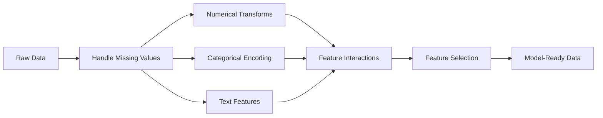

# Tính năng Kỹ thuật & Chọn

> Một tính năng tốt có giá trị một ngàn điểm dữ liệu.

**Type:** Build
**Languages:** Python, TypeScript
**Prerequisites:** Phase 1 (Statistics for ML, Linear Algebra), Phase 2 Lessons 1-7
**Time:** ~90 minutes

## Mục tiêu học tập

- Thực hiện các biến đổi số (chứng chuẩn hóa, quy mô tối đa tối thiểu, biến đổi nhật ký, binning) và giải thích khi nào mỗi biến đổi phù hợp
- Xây dựng mã hóa đơn, nhãn và mục tiêu cho các tính năng hạng mục và xác định nguy cơ rò rỉ dữ liệu trong mã hóa mục tiêu
- Xây dựng một máy tính vectorizer TF-IDF từ đầu và giải thích tại sao nó vượt qua số lượng từ nguyên liệu để phân loại văn bản
- Sử dụng lựa chọn tính năng dựa trên bộ lọc (nước ngưỡng biến thể, tương quan, thông tin lẫn nhau) để giảm chiều kích

## Vấn đề

Bạn có một bộ dữ liệu, bạn chọn một thuật toán, bạn luyện tập nó, kết quả là trung bình, bạn thử một thuật toán kỳ diệu hơn, vẫn trung bình, bạn dành một tuần để điều chỉnh các siêu tham số, cải tiến biên.

Sau đó ai đó biến dữ liệu thô thành các tính năng tốt hơn và một sự lùi hậu cần đơn giản đánh bại bộ sưu tập tăng cường gradient được điều chỉnh của bạn.

Trong ML cổ điển, đại diện của dữ liệu quan trọng hơn sự lựa chọn của thuật toán. Một mô hình giá nhà với "phần hình vuông" và "nhiều phòng ngủ" sẽ đánh bại một mô hình với "địa chỉ như một chuỗi thô" bất kể người học có độ tinh vi như thế nào.

Kỹ thuật tính năng là quá trình chuyển đổi dữ liệu thô thành đại diện làm cho các mô hình dễ dàng tìm thấy hơn.

## Khái niệm

### Hãng đường ống đặc trưng



### Các tính năng số

Số nguyên liệu hiếm khi sẵn sàng cho mô hình.

**Scaling:**Đặt các tính năng trên cùng phạm vi để các thuật toán dựa trên khoảng cách (K-Means, KNN, SVM) đối xử với tất cả các tính năng bằng nhau.

**Log transform:**Nén các phân phối xoay phải (thu nhập, dân số, số từ).

**Binning:**Chuyển đổi các giá trị liên tục thành các loại. hữu ích khi mối quan hệ giữa tính năng và mục tiêu không tuyến tính nhưng theo từng bước (ví dụ, nhóm tuổi).

**Polynomial features:**Tạo ra $x^2$- $x^3$- $x_1 x_2$cho phép các mô hình tuyến tính nắm bắt các mối quan hệ không tuyến tính với chi phí của nhiều tính năng hơn.

### Các tính năng danh mục

Các mô hình cần số, các loại cần mã hóa.

**One-hot encoding:**Tạo một cột nhị phân cho mỗi loại. "color = red/blue/green" trở thành ba cột: is_red, is_blue, is_green.

**Label encoding:**Bản đồ mỗi loại thành một số nguyên: đỏ = 0, xanh = 1, xanh = 2. Tạo ra thứ tự sai (chương tự có thể nghĩ xanh > xanh > đỏ). Chỉ phù hợp với các mô hình dựa trên cây phân chia theo các giá trị riêng lẻ.

**Target encoding:**Thay thế mỗi loại bằng trung bình của biến mục tiêu cho loại đó. mạnh nhưng nguy hiểm: nguy cơ rò rỉ dữ liệu cao. Chỉ cần được tính toán trên dữ liệu đào tạo và áp dụng cho dữ liệu thử nghiệm.

### Các tính năng văn bản

**Count vectorizer:**Số lượng lần mỗi từ xuất hiện trong một tài liệu. "con mèo ngồi trên thảm" trở thành {the: 2, cat: 1, sat: 1, on: 1, mat: 1}.

**TF-IDF:**Từ "đồng độ" - "đồng độ" - "đồng độ" - "đồng độ" - "đồng độ" - "đồng độ" - "đồng độ" - "đồng độ" - "đồng độ" - "đồng độ" - "đồng độ" - "đồng độ" - "đồng độ" - "đồng độ" - "đồng độ" - "đồng độ" - "đồng độ" - "đồng độ" - "đồng độ" - "đồng độ" - "đồng độ" - "đồng độ" - "đồng độ" - "đồng độ" - "đồng độ" - "đồng độ" - "đồng độ" - "đồng độ" - "đồng độ" - "đồng độ" - "đồng độ" - "đồng độ" - "đồng độ" - "đồng độ" - "đồng độ" - "đồng độ" - "đồng độ" - "đồng độ" - "đồng độ" - "đồng độ" - "đồng độ" - "đồng độ" - "đồng độ"

```math
\begin{aligned}
\text{TF}(\text{word}, \text{doc}) &= \frac{\text{count(word in doc)}}{\text{total words in doc}} \\
\text{IDF}(\text{word}) &= \log \frac{\text{total docs}}{\text{docs containing word}} \\
\text{TF-IDF} &= \text{TF} \cdot \text{IDF}
\end{aligned}
```

### Những giá trị bị mất tích

Dữ liệu thực có lỗ hổng.

- **Drop rows:**Chỉ khi dữ liệu bị thiếu hiếm và ngẫu nhiên
- **Mean/median imputation:**Đơn giản, giữ trung tâm của tính năng (đường trung bình mạnh hơn để ngoại lệ), nhưng thu hẹp sự khác biệt của nó và tích tụ mỗi giá trị được lấp vào một đỉnh, do đó hình dạng phân phối thay đổi
- **Mode imputation:**Đối với các tính năng phân loại
- **Indicator column:**Thêm một cột nhị phân "was_this_missing" trước khi tính toán.
- **Forward/backward fill:**Đối với dữ liệu chuỗi thời gian

### Các tính năng tương tác

Đôi khi mối quan hệ là kết hợp. "Tăng độ" và "năng nặng" đơn lẻ là ít dự đoán hơn $\text{BMI} = \text{weight} / \text{height}^2$Các tương tác tính năng nhân rộng không gian tính năng, vì vậy sử dụng kiến thức miền để chọn đúng.

### Chọn tính năng

Những tính năng không liên quan thêm tiếng ồn, kéo dài thời gian tập luyện và có thể gây ra sự quá phù hợp.

**Filter methods (pre-model):**
- Sự tương quan: loại bỏ các tính năng tương quan cao với nhau (từ)
- Thông tin lẫn nhau: đo lường mức độ biết một tính năng làm giảm sự không chắc chắn về mục tiêu
- Khoảng hạn biến thể: loại bỏ các tính năng hầu như không thay đổi

**Wrapper methods (model-based):**
- L1 Regularisation (Lasso): đưa trọng lượng tính năng không liên quan đến chính xác đến 0.
- Phục hồi loại bỏ tính năng: đào tạo, loại bỏ tính năng ít quan trọng nhất, lặp lại

**Why selection matters:**Một mô hình có 10 tính năng tốt thường sẽ vượt trội hơn một mô hình có 10 tính năng tốt và 90 tính năng ồn ào.

```figure
feature-scaling
```

## Hãy xây dựng nó

### Bước 1: Các biến đổi số từ đầu

```python
import math


def min_max_scale(values):
    min_val = min(values)
    max_val = max(values)
    if max_val == min_val:
        return [0.0] * len(values)
    return [(v - min_val) / (max_val - min_val) for v in values]


def standardize(values):
    n = len(values)
    mean = sum(values) / n
    variance = sum((v - mean) ** 2 for v in values) / n
    std = math.sqrt(variance) if variance > 0 else 1.0
    return [(v - mean) / std for v in values]


def log_transform(values):
    return [math.log(v + 1) for v in values]


def bin_values(values, n_bins=5):
    min_val = min(values)
    max_val = max(values)
    bin_width = (max_val - min_val) / n_bins
    if bin_width == 0:
        return [0] * len(values)
    result = []
    for v in values:
        bin_idx = int((v - min_val) / bin_width)
        bin_idx = min(bin_idx, n_bins - 1)
        result.append(bin_idx)
    return result


def polynomial_features(row, degree=2):
    n = len(row)
    result = list(row)
    if degree >= 2:
        for i in range(n):
            result.append(row[i] ** 2)
        for i in range(n):
            for j in range(i + 1, n):
                result.append(row[i] * row[j])
    return result
```

### Bước 2: Mã hóa danh mục từ đầu

```python
def one_hot_encode(values):
    categories = sorted(set(values))
    cat_to_idx = {cat: i for i, cat in enumerate(categories)}
    n_cats = len(categories)

    encoded = []
    for v in values:
        row = [0] * n_cats
        row[cat_to_idx[v]] = 1
        encoded.append(row)

    return encoded, categories


def label_encode(values):
    categories = sorted(set(values))
    cat_to_int = {cat: i for i, cat in enumerate(categories)}
    return [cat_to_int[v] for v in values], cat_to_int


def target_encode(feature_values, target_values, smoothing=10):
    global_mean = sum(target_values) / len(target_values)

    category_stats = {}
    for feat, target in zip(feature_values, target_values):
        if feat not in category_stats:
            category_stats[feat] = {"sum": 0.0, "count": 0}
        category_stats[feat]["sum"] += target
        category_stats[feat]["count"] += 1

    encoding = {}
    for cat, stats in category_stats.items():
        cat_mean = stats["sum"] / stats["count"]
        weight = stats["count"] / (stats["count"] + smoothing)
        encoding[cat] = weight * cat_mean + (1 - weight) * global_mean

    return [encoding[v] for v in feature_values], encoding
```

### Bước 3: Các tính năng văn bản từ đầu

```python
def count_vectorize(documents):
    vocab = {}
    idx = 0
    for doc in documents:
        for word in doc.lower().split():
            if word not in vocab:
                vocab[word] = idx
                idx += 1

    vectors = []
    for doc in documents:
        vec = [0] * len(vocab)
        for word in doc.lower().split():
            vec[vocab[word]] += 1
        vectors.append(vec)

    return vectors, vocab


def tfidf(documents):
    n_docs = len(documents)

    vocab = {}
    idx = 0
    for doc in documents:
        for word in doc.lower().split():
            if word not in vocab:
                vocab[word] = idx
                idx += 1

    doc_freq = {}
    for doc in documents:
        seen = set()
        for word in doc.lower().split():
            if word not in seen:
                doc_freq[word] = doc_freq.get(word, 0) + 1
                seen.add(word)

    vectors = []
    for doc in documents:
        words = doc.lower().split()
        word_count = len(words)
        tf_map = {}
        for word in words:
            tf_map[word] = tf_map.get(word, 0) + 1

        vec = [0.0] * len(vocab)
        for word, count in tf_map.items():
            tf = count / word_count
            idf = math.log(n_docs / doc_freq[word])
            vec[vocab[word]] = tf * idf
        vectors.append(vec)

    return vectors, vocab
```

### Bước 4: Đánh giá thiếu từ đầu

```python
def impute_mean(values):
    present = [v for v in values if v is not None]
    if not present:
        return [0.0] * len(values), 0.0
    mean = sum(present) / len(present)
    return [v if v is not None else mean for v in values], mean


def impute_median(values):
    present = sorted(v for v in values if v is not None)
    if not present:
        return [0.0] * len(values), 0.0
    n = len(present)
    if n % 2 == 0:
        median = (present[n // 2 - 1] + present[n // 2]) / 2
    else:
        median = present[n // 2]
    return [v if v is not None else median for v in values], median


def impute_mode(values):
    present = [v for v in values if v is not None]
    if not present:
        return values, None
    counts = {}
    for v in present:
        counts[v] = counts.get(v, 0) + 1
    mode = max(counts, key=counts.get)
    return [v if v is not None else mode for v in values], mode


def add_missing_indicator(values):
    return [0 if v is not None else 1 for v in values]
```

### Bước 5: Chọn tính năng từ đầu

```python
def correlation(x, y):
    n = len(x)
    mean_x = sum(x) / n
    mean_y = sum(y) / n
    cov = sum((xi - mean_x) * (yi - mean_y) for xi, yi in zip(x, y)) / n
    std_x = math.sqrt(sum((xi - mean_x) ** 2 for xi in x) / n)
    std_y = math.sqrt(sum((yi - mean_y) ** 2 for yi in y) / n)
    if std_x == 0 or std_y == 0:
        return 0.0
    return cov / (std_x * std_y)


def mutual_information(feature, target, n_bins=10):
    feat_min = min(feature)
    feat_max = max(feature)
    bin_width = (feat_max - feat_min) / n_bins if feat_max != feat_min else 1.0
    feat_binned = [
        min(int((f - feat_min) / bin_width), n_bins - 1) for f in feature
    ]

    n = len(feature)
    target_classes = sorted(set(target))

    feat_bins = sorted(set(feat_binned))
    p_feat = {}
    for b in feat_bins:
        p_feat[b] = feat_binned.count(b) / n

    p_target = {}
    for t in target_classes:
        p_target[t] = target.count(t) / n

    mi = 0.0
    for b in feat_bins:
        for t in target_classes:
            joint_count = sum(
                1 for fb, tv in zip(feat_binned, target) if fb == b and tv == t
            )
            p_joint = joint_count / n
            if p_joint > 0:
                mi += p_joint * math.log(p_joint / (p_feat[b] * p_target[t]))

    return mi


def variance_threshold(features, threshold=0.01):
    n_features = len(features[0])
    n_samples = len(features)
    selected = []

    for j in range(n_features):
        col = [features[i][j] for i in range(n_samples)]
        mean = sum(col) / n_samples
        var = sum((v - mean) ** 2 for v in col) / n_samples
        if var >= threshold:
            selected.append(j)

    return selected


def remove_correlated(features, threshold=0.9):
    n_features = len(features[0])
    n_samples = len(features)

    to_remove = set()
    for i in range(n_features):
        if i in to_remove:
            continue
        col_i = [features[r][i] for r in range(n_samples)]
        for j in range(i + 1, n_features):
            if j in to_remove:
                continue
            col_j = [features[r][j] for r in range(n_samples)]
            corr = abs(correlation(col_i, col_j))
            if corr >= threshold:
                to_remove.add(j)

    return [i for i in range(n_features) if i not in to_remove]
```

### Bước 6: Đường ống đầy đủ và demo

```python
import random


def make_housing_data(n=200, seed=42):
    random.seed(seed)
    data = []
    for _ in range(n):
        sqft = random.uniform(500, 5000)
        bedrooms = random.choice([1, 2, 3, 4, 5])
        age = random.uniform(0, 50)
        neighborhood = random.choice(["downtown", "suburbs", "rural"])
        has_pool = random.choice([True, False])

        sqft_with_missing = sqft if random.random() > 0.05 else None
        age_with_missing = age if random.random() > 0.08 else None

        price = (
            50 * sqft
            + 20000 * bedrooms
            - 1000 * age
            + (50000 if neighborhood == "downtown" else 10000 if neighborhood == "suburbs" else 0)
            + (15000 if has_pool else 0)
            + random.gauss(0, 20000)
        )

        data.append({
            "sqft": sqft_with_missing,
            "bedrooms": bedrooms,
            "age": age_with_missing,
            "neighborhood": neighborhood,
            "has_pool": has_pool,
            "price": price,
        })
    return data


if __name__ == "__main__":
    data = make_housing_data(200)

    print("=== Raw Data Sample ===")
    for row in data[:3]:
        print(f"  {row}")

    sqft_raw = [d["sqft"] for d in data]
    age_raw = [d["age"] for d in data]
    prices = [d["price"] for d in data]

    print("\n=== Missing Value Handling ===")
    sqft_missing = sum(1 for v in sqft_raw if v is None)
    age_missing = sum(1 for v in age_raw if v is None)
    print(f"  sqft missing: {sqft_missing}/{len(sqft_raw)}")
    print(f"  age missing: {age_missing}/{len(age_raw)}")

    sqft_indicator = add_missing_indicator(sqft_raw)
    age_indicator = add_missing_indicator(age_raw)
    sqft_imputed, sqft_fill = impute_median(sqft_raw)
    age_imputed, age_fill = impute_mean(age_raw)
    print(f"  sqft filled with median: {sqft_fill:.0f}")
    print(f"  age filled with mean: {age_fill:.1f}")

    print("\n=== Numerical Transforms ===")
    sqft_scaled = standardize(sqft_imputed)
    age_scaled = min_max_scale(age_imputed)
    sqft_log = log_transform(sqft_imputed)
    age_binned = bin_values(age_imputed, n_bins=5)
    print(f"  sqft standardized: mean={sum(sqft_scaled)/len(sqft_scaled):.4f}, std={math.sqrt(sum(v**2 for v in sqft_scaled)/len(sqft_scaled)):.4f}")
    print(f"  age min-max: [{min(age_scaled):.2f}, {max(age_scaled):.2f}]")
    print(f"  age bins: {sorted(set(age_binned))}")

    print("\n=== Categorical Encoding ===")
    neighborhoods = [d["neighborhood"] for d in data]

    ohe, ohe_cats = one_hot_encode(neighborhoods)
    print(f"  One-hot categories: {ohe_cats}")
    print(f"  Sample encoding: {neighborhoods[0]} -> {ohe[0]}")

    le, le_map = label_encode(neighborhoods)
    print(f"  Label encoding map: {le_map}")

    te, te_map = target_encode(neighborhoods, prices, smoothing=10)
    print(f"  Target encoding: {({k: round(v) for k, v in te_map.items()})}")

    print("\n=== Text Features ===")
    descriptions = [
        "large modern house with pool",
        "small cozy cottage near downtown",
        "spacious family home with large yard",
        "modern apartment downtown with view",
        "rustic cabin in rural area",
    ]
    cv, cv_vocab = count_vectorize(descriptions)
    print(f"  Vocabulary size: {len(cv_vocab)}")
    print(f"  Doc 0 non-zero features: {sum(1 for v in cv[0] if v > 0)}")

    tf, tf_vocab = tfidf(descriptions)
    print(f"  TF-IDF vocabulary size: {len(tf_vocab)}")
    top_words = sorted(tf_vocab.keys(), key=lambda w: tf[0][tf_vocab[w]], reverse=True)[:3]
    print(f"  Doc 0 top TF-IDF words: {top_words}")

    print("\n=== Polynomial Features ===")
    sample_row = [sqft_scaled[0], age_scaled[0]]
    poly = polynomial_features(sample_row, degree=2)
    print(f"  Input: {[round(v, 4) for v in sample_row]}")
    print(f"  Polynomial: {[round(v, 4) for v in poly]}")
    print(f"  Features: [x1, x2, x1^2, x2^2, x1*x2]")

    print("\n=== Feature Selection ===")
    feature_matrix = [
        [sqft_scaled[i], age_scaled[i], float(sqft_indicator[i]), float(age_indicator[i])]
        + ohe[i]
        for i in range(len(data))
    ]

    print(f"  Total features: {len(feature_matrix[0])}")

    surviving_var = variance_threshold(feature_matrix, threshold=0.01)
    print(f"  After variance threshold (0.01): {len(surviving_var)} features kept")

    surviving_corr = remove_correlated(feature_matrix, threshold=0.9)
    print(f"  After correlation filter (0.9): {len(surviving_corr)} features kept")

    binary_prices = [1 if p > sum(prices) / len(prices) else 0 for p in prices]
    print("\n  Mutual information with target:")
    feature_names = ["sqft", "age", "sqft_missing", "age_missing"] + [f"neigh_{c}" for c in ohe_cats]
    for j in range(len(feature_matrix[0])):
        col = [feature_matrix[i][j] for i in range(len(feature_matrix))]
        mi = mutual_information(col, binary_prices, n_bins=10)
        print(f"    {feature_names[j]}: MI={mi:.4f}")

    print("\n  Correlation with price:")
    for j in range(len(feature_matrix[0])):
        col = [feature_matrix[i][j] for i in range(len(feature_matrix))]
        corr = correlation(col, prices)
        print(f"    {feature_names[j]}: r={corr:.4f}")
```

## Sử dụng nó

Với scikit-learn, những biến đổi này là đường ống hợp nhất:

```python
from sklearn.preprocessing import StandardScaler, OneHotEncoder, PolynomialFeatures
from sklearn.impute import SimpleImputer
from sklearn.feature_extraction.text import TfidfVectorizer
from sklearn.feature_selection import mutual_info_classif, VarianceThreshold
from sklearn.compose import ColumnTransformer
from sklearn.pipeline import Pipeline

numeric_pipe = Pipeline([
    ("imputer", SimpleImputer(strategy="median")),
    ("scaler", StandardScaler()),
])

categorical_pipe = Pipeline([
    ("encoder", OneHotEncoder(sparse_output=False)),
])

preprocessor = ColumnTransformer([
    ("num", numeric_pipe, ["sqft", "age"]),
    ("cat", categorical_pipe, ["neighborhood"]),
])
```

Các phiên bản từ đầu cho thấy chính xác những gì xảy ra bên trong mỗi biến đổi. Các phiên bản thư viện thêm xử lý trường hợp cạnh, hỗ trợ matrix hiếm và thành phần đường ống, nhưng toán học là giống nhau.

## Chuyển nó

Bài học này mang lại:
- `outputs/prompt-feature-engineer.md`- một lời nhắc cho các tính năng kỹ thuật theo hệ thống từ dữ liệu thô

## Các bài tập

1. Thêm quy mô mạnh mẽ (nghiên sử dụng phạm vi trung bình và giữa các quartile thay vì trung bình và lệch tiêu chuẩn) cho các biến đổi số. So sánh nó với quy mô tiêu chuẩn trên dữ liệu với các mức ngoại lệ cực đoan.
2. Thực hiện mã hóa mục tiêu bỏ một bên: cho mỗi hàng, tính toán trung bình mục tiêu trừ giá trị mục tiêu của hàng đó.
3. Xây dựng một đường ống chọn tính năng tự động kết hợp ngưỡng biến đổi, lọc tương quan và xếp hạng thông tin lẫn nhau. Đưa nó vào bộ dữ liệu nhà và so sánh hiệu suất mô hình ( Sử dụng sự lùi lại tuyến tính đơn giản) với tất cả các tính năng so với các tính năng được chọn.

## Các điều khoản chính

| Term | What people say | What it actually means |
|------|----------------|----------------------|
| Feature engineering | "Making new columns" | Transforming raw data into representations that expose patterns to the model |
| Standardization | "Making it normal" | Subtracting the mean and dividing by standard deviation so the feature has mean=0 and std=1 |
| One-hot encoding | "Making dummy variables" | Creating one binary column per category, where exactly one column is 1 for each row |
| Target encoding | "Using the answer to encode" | Replacing each category with the average target value for that category, with smoothing to prevent overfitting |
| TF-IDF | "Fancy word counts" | Term Frequency times Inverse Document Frequency: words weighted by how distinctive they are across the corpus |
| Imputation | "Filling in blanks" | Replacing missing values with estimated values (mean, median, mode, or model-predicted) |
| Feature selection | "Throwing out bad columns" | Removing features that add noise or redundancy, keeping only those with signal about the target |
| Mutual information | "How much one thing tells you about another" | A measure of the reduction in uncertainty about variable Y gained by observing variable X |
| Data leakage | "Accidentally cheating" | Using information during training that would not be available at prediction time, giving falsely optimistic results |

## Đọc thêm

- [Feature Engineering and Selection (Max Kuhn & Kjell Johnson)](http://www.feat.engineering/)- sách trực tuyến miễn phí bao gồm toàn bộ cảnh quan kỹ thuật tính năng
- [scikit-learn Preprocessing Guide](https://scikit-learn.org/stable/modules/preprocessing.html)- tham chiếu thực tế cho tất cả các biến đổi tiêu chuẩn
- [Target Encoding Done Right (Micci-Barreca, 2001)](https://dl.acm.org/doi/10.1145/507533.507538)- giấy gốc về mã hóa mục tiêu bằng cách làm trơn
