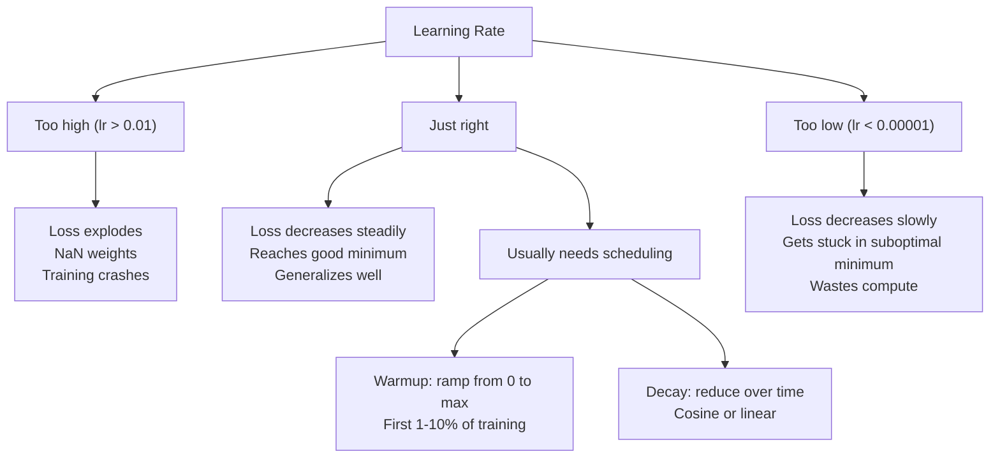
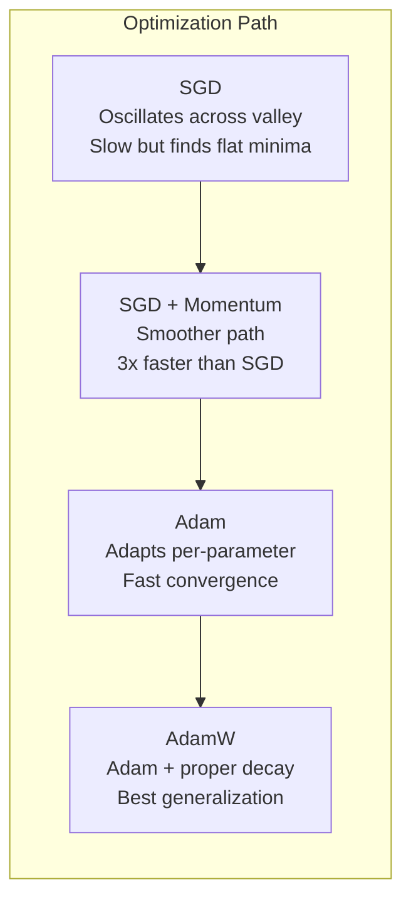
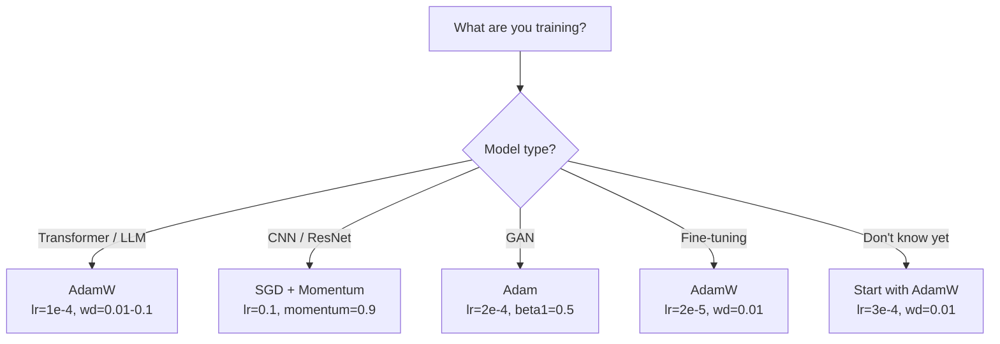

# Các chất tối ưu hóa

> Điểm giảm độ cho bạn biết phải di chuyển theo hướng nào, không nói gì về xa và tốc độ. SGD là một buso. Adam là GPS với dữ liệu giao thông.

**Type:** Build
**Languages:** Python, TypeScript
**Prerequisites:** Lesson 03.05 (Loss Functions)
**Time:** ~75 minutes

## Mục tiêu học tập

- Thực hiện SGD, SGD với động lực, Adam, và AdamW tối ưu hóa từ đầu trong Python
- Giải thích cách sửa đổi thiên vị của Adam bù đắp cho ước tính thời gian bắt đầu bằng không trong các bước đào tạo đầu tiên
- Hiển thị tại sao AdamW tạo ra tổng quát tốt hơn Adam với L2 quy định trên cùng một nhiệm vụ
- Chọn tối ưu hóa thích hợp và các siêu tham số mặc định cho các bộ chuyển đổi, CNN, GAN và điều chỉnh tinh tế

## Vấn đề

Bạn đã tính toán các gradient. Bạn biết rằng trọng lượng # 4,721 nên giảm 0,003 để giảm mất. Nhưng 0,003 trong những đơn vị nào?

Thâm giảm gradient vanilla áp dụng tốc độ học tập tương tự cho mọi tham số trên mọi bước: $w = w - \text{lr} \cdot \text{gradient}$Điều này tạo ra ba vấn đề làm cho việc đào tạo mạng thần kinh đau đớn trong thực tế.

Đầu tiên, dao động. Phong cảnh mất mát hiếm khi có hình dạng như một bát mịn. Nó giống như một thung lũng dài và hẹp. Điểm nghiêng chỉ ra qua thung lũng (nghĩa thẳng thắn), không phải dọc theo nó (nghĩa nông). Sự giảm dần sẽ nhảy lại qua chiều kích hẹp trong khi tiến bộ nhỏ dọc theo chiều kích hữu ích. Bạn đã thấy điều này: mất mát giảm nhanh hơn cao nguyên, không phải vì mô hình hội tụ mà vì nó đang dao động.

Thứ hai, một tốc độ học tập cho tất cả các tham số là sai. Một số trọng lượng cần cập nhật lớn (cũng ở giai đoạn đầu, không phù hợp).

Thứ ba, các điểm saddle. Trong các chiều cao, cảnh thất bại có những vùng phẳng rộng lớn nơi độ nghiêng gần bằng không. SGD vanilla trượt qua chúng với tốc độ nghiêng, đó thực sự là bằng không. Mô hình trông bị kẹt. Nó không bị kẹt - nó ở một vùng phẳng với sự hạ cánh hữu ích ở phía bên kia. Nhưng SGD không có cơ chế để đẩy qua.

Adam giải quyết cả ba. Nó duy trì hai trung bình chạy cho mỗi tham số - gradient trung bình (momentum, xử lý dao động) và gradient trung bình vuông (tốc độ thích nghi, xử lý các thang khác nhau). Kết hợp với sự sửa đổi thiên vị cho vài bước đầu tiên, nó cung cấp cho bạn một tối ưu hóa duy nhất hoạt động trên 80% các vấn đề với các siêu tham số mặc định. Bài học này xây dựng nó từ đầu để bạn hiểu chính xác khi nào và tại sao nó thất bại trên 20% còn lại.

## Khái niệm

### Thâm nhập theo cấp stochastic (SGD)

Tóm lại gradient trên một mini batch và bước về hướng ngược lại.

```math
w = w - \text{lr} \cdot \text{gradient}
```

"Stochastic" có nghĩa là bạn sử dụng một bộ phụ ngẫu nhiên (mini-batch) dữ liệu để ước tính gradient, thay vì toàn bộ bộ bộ dữ liệu. tiếng ồn này thực sự hữu ích - nó giúp thoát khỏi mức tối thiểu địa phương sắc nét. Nhưng tiếng ồn cũng gây ra dao động.

Tốc độ học tập là nút duy nhất. Tốc độ mất mát quá cao: sự mất mát khác nhau. Tốc độ quá thấp: đào tạo mất mãi mãi. Giá trị tối ưu phụ thuộc vào kiến trúc, dữ liệu, kích thước lô và giai đoạn đào tạo hiện tại. Đối với SGD vani trên mạng hiện đại, giá trị điển hình dao động từ 0,01 đến 0,1.

### Tốc độ

Sự tương tự của bóng xoay xuống đồi là quá sử dụng nhưng chính xác. thay vì bước qua gradient một mình, bạn duy trì một tốc độ tích lũy qua gradient.

```math
\begin{aligned}
m_t &= \beta \, m_{t-1} + \text{gradient} \\
w &= w - \text{lr} \cdot m_t
\end{aligned}
```

Beta (thường là 0.9) kiểm soát bao nhiêu lịch sử để giữ.$\beta = 0.9$, động lực là trung bình của 10 gradient cuối cùng ($1 / (1 - 0.9) = 10$().

Tại sao điều này sửa đổi dao động: các gradient chỉ ra cùng một hướng tích lũy. Các gradient hướng ngược bị hủy bỏ. Trong thung lũng hẹp đó, thành phần "các" đảo ngược dấu hiệu mỗi bước và bị làm giảm. thành phần "lọc theo" vẫn ổn định và được tăng cường. Kết quả là tăng tốc trơn tru theo hướng hữu ích.

Số liệu thực: SGD một mình trong một cảnh ảnh hưởng thua lỗ có thể mất 10.000 bước.$\beta = 0.9$(với các phương pháp khác nhau, các phương pháp này có thể được sử dụng để giải quyết các vấn đề khác nhau.

### RMSProp

Phương pháp tốc độ học tập thích nghi đầu tiên trên mỗi tham số thực sự hoạt động.

```math
\begin{aligned}
s_t &= \beta \, s_{t-1} + (1 - \beta) \cdot \text{gradient}^2 \\
w &= w - \text{lr} \cdot \frac{\text{gradient}}{\sqrt{s_t} + \epsilon}
\end{aligned}
```

$s_t$theo dõi trung bình chạy của gradient vuông. Các tham số có gradient lớn nhất định được chia bằng một số lớn (tốc độ học tập hiệu quả nhỏ hơn).

Điều này giải quyết vấn đề "một tốc độ học tập cho tất cả các tham số". Một trọng lượng đã nhận được các cập nhật lớn có thể gần mục tiêu của nó -- chậm lại nó. Một trọng lượng đã nhận được các cập nhật nhỏ có thể bị thiếu tập luyện -- tăng tốc nó.

Epsilon (thường là 1e-8) ngăn chặn chia bằng không khi một tham số chưa được cập nhật.

### Adam: Momentum + RMSProp

Adam kết hợp cả hai ý tưởng. Nó duy trì hai trung bình di động theo số:

```math
\begin{aligned}
m_t &= \beta_1 m_{t-1} + (1 - \beta_1) \cdot \text{gradient} && \text{(first moment: mean)} \\
v_t &= \beta_2 v_{t-1} + (1 - \beta_2) \cdot \text{gradient}^2 && \text{(second moment: variance)}
\end{aligned}
```

**Bias correction**là chi tiết chính mà hầu hết các giải thích bỏ qua.$m_1 = (1 - \beta_1) \cdot \text{gradient}$- Với $\beta_1 = 0.9$, đó là $0.1 \cdot \text{gradient}$-- 10 lần quá nhỏ. trung bình di động chưa nóng lên.

```math
\begin{aligned}
\hat{m} &= \frac{m_t}{1 - \beta_1^t} \\
\hat{v} &= \frac{v_t}{1 - \beta_2^t}
\end{aligned}
```

Ở bước 1 với $\beta_1 = 0.9$$\hat{m} = m_1 / (1 - 0.9) = m_1 / 0.1 =$ở bước 100:$(1 - 0.9^{100})$là khoảng 1.0, do đó sự điều chỉnh biến mất. Sự điều chỉnh Bias quan trọng cho ~ 10 bước đầu tiên và không liên quan sau ~ 50.

Thông tin mới:

```math
w = w - \text{lr} \cdot \frac{\hat{m}}{\sqrt{\hat{v}} + \epsilon}
```

Adam mặc định: $\text{lr} = 0.001$- $\beta_1 = 0.9$- $\beta_2 = 0.999$- $\epsilon = 10^{-8}$Những lỗi mặc định này sẽ làm việc cho 80% vấn đề.$\beta_2$- Gần như không bao giờ thay đổi.$\beta_1$hoặc $\epsilon$- Tôi không biết.

### Giảm cân được thực hiện đúng

L2 quy định thêm $\lambda w^2$Trong SGD vani, điều này tương đương với sự suy giảm trọng lượng (trừ trừ$\lambda w$Trong Adam, sự tương đương này bị phá vỡ.

Loshchilov & Hutter: khi bạn thêm L2 vào lỗ và sau đó Adam xử lý gradient, tốc độ học tập thích ứng cũng làm tăng thuật ngữ quy định. Các tham số có sự khác biệt gradient lớn nhận được ít quy định hơn. Các tham số có sự khác biệt nhỏ nhận được nhiều hơn. Đây không phải là những gì bạn muốn - bạn muốn quy định thống nhất bất kể số liệu thống kê gradient.

AdamW sửa chữa điều này bằng cách áp dụng sự suy giảm trọng lượng trực tiếp cho trọng lượng, sau khi cập nhật Adam:

```math
w = w - \text{lr} \cdot \frac{\hat{m}}{\sqrt{\hat{v}} + \epsilon} - \text{lr} \cdot \lambda w
```

Tiêu chuẩn giảm cân ($\text{lr} \cdot \lambda w$(văn số) không được quy mô bằng nhân nhân thích ứng của Adam.

Điều này có vẻ như là một chi tiết nhỏ. Nó không phải. AdamW hội tụ với các giải pháp tốt hơn so với việc điều chỉnh Adam + L2 trên hầu hết mọi nhiệm vụ. Nó là trình tối ưu hóa mặc định trong PyTorch cho đào tạo các biến đổi, mô hình phân phối và hầu hết các kiến trúc hiện đại. BERT, GPT, LLaMA, phân phối ổn định - tất cả được đào tạo với AdamW.

### Tốc độ học tập: Đường đo siêu quan trọng nhất



Nếu bạn điều chỉnh một siêu tham số, điều chỉnh tốc độ học tập. Một sự thay đổi 10 lần trong tốc độ học tập quan trọng hơn bất kỳ quyết định kiến trúc nào bạn sẽ đưa ra.

- SGD: lr = 0,01 đến 0,1
- Adam/AdamW: lr = 1e-4 đến 3e-4
- Các mô hình được đào tạo trước khi điều chỉnh: lr = 1e-5 đến 5e-5
- Tăng tốc độ học tập: đường thẳng trong 1-10% các bước đầu tiên

### So sánh tối ưu hóa



### Khi mỗi người tối ưu hóa chiến thắng



```figure
optimizer-trajectory
```

## Hãy xây dựng nó

### Bước 1: SGD Vanilla

```python
class SGD:
    def __init__(self, lr=0.01):
        self.lr = lr

    def step(self, params, grads):
        for i in range(len(params)):
            params[i] -= self.lr * grads[i]
```

### Bước 2: SGD với Momentum

```python
class SGDMomentum:
    def __init__(self, lr=0.01, beta=0.9):
        self.lr = lr
        self.beta = beta
        self.velocities = None

    def step(self, params, grads):
        if self.velocities is None:
            self.velocities = [0.0] * len(params)
        for i in range(len(params)):
            self.velocities[i] = self.beta * self.velocities[i] + grads[i]
            params[i] -= self.lr * self.velocities[i]
```

### Bước 3: Adam

```python
import math

class Adam:
    def __init__(self, lr=0.001, beta1=0.9, beta2=0.999, epsilon=1e-8):
        self.lr = lr
        self.beta1 = beta1
        self.beta2 = beta2
        self.epsilon = epsilon
        self.m = None
        self.v = None
        self.t = 0

    def step(self, params, grads):
        if self.m is None:
            self.m = [0.0] * len(params)
            self.v = [0.0] * len(params)

        self.t += 1

        for i in range(len(params)):
            self.m[i] = self.beta1 * self.m[i] + (1 - self.beta1) * grads[i]
            self.v[i] = self.beta2 * self.v[i] + (1 - self.beta2) * grads[i] ** 2

            m_hat = self.m[i] / (1 - self.beta1 ** self.t)
            v_hat = self.v[i] / (1 - self.beta2 ** self.t)

            params[i] -= self.lr * m_hat / (math.sqrt(v_hat) + self.epsilon)
```

### Bước 4: AdamW

```python
class AdamW:
    def __init__(self, lr=0.001, beta1=0.9, beta2=0.999, epsilon=1e-8, weight_decay=0.01):
        self.lr = lr
        self.beta1 = beta1
        self.beta2 = beta2
        self.epsilon = epsilon
        self.weight_decay = weight_decay
        self.m = None
        self.v = None
        self.t = 0

    def step(self, params, grads):
        if self.m is None:
            self.m = [0.0] * len(params)
            self.v = [0.0] * len(params)

        self.t += 1

        for i in range(len(params)):
            self.m[i] = self.beta1 * self.m[i] + (1 - self.beta1) * grads[i]
            self.v[i] = self.beta2 * self.v[i] + (1 - self.beta2) * grads[i] ** 2

            m_hat = self.m[i] / (1 - self.beta1 ** self.t)
            v_hat = self.v[i] / (1 - self.beta2 ** self.t)

            params[i] -= self.lr * m_hat / (math.sqrt(v_hat) + self.epsilon)
            params[i] -= self.lr * self.weight_decay * params[i]
```

### Bước 5: So sánh huấn luyện

Tập cùng một mạng hai lớp trên bộ dữ liệu vòng tròn từ bài học 05 với tất cả bốn tối ưu hóa. So sánh sự hội tụ.

```python
import random

def sigmoid(x):
    x = max(-500, min(500, x))
    return 1.0 / (1.0 + math.exp(-x))

def make_circle_data(n=200, seed=42):
    random.seed(seed)
    data = []
    for _ in range(n):
        x = random.uniform(-2, 2)
        y = random.uniform(-2, 2)
        label = 1.0 if x * x + y * y < 1.5 else 0.0
        data.append(([x, y], label))
    return data


class OptimizerTestNetwork:
    def __init__(self, optimizer, hidden_size=8):
        random.seed(0)
        self.hidden_size = hidden_size
        self.optimizer = optimizer

        self.w1 = [[random.gauss(0, 0.5) for _ in range(2)] for _ in range(hidden_size)]
        self.b1 = [0.0] * hidden_size
        self.w2 = [random.gauss(0, 0.5) for _ in range(hidden_size)]
        self.b2 = 0.0

    def get_params(self):
        params = []
        for row in self.w1:
            params.extend(row)
        params.extend(self.b1)
        params.extend(self.w2)
        params.append(self.b2)
        return params

    def set_params(self, params):
        idx = 0
        for i in range(self.hidden_size):
            for j in range(2):
                self.w1[i][j] = params[idx]
                idx += 1
        for i in range(self.hidden_size):
            self.b1[i] = params[idx]
            idx += 1
        for i in range(self.hidden_size):
            self.w2[i] = params[idx]
            idx += 1
        self.b2 = params[idx]

    def forward(self, x):
        self.x = x
        self.z1 = []
        self.h = []
        for i in range(self.hidden_size):
            z = self.w1[i][0] * x[0] + self.w1[i][1] * x[1] + self.b1[i]
            self.z1.append(z)
            self.h.append(max(0.0, z))

        self.z2 = sum(self.w2[i] * self.h[i] for i in range(self.hidden_size)) + self.b2
        self.out = sigmoid(self.z2)
        return self.out

    def compute_grads(self, target):
        eps = 1e-15
        p = max(eps, min(1 - eps, self.out))
        d_loss = -(target / p) + (1 - target) / (1 - p)
        d_sigmoid = self.out * (1 - self.out)
        d_out = d_loss * d_sigmoid

        grads = [0.0] * (self.hidden_size * 2 + self.hidden_size + self.hidden_size + 1)
        idx = 0
        for i in range(self.hidden_size):
            d_relu = 1.0 if self.z1[i] > 0 else 0.0
            d_h = d_out * self.w2[i] * d_relu
            grads[idx] = d_h * self.x[0]
            grads[idx + 1] = d_h * self.x[1]
            idx += 2

        for i in range(self.hidden_size):
            d_relu = 1.0 if self.z1[i] > 0 else 0.0
            grads[idx] = d_out * self.w2[i] * d_relu
            idx += 1

        for i in range(self.hidden_size):
            grads[idx] = d_out * self.h[i]
            idx += 1

        grads[idx] = d_out
        return grads

    def train(self, data, epochs=300):
        losses = []
        for epoch in range(epochs):
            total_loss = 0.0
            correct = 0
            for x, y in data:
                pred = self.forward(x)
                grads = self.compute_grads(y)
                params = self.get_params()
                self.optimizer.step(params, grads)
                self.set_params(params)

                eps = 1e-15
                p = max(eps, min(1 - eps, pred))
                total_loss += -(y * math.log(p) + (1 - y) * math.log(1 - p))
                if (pred >= 0.5) == (y >= 0.5):
                    correct += 1
            avg_loss = total_loss / len(data)
            accuracy = correct / len(data) * 100
            losses.append((avg_loss, accuracy))
            if epoch % 75 == 0 or epoch == epochs - 1:
                print(f"    Epoch {epoch:3d}: loss={avg_loss:.4f}, accuracy={accuracy:.1f}%")
        return losses
```

## Sử dụng nó

Các thiết bị tối ưu hóa PyTorch xử lý các nhóm tham số, cắt gradient và lập lịch tốc độ học tập:

```python
import torch
import torch.optim as optim

model = torch.nn.Sequential(
    torch.nn.Linear(784, 256),
    torch.nn.ReLU(),
    torch.nn.Linear(256, 10),
)

optimizer = optim.AdamW(model.parameters(), lr=3e-4, weight_decay=0.01)

scheduler = optim.lr_scheduler.CosineAnnealingLR(optimizer, T_max=100)

for epoch in range(100):
    optimizer.zero_grad()
    output = model(torch.randn(32, 784))
    loss = torch.nn.functional.cross_entropy(output, torch.randint(0, 10, (32,)))
    loss.backward()
    torch.nn.utils.clip_grad_norm_(model.parameters(), max_norm=1.0)
    optimizer.step()
    scheduler.step()
```

Mô hình luôn luôn là: zero_grad, forward, loss, backward, (clip), step, (schedule). nhớ thứ tự này.

Đối với các CNN, nhiều học viên vẫn thích SGD + động lực (lr=0.1, động lực=0.9, trọng lượng_sự giảm = 1e-4) với một lịch trình bước hoặc cosine. SGD tìm thấy các tối thiểu phẳng hơn, thường tổng quát tốt hơn. Đối với các biến đổi và LLM, AdamW với sự nóng lên + sự suy giảm cosine là mặc định phổ quát. Đừng chống lại sự đồng thuận mà không có lý do được đo lường.

## Chuyển nó

Bài học này mang lại:
- `outputs/prompt-optimizer-selector.md`-- một quyết định nhanh chóng để chọn tối ưu hóa đúng và tốc độ học tập cho bất kỳ kiến trúc

## Các bài tập

1. Thực hiện động lực Nesterov, nơi bạn tính toán gradient ở vị trí "lookhead" ($w - \text{lr} \cdot \beta v$(với các mô hình khác nhau) thay vì vị trí hiện tại. So sánh sự hội tụ với động lực tiêu chuẩn trên bộ dữ liệu vòng tròn.

2. Thực hiện một lịch trình học tập tốc độ nóng lên: đường thẳng từ 0 đến max_lr trong 10% bước đào tạo đầu tiên, sau đó sự phân rã cosine đến 0. Trén với Adam + nóng lên so với Adam mà không nóng lên. đo bao nhiêu thời gian cần để đạt được độ chính xác 90% trên bộ dữ liệu vòng tròn.

3. Theo dõi tốc độ học tập hiệu quả cho mỗi tham số trong quá trình đào tạo Adam.$\text{lr} \cdot \hat{m} / (\sqrt{\hat{v}} + \epsilon)$. Chụp bản phân phối tỷ lệ hiệu quả sau 10, 50, và 200 bước.

4. Thực hiện cắt gradient (clip theo tiêu chuẩn toàn cầu). Đặt tiêu chuẩn gradient tối đa là 1.0. Tập luyện với và không cắt bằng cách sử dụng tốc độ học tập cao (lr=0.01 cho Adam). Đếm số lần chạy khác nhau (kết bị đi đến NaN) với và không cắt trên 10 hạt ngẫu nhiên.

5. So sánh Adam vs AdamW trên một mạng lưới có trọng lượng lớn. khởi tạo tất cả trọng lượng đến các giá trị ngẫu nhiên ở [-5, 5] (nhiều lớn hơn bình thường). Tập luyện cho 200 thời đại với weight_decay = 0.1.

## Các điều khoản chính

| Term | What people say | What it actually means |
|------|----------------|----------------------|
| Learning rate | "Step size" | The scalar multiplier on the gradient update; the single most impactful hyperparameter in training |
| SGD | "Basic gradient descent" | Stochastic gradient descent: update weights by subtracting $\text{lr} \cdot \text{gradient}$, computed on a mini-batch |
| Momentum | "Rolling ball analogy" | Exponential moving average of past gradients; dampens oscillation and accelerates consistent directions |
| RMSProp | "Adaptive learning rate" | Divides each parameter's gradient by the running RMS of its recent gradients; equalizes learning rates |
| Adam | "The default optimizer" | Combines momentum (first moment) and RMSProp (second moment) with bias correction for the initial steps |
| AdamW | "Adam done right" | Adam with decoupled weight decay; applies regularization directly to weights rather than through the gradient |
| Bias correction | "Warmup for running averages" | Dividing by $(1 - \beta^t)$ to compensate for the zero-initialization of Adam's moment estimates |
| Weight decay | "Shrink the weights" | Subtracting a fraction of the weight value at each step; a regularizer that penalizes large weights |
| Learning rate schedule | "Changing lr over time" | A function that adjusts the learning rate during training; warmup + cosine decay is the modern default |
| Gradient clipping | "Capping the gradient norm" | Scaling down the gradient vector when its norm exceeds a threshold; prevents exploding gradient updates |

## Đọc thêm

- Kingma & Ba, "Adam: Một phương pháp tối ưu hóa Stochastic" (2014) - bài báo Adam ban đầu với phân tích hội tụ và dẫn xuất chỉnh sửa thiên vị
- Loshchilov & Hutter, "Discoupled Weight Decay Regularization" (2017) -- chứng minh rằng L2 regularization và giảm cân không tương đương ở Adam, và đề xuất AdamW
- Smith, "Tỷ lệ học tập chu kỳ cho đào tạo mạng thần kinh" (2017) -- giới thiệu kiểm tra phạm vi LR và lịch trình chu kỳ loại bỏ sự cần thiết để điều chỉnh một tỷ lệ học tập cố định
- Ruder, "Một tổng quan về thuật toán tối ưu hóa giảm độ" (2016) - khảo sát đơn tốt nhất của tất cả các biến thể tối ưu hóa, với so sánh và trực giác rõ ràng
