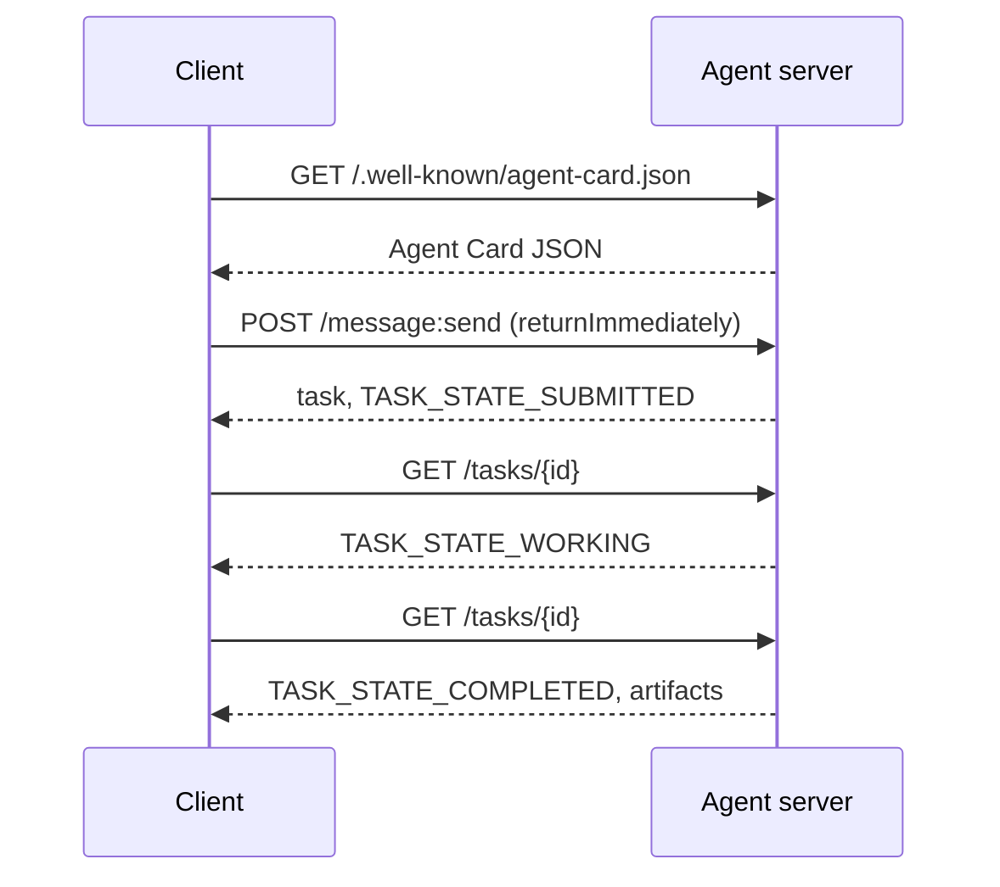

# A2A  Phương pháp giao dịch giữa các đại lý

> Google công bố A2A vào tháng 4 năm 2025; vào tháng 4 năm 2026 thông số kỹ thuật sẽ đạt đến https://a2a-protocol.org/latest/specification/và hơn 150 tổ chức ủng hộ nó. A2A là sự bổ sung ngang cho MCP (Dạy học 13): nơi MCP là dọc (hương cụ ), A2A là ngang (hương cụ ). Nó xác định các thẻ đại lý (khám phá), các nhiệm vụ với các đồ tạo tác (léc văn, dữ liệu có cấu trúc, video), chu kỳ cuộc sống nhiệm vụ không minh bạch và auth. Các hệ thống sản xuất ngày càng kết hợp MCP với A2A. Google Cloud đã đưa hỗ trợ A2A vào Vertex AI Agent Builder trong năm 2025-2026.

**Type:** Learn + Build
**Languages:** Python (stdlib, `http.server`, `json`), TypeScript
**Prerequisites:** Phase 16 · 04 (Primitive Model)
**Time:** ~75 minutes

## Vấn đề

Bạn có thể phơi bày một điểm cuối HTTP, xác định một sơ đồ JSON tùy chỉnh, và hy vọng bên kia nói. Mỗi cặp đại lý trở thành một tích hợp tùy chỉnh.

A2A là giao thức cáp phổ biến cho cuộc gọi đó. phát hiện tiêu chuẩn, mô hình nhiệm vụ tiêu chuẩn, giao thông tiêu chuẩn, đồ tạo vật tiêu chuẩn. Giống như HTTP + REST nhưng cho các đại lý như công dân hạng nhất.

## Khái niệm

### Bốn yếu tố

**Agent Card.**Một tài liệu JSON tại `/.well-known/agent-card.json`mô tả người đại lý: tên, kỹ năng, `supportedInterfaces`(URL điểm cuối, liên kết giao thức, phiên bản giao thức), các loại phương tiện nhập và ra ngoài mặc định, và yêu cầu auth (`securitySchemes`+`securityRequirements`Việc khám phá được thực hiện bằng cách đọc thẻ.

```http
GET /.well-known/agent-card.json HTTP/1.1
Host: agent.example.com
```

```json
{
  "name": "code-review-agent",
  "description": "Reviews Python and TypeScript code.",
  "version": "1.0.0",
  "supportedInterfaces": [
    {
      "url": "https://agent.example.com",
      "protocolBinding": "HTTP+JSON",
      "protocolVersion": "1.0"
    }
  ],
  "capabilities": {"streaming": false, "pushNotifications": false},
  "securitySchemes": {
    "bearer": {"httpAuthSecurityScheme": {"scheme": "Bearer"}}
  },
  "securityRequirements": [{"schemes": {"bearer": {"list": []}}}],
  "defaultInputModes": ["text/plain", "application/json"],
  "defaultOutputModes": ["application/json"],
  "skills": [
    {
      "id": "review-python",
      "name": "Review Python",
      "description": "Reviews Python code.",
      "tags": ["code-review", "python"]
    },
    {
      "id": "review-typescript",
      "name": "Review TypeScript",
      "description": "Reviews TypeScript code.",
      "tags": ["code-review", "typescript"]
    }
  ]
}
```

**Task.**Một vật thể không đồng bộ, có trạng thái với chu kỳ sống:`TASK_STATE_SUBMITTED`→ `TASK_STATE_WORKING`→ `TASK_STATE_COMPLETED`- `TASK_STATE_FAILED`- `TASK_STATE_CANCELED`Một khách hàng gửi một tin nhắn, máy chủ tạo ra nhiệm vụ, và khách hàng thăm dò hoặc đăng ký cập nhật.

**Artifact.**Các loại kết quả được tạo ra bởi một nhiệm vụ. văn bản, JSON cấu trúc, hình ảnh, video, âm thanh.`text`- `raw`- `url`, hoặc`data`và có thể đặt tên của nó `mediaType`, vì vậy các phương pháp khác nhau là hạng nhất.

**Opaque lifecycle.**A2A không quy định * làm thế nào * đại lý từ xa giải quyết nhiệm vụ. Khách hàng thấy chuyển đổi trạng thái và các hiện vật; thực hiện là miễn phí để sử dụng bất kỳ khung.

### Sự chia cắt MCP/A2A

- **MCP**(Dạy học 13): công cụ đại lý. Đại lý đọc / viết qua JSON-RPC đến một máy chủ công cụ.
- **A2A**Các bên đều là các đại lý với lý luận riêng của họ.

Các hệ thống sản xuất đa đại lý sử dụng cả hai. Một đồng nghiệp A2A gọi các công cụ MCP ở bên của nó.

### Xuống phát hiện



Đây là các đường liên kết HTTP + JSON, và mỗi yêu cầu đều mang `A2A-Version: 1.0`. Theo mặc định `SendMessage`chặn cho đến khi nhiệm vụ đạt đến một trạng thái cuối cùng hoặc bị gián đoạn, do đó một khách hàng thăm dò đặt `configuration.returnImmediately`để lấy lại nhiệm vụ ngay lập tức.

Hoặc với streaming: `POST /message:stream`trả lại các sự kiện được Server-Send (a `task`Đầu tiên, sau đó `statusUpdate`và `artifactUpdate`các sự kiện), và`/tasks/{id}:subscribe`kết nối lại với một nhiệm vụ đang chạy. dòng chảy đóng cửa khi nhiệm vụ đạt đến trạng thái cuối; không có `final`cờ.

### Tác giả

A2A hỗ trợ ba mô hình phổ biến:

- **Bearer token**: OAuth2 hoặc không minh bạch (`httpAuthSecurityScheme`hoặc `oauth2SecurityScheme`().
- **mTLS**: TLS chung; các tổ chức chứng minh danh tính với nhau (`mtlsSecurityScheme`().
- **API key**: một khóa trong một tiêu đề, tham số truy vấn hoặc cookie (`apiKeySecurityScheme`().

Người có tên được ghi trong thẻ đại lý:`securitySchemes`tên của mỗi chương trình và `securityRequirements`nói rằng khách hàng phải thỏa mãn những gì khách hàng khám phá và tuân thủ.

### 150 tổ chức hơn vào tháng 4 năm 2026

Việc chấp nhận doanh nghiệp đã thúc đẩy quy mô A2A. tiêu đề: A2A trở thành cách các hệ thống đại lý doanh nghiệp vượt qua ranh giới niềm tin. Google Cloud đã cung cấp hỗ trợ Vertex AI Agent Builder A2A; Microsoft Agent Framework hỗ trợ nó; hầu hết các khung chính (LangGraph, CrewAI, AutoGen) cung cấp A2A adapter.

### Khi A2A thắng

- **Cross-organization calls.**Trưởng công ty A gọi trưởng công ty B. Nếu không có A2A, mỗi cặp đều là hợp đồng được đặt theo yêu cầu.
- **Heterogeneous frameworks.**Cảnh sát LangGraph gọi Cảnh sát CrewAI gọi Cảnh sát Python tùy chỉnh.
- **Typed artifacts.**Kết quả video, cấu trúc JSON, âm thanh  tất cả là hạng nhất.
- **Long-running tasks.**Chuyển hình đời sống không rõ ràng + thăm dò làm cho các nhiệm vụ kéo dài hàng giờ trở nên đơn giản hơn.

### Khi A2A đấu tranh

- **Latency-sensitive micro-calls.**Chuyện sống của A2A là không đồng bộ. Sub-millisecond đại lý-to- đại lý không phù hợp; sử dụng trực tiếp RPC.
- **Tight-coupled in-process agents.**Nếu cả hai đại lý chạy trong cùng một quy trình Python, A2A HTTP round-trip là quá chết người.
- **Small teams.**Chi phí chung của các thông số là thực tế; các đại lý chỉ nội bộ có thể không cần các thủ tục.

### A2A vs ACP, ANP, NLIP

Một số thông số kỹ thuật liên quan xuất hiện trong năm 2024-2026:

- **ACP**(IBM/Linux Foundation)  tiền nhiệm của A2A, phạm vi hạn chế hơn.
- **ANP**(Nhiệm vụ mạng lưới đại lý)  phát hiện đồng nghiệp-sự nặng nề, phân cấp-lần đầu tiên.
- **NLIP**(Ecma Natural Language Interaction Protocol, tiêu chuẩn hóa tháng 12 năm 2025)  loại nội dung ngôn ngữ tự nhiên.

A2A là giao thức tương tác được áp dụng nhiều nhất vào tháng 4 năm 2026. Để xem so sánh, xem arXiv:2505.02279 (Liu et al., "Một cuộc khảo sát về giao thức tương tác của các đại lý").

```figure
sw-agent-card-discovery
```

## Hãy xây dựng nó

`code/main.py`thực hiện một máy chủ và client A2A tối thiểu sử dụng `http.server`và JSON, trên kết nối HTTP + JSON 1.0 .

- - Tự động`/.well-known/agent-card.json`- Tôi không biết.
- chấp nhận `POST /message:send`- Tôi không biết.
- quản lý trạng thái nhiệm vụ,
- trả lại các hiện vật trên `GET /tasks/{id}`- Tôi không biết.

Khách hàng:

- lấy thẻ đại lý,
- gửi tin nhắn với `returnImmediately`- Tôi không biết.
- thăm dò cho đến khi hoàn thành,
- đọc được vật cổ.

Đi chạy:

```
python3 code/main.py
npx tsx code/main.ts
```

Các kịch bản bắt đầu máy chủ trong một chuỗi nền, sau đó chạy khách hàng chống lại nó. Bạn thấy toàn bộ dòng chảy: khám phá, gửi, thăm dò, tạo vật.

## Sử dụng nó

`outputs/skill-a2a-integrator.md`thiết kế một sự tích hợp A2A: nội dung thẻ đại lý, các kế hoạch nhiệm vụ, lựa chọn tác giả, phát trực tuyến và thăm dò.

## Chuyển nó

Danh sách kiểm tra:

- **Pin the spec version.**A2A vẫn đang phát triển;`supportedInterfaces`Nhập trình tuyên bố mình `protocolVersion`, và khách hàng gửi`A2A-Version: 1.0`- Tôi không biết.
- **Idempotent task creation.**Các bài đăng trùng lặp (các thử mạng) nên tạo ra một nhiệm vụ.`messageId`- Tôi không biết.
- **Artifact schemas.**Cố định hình dạng mà đại lý trả về; người tiêu dùng nên xác nhận.
- **Rate limits + auth.**A2A là đối mặt với công chúng; áp dụng an ninh web tiêu chuẩn.
- **Dead-letter for failed tasks.**Kiểm tra các mẫu theo thời gian cho các loại lỗi tái phát.

## Các bài tập

1. Đi chạy`code/main.py`Hãy xác nhận khách hàng phát hiện ra máy chủ và nhận được vật liệu chính xác.
2. Thêm một kỹ năng thứ hai vào máy chủ (ví dụ: "summarize"). Cập nhật thẻ đại lý. Viết một khách hàng chọn kỹ năng dựa trên loại nhiệm vụ.
3. Thực hiện`POST /message:stream`: trả lời với Server-Send Events (a `task`Đầu tiên, sau đó `statusUpdate`Các sự kiện) và đóng dòng chảy ở một trạng thái cuối.
4. Đọc thông số kỹ thuật A2A (https://a2a-protocol.org/latest/specification/). Định danh ba điều mà đặc điểm yêu cầu không thực hiện trong bản demo này.
5. So sánh A2A (Agent Card discovery) với MCP (server-side capability listing via `listTools`(văn số 1 - 2) Sự khác biệt giữa các nhân viên tự mô tả và kiểm tra khả năng là gì?

## Các điều khoản chính

| Term | What people say | What it actually means |
|------|----------------|------------------------|
| A2A | "Agent-to-agent" | Peer protocol for agents to call other agents across systems. Google 2025. |
| Agent Card | "The agent's business card" | JSON at `/.well-known/agent-card.json` describing skills, `supportedInterfaces`, auth. |
| Task | "The unit of work" | Async stateful object with a lifecycle; artifacts produced on completion. |
| Artifact | "The result" | Typed output: text, structured JSON, image, video, audio. First-class media. |
| Opaque lifecycle | "How it's solved is the agent's business" | Client sees state transitions; server is free to choose framework/tools. |
| Discovery | "Finding the agent" | `GET /.well-known/agent-card.json` returns the card. |
| MCP vs A2A | "Tools vs peers" | MCP: vertical agent ↔ tool. A2A: horizontal agent ↔ agent. |
| ACP / ANP / NLIP | "Sibling protocols" | Adjacent specs; A2A is the most-adopted 2026. |

## Đọc thêm

- [A2A specification](https://a2a-protocol.org/latest/specification/) quy định quy định
- [A2A v1.0.1 release](https://github.com/a2aproject/A2A/tree/v1.0.1): các thẻ `docs/specification.md`và `specification/a2a.proto`Bài học này tiếp theo
- [Google Developers Blog — A2A announcement](https://developers.googleblog.com/en/a2a-a-new-era-of-agent-interoperability/) Tháng 4 năm 2025
- [A2A GitHub repo](https://github.com/a2aproject/A2A) Các thực hiện và SDK tham chiếu
- [Liu et al. — A Survey of Agent Interoperability Protocols](https://arxiv.org/html/2505.02279v1) MCP, ACP, A2A, ANP so sánh
