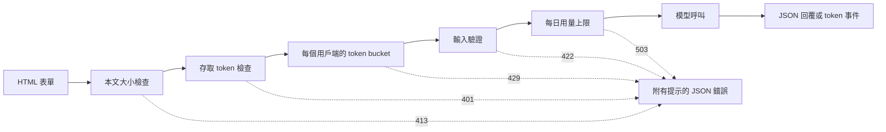

# 模型示範介面——從函式到可分享的應用程式（Model Demo Interfaces — From a Function to a Shareable App）

> 模型示範介面只有一份契約：輸入、模型呼叫與輸出。分享連結前，先替這三個部分各自設下限制。

**Type:** Build
**Languages:** Python
**Prerequisites:** Phase 11 · 13 (Building a Production LLM Application), Phase 17 · 08 (Inference Metrics), Phase 17 · 19 (AI Gateways)
**Time:** ~90 minutes

## Learning Objectives｜學習目標

- 寫下示範介面的輸入、模型呼叫與輸出契約，並替每個部分設下限制。
- 使用標準函式庫建置 HTTP 應用程式，包含一個 HTML 頁面、一個 JSON 端點，以及一個 Server-Sent Events 端點。
- 按照成本由低至高的順序驗證輸入，並回傳能告訴使用者下一步該怎麼做的 JSON 錯誤。
- 使用每個用戶端各自的 token bucket、每日用量上限，以及選用的存取 token，保護公開示範介面。
- 撰寫不保留任何輸入文字或用戶端位址的請求記錄。
- 比較標準函式庫示範介面與兩種框架版本，並指出示範介面何時必須升級為產品。

## The Problem｜問題

你的模型已經能在 notebook 中運作。現在有位審查者想試十筆輸入，也有位客戶想用手機看一筆結果。但他們都不會打開你的 notebook。

notebook 儲存格沒有輸入限制，也不會顯示進度。裡頭的錯誤是只有你看得懂的堆疊追蹤，而且它使用的是你的憑證和預算。如果不做任何調整，就把儲存格放到公開 URL 後面，你可能會遇到這些問題：

- 使用者貼上一份 40,000 個字元的文件。模型呼叫跑了一分鐘，最後卻以堆疊追蹤顯示失敗。
- 一支程式在一分鐘內送出 500 個請求。每個請求都會呼叫一次付費模型。
- 頁面八秒都沒有反應，使用者於是又按了四次按鈕。
- 伺服器記錄保留了每一筆輸入，包括含有客戶帳號的輸入。

只要少量程式碼，示範介面就能避免這些問題。本課會用 Python 標準函式庫建置一個示範介面，讓你看清楚每個部分的運作方式。接著，我們會用兩種常見框架建置同一個示範介面，並比較各框架的預設行為。

## The Concept｜核心概念

### 示範介面是一份契約

每個示範介面都有三個部分：使用者能送出的輸入、把輸入轉成輸出的模型呼叫，以及使用者會看到的輸出，其中也包括錯誤訊息。

動手寫頁面之前，先把契約寫下來：

| 部分 | 要回答的問題 | 本課的答案 |
|------|--------------------|-----------------------|
| 輸入 | 型別是什麼、大小限制多大、允許哪些字元？ | 1 到 500 個字元的字串，不含控制字元 |
| 模型呼叫 | 一次呼叫需要多久、費用多少？ | 一個耗時不到一毫秒且不收費的玩具關鍵字模型 |
| 輸出 | 成功與失敗時，使用者會看到什麼？ | 標籤、分數和回覆，或附有提示的 JSON 錯誤 |

notebook 對這三個部分都沒有限制。示範介面會替每個部分設下限制，並由伺服器對每個用戶端套用這些限制。



檢查項目依成本由低至高執行。請求只要有一項檢查未通過，就會立即停止，因此幾乎不會耗用伺服器資源。模型呼叫放在最後，因為只有這個步驟會產生費用。

### 在模型執行前先驗證

瀏覽器可以在送出資料前先檢查輸入。文字區域的 `maxlength` 和 `required` 屬性，能在不發出網路請求的情況下回饋使用者。這些檢查只能幫助誠實的使用者；任何用戶端都能略過頁面直接送出請求，所以伺服器必須重做每項檢查。

伺服器檢查要依成本由低至高排列：

1. 讀取 `Content-Length` 標頭。本文超過上限時，先拒絕請求再讀取本文。
2. 解析 JSON 本文。本文不是 JSON 物件時就拒絕。
3. 檢查欄位。拒絕空文字、超過長度上限的文字，以及含有控制字元的文字。
4. 只有通過所有檢查的請求，才呼叫模型。

| 未通過的檢查 | HTTP 狀態碼 | 錯誤識別碼 |
|--------------|-------------|------------|
| 本文超過 4,096 位元組 | 413 Content Too Large | `body_too_large` |
| 本文尚未收到 `Content-Length` 指定的位元組數就中斷 | 408 Request Timeout | `request_timeout` |
| Content-Type 不是 JSON | 415 Unsupported Media Type | `unsupported_media_type` |
| 本文不是 JSON 物件 | 400 Bad Request | `bad_json` |
| 文字欄位不存在、為空、過長或含有控制字元 | 422 Unprocessable Content | `missing_text`、`empty_text`、`text_too_long`、`control_characters` |

RFC 9110 定義了這些狀態碼及其名稱。

範例也是輸入設計的一部分。範例能讓使用者知道有效輸入的樣子，也讓審查者只要點一下就能測試。每種輸出類別都挑一個範例。本示範介面提供正向、負向和中性範例。

### 顯示模型正在運作

模型呼叫可能需要幾秒鐘。沒有任何回饋時，使用者無從分辨是模型很慢，還是頁面壞掉了。看不到變化的使用者可能會再次點選，於是伺服器又收到第二個付費請求。

本課的頁面會提供四種回饋：

- 請求執行期間停用送出按鈕。
- 顯示經過時間，並每 100 毫秒更新一次。
- 第一個 token 抵達時，顯示首 token 延遲。
- 請求結束時，顯示總耗時。

學習[推論指標](../../08-inference-metrics-goodput/)時，你看過首 token 延遲（time to first token，TTFT）這項伺服器指標。示範介面頁面也會向使用者顯示同一項數值，但改由瀏覽器測量。

### 以串流方式傳送輸出

語言模型會一次產生一個 token 的回覆。如果伺服器等到最後一個 token 才回覆，使用者就得等完整段生成結束。如果伺服器每當 token 就緒時就傳送，使用者收到第一個 token 後便能開始閱讀。

伺服器傳送事件（Server-Sent Events，SSE）是標準格式。回應的 Content-Type 為 `text/event-stream`。每個事件由一組 `event:` 和 `data:` 行組成，空白行則標示事件結束。WHATWG HTML 標準定義了這種格式。

```text
event: token
data: {"index":0,"text":"Label:"}

event: token
data: {"index":1,"text":" positive."}

event: done
data: {"label":"positive","score":1.0,"tokens":11}
```

瀏覽器提供了用於 SSE 的 `EventSource` 介面，但它只會送出 GET 請求。GET 請求會把輸入放進 URL，而網頁伺服器和代理伺服器會把 URL 寫入存取記錄。本示範介面改用帶有 JSON 本文的 POST 請求。頁面透過 `fetch()` 和 `response.body.getReader()` 讀取回應，並自行解析事件格式。

串流有一個單次 JSON 回覆不會遇到的問題：伺服器會在第一個 token 傳送前先送出狀態碼 200。如果模型之後失敗，伺服器就無法再更改狀態碼。因此，伺服器會在串流中送出 `error` 事件，頁面則把這個事件顯示為錯誤。

建置[正式環境 LLM 應用程式](../../../11-llm-engineering/13-production-app/)時，框架會替你透過 SSE 傳送 token。本課會手動寫出相同的通訊協定，讓你看清楚伺服器傳送的每一行內容。

### 撰寫能引導使用者採取行動的錯誤訊息

錯誤訊息有兩項任務：告訴使用者發生什麼事，以及告訴使用者接下來該怎麼做。堆疊追蹤對陌生使用者來說，兩件事都辦不到。

本示範介面的每種錯誤都使用相同的 JSON 結構：

```json
{
  "error": {
    "code": "text_too_long",
    "message": "The text has 812 characters. The limit is 500.",
    "hint": "Shorten the text to 500 characters or fewer.",
    "request_id": "a8f3c2b435e3"
  }
}
```

- `code` 是固定不變的名稱，用戶端程式碼和測試會比對它。
- `message` 說明實際情況，並提供使用者需要的數字。
- `hint` 告訴使用者可以採取的一個動作。
- `request_id` 可把使用者回報連結到一筆記錄。

RFC 9457 為 HTTP API 定義了一種稱為 problem details 的標準錯誤格式。本示範介面使用較精簡的結構達到相同目的。若其他團隊會呼叫你的 API，請使用 RFC 9457。

### 安全分享公開示範介面

公開連結會改變能送出請求的對象。針對每項風險，規劃一種控制措施：

| 風險 | 本示範介面的控制措施 | 面向更多使用者時的控制措施 |
|------|----------------------|-------------------------------|
| 單一用戶端送出太多請求 | 每個用戶端各自使用 token bucket，並回傳 429 和 `Retry-After` | 使用者登入後套用個別限制 |
| 陌生人找到連結 | 在 `Authorization` 標頭中使用選用的存取 token | 透過身分識別供應商實作單一登入 |
| 總成本無上限地增加 | 每日用量上限，並回傳 503 和 `Retry-After` | 在模型服務供應商端設定支出上限和警示 |
| 輸入過大或內容異常 | 本文大小上限、文字長度上限、控制字元檢查 | 對輸入和輸出進行內容審核 |
| 記錄保留私人輸入 | 只記錄輸入長度，以及用戶端位址的帶金鑰雜湊 | 設定記錄保留期限和存取控制 |

token bucket 使用兩個數值：容量是單一用戶端一次能送出的最大突發請求數；補充速率是長期平均的請求速率。每個請求會取用一個 token，而 bucket 會持續補充 token，直到達到容量上限：

```text
tokens = min(capacity, tokens + refill_rate * seconds_since_last_request)
accept the request if tokens >= 1, then subtract 1
```

bucket 空了之後，伺服器會回覆 `429 Too Many Requests`。RFC 6585 定義了狀態碼 429，並允許伺服器加上 `Retry-After` 標頭。本示範介面一律會加上這個標頭，值為下一個 token 可用前的秒數。頁面會讀取標頭，並在這段時間內停用按鈕。

本示範介面使用用戶端 IP 位址作為 bucket 的索引鍵。若伺服器位於反向代理後方，每個請求看起來都來自代理伺服器位址，因此所有使用者會共用同一個 bucket。此時，應從你自己的代理伺服器設定的標頭讀取用戶端位址。不要信任其他來源提供的該標頭，因為用戶端可以自行填入任何值。

學習 [AI 閘道](../../19-ai-gateways/)時，你看過閘道如何依租戶套用速率限制。示範介面也需要相同控制，只是規模較小。速率限制會限制每個用戶端，卻不會限制總用量。即使一百個用戶端都各自沒有超過限制，仍可能用完全部預算。用量上限會統計一天內所有模型呼叫，達到固定數量後便拒絕後續呼叫。

記錄和輸入一樣需要謹慎處理。`http.server` 處理常式的預設行為會把用戶端 IP 位址和請求行寫到標準錯誤。本示範介面會取代這行預設記錄。每個請求只寫入一筆記錄，包含路由、狀態碼、錯誤識別碼、延遲時間和輸入長度。用戶端位址會轉成帶金鑰的雜湊，因此你能統計各用戶端的請求數，卻不會儲存位址本身。

要讓使用者知道你會保留哪些資料。本示範介面頁面會說明伺服器只保留文字長度，不會保留文字本身。

### 示範介面何時成為產品

示範介面供已知使用者在單一行程中進行短時間操作。出現以下跡象時，就表示示範介面已經成為產品：

- 團隊以外的人每週都會使用它。
- 有人要求提供正常運作時間目標，或回報服務中斷。
- 使用者要求登入、儲存結果或查看歷史紀錄。
- 每週模型費用已列入預算。
- 輸入包含受合約或法律規範的資料。

| 特性 | 示範介面 | 產品 |
|----------|------|---------|
| 使用者 | 已知使用者、短時間操作 | 未知使用者、每日使用 |
| 狀態 | 無 | 帳戶、歷史紀錄、已儲存的結果 |
| 可用性 | 盡力而為、單一行程 | 明確的目標、複本、值班負責人 |
| 成本控制 | 單一每日用量上限 | 個別使用者的配額與計費 |
| 可觀測性 | 每個請求一筆記錄 | 追蹤、指標與警示 |

出現這些跡象時，請把示範介面遷移到正式環境 LLM 應用程式課程中的正式環境技術堆疊。該堆疊會加入真正的身分驗證、備援模型、追蹤功能，以及依使用者統計的成本。

```figure
demo-token-bucket
```

## Build It｜動手實作

程式碼只有一個檔案 `code/main.py`，除了標準函式庫以外不需要任何相依套件。先執行自我測試：

```bash
python3 code/main.py
```

自我測試會檢查驗證器、token bucket、串流格式，以及一次實際的 HTTP 往返。它會在可用的通訊埠啟動伺服器、送出三個請求、停止伺服器後結束。只有需要在瀏覽器中使用時，才啟動伺服器：

```bash
python3 code/main.py --serve
```

在瀏覽器中開啟 `http://127.0.0.1:8000`。按下 Ctrl+C 停止伺服器。

### 步驟 1：模型呼叫

這個模型是簡單的玩具關鍵字計數器，會把文字標記為正向、負向或中性，也會一次產生一個 token 的簡短回覆。

```python
def classify(text):
    words = WORD_RE.findall(text.lower())
    positive = sum(1 for word in words if word in POSITIVE)
    negative = sum(1 for word in words if word in NEGATIVE)
    score = (positive - negative) / max(1, positive + negative)
    if score > 0:
        label = "positive"
    elif score < 0:
        label = "negative"
    else:
        label = "neutral"
    return {"label": label, "score": round(score, 3), "positive_cues": positive,
            "negative_cues": negative, "words": len(words)}


def generate(text):
    result = classify(text)
    reply = (
        f"Label: {result['label']}. Positive cues: {result['positive_cues']}. "
        f"Negative cues: {result['negative_cues']}. Words read: {result['words']}."
    )
    parts = reply.split(" ")
    yield parts[0]
    for part in parts[1:]:
        yield " " + part
```

只要替換 `generate`，就能換成真正的模型。把 API 呼叫或本機模型放進這個函式即可。保留原本的函式簽章：輸入是字串，輸出是逐一產生的 token。驗證器、限制和頁面都維持不變。

### 步驟 2：驗證與錯誤回應

所有錯誤都由同一個例外類別承載。這個類別會保存 HTTP 狀態碼、固定識別名稱、訊息、提示，以及選用的回應標頭。

```python
class DemoError(Exception):
    def __init__(self, status, code, message, hint, headers=None):
        super().__init__(message)
        self.status = status
        self.code = code
        self.message = message
        self.hint = hint
        self.headers = dict(headers or {})


def validate_text(payload, max_chars=MAX_CHARS):
    if "text" not in payload:
        raise DemoError(422, "missing_text", 'The field "text" is missing.', 'Add a "text" field with your input.')
    text = payload["text"]
    if not isinstance(text, str):
        raise DemoError(422, "text_not_string", 'The field "text" is not a string.', "Send the input as a string.")
    text = text.strip()
    if not text:
        raise DemoError(422, "empty_text", "The text is empty.", "Type a sentence or pick an example.")
    if len(text) > max_chars:
        raise DemoError(422, "text_too_long", f"The text has {len(text)} characters. The limit is {max_chars}.",
                        f"Shorten the text to {max_chars} characters or fewer.")
    if CONTROL_RE.search(text):
        raise DemoError(422, "control_characters", "The text contains control characters.",
                        "Remove the hidden characters, then send the text again.")
    return text
```

驗證器會先移除開頭和結尾的空白。只有空白的文字會因此被判定為空值，而提示會告訴使用者該輸入什麼。`check_body_size` 和 `parse_json_body` 也使用相同模式處理 411、413、415 和 400 等情況。`error_body` 會把任何 `DemoError` 轉成核心概念一節所示的 JSON 結構。

### 步驟 3：token bucket

```python
class TokenBucket:
    def __init__(self, capacity, refill_per_second, now):
        if capacity < 1:
            raise ValueError("capacity must be at least 1")
        if refill_per_second <= 0:
            raise ValueError("refill_per_second must be positive")
        self.capacity = float(capacity)
        self.refill_per_second = float(refill_per_second)
        self.tokens = float(capacity)
        self.updated = now

    def take(self, now, cost=1.0):
        elapsed = max(0.0, now - self.updated)
        self.tokens = min(self.capacity, self.tokens + elapsed * self.refill_per_second)
        self.updated = now
        if self.tokens >= cost:
            self.tokens -= cost
            return 0.0
        return (cost - self.tokens) / self.refill_per_second
```

`take` 接受請求時會回傳 0.0；否則會回傳 bucket 累積足夠 token 所需的秒數。伺服器會將這個值無條件進位，再放進 `Retry-After` 標頭。

`RateLimiter` 使用 `OrderedDict` 為每個用戶端保存一個 bucket。由於 `ThreadingHTTPServer` 會在各自的執行緒中處理每個請求，因此需要用鎖保護字典。字典中的項目超過 `max_clients` 時，限制器會移除最後請求時間最早的用戶端。被移除的用戶端下次請求時會取得一個滿額 bucket。請將 `max_clients` 設得高於預期的活躍用戶端數量。

限制器接受 `clock` 引數。測試會傳入 `FakeClock`，因此測試可以直接讓時間前進十秒，不必真的等待。`UsageCap` 也用相同的時鐘模式計算每日總量。它會在固定的 86,400 秒視窗內統計呼叫次數，達到上限時則回傳下一個視窗開始前的秒數。

### 步驟 4：串流

```python
def sse_event(event, data):
    payload = json.dumps(data, separators=(",", ":"), ensure_ascii=False)
    return f"event: {event}\ndata: {payload}\n\n".encode("utf-8")


def stream_events(text, generate_fn=generate, delay=0.0, sleep=time.sleep):
    count = 0
    try:
        for token in generate_fn(text):
            yield sse_event("token", {"index": count, "text": token})
            count += 1
            if delay:
                sleep(delay)
    except Exception:
        yield sse_event("error", MODEL_ERROR)
        return
    result = classify(text)
    yield sse_event("done", {"label": result["label"], "score": result["score"], "tokens": count})
```

`json.dumps` 會把字串中的換行字元寫成兩個字元 `\n`。因此，每個事件的資料都只有一行，不含原始換行字元。若資料中出現原始換行，事件格式就會遭到破壞。

產生器會攔截模型錯誤並傳送 `error` 事件，因為伺服器已經送出狀態行。`delay` 和 `sleep` 引數能放慢瀏覽器中的串流速度，同時讓測試保持快速。

### 步驟 5：請求處理常式

`DemoHandler` 繼承 `BaseHTTPRequestHandler`。POST 處理常式會按照核心概念一節所述的順序執行檢查：

```python
def do_POST(self):
    app = self.server.app
    request_id = uuid.uuid4().hex[:12]
    client_id = self.client_address[0]
    started = time.perf_counter()
    route = self.path if self.path in self.routes else "other"
    status, code, chars = 200, None, 0
    try:
        declared = self.headers.get("Content-Length")
        try:
            if route == "other":
                raise DemoError(404, "not_found", "This endpoint does not exist.",
                                "Send requests to /api/predict or /api/stream.")
            size = check_body_size(declared, app.config.max_body_bytes)
        except DemoError:
            self.drain(int(declared) if declared and declared.isdigit() else 0)
            raise
        try:
            body = self.rfile.read(size)
        except TimeoutError:
            self.close_connection = True
            raise DemoError(408, "request_timeout", "The request body did not arrive in time.",
                            "Send the request again with the full body.") from None
        app.admit(client_id, self.headers.get("Authorization"))
        text = app.read_text(self.headers.get("Content-Type"), body)
        chars = len(text)
        app.charge()
        if route == "/api/predict":
            self.send_json(200, predict(text), request_id)
        else:
            code = self.send_stream(text, request_id)
    except DemoError as err:
        status, code = err.status, err.code
        self.send_error_json(err, request_id)
    except TimeoutError:
        status, code = 408, "request_timeout"
        self.close_connection = True
    except Exception:
        status, code = 500, "internal_error"
        self.send_error_json(DemoError(500, "internal_error", "The server failed on this request.",
                                       "Try again. Quote the request id if you report the problem."), request_id)
    finally:
        latency_ms = (time.perf_counter() - started) * 1000
        app.log.record(request_id, route, client_id, status, chars, latency_ms, code)
```

`admit` 會檢查存取 token 和 token bucket。`charge` 會檢查每日用量上限。這是最後一個步驟，因此只有有效請求會計入上限。每個請求都會在 `finally` 區塊中寫入一筆記錄，包括遭拒的請求。記錄中只保留 `route`，而不是原始路徑，因為路徑可能帶有包含使用者文字的查詢字串。

有四個容易忽略的細節可以避免問題：

- 處理常式類別上的 `timeout = 10` 會在用戶端停止傳送時關閉連線。若沒有這項設定，宣告本文有 100 個位元組卻只傳送 10 個位元組的用戶端，會讓伺服器執行緒永遠卡住。處理常式會傳送含有請求 ID 的 408 JSON 錯誤，然後關閉連線。串流開始後才發生逾時時，由於狀態行已送出，處理常式只會關閉連線。
- `log_message` 不會輸出任何內容，因此不會留下包含用戶端位址和請求行的預設記錄行。
- `drain` 會讀取並丟棄最多 64 KiB 的遭拒本文。RFC 1122 指出，主機關閉仍有未讀資料的連線時，TCP 會傳送重設訊號。用戶端因此可能收不到 413 回覆。
- `send_stream` 會攔截 `BrokenPipeError` 並關閉產生器。使用者關閉分頁時，模型也會停止，請求不會繼續產生費用。

`BaseHTTPRequestHandler` 預設使用 HTTP/1.0。此時串流本文結束的時機，就是伺服器關閉連線的時機。使用 HTTP/1.1 的伺服器則會以區塊傳輸編碼傳送本文，達成相同目的。

### 步驟 6：頁面

`render_page` 會回傳一份 HTML 文件，內含行內樣式和行內指令碼。頁面不會載入外部指令碼、字型或圖片。指令碼會像這樣讀取串流：

```javascript
const reader = response.body.getReader();
const decoder = new TextDecoder();
let buffer = "";
while (true) {
  const chunk = await reader.read();
  if (chunk.done) { break; }
  buffer += decoder.decode(chunk.value, { stream: true });
  let cut = buffer.indexOf("\n\n");
  while (cut >= 0) {
    const frame = parseFrame(buffer.slice(0, cut));
    buffer = buffer.slice(cut + 2);
    cut = buffer.indexOf("\n\n");
    if (frame.event === "token") { output.textContent += frame.data.text; }
  }
}
```

網路區塊可能在事件中途結束。讀取器會把尚未完整的部分留在 `buffer`，直到收到空白行為止。

頁面使用 `textContent` 寫入模型輸出，絕不使用 `innerHTML`。模型輸出是不可信任的文字。假設頁面把回覆當成 HTML 插入，而回覆中含有帶 `onerror` 屬性的元素，該屬性就可能在使用者的瀏覽器中執行程式碼。

伺服器也會傳送 `Content-Security-Policy` 標頭，並設定 `default-src 'none'`。政策會透過 SHA-256 雜湊識別一個行內指令碼和一個行內樣式。瀏覽器會拒絕其他所有指令碼，包括攻擊者注入頁面的指令碼。

```python
def csp_hash(source):
    digest = hashlib.sha256(source.encode("utf-8")).digest()
    return "'sha256-" + base64.b64encode(digest).decode("ascii") + "'"
```

### 步驟 7：執行並嘗試找出問題

啟動伺服器後，在另一個終端機中使用 `curl`。對剛啟動的伺服器連續送出七個請求。bucket 可容納五個 token，每兩秒補充一個 token：

```bash
for i in 1 2 3 4 5 6 7; do
  curl -s -o /dev/null -w '%{http_code} ' -X POST http://127.0.0.1:8000/api/predict \
    -H 'Content-Type: application/json' -d '{"text": "ok"}'
done
```

```text
200 200 200 200 200 429 429
```

等待十秒，再送出空文字：

```bash
curl -s -X POST http://127.0.0.1:8000/api/predict \
  -H 'Content-Type: application/json' -d '{"text": ""}'
```

```json
{"error": {"code": "empty_text", "message": "The text is empty.", "hint": "Type a sentence or pick an example.", "request_id": "e3e3599feaea"}}
```

使用 `curl -N` 觀察事件串流；這個選項會停用輸出緩衝：

```bash
curl -N -X POST http://127.0.0.1:8000/api/stream \
  -H 'Content-Type: application/json' -d '{"text": "The screen is bright."}'
```

若要要求使用存取 token，請在啟動伺服器前設定 `DEMO_ACCESS_TOKEN`。頁面接著會顯示 token 欄位。

```bash
export DEMO_ACCESS_TOKEN="$(python3 -c 'import secrets; print(secrets.token_urlsafe(24))')"
echo "$DEMO_ACCESS_TOKEN"
python3 code/main.py --serve
```

執行測試：

```bash
python3 -m unittest discover -s code/tests -v
```

HTTP 測試會在通訊埠 0 上啟動伺服器，讓作業系統選擇可用的通訊埠。`tearDown` 會停止伺服器，並確認執行緒已結束。

## Use It｜實際應用

Gradio 和 Streamlit 這兩種 Python 框架都能用較少程式碼建置同類型的示範介面。以下兩個範例都從 `main.py` 匯入契約，因此驗證器和模型維持不變。執行 `main.py` 或測試時，不需要安裝任何一種框架。

### 用元件包裝單一函式

Gradio 會在單一 Python 函式外加上網頁介面。輸入和輸出元件用來描述契約，產生器函式則會逐步傳送輸出。

```python
import os

import gradio as gr

from main import EXAMPLES, MAX_CHARS, DemoError, classify, generate, validate_text


def label_text(text):
    try:
        clean = validate_text({"text": text})
    except DemoError as err:
        raise gr.Error(f"{err.message} {err.hint}")
    label = classify(clean)["label"]
    reply = ""
    for token in generate(clean):
        reply += token
        yield reply, label


demo = gr.Interface(
    fn=label_text,
    inputs=gr.Textbox(label="Text to label", lines=5, max_length=MAX_CHARS),
    outputs=[gr.Textbox(label="Reply"), gr.Textbox(label="Label")],
    examples=list(EXAMPLES),
    flagging_mode="never",
)

if __name__ == "__main__":
    demo.queue(max_size=20).launch(auth=("demo", os.environ["DEMO_PASSWORD"]))
```

每次 `yield` 都會取代整個輸出值。因此，函式會在每個步驟都產生截至當下的完整回覆。

分享連結之前，請先明確設定 `flagging_mode`。預設模式會顯示檢舉按鈕。使用者按下按鈕時，Gradio 會把輸入和輸出寫入伺服器上的 CSV 檔案。設定為 `"never"` 就會移除按鈕。

`queue(max_size=20)` 會限制等待中的請求數量。預設的並行限制是每個事件同時執行一個呼叫。若模型很慢，在提高限制之前，它一次只能服務一位使用者。Gradio 啟動應用程式時也會建立 API 端點，因此你的速率限制也必須套用到這些端點。

### 每次輸入都會重新執行的指令碼

使用者每次變更小工具時，Streamlit 都會從上到下重新執行整份指令碼。表單會收集小工具的值，並在使用者按下送出按鈕時一次傳送。

```python
import streamlit as st

from main import EXAMPLES, MAX_CHARS, DemoError, classify, generate, validate_text

st.title("Toy sentiment demo")
st.caption("Do not paste private data.")

example = st.selectbox("Start from an example", ["", *EXAMPLES])
with st.form("demo"):
    text = st.text_area("Text to label", value=example, max_chars=MAX_CHARS)
    submitted = st.form_submit_button("Run model")

if submitted:
    try:
        clean = validate_text({"text": text})
    except DemoError as err:
        st.error(f"{err.message} {err.hint}")
    else:
        st.write_stream(generate(clean))
        st.write(f"Label: {classify(clean)['label']}")
```

`st.write_stream` 會直接接收產生器，並在每個區塊抵達時寫出。由於指令碼每次送出表單都會重新執行，請使用 `@st.cache_resource` 載入真正的模型。這個裝飾器會為所有工作階段保留模型的單一副本。

### 各選項的預設行為

| 需求 | 標準函式庫（本課） | Gradio | Streamlit |
|------|--------------------------------|--------|-----------|
| 表單、範例、結果區 | 由你撰寫 HTML | 由 `Interface` 根據元件和 `examples` 建立 | 使用 `st.text_area` 和 `st.selectbox` 等小工具 |
| 輸入長度上限 | 頁面上的 `maxlength` 和伺服器檢查 | `Textbox` 的 `max_length` | `st.text_area` 的 `max_chars` |
| 部分輸出 | 由你撰寫 SSE 和串流讀取器 | 產生器函式，每次 `yield` 都會取代輸出 | 使用產生器區塊的 `st.write_stream` |
| 進度顯示 | 由你撰寫計時器 | 輸出區的進度顯示，可透過 `show_progress` 設定 | `st.write_stream` 會在每個區塊抵達時顯示 |
| 顯示給使用者的錯誤 | 含有 `code`、`message`、`hint`、`request_id` 的 JSON | `raise gr.Error(...)` 顯示訊息 | `st.error(...)` 顯示訊息 |
| 並行處理 | 每個請求使用一個執行緒，沒有上限 | 使用佇列，預設每個事件同時執行一個呼叫 | 每個互動都會為該工作階段重新執行指令碼 |
| 公開連結 | 由你執行伺服器並設定網域 | `launch(share=True)` 會提供一週後到期的連結 | 將應用程式部署到伺服器 |
| 登入 | 檢查 bearer token | `launch(auth=...)` 搭配使用者名稱和密碼 | 搭配 OpenID Connect 供應商使用 `st.login()` |
| 速率限制與成本上限 | token bucket 和每日用量上限 | 由你撰寫程式，從請求取得用戶端位址 | 由你撰寫程式 |
| 工具會寫入磁碟的輸入 | 記錄只包含輸入長度 | 遭檢舉的範例會存入 CSV，除非 `flagging_mode="never"` | 由你的程式決定 |

框架最能替你省下頁面實作的功夫：表單、範例、進度顯示和部分輸出。它們在公開連結的風險控制上能省下的功夫較少。無論使用哪一種版本，速率限制、成本上限和記錄隱私都由你負責。標準函式庫版本會展示這些部分，讓你知道使用框架時該檢查什麼。

## Ship It｜交付成果

本課會產出 `outputs/skill-demo-interface-checklist.md`。提供模型示範介面的描述或程式碼後，它就會針對契約、回饋、錯誤和公開連結的控制措施回報通過或失敗。每個未通過項目都會附上一項修正方式。

## Exercises｜練習

1. 將 `BUCKET_CAPACITY` 設為 2，並將 `REFILL_PER_SECOND` 設為 1。先預測七請求迴圈的輸出，再實際執行並比較。
2. 在請求本文加入 `language` 欄位，只接受 `"en"`。其他值都要回傳附有提示的 422 錯誤，並新增兩項測試。
3. 找出玩具模型會標記錯誤的句子，例如「The screen is not good.」。把它加成第四個範例，並在頁面加上說明模型限制的註記。
4. 在你的電腦上把示範介面放到反向代理後方。新增 `trust_proxy` 選項，只在請求來自代理伺服器時讀取 `X-Forwarded-For`。撰寫一項測試，證明用戶端無法自行指定 bucket 的索引鍵。
5. 將 `generate` 換成會以串流方式回傳 token 的模型 API 呼叫。保留驗證器、限制和事件格式，比較頁面上的首 token 延遲與伺服器記錄中的延遲。

## Key Terms｜關鍵術語

| 術語 | 常見說法 | 實際意義 |
|------|----------------|------------------------|
| 示範介面契約（Demo contract） | 「使用者介面」 | 輸入限制、模型呼叫和輸出結構，包括錯誤 |
| token bucket | 「速率限制器」 | 依固定速率補充、最多達到指定容量的用戶端計數器。每個請求會取用一個 token |
| Retry-After | 「稍後再試」 | 回應標頭，指定用戶端可以重試前要等待的秒數或時間 |
| Server-Sent Events | 「串流」 | `text/event-stream` 回應，由 `event:` 和 `data:` 行組成，每個事件後都有空白行 |
| 首 token 延遲（Time to first token） | 「延遲」 | 從送出請求到使用者畫面出現第一個 token 的時間 |
| 用量上限（Usage cap） | 「預算」 | 在一段時間內，限制所有用戶端合計能呼叫模型的次數 |
| 帶金鑰的雜湊（Keyed hash） | 「匿名 ID」 | 使用秘密 salt 對用戶端位址計算的 HMAC。它只是化名；持有 salt 的人可以測試已知位址 |
| 內容安全政策（Content Security Policy） | 「CSP」 | 告知瀏覽器頁面可以使用哪些指令碼、樣式和連線的回應標頭 |

## Further Reading｜延伸閱讀

- [Python `http.server` 文件](https://docs.python.org/3/library/http.server.html)：伺服器類別、HTTP/1.0 預設值、預設記錄行，以及此模組不適用於正式環境的警告。
- [WHATWG HTML Standard，伺服器傳送事件](https://html.spec.whatwg.org/multipage/server-sent-events.html)：事件串流格式和 `EventSource` 介面。
- [MDN，使用伺服器傳送事件](https://developer.mozilla.org/en-US/docs/Web/API/Server-sent_events/Using_server-sent_events)：事件格式和瀏覽器 API 範例。
- [MDN，使用可讀取串流](https://developer.mozilla.org/en-US/docs/Web/API/Streams_API/Using_readable_streams)：如何逐區塊讀取 `fetch()` 回應本文。
- [MDN，使用 Fetch API](https://developer.mozilla.org/en-US/docs/Web/API/Fetch_API/Using_Fetch)：帶有 JSON 本文的請求，以及回應處理方式。
- [MDN，429 Too Many Requests](https://developer.mozilla.org/en-US/docs/Web/HTTP/Reference/Status/429) 和 [MDN，Retry-After](https://developer.mozilla.org/en-US/docs/Web/HTTP/Reference/Headers/Retry-After)：速率限制狀態碼及其標頭。
- [MDN，內容安全政策](https://developer.mozilla.org/en-US/docs/Web/HTTP/Guides/CSP)：行內指令碼的雜湊和 `default-src` 指示詞。
- [RFC 6585](https://www.rfc-editor.org/rfc/rfc6585.html)：其他 HTTP 狀態碼，包括 429。
- [RFC 9110](https://www.rfc-editor.org/rfc/rfc9110.html)：HTTP 語意，包括 413、415 和 422。
- [RFC 9457](https://www.rfc-editor.org/rfc/rfc9457.html)：HTTP API 的標準 JSON 錯誤格式 problem details。
- [RFC 1122](https://www.rfc-editor.org/rfc/rfc1122.html)：主機需求，包括關閉仍有未讀資料的連線時會送出 TCP 重設訊號（第 4.2.2.13 節）。
- [Gradio，分享應用程式](https://gradio.app/guides/sharing-your-app)：分享連結、身分驗證、API 頁面和速率限制。
- [Gradio，串流輸出](https://gradio.app/guides/streaming-outputs)：以產生器函式逐步輸出。
- [Gradio，Interface](https://gradio.app/docs/gradio/interface)：`examples`、`flagging_mode` 和 `concurrency_limit`。
- [Gradio，使用 flagging](https://gradio.app/guides/using-flagging)：遭檢舉的範例會存放在磁碟上的位置。
- [Streamlit，基本概念](https://docs.streamlit.io/get-started/fundamentals/main-concepts)：重新執行時的資料流程。
- [Streamlit，st.write_stream](https://docs.streamlit.io/develop/api-reference/write-magic/st.write_stream) 和 [Streamlit，快取](https://docs.streamlit.io/develop/concepts/architecture/caching)：部分輸出，以及只載入一次的模型。
- [Streamlit，st.login](https://docs.streamlit.io/develop/api-reference/user/st.login)：使用 OpenID Connect 登入。
