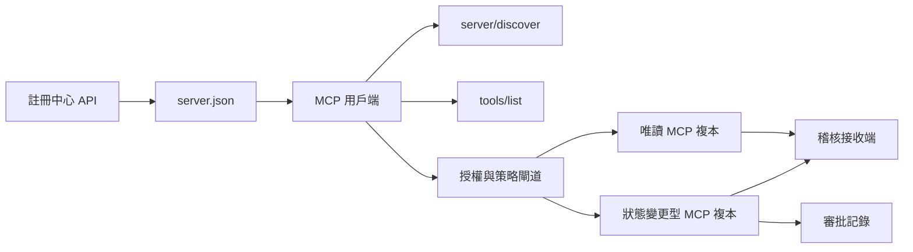

# 專案實戰 13：具備註冊中心與治理能力的無狀態 MCP 伺服器（Capstone 13: Stateless MCP Server with Registry and Governance）

> 正式環境中的 MCP 絕非單一伺服器行程。它是一整條合約鏈：可發布的中繼資料（metadata）、線上即時動態發現、無狀態請求信封、授權機制、策略門禁、審計追蹤以及部署證據鏈。

**Type:** Capstone
**Languages:** Python and TypeScript reference models; any production language
**Prerequisites:** Phase 11, Phase 13, Phase 14, Phase 17, and Phase 18
**Required MCP deep dives:** [Lesson 28: Tool Contracts](../../../13-tools-and-protocols/28-mcp-tool-contracts-and-content/docs/en.md), [Lesson 29: Reliability](../../../13-tools-and-protocols/29-mcp-reliability-cancellation-and-flow-control/docs/en.md), [Lesson 30: Registry Supply Chain](../../../13-tools-and-protocols/30-mcp-registry-supply-chain-and-drift/docs/en.md), and [Lesson 31: Conformance Operations](../../../13-tools-and-protocols/31-mcp-conformance-versioning-and-operations/docs/en.md)
**Protocol target:** MCP `2026-07-28`
**Time:** ~25 hours

## Learning Objectives｜學習目標

- 實作無狀態 MCP 請求與結果信封。
- 將註冊中心（Registry）中繼資料與線上即時通訊協定發現嚴格解耦隔離。
- 建構確定性、具備快取感知能力的工具發現機制。
- 為每一次工具呼叫強制落實簽發者（Issuer）、受眾（Audience）、範圍（Scope）與人工作業審批策略。
- 部署完全不依賴會話黏性（Session Affinity）的 Streamable HTTP。
- 在網路傳輸線路、授權驗證、策略引擎、註冊中心與稽核紀錄五大邊界處提供嚴格行為證據鏈。

## MCP 前置深度課程路徑

在將本專案實戰作為可交付的正式環境產品之前，必須依序完整學習第 13 階段關聯的四節深度專題：

1. [第 28 課](../../../13-tools-and-protocols/28-mcp-tool-contracts-and-content/docs/en.md) 定義了本伺服器必須對外暴露的工具、Schema、內容格式、分頁、自動補全、動態路由與錯誤處理合約。
2. [第 29 課](../../../13-tools-and-protocols/29-mcp-reliability-cancellation-and-flow-control/docs/en.md) 定義了取消競態、死線超時、冪等性、背壓流控、失敗重試以及斷線重連行為。
3. [第 30 課](../../../13-tools-and-protocols/30-mcp-registry-supply-chain-and-drift/docs/en.md) 定義了命名空間、來源出處、准入鎖定 Pin、註冊中心狀態、配置漂移、分散式帳本與回滾證據。
4. [第 31 課](../../../13-tools-and-protocols/31-mcp-conformance-versioning-and-operations/docs/en.md) 定義了黃金與負向對抗測試紀錄、嚴格版本劃分年代、跨 SDK 差異校驗、代理穿透證明、敏感資訊脫敏、健康檢查與版本發布門禁。

本專案實戰是上述各項工業資產的綜合集成，絕不允許使用一個簡單的單一 SDK 冒煙測試取而代之。

## The Problem｜問題

內部企業平台需要一套唯讀資料查詢工具，以及一組具備寫入與狀態變更能力的危險工具。工程師必須能夠動態發現該伺服器、理解連線協定、即時檢查其運作時能力，且**嚴格僅能呼叫其獲得明確授權的特定操作**。

最艱難的挑戰從來不是在記憶體中註冊一個函式。最艱難的挑戰在於確保以下六項維度的客觀真值始終保持高度一致：

1. `server.json` 聲明了伺服器可在何處被安裝或存取。
2. `server/discover` 揭示了線上即時行程當前所真正支援的能力集合。
3. 每一個請求明確標註其所採用的通訊協定版本與用戶端能力。
4. 授權機制將調用者嚴格綁定至合法的簽發者、資源標識與存取範圍。
5. 策略引擎精確裁決本次具體操作是否被允許在線上執行。
6. 審計證據在絕不洩漏金鑰憑證或機密資料的前提下，完整記錄跨越邊界的每一項事實。

若上述任意一項事實發生漂移，平台可能會列出一個根本無法連線的殭屍伺服器、將流量路由至不相容的用戶端、接受為其他資源簽發的冒充權杖，或在缺乏人工審批的情況下意外暴露高破壞性變更操作。

## 兩大發現層級

註冊中心（Registry）與線上即時 MCP 伺服器負責解答完全不同的架構問題。

| 層級 | 合約表面 | 負責解答的核心問題 |
|---|---|---|
| 發布層（Publication） | `server.json` 與 Registry API | 這是一個什麼伺服器、其套件發布位址或遠端端點在何處、該如何設定？ |
| 執行環境層（Runtime） | `server/discover` | 當前線上行程真正支援哪些通訊協定版本、擴充能力、擴充功能以及伺服器身分標識？ |

官方 Registry 使用帶有版本控制的 `server.json` Schema。一個遠端端點條目可聲明一個 Streamable HTTP 位址：

```json
{
  "$schema": "https://static.modelcontextprotocol.io/schemas/2025-12-11/server.schema.json",
  "name": "com.example/internal-readonly",
  "title": "Internal Read-Only Tools",
  "description": "Read-only incident and data lookup tools.",
  "version": "1.0.0",
  "remotes": [
    {
      "type": "streamable-http",
      "url": "https://mcp.internal.example.com/readonly"
    }
  ]
}
```

註冊中心的 Schema 版本與底層 MCP 通訊協定版本完全正交獨立。絕不允許隨意修改其中一個日期去強行迎合另一個。每份文件必須嚴格遵循自身的合約標準進行校驗。

單純的 Schema 格式合法絕不等於具備該命名空間的合法所有權。一個經過認證的發布者 `example.com` 必須使用反向 DNS 命名空間 `com.example/*` 或其合法的子命名空間。註冊中心的認證流程負責驗證該所有權。若將網域標籤維持原始正向順序，將代表一個完全不同的命名空間。

Python 標準庫參考實作中的 `validate_registry_document` 函式刻意設計為一個輕量級的遠端設定檔校驗器。它檢驗官方強制要求的 `name`、`description` 與 `version` 欄位；可選的 `title`；發布名稱與長度限制；具體語義版本規格；以及每個 `streamable-http` 或 `sse` 遠端端點的 HTTP(S) URL 格式。此外，由於本專案實戰強制要求實施線上動態探測，該校驗器強制要求 `remotes` 清單不得為空。`validate_publisher_namespace` 獨立負責檢驗名稱是否歸屬於已認證的發布者網域，而 `validate_runtime_alignment` 則負責比對發布檔案名稱、版本號與線上即時 `serverInfo` 是否存在漂移。官方完整 Schema 亦支援純套件形式與更豐富的欄位。在正式發布至正式環境前，應使用官方鎖定的 JSON Schema 或 `mcp-publisher` 工具實施全量校驗；切勿將本標準庫子集視為完全替代品。

伺服器必須完整實作 `server/discover` RPC 方法；用戶端可在呼叫其他方法前先呼叫它。本專案實戰用戶端在解析出端點位址後立即發起該探測，接收當前通訊協定版本與線上即時能力特徵：

```json
{
  "resultType": "complete",
  "supportedVersions": ["2026-07-28"],
  "capabilities": {
    "tools": {
      "listChanged": false
    }
  },
  "_meta": {
    "io.modelcontextprotocol/serverInfo": {
      "name": "com.example/internal-readonly",
      "version": "1.0.0"
    }
  },
  "ttlMs": 3600000,
  "cacheScope": "public"
}
```

企業私有目錄可以為其附加額外的權屬、安全審查或生命週期中繼資料，但絕對嚴禁將這些內部欄位捏造為 MCP 網路傳輸層欄位或 `server.json` 的頂層根屬性。企業內部組織策略應當存放在發布記錄旁路。當確實需要向公眾暴露自定義中繼資料時，必須嚴格使用 Registry 官方規範的 `_meta.io.modelcontextprotocol.registry/publisher-provided` 擴充命名空間，且整體大小嚴格限制在 4 KB 以內。

## 無狀態 MCP 核心

MCP `2026-07-28` 規範徹底廢除了傳統的「協定工作階段（Protocol Session）」以及 `initialize` / `notifications/initialized` 的繁瑣握手流程。同時全面移除了 `Mcp-Session-Id` 標頭。

每一個請求皆必須在 `params._meta` 中獨立攜帶當前通訊協定上下文：

```json
{
  "io.modelcontextprotocol/protocolVersion": "2026-07-28",
  "io.modelcontextprotocol/clientCapabilities": {},
  "io.modelcontextprotocol/clientInfo": {
    "name": "internal-platform-client",
    "version": "1.0.0"
  }
}
```

協定版本與用戶端能力是屬於「單次請求的事實」，而非「長連線的事實」。負載平衡器可以完全自由地將後續連續的請求分發給不同的健康節點複本，因為任何一個複本皆能直接從訊息信封本身獨立校驗其合法性。

常規業務結果必須顯式包含 `resultType: "complete"`。伺服器應當在每一個結果的 `_meta.io.modelcontextprotocol/serverInfo` 中表明自身的身分標識。若請求中遺失版本資訊或型別非字串，伺服器必須拋出無效參數錯誤 `-32602`。而錯誤碼 `-32022` 嚴格專屬於「用戶端傳入了一個語法正確但當前伺服器明確不支援的版本字串」，且回傳資料必須精準格式化為 `{"supported": ["2026-07-28"], "requested": "..."}`。

### 具備快取感知能力的工具發現（Cacheable discovery）

針對完全相同的有效工具集合，`tools/list` 的輸出必須具備嚴格的確定性。回傳結果包含：

- `ttlMs`：提供給用戶端的快取鮮度保鮮期建議；
- `cacheScope`：快取作用範圍，枚舉值為 `public` 或 `private`；
- 嚴格穩定的工具排序：確保相同的工具列表能最大化重複利用大模型的 Prompt 快取；
- `resultType: "complete"` 以及伺服器身分中繼資料。

基於單用戶權限篩選的工具列表通常應當返回 `cacheScope: "private"`。絕對嚴禁將具備個人權限差異的工具列表隱藏在共享的公共快取身後。

## 雙向串流 HTTP 傳輸

網路伺服器對外暴露一個接收 HTTP POST 請求的統一 MCP 端點。每一個 JSON-RPC 請求或通知皆擁有專屬的獨立 POST 請求。

針對常規請求，伺服器可回傳單一 JSON 物件，或是回傳一個嚴格作用於該請求生命週期的單向 SSE 串流。一個長期的 `subscriptions/listen` 請求則負責傳遞用戶端顯式訂閱的變更通知。在當前傳輸規範中，徹底廢除了獨立的純 GET 串流、工作階段 DELETE 請求、Session 標頭以及基於 `Last-Event-ID` 的重放修復機制。

每個 HTTP 請求頭部必須嚴格附帶：

- `MCP-Protocol-Version`：必須與請求體內部中繼資料完全一致；
- `Mcp-Method`：必須與 JSON-RPC 呼叫的方法名稱完全一致；
- `Mcp-Name`：專屬於 `tools/call`、`resources/read` 與 `prompts/get`；
- `Accept: application/json, text/event-stream`。

若複製的標頭與主體內容發生衝突，伺服器必須立即以標準 `-32020` 錯誤拒絕請求。嚴格校驗 `Origin` 跨域來源、將本地開發伺服器鎖定在 loopback 環回介面、對遠端用戶端實施強制身分驗證，並將被用戶端主動關閉的 SSE 串流嚴格視為「請求取消」訊號處理。



```figure
cf-mcp-gate
```

## 授權與策略控制

傳輸層中繼資料絕非授權本身。每一次工具呼叫皆必須實施端到端獨立授權校驗。

針對遠端伺服器：

1. 自動發現受保護資源的中繼資料（Protected-Resource Metadata）。
2. 為該資源精確選定合法的授權伺服器（Authorization Server）。
3. 用戶端註冊優先推薦「用戶端身分中繼資料文件（CIMD）」，僅將動態用戶端註冊（DCR）視為向下相容備用方案。
4. 在授權請求中主動發送 Resource Indicator 資源標識符。
5. 嚴格校驗回傳的 `iss` 欄位是否與該流程綁定的授權伺服器完全一致。
6. 以簽發者（Issuer）為 Key 嚴格隔離儲存用戶端金鑰憑證。絕對嚴禁跨不同簽發者混用註冊資料。
7. 在 MCP 伺服器端，嚴格校驗 Token 的簽發者、受眾（Audience）或資源、過期時間以及 Scope 存取權限。
8. 針對具體的工具名稱與呼叫參數，在業務層執行二次策略決策（Policy Decision）。

工具定義中的 `readOnlyHint` 或 `destructiveHint` 註解僅僅是用於輔助用戶端進行風險提示的弱依據，絕對不能作為值得信賴的安全授權控制點。

### 審批是一項具體記錄，而非魔法 Scope

任何具有實質狀態變更影響的危險工具呼叫，皆必須出具一份專屬的「審批記錄（Approval Record）」：該記錄嚴格綁定發起者、目標工具、經過規範化排序的參數雜湊摘要、目標實體環境、過期時間以及單次／重複使用策略。聊天對話歷史中的一句簡單確認絕不能充當合法審批的證據。

Python 參考實作對規範化排序 Key 的標準 JSON 計算雜湊摘要，隨後將該摘要與 Token Subject、工具名稱、伺服器 URL 以及過期時間嚴密綁定。如果攻擊者在獲得審批後篡改了哪怕一個微小參數，該記錄重放時必將在執行器觸發前當場校驗失敗。審批是一份獨立的客觀證據，絕不是動態追加到存取權杖（Access Token）裡的某個 Scope 字串。

若分離高風險工具能實質降低爆炸半徑，就應將它們放在可獨立審查的介面上。只有當憑證、策略、部署身分與稽核控制也彼此獨立時，這種分離才有用。

## Build It｜動手實作

### 1. 規範化發布中繼資料

編寫並通過 Schema 校驗 `server.json`。必須包含已獲認證的命名空間內的穩定名稱、語義版本號、精確描述，並在適用時提供官方 `repository` 或 `packages` 中繼資料，以及遠端或 stdio 傳輸聲明。敏感金鑰嚴格作為環境變數輸入宣告，絕對嚴禁硬編碼明文。

### 2. 實作線上即時發現機制

在提供任何具體業務 RPC 之前，優先實作 `server/discover` 端點。正確廣播當前支援的協定版本清單、能力集、擴充功能與伺服器身分標識。實作針對不支援版本的標準 `-32022` 拒絕邏輯。

### 3. 實作無狀態請求信封

在每一個傳入的請求中，強制要求包含協定版本與用戶端能力。在每一個回傳結果中顯式標明 `resultType` 與伺服器身分。徹底移除行程記憶體中的工作階段初始化狀態、長連線能力快取以及 Session ID。

### 4. 建置工具介面合約

從兩個唯讀查詢工具與一個狀態變更工具開始。為每個工具提供具備嚴格邊界的 JSON Schema、精準的行為描述、確定性的回傳結果格式以及誠實的風險註解。當用戶端依賴強型別結構時，提供規範的 Output Schema。

### 5. 加入快取感知列表

以嚴格穩定的順序回傳工具清單，並附帶 `ttlMs` 與 `cacheScope`。獨立編寫單元測試驗證快取超時過期與列表變更通知的邊界行為。

### 6. 整合嚴格授權與策略引擎

校驗 Token 簽發者、受眾、過期時間與 Scope 權限範圍。為每一次工具呼叫執行策略仲裁。將人工審批嚴格綁定至具體的高風險操作。在執行器啟動前，堅決攔截任何遺失審批或審批已過期的危險呼叫。

### 7. 註冊中心與執行環境狀態雙重校驗

首先校驗靜態的 `server.json` 發布文件，隨後呼叫 `server/discover` 探測真實的線上遠端端點。當發布的位址、伺服器身分、版本號或聲明能力與線上真實行程不一致時，主動產出精確的漂移分析報告。

### 8. 加入稽核證據

完整記錄操作者身分、簽發者、目標資源、工具名稱、策略決策、請求唯一 ID、分散式 Trace 上下文、耗時與最終執行結果。在持久化落盤前，對敏感參數與涉及機密的回傳內容實施脫敏或雜湊摘要化。審計儲存庫必須嚴格隔離在大模型可見的上下文之外。

### 9. 驗證水平擴展能力

在負載平衡器後方部署兩個完全對等的無狀態複本節點。發起至少 100 次高併發請求。嚴格證明系統的正確性完全不依賴 Session 黏性分發。若某個業務工具確實需要跨呼叫共享狀態，必須產生明確的共用識別值（opaque handle），並將狀態儲存在共用持久化系統中。

### 10. 跨越真實實體網路測試

針對編譯產出的真實伺服器二進位程式，啟動全套一致性合規測試。抓取實體網路上的 HTTP 請求標頭與 JSON 原始資料流，而非單純測試記憶體中的 SDK 物件。全面覆蓋：錯誤協定版本、標頭副本不符、Scope 缺失、受眾錯誤、畸形參數、處理器當機、任務主動取消以及快取過期等異常邊界。

## 必備證據鏈審查包

在包含以下全部五類實證證據之前，任何交付成果皆視為不合格：

| 證據類別 | 最低客觀證明要求 | 關聯深度章節 |
|---|---|---|
| 線路傳輸（Wire） | 針對黃金正確路徑與負向對抗測試，提供已脫敏的真實原始 HTTP 標頭與 JSON-RPC 報文，涵蓋中繼資料型別錯誤、標頭不符、不支援版本、遺失或未知 `resultType`、通知無回應以及響應 ID 配對校驗 | [第 31 課](../../../13-tools-and-protocols/31-mcp-conformance-versioning-and-operations/docs/en.md) |
| 代理穿透（Proxy） | 針對同一穩定案例，分別直連與透過線上代理中繼器執行，對比 Ingress、Origin 與 Egress 的狀態碼與報文雜湊摘要；證明協定層錯誤絕未被粗暴折疊為通用的 500 錯誤，且串流資料未被中間件意外緩衝 | [第 29 課](../../../13-tools-and-protocols/29-mcp-reliability-cancellation-and-flow-control/docs/en.md) 與 [第 31 課](../../../13-tools-and-protocols/31-mcp-conformance-versioning-and-operations/docs/en.md) |
| 准入審查（Admission） | 已認證的發布者命名空間、不可篡改的 Registry 記錄雜湊摘要、產物或遠端端點來源出處、線上 `server/discover` 身分與能力實測記錄、描述符鎖定 Pin、當前 Registry 狀態以及准入帳本事件 | [第 30 課](../../../13-tools-and-protocols/30-mcp-registry-supply-chain-and-drift/docs/en.md) |
| 重試機制（Retry） | 任務取消 vs 完成的極限競態、顯式逾時、安全讀取重試、變更操作冪等鍵、斷線重連後重新擷取，以及證明「單次 HTTP 請求的取消絕不會被靜默演變為持久長程任務的直接中斷」 | [第 29 課](../../../13-tools-and-protocols/29-mcp-reliability-cancellation-and-flow-control/docs/en.md) |
| 回滾機制（Rollback） | 精確的前一穩定版本號、准入與產物雜湊摘要、描述符鎖定 Pin、活躍 Registry 狀態、當前健康檢查窗口、路由復原結果以及已脫敏的決策證據 | [第 30 課](../../../13-tools-and-protocols/30-mcp-registry-supply-chain-and-drift/docs/en.md) 與 [第 31 課](../../../13-tools-and-protocols/31-mcp-conformance-versioning-and-operations/docs/en.md) |

在發布版本時，必須隨版本一同存檔該已脫敏證據包的雜湊摘要。若遺漏任意一類證據，必須立即熔斷暫停發布。絕對嚴禁從行程內調度器去空想網路代理行為、從 Registry 條目的存在去假想安全准入、從產生了新的 JSON-RPC ID 去盲信重試安全性，或從「上次好像部署成功過」去臆斷系統具備隨時回滾的能力。

## 本地參考實作模型

Python 模型在完全不開啟任何本機網路通訊埠的前提下，完整演示了註冊中心中繼資料解析、反向 DNS 發布者命名空間校驗、發布與線上身分對齊檢查、即時發現機制、確定性工具排序、逐請求中繼資料裝填、受信任簽發者／受眾／過期／Scope 校驗、操作級審批綁定、規範的部分 Registry 校驗器、策略決策與審計追蹤：

```bash
cd phases/19-capstone-projects/13-mcp-server-with-registry
python3 code/main.py
python3 -m unittest discover -s code/tests -v
```

TypeScript 專案在完全不依賴任何外部 MCP SDK 的純粹環境下，透過 stdio 暴露了標準的無狀態 JSON-RPC 形態。其 `tools/call` 處理路徑嚴格落實由 `tools/list` 所廣播的強型別輸入 Schema；一旦已知工具收到了不合法的參數，系統直接返回帶有 `isError: true` 的完整結果，而絕不盲目喚醒底層執行器：

```bash
cd phases/19-capstone-projects/13-mcp-server-with-registry/code/ts
npm install
npm run typecheck
npm test
npm run demo
```

上述參考模型旨在驗證本機合約邏輯的嚴密性。它們並不直接證明外部 HTTP 標頭、OAuth 交換協定、Registry 雲端發布、OPA 策略引擎整合、負載平衡器分發或收集器資料接收的真實運作狀態。

## 實體網路報文範例

```http
POST /mcp HTTP/1.1
Host: mcp.internal.example.com
Content-Type: application/json
Accept: application/json, text/event-stream
MCP-Protocol-Version: 2026-07-28
Mcp-Method: tools/call
Mcp-Name: postgres.readonly
Authorization: Bearer REDACTED

{
  "jsonrpc": "2.0",
  "id": 42,
  "method": "tools/call",
  "params": {
    "name": "postgres.readonly",
    "arguments": {"sql": "SELECT 1"},
    "_meta": {
      "io.modelcontextprotocol/protocolVersion": "2026-07-28",
      "io.modelcontextprotocol/clientCapabilities": {},
      "io.modelcontextprotocol/clientInfo": {
        "name": "internal-platform-client",
        "version": "1.0.0"
      }
    }
  }
}
```

## Ship It｜交付成果

本專案實戰最終應交付一個完整的程式碼儲存庫，包含：

- 一份符合 Schema 規範的 `server.json` 發布文件；
- 明確隔離的唯讀工具與寫入變更工具表面；
- `server/discover` 發現端點、具備確定性排序的 `tools/list`，以及受策略保護的 `tools/call`；
- 包含兩個可無縫互換之複本節點的 Streamable HTTP 線上部署架構；
- 整合完善的授權校驗與人工審批體系；
- 一個 Registry 發布工具或私有 Registry API 適配器；
- 嚴密的策略定義檔案與操作綁定之審批記錄；
- 已脫敏的稽核紀錄輸出與分散式 Trace 傳播鏈路；
- 線路傳輸層與代理穿透層的失敗測試證據鏈；
- 准入、重試、健康檢查與回滾證據，並附帶已脫敏證據審查包的雜湊校驗摘要。

| 權重分值 | 驗收核心指標 | 具體客觀測量方式 |
|---:|---|---|
| 25 | 通訊協定規範度 | 無狀態請求中繼資料、服務動態發現、回傳結果、HTTP 標頭以及負向異常邊界全綠通過 |
| 20 | 授權體系安全性 | 簽發者、受眾、過期時間、Scope 權限範圍以及具體操作審批綁定測試全綠通過 |
| 15 | 註冊中心資料一致性 | 合法的 `server.json`、真實發布記錄、線上即時探測，以及配置漂移報告的精準性 |
| 15 | 策略門禁與安全審查 | Allow、Deny、畸形報文、過期審批攔截，以及機密敏感資料脫敏測試全綠通過 |
| 15 | 彈性擴展與系統韌性 | 兩個複本節點負載均衡分發、完全不依賴 Session 黏性、取消競態、超時與自癒復原 |
| 10 | 審計可信度與追蹤 | 接收端已脫敏的稽核紀錄與全鏈路 Trace 分散式傳播證據鏈完備度 |

## Exercises｜練習

1. 修改已發布的遠端 URL 位址，但保持線上即時伺服器配置不變。調用註冊中心校驗工具，驗證其能否精確定位並呈報出該處的具體配置漂移。
2. 以完全相同的輸入參數連續調用兩次 `tools/list`，在二進位位元組層面上證明兩次回傳的工具排序完全一致。隨後等待 `ttlMs` 過期，驗證用戶端能正常發起快取刷新。
3. 發送一個主體內容完全合法的請求，但故意在 HTTP 頭部攜帶一個相互矛盾的 `MCP-Protocol-Version` 標頭。驗證伺服器能精確返回 `-32020` 錯誤，且絕對未在底層喚醒任何策略引擎或業務工具。
4. 為唯讀伺服器簽發一枚合法的 JWT Token，並嘗試持該 Token 存取寫入變更伺服器。證明受眾（Audience）校驗機制能在業務處理器執行前精準攔截該未授權請求。
5. 將一份審批記錄與特定操作的規範化參數雜湊摘要進行綁定。嘗試修改其中任意一個微小欄位，證明該審批記錄無法被惡意重放。
6. 將連續的用戶端請求交替輪流路由至兩個不同的後端複本節點。證明當業務工作流需要保持持久狀態時，系統全面採用明確的共用識別值，而完全不依賴任何隱密的行程本地記憶體。
7. 主動切斷一個請求層級的 SSE 長連線，並攜帶一個全新的 JSON-RPC 請求 ID 重新發起重試。確認系統在任何情況下皆未調用基於 `Last-Event-ID` 的舊式復原路徑。

## Key Terms｜關鍵術語

| 術語 | 常見說法 | 實際意義 |
|---|---|---|
| Stateless MCP |「哪裡都沒有狀態」| 沒有通訊協定工作階段；跨呼叫狀態是明確的，並由伺服器管理 |
| `server.json` |「工具清單」| Registry 用於命名、封裝、設定與傳輸方式的中繼資料 |
| `server/discover` |「交握」| 用於查詢即時版本與能力的必要一般 RPC，不是工作階段初始化流程 |
| Cache scope |「可以快取嗎？」| 可快取結果是否適合共用或僅供私人使用 |
| Policy decision |「Token 允許這麼做」| 針對操作者、工具、目標、引數與脈絡所做的另一項決策 |
| Approval record |「有人按了同意」| 在有效期限政策下，綁定單一操作者與重大操作的證據 |
| Explicit handle |「工作階段 ID」| 用來指稱伺服器管理狀態的一般應用程式資料，不是通訊協定連線狀態 |

## Further Reading｜延伸閱讀

- [MCP 2026-07-28 key changes](https://modelcontextprotocol.io/specification/2026-07-28/changelog) — 2026 年最新無狀態規範重大變更清單。
- [Streamable HTTP](https://modelcontextprotocol.io/specification/2026-07-28/basic/transports/streamable-http) — 雙向串流 HTTP 傳輸協定官方標準規格。
- [Server discovery](https://modelcontextprotocol.io/specification/2026-07-28/server/discover) — 線上服務動態發現端點官方技術規範。
- [MCP authorization](https://modelcontextprotocol.io/specification/2026-07-28/basic/authorization) — MCP 安全授權與權限管理白皮書。
- [Official Registry server.json requirements](https://github.com/modelcontextprotocol/registry/blob/main/docs/reference/server-json/official-registry-requirements.md) — 官方註冊中心 server.json 格式要求。
- [Official Registry OpenAPI contract](https://registry.modelcontextprotocol.io/openapi.yaml) — 官方註冊中心標準 OpenAPI 合約文件。
