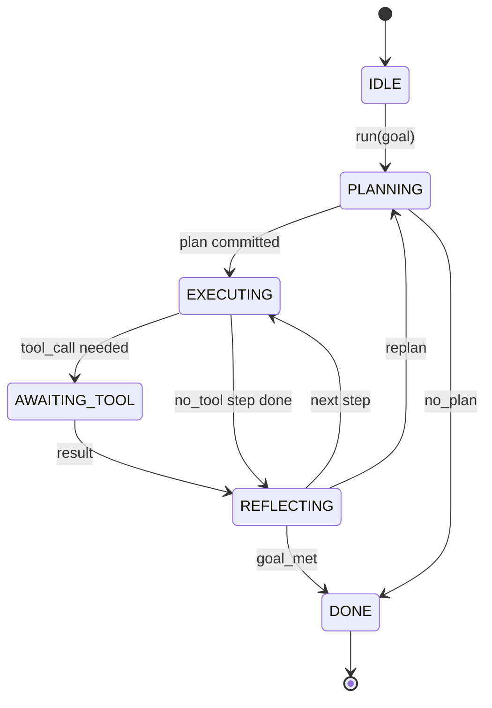

# Agent 執行環境迴圈合約（Agent Harness Loop Contract）

> 執行環境（harness）就是 Agent 本身。模型僅僅是協同處理器。本課將該核心控制迴圈合約徹底固化，使你能夠將任意模型插入其中。

**Type:** Build
**Languages:** Python
**Prerequisites:** Phase 13 lessons 01-07, Phase 14 lesson 01
**Time:** ~90 minutes

## Learning Objectives｜學習目標
- 將 Agent 執行環境迴圈明確定義為具備嚴格確定性狀態轉移的有限狀態機。
- 實作 10 個核心生命週期鉤子（Hook Topics），讓維運人員能接入策略、遙測與安全防護欄。
- 定義兩個核心讓出點（Pull Points）：迴圈在此處主動將控制權交還呼叫端，並在收到新輸入後繼續執行。
- 強制落實工作階段（Session）預算約束（對話輪數、工具呼叫次數、實際經過時間），且在超額時不洩漏部分狀態。
- 向下游推播包含 11 種事件型別的強型別事件串流，讓外部 UI 介面與追蹤器無需直接窺探內部變數即可精準訂閱。

```figure
cf-loop-contract
```

## 架構認知

一個能在完全無人值守狀態下連續自主運作 40 輪的程式開發 agent，絕非簡單的聊天對話迴圈。它本質上是一個有限狀態機，其節點可被維運人員精確攔截，其轉移邊可被外部系統嚴格審計。一旦你將這份軟體合約白紙黑字固化下來，替換後台模型、擴充工具集或變更安全策略將不再是一場傷筋動骨的系統重構，而僅僅是一次優雅的註冊呼叫（Registration Call）。

本課將親手建構該合約。我們定義了 6 種核心狀態、10 個生命週期鉤子主題、2 個主動讓出點、11 種強型別事件，以及一套完整的預算約束信封。執行環境內部的其餘所有元件（工具註冊中心、JSON-RPC 傳輸層、調度分發器、規劃器）皆完全插拔相容於該形態。

## 核心狀態機

該迴圈包含 6 種狀態。其中 5 種為活躍狀態，1 種為終止狀態。



`IDLE` 是唯一合法的系統入口狀態。`DONE` 是唯一合法的終止退出狀態。`AWAITING_TOOL` 是唯一會主動讓出控制權的 Pull Point 狀態。其餘所有狀態轉移皆在內部封閉完成。

該狀態機具備嚴格的確定性。給定相同的事件記錄，執行環境會進入相同狀態。正是這項特性，讓你在除錯時能不必再次呼叫模型，就精準重放故障工作階段。

## 生命週期鉤子主題

鉤子（Hooks）是維運人員介入迴圈生命週期的核心接縫。執行環境對外發布 10 個核心主題。每個主題支援掛載任意數量的訂閱處理常式。訂閱者嚴格依照註冊順序依序觸發。訂閱者可以動態修改資料負載、主動拋出異常以中斷當前輪次，或回傳特定標記直接跳過下一步。

```text
before_plan         after_plan
before_tool_call    after_tool_call
before_step         after_step
on_error
on_pause
on_budget_exceeded
on_complete
```

該結構高度對齊了 Claude Code、Cursor 與 OpenCode 在 2025 年中葉共同收斂出的標準形態。其命名完全基於功能本質，不具備任何廠商專屬色彩。阻斷 `rm -rf` 的資安護欄掛載於 `before_tool_call`；發送 OpenTelemetry 分散式 Span 的遙測擴充功能掛載於 `after_step`；在工作階段暫停時負責繼續執行的 hook 則掛載於 `on_pause`。

## 主動控制權讓出點

迴圈在兩種情況下會主動讓出執行緒控制權。第一種是在 `AWAITING_TOOL` 狀態下，當缺乏外部工具執行結果而無法推進時；第二個讓出點是在觸發 `on_pause` 時，若整體預算耗盡或某個內部鉤子明確請求人工審查。

讓出點（Pull Point）絕非程式崩潰拋出異常。它是一次優雅的 return 回傳。外部呼叫端檢查執行環境的狀態物件、取得執行環境要求的內容，隨後呼叫 `resume(payload)`。執行環境隨即從先前暫停的精確位置無縫繼續執行。這與 Python 中的生成器（Generator）機制完全同構。跨越讓出點的底層通訊傳輸方式完全由你決定：在終端機 TUI 中是用戶鍵盤按鍵；在 MCP 協定中是 `tools/call` 請求；在非同步佇列中則是一次工作拉取（Job Poll）。

## 強型別事件串流

在合約規範的特定生命週期節點上，迴圈會將即時事件追加至強型別串流中。該串流採用嚴格的 Append-Only 追加模式，外部訂閱者可以從任意歷史 Offset 偏移量開始重放。系統實作了 11 種標準事件型別：

- `session.start` — 當 `run(goal)` 被觸發時發布一次
- `plan.draft` — 當規劃器生成初步計畫草案時發布
- `plan.commit` — 當計畫草案被正式確認為有效計畫時發布
- `step.start` — 每個執行步驟開始時發布
- `step.end` — 每個步驟執行完畢後發布
- `tool.call` — 當需要工具輔助的步驟向呼叫端讓出控制權時發布
- `tool.result` — 當外部工具結果隨 resume 注入時發布
- `tool.error` — 當 resume 收到錯誤或鉤子中止呼叫時發布
- `budget.warn` — 當達到預算限制時發布
- `session.pause` — 當迴圈因預算耗盡或人工審核讓出控制權時發布
- `session.complete` — 當迴圈正式抵達 `DONE` 終止狀態時發布一次

這些事件絕非單純複製鉤子的資料負載。鉤子具備命令式特徵（可攔截、可修改、可阻斷）；而事件則具備純粹的觀察式特徵（只讀記錄、即時發送）。架構上應將兩者視為正交互補的體系。

## 預算信封管理

單一工作階段綁定三項硬性配額上限：總對話輪數上限、工具呼叫累計次數上限、實際經過秒數上限。每一輪讓輪數計數器加 1；每一次工具呼叫讓呼叫計數器加 1；在每一次狀態機轉移時皆檢查實際經過時間。一旦任意一項指標達到限制，迴圈立即觸發 `on_budget_exceeded` 鉤子，發布 `budget.warn` 事件，並在下一個讓出點安全過渡至 `IDLE` 狀態，並附帶預算超額的具體原因。

預算機制絕非粗暴的直接斷電開關（Kill Switch）。它本質上是一次優雅的讓出。外部呼叫者可以自主裁決：究竟是追加預算配額並呼叫 resume 繼續執行，還是徹底關閉當前工作階段。

## 本課邊界

本課不負責發起真實的模型 API 呼叫。不負責註冊真實的實體系統工具。不負責實作底層網路傳輸協定。這些能力將在隨後的四節課程中逐一建置。本課的唯一任務是將核心合約徹底定型，確保後續的四個模組能在完全不修改底層迴圈的前提下無縫插入。

在 `main.py` 中提供的確定性規劃器僅僅是一個教學替代樁（Mock）。它固定回傳一個由三個步驟組成的硬編碼計畫，其中兩個步驟需要工具呼叫。本課的唯一核心在於掌握控制迴圈的合約本質，而非計畫內容本身。

## 程式碼導讀

`HarnessLoop` 是最核心的主類別。它負責持有狀態、調度鉤子、發布事件。`Budget` 負責維護三維配額。`Event` 是串流中標準的強型別資料信封。`HookRegistry` 是分發查表。`_transition` 是整個系統中**唯一被允許修改狀態變數的函式**，這確保了狀態機的所有不變性約束皆集中收斂在單一位置。

自頂向下精讀 `main.py`。隨後深入精讀 `code/tests/test_loop.py` 單元測試集。測試用例嚴密鎖定了每一個狀態轉移邊與所有鉤子的精準觸發順序。

## 工程深化

在正式環境中建構 Agent 執行環境最艱難的挑戰從來不是狀態機圖譜本身。而是如何讓合約具備不可動搖的剛性約束。該合約必須能承受規劃器熱重載、工具回傳格式錯誤的 JSON，以及長達 40 輪的工作階段進行到三分之二時，某個鉤子在 `before_tool_call` 中拋出例外的情況。本課提供的單元測試完整模擬了這些極端邊界故障。親手執行測試、嘗試破壞它們、並編寫更多極限用例。

下一節課我們將為其掛載工具註冊中心。隨後引入 JSON-RPC 傳輸協定。隨後實作任務分發器。到了第二十四課，本檔案中所編寫的核心迴圈將會在落實真實預算的情況下，對真實工具執行真實計畫。
