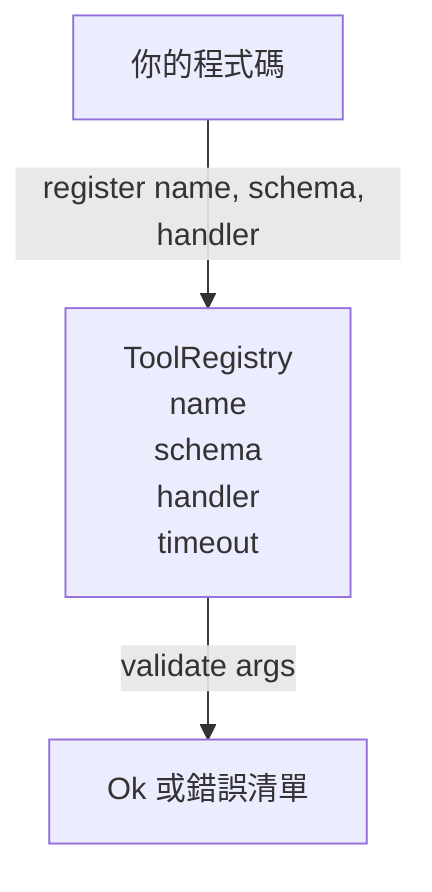

# 具備結構描述驗證的工具註冊中心（Tool Registry with Schema Validation）

> Agent 無法驗證的工具，Agent 就無法呼叫。在動手編寫具體工具執行邏輯之前，優先建構工具註冊中心與結構描述驗證器。

**Type:** Build
**Languages:** Python
**Prerequisites:** Phase 13 lessons 01-07, Phase 14 lesson 01
**Time:** ~90 minutes

## Learning Objectives｜學習目標
- 維護一個「工具名稱 → 結構描述 → 處理常式（Handler）」的強型別註冊中心，供分發器查詢一次後即可依據。
- 實作 JSON 結構描述 2020-12 的核心精簡子集，覆蓋 90% 真實工具呼叫所涉及的關鍵字。
- 回傳精確的、基於 JSON Pointer 語法格式的錯誤路徑，讓 LLM 能在一輪來回對話中迅速自我糾正。
- 預設堅決拒絕重複註冊（除非顯式傳入 override 覆蓋標誌），因為靜默覆蓋往往是正式環境工具目錄發生配置漂移的根源。
- 保持驗證器為純函式（無 I/O、無時間依賴、無全域狀態），使其隨時可在歷史重放記錄上精準復現。

```figure
cf-registry-validate
```

## 為何註冊中心先於工具

到了 2026 年，一個生產級程式開發 agent 內部註冊的工具數量，早已遠遠超出 LLM 單次上下文視窗所能容納的極限。一個中等複雜度的執行環境往往會註冊 200 個工具，並在每一輪對話中僅動態暴露出 10 至 40 個工具。註冊中心是回答以下三個問題的唯一權威真值來源：「有哪些工具？」、「它們的輸入參數具體要求何種格式？」以及「我具體該呼叫哪一個函式處理常式？」。一旦這三個問題被白紙黑字固定下來，執行環境的其餘模組便再也無需靠猜測維生。

我們在此刻堅決防範的典型架構失誤是：發布了沒有結構描述約束的處理常式，或是發布了寫著結構描述卻從不進行實質驗證的工具。這兩種通病極為普遍，且都會將下一層（第二十三課的分發器）徹底拖入猜謎遊戲中，最終唯一的崩潰表徵就是處理常式內部噴出難以理解的呼叫堆疊。

## 工具記錄的標準規格

```text
ToolRecord
  name        : str          (unique, lowercase alphanumeric and underscore segments separated by dots, e.g., snake_case.segment.case)
  description : str          (one line, shown to the model)
  schema      : dict         (JSON Schema 2020-12 subset)
  handler     : Callable     (async or sync, returns Any)
  idempotent  : bool         (dispatcher uses this for retry decisions)
  timeout_ms  : int          (override per-tool dispatcher default)
```

結構描述是驗證器唯一觸及的實體欄位。處理常式（Handler）對驗證器而言完全不透明。我們刻意將兩者解耦劃清界限。結構描述是靜態資料；Handler 是可執行程式碼。將兩者混為一談極易誘使工程師在 Handler 內部編寫參數驗證邏輯，而這正是我們極力撲滅的架構反模式。

## JSON 結構描述 2020-12 核心子集

完整的 2020-12 規範是一篇論文。我們需要 8 個關鍵字：

```text
type           string / number / integer / boolean / object / array / null
properties     map of property name -> schema
required       list of property names
enum           list of allowed primitive values
minLength      integer, applies to strings
maxLength      integer, applies to strings
pattern        ECMA-262-compatible regex, applies to strings
items          schema applied to every array element
```

這些就足以涵蓋工具 API 實際需要的內容。我們刻意未引入的複雜關鍵字（如 oneOf、anyOf、allOf、$ref、條件式判斷）雖然在正式環境複雜結構描述中十分合法，但會讓驗證器直接退化為一個需要處理循環依賴的龐大樹狀遍歷器。我們當前的目標是建置工具註冊中心，而非發明一個全功能 JSON 結構描述引擎。

## 基於 JSON Pointer 的錯誤路徑

當參數驗證失敗時，驗證器會回傳一個結構化的錯誤清單。每一個錯誤皆攜帶一條指向輸入資料深處的 JSON Pointer 路徑。Pointer 是由斜線（/）引導的屬性名稱與陣列索引序列：

```text
{"a": {"b": [1, 2, "x"]}}
                    ^
                    /a/b/2
```

相較於句子，LLM 更容易讀懂錯誤路徑。如果結構描述嚴格要求 `args.user.email` 必須為字串，而 LLM 卻傳入了一個整數，報錯資訊將精準標記為 `/user/email` 並附帶 `expected_type: string`。LLM 能在下一輪工具呼叫中修正該錯誤，而無需消耗額外的自然語言來回斡旋。

## 註冊與強制覆蓋

`register(name, schema, handler, **opts)` 預設嚴厲拒絕重複註冊同名工具。呼叫端必須顯式傳入 `override=True` 方可覆蓋既有條目。這是一項至關重要的維運紀律。程式碼庫中兩段互不相干的邏輯靜默註冊了完全同名的工具，往往是正式環境中排查耗時長達一週的幽靈 Bug。

註冊中心對外暴露三個標準讀取方法。`get(name)` 回傳具體記錄或拋出未找到異常；`validate(name, args)` 回傳 `Ok` 成功物件或錯誤清單；`names()` 依照初始註冊順序回傳所有工具名稱清單。

## 驗證器的能力邊界

它本質上是對結構描述語法樹的單次純遞迴遍歷。它是絕對純粹的純函式：絕不呼叫底層 Handler、絕不進行型別強制轉換（字串 `"42"` 絕對無法矇混通過 number 型別驗證）、絕不進行靜默截斷。

但它**絕對不是系統的安全防護邊界**。一個心懷惡意的 Handler 仍可能在驗證通過後有不當行為。第二十三課的分發器將為其加入逾時處理與沙盒層。註冊中心專注於契約形狀。

## 架構流程



## 程式碼導讀

`code/main.py` 定義了 `ToolRegistry`、`ToolRecord`、`ValidationError` 以及八大專屬型別驗證函式。驗證器依據 `schema["type"]` 進行分發（或將包含 `enum` 的結構描述視為未標註型別的枚舉驗證）。每個型別驗證器回傳空清單（代表驗證通過）或包含具體錯誤的 `ValidationError` 清單。頂層遍歷器在向下深入物件層級時，自動拼接錯誤並在路徑前綴追加指針節點。

`code/tests/test_registry.py` 全面覆蓋了工具註冊、覆蓋防禦、驗證成功、帶指針的驗證失敗，以及該子集中所有八大關鍵字的極限單元測試。

## 工程深化

在掌握本課核心後，未來當你的工具數量突破 50 個時，最值得優先擴充的兩大微型能力是：基於本地 definitions 區塊的 `$ref` 內部引用解析，以及用於實施嚴格封閉檢查的 `additionalProperties: false`。這兩項擴充皆足夠精簡，我們在本課將其刻意留白，是為了讓整份檔案能一次讀完。

下一課（第二十二課）我們將打造基於 stdio 的 JSON-RPC 傳輸協定，將該註冊中心標準化暴露給 LLM 用戶端。隨後在第二十三課，我們將把傳輸層與註冊中心全量封裝進具備逾時與重試功能的分發器之中。
