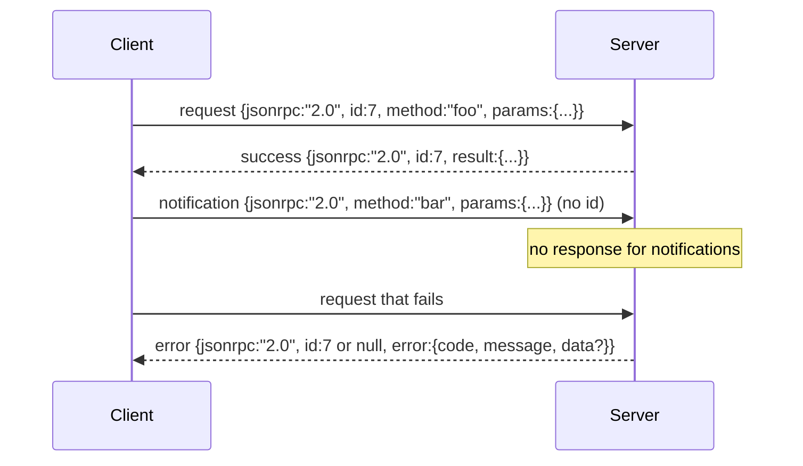

# 基於換行分隔標準輸入輸出的 JSON-RPC 2.0 傳輸協定（JSON-RPC 2.0 Over Newline-Delimited Stdio）

> LLM 用戶端與工具伺服器之間最核心的傳輸基座，就是基於標準輸入輸出（stdio）的 JSON-RPC 協定。親手從零實作一次，你就能深刻體會到每一層成幀封裝（Framing Layer）背後所換取的工程價值。

**Type:** Build
**Languages:** Python
**Prerequisites:** Phase 13 lessons 01-07, Phase 14 lesson 01
**Time:** ~90 minutes

## Learning Objectives｜學習目標
- 熟練實作基於標準輸入輸出（stdin / stdout）、以換行符號分隔 JSON 的 JSON-RPC 2.0 傳輸協定。
- 嚴格映射五大官方標準錯誤碼（-32700、-32600、-32601、-32602、-32603），並以精準的語意向外暴露。
- 清晰辨析常規請求（Request）、回傳回應（Response）、單向通知（Notification）與批次請求（Batch），絕不捏造私有的信封 Key。
- 具備單行解析錯誤的容錯韌性，在某行 JSON 損壞時絕不污染後續整條傳輸串流。
- 使用 io.BytesIO 建構自我終止的自閉環 Demo，使本課在完全無需啟動子行程的前提下可完整測試。

```figure
cf-jsonrpc-frames
```

## 為何 JSON-RPC 始終是通用語

到了 2026 年，一個程式開發 agent 在單一工作階段內往往需要同時與十餘個外部工具伺服器通訊。每個伺服器可能是一個本地獨立行程，或是一個遠端網路端點。線上傳輸格式自 2013 年以來相同。JSON-RPC 2.0 是一份僅有兩頁紙長度的極簡規範。它之所以能長盛不衰，是因為其所有替代品（如 gRPC、單呼叫 HTTP、自定義二進位協定）皆強加了某種難以調和的架構妥協：它們要麼綁死串流、要麼綁死批次、要麼強依賴特定的底層傳輸通道。而 JSON-RPC 則在 stdio 管線、本地 Socket、WebSocket 與 HTTP 之間維持對稱——只要雙方恪守規範，一個用戶端便能輕鬆驅動一個其此前從未謀面的未知伺服器。

本課將親手打造其 stdio 變體：換行符號分隔的 JSON（Newline-Delimited JSON）。每個請求佔據獨立的一行，每個回應佔據獨立的一行。整個傳輸通道的邊界清晰收斂於 `\n`。

## 網路報文信封形態

系統共存在四種標準信封形態。其中兩種由用戶端發送，另外兩種由伺服器端回傳。



單向通知（Notification）**絕對不包含 `id` 欄位**。伺服器**絕對嚴禁對 Notification 傳回任何回應**。如果伺服器盲目對通知傳回回應，用戶端將根本無法在程式碼呼叫點中將其配對消費。正是這條鐵律，讓底層成幀的數學邏輯維持了極致簡約。

批次請求（Batch）是一個由多個請求或通知組成的 JSON 陣列。伺服器必須以一個回應陣列進行回覆，順序可任意排列，且陣列中僅為「非通知」請求生成對應的回應項。若批次中的所有項目皆為單向通知，伺服器必須保持沉默、完全不發送任何資料。

## 五大標準錯誤碼

```text
-32700  Parse error      JSON could not be parsed
-32600  Invalid Request  Envelope shape is wrong
-32601  Method not found
-32602  Invalid params
-32603  Internal error
```

在 -32000 到 -32099 之間的錯誤碼保留給伺服器自定義擴充。其餘區間保留給上層業務應用定義。本課嚴格聚焦於這五大標準錯誤碼。如果底層業務 Handler 意外拋出未捕獲異常，傳輸層將自動為其套上 -32603 外殼，並在 `data.exception` 欄位中精準附帶異常類別的名稱。

解析錯誤（Parse Error）有一條特殊規定：回應中的 `id` 必須強制填為 `null`，因為既然 JSON 連解析都未通過，底層自然根本無從提取出合法的請求 ID。

## 換行成幀與 BytesIO 演示

傳輸層每次精確讀取一行。一行代表以 `\n` 結尾的完整位元組序列。若某一行文字無法被成功解析為合法 JSON，傳輸層立即向外寫回一個 `id: null` 的 -32700 錯誤回應，隨後毫無波瀾地繼續監聽下一行。當前傳輸串流絕對不會被單一壞行所毒化。下一行將作為全新的請求重新被接收解析。

在教學演示中，我們使用一對 `io.BytesIO` 物件模擬標準輸入（stdin）與標準輸出（stdout）。伺服器持續讀取請求直至 EOF 結束符號、為每一個請求寫回對應回應，隨後正常返回。用戶端自記憶體緩衝區中將回應完整讀回。無需在作業系統中啟動子行程，也不會設定逾時。Python 的 `io` 介面提供相同的 `.readline()` 與 `.write()` 合約，因此該模組在真實子行程管線中的行為與此相同。

## 方法分發機制

傳輸層自身完全不關心系統中具體存在哪些業務方法。它直接將解析後的任務轉發給一個由外層執行環境提供的呼叫回呼常式：`handler(method, params)`。處理常式回傳具體計算結果，或拋出異常。系統定義了三類專屬異常類別，以精準映射至對應的錯誤碼：

```text
MethodNotFound -> -32601
InvalidParams  -> -32602
Anything else  -> -32603 with exception name in data
```

傳輸層永遠不需要直接看見工具註冊中心。註冊中心始終隱藏在 Handler 後方。這正是我們極力推崇的架構分層美學：傳輸層專注於講好 JSON-RPC 協定；註冊中心專注於校驗工具的輸入形狀；而第二十三課的分發器則負責將兩者無縫編排串聯在一起。

## 錯誤情境下的串流韌性

```text
client writes              server reads             server writes
---------------            -----------              -------------
{...valid request...}      parses ok                {...response, id matches...}
{...broken json...         parse fails              {id:null, error: -32700}
{...valid request...}      parses ok                {...response, id matches...}
{...missing method...}     invalid envelope         {id:X, error: -32600}
```

一行損壞的畸形 JSON 絕對不會導致伺服器主迴圈崩潰。一個遺漏了 `method` 欄位的非法請求絕對不會導致迴圈退出。底層 Handler 拋出的業務異常同樣不會打斷伺服器。傳輸層將頑強地持續讀取，直至收到明確的 EOF 信號。

## 單向通知與非對稱資料流

通知採用 Fire-and-Forget 即發即棄機制。在 Agent 執行環境中，通知常用於回報進度事件、傳遞取消訊號，以及傳送記錄行。正是藉助單向通知機制，一個需要長時間運作的耗時工具才能在無需反覆往返等待的前提下，平滑向前端持續串流最新執行狀態。

本課實作了一個專屬的出向通知輔助方法：`write_notification`。伺服器能在處理長任務請求的在途（In-Flight）過程中，隨時呼叫它向用戶端推播進度。演示展示了這一經典模式：當收到一個請求後，Handler 在計算中途連續發出兩條進度通知，最後才正式寫回最終的業務回應。

## 程式碼導讀

`code/main.py` 定義了 `StdioTransport` 類別、解析輔助函式（`parse_request`）、三個寫入輔助方法（`write_response`、`write_error`、`write_notification`），以及核心分發調度迴圈 `serve`。所有官方標準錯誤碼常數皆定義在模組全域作用域中。

`code/tests/test_transport.py` 完整覆蓋了五大錯誤碼的精確斷言、單向通知（絕對不寫回應）、批次請求（陣列傳入、陣列回傳、自動跳過通知項）、損壞 JSON 容錯（回傳 parse 錯誤後繼續正常處理），以及 Handler 在處理中途穿插發送進度通知的非對稱資料流邊界測試。

## 工程深化

對於後續的學習而言，當前實作的這套傳輸層已完全足夠。而在工業級正式環境中，成熟的傳輸層通常會進一步補齊三項進階能力：能在多次轉送後保留的關聯 ID 欄位（目前的 `id` 已具備此用途，但在微服務 Mesh 拓撲中還需要外層全域 Trace ID）、一個專屬的任務取消通道（例如攜帶在途任務 ID 的 `$/cancelRequest` 特殊通知），以及內容協商握手（Content-Type Negotiation），讓同一個實體 Socket 可支援 JSON-RPC 與 Streamable HTTP。但必須明確：這些進階擴充絕不會動搖底層的報文成幀本質，它們僅僅是中繼資料層面的擴展。
