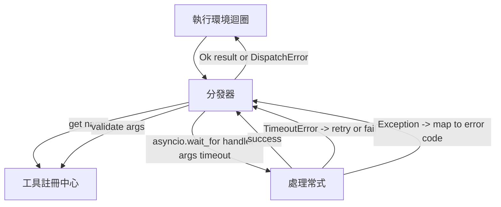
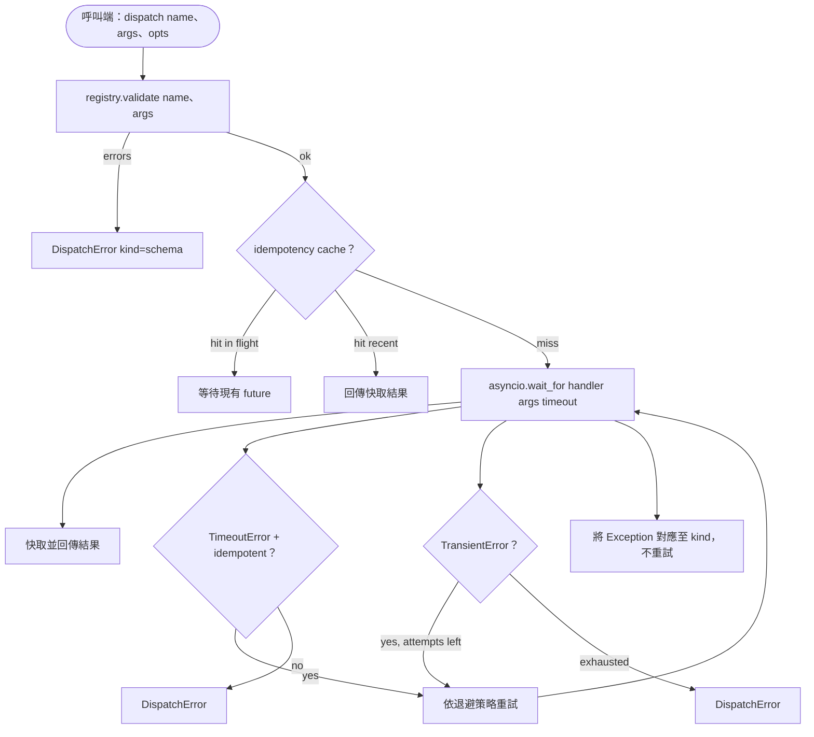

# 函式呼叫分發器（Function Call Dispatcher）

> 分發器是整個執行環境為結構描述所許下的每一項承諾進行履約兌現的唯一接縫。逾時控制、失敗重試、冪等去重、錯誤語意映射——全部收斂於此單一表面。

**Type:** Build
**Languages:** Python
**Prerequisites:** Phase 13 lessons 01-07, Phase 14 lesson 01
**Time:** ~90 minutes

## Learning Objectives｜學習目標
- 為工具處理常式封裝呼叫級別的逾時控制，在逾時時回傳強型別錯誤，而絕不讓控制迴圈陷入無休止的掛起假死。
- 實作帶有隨機抖動（Jitter）的指數退避重試演算法，並嚴格限制最大嘗試次數。
- 基於冪等鍵（Idempotency Key）消除重試競態，確保一個與慢速原始呼叫發生競爭的重試請求絕不會在後端被重複執行兩次。
- 將底層處理常式拋出的業務異常與傳輸故障，精準映射為上層執行環境控制迴圈能完全理解的統一錯誤信封。
- 透過並行信號量（Semaphore）嚴格限制平行分發的併發上限，避免瞬間 Fan-out 展開的 40 個並行工具呼叫打爆事件迴圈與底層連線池。

```figure
cf-dispatch-retry
```

## 分發器的架構座標

分發器精確坐落於執行環境主迴圈（第二十課）與工具註冊中心（第二十一課）之間。傳輸層（第二十二課）向主迴圈餵入請求。主迴圈將具體的工具呼叫任務轉發給分發器。分發器查詢註冊中心、呼叫處理常式，並最終回傳計算結果或一個符合 JSON-RPC 規範的錯誤信封。



分發器是整個體系中**唯一知曉計時器、重試策略與冪等性邏輯的架構層**。主迴圈對此一無所知。註冊中心對此一無所知。業務 Handler 對此同樣一無所知。這種高度的職責隔離，正是工業級架構的核心精髓。

## 逾時控制

每個工具在註冊中心皆包含預設的 `timeout_ms` 逾時時長。當執行環境主迴圈在呼叫時傳入特定時長參數時，分發器支援進行單次覆蓋。底層實作採用 `asyncio.wait_for`。一旦觸發逾時，正在執行的 handler task 會被取消，分發器立即回傳 `DispatchError(kind="timeout")`。

必須注意：對於非冪等（Non-idempotent）工具，逾時預設**絕不是可重試的錯誤**。一個超時的 `db.write` 資料庫寫入操作，在底層究竟是成功寫入資料還是中途失敗是完全未知的。盲目發起重試極可能導致資料被重複插入兩次。分發器嚴格遵從註冊記錄中的 `idempotent` 布林標記：冪等工具方可重試，非冪等工具嚴禁重試。

## 帶指數退避的重試策略

重試策略嚴格限制最多嘗試 3 次。退避時長採用帶有隨機擾動（Jitter）的指數增長模式：

```text
attempt 1  -> delay 0
attempt 2  -> delay 0.1s * (1 + random[0..0.5])
attempt 3  -> delay 0.4s * (1 + random[0..0.5])
```

系統規定：**僅有 `timeout` 與 `transient`（暫態故障）允許觸發重試**。`schema` 參數錯誤、`not_found` 工具未找到或 `internal` 系統內部錯誤絕對禁止重試。結構描述格式錯誤具備嚴格的確定性，反覆重試不會改變輸出結果，只會耗用工具呼叫預算。

重試迴圈必須時時刻刻敬畏主迴圈傳入的預算信封。若呼叫端的剩餘工具配額已歸零，分發器在第一次嘗試時即刻快速失敗（Fail-fast），直接回傳 `kind="budget_exceeded"`。

## 基於冪等鍵的並發去重

在正式環境中，當原始請求仍在處理中時、後續重試請求卻已提前發出，這是一類極不易察覺且破壞力巨大的經典並發 Bug。假設第一個請求在 4.9 秒時仍在等待後端回應（剛好卡在 5 秒逾時線邊緣）。重試請求在第 5 秒被觸發發出。此時，兩個完全相同的請求正同時在後端伺服器上發生競爭。若該工具是 `payments.charge` 信用卡扣款，用戶將當場被重複扣費兩次！

分發器支援接收一個可選的 `idempotency_key` 冪等鍵。若當前有一個帶有相同 Key 的請求正在在途（In-Flight）執行，新到達的請求將直接 await 當前在途的 Future，並共享其最終結果。請求完成後，快取會保留該 key 60 秒，以吸收延遲到達的重試。

冪等鍵的生成是呼叫方的責任。執行環境通常由規劃器推導該 Key：`f"{step_id}:{tool_name}:{hash(args)}"`。分發器自身絕不憑空臆造 Key，因為單純依據參數進行雜湊，極易導致兩個在語意上完全不同但在參數上偶然一致的獨立操作被錯誤合併。

## 統一錯誤信封

任何失敗的分發皆會封裝為單一的強型別錯誤信封回傳：

```text
DispatchError
  kind        : "timeout" | "transient" | "schema" | "not_found" | "internal" | "budget_exceeded"
  message     : str
  attempts    : int
  jsonrpc_code: int   (one of -32601, -32602, -32603)
```

執行環境主迴圈依據 `kind` 精確推導下一個目標狀態。`schema` 與 `not_found` 轉發至 `on_error` 並觸發重新規劃（Replan）；`timeout` 與 `transient` 轉發至 `on_error`，並視重試次數決定是否需要重規劃；`budget_exceeded` 則直接觸發 `on_budget_exceeded`。

## 扇出並行併發限制

`gather(*calls)` 會同時在後台喚醒所有協程。當需要處理 40 個並行工具呼叫時，這意味著瞬間建立 40 個底層 Socket 連線或 40 個作業系統子行程管線。多數後端不喜歡單一用戶端同時建立 40 條平行連線。

分發器使用 asyncio.Semaphore 號誌為 `gather` 施加硬性邊界。預設並行併發上限為 8。每一次分發呼叫在啟動前必須先取得號誌，在執行完畢後立即釋放。呼叫端看到的依然是類似 `gather` 的批次回傳輸出，但實際排程受到限制。

## 單次呼叫的完整決策流



## 程式碼導讀

`code/main.py` 定義了 `Dispatcher` 主類別、`DispatchError` 與 `TransientError`。分發器在初始化構造時接收一個註冊中心實例。非同步的 `dispatch(name, args, ...)` 是唯一的對外公開入口。單次嘗試的逾時控制在 `_run_with_retries` 內部使用 `asyncio.wait_for` 實施。`gather_bounded(calls)` 負責受控的並行批次分發。

`code/tests/test_dispatcher.py` 完整覆蓋了逾時控制、暫態重試、結構描述錯誤禁止重試、冪等鍵並發去重（兩個攜帶相同 Key 的並行呼叫被合併為單次 Handler 執行），以及併發號誌限制等關鍵場景。

測試用例全面採用 `asyncio.sleep(0)` 與基於計數器（`Counter`）的確定性樁函式，使得全套測試能在數毫秒內極速跑完，完全不依賴不可控的物理時鐘等待。

## 工程深化

在正式環境中，成熟的分發器通常會進一步補齊兩項關鍵能力。第一，在每一次狀態跳轉處留下結構化記錄（雖然主迴圈的事件串流已為你提供了全域視角，但分發器亦應當向外發布 `dispatch.attempt` 與 `dispatch.retry` 細粒度事件）。第二，斷路器模式（Circuit Breaker）：當某個工具在特定的滑動視窗內連續失敗 N 次時，該工具自動進入冷卻熔斷期，後續的分發請求將立即回傳 `kind="circuit_open"`，而不再盲目呼叫底層 Handler 加劇後端雪崩。這兩項擴充皆能完美疊加在本分發器之上，完全無需更動現有合約架構。

第二十四課我們將把分發器與規劃-執行 Agent 深度縫合，讓你完整見證四大核心模組協同運作的壯麗全景。
