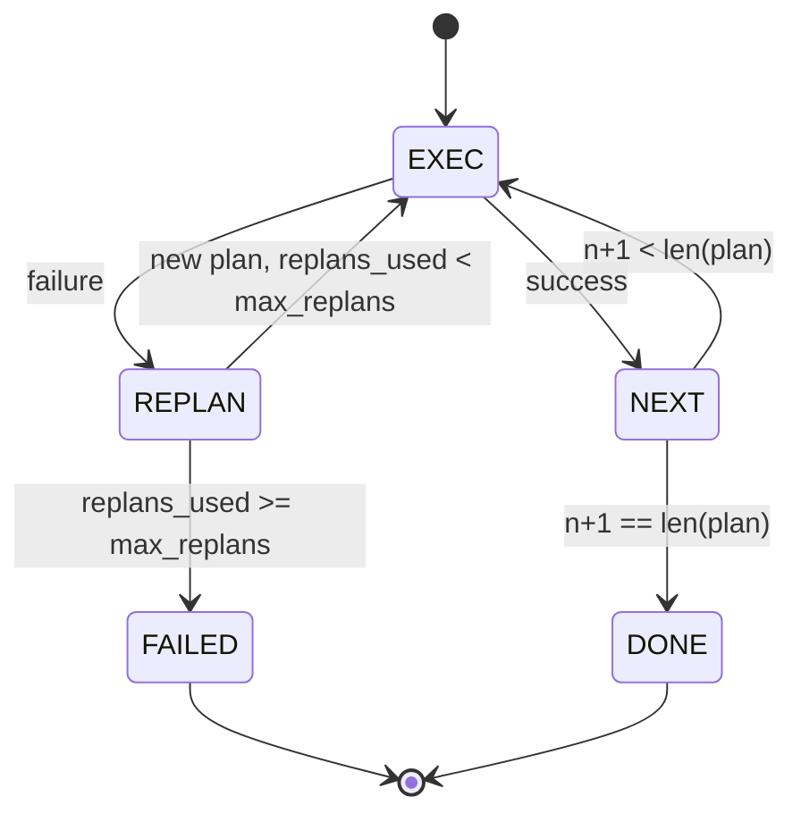

# 規劃-執行控制流（Plan-Execute Control Flow）

> 一個無法在異常報錯中存活下來的計畫，充其量只是一段死板的腳本（Script）。一個具備重新規劃（Replan）能力的腳本，就是 agent。先建構重規劃器。

**Type:** Build
**Languages:** Python
**Prerequisites:** Phase 13 lessons 01-07, Phase 14 lesson 01
**Time:** ~90 minutes

## Learning Objectives｜學習目標
- 將規劃（Plan）表示為由強型別步驟（Steps）組成的有序清單，使執行器能清晰推理當前進度與最終結果。
- 嚴格依照序列執行各步驟，並在遭遇失敗時以受控方式將失敗交接回規劃器。
- 攜帶歷史報錯上下文，從當前遊標（Cursor）位置無縫發起重新規劃，讓新計畫能參考先前的錯誤脈絡。
- 在每一次修訂計畫時發布標準的 plan.diff 變更事件，讓下游追蹤器或前端 UI 能即時視覺化展示計畫因何而變。
- 同時落實兩項硬性預算限制：步驟總執行次數上限與重規劃次數上限。

```figure
cg-plan-replan
```

## 規劃與執行，而非思維鏈

傳統的思維鏈（Chain-of-Thought）Agent 往往是一邊吐出 Token 一邊讓迴圈去盲猜工具呼叫究竟何時結束。而「規劃-執行（Plan-and-Execute）」Agent 則截然不同：它優先產出一份結構化的靜態計畫，隨後由執行器以確定性的方式逐步推動執行。計畫本身是靜態結構化資料，執行環境可檢視這份資料；執行過程則是執行環境將該資料流經分發器的一系列確定性呼叫。

系統包含兩大核心元件：產出計畫的**規劃器（Planner）**，以及推進計畫的**執行器（Executor）**。整個架構最精妙的工程焦點，全在於當執行器撞上異常故障時系統該如何處置。系統提供三種對策：

```text
1. Abort         (return failed, surface the error)
2. Skip          (mark step failed, continue with the rest)
3. Replan        (hand the error to the planner, get a new plan from the cursor)
```

重規劃（Replan）讓腳本成為 agent。

## 步驟的標準結構

```text
Step
  id              : int           (monotonic within a plan revision)
  tool_name       : str
  args            : dict
  expected_outcome: str           (planner's stated success condition)
  result          : Any | None
  error           : str | None
```

`expected_outcome` 是規劃器在定義該步驟時同步給出的一句簡明預期目標。執行器自身並不直接強制斷言該目標。它的核心價值體現在兩處：第一，當執行失敗時，重規劃器能重新閱讀該預期目標以理解「當初原本想達成什麼」；第二，事件串流能對外廣播該目標，供視覺化追蹤器即時呈現「該步驟原本預期完成的事項」。

## 規劃器的函式特徵

```python
def planner(goal: str, history: list[Step], last_error: str | None) -> list[Step]:
    ...
```

規劃器是一個純函式。`goal` 是終端使用者的最終目標。`history` 是已執行步驟的歷史（含結果與錯誤）。在第一次呼叫時 `last_error` 為 None，在後續的所有重規劃呼叫中則傳入最新一次的具體故障報錯。規劃器依據這些線索，回傳從當前遊標開始的下一階段新計畫。

規劃器不瞭解執行器，也不瞭解重試或逾時。它負責產出計畫，僅此而已。

## 執行器狀態機

執行器本質上是一個微型狀態機。每個步驟都會透過分發器執行。執行結果歸結為三種情形：成功、可重規劃的失敗、致命失敗。可重規劃的失敗被重新交接回規劃器；而致命失敗（預算耗盡、重規劃次數突破天花板）則直接標記整體工作階段失敗並退出。



## 計畫修訂的 Diff 變更事件

當某個步驟失敗且規劃器成功交出一份新計畫後，執行器立即向外廣播一個包含三個核心陣列的 `plan.diff` 事件：

```text
removed: list of step ids that were in the old plan and are not in the new
added  : list of step ids in the new plan that were not in the old
revised: list of step ids whose tool_name or args changed
```

外部追蹤器或前端 UI 能據此即時以視覺化方式呈現：對被剔除的步驟打上刪除線，對新增的補救步驟打上高亮框。核心在於：計畫的修訂必須是可見的事件，而不是靜默改寫。

## 兩大硬性預算邊界

`max_steps` 限制了整個工作階段內累計執行的步驟總次數上限（包含重規劃所追加的新步驟）。系統預設值為 12。一個原本由 5 個步驟組成的線性計畫，若經歷兩次重規劃、每次額外追加 3 個步驟，其累計執行次數將攀升至 16 次，直接觸發預算熔斷。執行器將堅決拒絕重規劃並回傳 `FAILED`。

`max_replans` 限制了在初始計畫之外被允許觸發重規劃的最大次數。系統預設值為 5。這是更為關鍵的保護屏障。若缺乏該限制，規劃器連續五次回傳相同的錯誤計畫時，便會持續循環，直到步驟預算耗盡。限制重規劃次數能讓失敗更快發生，也能讓原因更清楚。

## 教學專用確定性規劃器

本課在教學程式碼中不呼叫模型，而是內建一套根據 `last_error` 選擇計畫的確定性規劃器樁：

```text
last_error is None    -> emit a four-step plan
last_error matches X  -> emit a three-step plan that routes around X
last_error matches Y  -> emit a two-step plan that gives up gracefully
otherwise             -> return [] (signals nothing to replan)
```

這套規則已完全足以覆蓋並嚴格測試執行器在所有狀態轉移路徑上的行為表現：直接成功、單次重規劃成功、二次重規劃成功、重規劃次數耗盡熔斷，以及步驟總配額耗盡熔斷。

## 最終會話結果格式

```text
SessionResult
  status      : "completed" | "failed"
  reason      : str     ("goal_met" | "step_budget" | "replan_budget" | "no_plan")
  history     : list[Step]
  revisions   : list[PlanDiff]
  events      : list[Event]
```

第二十課的執行環境主迴圈可以直接原生讀取該結果物件。第二十三課的分發器負責驅動每個步驟的具體執行。第二十一課的註冊中心負責嚴密校驗每個步驟的參數形狀。而第二十二課的傳輸層則能將這整套流暢的控制流透過 JSON-RPC 完整暴露給 LLM 用戶端。

## 程式碼導讀

`code/main.py` 定義了 `PlanExecuteAgent`、`Step`、`PlanDiff`、`SessionResult` 以及確定性規劃器實作。執行器以單一的 `run(goal)` 方法作為對外入口，回傳 `SessionResult`。計畫 Diff 透過比對步驟 ID 與 `(tool_name, args)` 元組自動精確計算。

`code/tests/test_agent.py` 完整覆蓋了線性直接成功、中途失敗重規劃自癒、重規劃預算耗盡（`failed:replan_budget`）、步驟總配額耗盡，以及 plan.diff 事件精確格式的單元測試。

## 工程深化

在未來將該模組對接真實模型時，有兩項進階能力極具擴充價值。第一，局部計畫快取（Partial-Plan Caching）：當一個包含 6 個步驟的計畫在順利跑完前 3 個步驟後、在第 4 步發生報錯時，我們顯然不希望重新規劃時把前 3 個已經成功的步驟推倒重跑。執行器內部早已維護了完整的 History 歷史；規劃器僅需學會讀取歷史並僅對後續步驟重新編排即可。第二，平行路徑執行（Parallel Branches）：目前的執行器嚴格依序執行。若規劃器能在特定節點輸出具備相互獨立性的平行路徑（例如使用 `gather_step` 替代單一的 `next_step`），執行器便能透過分發器同時並行發射多個工具呼叫。

這兩項擴充都會增加工程複雜度。但在線性執行器的合約固定後，後續擴充會更容易加入。這正是本課所奠定的基礎。
