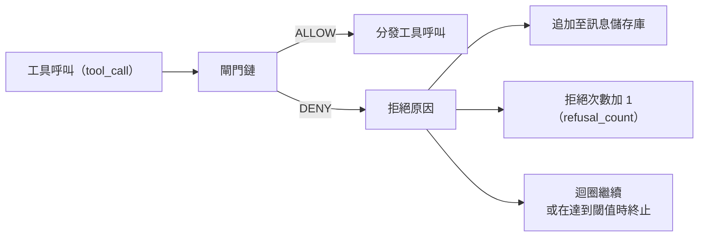
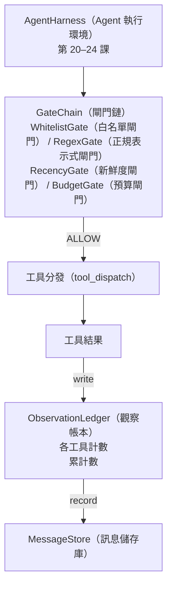

# 專案實戰第 25 課：驗證閘門與觀察預算（Capstone Lesson 25: Verification Gates and the Observation Budget）

> 一個缺乏驗證層的 Agent 執行環境，只不過是披著大衣的虛無願望。本課將親手打造確定性驗證閘門鏈（Gate Chain），精確裁決某一工具呼叫是否被允許執行、Agent 被允許看見多少輸出，以及當 Agent 閱讀了過多內容時控制迴圈何時必須強制終止。這條鏈由一系列精簡的具名閘門構成，並搭配追蹤模型已看到之每個 Token 的觀察帳本（Observation Ledger）。

**Type:** Build
**Languages:** Python (stdlib)
**Prerequisites:** Phase 19 · 20-24 (Track A1: agent loop, tool registry, message store, prompt builder, model router), Phase 14 · 33 (instructions as constraints), Phase 14 · 36 (scope contracts), Phase 14 · 38 (verification gates)
**Time:** ~90 minutes

## Learning Objectives｜學習目標

- 建構具備確定性 `evaluate(call)` 方法的 `VerificationGate` 通訊協定。
- 將預算、新鮮度、白名單與正規表示式閘門組合為具備短路求值（Short-Circuit）特性的閘門鏈。
- 透過以工具與對話輪次為索引鍵的 `ObservationLedger`，精確記帳每一筆觀察輸出。
- 當累計觀察消耗突破預算天花板時，堅決拒絕後續的工具呼叫。
- 產出結構化的 `GateDecision` 決策記錄，供下游可觀測性系統攝取。

## The Problem｜問題

當一個 Agent 執行環境允許 LLM 自由呼叫工具時，在真實使用的第一個小時內，常見三類錯誤。

第一類是**無邊界的觀察爆炸（Unbounded Observation）**。在一個包含 20 萬行程式碼的儲存庫中執行一次粗暴的 grep，會在下一輪對話中瞬間向上下文傾倒高達 50 萬 Token 的終端文字。LLM 在每千位元組中僅能勉強找到一個比對結果，而其餘寶貴的上下文視窗則被垃圾輸出徹底淹沒。這不僅造成昂貴的 Token 帳單浪費，且讓 Agent 在核心任務上的推理表現急劇惡化。

第二類是**陳舊資訊干擾（Stale Recency）**。一個長程複雜任務累積了多達 50 次工具呼叫。LLM 竟然把第 3 輪讀取的初版檔案內容當作即時最新的真實狀態反覆引用。第 47 輪所進行的精確修改永遠無法被 LLM 察覺，因為 Prompt 建構器盲目地將最早期的過期觀察優先序列化裝填進了上下文。

第三類是**權限失控蔓延（Privilege Creep）**。一個原本單純的資料研究任務最初僅呼叫 `web_search`，隨後 LLM 自行胡亂捏造了一個工具名稱，而執行環境因為預設寬容放行，竟莫名其妙地在底層啟動了 `shell`。等到維運人員審閱追蹤資料時，才驚恐地發現 /tmp 目錄下已經躺著一個垃圾檔案，且一條未經授權的 curl 請求已經打向了內部私有 API。

驗證閘門（Verification Gate）是執行環境中負責說「不」的元件。它不是 LLM，也不是裁判。它是以 `(call, history, ledger)` 為輸入的確定性函式，會回傳含有原因的 ALLOW 或 DENY。原因會被記錄，模型會收到通知。迴圈會繼續或中止。

## The Concept｜核心概念



所謂閘門，是指任何實作了 `evaluate(call, ctx) -> GateDecision` 介面的物件。閘門鏈（Gate Chain）是一個有序列表。鏈條在遇到第一個拒絕（DENY）時立即短路終止求值。求值順序至關重要：運算開銷最低的靜態結構閘門必須排在運算代價高昂的 Token 記帳閘門之前。

本課親手實作四大核心閘門：

- `WhitelistGate`（白名單閘門）：被允許呼叫的工具名稱集合由白名單顯式定義。任何在此集合之外的工具直接拒絕。這是運算開銷最低的閘門，排在鏈條首位。
- `RegexGate`（正規表示式閘門）：工具傳入的參數必須經過正規表示式比對。專門用於攔截包含 `rm -rf` 的危險 Shell 指令，或打向內部私有 IP 的 HTTP 呼叫。純粹基於請求負載進行靜態判斷。
- `RecencyGate`（新鮮度閘門）：LLM 嚴格僅能看見最近 N 輪以內的即時觀察輸出。更古老的歷史觀察會自動隱藏。該閘門會主動拒絕那些企圖將已過期失效的舊觀察視窗繼續向外延伸的工具呼叫。
- `BudgetGate`（預算閘門）：LLM 在單一工作階段內累計讀取的總 Token 數具備硬性天花板。一旦帳本顯示已抵達該紅線，後續的所有工具呼叫一律堅決予以拒絕。

觀察帳本（Observation Ledger）承擔著全鏈路記帳職責。每一次成功的工具呼叫皆會向帳本寫入一行標準記錄：工具名稱、對話輪次、本次產生的 Token 數、累計 Token 數。帳本精確回答兩個核心問題：LLM 目前累計總共閱讀了多少資料？以及 LLM 針對工具 X 累計閱讀了多少資料？全域預算閘門讀取第一個問題的答案；而你在後續練習中將編寫的「單工具獨立預算閘門」則讀取第二個問題。

```figure
cg-gate-chain
```

## 系統架構



執行環境主迴圈主動向閘門鏈發起詢問。閘門鏈要麼點頭放行，要麼出具拒絕。若放行，工具會正常呼叫，帳本遞增記帳，執行結果被追加至訊息儲存庫中。若拒絕，該拒絕原因作為系統訊息回傳給 LLM，控制迴圈隨後裁決是引導重試還是直接終止。

## 實作內容

本課的所有實作收斂於單一的 `main.py` 與附帶的單元測試集：

1. `Observation` 與 `ToolCall` 資料類別（Dataclass）定義了傳輸線路上的標準資料形態。
2. `ObservationLedger` 負責記錄 `(turn, tool, tokens)` 明細行，並對外提供 `cumulative()` 累計查詢與 `per_tool(name)` 單工具查詢。
3. `GateDecision` 封裝包含 `(allow, reason, gate_name)` 的標準決策結果。
4. `VerificationGate` 定義核心通訊協定，每個閘門皆實作 `evaluate(call, ctx)`。
5. `GateChain` 封裝一個有序閘門列表。它依序呼叫各個閘門，遇到首個 DENY 即刻短路回傳，或在所有閘門皆綠燈放行時回傳 ALLOW。
6. 演示程式運作一個微型的合成 Agent 迴圈。連續執行三輪。第三輪會觸發預算閘門的拒絕，迴圈會回報清楚的拒絕原因，且拒絕計數非零。

在本課的教學實作中，Token 計算故意採用了極簡的 `len(text) // 4` 啟發式近似。本課的核心焦點全在於閘門鏈的架構管線，而非 tokenizer 本身。在真實正式環境中，隨時可將其無縫替換為真實的 tokenizer。

## 為何閘門排序至關重要

攔截拒絕（DENY）的開銷永遠低於放行執行（ALLOW）。`WhitelistGate` 僅需 O(1) 的雜湊查表即可完成；`RegexGate` 的耗時為 O(pattern * argv)；`RecencyGate` 僅需讀取訊息儲存庫的一小段最新切片；而 `BudgetGate` 則需要掃描整個帳本。我們依照運算開銷由低到高的順序嚴格排列，確保任何違規呼叫能在觸發昂貴運算之前被光速短路攔截。

此外，閘門順序亦完全依照爆炸半徑（Blast Radius）進行嚴謹考量。白名單是最根本的前提：該工具根本就不在合約授權清單內；正規表示式閘門次之：工具雖然合法，但傳入的特定參數越過了安全邊界；新鮮度閘門緊隨其後：呼叫在結構上合法，但上下文存在陳舊失效風險；預算閘門排在最後：因為依據定義，只有當請求在語義與安全層面全部合法通過之後，系統才需要檢查其剩餘額度。

## 與 Track A 其餘模組的協同

前面的課程為你建置了控制迴圈、工具註冊中心、訊息儲存庫、Prompt 建構器與模型路由器。本課則精準卡位在 LLM 與底層實體工具之間的最核心防線。第二十六課將建置安全沙盒（一旦閘門鏈給出 ALLOW，分發器便將工具呼叫安全投遞至沙盒中）；第二十七課將建置自動化評測套件（將拒絕次數作為評估 Agent 工程品質的核心信號）；第二十八課將閘門決策無縫接入 OpenTelemetry 分散式 Span；第二十九課則將這一切精密元件融合成一個真實可用的工業級程式設計 Agent。

## 執行驗證

```bash
cd phases/19-capstone-projects/25-verification-gates-observation-budget
python3 code/main.py
python3 -m pytest code/tests/ -v
```

演示程式將輸出逐輪詳細的 Trace 追蹤，呈現每一個閘門的決策細節，並以結束碼 0 正常退出。測試用例全面覆蓋了帳本記帳、單個閘門獨立驗證、閘門鏈短路機制，以及微型 Agent 控制迴圈的端到端行為。
