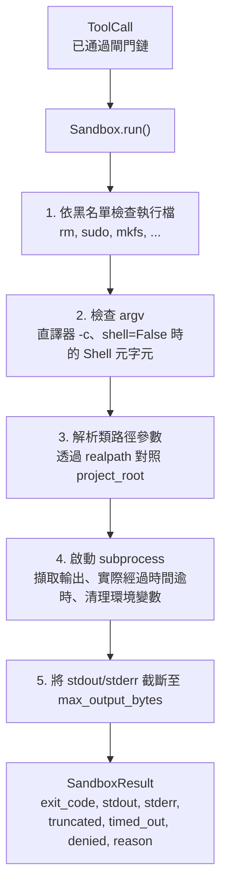
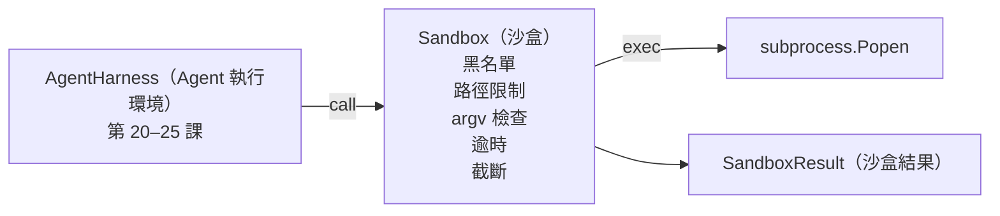

# 專案實戰第 26 課：帶有黑名單與路徑拘禁的安全沙盒執行器（Capstone Lesson 26: Sandbox Runner with Denylist and Path Jail）

> 驗證閘門決定了一個工具呼叫**是否被允許執行**；而安全沙盒則決定了當它執行時**具體會發生什麼**。本課將親手打造一個子行程（Subprocess）執行器：嚴格攔截危險可執行程式、阻斷畸形危險的 argv 參數結構、將所有檔案路徑強制拘禁在專案根目錄內（Path Jail）、自動截斷過大終端輸出，並在實際經過時間逾時後強制終止失控行程。這是橫亙在模型與底層作業系統實體環境之間的第二道核心安全防線。

**Type:** Build
**Languages:** Python (stdlib)
**Prerequisites:** Phase 19 · 25 (verification gates and observation budget), Phase 14 · 33 (instructions as constraints), Phase 14 · 38 (verification gates)
**Time:** ~90 minutes

## Learning Objectives｜學習目標

- 建構封裝 `subprocess.run` 的 `Sandbox` 類別，內建逾時控制、標準輸出與標準錯誤擷取，以及輸出安全截斷。
- 透過黑名單按程式名稱進行攔截，並透過 argv 檢查器按參數語法結構進行深度阻斷。
- 堅決拒絕任何在解析後企圖跳出已宣告之專案根目錄（Project Root）以外的路徑參數。
- 當 shell 模式關閉時，主動偵測並攔截 Shell 元字元（Metacharacters）。
- 回傳結構化的 `SandboxResult` 物件，供下游可觀測性模組與自動化評測套件標準化攝取。

## The Problem｜問題

一個具備 Shell 終端機呼叫權限的程式開發 agent，完全有能力在短短單次對話輪次內暗中植入系統後門、盜取本機金鑰、徹底破壞開發者筆記型電腦作業系統，並在雲端帳戶中刷出天價帳單。成本最低的防禦自然是完全不給予其 Shell 權限；而成本次低的防禦，則是為其打造一個針對特定危險模式堅決說「不」的專屬沙盒。

Agent 的追蹤記錄中反覆出現三類失敗模式。

第一類是**高危險可執行程式**。當一個模型在修復路徑或權限報錯遭遇挫敗施壓時，往往會鋌而走險呼叫 `sudo`、`chmod -R 777`、`rm -rf`、`mkfs`、`dd`。這些毀滅性指令在任何正常的 Agent 運作中皆絕無立足之地。黑名單機制能在第一時間按原始名稱或別名精準捕獲它們。

第二類是 **argv 偽裝繞過技巧**。當模型被明確告知「禁止呼叫 Shell」時，它極易嘗試透過直譯器發起繞過：例如呼叫 `python3 -c "import os; os.system('rm -rf /')"`、`bash -c '...'`、`node -e '...'`、`perl -e '...'`。沙盒必須敏銳洞察：任何攜帶類似 `-c` 或 -e 參數的直譯器呼叫，本質上只不過是包了一層偽裝的 Shell 呼叫而已。

第三類是**檔案系統路徑逃逸（Path Escape）**。模型本應讀取 `./src/main.py`，卻意外或惡意嘗試讀取 `../../etc/passwd`。沙盒透過 `os.path.realpath` 將傳入的所有路徑實施規範化解析，並嚴格斷言其絕對路徑前綴必須完全隸屬於專案根目錄之內。

必須清醒認識到：該沙盒絕非作業系統核心意義上的完美安全隔離邊界。一個具備任意程式碼執行能力的頂級攻擊者依然可能找到逃逸漏洞。該沙盒的核心定位是**開發階段的剛性防護欄（Development-Time Guardrail）**：它會讓常見失敗模式更明顯，並阻止 Agent 因單純失誤造成損害。

## The Concept｜核心概念



沙盒包含四大防禦拒絕維度：程式名稱、argv 參數結構、檔案路徑、Shell 語法元字元。每個維度皆為純函式校驗，此時完全尚未啟動真實的作業系統子行程。只有當所有維度皆確認安全通過之後，子行程才會被正式發起建立。

`SandboxResult` 回傳的結束碼遵循工業慣例：0 代表完全成功，非零代表常規執行失敗；此外引入了三個專屬的哨兵狀態碼：拒絕攔截（-100）、執行逾時（-101），以及輸出被截斷（結束碼保留實際結束碼，但設定截斷布林標記）。下游課程可以直接結構化解析該物件，而不必反覆以正規表示式比對 stderr。

```figure
cg-path-jail
```

## 系統架構



黑名單在底層是一個包含可執行檔基本檔名（Basename）的 frozenset。各種別名路徑（如 `/bin/rm` 與 `/usr/bin/rm`）在解析後皆會對齊為完全相同的基本檔名。argv 檢查器能精準辨識直譯器特徵：一旦發現 argv[0] 為直譯器且後續任意參數以 `-c` 或 `-e` 開頭，即刻堅決予以拒絕。當呼叫未顯式啟用 Shell 模式時，任何包含 Shell 元字元（`;`、`|`、`&`、`>`、`<`、反引號、`$()`）的指令皆會觸發拒絕。

路徑拘禁（Path Jail）是整個模組中最精妙的設計。沙盒在初始化構造時接收一個明確的 `project_root` 專案根目錄。任何外觀形似路徑的參數（包含 `/` 或符合本機既有檔案），皆會首先透過 `os.path.realpath` 消除所有相對符號與軟連結跳轉，隨後嚴格比對專案根目錄的真實絕對路徑。若解析出的實體目標未被包含在根目錄之下，直接拒絕執行。企圖利用符號連結（Symlink）進行逃逸的攻擊，因 realpath 會直接追蹤解析至真實底層目標，同樣會被無情阻斷。

## 實作內容

本課的所有實作收斂於 `main.py` 與對應的測試套件：

1. `SandboxResult` 資料類別：exit_code、stdout、stderr、truncated、timed_out、denied、reason、duration_ms。
2. `SandboxConfig` 資料類別：project_root、max_output_bytes、timeout_seconds、denylist、interpreter_block。
3. `Sandbox` 主類別：`run(argv, *, shell=False, cwd=None)` 回傳結構化的 `SandboxResult`。
4. 內部私有檢查輔助方法：`_check_executable_denylist`、`_check_argv_interpreter`、`_check_shell_metachars`、`_check_path_jail`。
5. 終端輸出截斷機制，帶有清晰的 `truncated` 布林標識並在擷取的串流末尾追加截斷標記行。
6. 底部端到端演示：依序發起一系列合法指令與惡意對抗指令，清晰呈現每一個呼叫的最終處置結果。

沙盒底層呼叫 `subprocess.run`，預設強制指定 `shell=False` 並開啟 `capture_output=True`。實際經過時間逾時控制依託 `timeout` 參數；一旦觸發 `TimeoutExpired` 異常，沙盒立即強制殺死整個子行程組（Process Group）並合成標準的 SandboxResult。

## 本課沙盒的邊界聲明

本課所打造的沙盒，在底層並未呼叫 Linux Namespaces、cgroups、seccomp、gVisor、Firecracker 或任何核心層級隔離。子行程具備當前 Python 行程所擁有的一切本機權限。該層防護的本質是**語法與結構層面的剛性約束**：它確保 Agent 最常見的危險操作被當場斬斷，並將刺耳的拒絕告警即時匯入可觀測性系統，而非任由其在背景靜默運作。

在真實正式環境中，你應當在此基礎上實施縱深堆疊：在非特權 Docker 容器中運作、在極簡 MicroVM 微型虛擬機中運作、剝離所有 Linux Capabilities 特權、將專案根目錄掛載為唯讀並僅為臨時 Scratch 目錄提供讀寫權限、透過 ulimit 鎖定記憶體與 CPU 配額，並清理環境變數，只保留已知安全白名單。第二十九課將展示其中部分工程實踐。作業系統核心級隔離超出了本課的範疇。

## 執行驗證

```bash
cd phases/19-capstone-projects/26-sandbox-runner-denylist
python3 code/main.py
python3 -m pytest code/tests/ -v
```

演示程式首先在 /tmp 中動態建立一個臨時目錄，在其中寫入一個乾淨的測試檔案，隨後發起整套極限呼叫矩陣測試。合法指令成功執行；被攔截指令回傳帶有 `denied=True` 與明確原因的 SandboxResult；逾時指令回傳 `timed_out=True`；超大輸出指令正確標記 `truncated=True`。演示程式以清楚的 JSON 表格印出所有測試結果，並以 0 碼安全退出。

## 與 Track A 其餘模組的協同

第二十五課打造了前置驗證閘門鏈；第二十六課則是當閘門鏈給出 ALLOW 放行後負責實體呼叫的安全執行器；第二十七課的自動化評測套件將沙盒的執行結果與各題目的標準預期結束碼進行精確比對；第二十八課圍繞每一次 `Sandbox.run` 呼叫在 OpenTelemetry 中建立專屬的 `gen_ai.tool.execution` Span；而第二十九課的端到端實戰演示，則將驅動一個真實的程式開發 agent 同時穿透這兩層安全護網完成全套程式開發任務。
