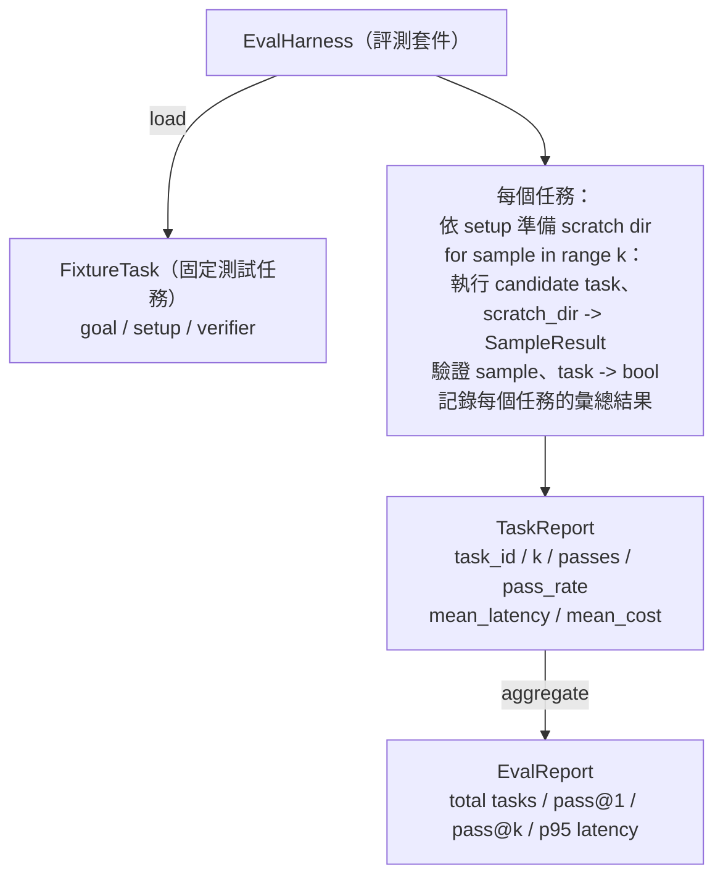

# 專案實戰第 27 課：包含固定測試任務的評測套件（Capstone Lesson 27: Eval Harness with Fixture Tasks）

> 一個程式開發 agent 的真實水準，完全取決於你用來度量它的測試任務套件（Benchmark Suite）。本課將親手建構一個自動化評測套件：讀取包含固定測試任務（Fixture Tasks）的目錄、將每道題目餵入受測 Agent 執行、透過確定性驗證器（Deterministic Verifier）給出及格或失敗的客觀判決，並將全部測試結果聚合計算為 pass@1、pass@k、平均延遲與平均成本。評測套件是讓你能判斷一次修改究竟是「迴歸」還是「重構」的依據。

**Type:** Build
**Languages:** Python (stdlib)
**Prerequisites:** Phase 19 · 25 (verification gates), Phase 19 · 26 (sandbox runner), Phase 14 · 30 (eval-driven agent development), Phase 14 · 19 (SWE-bench and GAIA benchmarks)
**Time:** ~90 minutes

## Learning Objectives｜學習目標

- 將固定測試任務定義為由目標（Goal）、初始化設定（Setup）與驗證器（Verifier）組成的三元組。
- 針對單一任務發起多輪抽樣運作，並精確計算 pass@1 與 pass@k 指標。
- 將物理時鐘延遲與成本聚合計算為平均值與第 95 百分位數（p95）指標。
- 將確定性驗證器（檔案內容比對、結束狀態碼、正規表示式比對）封裝為可重複呼叫的函式。
- 輸出可供回歸追蹤腳本讀取的結構化 JSON 報告。

## The Problem｜問題

在缺乏嚴密評測套件的情況下建構 Agent 基準評測，必然會遭受三大經典陷阱的折磨。

第一類是**未經嚴格驗證的虛假通過（Unverified Pass）**。Agent 宣稱自己已經修復了缺陷，人類工程師隨便掃描了一眼 Git Diff，整套測試套件就被標記為綠燈通過；然而三週之後，回歸測試卻再次引發了完全相同的故障。Agent 只不過是給出了一段看似合情合理的說辭，實質上根本沒有解決任何實體問題。

第二類是**未被察覺的靜默退化（Undetected Regression）**。工程師對 Prompt 範本作了一次調整，讓 Agent 在某個顯眼的任務上表現提升了 4%，但在另一個不顯眼的任務上卻變差了 14%。在缺乏客觀黃金評測集與單題獨立得分看板的情況下，這項退化變更直接混入 main 主幹，直到有客戶抱怨時才被揭發。

第三類是**測試樣本維度的統計漂移（Per-Task Drift）**。週一的評測跑了 100 道題，而週五的評測只跑了 95 道題（因為有人在中途重命名了 5 個測試夾具）。表面上看通過率似乎上升了 5%，但實際上這完全是由於測試集母數縮水造成的虛假幻覺。

評測套件正是將上述所有混亂轉化為客觀事實的專屬程式。它每次皆以完全可重現的固定順序遍歷每一個測試夾具，並交由確定性驗證器出具絕對客觀的 True / False 裁決。

## The Concept｜核心概念

```mermaid
flowchart LR
  F1[固定測試任務<br/>fixtures/task_001/<br/>task.json + expected/] --> Harness
  F2[固定測試任務<br/>fixtures/task_002/<br/>...] --> Harness
  Harness[評測套件<br/>每個任務：<br/>設定 / 執行 agent k 次抽樣 /<br/>驗證每筆樣本 /<br/>記錄延遲與成本]
  Harness --> Report[EvalReport（評測報告）<br/>pass@1 / pass@k<br/>平均毫秒 / p95 毫秒<br/>平均成本]
```

一個 `FixtureTask` 由一個微型 JSON 宣告檔案與一個可選的 `expected/` 預期結果目錄構成。JSON 宣告了任務的唯一 `id`、給予 Agent 的指令要求 `goal`、初始化工作目錄的 `setup` 區塊（需要拷貝至暫存目錄的原始程式碼），以及 `verifier` 驗證器區塊。驗證器區塊指名了註冊中心中的特定驗證函式及其所需參數。

三大經典驗證器形態覆蓋了絕大多數實用任務：

第一類是 `file_equals`（檔案內容比對）。Agent 運作完畢後，比對指定檔案的內容與預期內容。專門用於驗證「以指定方式修復這個 Bug」的題目。

第二類是 `regex_match`（正規表示式比對）。比對目標檔案的內容是否符合特定的正規表示式規則。專門用於驗證「函式必須被宣告存在且回傳 X」，但具體內部實作允許靈活寫法的寬鬆題目。

第三類是 `shell_exit_zero`（Shell 零碼退出）。套件透過第二十六課的沙盒執行一段 Shell 指令，僅當該指令的結束碼為 0 時才裁定該題目通過。專門用於驗證「該專案自帶的測試套件必須全綠通過」的真實工程題目。

評測套件對每個任務重複抽樣運作 `k` 次。Pass@k 的標準數學定義為 `1 - (1 - p)^k`（其中 p 為經驗單次通過率）；套件同時呈報原始的成功次數，方便你洞察隨機變異數。延遲度量單次抽樣的物理時鐘耗時。成本則直接讀取 Agent 自我回報的記帳數值（Token 消耗數、美元花費或兩者兼具）；套件會將成本加總，並呈現逐任務與整體彙總數值。

```figure
pass-at-k
```

## 系統架構



受測候選者（Candidate）被抽象為一個標準可呼叫物件：`Callable[[FixtureTask, str], SampleResult]`。評測套件透過 `tempfile.mkdtemp()` 動態建立一個全新的乾淨暫存目錄，並將該路徑字串傳入。評測套件完全不關心受測對象的內部實作細節——候選者可以是一個確定性的補丁套用常式（用於評測套件自身的單元自測）、一個真實的 LLM Agent，或一個模糊測試器。唯一的合約約束就是其回傳的 `SampleResult` 物件。

## 實作內容

`main.py` 交付以下核心架構：

1. `FixtureTask` 資料類別。
2. SampleResult 資料類別：success_self_reported、latency_ms、cost_units、edits。
3. `TaskReport` 與 EvalReport 評測報告類別，具備 `to_dict()` 序列化能力。
4. `VerifierRegistry` 驗證器註冊中心，維護名稱至函式的映射。內建三大驗證器：file_equals、regex_match、shell_exit_zero。
5. `EvalHarness` 主類別：載入目標目錄的所有任務，針對受測對象成批執行評測，回傳標準的 `EvalReport`。
6. 在 `tasks/` 中內建 5 個經典的固定測試任務：
   - `fizzbuzz` 中的差一錯誤（Off-by-one）
   - `factorial` 階乘中的遺漏 return
   - 錯誤訊息中的拼寫筆誤
   - 遺留的空函式主體實作
   - 鏈結串列遍歷中的差一錯誤
7. 一個確定性的參考候選者樁（`apply_known_fixes`），評測套件呼叫它能精確展示 pass@1 為 1.0 的滿分驗收基準。
8. 底部演示程式印出標準的 EvalReport JSON 報告並以 0 碼退出。

所有測試夾具皆以標準 JSON 規格封裝於 `tasks/` 之中，並配對包含 `tasks/<id>/buggy/`（有缺陷的原始碼）與 `tasks/<id>/expected/`（期望修復後的正確程式碼）。評測套件自動將 buggy 目錄拷貝至沙盒暫存區，交給 Agent 修復，隨後對照 expected 進行自動化驗收。

## 為何同時度量 pass@k 與 pass@1

真實的 LLM agent 具備天然的隨機機率特徵。一個 0.6 的 pass@1 看上去似乎意味著頻繁失敗；但高達 0.95 的 pass@5 則表明 Agent 在絕大多數情況下完全有能力找到正確答案，只不過在早期的隨機抽樣中偶爾選錯了探索路徑。此時的系統修復方向應當是引入抽樣與排序（Best-of-N）機制，而非一味增加訓練。Pass@k 讓這一架構真相變得清晰可見。

然而，pass@k 必須與 pass@1 並列呈報，因為 pass@k 容易掩蓋另一種致命缺陷：如果一個模型在嘗試了 20 次後僅僅碰巧瞎貓碰上死耗子答對了 1 次，它在工程上絕對不能算作一個具備實用價值的合格 Agent。評測套件同時將這兩個維度公之於眾。

## 與 Track A 其餘模組的協同

第二十五課打造了驗證閘門鏈；第二十六課打造了安全沙盒。當測試任務使用 `shell_exit_zero` 驗證器時，評測套件會透過第二十六課的沙盒執行測試指令。第二十八課將每次評測套件的運作封裝進 OpenTelemetry Trace 中；第二十九課的端到端演示則以本課內建的其中一個固定測試任務執行，並斷言參考候選者的 pass@1 = 1.0。

## 執行驗證

```bash
cd phases/19-capstone-projects/27-eval-harness-fixture-tasks
python3 code/main.py
python3 -m pytest code/tests/ -v
```

演示程式將在終端機印出完整的 EvalReport JSON 報告，涵蓋 pass@1、pass@5、平均延遲以及逐題細分指標，並以結束碼 0 安全退出。單元測試全面覆蓋了各個驗證器函式、pass@k 數學公式計算、夾具資料動態載入，以及評測套件在參考候選者上的端到端閉環測試。
