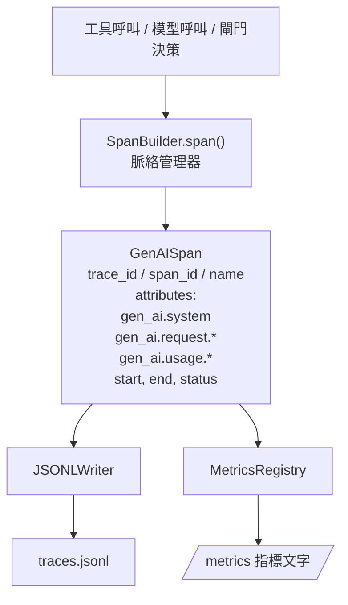
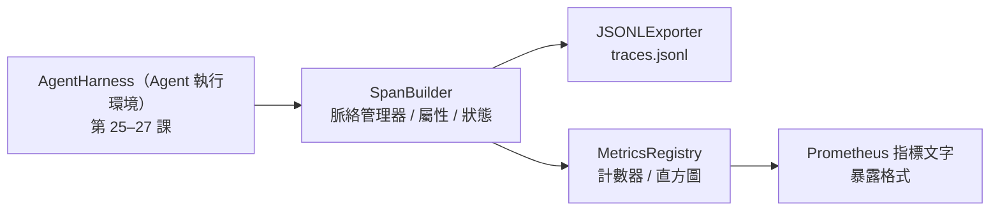

# 專案實戰第 28 課：基於 OTel GenAI Span 與 Prometheus 指標的可觀測性（Capstone Lesson 28: Observability with OTel GenAI Spans and Prometheus Metrics）

> 一個缺乏可觀測性的 Agent 執行環境，只是一台不斷燒錢的黑盒子。本課將親手實作一個 Span 建構器：輸出嚴格相容於 OpenTelemetry GenAI 語意約定的標準記錄、將它們以每行一個獨立 Span 的形式寫入 JSON-Lines 檔案，並以標準的 Prometheus 純文字格式對外暴露計數器（Counter）與直方圖（Histogram）指標。整套實作完全基於 Python 標準函式庫，在離線環境下即可流暢運作。

**Type:** Build
**Languages:** Python (stdlib)
**Prerequisites:** Phase 19 · 25 (verification gates), Phase 19 · 26 (sandbox), Phase 19 · 27 (eval harness), Phase 13 · 20 (OpenTelemetry GenAI), Phase 14 · 23 (OTel GenAI conventions)
**Time:** ~90 minutes

## Learning Objectives｜學習目標

- 建構完全符合 OpenTelemetry GenAI 語意約定標準形態的 Span 資料類別。
- 實作 JSONL 匯出器（Exporter），以每行一個獨立自包含 Span 的形式進行落盤持久化。
- 建構支援多標籤（Labels）維度的計數器與直方圖，並實作符合 Prometheus 純文字格式的指標暴露規範。
- 將任意可呼叫函式封裝進 Span 上下文管理器中，記錄執行時間、狀態與例外。
- 驗證輸出的 Span 能完美透過 `json.loads` 反序列化回溯，並符合規格所定的欄位形狀。

## The Problem｜問題

一個在正式環境中持續運作的程式開發 agent，在每一輪對話中皆會產生三類關鍵產物：一次模型呼叫、一次實體工具呼叫，以及一次驗證閘門的安全裁決。若缺乏結構化的遙測追蹤，這些產物將變得毫無排查價值。

第一類經典故障是**鏈路追蹤完全缺失**。週二出了問題，但留下的唯一線索只有一段長達 500 行的原始終端對話文字。完全無法查證底層究竟呼叫了哪個工具、耗費了多少毫秒、Prompt 到底塞入了多少 Token，或者安全閘門是否曾攔截過任何請求。Agent 開發者只能在迷霧中盲猜。

第二類經典故障是**鏈路格式無法解析**。執行環境雖然在背景記錄了 Span，但內部充斥著開發者隨手捏造的臨時欄位名稱。Grafana、Honeycomb、Jaeger 或本機 CLI 工具完全無法讀懂這些自定義格式。整個工程團隊現有的可觀測性基礎設施直接作廢，僅僅因為這些 Span 未遵循工業標準。

第三類經典故障是**指標完全缺乏聚合**。你在追蹤資料中固然能偶爾看到某次緩慢的工具呼叫，但你根本無法回答核心架構提問：「在過去一個小時內，read_file 工具呼叫的 p95 延遲究竟是多少？」，因為系統只有雜亂的離散 Trace，而沒有度量指標（Metrics）。

OpenTelemetry GenAI 語意約定正是為了終結上述混亂而生。它定義了一套跨所有主流 LLM 框架通用的標準屬性集合。只要你的執行環境輸出這些屬性，OTel 相容的後端就能讀取它們。

## The Concept｜核心概念



執行環境內部的每一次具體操作皆會產出一個專屬的 Span。一個標準的 Span 包含：Trace ID（標記整個 Agent 任務呼叫鏈）、Span ID（標記本次單一具體操作）、名稱（如 `gen_ai.chat`、`gen_ai.tool.execution`）、遵循 GenAI 約定的標準屬性、起始與終止時間戳記，以及狀態。

GenAI 語意約定標準化了以下核心屬性 Key：`gen_ai.system`（標明服務供應商，如 `anthropic`、`openai`）、`gen_ai.request.model`（請求模型 ID）、`gen_ai.request.max_tokens`、`gen_ai.usage.input_tokens`、`gen_ai.usage.output_tokens`、`gen_ai.response.model`、`gen_ai.response.id`、`gen_ai.operation.name`，以及專屬於工具呼叫的 `gen_ai.tool.name` 與 `gen_ai.tool.call.id`。

匯出器將追蹤資料寫入 JSONL 檔案。每行一個標準的 JSON 物件。這是下游串流工具、grep 命令列以及資料倉儲最容易消費、過濾與匯入的極簡工業格式。在真實正式環境中匯出器通常透過 OTLP gRPC 協定發送；而在本課中，本地 JSONL 匯出器提供了完全對等的離線替代，在任何個人工作站上皆可零依賴完美運行。

指標模組與鏈路追蹤並肩運作。每次工具呼叫會讓計數器遞增：`tools_called_total{tool="read_file"}`。直方圖則負責採樣記錄物理延遲分佈：`tool_latency_ms{tool="read_file"}`。兩者皆支援序列化為 Prometheus 純文字暴露格式（Prometheus Text Exposition Format）——這是目前監控系統以主動擷取方式收集指標時的業界事實標準。

```figure
trace-spans
```

## 系統架構



Span 建構器是一個小巧的類別，提供 `span(name, attrs)` 方法並回傳一個 Python 上下文管理器。該上下文管理器在進入時記錄起始時間，在退出時記錄終止時間，若發生例外，便附加該例外資訊，隨後將封裝完畢的 Span 投遞給匯出器。

指標註冊中心由兩個字典構成。計數器在記憶體中維護 `{(name, frozen_labels): int}`。直方圖則將原始數值採樣追加進清單中，並在指標對外暴露的瞬間，動態聚合計算為 Prometheus 標準的各個直方圖桶（Buckets）。

## 實作內容

`main.py` 交付以下架構模組：

1. `GenAISpan` 資料類別：trace_id、span_id、parent_span_id、name、attributes、start_unix_nano、end_unix_nano、status、status_message、events。
2. `SpanBuilder` 類別，提供 `span(name, attrs, parent=None)` 上下文管理器。
3. `JSONLExporter` 類別，提供 `export(span)` 方法將單條 Span 格式化追加為一行。
4. `Counter` 與 `Histogram` 類別，以及統一的 `MetricsRegistry`。
5. `prometheus_exposition(registry)` 函式，輸出標準 Prometheus 純文字格式指標。
6. `wrap_tool_call(name)` 裝飾器，自動為工具呼叫套上 Span 並即時更新指標。
7. 底部演示程式：合成一次完整的 Agent 呼叫（外層為 gen_ai.chat Span，內部巢狀多個工具 Span），寫入 traces.jsonl，在終端機印出 Prometheus 指標暴露文字，並以 0 碼退出。

Span ID 與 Trace ID 皆為 16 位元組（128-bit）的十六進位字串，由 `os.urandom` 隨機生成。這與 OTel 的 W3C Trace Context 規範完全對齊。匯出器自身具備容錯設計，絕不會向外拋出未捕獲異常；回報 I/O 錯誤，但讓 harness 繼續執行。

直方圖採用預設的標準桶邊界集合（OTel 預設的延遲桶邊界：5, 10, 25, 50, 100, 250, 500, 1000, 2500, 5000, 10000, +Inf）。原始數值被暫存在清單中；在對外暴露指標時動態統計每個區間的分佈頻次。

## 為何親手實作而非盲目引入 SDK

完整的 OpenTelemetry Python SDK 是一個極其龐大繁雜的重型第三方依賴。它包含數千行程式碼，OTLP 匯出器涉及多個行程，且執行時期成本會耗盡課程預算。親手打造這套輕量實作，能讓你直接了解底層的傳輸格式。在真實正式環境中，你只需將完全相同的這套屬性字典填入官方的標準 SDK 中，即可無縫享有現成的 OTLP 匯出器、背景批次打包與資源偵測能力。

語意約定相當穩定。本課輸出的格式到了 2030 年仍能被解析，因為 OTel 不會破壞既有的 GenAI 屬性名稱，只會新增名稱。

## 與 Track A 其餘模組的協同

第二十五課打造了驗證閘門鏈；第二十六課打造了安全沙盒；第二十七課打造了自動化評測套件。第二十八課則讓前述三大模組全部獲得全鏈路透視的可觀測性。第二十九課的端到端大演示，將為受測 Agent 的每一個運作步驟套上標準 Span，並在最後以 Prometheus 純文字格式印出指標。

## 執行驗證

```bash
cd phases/19-capstone-projects/28-observability-otel-traces
python3 code/main.py
python3 -m pytest code/tests/ -v
```

演示程式將在目前目錄下生成一個 `traces.jsonl` 檔案（並在結束時清理），隨後在終端機印出包含 3 個具體 Span 的 JSON 範例，並輸出計數器與直方圖的 Prometheus 標準格式文字。單元測試全面驗證：Span 能正確進行 JSON 雙向反序列化回溯、標準 GenAI 屬性完整無遺漏、計數器能精準遞增，且直方圖在暴露指標時包含正確的區間桶分佈。
