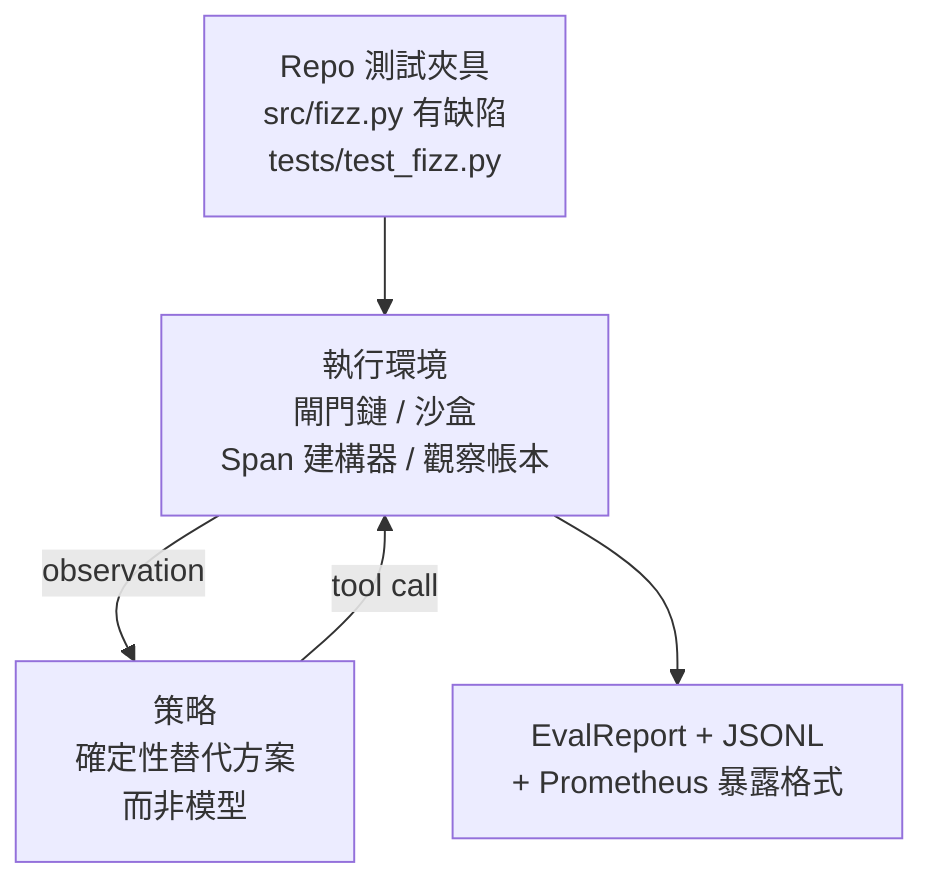
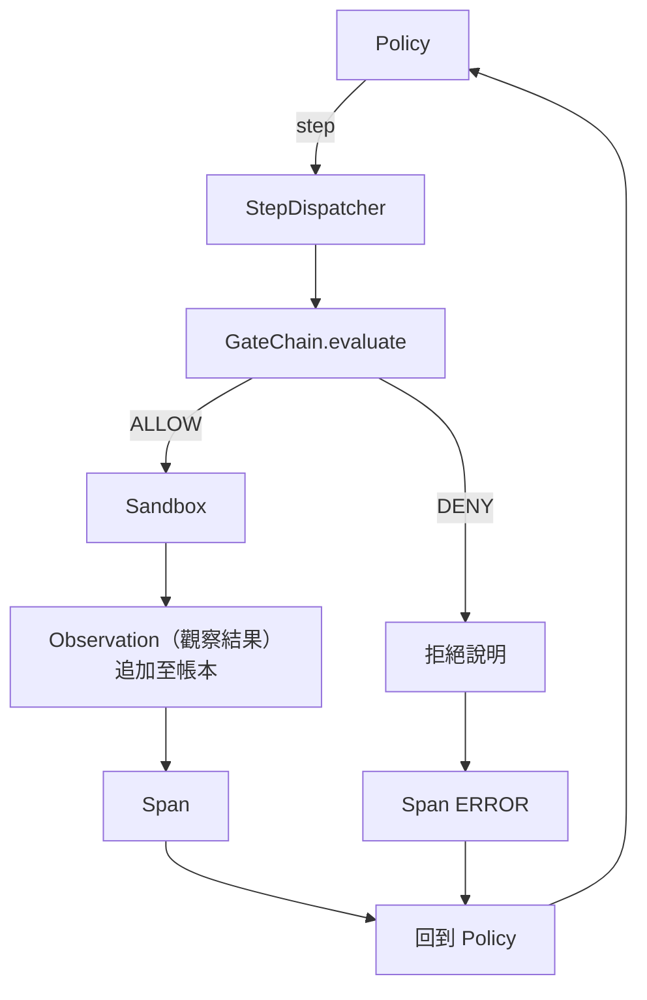

# 專案實戰第 29 課：基於執行環境的端到端程式設計任務實戰演示（Capstone Lesson 29: End-to-End Coding Agent on the Harness）

> 這是 Track A 的整合成果。本課將驗證閘門鏈、安全沙盒、自動化評測套件以及 OpenTelemetry Span 全量縫合為一個真正運作的程式設計 Agent，成功修復一個多檔案 Python 專案中的真實、小型 fixture 規模缺陷。該 Agent 採用確定性決策策略（Deterministic Policy）而非使用 LLM；這一替換使本課具備可重現性，也顯示整個系統的核心在於執行環境本身。底層合約完全相同：真實模型可在該策略接縫處無縫替換。

**Type:** Build
**Languages:** Python (stdlib)
**Prerequisites:** Phase 19 · 25 (verification gates), Phase 19 · 26 (sandbox), Phase 19 · 27 (eval harness), Phase 19 · 28 (observability), Phase 14 · 38 (verification gates), Phase 14 · 41 (workbench for real repos), Phase 14 · 42 (agent workbench capstone)
**Time:** ~90 minutes

## Learning Objectives｜學習目標

- 將閘門鏈、沙盒、評測套件與 Span 建構器無縫組合為單一的 Agent 閉環控制迴圈。
- 實作確定性策略，協同調度 read_file、run_tests 與 write_file 工具修復測試夾具中的具體程式碼缺陷。
- 在整個端到端運作中同時強制落實全域步驟預算與觀察 Token 預算限制。
- 為全流程運作完整發布符合 OTel GenAI 規範的 Trace 鏈路追蹤與 Prometheus 指標。
- 嚴格驗證 Agent 在少於 12 個步驟內成功解決測試夾具，且在呼叫合法工具時觸發閘門拒絕的次數為零。

## The Problem｜問題

絕大多數 Agent 教學演示皆是在完全孤立的理想環境下運作的：一個孤立的沙盒、一個孤立的評測套件、一個孤立的 Span 記錄器。單獨看它們似乎完美無瑕。然而一旦將它們強行組裝在一起，接縫處的裂痕便會立刻暴露無遺。

驗證閘門鏈給出了 ALLOW 放行，但沙盒卻因某個閘門鏈未曾料到的底層原因拒絕執行；評測套件標記測試通過，但 OTel 追蹤卻赫然記錄著安全閘門曾經攔截過某個 Agent 宣稱自己呼叫成功的工具；Prometheus 計數器在原本應該只加一次的地方被重複觸發了兩次；觀察預算早已超額，但 Agent 卻繼續執行，因為預算只在閘門鏈中記帳而沙盒對此一無所知。

本課是整個 Track A 的整合驗收測試。受測 Agent 必須嚴格依照順序完成四件事：閱讀程式碼庫目錄、運行初始測試套件、自測試報錯資訊中精準定位 Bug 根因、編寫並寫入修復補丁、重新運行測試套件驗證全綠，最後優雅退出。每一次操作皆必須嚴格穿透閘門鏈；每一次工具執行都必須經過沙盒；每一個步驟皆必須封裝進標準 Span；而評測套件則在最後對全過程給出客觀評分。

## The Concept｜核心概念



Agent 的決策策略是一個標準的有限狀態機。包含 5 種狀態：

`SURVEY`（環境勘測）：Agent 讀取專案目錄清單。下一個狀態為 RUN_TESTS。

`RUN_TESTS`（執行測試）：Agent 呼叫測試指令。若測試直接通過，狀態機成功終止；否則下一個狀態轉移至 INSPECT。

`INSPECT`（檢視原始碼）：Agent 讀取報錯的源檔案。下一個狀態為 FIX。

`FIX`（編寫修復）：Agent 將修復後的正確內容寫入檔案。下一個狀態為 VERIFY。

`VERIFY`（重新驗收）：Agent 再次執行測試指令。若測試全綠通過，狀態機成功終止；否則宣告失敗並終止。

每個狀態精確對應一次工具呼叫。每次工具呼叫皆必須完整穿透驗證閘門鏈。一旦工具呼叫遭到拒絕，Agent 立即在 Trace 追蹤中記錄拒絕原因並優雅停機。

測試夾具中的 Bug 是 `fizz.py` 中的一個典型差一錯誤（Off-by-one）。確定性策略透過正規表示式直接從測試報錯中萃取 Bug 特徵並寫出修復後的檔案。將該確定性策略替換為真實的 LLM，絕不會改變執行環境的底層合約。

```figure
cg-harness-weave
```

## 系統架構



本課程式碼完全自包含。第二十五課至第二十八課所建立的各項核心原語（閘門鏈、沙盒、觀察帳本、Span 建構器）皆以極簡形式在 `main.py` 內部重新定義，使本課無需跨目錄引用同級檔案即可獨立運作。命名與前述章節百分之百保持一致，確保心智模型清晰無歧義。

## 實作內容

`main.py` 交付以下架構模組：

1. 極簡執行環境原語集合，命名與第二十五至二十八課完全一致：`GateChain`、`Sandbox`、`ObservationLedger`、`SpanBuilder`、`MetricsRegistry`。
2. `CodingAgentPolicy` 類別：包含五種狀態的確定性決策狀態機。
3. `Repo` 輔助類別：在本地暫存目錄中快速拉起內建有缺陷程式碼的測試夾具。
4. `AgentRun` 核心驅動類別：驅動策略運作、透過執行環境安全分發、回傳標準的 `AgentRunReport`。
5. 內建測試夾具（`fixture_repo/`）：包含有缺陷的 src/fizz.py、測試案例 tests/test_fizz.py，以及用於評測驗收的 expected/ 目錄。
6. 底部端到端演示：驅動策略運作端到端流程並修復 Bug、印出逐步追蹤資料、斷言測試通過，並輸出 Prometheus 指標。

內建的測試夾具與第二十七課的結構完全對齊：一個有 Bug 的原始檔案與一個測試檔案。測試報錯資訊中包含足夠的特徵，供確定性策略定位修復方案。真實 LLM 將以完全相同的迴圈和合約執行該任務（只不過推理速度較慢而且能召回範圍更廣的資訊），執行環境對它的預期完全一致。

## 為何採用確定性策略而非 LLM

呼叫真實 LLM 需要設定 API Key、進行網路呼叫，且會帶來無法驗證的隨機性。然而本課的核心使命是**傳授並驗收執行環境本身**。採用確定性策略作為替補，使得本課能在任何開發者的本機電腦上零外部依賴極速跑通，並允許單元測試集對執行步驟進行精確斷言。

本課實作的策略是 LLM agent 行為的嚴格純粹子集。該策略讀取儲存庫、觀察測試報錯、鎖定出錯行，並寫出補丁。真實 LLM 在完全相同的執行環境合約下同樣運作著這套邏輯；其底層記帳方式完全一致。

## 端到端演示的核心斷言

端到端演示在退出時嚴格斷言五項核心事實，單元測試集亦透過程式化方式對其進行強制校驗：

決策策略在少於 12 個步驟內成功解決了測試夾具。

觀察 Token 預算全程未曾超額。

合法工具呼叫遭到閘門拒絕的次數為 0（Agent 絕未捏造未經授權的虛假工具名稱）。

每一個執行步驟在 traces.jsonl 中皆具備唯一對應的標準 Span。

Prometheus 指標輸出中明確包含 `tools_called_total{tool="read_file"}` 計數器與 `tool_latency_ms` 直方圖。

## 與 Track A 其餘模組的協同

本課是整個體系的終極集大成整合。第二十五課編寫了閘門鏈；第二十六課編寫了安全沙盒；第二十七課編寫了評測套件；第二十八課編寫了可觀測性鏈路；第二十九課則證明了它們能作為一個系統運作。真實的 agent harness 可由此延伸：將確定性策略替換為模型、將內建夾具替換為真實儲存庫任務、將 JSONL 匯出器替換為 OTLP。

## 執行驗證

```bash
cd phases/19-capstone-projects/29-end-to-end-coding-task-demo
python3 code/main.py
python3 -m pytest code/tests/ -v
```

演示程式將在終端機印出逐步詳細的 Trace 追蹤、最終的評測驗收報告以及標準的 Prometheus 指標文字，並以結束碼 0 安全退出。測試用例全面覆蓋了策略狀態轉移、針對合成工具呼叫的閘門拒絕、內建夾具的端到端修復驗收，以及步驟預算的不變性約束。
