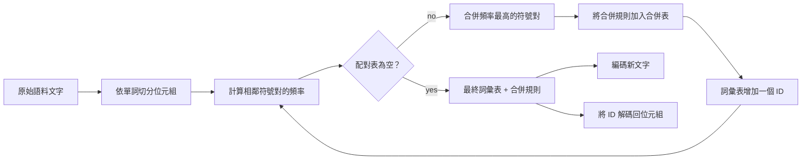
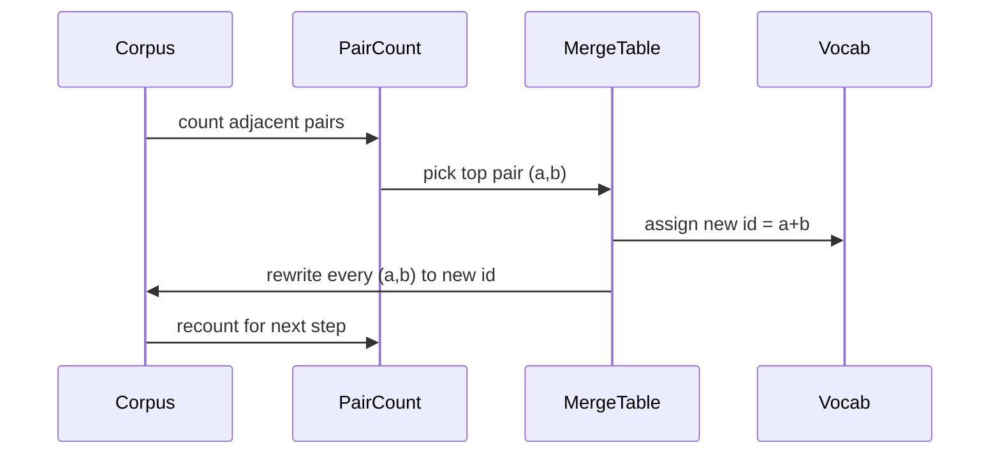

# 從零打造 BPE Tokenizer（BPE Tokenizer From Scratch）

> 位元組流入，ID 流出，ID 再無損還原為完全相同的位元組。親手建構每一款現代文字模型皆以此為起點的底層 tokenizer。

**Type:** Build
**Languages:** Python
**Prerequisites:** Phase 04 lessons, Phase 07 transformer lessons
**Time:** ~90 minutes

## Learning Objectives｜學習目標
- 透過反覆合併訓練語料中出現頻率最高的相鄰符號對，從原始文字語料中訓練出位元組對編碼（Byte-Pair Encoding，BPE）詞彙表。
- 實作確定性合併表（Merge Table），並將其應用於全新文字，產出標準的子詞（Subword）ID 串流。
- 實作任意 UTF-8 字串與 ID 之間完全無損的雙向可逆回溯（Round-trip）。
- 保留並隔離保護特殊 Token（`<|endoftext|>`、`<|pad|>`），確保它們在訓練與解碼過程中完好存活。
- 深刻理解為何「位元組級字母表（Byte-Level Alphabet）」是建構通用 tokenizer 的合適基礎。

```figure
cap-bpe-merge
```

## 架構認知

語言模型本質上永遠看不到文字。它能看見的只有一串整數。將字串精準對齊為整數陣列並支援向後還原的橋樑，就是 tokenizer。如果這一層基礎設施出現了偏差，那麼後續整個訓練過程中記錄的每一條損失函數曲線，都只不過是在度量完全錯誤的假象。

在當代通用文字模型中，主要的子詞 tokenizer 家族是位元組對編碼（BPE）。其核心思想極為精煉：從已知的基礎字母表出發；找出訓練語料中出現頻次最高的相鄰符號對；將其合併為一個全新的抽象符號；反覆迭代該過程，直至詞彙表擴展至目標容量。而對全新輸入文字進行編碼時，只需以完全相同的順序重複應用這張合併表即可。

我們將親手打造其位元組級變體（Byte-level BPE）。底層字母表直接錨定為 256 個原始位元組（Raw Bytes），而非複雜的 Unicode 碼點（Code Points）。正是這一關鍵決策，讓該 tokenizer 具備了能夠吞下任意合法 UTF-8 輸入文字的能力，且無需回退至 <unk> 未知 Token。

## 處理管線



訓練階段與推論階段嚴格共享同一張合併表。這份共享是整個系統的剛性合約。若在推論解碼時擅自更動了合併表的優先級順序，你將會解碼出不同的 ID 序列。

## 位元組字母表

詞彙表的前 256 個 ID（0x00 至 0xFF）嚴格保留給原始位元組。這從數學上百分之百保證了：在進行任何合意合併之前，任意傳入的輸入字串皆已經天然能夠被詞彙表完整表達。在位元組區塊之後，我們預留了一小段專門用於特殊 Token 的連續空間。訓練迴圈絕對不會將這些保留 ID 作為合併候選目標提出，因為我們在 Pretokenizer 前置處理時已將它們完全隔絕在訓練串流之外。

Pretokenizer 在訓練資料進入 BPE 之前，優先依據空白符號與標點符號邊界將文字切分為離散的單詞。若缺乏這道前置切割，BPE 合併演算法將會盲目地跨越單詞物理邊界去學習合併，導致詞彙表中充斥著整段常見短語。而引入單詞邊界約束後，所有符號合併皆被嚴格限制在單詞內部，因此，結果會泛化。

## 訓練迴圈

在每一個訓練步驟中，迴圈依序執行三件事：第一，遍歷語料庫中的所有單詞，統計當前每對相鄰符號出現的累計頻次（並乘以該單詞本身的全域詞頻權重）；第二，挑選出計數最高的一對相鄰符號；第三，將語料中該符號對的所有出現位置，全量重寫為一個單一的新符號，並將詞彙表中的下一個可用索引分配給該新符號作為 ID。隨後，將該次合併規則嚴格記錄進合併表中。



單步訓練的時間複雜度與以符號序列表示的語料庫長度呈線性正相關。對於包含百萬級單詞、目標詞彙表設定為 1 萬個 ID 的常規語料，整個訓練迴圈僅需數秒即可全部收斂完畢，因為符號序列會隨著合併逐漸縮短。

## 編碼全新文字

在推論階段，編碼器完全不需要統計字頻計數器。它只需依照訓練時學習到的先後順序，依序遍歷應用這張合併表。針對一個傳入的全新單詞，編碼器首先將其切散為原始位元組序列；隨後在序列中搜尋目前具有最高優先級（即在合併表中最早被習得、排名最前）的合併規則；執行該次合併；隨後重新掃描；直到合併表中再無任何規則可套用於當前序列為止。

基於合併表排名（Rank）進行嚴格排序，正是確保推論編碼具備嚴密確定性、並與訓練時在同等輸入上展現相同行為的核心數學保證。最先被學到的高頻規則始終位於合併表頂端並被優先套用。若有兩條合併規則可能在同一位置發生碰撞，排名較前者永遠勝出。

## 特殊 Token 處理

特殊 Token 是純位元組資料流中永遠無法天然產生的專屬標識符。我們透過手動預留分配它們。在教學演示中，定義兩個核心特殊 Token 即完全足夠：

- `<|endoftext|>`：在預訓練期間用於隔離不同的獨立文件。它明確告誡模型：「此處開啟了一篇全新的獨立文件，絕對嚴禁將上一篇文件的上下文記憶洩漏至此。」
- `<|pad|>`：用於填充長度不一的短序列，使得整個 Batch 批次能夠對齊為完美的矩形張量。在訓練計算損失時，Loss Mask 會自動將其忽略。

編碼器接收一個布林開關以允許在輸入文字中解析特殊 Token。當開關關閉時，字面量 `<|endoftext|>` 與 `<|pad|>` 會被當作普通純文字拆解為對應的各個字元位元組；而當開關開啟時，這些字串會被直接映射至其專屬的保留 ID，且絕對不參與後續的任何 BPE 合併。

## 無損雙向可逆保證

編碼後隨即解碼，必須能百分之百原汁原味地還原出原始輸入位元組。解碼器只需依照順序，將序列中每個 ID 的位元組展開式進行連續拼接。由於詞彙表中的每一個 ID 要麼是一個原始位元組，要麼是由兩個先前已知的 ID 組合而成，因此其遞迴展開必定收斂於純粹的原始位元組陣列。解碼器最後將這些位元組轉換回 UTF-8 字串。

本課的單元測試集嚴密檢驗了該項核心性質：在從未見過的全新句子、包含複雜 Unicode Emoji 表情符號的句子，以及包含字面量 `<|endoftext|>` 的特殊句子上，皆進行了無損可逆性校驗。

## 本課邊界

本課未實作規模最大的正式 tokenizer 常見的正規表示式 pretokenizer。此處實作的 pretokenizer 採用簡單的空白符號與標點符號切分。這足以在小型訓練語料上產生合理的合併規則，且符合本課後續各課的合約。下一課我們將把該 tokenizer 視為黑盒基礎設施，在其上方直接建構滑動視窗資料集。

此外，本課未對相鄰符號對計數器進行平行化處理。對於數千個單詞的語料，Python 迴圈不到一秒即可完成。若語料更大，直接的做法是平行計算各單詞的符號對，再彙總計數。

## 程式碼導讀

`main.py` 定義了四大核心物件：`BPETokenizer` 負責維護詞彙表、合併表與特殊 Token 字典；`train` 是核心訓練迴圈；`encode` 是推論編碼路徑；`decode` 是位元組還原解碼器。底部演示程式在內建語料上訓練一個微型 tokenizer，對保留測試句進行編碼與解碼還原，並在終端機印出結果。`code/tests/test_bpe.py` 中的單元測試鎖定了無損雙向可逆性、特殊 Token 隔離保護，以及合併優先級排序等關鍵特性。

運作演示程式。嘗試將目標詞彙表容量從 300 逐步擴大到 600，親眼觀察保留測試句在編碼後的 Token 長度是如何顯著縮短的。這條長度下降曲線，就是經典的 BPE 壓縮率曲線。
