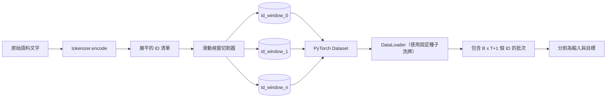
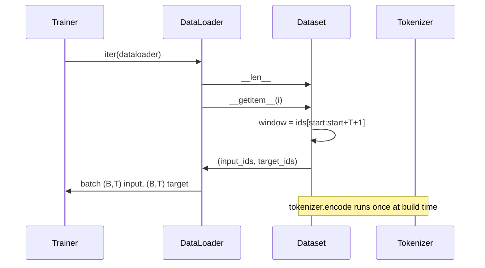

# 帶滑動視窗的 Token 化資料集（Tokenized Dataset with Sliding Window）

> 預訓練本質上是一個將 Token ID 轉化為參數梯度的數學映射。本課將親手打造向模型源源不斷輸送 ID 串流的資料輸送帶。

**Type:** Build
**Languages:** Python
**Prerequisites:** Phase 04 lessons, Phase 07 transformer lessons, Lesson 30 of this phase
**Time:** ~90 minutes

## Learning Objectives｜學習目標
- 透過單次呼叫 tokenizer，將原始文字語料庫全量轉化為連續的 Token ID 串流。
- 使用可配置的重疊步長（Stride），將 ID 串流精確切割為固定長度的滑動視窗。
- 建構標準的 PyTorch Dataset，為 next-token prediction 產出輸入與目標張量對。
- 使用 DataLoader 封裝資料集，並為每個 Epoch 注入鎖定隨機種子的確定性洗牌（Deterministic Shuffle）機制。
- 深刻理解步長大小、資料冗餘度與有效資料集容量之間的工程權衡。

```figure
cap-sliding-window
```

## 架構認知

預訓練運作每次依序讀取一個批次（Batch）的 Token ID 並更新模型權重。每個批次的資料形狀由訓練合約嚴密約束。對於自回歸因果語言模型（Causal LM），該批次包含形狀為 `(B, T)` 的輸入 ID 與形狀同為 `(B, T)` 的目標 ID，其中目標序列即為輸入序列向左平移一位後的結果。資料管線的核心使命，就是從高達數 GB 的原始文字語料中，以完全確定性且可重現的方式按需生成符合該合約的張量資料。

本課將親手打造該資料管線。上一課的 tokenizer 將原始文字轉化為長條扁平的 ID 陣列。滑動視窗切割器將該陣列切分為標準訓練樣本。自定義的 PyTorch Dataset 將每個樣本包裝為張量暴露。最後，DataLoader 依據鎖定的隨機種子對樣本進行分批打包與洗牌。

## 形狀合約

因果語言模型消費形狀為 `(B, T)` 的 ID 張量，其中 `B` 為批次大小（Batch Size），`T` 為上下文長度（Context Length）。在位置 `t` 處的預測目標，即為位置 `t+1` 處的輸入。這意味著每一個標準訓練樣本在底層必須涵蓋連續的 `T+1` 個原始 ID。視窗步長（Stride）則決定了相鄰兩個訓練樣本之間存在多大比例的內容重疊。



視窗切割器絕不跨越語料庫的物理邊界。如果最後一個視窗湊不齊 `T+1` 個 Token，切割器直接將其捨棄。使用 `<|pad|>` 填充末尾同樣是有效的選擇，但這會讓損失函數的遮罩計算變得繁複。在本課的教學實作中，我們選擇直接捨棄殘餘尾部。

## 為何採用滑動視窗

預訓練語料庫是一整條連綿不斷的長長 ID 串流。若模型僅能看見完全無重疊的固定視窗，那麼每個訓練樣本都只會在完全相同的 `T` 處邊界上訓練模型。動態調整滑動步長能讓這些視窗邊界在文字中靈活平移，從而讓模型在更豐富多樣的「預測下一個 Token」情境下學習。

當步長設為 `T` 時，產出完全不重疊的獨立視窗。當步長設為 `T // 2` 時，相鄰視窗存在 50% 的重疊，有效訓練樣本量翻倍。當步長設為 `1` 時，產出最大重疊，樣本量暴增 `T` 倍。代價是每個 Epoch 消耗的算力大幅激增；增益是模型見識到了更豐富的邊界多樣性。在絕大多數超大規模預訓練中，工程師通常直接將步長設為上下文長度 T，因為海量語料本身已遠遠超出模型在單個 Epoch 內能消化的極限，邊界重疊的價值相對稀釋。

## PyTorch Dataset 類別

標準 PyTorch Dataset 必須實作兩個核心方法：`__len__` 回傳總樣本數；`__getitem__` 回傳指定索引的一對張量樣本。我們的 Dataset 內部僅持有編碼後的 ID 陣列與步長整數。索引存取時即時動態計算視窗的起始偏移量，因此無論步長將資料集擴展為多少樣本，其在記憶體中的物理開銷永遠只有一份原始 ID 陣列。



錯位平移操作在 `__getitem__` 內部優雅完成。Dataset 回傳 `(input, target)` 元組，其中 `input = window[:-1]`，`target = window[1:]`。兩者皆為 PyTorch long 整數張量。訓練迴圈將它們直接作為 Ground Truth。

## 確定性洗牌

帶有 `shuffle=True` 的 DataLoader 內部調用 PyTorch 的隨機數生成器。透過在每個 Epoch 顯式傳入一個鎖定隨機種子的 `torch.Generator`，我們能保證每次重啟訓練時資料打散的順序百分之百完全一致。當你需要嚴格對比兩個僅差了一個微小超參數的實驗運作時，該特性至關重要。若缺乏確定性隨機種子，兩次運作看到的資料順序將發生不可控的隨機漂移，導致損失函數曲線因無關雜訊而分道揚鑣。

本課中的種子合約簡明嚴謹：`epoch_seed = base_seed + epoch_index`。基礎種子（Base Seed）在建構時指定；Epoch 索引在每個 Epoch 開始時由訓練器遞增。只要基礎種子相同，多次重複實驗在每個 Epoch 中看到的資料順序保證毫無二致。

## 批次取樣機制

PyTorch 的預設取樣器在不放回抽樣模式下均勻隨機抽取索引。這正是預訓練階段的理想行為。在小資料集上進行 fine-tuning 時，合約完全相同。DataLoader 透過連續調用 `__getitem__` `B` 次並將結果在第 0 維度進行堆疊（Stack）來拼裝批次。由於每個樣本在建構時長度皆嚴格對齊為固定長度，因此完全無需任何動態填充（Padding）邏輯。

本課將 `num_workers=0` 固定設為 0 以求教學簡約。在正式環境中，worker 行程會平行執行 `__getitem__` 呼叫。在我們的記憶體張量切片模式下，這幾乎是零開銷的純切片操作，且相同的 Dataset API 原生相容多行程 Worker。

## 樣本容量精確計算法則

針對長度為 `N` 的 ID 串流、上下文長度為 `T` 以及滑動步長為 `S`，可生成的有效樣本總數計算公式為：`max(0, 1 + (N - (T + 1)) // S)`。本課將該計算以靜態方法形式暴露在 Dataset 上，使訓練器無需遍歷資料集即可瞬間算出單個 Epoch 所需的精確訓練步數。

## 本課邊界

本課未實作基於磁碟的串流讀取。語料庫在記憶體中一次性編碼並作為單一張量持有。對於包含數百萬 Token 的教學語料，其記憶體佔用遠低於 100MB，非常適合本課的教學場景。磁碟串流讀取是一項獨立的基礎設施擴充，未來只需替換底層儲存介面，即可無縫保留相同的 Dataset 呼叫合約。

此外，本課將語料庫視為單一連續的文字串流，未對多篇文件進行特殊的動態封裝。當語料由多篇獨立文件拼接而成時，可在文件交界處插入 `<|endoftext|>` ID，模型將在訓練過程中自然學會跨文件邊界的預測行為。

## 程式碼導讀

`main.py` 定義了兩個核心類別與一個輔助函式：`SlidingWindowDataset` 實作標準 PyTorch Dataset；`make_dataloader` 回傳配置好確定性隨機產生器的 DataLoader；`_encode_corpus_to_ids` 執行單次 tokenizer 編碼。底部演示程式在行程內訓練一個微型 tokenizer、對內建語料進行編碼、建構資料集與資料載入器、印出一個批次，並嚴格斷言輸出合約。`code/tests/test_dataset.py` 單元測試鎖定了視窗計數公式、錯位平移性質、確定性洗牌一致性以及步長權衡。

運作演示程式。嘗試將上下文長度從 16 擴大至 32，親眼觀察每個 Epoch 的有效樣本數量是如何成倍下降的。那個數字，正是你單個 Epoch 的總訓練步數預算。
