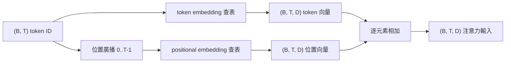
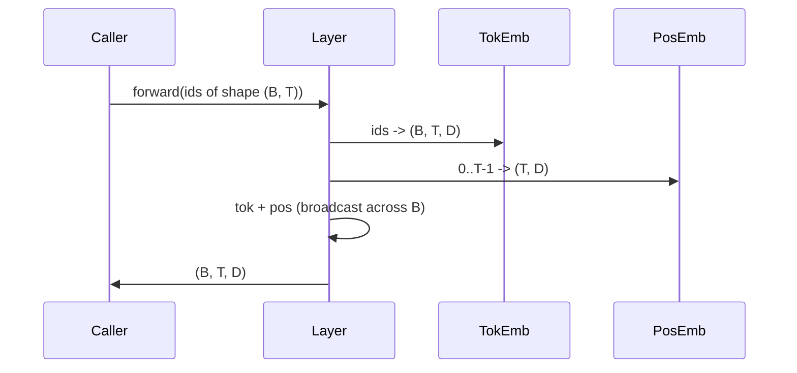

# Token 與位置 embedding（Token and Positional Embeddings）

> Token ID 只是一串整數。模型渴望的是高維向量。兩張查表（Lookup Tables）橫亙在兩者之間，而 positional embedding 的選型會影響模型究竟能學到何種能力。

**Type:** Build
**Languages:** Python
**Prerequisites:** Phase 04 lessons, Phase 07 transformer lessons, Lessons 30 and 31 of this phase
**Time:** ~90 minutes

## Learning Objectives｜學習目標
- 建構將詞彙表 ID 映射至稠密向量的 token embedding 查表矩陣。
- 建構以位置索引起索引的可學習 positional embedding 查表矩陣。
- 建構以位置索引、完全不消耗可學習參數的固定正弦 positional embedding。
- 將 token embedding 與 positional embedding 向量相加，合成 transformer 區塊的標準單一輸入張量。
- 在長度外推泛化能力與參數量維度上，深入對比可學習 positional embedding 與正弦 positional embedding 的本質差異。

```figure
cc-embedding-lookup
```

## 架構認知

模型與一個 Token ID 的第一次接觸，發生在 token embedding 矩陣的行查表（Row Lookup）操作中。該矩陣的行數等於詞彙表大小，列數等於模型隱藏層維度。查表操作回傳一個稠密向量，整個模型將該向量視為該 ID 初始的語義表徵。反向傳播在每一次前向傳播中，精準更新那些被實際命中讀取的矩陣行。隨著訓練的不斷推進，這些行向量在幾何空間中的方向分佈，將逐漸學會精準表達語義相似度。

然而，純粹的 Token ID 本身是完全缺乏順序概念的。模型迫切需要第二種訊號來告訴它：位置 1 與位置 17 不同。針對該訊號，業界最主流的兩大經典選型是：**可學習 positional embedding**（第二張獨立查表，每一行對應一個具體位置索引）與**固定正弦 positional embedding**（完全無需參數的純數學公式）。該選型具有深遠的架構後果：可學習查表需要佔用實體模型參數，且受限於模型預訓練時所設定的最大上下文長度上限；正弦查表在理論上是無參數的，公式可以外推至任意位置，但本課中的 `SinusoidalPositionalEmbedding` 在初始化時預先計算了 `max_context_length` 的固定表格，若 `forward` 超過該界限會拋出異常；因此這兩個模組在此皆施加了最大上下文長度限制。即便查表表格足夠大，模型在面對超出訓練長度的輸入時依然可能表現吃力。

本課將親手實作這兩類 positional embedding，並將它們與 token embedding 結合成下一課注意力區塊所需的標準輸入。

## 形狀合約

embedding 階段接收一個形狀為 `(B, T)` 的 Token ID 批次張量。輸出為一個形狀為 `(B, T, D)` 的高維張量，其中 `D` 為模型隱藏層維度（Model Dimension）。批次中的每一個樣本皆具備完全相同的上下文長度 `T`；序列中的每一個位置皆具備完全相同的向量維度 `D`。



兩者的合成方式採用**逐元素相加（Sum）**，而非拼接（Concatenation）。相加操作能確保向量維度 `D` 在貫穿整套神經網路時維持恆定，並賦予模型足夠的自由度去決定在特定特徵維度上，究竟是 Token 語義佔據主導地位，還是位置順序佔據主導地位。

## Token embedding 矩陣

Token embedding 本質上是一個形狀為 `(V, D)` 的可學習參數張量，其中 `V` 為詞彙表容量大小。PyTorch 將其封裝為 `nn.Embedding(V, D)`。在初始化時，矩陣權重通常以常態分佈隨機採樣，傳統上在 Transformer 規模下設定均值為 0、標準差約為 `0.02`。精確的初始化細節遠不如其在各次運作中維持一致性來得重要。

前向傳播本質上是一次極速的列聚集（Row Gathering）索引操作。PyTorch 將形狀為 `(B, T)` 的 64 位元整數 ID 瞬間映射為形狀為 `(B, T, D)` 的浮點數張量。反向傳播在累積梯度時，嚴格僅作用於在前向傳播中被實際索引到的那些行。在當前批次中從未出現過的 token ID 對應列，在此步更新中接收到的梯度精確為零。

一處精妙的工程細節：在許多現代模型中，輸入端的 token embedding 矩陣與輸出端的線性預測頭（LM Head）往往共享完全相同的權重（權重綁定，Weight Tying）。一旦開啟權重綁定，反向傳播在輸出端將會無差別觸及 embedding 矩陣的每一行。本課將兩者解耦為獨立模組進行清晰演示，但在完整模型中同一個矩陣可同時兼具這兩種角色。

## 可學習位置 embedding

可學習 positional embedding 是第二個獨立的 `nn.Embedding`，形狀為 `(max_context_length, D)`。其查表查詢以位置整數索引 `0, 1, 2, ..., T-1` 作為 Key。前向傳播在取得該位置向量後，自動沿著批次維度進行廣播。

可學習查表的核心致命傷在於：若模型在預訓練時僅設定了 `T-1` 的長度，那麼在推論時將完全無法查詢位置 `T`。因為該行在物理記憶體中根本不存在。正式環境中採用該方案的 decoder-only 模型通常將最大上下文長度硬編碼進架構中，並堅決拒絕處理任何超出該長度的超長輸入。

## 固定正弦 positional embedding

正弦 positional embedding 本質上是一個從位置座標直接映射至向量的純數學確定性函式。針對位置 `p` 與特徵維度 `i`，其生成公式為：

```python
angle = p / (10000 ** (2 * (i // 2) / D))
emb[p, 2k]     = sin(angle)
emb[p, 2k + 1] = cos(angle)
```

該函式完全不依賴任何可學習參數。每一個絕對位置皆擁有全域唯一的專屬向量。波長沿著特徵維度呈幾何級數變化，因此較低維度編碼粗略的位置資訊，較高維度編碼細緻的位置資訊。

結合 `sin` 與 `cos` 所換取的極具美感的數學性質在於：位於位置 `p + k` 處的向量，天然可以表示為位置 `p` 處向量的線性變換函式。這為後續的自注意力機制提供了一條極其順暢的學習途徑，使其能夠輕易掌握相對位置偏移量（Relative-Position Offsets），而無需引入額外參數來刻意表達「向前看 5 個 Token」的概念。

本課在物件初始化構造時一次性算好完整的正弦查表，並在每次前向計算時直接透過切片索引用於運算。

## embedding 合成流程

輸入資料管線依序執行三件事：讀取 Token ID、查表提取 Token 語義向量、疊加位置向量、回傳相加後的張量總和。



相加步驟中的張量廣播自動將形狀為 `(T, D)` 的位置張量複製並鋪滿整個批次維度。PyTorch 在將位置張量透過 unsqueeze 升維為 `(1, T, D)` 後，會自動完成該廣播相加。

## 對比分析

本課在完全相同的輸入資料上同時運作這兩種變體，並在終端機印出兩項核心診斷指標：

第一項是**參數量對比**。可學習變體在 token embedding 之外額外追加了 `max_context_length * D` 個參數開銷；而正弦變體追加的參數開銷精確為零。

第二項是**相鄰位置 embedding 向量之間的餘弦相似度**。正弦變體的相似度呈現平滑且完全可預測的衰減曲線，因為其底層數學函式是連續可導的；而未經訓練的可學習變體在初始化時，相鄰位置之間的相似度幾乎呈現純隨機分佈，因為各行權重皆獨立取樣自高斯分佈。在經歷充分訓練後，可學習 embedding 通常也會自主學出類似的平滑幾何結構，但這完全依賴於它必須從海量資料中自行艱難探索。

## 本課邊界

本課未引入旋轉位置編碼（RoPE）或 ALiBi 機制。這兩者是 production transformer 的現代選擇。它們雖然遵循與本課完全相同的張量維度合約（對形狀為 `(B, T, D)` 的向量套用依位置而定的轉換），但它們作用於注意力投影步驟，而非模型最前端的輸入層。下一節課我們將打造自注意力區塊，並在擴充練習中引導你親手將旋轉編碼整合進 query-key 投影中。

此外，本課不負責訓練 embedding 矩陣。訓練依託於損失函數的反向傳播，而計算損失則必須依賴後續完整的注意力區塊與 LM Head 預測頭。這些模組將在後續課程中逐一揭曉。

## 程式碼導讀

`main.py` 定義了三大核心模組：`TokenEmbedding` 封裝標準的 `nn.Embedding(V, D)`；`LearnedPositionalEmbedding` 封裝位置查表 `nn.Embedding(L, D)`；`SinusoidalPositionalEmbedding` 預先計算正弦表格並作為 Buffer 暫存持有；`EmbeddingComposer` 負責將兩者優雅相加。底部演示程式印出張量形狀、統計參數量，並輸出相鄰位置相似度的客觀診斷指標。`code/tests/test_embeddings.py` 單元測試鎖定了形狀約束、張量廣播行為、參數量統計以及正弦公式的數學精確性。

運作演示程式。嘗試將模型維度 `D` 從 64 調整至 32，親眼觀察終端機中正弦波長頻帶的幾何變化。
